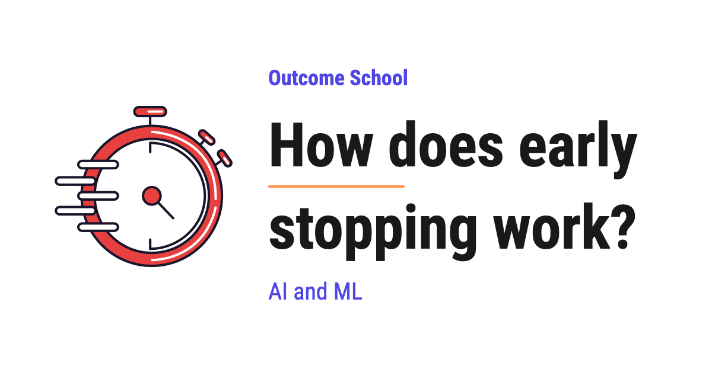

# How does early stopping work?

> Archived from <https://outcomeschool.com/blog/early-stopping> on 2026-11-25.

Early stopping means we watch the validation loss during training and stop the moment the model starts to overfit, instead of training for all the planned epochs.

In this blog, we will learn about how early stopping works. We will also see what overfitting is, how the validation loss tells us when to stop, what a validation-loss plateau is, why early stopping acts as implicit regularization, how patience works in code, and when to use early stopping.

We will cover the following:
<ul><li>What is overfitting?</li><li>What is early stopping?</li><li>How does early stopping work?</li><li>What is a validation-loss plateau?</li><li>Early stopping as implicit regularization</li><li>The algorithm with patience</li><li>A simple code example</li><li>When to use early stopping</li></ul>
I am <strong>Amit Shekhar</strong>, Founder @ <a target="_blank" rel="noopener noreferrer" href="https://outcomeschool.com">Outcome School</a>, I have taught and mentored many developers, and their efforts landed them high-paying tech jobs, helped many tech companies in solving their unique problems, and created many open-source libraries being used by top companies. I am passionate about sharing knowledge through open-source, blogs, and videos.

I teach <a target="_blank" rel="noopener noreferrer" href="https://outcomeschool.com/program/ai-and-machine-learning">AI and Machine Learning</a> at Outcome School.

Let&#x27;s get started.
<h2 id="what-is-overfitting">What is overfitting?</h2>
During training, the model learns in rounds. Each full pass over the training data is called an <strong><a target="_blank" rel="noopener noreferrer" href="epoch-batch-and-iteration.md">epoch</a></strong>. After each epoch, we can measure the <strong>loss</strong>, which tells us how far the model&#x27;s answers are from the correct answers. A lower loss means the model is doing better.

Now, here is a problem that appears during training.

<strong><a target="_blank" rel="noopener noreferrer" href="bias-variance-tradeoff.md">Overfitting</a> means the model memorizes the training examples instead of learning the general pattern.</strong>

Means, the model becomes very good at the exact examples we showed it, but very bad at new examples it has never seen.

Let&#x27;s say a student is preparing for an exam. Suppose the student memorizes the answers to last year&#x27;s question paper word for word, without understanding the subject. In the practice paper, the student scores full marks. But in the real exam, where the questions are new, the student fails.

That student has overfit to the old paper.

Our model can do the same thing. If we train for too long, the model stops learning the real pattern and starts memorizing the training data.

To catch this, we split our data into two parts, as below:

<pre><code class="language-text code-highlight">+-----------------------------------------------------+
|                    All our data                     |
+-----------------------------+-----------------------+
|      Training data          |    Validation data    |
|  (model learns from this)   |  (model is tested on  |
|                             |   this, but never     |
|                             |   learns from it)     |
+-----------------------------+-----------------------+
</code></pre>

Here, we can see that we keep two separate parts. The model learns only from the training data. The validation data is kept aside and is never used for learning. We have a detailed blog on <a target="_blank" rel="noopener noreferrer" href="train-validation-test-split.md">why we split data into train, validation, and test sets</a> that explains this in depth.

So, we measure two losses. The <strong>training loss</strong> tells us how the model does on data it has seen. The <strong>validation loss</strong> tells us how the model does on data it has never seen.
<h2 id="what-is-early-stopping">What is early stopping?</h2>
Now that we understand overfitting, it is time to learn about the solution.

<strong>Early stopping means we stop training the moment the model starts to overfit, instead of training for all the planned epochs.</strong>

Means, we watch the validation loss during training, and we stop at the point where the model is doing its best on new data.

Let&#x27;s say we planned to train for 100 epochs. But the model reaches its best performance on the validation data at epoch 30. After epoch 30, it starts memorizing the training data. Early stopping tells us to stop at epoch 30 and keep that version of the model.
<h2 id="how-does-early-stopping-work">How does early stopping work?</h2>
To understand this, let&#x27;s look at what happens to both losses as training goes on, as below:

<pre><code class="language-text code-highlight">Loss
 ^
 |  \
 |   \                                  Validation loss
 |    \                            ____/
 |     \                      ____/
 |      \____            ____/
 |           \____  ____/
 |                \/  &lt;- lowest validation loss (stop here)
 |
 |   \_____
 |         \_______
 |                 \_____________________  Training loss
 +-------------------------------------------&gt; Epochs
</code></pre>

Here, we can see two lines.

The training loss (the bottom line) keeps going down. The model keeps getting better on the data it has seen.

The validation loss (the top line) goes down at first, reaches a lowest point, and then starts going up again.

That lowest point is the best point. Before it, the model is still learning the real pattern. After it, the model starts memorizing the training data, so it does worse on new data and the validation loss rises.

Early stopping tells us to stop right at that lowest point.

<strong>Planning your move into AI?</strong>

No matter which tech domain you work in today, with your effort, you can transition to these roles:
<ul><li>AI Engineer</li><li>Forward Deployed Engineer</li><li>AI Agent Engineer</li><li>Harness Engineer</li><li>Voice AI Engineer</li><li>AI Architect</li><li>LLM Engineer</li><li>LLM Inference Engineer</li><li>Gen AI Engineer</li><li>MLOps Engineer</li><li>ML Engineer</li><li>Deep Learning Engineer</li></ul>
Our <a target="_blank" rel="noopener noreferrer" href="https://outcomeschool.com/program/ai-and-machine-learning">AI and Machine Learning Program</a> at Outcome School takes you there.
<h2 id="what-is-a-validation-loss-plateau">What is a validation-loss plateau?</h2>
Now, there is one more detail we must understand.

The validation loss does not always drop smoothly. Sometimes it goes down a little, then up a little, then down again.

A <strong>plateau</strong> is when the validation loss stops improving for a while, staying almost flat or slowly getting worse. It means the model is no longer getting better on new data.

Let&#x27;s look at this as below:

<pre><code class="language-text code-highlight">Validation loss
 ^
 |  \
 |   \
 |    \
 |     \___
 |         \___
 |             \____  ___  ___   &lt;- plateau (no more real improvement)
 |                  \/   \/   \
 |
 +-----------------------------------&gt; Epochs
                     |&lt;-- flat --&gt;|
                     no improvement here
</code></pre>

Here, we can see that the loss drops at first. Then it flattens out and moves up and down a little. This flat part is the plateau.

When we see this plateau, it is a signal that more training is unlikely to help on new data, and it often leads to overfitting.

So, early stopping halts on a validation-loss plateau. When the validation loss stops improving, we stop.
<h2 id="early-stopping-as-implicit-regularization">Early stopping as implicit regularization</h2>
Now, let&#x27;s learn about a deeper idea.

First, what is regularization?

<strong><a target="_blank" rel="noopener noreferrer" href="regularization-in-machine-learning.md">Regularization</a> means any technique that stops the model from overfitting, so it works better on new data.</strong>

There are two kinds. <strong>Explicit regularization</strong> is when we add a special rule or penalty into the training on purpose, for example a penalty that keeps the numbers inside the model small.

<strong>Implicit regularization</strong> is when a technique reduces overfitting as a side effect, without us adding any special penalty.

Early stopping is implicit regularization.

Here is why. When we train, the numbers inside the model (called <strong>weights</strong>) often start small and tend to grow larger as the model fits the data more and more tightly. Very large weights are often a sign of a complex, overfit model.

By stopping early, we stop the weights from growing too large. We keep the model in a simpler state.

Let&#x27;s see this idea as below:

<pre><code class="language-text code-highlight">Weight size
 ^
 |                                    _______ large weights
 |                              _____/        (complex, overfit)
 |                        _____/
 |                  _____/
 |            _____/  &lt;- we STOP here (early stopping)
 |       ___/           weights still moderate
 |    __/               (simpler, general)
 |  _/
 +----------------------------------------&gt; Epochs
</code></pre>

Here, we can see that the weights keep growing the longer we train. Early stopping cuts the training off while the weights are still moderate. This keeps the model simple.

So, early stopping does a similar job to a regularization penalty, but we never added any penalty. It happens as a side effect of stopping at the right time. That is why we call it implicit regularization.

<strong>A quick note for you</strong>

No matter which tech domain you work in, get familiar with these topics:
<ul><li>LLM</li><li>RAG</li><li>MCP</li><li>Agent</li><li>Fine-tuning</li><li>Quantization</li></ul>
We put it all together in one video:

<a target="_blank" rel="noopener noreferrer" href="https://www.youtube.com/watch?v=lnfWvX66FUk">AI Engineering Explained: LLM, RAG, MCP, Agent, Fine-Tuning, and Quantization</a>

No need to stop reading - bookmark it and watch later when you get time. Future you will thank you.

Now, let&#x27;s get back to the topic.
<h2 id="the-algorithm-with-patience">The algorithm with patience</h2>
Now, let&#x27;s understand how a computer actually decides when to stop.

We do not want to stop the very first time the validation loss goes up, because it may just be a small bump and then improve again. So, we use an idea called <strong>patience</strong>.

<strong>Patience means the number of epochs we are willing to wait for improvement before we finally stop.</strong>

We give the model a few more chances. If it still does not improve after those chances, we stop.

Here is how the logic works, as below:

<pre><code class="language-text code-highlight">+------------------------------------------------------+
| Keep the best validation loss seen so far            |
| Keep a counter, starting at 0                        |
+------------------------------------------------------+
                        |
                        ↓
        +-------------------------------+
        | After each epoch, check the   |
        | new validation loss           |
        +-------------------------------+
                        |
          +-------------+-------------+
          |                           |
   Loss improved?                Loss did NOT improve?
          |                           |
          ↓                           ↓
 +------------------+       +----------------------+
 | Save this model  |       | counter = counter+1  |
 | as the best.     |       +----------------------+
 | counter = 0      |                 |
 +------------------+                 ↓
                          +-------------------------+
                          | counter &gt;= patience?    |
                          +-------------------------+
                             |                 |
                            Yes                No
                             |                 |
                             ↓                 ↓
                     +------------+    keep training
                     |    STOP    |
                     |  Restore   |
                     | best model |
                     +------------+
</code></pre>

Here, we can see the full logic.

After every epoch, we check the validation loss. If it improved, we save that model as the best one so far, and we reset the counter to zero. If it did not improve, we add one to the counter.

When the counter reaches our patience value, we stop training. Then we restore the best model we had saved, not the last one.

So, patience lets us wait through small bumps but still stop once the plateau is real.
<h2 id="a-simple-code-example">A simple code example</h2>
Now, let&#x27;s see this idea in a short piece of code, as below:

<pre><code class="code-highlight language-python">best_loss = float(&quot;inf&quot;)   # best validation loss so far, start very high
patience = 5               # wait 5 epochs without improvement
counter = 0                # counts epochs with no improvement

for epoch in range(100):
    train_one_epoch()                 # model learns from training data
    val_loss = check_validation()     # measure loss on validation data

    if val_loss &lt; best_loss:
        best_loss = val_loss          # we found a new best
        save_model()                  # save this best version
        counter = 0                   # reset the counter
    else:
        counter = counter + 1         # no improvement this epoch

    if counter &gt;= patience:
        print(&quot;Early stopping now&quot;)
        break                         # stop the training loop

restore_best_model()                  # load the best saved version
</code></pre>

Here, we can see the whole idea. The functions <code>train_one_epoch</code>, <code>check_validation</code>, <code>save_model</code>, and <code>restore_best_model</code> stand for our own training code.

We start <code>best_loss</code> very high, so the first epoch will always beat it. After each epoch, we measure <code>val_loss</code> on the validation data. If it is lower than <code>best_loss</code>, we found a better model, so we save it and reset the <code>counter</code>. If not, we add one to the <code>counter</code>.

When the <code>counter</code> reaches <code>patience</code>, which is 5 here, we <code>break</code> out of the loop. Finally, we call <code>restore_best_model</code> to load the best version we saved, not the last one.

To master Loss Functions, Hyperparameter Tuning, and the full training loop with epochs and batches, check out our <a target="_blank" rel="noopener noreferrer" href="https://outcomeschool.com/program/ai-and-machine-learning">AI and Machine Learning Program</a> at Outcome School.
<h2 id="when-to-use-early-stopping">When to use early stopping</h2>
Now, let&#x27;s understand when early stopping helps us.

Early stopping is useful in most training setups where we have a separate validation set. It saves us time, because we do not train longer than needed. It saves us money, because training uses expensive computing power. And it gives us a better model, because we keep the version that does best on new data.

Let me tabulate the difference between training without and with early stopping for your better understanding.
<table><thead><tr><th>Point</th><th>Without early stopping</th><th>With early stopping</th></tr></thead><tbody><tr><td>Training length</td><td>All planned epochs</td><td>Stops at the best point</td></tr><tr><td>Overfitting risk</td><td>Higher</td><td>Lower</td></tr><tr><td>Final model kept</td><td>The last epoch&#x27;s model</td><td>The best epoch&#x27;s model</td></tr><tr><td>Time and compute</td><td>Wasted after the best point</td><td>Saved</td></tr><tr><td>New-data accuracy</td><td>Often worse</td><td>Often better</td></tr></tbody></table>
Here, we can see that early stopping trains for less time, lowers overfitting, keeps the best model, and often does better on new data.

<strong>Stay updated:</strong> Subscribe to our <a target="_blank" rel="noopener noreferrer" href="https://outcomeschool.substack.com/subscribe">newsletter</a> to get our latest AI and Machine Learning blogs straight to your inbox.
<h2 id="frequently-asked-questions">Frequently Asked Questions</h2><h3 id="why-do-we-restore-the-best-model-instead-of-keeping-the-last-one">Why do we restore the best model instead of keeping the last one?</h3>
Because the last model is usually worse on new data. After the best point, the model starts memorizing the training data, so the validation loss rises. That is why we save the model every time the validation loss improves, and when training stops, we load that best saved version, not the one from the last epoch.
<h3 id="why-dont-we-stop-the-first-time-the-validation-loss-goes-up">Why don&#x27;t we stop the first time the validation loss goes up?</h3>
Because it may just be a small bump. The validation loss does not always drop smoothly, and it can go up a little and then improve again. So, we use patience, which is the number of epochs we are willing to wait for improvement. We stop only when the loss still has not improved after those epochs.
<h3 id="does-early-stopping-need-a-validation-set">Does early stopping need a validation set?</h3>
Yes. Early stopping works by watching the validation loss, which is measured on validation data that the model never learns from. Without that separate data, we cannot tell when the model stops getting better on new data. That is why early stopping is useful in most training setups where we have a separate validation set.
<h3 id="why-does-the-training-loss-keep-going-down-while-the-validation-loss-goes-up">Why does the training loss keep going down while the validation loss goes up?</h3>
Because the model starts memorizing the training data. It keeps getting better on the examples it has seen, so the training loss keeps dropping. But it gets worse on new examples it has never seen, so the validation loss rises. This gap is the sign of overfitting, and it is exactly where early stopping tells us to stop.

That&#x27;s it for now.

Thanks

<strong>Amit Shekhar</strong> Founder @ <a target="_blank" rel="noopener noreferrer" href="https://outcomeschool.com">Outcome School</a>

You can connect with me on:
<ul><li><a target="_blank" rel="noopener noreferrer" href="https://x.com/amitiitbhu">X</a></li><li><a target="_blank" rel="noopener noreferrer" href="https://www.linkedin.com/in/amit-shekhar-iitbhu">LinkedIn</a></li><li><a target="_blank" rel="noopener noreferrer" href="https://github.com/amitshekhariitbhu">GitHub</a></li></ul>
Follow Outcome School on:
<ul><li><a target="_blank" rel="noopener noreferrer" href="https://x.com/outcome_school">X</a></li><li><a target="_blank" rel="noopener noreferrer" href="https://youtube.com/@OutcomeSchool">YouTube</a></li><li><a target="_blank" rel="noopener noreferrer" href="https://www.linkedin.com/company/outcomeschool">LinkedIn</a></li><li><a target="_blank" rel="noopener noreferrer" href="http://github.com/OutcomeSchool">GitHub</a></li></ul>
<a target="_blank" rel="noopener noreferrer" href="https://outcomeschool.com/blog"><strong>Read all of our high-quality blogs here.</strong></a>

