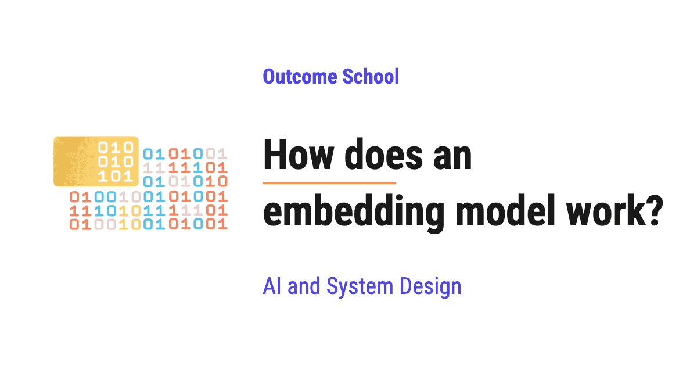

# How does an embedding model work?

> Archived from <https://outcomeschool.com/blog/embedding-model> on 2026-11-25.

An embedding model is a model that turns a piece of text into a list of numbers that captures its meaning. Texts with similar meaning get similar lists of numbers, so a computer can measure how close two meanings are.

In this blog, we will learn about how an embedding model works. We will also see what an embedding actually is, how the model turns text into a list of numbers step by step, how it is trained to place similar meanings close together, how we measure the closeness between two embeddings, where embedding models are used, and where they fail.

We will cover the following:
<ul><li>What is an embedding?</li><li>Understanding meaning as a position on a map</li><li>What is an embedding model?</li><li>How does an embedding model work, step by step?</li><li>How is an embedding model trained?</li><li>How do we measure the similarity between two embeddings?</li><li>A simple example in code</li><li>Embedding model vs LLM</li><li>Where do we use embedding models?</li><li>Limitations of embedding models</li></ul>
I am <strong>Amit Shekhar</strong>, Founder @ <a target="_blank" rel="noopener noreferrer" href="https://outcomeschool.com">Outcome School</a>, I have taught and mentored many developers, and their efforts landed them high-paying tech jobs, helped many tech companies in solving their unique problems, and created many open-source libraries being used by top companies. I am passionate about sharing knowledge through open-source, blogs, and videos.

I teach <a target="_blank" rel="noopener noreferrer" href="https://outcomeschool.com/program/ai-and-machine-learning">AI and Machine Learning</a> at Outcome School.

Let&#x27;s get started.
<h2 id="what-is-an-embedding">What is an embedding?</h2>
<strong>An embedding is a list of numbers that represents the meaning of a piece of text.</strong>

For example, the sentence &quot;I love my puppy&quot; can become a list like below:

<pre><code class="language-text code-highlight">[0.12, -0.45, 0.88, 0.03, -0.27, ..., 0.61]
</code></pre>

This list of numbers is also called a <strong>vector</strong>. A vector is just an ordered list of numbers. The number of items in the list is called its <strong>dimension</strong>. Real embedding models produce lists with a few hundred to a few thousand numbers. For example, a popular small model called <code>all-MiniLM-L6-v2</code> produces a list of 384 numbers for every sentence.

<strong>Note:</strong> A single number in this list does not have a clear human meaning like &quot;this number means animal&quot;. The meaning lives in the whole list together, not in any one number.

Now, the next big question is: how can a list of numbers hold meaning? Let&#x27;s understand this with a map.
<h2 id="understanding-meaning-as-a-position-on-a-map">Understanding meaning as a position on a map</h2>
The best way to learn this is by taking an example.

Suppose we have a big map. On this map, we place words in such a way that words with similar meanings sit close to each other.

<pre><code class="language-text code-highlight">                 ^
                 |    puppy  dog
                 |       cat  kitten
                 |
                 |
                 |                        car   bus
                 |                           truck
                 |
                 |   apple  banana
                 |      mango
                 +-------------------------------------&gt;
</code></pre>

Here, we can see that:
<ul><li>&quot;puppy&quot;, &quot;dog&quot;, &quot;cat&quot;, and &quot;kitten&quot; sit together in one corner, because they are all pets.</li><li>&quot;car&quot;, &quot;bus&quot;, and &quot;truck&quot; sit together in another corner, because they are all vehicles.</li><li>&quot;apple&quot;, &quot;banana&quot;, and &quot;mango&quot; sit together in a third corner, because they are all fruits.</li></ul>
Every word on this map has a position. And a position on a flat map with two directions, which we call a 2D map, is just two numbers: how far to the right, and how far up. So, &quot;dog&quot; can be written as something like <code>[2.0, 9.0]</code> and &quot;truck&quot; as <code>[8.5, 5.0]</code>.

Means, the position itself is the meaning. Two things are similar if their positions are close.

Now, a 2D map has only two directions, which is too few to capture all the shades of meaning in human language. So, a real embedding uses hundreds of directions instead of two. We cannot draw a map with 384 directions, but the idea stays exactly the same: <strong>similar meanings get nearby positions, and different meanings get faraway positions.</strong>

This map of meanings is called the <strong>embedding space</strong>.

We have a detailed blog on <a target="_blank" rel="noopener noreferrer" href="what-are-embeddings.md">What are Embeddings?</a> that explains this in depth.
<h2 id="what-is-an-embedding-model">What is an embedding model?</h2>
<strong>An embedding model is a trained model that takes a piece of text as input and gives its embedding as output.</strong>

The embedding model decides where each text goes on the map of meanings.

<pre><code class="language-text code-highlight"> &quot;I love my puppy&quot;  ---&gt;  [ Embedding Model ]  ---&gt;  [0.12, -0.45, 0.88, ..., 0.61]
     (text)                                            (embedding / vector)
</code></pre>

The input can be a word, a sentence, a paragraph, or even a full page. The output is always a list of the same fixed length. A short sentence and a long paragraph both become, for example, 384 numbers.

This is very useful, because now we can compare any two texts in the same way, no matter how long they are.

Now, let&#x27;s open this box and see what happens inside.
<h2 id="how-does-an-embedding-model-work-step-by-step">How does an embedding model work, step by step?</h2>
Most modern embedding models are built on an architecture called the <strong><a target="_blank" rel="noopener noreferrer" href="decoding-transformer-architecture.md">Transformer</a></strong>. The Transformer reads all the words of a text together and understands how each word relates to the other words. It is the same architecture that powers <a target="_blank" rel="noopener noreferrer" href="large-language-model-llm.md">LLMs (Large Language Models)</a>.

We do not need the full details of the Transformer here. We will just follow the journey of one sentence through the model.

Let&#x27;s take the sentence: &quot;I love my puppy&quot;.

<strong>Step 1:</strong> We break the text into tokens.

First, the model breaks the text into small pieces called <strong><a target="_blank" rel="noopener noreferrer" href="tokenization-in-llms.md">tokens</a></strong>. A token is a word or a part of a word.

<pre><code class="language-text code-highlight">&quot;I love my puppy&quot;  ---&gt;  [&quot;I&quot;, &quot;love&quot;, &quot;my&quot;, &quot;puppy&quot;]
</code></pre>

A rare word can be split into smaller parts. For example, &quot;unbelievable&quot; can become <code>[&quot;un&quot;, &quot;believ&quot;, &quot;able&quot;]</code>. This way, the model can handle any word, even words it has never seen fully.

Each token is then replaced by its ID number from the model&#x27;s fixed list of known tokens, called the <strong>vocabulary</strong>.

<strong>Step 2:</strong> We look up a starting vector for each token.

The model has a big table where every token in its vocabulary has its own starting vector. It looks up each token in this table.

<pre><code class="language-text code-highlight">&quot;I&quot;      ---&gt;  [0.3, -0.1, ...]
&quot;love&quot;   ---&gt;  [0.7,  0.5, ...]
&quot;my&quot;     ---&gt;  [0.2,  0.0, ...]
&quot;puppy&quot;  ---&gt;  [0.9, -0.4, ...]
</code></pre>

At this stage, every token gets the same vector no matter where it appears. The word &quot;bank&quot; gets the same vector in &quot;river bank&quot; and in &quot;bank account&quot;. The model has not yet looked at the surrounding words.

<strong>Step 3:</strong> We let the tokens look at each other.

Now, the Transformer layers come into the picture. Inside these layers, every token looks at every other token in the sentence and updates its own vector based on what it sees. This mechanism is called <strong><a target="_blank" rel="noopener noreferrer" href="self-attention-in-transformers.md">attention</a></strong>.

So, after the Transformer layers, &quot;bank&quot; in &quot;river bank&quot; gets a vector close to water and nature, and &quot;bank&quot; in &quot;bank account&quot; gets a vector close to money. Each token&#x27;s vector now carries the meaning of the token in its context.

<pre><code class="language-text code-highlight">Before:  &quot;bank&quot; ---&gt; same vector everywhere
After:   &quot;river bank&quot;   ---&gt; bank vector near &quot;water&quot;, &quot;shore&quot;
         &quot;bank account&quot; ---&gt; bank vector near &quot;money&quot;, &quot;loan&quot;
</code></pre>

<strong>Planning your move into AI?</strong>

No matter which tech domain you work in today, with your effort, you can transition to these roles:
<ul><li>AI Engineer</li><li>Forward Deployed Engineer</li><li>AI Agent Engineer</li><li>Harness Engineer</li><li>Voice AI Engineer</li><li>AI Architect</li><li>LLM Engineer</li><li>LLM Inference Engineer</li><li>Gen AI Engineer</li><li>MLOps Engineer</li><li>ML Engineer</li><li>Deep Learning Engineer</li></ul>
Our <a target="_blank" rel="noopener noreferrer" href="https://outcomeschool.com/program/ai-and-machine-learning">AI and Machine Learning Program</a> at Outcome School takes you there.

<strong>Step 4:</strong> We combine all token vectors into one vector.

Now, we have one vector for each token. But we want one single vector for the whole sentence. So, the model combines them. This step is called <strong>pooling</strong>.

The most common way is <strong>mean pooling</strong>, which means taking the average of all the token vectors, number by number.

<pre><code class="language-text code-highlight">&quot;I&quot;      ---&gt; [0.2, 0.6]
&quot;love&quot;   ---&gt; [0.8, 0.4]
&quot;my&quot;     ---&gt; [0.1, 0.5]
&quot;puppy&quot;  ---&gt; [0.9, 0.5]
-------------------------
Average  ---&gt; [0.5, 0.5]   &lt;--- one vector for the whole sentence
</code></pre>

Here, for the sake of understanding, we have used only two numbers per token. The first numbers are 0.2, 0.8, 0.1, and 0.9. Their sum is 2.0, and the average is 2.0 / 4 = 0.5. We do the same for the second numbers. Real models do the same thing with hundreds of numbers.

Some models use a different way. They add a special token at the start of the text, often called <code>[CLS]</code>, and use the final vector of only that special token as the summary of the whole sentence. Both ways give us one vector for the full text.

<strong>Step 5:</strong> We normalize the vector.

Finally, many embedding models scale the vector so that its length becomes exactly 1. The length of a vector is how far its point is from the center of the map. This is called <strong>normalization</strong>. It does not change the direction of the vector, it only changes its size.

Why do we do this? Because we care about the direction of the vector, which carries the meaning, and not about its size. Normalization makes comparing two vectors simple and fair.

The full journey looks like below:

<pre><code class="language-text code-highlight">              &quot;I love my puppy&quot;
                      ↓
             [ Step 1: Tokens ]
        (&quot;I&quot;, &quot;love&quot;, &quot;my&quot;, &quot;puppy&quot;)
                      ↓
          [ Step 2: Lookup table ]
       (one starting vector per token)
                      ↓
           [ Step 3: Transformer ]
       (vectors updated using context)
                      ↓
             [ Step 4: Pooling ]
          (average into one vector)
                      ↓
            [ Step 5: Normalize ]
              (length set to 1)
                      ↓
       [0.12, -0.45, 0.88, ..., 0.61]
               (the embedding)
</code></pre>

This is how an embedding model turns text into an embedding.
<h2 id="how-is-an-embedding-model-trained">How is an embedding model trained?</h2>
Now, the question is: how does the model learn to put &quot;I love my puppy&quot; near &quot;I adore my dog&quot;, and far from &quot;The stock market crashed today&quot;?

At the very beginning, all the numbers inside the model are random, so it places texts on the map randomly. In practice, we usually start from a Transformer that has already read a huge amount of text and knows language well. But even that model does not yet place similar sentences close together on the map. Training fixes this.

The most common way to train an embedding model is called <strong><a target="_blank" rel="noopener noreferrer" href="contrastive-learning.md">contrastive learning</a></strong>.

Here, the model learns by contrasting, which means comparing, things that are similar with things that are different.

Let&#x27;s say we have a teacher who shows the model three sentences at a time:
<ul><li><strong>Anchor:</strong> &quot;How do I bake a cake?&quot;</li><li><strong>Positive:</strong> &quot;Steps to make a cake at home&quot; (similar meaning)</li><li><strong>Negative:</strong> &quot;How do I change a car tire?&quot; (different meaning)</li></ul>
The teacher gives the model one rule: <strong>pull the anchor and the positive closer together, and push the anchor and the negative further apart.</strong>

<pre><code class="language-text code-highlight">Before training:                After training:

  cake-question                   cake-question  cake-steps
                tire-question         (close together)
     cake-steps
                                                     tire-question
                                                     (far away)
</code></pre>

The model creates embeddings for all three sentences and checks how close they are. If the positive is not close enough, or the negative is too close, the model gets a penalty. This penalty is called the <strong>loss</strong>. The model&#x27;s parameters then get updated slightly to reduce the loss.

We repeat this for millions of such examples. Slowly, the model learns a map where similar meanings sit together.

Where do these similar pairs come from? They come from data that naturally has pairs of related text, for example:
<ul><li>A question and its answer from a question-and-answer website.</li><li>The title of an article and its first paragraph.</li><li>A search query and the page that people clicked on.</li></ul>
<strong>Note:</strong> We often do not need a hand-picked negative for every example. The model trains on a group of pairs at once, and for each anchor, it treats the positives of all the other pairs in the group as negatives. This trick is called <strong>in-batch negatives</strong>, and it gives a lot of negatives for free.

So, the model is not told what each number means. It only learns from &quot;these two are similar, and these two are not&quot;. The map of meanings appears on its own from this training.

<strong>A quick note for you</strong>

No matter which tech domain you work in, get familiar with these topics:
<ul><li>LLM</li><li>RAG</li><li>MCP</li><li>Agent</li><li>Fine-tuning</li><li>Quantization</li></ul>
We put it all together in one video:

<a target="_blank" rel="noopener noreferrer" href="https://www.youtube.com/watch?v=lnfWvX66FUk">AI Engineering Explained: LLM, RAG, MCP, Agent, Fine-Tuning, and Quantization</a>

No need to stop reading - bookmark it and watch later when you get time. Future you will thank you.

Now, let&#x27;s get back to the topic.
<h2 id="how-do-we-measure-the-similarity-between-two-embeddings">How do we measure the similarity between two embeddings?</h2>
Now, we have embeddings. The next big question is: how do we find how close two embeddings are?

The most popular way is <strong><a target="_blank" rel="noopener noreferrer" href="cosine-similarity.md">cosine similarity</a></strong>. It measures the angle between two vectors.

Let&#x27;s say each embedding is an arrow starting from the center of the map.
<ul><li>If two arrows point in the same direction, the meanings are similar. The cosine similarity is close to 1.</li><li>If two arrows point at a right angle, the meanings are unrelated. The cosine similarity is close to 0.</li><li>If two arrows point in opposite directions, the cosine similarity is close to -1.</li></ul>
When the vectors are normalized to length 1, cosine similarity becomes the same as a simple calculation called the <strong>dot product</strong>. The dot product means multiplying the matching numbers of the two lists and adding the results.

Let&#x27;s see a small example with two-number vectors:

<pre><code class="language-text code-highlight">A = [0.6, 0.8]
B = [0.8, 0.6]

Dot product = (0.6 x 0.8) + (0.8 x 0.6)
            = 0.48 + 0.48
            = 0.96
</code></pre>

Both vectors have length 1, and the result is 0.96, which is very close to 1. So, A and B have very similar meanings.
<h2 id="a-simple-example-in-code">A simple example in code</h2>
Now, let&#x27;s see the code for using an embedding model. We will use the <code>sentence-transformers</code> library in Python.

<pre><code class="code-highlight language-python">from sentence_transformers import SentenceTransformer, util

model = SentenceTransformer(&quot;all-MiniLM-L6-v2&quot;)

sentences = [
    &quot;I love my puppy&quot;,
    &quot;I adore my dog&quot;,
    &quot;The stock market crashed today&quot;,
]

embeddings = model.encode(sentences)
print(embeddings.shape)

scores = util.cos_sim(embeddings[0], embeddings[1:])
print(scores)
</code></pre>

Here, we have done the following:
<ul><li>We loaded a small embedding model called <code>all-MiniLM-L6-v2</code>.</li><li>We gave it three sentences.</li><li><code>model.encode</code> turned each sentence into an embedding. The shape will be <code>(3, 384)</code>, which means 3 sentences, each with 384 numbers.</li><li><code>util.cos_sim</code> measured the cosine similarity between the first sentence and the other two.</li></ul>
When we run this, the score between &quot;I love my puppy&quot; and &quot;I adore my dog&quot; will be high, and the score between &quot;I love my puppy&quot; and &quot;The stock market crashed today&quot; will be much lower. The exact numbers depend on the model, but the pattern stays the same.

It works perfectly. The first two sentences get a high score, even though they use different words.

<strong>Stay updated:</strong> Subscribe to our <a target="_blank" rel="noopener noreferrer" href="https://outcomeschool.substack.com/subscribe">newsletter</a> to get our latest AI and Machine Learning blogs straight to your inbox.
<h2 id="embedding-model-vs-llm">Embedding model vs LLM</h2>
Many people get confused between an embedding model and an LLM, because both are built on the Transformer. Let me tabulate the differences between an embedding model and an LLM for your better understanding.
<table><thead><tr><th>Point</th><th>Embedding Model</th><th>LLM</th></tr></thead><tbody><tr><td>Input</td><td>Text</td><td>Text</td></tr><tr><td>Output</td><td>A fixed list of numbers</td><td>New text, one token at a time</td></tr><tr><td>Main job</td><td>Understand and compare meaning</td><td>Generate answers and content</td></tr><tr><td>Size</td><td>Usually small and fast</td><td>Usually large and slower</td></tr><tr><td>Cost per use</td><td>Very low</td><td>Higher</td></tr><tr><td>Example use</td><td>Search, matching, grouping</td><td>Chat, writing, reasoning</td></tr></tbody></table>
They often work together, as we will see next.
<h2 id="where-do-we-use-embedding-models">Where do we use embedding models?</h2>
Let&#x27;s see the most common use cases.
<ul><li><strong><a target="_blank" rel="noopener noreferrer" href="how-does-semantic-search-work.md">Semantic search</a>:</strong> Search by meaning instead of exact words. If we search &quot;cheap phone&quot;, we can also find a product described as &quot;budget smartphone&quot;.</li><li><strong><a target="_blank" rel="noopener noreferrer" href="retrieval-augmented-generation-rag.md">RAG (Retrieval-Augmented Generation)</a>:</strong> Before an LLM answers a question, we use embeddings to find the most relevant documents from our own data, and give them to the LLM. This way, the LLM can answer using our private documents.</li><li><strong><a target="_blank" rel="noopener noreferrer" href="recommendation-system.md">Recommendations</a>:</strong> Suggest articles, songs, or products that are close in meaning to what a user already liked.</li><li><strong>Clustering:</strong> Group thousands of customer reviews into topics automatically, because similar reviews land close together on the map.</li><li><strong>Duplicate detection:</strong> Find two support tickets that ask the same thing in different words.</li></ul>
The common flow in semantic search and RAG looks like below:

<pre><code class="language-text code-highlight">Step A (once):
    All documents ---&gt; Embedding Model ---&gt; Store vectors in a database

Step B (each query):
    User question ---&gt; Embedding Model ---&gt; Query vector
                                                  ↓
                        Find the closest stored vectors (highest similarity)
                                                  ↓
                                    Return the matching documents
</code></pre>

Here, we embed all our documents only once and store the vectors in a <strong><a target="_blank" rel="noopener noreferrer" href="how-does-a-vector-database-work.md">vector database</a></strong>, which is a database built for storing and searching vectors. Then, for every question, we embed only the question and <a target="_blank" rel="noopener noreferrer" href="how-does-approximate-nearest-neighbor-ann-search-work.md">find the nearest documents</a>. This is very fast.

If we want to go deep into Embeddings, RAG, and Vector Databases, and even build an AI Tutor from scratch, we cover all of it in our <a target="_blank" rel="noopener noreferrer" href="https://outcomeschool.com/program/ai-and-machine-learning">AI and Machine Learning Program</a> at Outcome School.
<h2 id="limitations-of-embedding-models">Limitations of embedding models</h2>
Embedding models are powerful, but they have some limits that we must know.
<ul><li><strong>Fixed input length:</strong> Every model can read only a limited number of tokens at a time. Very long text gets cut off, so we usually <a target="_blank" rel="noopener noreferrer" href="chunking-strategies-for-rag.md">split long documents into smaller chunks</a> first.</li><li><strong>Different models, different maps:</strong> Embeddings from one model cannot be compared with embeddings from another model. Each model builds its own map. If we change the model, we must re-embed all our data.</li><li><strong>Similar is not always correct:</strong> &quot;The movie was good&quot; and &quot;The movie was not good&quot; can still land fairly close, because they share most words and the same topic. Embeddings capture topic very well, but they can miss small details like &quot;not&quot;.</li><li><strong>Domain knowledge:</strong> A general model can perform poorly on very special text like medical or legal documents. In that case, we use a model trained on that kind of text, or we <a target="_blank" rel="noopener noreferrer" href="how-does-fine-tuning-work.md">fine-tune</a> one, which means we train a general model a little more on our own special text.</li></ul>
Now, we must have understood how an embedding model works.
<h2 id="frequently-asked-questions">Frequently Asked Questions</h2><h3 id="can-we-compare-embeddings-from-two-different-embedding-models">Can we compare embeddings from two different embedding models?</h3>
No. Embeddings from one model cannot be compared with embeddings from another model, because each model builds its own map of meanings. If we change the embedding model, we must re-embed all our data with the new model so that every vector lives on the same map.
<h3 id="do-a-short-sentence-and-a-long-paragraph-get-embeddings-of-the-same-size">Do a short sentence and a long paragraph get embeddings of the same size?</h3>
Yes. An embedding model always gives a list of the same fixed length, no matter how long the input is. For example, <code>all-MiniLM-L6-v2</code> turns both a short sentence and a long paragraph into 384 numbers. This is why we can compare any two texts in the same way.
<h3 id="does-a-single-number-in-an-embedding-have-a-meaning">Does a single number in an embedding have a meaning?</h3>
No. A single number in an embedding does not have a clear human meaning like &quot;this number means animal&quot;. The meaning lives in the whole list together. The model is never told what each number means; it only learns which texts are similar and which are not, and the map of meanings appears from that training.
<h3 id="can-an-embedding-model-understand-negation-like-not">Can an embedding model understand negation like &quot;not&quot;?</h3>
Not always. &quot;The movie was good&quot; and &quot;The movie was not good&quot; can still land fairly close, because they share most words and the same topic. Embeddings capture the topic very well, but they can miss small details like &quot;not&quot;, so similar is not always correct.

That&#x27;s it for now.

Thanks

<strong>Amit Shekhar</strong> Founder @ <a target="_blank" rel="noopener noreferrer" href="https://outcomeschool.com">Outcome School</a>

You can connect with me on:
<ul><li><a target="_blank" rel="noopener noreferrer" href="https://x.com/amitiitbhu">X</a></li><li><a target="_blank" rel="noopener noreferrer" href="https://www.linkedin.com/in/amit-shekhar-iitbhu">LinkedIn</a></li><li><a target="_blank" rel="noopener noreferrer" href="https://github.com/amitshekhariitbhu">GitHub</a></li></ul>
Follow Outcome School on:
<ul><li><a target="_blank" rel="noopener noreferrer" href="https://x.com/outcome_school">X</a></li><li><a target="_blank" rel="noopener noreferrer" href="https://youtube.com/@OutcomeSchool">YouTube</a></li><li><a target="_blank" rel="noopener noreferrer" href="https://www.linkedin.com/company/outcomeschool">LinkedIn</a></li><li><a target="_blank" rel="noopener noreferrer" href="http://github.com/OutcomeSchool">GitHub</a></li></ul>
<a target="_blank" rel="noopener noreferrer" href="https://outcomeschool.com/blog"><strong>Read all of our high-quality blogs here.</strong></a>

