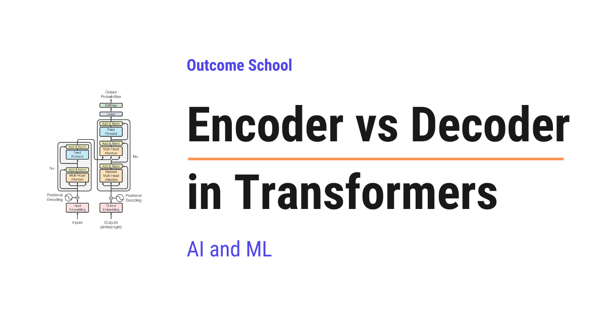

# Encoder vs Decoder in Transformers

> Archived from <https://outcomeschool.com/blog/encoder-vs-decoder-in-transformers> on 2026-11-25.

In Transformers, the Encoder reads the whole input at once, in both directions, to understand it. The Decoder generates the output one token at a time, and it can look only backward.

In this blog, we will learn about Encoder vs Decoder in Transformers, the two building blocks behind almost every modern AI model that works with language. We will also see how the Encoder and the Decoder differ from each other, how each one works with simple examples, why one of them reads in both directions while the other one looks only backward, what the three types of Transformers are, and when to use which one.

We will cover the following:
<ul><li>What is a Transformer?</li><li>A word about tokens</li><li>What is an Encoder?</li><li>What is a Decoder?</li><li>The one big difference</li><li>The three types of Transformers</li><li>Let&#x27;s tabulate the difference</li><li>When to use which one?</li><li>Summary</li></ul>
I am <strong>Amit Shekhar</strong>, Founder @ <a target="_blank" rel="noopener noreferrer" href="https://outcomeschool.com">Outcome School</a>, I have taught and mentored many developers, and their efforts landed them high-paying tech jobs, helped many tech companies in solving their unique problems, and created many open-source libraries being used by top companies. I am passionate about sharing knowledge through open-source, blogs, and videos.

I teach <a target="_blank" rel="noopener noreferrer" href="https://outcomeschool.com/program/ai-and-machine-learning">AI and Machine Learning</a> at Outcome School.

Let&#x27;s get started.
<h2 id="what-is-a-transformer">What is a Transformer?</h2>
Before jumping into Encoder and Decoder, we must know what a Transformer is.

<strong>A Transformer is the architecture behind most modern AI models that work with language.</strong> The AI tools we use today, like ChatGPT, Claude, and Gemini, are all built using the <a target="_blank" rel="noopener noreferrer" href="decoding-transformer-architecture.md">Transformer architecture</a>.

The Transformer became famous because it is very good at understanding the relationship between words. It can look at a sentence and figure out how each word connects to the other words. This is what makes it so powerful with language.

Now, a Transformer is built from two main building blocks. One block is called the Encoder, and the other block is called the Decoder. In this blog, we will understand both of them and see how they differ.

Before that, we need to understand one small word, the token.
<h2 id="a-word-about-tokens">A word about tokens</h2>
When a Transformer reads text, it does not read whole sentences at once. It breaks the text into small pieces. Each small piece is called a token.

A token is usually a word or a part of a word. For the sake of understanding, we can just think of a token as a word.

So, the sentence &quot;I love AI&quot; becomes three tokens: &quot;I&quot;, &quot;love&quot;, and &quot;AI&quot;. The Transformer works on these tokens.

The exact rule for splitting the text into tokens comes from a <a target="_blank" rel="noopener noreferrer" href="tokenization-in-llms.md">tokenization</a> algorithm. We have a detailed blog on <a target="_blank" rel="noopener noreferrer" href="bpe-in-llms.md">Byte Pair Encoding in LLMs</a> that explains how this works.

<strong>Planning your move into AI?</strong>

No matter which tech domain you work in today, with your effort, you can transition to these roles:
<ul><li>AI Engineer</li><li>Forward Deployed Engineer</li><li>AI Agent Engineer</li><li>Harness Engineer</li><li>Voice AI Engineer</li><li>AI Architect</li><li>LLM Engineer</li><li>LLM Inference Engineer</li><li>Gen AI Engineer</li><li>MLOps Engineer</li><li>ML Engineer</li><li>Deep Learning Engineer</li></ul>
Our <a target="_blank" rel="noopener noreferrer" href="https://outcomeschool.com/program/ai-and-machine-learning">AI and Machine Learning Program</a> at Outcome School takes you there.

Now that we know about tokens, let&#x27;s understand the Encoder.
<h2 id="what-is-an-encoder">What is an Encoder?</h2>
<strong>The Encoder reads the whole input and builds a deep understanding of it.</strong>

In simple words, the job of the Encoder is to understand. It takes all the tokens of the input, looks at them together, and creates a rich meaning for each token.

Here is the most important point about the Encoder. It can look at all the tokens at the same time, both to the left and to the right of any word. It reads the whole sentence at once. This is why we say the Encoder looks in both directions.

Let&#x27;s understand why both directions matter. Consider the sentence, &quot;The bank of the river was muddy.&quot; Here, the word &quot;bank&quot; is confusing. It could mean a money bank or the side of a river. To understand it correctly, we must read the word &quot;river&quot; that comes later. The Encoder can do this, because it reads the full sentence at once and looks in both directions.

We can picture the Encoder like below:

<pre><code class="code-highlight">   Input tokens:   [The]  [bank]  [of]  [the]  [river]  [was]  [muddy]

                     Every token looks at ALL other tokens
                      (both left and right, all at once)

                                    |
                                    v
   Output:   a deep understanding (meaning) for each token
</code></pre>

Here, we can see that each token is allowed to look at every other token in the sentence. This looking at each other is done by a mechanism called <a target="_blank" rel="noopener noreferrer" href="self-attention-in-transformers.md">Self Attention</a>. Because of this, the Encoder understands the full meaning very well.

So, the Encoder is like a careful reader. It reads the whole thing first and understands it deeply. It does not write anything new. It only understands.

To learn the Attention Mechanism, Self-Attention, and Transformer Architecture in depth, check out our <a target="_blank" rel="noopener noreferrer" href="https://outcomeschool.com/program/ai-and-machine-learning">AI and Machine Learning Program</a> at Outcome School.
<h2 id="what-is-a-decoder">What is a Decoder?</h2>
Now that we have learned about the Encoder, it&#x27;s time to learn about the Decoder.

<strong>The Decoder generates the output, one token at a time.</strong>

In simple words, the job of the Decoder is to write. It produces the answer token by token, from left to right, just like we write a sentence word by word.

Here is the most important point about the Decoder. While writing, it can only look at the tokens that came before. It cannot look at the future tokens, because those tokens are not written yet. This makes sense. When we write a sentence, we do not know the next word until we write it. Inside the model, this is enforced by a <a target="_blank" rel="noopener noreferrer" href="causal-masking-in-attention.md">causal mask</a> that hides the future tokens.

Let&#x27;s understand this with an example. Suppose the Decoder is writing &quot;The sky is blue&quot;. When it is about to write &quot;blue&quot;, it can look at &quot;The&quot;, &quot;sky&quot;, and &quot;is&quot;. But it cannot look at &quot;blue&quot; itself, because that is the word it is trying to guess right now.

We can picture the Decoder like below:

<pre><code class="code-highlight">   Step 1:  &lt;start&gt;                 -&gt;  predict next  -&gt;  &quot;The&quot;
   Step 2:  &lt;start&gt; The             -&gt;  predict next  -&gt;  &quot;sky&quot;
   Step 3:  &lt;start&gt; The sky         -&gt;  predict next  -&gt;  &quot;is&quot;
   Step 4:  &lt;start&gt; The sky is      -&gt;  predict next  -&gt;  &quot;blue&quot;

   (each step can only look back at the words already written)
</code></pre>

Here, we can see that the Decoder builds the sentence one word at a time, always looking only at the words behind it.

So, the Decoder is like a writer. It creates new text step by step, using only what it has written so far. This way of generating, where each new token depends on the tokens that came before it, is what makes it an <a target="_blank" rel="noopener noreferrer" href="autoregressive-models.md">autoregressive model</a>.
<h2 id="the-one-big-difference">The one big difference</h2>
If we forget everything else, we must remember this one line.
<blockquote>
The Encoder reads and understands the whole input at once. The Decoder writes new output one token at a time, looking only at the past.
</blockquote>
That is the heart of the difference. The Encoder is a reader that looks in both directions. The Decoder is a writer that looks only backward.

<strong>A quick note for you</strong>

No matter which tech domain you work in, get familiar with these topics:
<ul><li>LLM</li><li>RAG</li><li>MCP</li><li>Agent</li><li>Fine-tuning</li><li>Quantization</li></ul>
We put it all together in one video:

<a target="_blank" rel="noopener noreferrer" href="https://www.youtube.com/watch?v=lnfWvX66FUk">AI Engineering Explained: LLM, RAG, MCP, Agent, Fine-Tuning, and Quantization</a>

No need to stop reading - bookmark it and watch later when you get time. Future you will thank you.

Now, let&#x27;s get back to the topic.
<h2 id="the-three-types-of-transformers">The three types of Transformers</h2>
Now, here is something interesting. We can build a Transformer using only the Encoder, only the Decoder, or both together. This gives us three types of Transformers, and each one is good for a different job.

Let&#x27;s understand all three.

<strong>1. Encoder-only:</strong> This uses only the Encoder. Its job is pure understanding. It is great for tasks like deciding if a review is positive or negative, or turning text into <a target="_blank" rel="noopener noreferrer" href="what-are-embeddings.md">embeddings</a> for search. A famous example is a model called BERT.

<strong>2. Decoder-only:</strong> This uses only the Decoder. Its job is pure generation. It writes text one token at a time. <a target="_blank" rel="noopener noreferrer" href="evolution-of-llm-architecture.md">Most modern chat AI models are decoder-only</a>, like the models behind ChatGPT, Claude, and Gemini.

<strong>3. Encoder-Decoder:</strong> This uses both blocks together. The Encoder first reads and understands the input. Then the Decoder writes the output based on that understanding. This is great for tasks where we take one full text and turn it into another, like translating a sentence from English to French. A famous example is a model called T5.

We can picture the three types like below:

<pre><code class="code-highlight">   Encoder-only        Decoder-only        Encoder-Decoder
   ------------        ------------        ---------------
   Encoder             Decoder             Encoder + Decoder
       |                   |                   |
       v                   v                   v
   understand          generate            understand, then
   the input           the output          generate
       |                   |                   |
       v                   v                   v
   (BERT)              (ChatGPT)           (T5)
</code></pre>

Here, we can see the three types at a glance. The Encoder-only type only understands. The Decoder-only type only generates. The Encoder-Decoder type first understands and then generates.

That pure understanding is what makes the Encoder-only type a great fit for search. We have a detailed blog on <a target="_blank" rel="noopener noreferrer" href="decoding-colbert.md">Decoding ColBERT</a> that explains how a BERT encoder is turned into a fast, word-level retrieval model.

Let&#x27;s understand the Encoder-Decoder flow with a translation example like below:

<pre><code class="code-highlight">   English input: &quot;I love AI&quot;
          |
          v
   +---------------+
   |    Encoder    |   reads and understands the full English sentence
   +---------------+
          |
          |  passes the understanding to the Decoder
          v
   +---------------+
   |    Decoder    |   writes the French output, one token at a time
   +---------------+
          |
          v
   French output: &quot;J&#x27;aime l&#x27;IA&quot;
</code></pre>

Here, we can see the teamwork. The Encoder understands the English sentence fully. Then the Decoder uses that understanding to write the French sentence step by step. The bridge that carries this understanding from the Encoder into the Decoder is <a target="_blank" rel="noopener noreferrer" href="cross-attention-in-transformers.md">Cross Attention</a>.

To master the Encoder-Decoder Architecture, Cross Attention, and LLM Internals, and build a Large Language Model (LLM) from scratch, check out our <a target="_blank" rel="noopener noreferrer" href="https://outcomeschool.com/program/ai-and-machine-learning">AI and Machine Learning Program</a> at Outcome School.
<h2 id="lets-tabulate-the-difference">Let&#x27;s tabulate the difference</h2>
Let me tabulate the differences between the Encoder and the Decoder for your better understanding.
<table><thead><tr><th>Point</th><th>Encoder</th><th>Decoder</th></tr></thead><tbody><tr><td>Main job</td><td>Understand the input</td><td>Generate the output</td></tr><tr><td>How it reads</td><td>Looks at all tokens at once</td><td>Writes one token at a time</td></tr><tr><td>Direction</td><td>Both directions (left and right)</td><td>Only backward (past tokens)</td></tr><tr><td>Good for</td><td>Understanding tasks</td><td>Writing tasks</td></tr><tr><td>Example model</td><td>BERT</td><td>The models behind ChatGPT, Claude</td></tr></tbody></table><h2 id="when-to-use-which-one">When to use which one?</h2>
This is the real question. Let&#x27;s make it very simple.

The trick is to look at the task we want to solve.
<ul><li>If our task is to understand text, like sorting reviews or searching, we use an Encoder-only model.</li><li>If our task is to generate text, like chatting or writing, we use a Decoder-only model.</li><li>If our task is to take one full text and turn it into another, like translation or summarization, we use an Encoder-Decoder model.</li></ul>
So, we must always ask ourselves: do we want to understand, to generate, or to convert one text into another? The answer decides which one to use.

<strong>Note:</strong> Today, most popular chat AI models are decoder-only. This is because a good writer must also understand well, and it turns out that a large Decoder learns to do both understanding and writing at the same time. This is why decoder-only models power most of the AI chat tools we use today.

<strong>Stay updated:</strong> Subscribe to our <a target="_blank" rel="noopener noreferrer" href="https://outcomeschool.substack.com/subscribe">newsletter</a> to get our latest AI and Machine Learning blogs straight to your inbox.
<h2 id="summary">Summary</h2>
Let&#x27;s quickly recap what we have learned.
<ul><li>A Transformer is the architecture behind most modern language AI, and it is built from two blocks: the Encoder and the Decoder.</li><li>The Encoder reads the whole input at once and understands it deeply, looking in both directions.</li><li>The Decoder writes the output one token at a time, looking only at the past tokens.</li><li>We can build three types: Encoder-only for understanding, Decoder-only for generation, and Encoder-Decoder for converting one text into another.</li><li>Most modern chat AI models today are decoder-only.</li></ul>
This is how the Encoder and the Decoder work as the two building blocks of a Transformer.

Now, we must have understood Encoder vs Decoder in Transformers.
<h2 id="frequently-asked-questions">Frequently Asked Questions</h2><h3 id="is-chatgpt-an-encoder-model-or-a-decoder-model">Is ChatGPT an encoder model or a decoder model?</h3>
ChatGPT is built on a decoder-only model. Most modern chat AI models, like the models behind ChatGPT, Claude, and Gemini, are decoder-only. Their job is pure generation, writing text one token at a time while looking only at the tokens that came before.
<h3 id="why-are-most-chat-models-decoder-only-if-they-also-need-to-understand-text">Why are most chat models decoder-only if they also need to understand text?</h3>
A good writer must also understand well, and a large Decoder learns to do both understanding and writing at the same time. This is why decoder-only models power most of the AI chat tools we use today.
<h3 id="can-bert-be-used-to-generate-text-like-chatgpt">Can BERT be used to generate text like ChatGPT?</h3>
No. BERT is an Encoder-only model, and its job is pure understanding. It does not write anything new. It is great for tasks like deciding if a review is positive or negative, or turning text into embeddings for search.
<h3 id="how-does-the-decoder-use-what-the-encoder-understood">How does the Decoder use what the Encoder understood?</h3>
The Decoder uses Cross Attention. In an Encoder-Decoder model, the Encoder first reads and understands the full input. Cross Attention is the bridge that carries this understanding into the Decoder, which then writes the output one token at a time, like a French translation of an English sentence.

That&#x27;s it for now.

Thanks

<strong>Amit Shekhar</strong> Founder @ <a target="_blank" rel="noopener noreferrer" href="https://outcomeschool.com">Outcome School</a>

You can connect with me on:
<ul><li><a target="_blank" rel="noopener noreferrer" href="https://x.com/amitiitbhu">X</a></li><li><a target="_blank" rel="noopener noreferrer" href="https://www.linkedin.com/in/amit-shekhar-iitbhu">LinkedIn</a></li><li><a target="_blank" rel="noopener noreferrer" href="https://github.com/amitshekhariitbhu">GitHub</a></li></ul>
Follow Outcome School on:
<ul><li><a target="_blank" rel="noopener noreferrer" href="https://x.com/outcome_school">X</a></li><li><a target="_blank" rel="noopener noreferrer" href="https://youtube.com/@OutcomeSchool">YouTube</a></li><li><a target="_blank" rel="noopener noreferrer" href="https://www.linkedin.com/company/outcomeschool">LinkedIn</a></li><li><a target="_blank" rel="noopener noreferrer" href="https://github.com/OutcomeSchool">GitHub</a></li></ul>
<a target="_blank" rel="noopener noreferrer" href="https://outcomeschool.com/blog"><strong>Read all of our high-quality blogs here.</strong></a>

