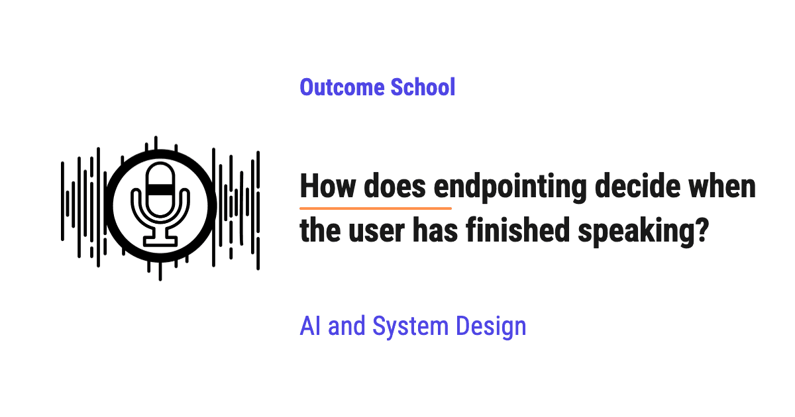

# How does endpointing decide when the user has finished speaking?

> Archived from <https://outcomeschool.com/blog/endpointing-in-voice-agents> on 2026-11-25.

Endpointing is the part of a voice assistant that decides when the user has finished speaking, so that the assistant knows when to stop listening and start replying. It does this by watching for silence, listening to how the user speaks, and reading what the user has said so far.

In this blog, we will learn about how endpointing decides when the user has finished speaking. We will also see why this decision is so hard, how a simple silence timer works, how voice activity detection finds speech and silence, how the words and the tone of the voice help, how all these signals come together, and how a real voice assistant balances speed with not cutting off the user.

We will cover the following:
<ul><li>What is Endpointing?</li><li>Why is Endpointing Hard?</li><li>Approach 1: Fixed Silence Timer</li><li>How Voice Activity Detection Works</li><li>Approach 2: Reading the Words</li><li>Approach 3: Listening to the Voice</li><li>Approach 4: Combining All the Signals</li><li>Waiting Too Long vs Cutting Off Too Early</li><li>Extra Steps Around the Endpoint</li></ul>
I am <strong>Amit Shekhar</strong>, Founder @ <a target="_blank" rel="noopener noreferrer" href="https://outcomeschool.com">Outcome School</a>, I have taught and mentored many developers, and their efforts landed them high-paying tech jobs, helped many tech companies in solving their unique problems, and created many open-source libraries being used by top companies. I am passionate about sharing knowledge through open-source, blogs, and videos.

I teach <a target="_blank" rel="noopener noreferrer" href="https://outcomeschool.com/program/ai-and-machine-learning">AI and Machine Learning</a> at Outcome School.

Let&#x27;s get started.
<h2 id="what-is-endpointing">What is Endpointing?</h2>
<strong>Endpointing is the process of detecting the point in time where the user has finished their turn of speaking.</strong>

A voice assistant listens to us through the microphone. At some moment, it has to say to itself: &quot;The user is done. Now it is my turn to speak.&quot;

That moment is the endpoint. Endpointing is also called <strong>end-of-turn detection</strong> or <strong>turn detection</strong>.

Endpointing is one part of a bigger job called turn-taking. We have a detailed blog on <a target="_blank" rel="noopener noreferrer" href="what-is-turn-taking-in-a-voice-ai-agent.md">turn-taking in a voice AI agent</a> that explains how the agent decides whose turn it is to speak.

Let&#x27;s say we ask a voice assistant: &quot;What is the weather in Delhi today?&quot;

The flow looks like below:

<pre><code class="code-highlight">User speaks: &quot;What is the weather in Delhi today?&quot;
                       ↓
Endpointing decides: the user has finished
                       ↓
Speech recognition gives the final text
                       ↓
The AI model writes the answer
                       ↓
Text-to-speech speaks the answer
</code></pre>

Here, we can see that the assistant normally does not start its reply until the endpoint is decided. If endpointing is slow, the whole reply is slow. If endpointing is wrong, the assistant replies to half a sentence.
<h2 id="why-is-endpointing-hard">Why is Endpointing Hard?</h2>
When we talk to another person, we usually know when they have finished, often even before they stop. Studies of human conversation show that the gap between two speakers is often only around 200 milliseconds. For a machine, matching this is not easy.

The main problem is that <strong>silence does not always mean the end</strong>.

Humans pause in the middle of a sentence all the time. Let&#x27;s say a user says:

&quot;I want to book a flight to... umm... Mumbai.&quot;

Here, there is a <a target="_blank" rel="noopener noreferrer" href="long-pauses-in-voice-agents.md">long pause</a> after &quot;to&quot;. If the assistant treats this pause as the end, it will reply to &quot;I want to book a flight to&quot;, which is an incomplete request. The user gets cut off.

Now, consider the opposite case. The user says:

&quot;Yes.&quot;

And then stops. Here, the user has clearly finished. If the assistant keeps waiting for more, the user feels that the assistant is slow.

So, endpointing has to solve two problems at the same time:
<ul><li>Do not <a target="_blank" rel="noopener noreferrer" href="voice-agents-cutting-users-off.md">cut off the user in the middle of a thought</a>.</li><li>Do not make the user wait after they have finished.</li></ul>
These two goals pull in opposite directions. The best way to learn how endpointing handles this is by looking at the approaches one by one, from the simplest to the most advanced.
<h2 id="approach-1-fixed-silence-timer">Approach 1: Fixed Silence Timer</h2>
The simplest way to do endpointing is to wait for silence.

The rule is like below:

<pre><code class="code-highlight">If the user has been silent for 700 milliseconds,
then the user has finished speaking.
</code></pre>

Here, 700 milliseconds is just an example value for the sake of understanding. Real systems choose their own value, and it is often somewhere between a few hundred milliseconds and around one second.

Let&#x27;s see how it works step by step for &quot;What is the weather in Delhi today?&quot;:

<strong>Step 1:</strong> The user starts speaking. The timer is not running.

<strong>Step 2:</strong> The user says &quot;today&quot; and stops. The silence timer starts at 0 milliseconds.

<strong>Step 3:</strong> The silence continues, and the timer reaches 700 milliseconds. The assistant decides that the user has finished.

If the user starts speaking again before the timer reaches 700 milliseconds, the timer resets to 0.

<strong>Advantage:</strong>
<ul><li>It is simple to build and fast to run.</li></ul>
<strong>Disadvantage:</strong>
<ul><li>One fixed number cannot fit every situation. A short value cuts off users who pause to think. A long value makes every reply feel slow, even for a simple &quot;Yes.&quot;</li><li>Every reply is delayed by at least the full wait time, because the assistant must wait 700 milliseconds even when the user has clearly finished.</li></ul>
The issue with this approach is that it only listens to silence, and silence alone does not tell us whether the user is done. Let&#x27;s see how the next approach solve this issue.

But before jumping into the next approach, we must know how the machine even knows whether there is silence or speech. Here comes the Voice Activity Detection into the picture.
<h2 id="how-voice-activity-detection-works">How Voice Activity Detection Works</h2>
<strong>Voice Activity Detection (VAD) is a small detector, today usually a small <a target="_blank" rel="noopener noreferrer" href="neural-network.md">neural network</a>, that listens to the audio and tells us whether a human is speaking or not at each moment.</strong>

The microphone gives us a continuous stream of audio. VAD cuts this stream into <a target="_blank" rel="noopener noreferrer" href="audio-frames-and-chunk-sizes.md">small pieces called <strong>frames</strong></a>. A frame is usually a few tens of milliseconds long, for example 20 or 30 milliseconds.

For each frame, VAD gives a score between 0 and 1:
<ul><li>A score close to 1 means &quot;someone is speaking&quot;.</li><li>A score close to 0 means &quot;no one is speaking&quot;.</li></ul>
The system picks a threshold, for example 0.5. A score above it counts as speech, and a score below it counts as silence.

The output looks like below:

<pre><code class="code-highlight">Frame   Score   Label
1       0.95    speech
2       0.97    speech
3       0.92    speech
4       0.10    silence
5       0.05    silence
6       0.04    silence
</code></pre>

Here, we can see that the user was speaking in frames 1 to 3, and then the silence started at frame 4.

<strong>Note:</strong> Silence here does not mean zero sound. A room almost always has some noise, like a fan or traffic. A good VAD is trained to tell the difference between human speech and background noise. Simple older methods only checked how loud the audio was, which made them fail often in noisy rooms.

Now, the silence timer from Approach 1 counts how long the VAD has been saying &quot;silence&quot;. With 30 millisecond frames, 700 milliseconds of silence is about 23 silent frames in a row. This is how VAD and the silence timer work together.

<strong>Planning your move into AI?</strong>

No matter which tech domain you work in today, with your effort, you can transition to these roles:
<ul><li>AI Engineer</li><li>Forward Deployed Engineer</li><li>AI Agent Engineer</li><li>Harness Engineer</li><li>Voice AI Engineer</li><li>AI Architect</li><li>LLM Engineer</li><li>LLM Inference Engineer</li><li>Gen AI Engineer</li><li>MLOps Engineer</li><li>ML Engineer</li><li>Deep Learning Engineer</li></ul>
Our <a target="_blank" rel="noopener noreferrer" href="https://outcomeschool.com/program/ai-and-machine-learning">AI and Machine Learning Program</a> at Outcome School takes you there.

But silence alone is still not enough. Let&#x27;s see how the meaning of the words helps.
<h2 id="approach-2-reading-the-words">Approach 2: Reading the Words</h2>
When we listen to someone, we use the meaning of their words to know if they are done. Let&#x27;s take two sentences:
<ul><li>&quot;What is the weather in Delhi today?&quot;</li><li>&quot;What is the weather in&quot;</li></ul>
Even without hearing any pause, we can tell that the first sentence is complete and the second is not. The second one is clearly waiting for a place name.

A voice assistant can do the same thing. While the user is speaking, the speech recognition model is already turning the audio into text, piece by piece. This is called <strong>streaming speech recognition</strong>. So, at any moment, the assistant has the text of what the user has said so far.

Now, we can give this text to a small model that answers one question:

<strong>&quot;Is this sentence complete, or is the user going to say more?&quot;</strong>

This model is often called a <strong>turn detector</strong> or an <strong>end-of-turn model</strong>. It is trained on many real conversations, where each piece of text is labeled as &quot;finished&quot; or &quot;not finished&quot;. It gives a probability. The numbers below are only for the sake of understanding:
<table><thead><tr><th>Text so far</th><th>Probability that the user is done</th></tr></thead><tbody><tr><td>&quot;What is the weather in&quot;</td><td>0.05</td></tr><tr><td>&quot;I want to book a flight to&quot;</td><td>0.08</td></tr><tr><td>&quot;What is the weather in Delhi today&quot;</td><td>0.94</td></tr><tr><td>&quot;Yes&quot;</td><td>0.90</td></tr></tbody></table>
Here, we can see that the model gives a low probability to the incomplete sentences and a high probability to the complete ones.

Many turn detectors also read the last few messages of the conversation, not just the current sentence. Let&#x27;s say the assistant asked: &quot;What is your phone number?&quot; The user says &quot;98765&quot; and pauses. With the question in front of it, the model can tell that <a target="_blank" rel="noopener noreferrer" href="unfinished-input-in-voice-agents.md">a phone number usually has more digits</a>, so the user is not done yet.

Now, the assistant can change how long it waits based on this probability:
<ul><li>If the probability is high, wait a short time, for example 200 milliseconds.</li><li>If the probability is low, wait much longer, for example 2 seconds.</li></ul>
Let&#x27;s go back to &quot;I want to book a flight to... umm... Mumbai.&quot; When the user pauses after &quot;to&quot;, the turn detector says the sentence is incomplete. So, the assistant waits longer. The user gets time to think and says &quot;Mumbai&quot;. Now, the sentence is complete, and the assistant replies quickly.

<strong>Advantage:</strong>
<ul><li>It understands when a sentence is clearly unfinished, so it cuts off users less often.</li></ul>
<strong>Disadvantage:</strong>
<ul><li>It depends on the text from speech recognition. If the text is wrong or arrives late, the decision also becomes wrong or late.</li><li>Text loses the way something was said. &quot;You are coming.&quot; and &quot;You are coming?&quot; look the same when speech recognition gives text without punctuation, but they sound very different.</li></ul>
The issue with this approach is that it ignores the voice itself. Let&#x27;s see how the next approach solve this issue.
<h2 id="approach-3-listening-to-the-voice">Approach 3: Listening to the Voice</h2>
When humans finish a sentence, the voice itself gives clues. These clues are called <strong>prosody</strong>. Prosody is the melody and rhythm of speech. It covers how the voice goes up and down, how fast we speak, and how we stretch the sounds.

Some common clues are:
<ul><li><strong>Falling pitch:</strong> At the end of a statement, the voice usually goes down. &quot;I am going home.&quot; ends low.</li><li><strong>Rising pitch:</strong> At the end of a question, the voice often goes up. &quot;Are you going home?&quot; ends high.</li><li><strong>Slowing down:</strong> People often stretch the last word a little when they finish.</li><li><strong>Filler sounds:</strong> Sounds like &quot;umm&quot; and &quot;uhh&quot; usually mean the user is still thinking and is not done. Many speech recognition models drop these sounds from the text, so only the audio keeps them.</li><li><strong>Breathing in:</strong> A quick breath often means the user is about to continue.</li></ul>
An audio-based turn detector listens directly to the audio, not the text. It learns these clues from many recorded conversations, where each moment is labeled as &quot;the turn ended here&quot; or &quot;the turn did not end here&quot;.

Let&#x27;s say the user says &quot;I need a taxi&quot; and then pauses, because they also want to add &quot;and a hotel room&quot;. The text &quot;I need a taxi&quot; looks like a complete request. But the voice stayed level at the end instead of falling, and this tells the audio model that the user is likely to continue.

<strong>Advantage:</strong>
<ul><li>It catches clues that text cannot capture, like the tone of a question or a thinking pause.</li><li>It does not have to wait for speech recognition to finish.</li></ul>
<strong>Disadvantage:</strong>
<ul><li>Prosody changes from person to person, from language to language, and from accent to accent. A model trained on one group of speakers can do worse on others.</li></ul>
<strong>A quick note for you</strong>

No matter which tech domain you work in, get familiar with these topics:
<ul><li>LLM</li><li>RAG</li><li>MCP</li><li>Agent</li><li>Fine-tuning</li><li>Quantization</li></ul>
We put it all together in one video:

<a target="_blank" rel="noopener noreferrer" href="https://www.youtube.com/watch?v=lnfWvX66FUk">AI Engineering Explained: LLM, RAG, MCP, Agent, Fine-Tuning, and Quantization</a>

No need to stop reading - bookmark it and watch later when you get time. Future you will thank you.

Now, let&#x27;s get back to the topic.

Now, it&#x27;s time to learn how a real system uses all three signals together.
<h2 id="approach-4-combining-all-the-signals">Approach 4: Combining All the Signals</h2>
Each signal is good at something and weak at something:
<table><thead><tr><th>Signal</th><th>What it is good at</th><th>Where it is weak</th></tr></thead><tbody><tr><td>Silence (VAD)</td><td>Fast, simple, works in any language</td><td>Cannot tell a pause from an end</td></tr><tr><td>Words (text model)</td><td>Knows when a sentence is unfinished</td><td>Depends on speech recognition text</td></tr><tr><td>Voice (audio model)</td><td>Hears tone, fillers, and thinking pauses</td><td>Varies across speakers and accents</td></tr></tbody></table>
So, many modern voice assistants <a target="_blank" rel="noopener noreferrer" href="silence-vs-model-based-turn-detection.md">combine them</a>. A common way to do this is like below:

<pre><code class="code-highlight">Audio from microphone
          ↓
VAD: is the user speaking or silent?
          ↓
Silence detected, timer starts
          ↓
Turn detector checks words, voice, or both
          ↓
Probability that the user is done
          ↓
High probability: short wait
Low probability: long wait
          ↓
Timer reaches the wait time
          ↓
Endpoint decided, assistant replies
</code></pre>

Here, we can notice a few things:
<ul><li>VAD is always running because it is cheap. It decides when to ask the turn detector.</li><li>In many systems, the turn detector runs only when silence starts, so the heavier model does not run all the time.</li><li>The silence timer still exists, but its length is no longer fixed. It changes based on how confident the turn detector is.</li><li>If the user speaks again during the wait, VAD detects speech and the timer resets.</li><li>There is usually a maximum wait time. Even if the turn detector says &quot;not done&quot;, the assistant does not wait forever. If the user stays silent for a long time, the assistant takes its turn.</li></ul>
Let&#x27;s walk through one example from start to end. The user says: &quot;Can you set an alarm for... umm... seven in the morning?&quot;

<strong>Step 1:</strong> The user says &quot;Can you set an alarm for... umm...&quot; and pauses. VAD detects silence. The timer starts.

<strong>Step 2:</strong> The turn detector reads &quot;Can you set an alarm for&quot; and hears the &quot;umm&quot;. It gives a low probability. So, the wait time becomes long.

<strong>Step 3:</strong> Before the long wait ends, the user starts speaking again. VAD detects speech, and the timer resets. The user says &quot;seven in the morning&quot;.

<strong>Step 4:</strong> The user stops. VAD detects silence. The timer starts again.

<strong>Step 5:</strong> The turn detector reads the full question and hears the rising pitch at the end of the question. It gives a high probability. So, the wait time becomes short.

<strong>Step 6:</strong> The short wait ends. The endpoint is decided. The assistant replies: &quot;Sure, I have set an alarm for 7 AM.&quot;

The user was not cut off at the pause, and the reply came quickly at the real end.

To learn how VAD, turn detection, and the rest of the pipeline fit together when we Design a Real-Time Voice AI Agent, check out our <a target="_blank" rel="noopener noreferrer" href="https://outcomeschool.com/program/ai-and-machine-learning">AI and Machine Learning Program</a> at Outcome School.
<h2 id="waiting-too-long-vs-cutting-off-too-early">Waiting Too Long vs Cutting Off Too Early</h2>
Every endpointing system has to balance two kinds of mistakes:
<ul><li><strong>Early endpoint (cutting off):</strong> The assistant thinks the user is done, but the user was only pausing. The assistant replies to half a request. This annoys the user and often gives wrong answers.</li><li><strong>Late endpoint (waiting too long):</strong> The user is done, but the assistant keeps waiting. This feels slow and unnatural.</li></ul>
If we make the wait shorter, we get fewer late endpoints but more early endpoints. If we make the wait longer, we get the opposite. This is a trade-off.

We have a detailed blog on <a target="_blank" rel="noopener noreferrer" href="voice-agent-latency-budget.md">how to build a latency budget for a voice AI agent</a> that covers how this wait fits with every other stage of the reply.

So, teams measure both:
<ul><li><strong>Latency:</strong> How much time passes between the user really finishing and the assistant deciding that the user has finished.</li><li><strong>Cut-off rate:</strong> How often the assistant decides too early and interrupts the user.</li></ul>
Then, they tune the wait times and the probability thresholds based on their use case. For example, a voice assistant for quick commands like &quot;Turn off the lights&quot; can use shorter waits. A voice assistant for customer support, where users explain long problems, needs longer waits.

We have a detailed blog on <a target="_blank" rel="noopener noreferrer" href="dynamic-endpointing.md">how dynamic endpointing adapts to how fast a user talks</a> that explains how the wait can change for each user.

<strong>Stay updated:</strong> Subscribe to our <a target="_blank" rel="noopener noreferrer" href="https://outcomeschool.substack.com/subscribe">newsletter</a> to get our latest AI and Machine Learning blogs straight to your inbox.
<h2 id="extra-steps-around-the-endpoint">Extra Steps Around the Endpoint</h2>
Even with the best endpointing, mistakes will happen. So, voice assistants add a few extra steps around the endpoint.

<strong>The user starts speaking again.</strong> Let&#x27;s say the assistant decided the endpoint too early, and the user continues speaking. A good assistant notices that VAD has detected speech again, stops its reply, and keeps listening to the rest of the request. This is called <strong><a target="_blank" rel="noopener noreferrer" href="what-is-barge-in-in-a-voice-ai-agent.md">barge-in</a></strong>, which means the user can interrupt the assistant at any time.

<strong>Starting the work early.</strong> Some systems <a target="_blank" rel="noopener noreferrer" href="speculative-generation-in-voice-agents.md">start preparing the answer at the first sign of an endpoint</a>, before they are fully sure. If the user continues, the system throws away that work, which costs extra computing. If the user is really done, the answer is already partly ready, and this hides some of the waiting time from the user.

Now we must have understood how endpointing decides when the user has finished speaking, why it is hard, and how a real voice assistant balances speed with not cutting off the user.
<h2 id="frequently-asked-questions">Frequently Asked Questions</h2><h3 id="is-endpointing-the-same-as-voice-activity-detection">Is endpointing the same as voice activity detection?</h3>
No. Voice activity detection only tells us whether a human is speaking in each small frame of audio. Endpointing uses that silence signal, and often the words and the voice too, to decide that the user has finished their turn. A pause that VAD marks as silence is not always the end of the turn.
<h3 id="how-long-should-a-voice-assistant-wait-in-silence-before-replying">How long should a voice assistant wait in silence before replying?</h3>
There is no single right value. A fixed silence timer is often set somewhere between a few hundred milliseconds and around one second. With a turn detector, the wait changes: a short wait, for example 200 milliseconds, when the user is likely done, and a much longer one, for example 2 seconds, when the sentence looks unfinished.
<h3 id="what-happens-if-the-assistant-decides-the-endpoint-too-early">What happens if the assistant decides the endpoint too early?</h3>
The assistant replies to half a request, which annoys the user and often gives wrong answers. A good assistant handles this with barge-in. When VAD detects that the user has started speaking again, the assistant stops its reply and keeps listening to the rest of the request.
<h3 id="why-do-filler-sounds-like-umm-matter-for-endpointing">Why do filler sounds like &quot;umm&quot; matter for endpointing?</h3>
Filler sounds like &quot;umm&quot; and &quot;uhh&quot; usually mean that the user is still thinking and is not done. Many speech recognition models drop these sounds from the text, so a text-based turn detector cannot see them. An audio-based turn detector listens to the voice directly, so it can still hear them.
<h3 id="does-the-turn-detector-run-all-the-time">Does the turn detector run all the time?</h3>
Not in many systems. VAD is always running because it is cheap, and the turn detector often runs only when silence starts, so the heavier model does not run all the time. There is also usually a maximum wait time, so the assistant takes its turn if the user stays silent for a long time.

That&#x27;s it for now.

Thanks

<strong>Amit Shekhar</strong> Founder @ <a target="_blank" rel="noopener noreferrer" href="https://outcomeschool.com">Outcome School</a>

You can connect with me on:
<ul><li><a target="_blank" rel="noopener noreferrer" href="https://x.com/amitiitbhu">X</a></li><li><a target="_blank" rel="noopener noreferrer" href="https://www.linkedin.com/in/amit-shekhar-iitbhu">LinkedIn</a></li><li><a target="_blank" rel="noopener noreferrer" href="https://github.com/amitshekhariitbhu">GitHub</a></li></ul>
Follow Outcome School on:
<ul><li><a target="_blank" rel="noopener noreferrer" href="https://x.com/outcome_school">X</a></li><li><a target="_blank" rel="noopener noreferrer" href="https://youtube.com/@OutcomeSchool">YouTube</a></li><li><a target="_blank" rel="noopener noreferrer" href="https://www.linkedin.com/company/outcomeschool">LinkedIn</a></li><li><a target="_blank" rel="noopener noreferrer" href="http://github.com/OutcomeSchool">GitHub</a></li></ul>
<a target="_blank" rel="noopener noreferrer" href="https://outcomeschool.com/blog"><strong>Read all of our high-quality blogs here.</strong></a>

