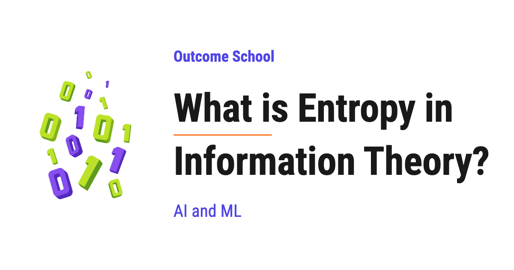

# What is Entropy in Information Theory?

> Archived from <https://outcomeschool.com/blog/entropy-in-information-theory> on 2026-11-25.

Entropy in information theory is a measure of uncertainty. It tells us how surprised we are, on average, by the outcome of something, so low entropy means easy to guess.

In this blog, we will learn about Entropy in Information Theory. We will also see the idea of surprise behind it, how we measure information in bits, the formula and each of its parts, a step-by-step example with a fair coin and a biased coin, and where entropy is used.

We will cover the following:
<ul><li>What is Entropy?</li><li>The simple idea of surprise</li><li>Measuring information in bits</li><li>The formula, decomposed</li><li>A step-by-step example</li><li>Low entropy vs high entropy</li><li>Where Entropy is used</li></ul>
I am <strong>Amit Shekhar</strong>, Founder @ <a target="_blank" rel="noopener noreferrer" href="https://outcomeschool.com">Outcome School</a>, I have taught and mentored many developers, and their efforts landed them high-paying tech jobs, helped many tech companies in solving their unique problems, and created many open-source libraries being used by top companies. I am passionate about sharing knowledge through open-source, blogs, and videos.

I teach <a target="_blank" rel="noopener noreferrer" href="https://outcomeschool.com/program/ai-and-machine-learning">AI and Machine Learning</a> at Outcome School.

Let&#x27;s get started.
<h2 id="what-is-entropy">What is Entropy?</h2>
<strong>Entropy is a measure of uncertainty. It tells us how surprised we are, on average, by the outcome of something.</strong>

Entropy measures how unpredictable a thing is. If we can easily guess the outcome, the entropy is low. If the outcome is very hard to guess, the entropy is high.

Let&#x27;s say we have a coin that always lands on heads. There is no surprise at all, because we already know the answer. So the entropy is zero. Now let&#x27;s say we have a fair coin that can land heads or tails equally. Now we cannot guess the outcome. So the entropy is high.
<h2 id="the-simple-idea-of-surprise">The simple idea of surprise</h2>
Before jumping into numbers, we must understand the idea of surprise.

An event that always happens gives us no surprise. If someone tells us &quot;the sun rose today&quot;, we learn nothing new, because we already knew it.

An event that rarely happens gives us a big surprise. If someone tells us &quot;it snowed in the desert today&quot;, we are very surprised, because it almost never happens.

So, surprise and probability are connected:

<pre><code class="language-text code-highlight">   High probability  -&gt;  Low surprise   -&gt;  Little information
   Low probability   -&gt;  High surprise  -&gt;  Lots of information
</code></pre>

Entropy is the average surprise across all possible outcomes.

<strong>Planning your move into AI?</strong>

No matter which tech domain you work in today, with your effort, you can transition to these roles:
<ul><li>AI Engineer</li><li>Forward Deployed Engineer</li><li>AI Agent Engineer</li><li>Harness Engineer</li><li>Voice AI Engineer</li><li>AI Architect</li><li>LLM Engineer</li><li>LLM Inference Engineer</li><li>Gen AI Engineer</li><li>MLOps Engineer</li><li>ML Engineer</li><li>Deep Learning Engineer</li></ul>
Our <a target="_blank" rel="noopener noreferrer" href="https://outcomeschool.com/program/ai-and-machine-learning">AI and Machine Learning Program</a> at Outcome School takes you there.
<h2 id="measuring-information-in-bits">Measuring information in bits</h2>
Now, we need a unit to measure information. In information theory, we measure it in <strong>bits</strong>.

One bit is the amount of information we get from one fair coin flip. A fair coin has two equally likely outcomes, heads or tails. Learning the result of one such flip gives us exactly one bit.

Here is a simple way to think about bits. When all outcomes are equally likely, the number of bits is the number of yes-or-no questions we need to ask to figure out the answer.

<pre><code class="language-text code-highlight">   2 equally likely outcomes  -&gt;  1 question  -&gt;  1 bit
   4 equally likely outcomes  -&gt;  2 questions -&gt;  2 bits
   8 equally likely outcomes  -&gt;  3 questions -&gt;  3 bits
</code></pre>

Each yes-or-no question cuts the possibilities in half. So the number of bits grows slowly as the number of outcomes grows. This is why we use the logarithm with base 2 in the formula.
<h2 id="the-formula-decomposed">The formula, decomposed</h2>
Now, let&#x27;s see the actual formula for entropy, written as <code>H</code>.

<strong>H = - sum over every outcome of (p * log2(p))</strong>

Let&#x27;s break this down.
<ul><li><code>p</code> is the probability of one outcome.</li><li><code>-log2(p)</code> measures the surprise of that outcome. Rarer outcomes give a bigger surprise.</li><li>We multiply the surprise by its probability <code>p</code>, so common outcomes count more toward the average.</li><li>We add this up for every possible outcome.</li><li>The minus sign in front turns <code>log2(p)</code> into the surprise <code>-log2(p)</code>. It makes the final number positive, because <code>log2</code> of a probability is zero or negative.</li></ul>
So, in plain words, entropy is the average surprise, weighted by how often each outcome happens.

<strong>A quick note for you</strong>

No matter which tech domain you work in, get familiar with these topics:
<ul><li>LLM</li><li>RAG</li><li>MCP</li><li>Agent</li><li>Fine-tuning</li><li>Quantization</li></ul>
We put it all together in one video:

<a target="_blank" rel="noopener noreferrer" href="https://www.youtube.com/watch?v=lnfWvX66FUk">AI Engineering Explained: LLM, RAG, MCP, Agent, Fine-Tuning, and Quantization</a>

No need to stop reading - bookmark it and watch later when you get time. Future you will thank you.

Now, let&#x27;s get back to the topic.
<h2 id="a-step-by-step-example">A step-by-step example</h2>
The best way to learn this is by taking an example.

Let&#x27;s take a fair coin. It has two outcomes, each with probability 0.5.

<strong>Step 1:</strong> Write <code>log2(p)</code> for each outcome. <code>log2(0.5)</code> is <code>-1</code>.

<strong>Step 2:</strong> Multiply by the probability. For heads, <code>0.5 * (-1) = -0.5</code>. For tails, <code>0.5 * (-1) = -0.5</code>.

<strong>Step 3:</strong> Add them. <code>-0.5 + (-0.5) = -1</code>.

<strong>Step 4:</strong> Apply the minus sign in front. <code>-(-1) = 1</code>.

So the entropy of a fair coin is 1 bit. This matches our earlier idea that one fair coin flip gives one bit.

Now let&#x27;s take a biased coin that lands heads 90% of the time and tails 10% of the time.

<pre><code class="language-text code-highlight">   Heads: 0.9 * log2(0.9) = 0.9 * (-0.152) = -0.137
   Tails: 0.1 * log2(0.1) = 0.1 * (-3.322) = -0.332
   Sum   = -0.469
   H     = -(-0.469) = 0.469 bits
</code></pre>

The biased coin has only about 0.47 bits of entropy, which is much less than the fair coin&#x27;s 1 bit. This makes sense, because the biased coin is easier to guess. We would bet on heads and be right most of the time.
<h2 id="low-entropy-vs-high-entropy">Low entropy vs high entropy</h2>
Let&#x27;s place the two coins side by side to see the pattern.

<pre><code class="language-text code-highlight">        FAIR COIN (50/50)                 BIASED COIN (90/10)

   Hard to guess the result           Easy to guess the result
   Maximum uncertainty                Low uncertainty
   Entropy = 1 bit                    Entropy = 0.47 bits

   |####################|             |#########           |
   full uncertainty                   less uncertainty
</code></pre>

Here, we can see the rule. The more balanced the outcomes, the higher the entropy. The more one outcome dominates, the lower the entropy. Entropy is highest when everything is equally likely, because that is when we are the most unsure.

<strong>Stay updated:</strong> Subscribe to our <a target="_blank" rel="noopener noreferrer" href="https://outcomeschool.substack.com/subscribe">newsletter</a> to get our latest AI and Machine Learning blogs straight to your inbox.
<h2 id="where-entropy-is-used">Where Entropy is used</h2>
Let&#x27;s see where entropy helps us.
<ul><li><strong>Data compression.</strong> Entropy tells us the smallest average number of bits needed per symbol to store a message. On average, we cannot compress below the entropy without losing information.</li><li><strong>Decision trees.</strong> Machine learning models like <a target="_blank" rel="noopener noreferrer" href="decision-trees-and-random-forests.md">decision trees</a> use entropy to pick the question that reduces uncertainty the most at each step.</li><li><strong>Machine learning loss.</strong> A very common loss function called <a target="_blank" rel="noopener noreferrer" href="math-behind-cross-entropy-loss.md">cross-entropy</a> comes directly from this idea. It measures how surprised a model is by the true answer.</li><li><strong>Communication.</strong> Ideas built on entropy set the limit on how much information a channel can carry.</li></ul>
We have a detailed blog on <a target="_blank" rel="noopener noreferrer" href="kl-divergence.md">KL Divergence</a> that explains how entropy and cross-entropy are related.
<h2 id="frequently-asked-questions">Frequently Asked Questions</h2><h3 id="what-is-the-entropy-of-a-coin-that-always-lands-on-heads">What is the entropy of a coin that always lands on heads?</h3>
The entropy is zero. If a coin always lands on heads, there is no surprise at all, because we already know the answer before the flip. Entropy measures how unpredictable an outcome is, so an outcome we can always guess has no uncertainty.
<h3 id="why-does-the-entropy-formula-use-log-base-2">Why does the entropy formula use log base 2?</h3>
Because we measure information in bits. Each yes-or-no question cuts the possibilities in half, so the number of bits grows slowly as the number of outcomes grows. With log base 2, one fair coin flip with two equally likely outcomes gives exactly one bit.
<h3 id="when-is-entropy-the-highest">When is entropy the highest?</h3>
Entropy is highest when every outcome is equally likely, because that is when we are the most unsure. The more balanced the outcomes, the higher the entropy. For example, a fair coin has 1 bit of entropy, while a coin that lands heads 90% of the time has only about 0.47 bits.
<h3 id="why-is-there-a-minus-sign-in-the-entropy-formula">Why is there a minus sign in the entropy formula?</h3>
The minus sign makes the final number positive. The log2 of a probability is zero or negative, so without the minus sign the sum would never be positive. The minus sign turns <code>log2(p)</code> into the surprise <code>-log2(p)</code>, which gets bigger as an outcome gets rarer.
<h3 id="how-is-entropy-related-to-cross-entropy-loss">How is entropy related to cross-entropy loss?</h3>
Cross-entropy loss comes directly from the idea of entropy. Entropy is the average surprise across all possible outcomes. Cross-entropy, a very common loss function in machine learning, measures how surprised a model is by the true answer.

That&#x27;s it for now.

Thanks

<strong>Amit Shekhar</strong> Founder @ <a target="_blank" rel="noopener noreferrer" href="https://outcomeschool.com">Outcome School</a>

You can connect with me on:
<ul><li><a target="_blank" rel="noopener noreferrer" href="https://x.com/amitiitbhu">X</a></li><li><a target="_blank" rel="noopener noreferrer" href="https://www.linkedin.com/in/amit-shekhar-iitbhu">LinkedIn</a></li><li><a target="_blank" rel="noopener noreferrer" href="https://github.com/amitshekhariitbhu">GitHub</a></li></ul>
Follow Outcome School on:
<ul><li><a target="_blank" rel="noopener noreferrer" href="https://x.com/outcome_school">X</a></li><li><a target="_blank" rel="noopener noreferrer" href="https://youtube.com/@OutcomeSchool">YouTube</a></li><li><a target="_blank" rel="noopener noreferrer" href="https://www.linkedin.com/company/outcomeschool">LinkedIn</a></li><li><a target="_blank" rel="noopener noreferrer" href="http://github.com/OutcomeSchool">GitHub</a></li></ul>
<a target="_blank" rel="noopener noreferrer" href="https://outcomeschool.com/blog"><strong>Read all of our high-quality blogs here.</strong></a>

