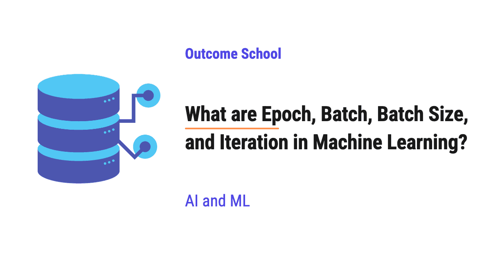

# What are Epoch, Batch, Batch Size, and Iteration in Machine Learning?

> Archived from <https://outcomeschool.com/blog/epoch-batch-and-iteration> on 2026-11-25.

Epoch, Batch, Batch Size, and Iteration are the four words that describe how a machine learning model goes through its training data. A batch is a small group of samples, the batch size is how many samples are in that group, an iteration is one learning step on one batch, and an epoch is one full pass over the entire training data.

In this blog, we will learn about Epoch, Batch, Batch Size, and Iteration in Machine Learning. We will also see what happens in one training step, why we do not feed all the data at once, how to calculate the number of iterations with a real example, the difference between batch, mini-batch, and stochastic gradient descent, how to choose the batch size and the number of epochs, and how all of this looks in a simple Python training loop.

We will cover the following:
<ul><li>What happens in one training step?</li><li>Why do we not feed all the data at once?</li><li>What is a Batch and Batch Size?</li><li>What is an Iteration?</li><li>What is an Epoch?</li><li>Calculating iterations with an example</li><li>When the data does not divide evenly</li><li>Batch vs Mini-Batch vs Stochastic Gradient Descent</li><li>How to choose the Batch Size?</li><li>How many Epochs do we need?</li><li>A simple training loop in Python</li></ul>
I am <strong>Amit Shekhar</strong>, Founder @ <a target="_blank" rel="noopener noreferrer" href="https://outcomeschool.com">Outcome School</a>, I have taught and mentored many developers, and their efforts landed them high-paying tech jobs, helped many tech companies in solving their unique problems, and created many open-source libraries being used by top companies. I am passionate about sharing knowledge through open-source, blogs, and videos.

I teach <a target="_blank" rel="noopener noreferrer" href="https://outcomeschool.com/program/ai-and-machine-learning">AI and Machine Learning</a> at Outcome School.

Let&#x27;s get started.
<h2 id="what-happens-in-one-training-step">What happens in one training step?</h2>
Before jumping into epoch and batch, we must know what happens when a model learns from data.

A model has many numbers inside it called <strong>parameters</strong> (also called weights). At the start, these numbers are <a target="_blank" rel="noopener noreferrer" href="random-weight-initialization.md">random</a>, so the model gives wrong answers. Training is the process of updating these parameters step by step so that the answers become correct.

Let&#x27;s say we are training a model to tell whether a photo shows a cat or a dog. We have 1000 labeled photos. Each photo with its correct answer is called a <strong>sample</strong> (also called an example).

One training step has three parts:
<ul><li><strong>Forward pass:</strong> We give some samples to the model, and the model makes its guesses.</li><li><strong>Loss:</strong> We compare the guesses with the correct answers and calculate one number that tells how wrong the model is. This number is called the <strong>loss</strong>. A big loss means very wrong. A small loss means almost right.</li><li><strong>Update:</strong> We slightly change the parameters in the direction that makes the loss smaller. This is done using <strong><a target="_blank" rel="noopener noreferrer" href="math-behind-gradient-descent.md">gradient descent</a></strong>, which finds which way each parameter must move to reduce the loss.</li></ul>
Let&#x27;s see this as a diagram:

<pre><code class="language-text code-highlight">┌──────────────────────────────┐
│ Some samples (photos)        │
└──────────────────────────────┘
                ↓
┌──────────────────────────────┐
│ Forward pass: model guesses  │
└──────────────────────────────┘
                ↓
┌──────────────────────────────┐
│ Loss: how wrong the guesses  │
│ are, for example 0.8         │
└──────────────────────────────┘
                ↓
┌──────────────────────────────┐
│ Update: change parameters    │
│ a little to reduce the loss  │
└──────────────────────────────┘
</code></pre>

Here, we can see that one training step takes some samples and ends with slightly better parameters. The model repeats this step many times, and the loss keeps going down.

We have a detailed blog on <a target="_blank" rel="noopener noreferrer" href="math-behind-backpropagation.md">Backpropagation</a> that explains step by step how the model finds which way each parameter must move.

Now, the question is: in one step, how many samples do we give to the model? All 1000? Or just a few? This is where batch, iteration, and epoch come into the picture.
<h2 id="why-do-we-not-feed-all-the-data-at-once">Why do we not feed all the data at once?</h2>
The simplest idea is to give all the samples to the model in one step. With 1000 small photos, this works. But real datasets are huge. A dataset can have millions of images, and an <a target="_blank" rel="noopener noreferrer" href="large-language-model-llm.md">LLM (Large Language Model)</a> can be trained on trillions of tokens.

Feeding all the data at once creates these problems:
<ul><li><strong>Memory:</strong> The computer (usually a GPU) must hold all the samples and all the in-between calculations in memory at the same time. Millions of images do not fit.</li><li><strong>Slow learning:</strong> The model makes only one update after looking at the entire dataset. If the dataset is huge, we wait a very long time for every single update.</li></ul>
So, here comes the batch to the rescue. Instead of the whole dataset, we give the model a small group of samples, update the parameters, then give the next small group, update again, and so on. The model starts improving after the very first small group.
<h2 id="what-is-a-batch-and-batch-size">What is a Batch and Batch Size?</h2>
<strong>A batch is a small group of samples that the model processes together in one training step.</strong>

<strong>Batch size is the number of samples in one batch.</strong>

Let&#x27;s say we have 1000 photos and we pick a batch size of 100. Then, we split the 1000 photos into groups of 100 photos each. Each group is one batch.

Let&#x27;s see this as a diagram:

<pre><code class="language-text code-highlight">┌────────────────────────────────────────┐
│ Training data: 1000 photos             │
└────────────────────────────────────────┘
                     ↓
        split with batch size 100
                     ↓
┌──────────┐ ┌──────────┐     ┌──────────┐
│ Batch 1  │ │ Batch 2  │     │ Batch 10 │
│ photos   │ │ photos   │ ... │ photos   │
│ 1-100    │ │ 101-200  │     │ 901-1000 │
└──────────┘ └──────────┘     └──────────┘
</code></pre>

Here, we can see that 1000 photos with a batch size of 100 give us 10 batches. Each batch has exactly 100 photos.

One thing to notice: the loss for a batch is the average of the losses of all the samples in that batch. So, one batch gives one loss number, and one update.
<h2 id="what-is-an-iteration">What is an Iteration?</h2>
<strong>An iteration is one training step on one batch: forward pass, loss, and update.</strong>

Every time the model processes one batch and updates its parameters once, we count one iteration. A batch is the data, and an iteration is the step we do with that data.

So, with 10 batches, the model needs 10 iterations to see every photo once. Iteration 1 uses Batch 1, Iteration 2 uses Batch 2, and so on till Iteration 10 uses Batch 10.

<strong>Note:</strong> Iteration is also called a <strong>step</strong>. Many training tools print &quot;step 500&quot; which means 500 iterations are done.

<strong>Planning your move into AI?</strong>

No matter which tech domain you work in today, with your effort, you can transition to these roles:
<ul><li>AI Engineer</li><li>Forward Deployed Engineer</li><li>AI Agent Engineer</li><li>Harness Engineer</li><li>Voice AI Engineer</li><li>AI Architect</li><li>LLM Engineer</li><li>LLM Inference Engineer</li><li>Gen AI Engineer</li><li>MLOps Engineer</li><li>ML Engineer</li><li>Deep Learning Engineer</li></ul>
Our <a target="_blank" rel="noopener noreferrer" href="https://outcomeschool.com/program/ai-and-machine-learning">AI and Machine Learning Program</a> at Outcome School takes you there.
<h2 id="what-is-an-epoch">What is an Epoch?</h2>
<strong>An epoch is one complete pass over the entire training data.</strong>

When the model has seen every sample in the training data exactly once, one epoch is complete. In our example, 10 iterations make 1 epoch.

One pass is usually not enough. Each update moves the parameters only a little. So, we go over the same data again and again. If we train for 5 epochs, the model sees every photo 5 times.

Before every epoch, we usually <strong>shuffle</strong> the data, which means we mix up the order of the samples. This way, the batches are different in every epoch, and the model does not learn anything from the order of the data.

Let&#x27;s see the epoch loop as a diagram:

<pre><code class="language-text code-highlight">┌──────────────────────────────────────┐
│ Epoch 1: shuffle 1000 photos         │
└──────────────────────────────────────┘
                    ↓
┌──────────────────────────────────────┐
│ Iteration 1: update on Batch 1       │
│ Iteration 2: update on Batch 2       │
│ ...                                  │
│ Iteration 10: update on Batch 10     │
└──────────────────────────────────────┘
                    ↓
┌──────────────────────────────────────┐
│ Epoch 2: shuffle 1000 photos         │
└──────────────────────────────────────┘
                    ↓
┌──────────────────────────────────────┐
│ Iterations 11 to 20: Batches 1 to 10 │
└──────────────────────────────────────┘
                    ↓
┌──────────────────────────────────────┐
│ Epochs 3 and 4: iterations 21 to 40  │
└──────────────────────────────────────┘
                    ↓
┌──────────────────────────────────────┐
│ Epoch 5: iterations 41 to 50         │
└──────────────────────────────────────┘
</code></pre>

Here, we can see that every epoch has 10 iterations, and the iteration count keeps going up across epochs. After 5 epochs, the model has made 50 updates.

<strong>A quick note for you</strong>

No matter which tech domain you work in, get familiar with these topics:
<ul><li>LLM</li><li>RAG</li><li>MCP</li><li>Agent</li><li>Fine-tuning</li><li>Quantization</li></ul>
We put it all together in one video:

<a target="_blank" rel="noopener noreferrer" href="https://www.youtube.com/watch?v=lnfWvX66FUk">AI Engineering Explained: LLM, RAG, MCP, Agent, Fine-Tuning, and Quantization</a>

No need to stop reading - bookmark it and watch later when you get time. Future you will thank you.

Now, let&#x27;s get back to the topic.
<h2 id="calculating-iterations-with-an-example">Calculating iterations with an example</h2>
Now, let&#x27;s put all four words together.
<ul><li>Number of samples: 1000</li><li>Batch size: 100</li><li>Number of epochs: 5</li></ul>
The number of iterations in one epoch is the number of batches:

<strong>iterations per epoch = number of samples / batch size = 1000 / 100 = 10</strong>

The total number of iterations for the whole training is:

<strong>total iterations = iterations per epoch * number of epochs = 10 * 5 = 50</strong>

So, the model makes 50 updates to its parameters, and it sees every photo 5 times.
<h2 id="when-the-data-does-not-divide-evenly">When the data does not divide evenly</h2>
Now, let&#x27;s change the example a little. Suppose we have 1050 photos, and the batch size is still 100.

1050 / 100 = 10.5. But we cannot have half an iteration.

So, we make 10 full batches of 100 photos each, which covers 1000 photos. The remaining 50 photos become one more batch. So, we get 11 batches, and 11 iterations in one epoch.

Let&#x27;s see this as a diagram:

<pre><code class="language-text code-highlight">┌────────────────────────────────────────┐
│ Training data: 1050 photos             │
└────────────────────────────────────────┘
                     ↓
        split with batch size 100
                     ↓
┌──────────┐     ┌──────────┐ ┌──────────┐
│ Batch 1  │     │ Batch 10 │ │ Batch 11 │
│ 100      │ ... │ 100      │ │ 50       │
│ photos   │     │ photos   │ │ photos   │
└──────────┘     └──────────┘ └──────────┘
</code></pre>

Here, we can see that Batch 1 to Batch 10 have 100 photos each, and Batch 11 has the remaining 50 photos.

This is why we round up. The correct formula is:

<strong>iterations per epoch = ceil(number of samples / batch size)</strong>

Here, <code>ceil</code> means round up to the next whole number. So, ceil(1050 / 100) = ceil(10.5) = 11.

For 3 epochs, the total is 11 * 3 = 33 iterations.

<strong>Note:</strong> Some training tools give us an option to drop the last smaller batch. In that case, we get 10 iterations per epoch, and those 50 photos are skipped for that epoch.

To learn Epoch, Batch, Batch Size, and Iteration along with the rest of the Machine Learning Fundamentals in depth, check out our <a target="_blank" rel="noopener noreferrer" href="https://outcomeschool.com/program/ai-and-machine-learning">AI and Machine Learning Program</a> at Outcome School.
<h2 id="batch-vs-mini-batch-vs-stochastic-gradient-descent">Batch vs Mini-Batch vs Stochastic Gradient Descent</h2>
The batch size decides the type of gradient descent we are using. There are three types.

<strong>Batch Gradient Descent:</strong> The batch size is equal to the full dataset. With 1000 photos, the batch size is 1000. So, there is only 1 iteration per epoch.
<ul><li><strong>Advantage:</strong> Each update is very accurate, because it looks at all the data.</li><li><strong>Disadvantage:</strong> Needs a lot of memory, and the model gets only one update per epoch, so learning is slow.</li></ul>
<strong>Stochastic Gradient Descent (SGD):</strong> The batch size is 1. The model updates after every single sample. The word stochastic means random, because each update depends on one randomly picked sample. With 1000 photos, there are 1000 iterations per epoch.
<ul><li><strong>Advantage:</strong> Needs very little memory, and gives many updates per epoch.</li><li><strong>Disadvantage:</strong> Each update is based on only one sample, so it is noisy. Also, the GPU is good at processing many samples in parallel, and with one sample at a time, most of that power is wasted.</li></ul>
<strong>Mini-Batch Gradient Descent:</strong> The batch size is somewhere in between, like 32, 64, or 128. With 1000 photos and a batch size of 100, there are 10 iterations per epoch.
<ul><li><strong>Advantage:</strong> Updates are fairly accurate, memory use is under control, and the GPU stays busy.</li><li><strong>Disadvantage:</strong> We must choose a good batch size, and each update still has a little noise.</li></ul>
Let me tabulate the differences between Batch, Mini-Batch, and Stochastic Gradient Descent for your better understanding.
<table><thead><tr><th>Type</th><th>Batch size</th><th>Iterations per epoch (1000 samples)</th><th>Updates</th></tr></thead><tbody><tr><td>Batch Gradient Descent</td><td>1000 (all)</td><td>1</td><td>Accurate but slow</td></tr><tr><td>Mini-Batch Gradient Descent</td><td>100</td><td>10</td><td>Balanced</td></tr><tr><td>Stochastic Gradient Descent</td><td>1</td><td>1000</td><td>Fast but noisy</td></tr></tbody></table>
In practice, almost all modern training uses mini-batches. Many people also use the name <a target="_blank" rel="noopener noreferrer" href="optimizers-in-deep-learning.md">SGD</a> when they actually mean mini-batch gradient descent.
<h2 id="how-to-choose-the-batch-size">How to choose the Batch Size?</h2>
There is a trade-off here.

<strong>Larger batch size:</strong>
<ul><li>Each update is more accurate, because it averages over more samples.</li><li>Uses the GPU better, so one epoch finishes faster.</li><li>Needs more memory.</li><li>Gives fewer updates per epoch.</li></ul>
<strong>Smaller batch size:</strong>
<ul><li>Needs less memory.</li><li>Gives more updates per epoch.</li><li>Each update is noisier. A little noise often helps the model generalize better, which means it works well on new data it has never seen.</li><li>Uses the GPU less efficiently.</li></ul>
A common practice is to start with a batch size like 32, 64, or 128, and then go higher if the GPU memory allows and the model still learns well. These powers of 2 are popular choices, but any number works.

<strong>Note:</strong> When we change the batch size, we often need to change the <a target="_blank" rel="noopener noreferrer" href="learning-rate-schedules-and-warmup.md"><strong>learning rate</strong></a> too. The learning rate decides how big each update is. A larger batch often works well with a larger learning rate.

<strong>Stay updated:</strong> Subscribe to our <a target="_blank" rel="noopener noreferrer" href="https://outcomeschool.substack.com/subscribe">newsletter</a> to get our latest AI and Machine Learning blogs straight to your inbox.
<h2 id="how-many-epochs-do-we-need">How many Epochs do we need?</h2>
Too few epochs, and the model has not learned enough. This is called <strong><a target="_blank" rel="noopener noreferrer" href="bias-variance-tradeoff.md">underfitting</a></strong>. The model does badly on the training data and on new data.

Too many epochs, and the model starts memorizing the training data instead of learning the general pattern. This is called <strong><a target="_blank" rel="noopener noreferrer" href="regularization-in-machine-learning.md">overfitting</a></strong>. The model does very well on the training data, but badly on new data.

So, how can we find the right number? The answer is a <strong><a target="_blank" rel="noopener noreferrer" href="train-validation-test-split.md">validation set</a></strong>. We keep aside some data that the model never trains on. After every epoch, we check the loss on this validation set.
<ul><li>If the validation loss keeps going down, the model is still learning. We continue.</li><li>If the validation loss stops going down and starts going up, while the training loss is still going down, the model has started overfitting. We stop.</li></ul>
Stopping the training at this point is called <strong><a target="_blank" rel="noopener noreferrer" href="early-stopping.md">early stopping</a></strong>. This way, we do not need to guess the perfect number of epochs in advance. We set a large number, and early stopping decides when to stop.

The number of epochs depends on the dataset size and the task. A small model on a small dataset can need 50 or 100 epochs. A large LLM trained on trillions of tokens often sees most of its data only once, which means about 1 epoch.
<h2 id="a-simple-training-loop-in-python">A simple training loop in Python</h2>
Now, let&#x27;s see how epoch, batch, batch size, and iteration look in code. We will use the case of 1050 samples and a batch size of 100.

<pre><code class="code-highlight language-python">import math
import random

num_samples = 1050
batch_size = 100
num_epochs = 3

data = list(range(num_samples))
print(&quot;Iterations per epoch:&quot;, math.ceil(num_samples / batch_size))

total_iterations = 0
for epoch in range(num_epochs):
    random.shuffle(data)
    for start in range(0, num_samples, batch_size):
        batch = data[start:start + batch_size]
        # forward pass, loss, and update go here
        total_iterations += 1
    print(f&quot;Epoch {epoch + 1} done, last batch size: {len(batch)}&quot;)

print(&quot;Total iterations:&quot;, total_iterations)
</code></pre>

Here, we have:
<ul><li><code>data</code> which stands for our 1050 samples. For the sake of understanding, each sample is just a number.</li><li>The outer loop <code>for epoch in range(num_epochs)</code> which runs once per epoch.</li><li><code>random.shuffle(data)</code> which mixes up the order of the samples before every epoch.</li><li>The inner loop which moves through the data 100 samples at a time. Each run of this inner loop is one iteration.</li><li><code>data[start:start + batch_size]</code> which picks one batch. For the last batch, only 50 samples are left, so Python gives us those 50.</li><li>The comment <code># forward pass, loss, and update go here</code> which is where the real model does its training step.</li></ul>
This will print the following:

<pre><code class="language-text code-highlight">Iterations per epoch: 11
Epoch 1 done, last batch size: 50
Epoch 2 done, last batch size: 50
Epoch 3 done, last batch size: 50
Total iterations: 33
</code></pre>

Here, we can see that the numbers match our calculation: 11 iterations per epoch, the last batch has 50 samples, and 3 epochs give 33 iterations in total.

Now we must have understood what Epoch, Batch, Batch Size, and Iteration are, how they are connected, and how to choose them while training a machine learning model.
<h2 id="frequently-asked-questions">Frequently Asked Questions</h2><h3 id="what-is-the-difference-between-an-epoch-and-an-iteration">What is the difference between an epoch and an iteration?</h3>
An epoch is one complete pass over the entire training data, while an iteration is one training step on one batch. One epoch is made of many iterations. For example, with 1000 samples and a batch size of 100, one epoch has 10 iterations, and 5 epochs give 50 iterations in total.
<h3 id="is-an-iteration-the-same-as-a-step">Is an iteration the same as a step?</h3>
Yes. An iteration is also called a step. In one iteration, the model takes one batch, makes its guesses in the forward pass, calculates the loss, and updates its parameters once. Many training tools print &quot;step 500&quot;, which means 500 iterations are done.
<h3 id="why-do-we-shuffle-the-data-before-every-epoch">Why do we shuffle the data before every epoch?</h3>
We shuffle the data before every epoch so that the batches are different in every epoch. Shuffling mixes up the order of the samples, so the model does not learn anything from the order of the data. Each epoch then goes through the same samples in a new order.
<h3 id="does-a-large-llm-train-for-many-epochs">Does a large LLM train for many epochs?</h3>
No. A large LLM trained on trillions of tokens often sees most of its data only once, which means about 1 epoch. In contrast, a small model on a small dataset can need 50 or 100 epochs. The number of epochs depends on the dataset size and the task.
<h3 id="should-we-change-the-learning-rate-when-we-change-the-batch-size">Should we change the learning rate when we change the batch size?</h3>
Yes, often. The learning rate decides how big each update is, so when we change the batch size, we often need to change the learning rate too. A larger batch often works well with a larger learning rate.

That&#x27;s it for now.

Thanks

<strong>Amit Shekhar</strong> Founder @ <a target="_blank" rel="noopener noreferrer" href="https://outcomeschool.com">Outcome School</a>

You can connect with me on:
<ul><li><a target="_blank" rel="noopener noreferrer" href="https://x.com/amitiitbhu">X</a></li><li><a target="_blank" rel="noopener noreferrer" href="https://www.linkedin.com/in/amit-shekhar-iitbhu">LinkedIn</a></li><li><a target="_blank" rel="noopener noreferrer" href="https://github.com/amitshekhariitbhu">GitHub</a></li></ul>
Follow Outcome School on:
<ul><li><a target="_blank" rel="noopener noreferrer" href="https://x.com/outcome_school">X</a></li><li><a target="_blank" rel="noopener noreferrer" href="https://youtube.com/@OutcomeSchool">YouTube</a></li><li><a target="_blank" rel="noopener noreferrer" href="https://www.linkedin.com/company/outcomeschool">LinkedIn</a></li><li><a target="_blank" rel="noopener noreferrer" href="http://github.com/OutcomeSchool">GitHub</a></li></ul>
<a target="_blank" rel="noopener noreferrer" href="https://outcomeschool.com/blog"><strong>Read all of our high-quality blogs here.</strong></a>

