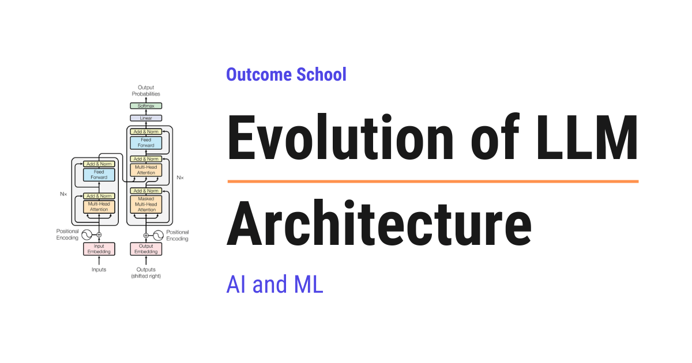

# Evolution of LLM Architecture

> Archived from <https://outcomeschool.com/blog/evolution-of-llm-architecture> on 2026-11-25.

LLM architecture evolved in stages: from RNNs that read one word at a time, to Attention, to the Transformer, to making models bigger, and then to Mixture of Experts (MoE) that makes big models cheaper to run.

In this blog, we will learn about the Evolution of LLM Architecture, the step-by-step journey of how the design of large language models changed from simple word-by-word readers to the massive AI models we use today. We will also see why the early models kept forgetting, how attention solved that problem, how the Transformer removed the slow parts, how making models bigger made them smarter, how Mixture of Experts made big models cheaper to run, what problems still remain, and what is coming next.

We will cover the following:
<ul><li>What is an LLM Architecture?</li><li>Stage 1: Reading one word at a time (RNN)</li><li>Stage 2: Attention</li><li>Stage 3: The Transformer</li><li>Stage 4: Scaling</li><li>Stage 5: Mixture of Experts (MoE)</li><li>Stage 6: New Directions</li><li>Summary of the evolution</li></ul>
I am <strong>Amit Shekhar</strong>, Founder @ <a target="_blank" rel="noopener noreferrer" href="https://outcomeschool.com">Outcome School</a>, I have taught and mentored many developers, and their efforts landed them high-paying tech jobs, helped many tech companies in solving their unique problems, and created many open-source libraries being used by top companies. I am passionate about sharing knowledge through open-source, blogs, and videos.

I teach <a target="_blank" rel="noopener noreferrer" href="https://outcomeschool.com/program/ai-and-machine-learning">AI and Machine Learning</a> at Outcome School.

Let&#x27;s get started.
<h2 id="what-is-an-llm-architecture">What is an LLM Architecture?</h2>
<strong>An LLM Architecture is the blueprint of a <a target="_blank" rel="noopener noreferrer" href="large-language-model-llm.md">large language model</a>. It describes how the model reads text, how it remembers what it has read, and how it produces the next word.</strong>

Let&#x27;s break the name.

<strong>LLM = Large + Language + Model</strong>
<ul><li><strong>Language</strong>: it works with text, the words we read and write every day.</li><li><strong>Model</strong>: it is a computer program that has learned patterns from a huge amount of text.</li><li><strong>Large</strong>: it has learned from a very large amount of text and has a very large number of internal settings.</li></ul>
<strong>Architecture</strong> is simply the design. Let&#x27;s say we are building a house. The architecture is the plan that tells us where the rooms go, how big the doors are, and how the water flows. The bricks and cement are the same for every house, but the plan decides how good the house is.

Similarly, in an LLM, the numbers and the math are similar across models, but the architecture decides how the model reads, remembers, and answers.

Every big step in LLM architecture happened because the previous design had a problem.
<ul><li>The first models forgot what they read.</li><li>Then attention solved forgetting, but the models were still slow.</li><li>Then the Transformer made them fast, but nobody knew how big to make them.</li><li>Then scaling made them smart, but too costly to run.</li><li>Then Mixture of Experts made them cheaper.</li><li>And the story is still going on.</li></ul>
So, the best way to understand today&#x27;s LLM is to walk through this timeline, one problem and one solution at a time.

Do not worry, we will learn about each of them in detail.
<h2 id="stage-1-reading-one-word-at-a-time-rnn">Stage 1: Reading one word at a time (RNN)</h2>
Before Transformers, the most popular design for reading text was the <strong><a target="_blank" rel="noopener noreferrer" href="recurrent-neural-network.md">Recurrent Neural Network (RNN)</a></strong>.

A neural network is a computer program made of a very large number of connected numbers that learns patterns from examples. Showing it a lot of examples so that it learns from them is called <strong>training</strong>. Do not worry about the internal details. For this blog, we only need to know how each design reads text.

<strong>Note:</strong> A model does not read whole words. It first cuts the text into small pieces called <strong><a target="_blank" rel="noopener noreferrer" href="tokenization-in-llms.md">tokens</a></strong>. A token can be a full word, a part of a word, or a punctuation mark. For the sake of understanding, we will say word everywhere in this blog, but wherever we say word, the model is really working with a token.

Suppose we give an RNN the sentence: &quot;The cat sat on the mat.&quot;

An RNN reads it one word at a time, from left to right. After reading each word, it updates a single small memory and then moves to the next word. The memory is like a tiny note. After reading &quot;The&quot;, the note has something about &quot;The&quot;. After &quot;cat&quot;, the note is rewritten to remember &quot;The cat&quot;. And so on, till the end.

At the end, the whole sentence is squeezed into that one small note.

Let&#x27;s understand this with a picture:

<pre><code class="language-text code-highlight"> Word:     The       cat       sat       on        the       mat
            |         |         |         |         |         |
            v         v         v         v         v         v
 Note:   [note] -&gt; [note] -&gt; [note] -&gt; [note] -&gt; [note] -&gt; [note]
                                                              |
                                                              v
                                                   the whole sentence
                                                   lives in this one note
</code></pre>

Here, there is only one note. The arrow from one note to the next shows that the same note is rewritten after every word. The only thing carried forward from the past is this note, nothing else.

This worked for short sentences. But, here is the catch.

<strong>Problem 1: It forgets.</strong>

Let&#x27;s say the text is very long, like a full paragraph. By the time the model reaches the end, the note has been rewritten so many times that the early words are almost gone. If the paragraph starts with &quot;Riya went to the market&quot; and ends with &quot;and then she bought&quot;, the model struggles to remember that &quot;she&quot; means Riya.

<pre><code class="language-text code-highlight"> Riya  went  to  the  market  and  then  she  bought
  |                                       |
  |   the note is rewritten again and     |
  |   again between these two words       |
  v                                       v
 &quot;Riya&quot; is written into       by now &quot;Riya&quot; has mostly
 the note at the very start   faded out of the note
</code></pre>

Here, we can see that &quot;Riya&quot; entered the note at the start, but every word after it overwrote the note a little more. By the time the model reaches &quot;she&quot;, very less of &quot;Riya&quot; is left.

<strong>Problem 2: It is slow to train.</strong>

The model must read word 1 before word 2, and word 2 before word 3. Means, it cannot read all the words at the same time. So, even if we have a very powerful computer that can do thousands of things in parallel, the RNN uses it one step at a time.

Improved versions of RNN, called <a target="_blank" rel="noopener noreferrer" href="lstm-and-gru.md">LSTM and GRU</a>, reduced the forgetting a lot, but they did not remove it, and the slow one-by-one reading remained.

The issue with this approach is forgetting and slow training. Let&#x27;s see how the next approach solve this issue.
<h2 id="stage-2-attention">Stage 2: Attention</h2>
Here comes the <strong>Attention</strong> into the picture.

<strong>Attention is a mechanism that lets the model look back at every word in the input and decide how much to focus on each one while processing the current word.</strong>

In simple words, instead of keeping one tiny note, we keep the whole page open in front of us. When we need to understand a word, we look at whichever earlier words matter for it.

Let&#x27;s see the difference with a picture:

<pre><code class="language-text code-highlight"> RNN:

   Riya -&gt; went -&gt; to -&gt; the -&gt; market -&gt; and -&gt; then -&gt; she
   (one small note passed along the chain, rewritten at each step)

 Attention:

   Riya   went   to   the   market   and   then   she
    ^      ^      ^    ^      ^       ^      ^     |
    |      |      |    |      |       |      |     |
    +------+------+----+------+-------+------+-----+
             &quot;she&quot; looks directly at every earlier word
</code></pre>

Here, in the RNN, &quot;she&quot; can only see the note that reached it through the chain. In attention, &quot;she&quot; has a direct line to every earlier word. Nothing is lost on the way.

<strong>Attention = Look at every word + Decide how much each one matters + Mix them accordingly</strong>

Let&#x27;s take the example again: &quot;Riya went to the market and then she bought mangoes.&quot;

When the model is processing the word &quot;she&quot;, attention lets it look at all the words before it and ask: which words help me understand &quot;she&quot;? The answer is &quot;Riya&quot;. So, the model gives high attention to &quot;Riya&quot; and low attention to words like &quot;to&quot; and &quot;the&quot;.
<h3 id="how-attention-decides-where-to-focus">How attention decides where to focus</h3>
The best way to learn this is by taking an example.

Suppose the model is processing &quot;she&quot;. For the sake of understanding, let&#x27;s look at only 4 of the earlier words. Attention gives each word a score that tells how important it is. Then it converts those scores into weights that add up to 1.
<ul><li>Riya: 0.70</li><li>went: 0.10</li><li>market: 0.15</li><li>then: 0.05</li></ul>
Here, we can see that &quot;Riya&quot; gets 70 percent of the focus. The model then builds its understanding of &quot;she&quot; mostly from &quot;Riya&quot;, a little from &quot;market&quot;, and very less from the others.

Let&#x27;s see how the model builds &quot;she&quot; from these weights:

<pre><code class="language-text code-highlight">   0.70 x Riya    ----+
   0.10 x went    ----+
   0.15 x market  ----+----&gt; understanding of &quot;she&quot;
   0.05 x then    ----+
   ----
   1.00  (the weights add up to 1)
</code></pre>

Here, each earlier word is multiplied by its weight and then all of them are added together. Since &quot;Riya&quot; has the biggest weight, the result is mostly &quot;Riya&quot;.

That is all attention is. <strong>A weighted mix of the other words, where the weights say how much each word matters.</strong>

This simple idea is the heart of every modern LLM.
<h3 id="query-key-and-value">Query, Key, and Value</h3>
Inside attention, every word plays three roles. Let&#x27;s take an analogy of a library.
<ul><li><strong>Query</strong>: the question we are asking. When we are at &quot;she&quot;, the query is &quot;who is this person?&quot;</li><li><strong>Key</strong>: the label on every book. Each earlier word carries a label that says what it is about. The word &quot;Riya&quot; carries a label like &quot;a person&#x27;s name&quot;.</li><li><strong>Value</strong>: the content inside the book. The actual information that the word carries.</li></ul>
The model compares the query with every key. The keys that match well get high scores. Then it collects the values, weighted by those scores. That gives us the weighted mix we saw above.

Here is how the flow looks:

<pre><code class="language-text code-highlight"> Query from &quot;she&quot;: who is this person?
          |
          v
 Compare the query with every key:
   Key of &quot;Riya&quot;   : a person&#x27;s name  -&gt; strong match
   Key of &quot;went&quot;   : an action        -&gt; weak match
   Key of &quot;market&quot; : a place          -&gt; weak match
          |
          v
 Collect the values, weighted by the match
          |
          v
 Understanding of &quot;she&quot;, built mostly from the value of &quot;Riya&quot;
</code></pre>

Here, the query is the question, the keys decide which words answer it well, and the values are the information we finally collect. The key only helps in matching. The actual content comes from the value.

We have a detailed blog on <a target="_blank" rel="noopener noreferrer" href="math-behind-attention-qkv.md">the math behind Q, K, and V</a> that explains this step by step with real numbers.
<h3 id="self-attention">Self-Attention</h3>
When the words of a sentence pay attention to other words of the same sentence, we call it as <strong><a target="_blank" rel="noopener noreferrer" href="self-attention-in-transformers.md">Self-Attention</a></strong>. The sentence is looking at itself. This is the form of attention used inside LLMs.
<h3 id="multi-head-attention">Multi-Head Attention</h3>
One attention can focus on one kind of relationship at a time. But a sentence has many relationships. &quot;she&quot; relates to &quot;Riya&quot; by meaning, &quot;bought&quot; relates to &quot;mangoes&quot; by grammar, and so on.

So, instead of one attention, we run several attentions side by side. Each one is called a <strong>head</strong>. One head learns to track names, another learns to track grammar, another learns to track position, and etc. Then we combine what all the heads found.

This is called <strong><a target="_blank" rel="noopener noreferrer" href="multi-head-attention-in-transformers.md">Multi-Head Attention</a></strong>. It is like having a team of readers where each reader is looking for a different thing in the same sentence.

<pre><code class="language-text code-highlight">                   The sentence
                        |
         +--------------+--------------+
         |              |              |
         v              v              v
    +----------+   +----------+   +----------+
    |  Head 1  |   |  Head 2  |   |  Head 3  |
    |  tracks  |   |  tracks  |   |  tracks  |
    |  names   |   |  grammar |   | position |
    +----------+   +----------+   +----------+
         |              |              |
         +--------------+--------------+
                        |
                        v
               Combine all the heads
</code></pre>

Here, all the heads read the same sentence at the same time, but each head is looking for a different kind of relationship. At the end, we combine what all of them found into one result.

Attention solved the forgetting problem, because now no word in the input is ever squeezed out of memory. Every word can be looked at directly.

But, in the beginning, attention was added on top of RNNs. The RNN still read the input one word at a time, and attention only helped the model look back at what the RNN had already read. So, the one-by-one slow reading was still there.

The issue with this approach is that the model still read slowly, one word at a time. Let&#x27;s see how the next approach solve this issue.

To learn Attention Mechanism, Q, K, V Matrices, and Self-Attention and Multi-Head Attention in depth, check out our <a target="_blank" rel="noopener noreferrer" href="https://outcomeschool.com/program/ai-and-machine-learning">AI and Machine Learning Program</a> at Outcome School.
<h2 id="stage-3-the-transformer">Stage 3: The Transformer</h2>
In 2017, a research paper with the title &quot;Attention Is All You Need&quot; asked a bold question: if attention is doing the real work, why keep the RNN at all?

So, they removed the RNN completely and built a model only from attention and a few simple pieces of math. That model is called the <strong><a target="_blank" rel="noopener noreferrer" href="decoding-transformer-architecture.md">Transformer</a></strong>.

<strong>A Transformer is a model that reads all the words of the input at the same time and uses attention to understand how they relate to each other.</strong>
<h3 id="what-is-inside-a-transformer">What is inside a Transformer</h3>
A Transformer is made of blocks stacked on top of each other. Each block has two main parts:
<ul><li><strong>Multi-Head Attention</strong>: the words look at each other and gather information. This is the looking step.</li><li><strong><a target="_blank" rel="noopener noreferrer" href="feed-forward-networks-in-llms.md">Feed-Forward Network</a></strong>: a simple layer of math that each word passes through on its own to process what it gathered. This is the thinking step.</li></ul>
We stack many such blocks. Early blocks learn simple things like grammar. Deeper blocks learn bigger things like meaning and reasoning. A small model has around 12 blocks. A large model has 100 or more.

Here is how the blocks are stacked:

<pre><code class="language-text code-highlight">             Input words
                  |
                  v
   +-----------------------------+
   |  Block 1                    |
   |   Multi-Head Attention      |  &lt;- looking step
   |   Feed-Forward Network      |  &lt;- thinking step
   +-----------------------------+
                  |
                  v
   +-----------------------------+
   |  Block 2                    |
   |   Multi-Head Attention      |
   |   Feed-Forward Network      |
   +-----------------------------+
                  |
                  v
                . . .
                  |
                  v
   +-----------------------------+
   |  Block N                    |
   |   Multi-Head Attention      |
   |   Feed-Forward Network      |
   +-----------------------------+
                  |
                  v
        Predict the next word
</code></pre>

Here, the words enter at the top, pass through every block one after another, and the last block predicts the next word. Every block does the same two steps: look, then think.

<strong>Planning your move into AI?</strong>

No matter which tech domain you work in today, with your effort, you can transition to these roles:
<ul><li>AI Engineer</li><li>Forward Deployed Engineer</li><li>AI Agent Engineer</li><li>Harness Engineer</li><li>Voice AI Engineer</li><li>AI Architect</li><li>LLM Engineer</li><li>LLM Inference Engineer</li><li>Gen AI Engineer</li><li>MLOps Engineer</li><li>ML Engineer</li><li>Deep Learning Engineer</li></ul>
Our <a target="_blank" rel="noopener noreferrer" href="https://outcomeschool.com/program/ai-and-machine-learning">AI and Machine Learning Program</a> at Outcome School takes you there.
<h3 id="the-word-order-problem">The word order problem</h3>
There is one interesting problem. Since the Transformer reads all the words at once, it does not naturally know which word came first. &quot;Dog bites man&quot; and &quot;Man bites dog&quot; would look the same to it.

So, here comes the <strong>Positional Encoding</strong> to the rescue. Before the words enter the model, we add a small signal to each word that says its position: word 1, word 2, word 3, and so on. Now, the model knows the order.

The original Transformer used a fixed signal for this. Modern LLMs use newer ways to do the same job, like <strong><a target="_blank" rel="noopener noreferrer" href="math-behind-rope-rotary-position-embedding.md">Rotary Position Embedding (RoPE)</a></strong>, which is used in LLaMA and many other models. The method changed, but the idea is the same: tell the model where each word sits.
<h3 id="encoder-decoder-and-decoder-only">Encoder, Decoder, and Decoder-only</h3>
The original Transformer had two halves.
<ul><li><strong>Encoder</strong>: reads the input and understands it.</li><li><strong>Decoder</strong>: writes the output one word at a time, looking at what the encoder understood and at what it has already written.</li></ul>
This was built for translation. Read English, write French.

Later, researchers found that for generating text, we only need the decoder half. Give it some words, and it predicts the next word. Then add that word to the input, and predict the next. This is the <strong><a target="_blank" rel="noopener noreferrer" href="encoder-vs-decoder-in-transformers.md">Decoder-only Transformer</a></strong>, and it is the design used by GPT and almost every chat model today.

<pre><code class="language-text code-highlight"> Encoder-Decoder (built for translation):

   &quot;The cat sat&quot;  ---&gt;  [ Encoder ]  ---&gt;  [ Decoder ]  ---&gt;  &quot;Le chat s&#x27;est assis&quot;

 Decoder-only (used by chat models):

   &quot;The capital of India is&quot;      ---&gt;  [ Decoder ]  ---&gt;  &quot;New&quot;
   &quot;The capital of India is New&quot;  ---&gt;  [ Decoder ]  ---&gt;  &quot;Delhi&quot;
</code></pre>

Here, the decoder-only model has a single stream. The word it produces is added back to the input, and it predicts again. This loop continues till the answer is complete.

This loop is called autoregressive generation, and we have a detailed blog on <a target="_blank" rel="noopener noreferrer" href="autoregressive-models.md">Autoregressive Models</a> that explains how it works.
<h3 id="why-the-transformer-won">Why the Transformer won</h3>
The Transformer processes all the words in parallel. This matched perfectly with <a target="_blank" rel="noopener noreferrer" href="how-does-a-gpu-work-for-deep-learning.md">GPUs</a>, which are chips built to do thousands of small calculations at the same time. Training that took weeks on RNNs took days on Transformers.

<pre><code class="language-text code-highlight"> RNN (one word per step):

   Step 1    Step 2    Step 3    Step 4    Step 5    Step 6
    The   -&gt;  cat   -&gt;  sat   -&gt;  on    -&gt;  the   -&gt;  mat

 Transformer (all words in one step):

   Step 1
    The     cat     sat     on      the     mat
     |       |       |       |       |       |
     +-------+-------+-------+-------+-------+
                  all processed together
</code></pre>

Here, the RNN needs 6 steps for 6 words, and each step must wait for the previous one to finish. The Transformer handles all 6 words in a single step, so all the GPU cores stay busy at the same time.

We have a detailed blog on <a target="_blank" rel="noopener noreferrer" href="how-do-rnns-and-transformers-differ.md">how RNNs and Transformers differ</a> that covers this comparison end to end.

<strong>Note:</strong> This parallel reading applies to the input and to training. While writing the answer, the model still produces one word at a time, as we saw in the decoder-only loop above. Reading is parallel, writing is one by one. Keep this in mind, it will matter when we reach the KV Cache later.

And that speed opened the door to the next stage. If training is fast, why not train a bigger model on more data?

This was all about the Transformer. It solved slow training. Now, the next big question is: how big do we make it?

If we want to go deep into Transformer Architecture, Positional Encodings, and Encoder-Decoder Architecture, and build a Large Language Model (LLM) from scratch, check out our <a target="_blank" rel="noopener noreferrer" href="https://outcomeschool.com/program/ai-and-machine-learning">AI and Machine Learning Program</a> at Outcome School.
<h2 id="stage-4-scaling">Stage 4: Scaling</h2>
<strong>Scaling means making the model bigger in three ways: more parameters, more training data, and more compute.</strong>

Let&#x27;s understand each.
<ul><li><strong>Parameters</strong>: the internal settings of the model. Let&#x27;s say a model is a giant board with billions of tiny knobs. Training turns each knob a little to make the predictions better. The number of knobs is the number of parameters.</li><li><strong>Data</strong>: the text the model learns from. Books, websites, articles, code, and etc.</li><li><strong>Compute</strong>: the total amount of calculation done during training. More compute means more GPUs running for more time.</li></ul><h3 id="the-surprising-discovery">The surprising discovery</h3>
Around 2020, researchers noticed something surprising. When they increased parameters, data, and compute together, the model got better in a smooth and predictable way. There was no sudden wall. Bigger kept getting better.

These are called <strong>Scaling Laws</strong>. They gave a formula that said: if we spend this much compute, the model will reach roughly this much quality.

Hence, models grew very fast.
<ul><li>GPT-2 had about 1.5 billion parameters.</li><li>GPT-3 had about 175 billion parameters, more than 100 times bigger, just one year later.</li></ul>
And GPT-3 did things that GPT-2 could not. It could write essays, answer questions, and even write code, that too without being trained for those specific tasks. These new abilities that appear only at a large size are called <strong>emergent abilities</strong>.

<strong>Note:</strong> Some researchers argue that these abilities do not appear suddenly. They grow smoothly with size and only look sudden because of how we measure them. The term is still widely used, so it is good to know it.
<h3 id="balancing-data-and-size">Balancing data and size</h3>
Then came a correction. In 2022, a research paper called <a target="_blank" rel="noopener noreferrer" href="chinchilla-scaling-laws.md">Chinchilla</a> found that many big models were undertrained. They had too many parameters and too little data.

The lesson was simple: <strong>for the best result, grow the data along with the parameters.</strong> A smaller model trained on much more data can beat a bigger model trained on less data. This is why later models like LLaMA were trained on trillions of tokens.

<strong>A quick note for you</strong>

No matter which tech domain you work in, get familiar with these topics:
<ul><li>LLM</li><li>RAG</li><li>MCP</li><li>Agent</li><li>Fine-tuning</li><li>Quantization</li></ul>
We put it all together in one video:

<a target="_blank" rel="noopener noreferrer" href="https://www.youtube.com/watch?v=lnfWvX66FUk">AI Engineering Explained: LLM, RAG, MCP, Agent, Fine-Tuning, and Quantization</a>

No need to stop reading - bookmark it and watch later when you get time. Future you will thank you.

Now, let&#x27;s get back to the topic.
<h3 id="the-cost-problem">The cost problem</h3>
Scaling worked, but it created a new problem.

In a normal Transformer, every parameter is used for every single word. If a model has 175 billion parameters and we ask it a question of 100 words, all 175 billion parameters do work for each of those 100 words. This is called a <strong>dense</strong> model, because everything is active all the time.

<pre><code class="language-text code-highlight"> Dense model:

   word 1    ---&gt;  all 175 billion parameters work  ---&gt;  output
   word 2    ---&gt;  all 175 billion parameters work  ---&gt;  output
   word 3    ---&gt;  all 175 billion parameters work  ---&gt;  output
    ...
   word 100  ---&gt;  all 175 billion parameters work  ---&gt;  output
</code></pre>

Here, whether the word is a simple &quot;the&quot; or a difficult technical term, the full model works on it. There is no way to do less work for an easy word.

So, doubling the size of the model doubles the cost of every answer. Training became very costly, and running the model for millions of users became even more costly.

The issue with this approach is that every increase in size brings the same increase in running cost. Let&#x27;s see how the next approach solve this issue.
<h2 id="stage-5-mixture-of-experts-moe">Stage 5: Mixture of Experts (MoE)</h2>
Here comes the <strong><a target="_blank" rel="noopener noreferrer" href="mixture-of-experts.md">Mixture of Experts (MoE)</a></strong> to the rescue.

<strong>Mixture of Experts is an architecture where the model is divided into many smaller parts called experts, and for each word, only a few experts are used.</strong>

Let&#x27;s decompose it.

<strong>Mixture of Experts = Many Experts + A Router that picks a few of them</strong>

Let&#x27;s say we go to a big hospital. The hospital has a heart specialist, a bone specialist, a skin specialist, and an eye specialist. When we walk in, the receptionist listens to our problem and sends us to one or two relevant doctors. All four doctors do not examine every patient.
<ul><li>The doctors are the <strong>experts</strong>.</li><li>The receptionist is the <strong>router</strong>, also called the gate.</li><li>Sending each patient to only a few doctors is called <strong>sparse activation</strong>.</li></ul><h3 id="how-moe-works-inside-the-transformer">How MoE works inside the Transformer</h3>
Remember the Feed-Forward Network inside every Transformer block, the thinking step after attention? In an MoE model, that single feed-forward network is replaced by many feed-forward networks, the experts. A small router sits in front of them.

For every word:
<ul><li>The router looks at the word and gives a score to each expert.</li><li>It picks the top few experts, usually the top 1 or top 2.</li><li>Only those experts process the word.</li><li>Their outputs are combined and passed forward.</li></ul>
The attention part stays the same. Only the thinking step becomes a team of specialists.

Let&#x27;s understand this with a picture:

<pre><code class="language-text code-highlight">             Word comes in
                    |
                    v
 +--------------------------------------+
 |         Multi-Head Attention         |   same as before
 +--------------------------------------+
                    |
                    v
 +--------------------------------------+
 |                Router                |   gives a score to each expert
 +--------------------------------------+
   |    |    |    |    |    |    |    |
  0.4  0.1  0.3  0.0  0.1  0.0  0.1  0.0     scores
   |         |
   v         v
 [E1] [E2] [E3] [E4] [E5] [E6] [E7] [E8]     8 experts
  on   off  on   off  off  off  off  off     only the top 2 work
   |         |
   +----+----+
        |
        v
 Combine the two outputs and pass forward
</code></pre>

Here, the router gave the highest scores to Expert 1 and Expert 3, so only those two do the work for this word. The other six sit idle for this word. For the next word, the router can pick a different pair.
<h3 id="total-parameters-vs-active-parameters">Total parameters vs active parameters</h3>
This is the key idea, so let&#x27;s take numbers.

Suppose we start with a model of about 7 billion parameters and, in each block, replace its single Feed-Forward Network (the thinking step) with 8 expert Feed-Forward Networks. This is the basic design of Mixtral 8x7B. The name means 8 experts built on the architecture of a 7 billion base model. The model does not become 8 x 7 = 56 billion, because the attention part and the other shared pieces are not copied. Only the Feed-Forward Network is copied 8 times. Together with the shared parts, the model has about 47 billion parameters in total.

<strong>Note:</strong> The numbers here are rounded for the sake of understanding.

Now, for each word, the router picks only 2 of the 8 experts. So, the work done for each word uses about 13 billion parameters.
<ul><li><strong>Total parameters</strong>: about 47 billion. This is the knowledge the model holds.</li><li><strong>Active parameters</strong>: about 13 billion. This is the work done per word.</li></ul>
<pre><code class="language-text code-highlight"> Total parameters (what the model knows):

   [ shared parts ] [E1] [E2] [E3] [E4] [E5] [E6] [E7] [E8]   = about 47 billion

 Active parameters (what works for one word):

   [ shared parts ] [E1]      [E3]                            = about 13 billion
</code></pre>

Here, all 8 experts live inside the model, but for any one word, only 2 of them wake up along with the shared parts.

Means, the model has the knowledge of a 47 billion model but a running cost close to that of a 13 billion model. It is not exactly equal, because the router and the shared parts also do some work, but it is far cheaper than running all 47 billion. That&#x27;s the beauty of MoE.

This way we can use MoE to solve the interesting problem of cost without giving up knowledge.

Bigger models like DeepSeek-V3 push this much further. It has about 671 billion total parameters, but only about 37 billion are active for each word.
<h3 id="what-each-expert-learns">What each expert learns</h3>
One more thing to notice: we do not tell the experts what to specialize in. During training, the router and the experts learn together. Some experts end up handling punctuation, some handle numbers, some handle parts of code, and some handle a particular kind of word. The split is not always clean, but it happens on its own.
<h3 id="the-problems-with-moe">The problems with MoE</h3>
MoE is not free. It has its own issues.
<ul><li><strong>Memory</strong>: even though only 2 experts work per word, all 8 must be loaded in memory, because the next word can go to a different pair. So, MoE saves compute but not memory.</li><li><strong>Load balancing</strong>: if the router keeps sending everything to the same two experts, the other experts never learn. So, we add a small extra rule during training that pushes the router to spread the work. Without this, MoE fails.</li><li><strong>Training complexity</strong>: routing decisions make training less stable and harder to get right.</li></ul>
Still, MoE is the reason we can have models with hundreds of billions of parameters that respond in reasonable time. Most of the biggest models today use MoE in some form.

This was all about Mixture of Experts. It solved the cost of the thinking step. But the attention step has its own cost, and that brings us to what is happening now.

We have a complete program on Mixture of Experts (MoE), Optimization and Scaling Techniques, and LLM Internals - check out our <a target="_blank" rel="noopener noreferrer" href="https://outcomeschool.com/program/ai-and-machine-learning">AI and Machine Learning Program</a> at Outcome School.
<h2 id="stage-6-new-directions">Stage 6: New Directions</h2>
Researchers are now working in a few directions at the same time. Let&#x27;s look at the important ones.
<h3 id="the-long-context-problem">The long context problem</h3>
The text we give to the model at one time is called the <strong>context</strong>. Today, we want to give it whole books, long conversations, and big codebases. That creates a problem.

Attention compares every word with every other word. If the input has 1,000 words, that is 1,000 x 1,000 = 1 million comparisons. If the input has 100,000 words, that is 10 billion comparisons. Doubling the input makes these comparisons four times costlier.

<pre><code class="language-text code-highlight"> 4 words  -&gt;  4 x 4 = 16 comparisons

          The   cat   sat   on
   The     x     x     x     x
   cat     x     x     x     x
   sat     x     x     x     x
   on      x     x     x     x

 8 words  -&gt;  8 x 8 = 64 comparisons   (2 times the words, 4 times the cost)
</code></pre>

Here, every row is a word looking at every column. Adding one word adds a full new row and a full new column, so the grid grows much faster than the input.

Also, while generating the answer, the model stores the keys and values of every earlier word so that it does not calculate them again. This storage is called the <strong><a target="_blank" rel="noopener noreferrer" href="kv-cache-in-llms.md">KV Cache</a></strong>. For long inputs, the KV Cache becomes huge and eats up memory.

A few designs came to fix this:
<ul><li><strong><a target="_blank" rel="noopener noreferrer" href="grouped-query-attention.md">Grouped Query Attention (GQA)</a></strong>: many attention heads share the same keys and values instead of each head having its own. This shrinks the KV Cache a lot with very less loss in quality. Used in LLaMA 3 and many other models.</li><li><strong><a target="_blank" rel="noopener noreferrer" href="kv-cache-compression.md">Multi-Head Latent Attention (MLA)</a></strong>: compresses the keys and values into a small form before storing them, and expands them back when needed. Used in DeepSeek models.</li><li><strong><a target="_blank" rel="noopener noreferrer" href="how-does-sliding-window-attention-work.md">Sliding Window Attention</a></strong>: each word looks only at a fixed window of nearby words instead of everything. Information still travels far by passing through many blocks. Used in Mistral.</li></ul>
Let&#x27;s see each of them with a picture. First, GQA:

<pre><code class="language-text code-highlight"> Multi-Head Attention:                Grouped Query Attention:

   Head 1 -&gt; own Key + Value            Head 1 --+
   Head 2 -&gt; own Key + Value            Head 2 --+--&gt; shared Key + Value (group A)
   Head 3 -&gt; own Key + Value            Head 3 --+
   Head 4 -&gt; own Key + Value            Head 4 --+

   Head 5 -&gt; own Key + Value            Head 5 --+
   Head 6 -&gt; own Key + Value            Head 6 --+--&gt; shared Key + Value (group B)
   Head 7 -&gt; own Key + Value            Head 7 --+
   Head 8 -&gt; own Key + Value            Head 8 --+

   8 sets stored in the KV Cache        2 sets stored in the KV Cache
</code></pre>

Here, the heads are divided into groups, and all the heads in one group share one set of keys and values. With 8 heads in 2 groups, the KV Cache becomes four times smaller. Each head still asks its own query, so the quality stays almost the same.

Now, let&#x27;s see MLA:

<pre><code class="language-text code-highlight"> Normal attention:

   Key + Value (big)  -------------------------------&gt;  stored in KV Cache (big)

 Multi-Head Latent Attention:

   Key + Value (big)  --&gt; compress --&gt;  small form  --&gt;  stored in KV Cache (small)
                                             |
                                             v
                          expand back to full size only when needed
</code></pre>

Here, instead of storing the big keys and values, MLA stores a small compressed form. When the model needs them, it expands the small form back. So, the KV Cache holds much less, and the model still gets the full information when it looks back.

Finally, let&#x27;s see Sliding Window Attention:

<pre><code class="language-text code-highlight"> Full attention:

   w1   w2   w3   w4   w5   w6   w7   w8
    ^    ^    ^    ^    ^    ^    ^    |
    +----+----+----+----+----+----+----+
          w8 looks at all 7 earlier words

 Sliding Window Attention (window = 3):

   w1   w2   w3   w4   w5   w6   w7   w8
                        ^    ^    ^    |
                        +----+----+----+
          w8 looks only at the 3 nearest words

 How information still travels far:

   Block 1:  w5 gathers from w2, w3, w4
   Block 2:  w8 gathers from w5, w6, w7, and w5 already carries w2, w3, w4
</code></pre>

Here, in Block 1, w5 has already gathered information from w2, w3, and w4. In Block 2, when w8 looks at w5, it indirectly gets that information too. So, even with a small window, information from far away still reaches, one block at a time.

Because of these ideas, models moved from reading about 2,000 tokens at a time to reading a million tokens at a time.

<strong>Stay updated:</strong> Subscribe to our <a target="_blank" rel="noopener noreferrer" href="https://outcomeschool.substack.com/subscribe">newsletter</a> to get our latest AI and Machine Learning blogs straight to your inbox.
<h3 id="a-new-kind-of-memory-state-space-models">A new kind of memory: State Space Models</h3>
Some researchers went back to the idea of reading one word at a time, but with a much smarter memory. These are called <strong>State Space Models</strong>, and the popular one is <strong>Mamba</strong>.

In simple words, Mamba keeps a running memory like an RNN, so its cost grows in a straight line with the input length instead of squaring. But unlike the old RNN, it looks at each incoming word and decides what to keep and what to throw away from memory. So, important information from far back survives much better than it did in the old RNN.

Here is a rough picture of how the cost grows. The numbers are only for comparison, not real measurements:

<pre><code class="language-text code-highlight"> Input length:      1,000     2,000     4,000     8,000  words

 Attention cost:    1 unit    4 units   16 units  64 units   (squares)
 Mamba cost:        1 unit    2 units   4 units   8 units    (straight line)
</code></pre>

Here, every time the input doubles, the attention cost becomes 4 times, but the Mamba cost only becomes 2 times. For very long inputs, this difference becomes huge.

Today, we also see <strong>hybrid</strong> models that mix a few attention blocks with many Mamba blocks, in order to get the accuracy of attention with the speed of Mamba.
<h3 id="one-model-for-text-images-and-audio">One model for text, images, and audio</h3>
Early LLMs read only text. Now, the same Transformer design is being used for images, audio, and video. An image is <a target="_blank" rel="noopener noreferrer" href="decoding-vision-transformer-vit.md">cut into small patches</a>, each patch is turned into a token just like a word, and the same attention handles it. Audio and video are handled in a similar way. These are called <strong><a target="_blank" rel="noopener noreferrer" href="multimodal-ai.md">multimodal</a></strong> models.
<h3 id="thinking-longer-instead-of-growing-bigger">Thinking longer instead of growing bigger</h3>
For years, the way to a smarter model was a bigger model. Now, there is a second way. Let the model think for longer before answering.

<a target="_blank" rel="noopener noreferrer" href="large-reasoning-models.md">Reasoning models</a> generate a long chain of thinking steps before giving the final answer. In those steps, they often try different paths and check their own work. This is called scaling at <strong>inference time</strong>. Inference is just the word for the time when the model is answering. Means, we spend more compute when answering instead of only when training.

So, the scaling story now has two directions: scale the training, and scale the thinking.
<h2 id="summary-of-the-evolution">Summary of the evolution</h2>
Here is the whole journey in one picture:

<pre><code class="language-text code-highlight"> RNN  ---&gt;  Attention  ---&gt;  Transformer  ---&gt;  Scaling  ---&gt;  MoE  ---&gt;  New Directions

 forgets    fixes            removes the        makes the      cuts the   long context,
 and slow   forgetting       slow RNN           model smart    cost       Mamba, reasoning
</code></pre>

Here, every arrow is a problem being solved. Each stage kept what worked in the previous stage and fixed the biggest thing that did not.

Let me tabulate the whole journey for your better understanding.
<table><thead><tr><th>Stage</th><th>Key idea</th><th>Problem it solved</th><th>Problem it left behind</th></tr></thead><tbody><tr><td>RNN</td><td>Read one word at a time with a single memory</td><td>Could read text of any length</td><td>Forgot early words, slow to train</td></tr><tr><td>Attention</td><td>Look at every earlier word with weights</td><td>Forgetting</td><td>Still slow with RNN underneath</td></tr><tr><td>Transformer</td><td>Only attention, all words in parallel</td><td>Slow training</td><td>How big to make it</td></tr><tr><td>Scaling</td><td>More parameters, data, and compute</td><td>Model quality</td><td>Cost grows with size</td></tr><tr><td>Mixture of Experts</td><td>Use only a few experts per word</td><td>Running cost of large models</td><td>Memory, load balancing</td></tr><tr><td>New Directions</td><td>GQA, MLA, Mamba, multimodal, reasoning</td><td>Long context, new inputs, smarter answers</td><td>Still evolving</td></tr></tbody></table>
Here, we can see the pattern clearly. Every stage kept the good part of the previous stage and fixed its biggest problem.
<ul><li>Attention kept the idea of reading text and fixed forgetting.</li><li>Transformer kept attention and removed the slow part.</li><li>Scaling kept the Transformer and made it bigger.</li><li>MoE kept the size and cut the cost.</li><li>The newer ideas keep all of it and push further, giving us longer context, new kinds of input, and smarter answers.</li></ul>
Now we must have understood the evolution of LLM architecture, from attention to scaling to Mixture of Experts and beyond. The next time we hear about a new model, we can ask a simple question: which problem from this timeline is it trying to solve?
<h2 id="frequently-asked-questions">Frequently Asked Questions</h2><h3 id="does-a-mixture-of-experts-model-use-less-memory-than-a-dense-model">Does a Mixture of Experts model use less memory than a dense model?</h3>
No. MoE saves compute but not memory. Even though only a few experts work for each word, all the experts must be loaded in memory, because the next word can go to a different pair. So the running cost per word drops, but the full model still has to sit in memory.
<h3 id="is-mixtral-8x7b-a-56-billion-parameter-model">Is Mixtral 8x7B a 56 billion parameter model?</h3>
No. Mixtral 8x7B has about 47 billion parameters in total, not 56 billion. Only the Feed-Forward Network is copied 8 times, while the attention part and the other shared pieces are not copied. For each word, only 2 of the 8 experts are used, so about 13 billion parameters are active.
<h3 id="is-a-bigger-model-always-better-than-a-smaller-one">Is a bigger model always better than a smaller one?</h3>
No. The Chinchilla paper found that many big models were undertrained, with too many parameters and too little data. A smaller model trained on much more data can beat a bigger model trained on less data. So, for the best result, we should grow the data along with the parameters.
<h3 id="does-a-transformer-write-the-whole-answer-in-parallel">Does a Transformer write the whole answer in parallel?</h3>
No. The Transformer reads the input in parallel, and training is parallel too. But while writing the answer, the model still produces one word at a time. Each new word is added back to the input, and the model predicts again until the answer is complete.
<h3 id="is-mamba-just-an-rnn">Is Mamba just an RNN?</h3>
No. Mamba keeps a running memory like an RNN, so its cost grows in a straight line with the input length. But unlike the old RNN, it looks at each incoming word and decides what to keep and what to throw away. So important information from far back survives much better.

That&#x27;s it for now.

Thanks

<strong>Amit Shekhar</strong> Founder @ <a target="_blank" rel="noopener noreferrer" href="https://outcomeschool.com">Outcome School</a>

You can connect with me on:
<ul><li><a target="_blank" rel="noopener noreferrer" href="https://x.com/amitiitbhu">X</a></li><li><a target="_blank" rel="noopener noreferrer" href="https://www.linkedin.com/in/amit-shekhar-iitbhu">LinkedIn</a></li><li><a target="_blank" rel="noopener noreferrer" href="https://github.com/amitshekhariitbhu">GitHub</a></li></ul>
Follow Outcome School on:
<ul><li><a target="_blank" rel="noopener noreferrer" href="https://x.com/outcome_school">X</a></li><li><a target="_blank" rel="noopener noreferrer" href="https://youtube.com/@OutcomeSchool">YouTube</a></li><li><a target="_blank" rel="noopener noreferrer" href="https://www.linkedin.com/company/outcomeschool">LinkedIn</a></li><li><a target="_blank" rel="noopener noreferrer" href="http://github.com/OutcomeSchool">GitHub</a></li></ul>
<a target="_blank" rel="noopener noreferrer" href="https://outcomeschool.com/blog"><strong>Read all of our high-quality blogs here.</strong></a>

