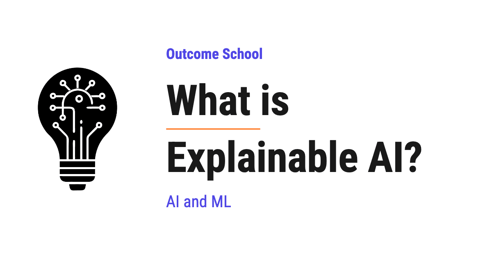

# What is Explainable AI?

> Archived from <https://outcomeschool.com/blog/explainable-ai-xai> on 2026-11-25.

Explainable AI, often written as XAI, is a set of methods that help us understand why an AI model made a certain decision, giving reasons a human can follow.

In this blog, we will learn about Explainable AI. We will also see the problem of the black box, why explanations are important, the difference between global and local explanations, the common methods, the accuracy and explainability trade-off, and where it is used.

We will cover the following:
<ul><li>The problem of the black box</li><li>What is Explainable AI?</li><li>Importance of Explainable AI</li><li>Global and local explanations</li><li>The common methods</li><li>The accuracy and explainability trade-off</li><li>Where it is used</li></ul>
I am <strong>Amit Shekhar</strong>, Founder @ <a target="_blank" rel="noopener noreferrer" href="https://outcomeschool.com">Outcome School</a>, I have taught and mentored many developers, and their efforts landed them high-paying tech jobs, helped many tech companies in solving their unique problems, and created many open-source libraries being used by top companies. I am passionate about sharing knowledge through open-source, blogs, and videos.

I teach <a target="_blank" rel="noopener noreferrer" href="https://outcomeschool.com/program/ai-and-machine-learning">AI and Machine Learning</a> at Outcome School.

Let&#x27;s get started.
<h2 id="the-problem-of-the-black-box">The problem of the black box</h2>
Before jumping into Explainable AI, we must understand the problem it solves.

Many powerful AI models, like deep <a target="_blank" rel="noopener noreferrer" href="neural-network.md">neural networks</a>, are very accurate. But they are also a mystery. They give an answer, but they do not tell us why. We put data in, and a decision comes out, but the reasoning inside is hidden.

<pre><code class="code-highlight">              Input
                ↓
+----------------------------------+
| big AI model, a mystery inside   |
+----------------------------------+
                ↓
             Decision
</code></pre>

Here, we can see the input and the decision, but not the &quot;why&quot;.

This hidden nature is called a <strong>black box</strong>. We can see what goes in and what comes out, but we cannot see the reasoning inside. This is a serious problem when the decision matters, like approving a loan or reading a medical scan.
<h2 id="what-is-explainable-ai">What is Explainable AI?</h2>
<strong>Explainable AI, often written as XAI, is a set of methods that help us understand why an AI model made a certain decision.</strong>

It gives us the reasons behind a decision in a way a human can understand.

<pre><code class="code-highlight">   Black box:      &quot;Loan rejected.&quot;   (no reason given)

   Explainable AI: &quot;Loan rejected, mainly because the income was low
                    and the existing debt was high.&quot;   (clear reasons)
</code></pre>

Here, we can see the difference. Instead of just a decision, we also get the reasons behind it. This turns a mysterious answer into a decision we can understand and check.

<strong>Planning your move into AI?</strong>

No matter which tech domain you work in today, with your effort, you can transition to these roles:
<ul><li>AI Engineer</li><li>Forward Deployed Engineer</li><li>AI Agent Engineer</li><li>Harness Engineer</li><li>Voice AI Engineer</li><li>AI Architect</li><li>LLM Engineer</li><li>LLM Inference Engineer</li><li>Gen AI Engineer</li><li>MLOps Engineer</li><li>ML Engineer</li><li>Deep Learning Engineer</li></ul>
Our <a target="_blank" rel="noopener noreferrer" href="https://outcomeschool.com/program/ai-and-machine-learning">AI and Machine Learning Program</a> at Outcome School takes you there.
<h2 id="importance-of-explainable-ai">Importance of Explainable AI</h2>
Now, why do we care so much about explanations? Let&#x27;s see the reasons.
<ul><li><strong>Trust.</strong> We trust a decision more when we understand why it was made.</li><li><strong>Fairness.</strong> Explanations help us catch unfair bias, like a model rejecting people for the wrong reasons.</li><li><strong>Debugging.</strong> If a model is wrong, the explanation helps us find and fix the cause.</li><li><strong>Rules and law.</strong> In areas like finance and health, the law can require a reason for a decision. In many places, a person has a right to know why they were rejected.</li></ul><h2 id="global-and-local-explanations">Global and local explanations</h2>
There are two kinds of explanations, and it helps to know the difference.
<ul><li>A <strong>global explanation</strong> tells us how the model behaves overall. For example, &quot;in general, income is the most important factor for this model.&quot;</li><li>A <strong>local explanation</strong> tells us why the model made one specific decision. For example, &quot;this particular loan was rejected because of this person&#x27;s high debt.&quot;</li></ul>
<pre><code class="code-highlight">   Global:  how the model behaves in general
   Local:   why the model made this one decision
</code></pre>

Here, we can see the two views. Global is the big picture across all decisions. Local zooms into a single case. Both are useful, depending on what we want to know.

<strong>A quick note for you</strong>

No matter which tech domain you work in, get familiar with these topics:
<ul><li>LLM</li><li>RAG</li><li>MCP</li><li>Agent</li><li>Fine-tuning</li><li>Quantization</li></ul>
We put it all together in one video:

<a target="_blank" rel="noopener noreferrer" href="https://www.youtube.com/watch?v=lnfWvX66FUk">AI Engineering Explained: LLM, RAG, MCP, Agent, Fine-Tuning, and Quantization</a>

No need to stop reading - bookmark it and watch later when you get time. Future you will thank you.

Now, let&#x27;s get back to the topic.
<h2 id="the-common-methods">The common methods</h2>
Now, let&#x27;s see the common ways to explain a model.
<ul><li><strong>Feature importance.</strong> This shows which inputs mattered most to the decision. For a loan, it can show that income and debt mattered most.</li><li><strong>LIME and SHAP.</strong> These are popular methods that measure how much each input pushed the decision toward or away from the result. SHAP, for example, fairly splits the credit among all the inputs.</li><li><strong>Counterfactuals.</strong> This tells us the smallest change that would flip the decision. For example, &quot;if the income were 5,000 higher, the loan would have been approved.&quot; This is easy to act on.</li><li><strong>Visualization.</strong> For images, we can highlight the parts of the picture the model focused on, like showing which pixels led it to say &quot;cat&quot;.</li></ul>
<pre><code class="code-highlight">   Feature importance:  which inputs mattered most
   LIME / SHAP:         how much each input pushed the decision
   Counterfactual:      the smallest change that flips the decision
   Visualization:       which parts of an image the model looked at
</code></pre>

Here, we can see that each method gives a different kind of reason, and we pick the one that fits our need.
<h2 id="the-accuracy-and-explainability-trade-off">The accuracy and explainability trade-off</h2>
There is one important trade-off to understand.

Simple models, like a small <a target="_blank" rel="noopener noreferrer" href="decision-trees-and-random-forests.md">decision tree</a>, are easy to explain, but they may be less accurate. Very complex models, like deep neural networks, are often more accurate, but they are much harder to explain.

<pre><code class="code-highlight">   Simple model:   easy to explain,   sometimes less accurate
   Complex model:  harder to explain, often more accurate
</code></pre>

Here, we can see the balance. Sometimes we choose a simpler model just so we can explain it. Other times we keep a complex model and add explainability methods on top to understand it. The right choice depends on how much the explanation matters for our use case.

<strong>Stay updated:</strong> Subscribe to our <a target="_blank" rel="noopener noreferrer" href="https://outcomeschool.substack.com/subscribe">newsletter</a> to get our latest AI and Machine Learning blogs straight to your inbox.
<h2 id="where-it-is-used">Where it is used</h2>
Now, let&#x27;s see where it is used.
<ul><li><strong>Finance.</strong> Explaining why a loan or a credit card was approved or rejected.</li><li><strong>Healthcare.</strong> Showing why a model flagged a scan, so a doctor can check the reasoning.</li><li><strong>Hiring.</strong> Making sure a screening model is fair and not biased.</li><li><strong>Any high-stakes decision</strong> where people deserve to know the reason.</li></ul>
Now we must have understood what Explainable AI is, how it explains a decision, and where it is used.
<h2 id="frequently-asked-questions">Frequently Asked Questions</h2><h3 id="what-does-shap-do-in-explainable-ai">What does SHAP do in Explainable AI?</h3>
SHAP measures how much each input pushed a decision toward or away from the result. It fairly splits the credit for the decision among all the inputs. SHAP and LIME are popular methods, and each gives a different kind of reason than feature importance or counterfactuals.
<h3 id="what-is-a-counterfactual-explanation">What is a counterfactual explanation?</h3>
A counterfactual explanation tells us the smallest change that would flip the decision. For example, &quot;if the income were 5,000 higher, the loan would have been approved.&quot; This kind of explanation is easy to act on, because it tells the person exactly what would change the result.
<h3 id="is-a-decision-tree-an-explainable-model">Is a decision tree an explainable model?</h3>
Yes. A small decision tree is a simple model that is easy to explain. The trade-off is that it may be less accurate than a very complex model like a deep neural network. Sometimes we choose such a simpler model just so we can explain its decisions.
<h3 id="can-the-law-require-an-explanation-for-an-ai-decision">Can the law require an explanation for an AI decision?</h3>
Yes. In areas like finance and health, the law can require a reason for a decision. In many places, a person has a right to know why they were rejected, for example, why a loan was not approved. Explainable AI helps us give that reason.

That&#x27;s it for now.

Thanks

<strong>Amit Shekhar</strong> Founder @ <a target="_blank" rel="noopener noreferrer" href="https://outcomeschool.com">Outcome School</a>

You can connect with me on:
<ul><li><a target="_blank" rel="noopener noreferrer" href="https://x.com/amitiitbhu">X</a></li><li><a target="_blank" rel="noopener noreferrer" href="https://www.linkedin.com/in/amit-shekhar-iitbhu">LinkedIn</a></li><li><a target="_blank" rel="noopener noreferrer" href="https://github.com/amitshekhariitbhu">GitHub</a></li></ul>
Follow Outcome School on:
<ul><li><a target="_blank" rel="noopener noreferrer" href="https://x.com/outcome_school">X</a></li><li><a target="_blank" rel="noopener noreferrer" href="https://youtube.com/@OutcomeSchool">YouTube</a></li><li><a target="_blank" rel="noopener noreferrer" href="https://www.linkedin.com/company/outcomeschool">LinkedIn</a></li><li><a target="_blank" rel="noopener noreferrer" href="http://github.com/OutcomeSchool">GitHub</a></li></ul>
<a target="_blank" rel="noopener noreferrer" href="https://outcomeschool.com/blog"><strong>Read all of our high-quality blogs here.</strong></a>

