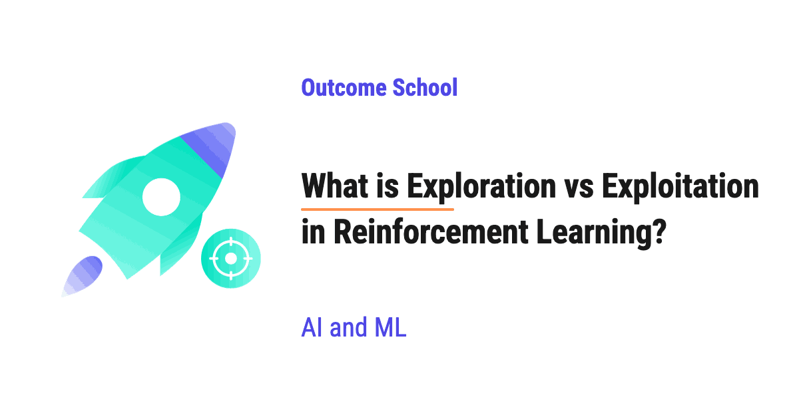

# What is Exploration vs Exploitation in Reinforcement Learning?

> Archived from <https://outcomeschool.com/blog/exploration-vs-exploitation> on 2026-11-25.

Exploration vs Exploitation in Reinforcement Learning is the choice an agent faces at every step: use the action it already knows works well (exploitation), or try a different action to learn something new that can work even better (exploration).

In this blog, we will learn about exploration vs exploitation in reinforcement learning. We will also see what exploitation and exploration mean, why balancing them is a dilemma, the multi-armed bandit problem with real numbers, the common strategies from greedy and epsilon-greedy to UCB and softmax and how they compare, and how exploration shows up when we train LLMs with reinforcement learning.

We will cover the following:
<ul><li>What is Exploitation?</li><li>What is Exploration?</li><li>The Exploration vs Exploitation Dilemma</li><li>The Multi-Armed Bandit Problem</li><li>Greedy Strategy</li><li>Epsilon-Greedy Strategy</li><li>Decaying Epsilon</li><li>Optimistic Initial Values</li><li>Upper Confidence Bound (UCB)</li><li>Softmax Exploration with Temperature</li><li>Comparing the Strategies</li><li>Exploration in LLM Reinforcement Learning</li></ul>
I am <strong>Amit Shekhar</strong>, Founder @ <a target="_blank" rel="noopener noreferrer" href="https://outcomeschool.com">Outcome School</a>, I have taught and mentored many developers, and their efforts landed them high-paying tech jobs, helped many tech companies in solving their unique problems, and created many open-source libraries being used by top companies. I am passionate about sharing knowledge through open-source, blogs, and videos.

I teach <a target="_blank" rel="noopener noreferrer" href="https://outcomeschool.com/program/ai-and-machine-learning">AI and Machine Learning</a> at Outcome School.

Let&#x27;s get started.

In <strong><a target="_blank" rel="noopener noreferrer" href="reinforcement-learning.md">Reinforcement Learning</a></strong>, an <strong>agent</strong> learns by doing. It takes an <strong>action</strong>, gets a <strong>reward</strong> (a number that says how good that action was), and slowly learns which actions give more reward. The agent does not know the right answer in advance. It has to find it by trying.

So, at every step, the agent faces a question: repeat the best action it knows, or try something new? Here comes the exploration vs exploitation into the picture.
<h2 id="what-is-exploitation">What is Exploitation?</h2>
<strong>Exploitation means picking the action that has given the best reward so far.</strong>

Let&#x27;s say we have moved to a new city. In the first week, we tried 3 restaurants, and one of them served very good food. Now, whenever we feel hungry, we go back to that same restaurant. This is exploitation. We are using what we already know to get a good meal with low risk.

Exploitation gives us a good reward right now. But it has one problem. We never learn whether there is an even better restaurant just two streets away.

This was about exploitation. Now, it&#x27;s time to learn about exploration.
<h2 id="what-is-exploration">What is Exploration?</h2>
<strong>Exploration means trying an action that is not the current best, so that we can learn more about it.</strong>

In the same city, there are 50 restaurants, and we have tried only 3 of them. If we try a new restaurant today, this is exploration. The meal can be bad. But it can also turn out to be the best food in the city, and then we will eat better for the rest of our stay.

Exploration costs us something today, and it pays us back later with better knowledge.
<h2 id="the-exploration-vs-exploitation-dilemma">The Exploration vs Exploitation Dilemma</h2>
Now, the question is: how often should we try a new restaurant, and how often should we go back to our favorite one?
<ul><li>If we only exploit, we get stuck with the first good option we found, which is often not the best one.</li><li>If we only explore, we keep trying new places forever and never enjoy the best one we already found.</li></ul>
Both extremes collect less total reward. The agent must balance the two. This is called the <strong>exploration vs exploitation dilemma</strong>, and it is one of the central problems in reinforcement learning.

The best way to learn this is by taking an example.
<h2 id="the-multi-armed-bandit-problem">The Multi-Armed Bandit Problem</h2>
The classic example used to study this dilemma is the <strong>multi-armed bandit problem</strong>.

A slot machine in a casino is sometimes called a &quot;one-armed bandit&quot;, because it has one lever (arm) and it takes our money. A <strong>multi-armed bandit</strong> is a row of such machines, and at every step we choose which one to pull. It is the simplest form of reinforcement learning, because the situation never changes between pulls. Only our choice of machine matters. When the situation does change after every action, the problem is written down as a <a target="_blank" rel="noopener noreferrer" href="markov-decision-process-mdp.md">Markov Decision Process (MDP)</a>, and we have a detailed blog that explains it step by step.

Let&#x27;s say we have 3 machines: A, B, and C. Each pull either pays 1 coin or pays 0 coins. Each machine has a hidden chance of paying:
<table><thead><tr><th>Machine</th><th>Hidden chance of paying 1 coin</th></tr></thead><tbody><tr><td>A</td><td>20%</td></tr><tr><td>B</td><td>50%</td></tr><tr><td>C</td><td>80%</td></tr></tbody></table>
We, as the agent, do not see this table. We have 1000 pulls, and our goal is to collect as many coins as possible.

If we knew the table, we would pull machine C every time and collect about 800 coins. But we do not know it. We must discover it by pulling.

For each machine, the agent keeps an <strong>estimate</strong>: the average reward it has seen from that machine so far. For example, if we pulled machine B 4 times and got 1, 0, 1, 1, the estimate for B is:

<strong>estimate(B) = (1 + 0 + 1 + 1) / 4 = 0.75</strong>

When the situation changes after every action, the agent keeps such an estimate for every state and action. We have a detailed blog on <a target="_blank" rel="noopener noreferrer" href="value-function-and-q-learning.md">Value Function and Q-Learning</a> that covers this end to end.

Now, let&#x27;s see different strategies the agent can use to decide which machine to pull next.
<h2 id="greedy-strategy">Greedy Strategy</h2>
The simplest strategy is <strong>greedy</strong>: always pull the machine with the highest estimate.

At the start, all estimates are 0. Let&#x27;s say ties go to the first machine, so the agent pulls A. Now, two things can happen:
<ul><li>A pays 0 coins. The estimate of A stays at 0, all three machines are still tied, and the tie again goes to A.</li><li>A pays 1 coin. The estimate of A goes above 0, while B and C are still at 0. So, A wins clearly.</li></ul>
Either way, the agent picks A again, and again, and again.

The agent never tries B or C even once. It ends up with about 200 coins instead of about 800.

This is the failure of pure exploitation. The greedy agent locks onto the first option that looked good and never learns that something better exists.

<strong>Planning your move into AI?</strong>

No matter which tech domain you work in today, with your effort, you can transition to these roles:
<ul><li>AI Engineer</li><li>Forward Deployed Engineer</li><li>AI Agent Engineer</li><li>Harness Engineer</li><li>Voice AI Engineer</li><li>AI Architect</li><li>LLM Engineer</li><li>LLM Inference Engineer</li><li>Gen AI Engineer</li><li>MLOps Engineer</li><li>ML Engineer</li><li>Deep Learning Engineer</li></ul>
Our <a target="_blank" rel="noopener noreferrer" href="https://outcomeschool.com/program/ai-and-machine-learning">AI and Machine Learning Program</a> at Outcome School takes you there.
<h2 id="epsilon-greedy-strategy">Epsilon-Greedy Strategy</h2>
So, here comes <strong>epsilon-greedy</strong> to the rescue.

Pick a small number called <strong>epsilon</strong>, for example 0.1. Then, at every step:
<ul><li>With probability epsilon (10% of the time), explore: pull a random machine.</li><li>With probability 1 - epsilon (90% of the time), exploit: pull the machine with the highest estimate.</li></ul>
Let&#x27;s see this as a diagram:

<pre><code class="language-text code-highlight">     ┌────────────────────────────────┐
     │ Pick a random number r         │
     │ between 0 and 1                │
     └────────────────┬───────────────┘
                      ↓
     ┌────────────────────────────────┐
     │ Is r &lt; epsilon (0.1)?          │
     └────┬───────────────────────┬───┘
          ↓                       ↓
         Yes                     No
          ↓                       ↓
┌───────────────────┐   ┌───────────────────┐
│ EXPLORE           │   │ EXPLOIT           │
│ Pull a random     │   │ Pull the machine  │
│ machine           │   │ with the highest  │
│ (10% of pulls)    │   │ estimate (90%)    │
└─────────┬─────────┘   └─────────┬─────────┘
          ↓                       ↓
┌───────────────────────────────────────────┐
│ Get reward: 1 coin or 0 coins             │
└─────────────────────┬─────────────────────┘
                      ↓
┌───────────────────────────────────────────┐
│ Update the estimate of that machine       │
└───────────────────────────────────────────┘
</code></pre>

Here, we can see that 90% of the time the agent uses its best guess, and 10% of the time it tries a random machine. Those random tries are how it discovers that C is better than A.

Let&#x27;s see the code for both greedy and epsilon-greedy as below:

<pre><code class="code-highlight language-python">import random

def run(epsilon, steps=1000, seed=42):
    random.seed(seed)
    win_chance = [0.2, 0.5, 0.8]   # hidden from the agent
    estimate = [0.0, 0.0, 0.0]     # what the agent believes
    count = [0, 0, 0]
    total = 0
    for _ in range(steps):
        if random.random() &lt; epsilon:
            arm = random.randrange(3)              # explore
        else:
            arm = estimate.index(max(estimate))    # exploit
        reward = 1 if random.random() &lt; win_chance[arm] else 0
        count[arm] += 1
        estimate[arm] += (reward - estimate[arm]) / count[arm]
        total += reward
    print(f&quot;epsilon={epsilon}: total={total}, pulls={count}&quot;)

run(0.0)
run(0.1)
</code></pre>

Here, we have:
<ul><li><code>win_chance</code> is the hidden table. The agent never reads it directly. It only sees the reward.</li><li><code>estimate</code> is the running average reward of each machine.</li><li>If the random number is less than <code>epsilon</code>, we pull a random machine. Otherwise, we pull the machine with the highest estimate.</li><li>The line <code>estimate[arm] += (reward - estimate[arm]) / count[arm]</code> updates the average without storing every past reward.</li><li><code>run(0.0)</code> is pure greedy, because epsilon is 0. <code>run(0.1)</code> is epsilon-greedy.</li></ul>
This will print the following:

<pre><code class="language-text code-highlight">epsilon=0.0: total=186, pulls=[1000, 0, 0]
epsilon=0.1: total=725, pulls=[96, 38, 866]
</code></pre>

Here, we can see that the greedy agent pulled machine A all 1000 times and got only 186 coins. The epsilon-greedy agent explored enough to find machine C, pulled it 866 times, and got 725 coins. That is almost 4 times more coins.

But epsilon-greedy has a weakness. Even after the agent is sure that C is the best, it still spends 10% of its pulls on random choices forever, and most of those random choices land on A or B. Let&#x27;s see how the next strategy solves this issue.
<h2 id="decaying-epsilon">Decaying Epsilon</h2>
In the beginning, the agent knows nothing, so it must explore a lot. Later, it knows a lot, so it must explore very less.

<strong>Decaying epsilon</strong> follows exactly this idea. We start with a large epsilon and make it smaller after every step. For example:

<strong>epsilon = max(0.01, 1.0 * 0.99^step)</strong>

Let&#x27;s see how epsilon changes over time:
<table><thead><tr><th>Step</th><th>Epsilon</th><th>Behaviour</th></tr></thead><tbody><tr><td>0</td><td>1.00</td><td>Explore every time</td></tr><tr><td>100</td><td>0.37</td><td>Explore about 1 in 3 pulls</td></tr><tr><td>300</td><td>0.05</td><td>Explore about 1 in 20 pulls</td></tr><tr><td>500+</td><td>0.01</td><td>Explore about 1 in 100 pulls</td></tr></tbody></table>
Here, the <code>max(0.01, ...)</code> part keeps a small amount of exploration alive, so that the agent can still notice if the hidden chances of the machines change later.

This is how decaying epsilon explores a lot at the start, when exploration is most useful, and exploits a lot at the end, when the agent already knows the best action.

<strong>A quick note for you</strong>

No matter which tech domain you work in, get familiar with these topics:
<ul><li>LLM</li><li>RAG</li><li>MCP</li><li>Agent</li><li>Fine-tuning</li><li>Quantization</li></ul>
We put it all together in one video:

<a target="_blank" rel="noopener noreferrer" href="https://www.youtube.com/watch?v=lnfWvX66FUk">AI Engineering Explained: LLM, RAG, MCP, Agent, Fine-Tuning, and Quantization</a>

No need to stop reading - bookmark it and watch later when you get time. Future you will thank you.

Now, let&#x27;s get back to the topic.
<h2 id="optimistic-initial-values">Optimistic Initial Values</h2>
There is another simple trick that does not use any randomness at all.

Instead of starting every estimate at 0, we start every estimate at a high value, for example 1.0, which is the best reward possible here. It is as if the agent believes &quot;every machine pays every time&quot; until it is proven wrong.

Now, let&#x27;s use the plain greedy strategy with these optimistic starting values:
<ul><li>The agent pulls A. A pays 0. The estimate of A drops below 1.0.</li><li>Now B and C still look perfect at 1.0, so the greedy agent tries them.</li><li>Every machine gets tried, and every pull that pays 0 lowers that machine&#x27;s estimate, until the agent settles on the one that keeps paying, which is usually C.</li></ul>
Means, the optimism itself pushes the agent to explore.

<strong>Note:</strong> This works well at the start, but it is not a full solution. The early exploration is a one-time push. In our example, it finds C in most runs, but if the agent gets unlucky early, it can still settle on B. And if the hidden chances of the machines change later, this trick does not explore again.
<h2 id="upper-confidence-bound-ucb">Upper Confidence Bound (UCB)</h2>
Epsilon-greedy explores randomly. It can waste a pull on machine A even when we have already pulled A hundreds of times and know it is bad.

<strong>Upper Confidence Bound (UCB)</strong> explores in a more targeted way. It prefers the machines that we are unsure about.

UCB gives each machine a score, and the agent pulls the machine with the highest score:

<strong>score = average_reward + sqrt(2 * ln(t) / n)</strong>

Here, in this formula:
<ul><li><code>average_reward</code> is the estimate of that machine.</li><li><code>t</code> is the total number of pulls so far, across all machines.</li><li><code>n</code> is the number of times this particular machine was pulled.</li><li><code>ln</code> is the natural logarithm, which grows very slowly as <code>t</code> grows.</li></ul>
The second part is the <strong>exploration bonus</strong>. It is big when <code>n</code> is small, which means we have pulled this machine only a few times and we are not sure about it. It shrinks as we pull the machine more.

Let&#x27;s take an example after 20 total pulls (<code>t = 20</code>, so <code>ln(20)</code> is about 3.0):
<table><thead><tr><th>Machine</th><th>Average</th><th>Pulls (n)</th><th>Bonus</th><th>Score</th></tr></thead><tbody><tr><td>A</td><td>0.20</td><td>10</td><td>0.77</td><td>0.97</td></tr><tr><td>B</td><td>0.50</td><td>2</td><td>1.73</td><td>2.23</td></tr><tr><td>C</td><td>0.60</td><td>8</td><td>0.87</td><td>1.47</td></tr></tbody></table>
Here, we can notice that machine C has the best average, but UCB picks machine B. Why? Because B was pulled only 2 times. Its average of 0.50 is based on very little data, and its true value can be much higher. UCB gives B a chance to prove itself.

If B is really worse than C, more pulls bring its average close to its true value of 0.5, its bonus shrinks, and UCB moves back to C. And because <code>ln(t)</code> keeps growing slowly, a machine that has not been pulled for a long time slowly gains bonus again and gets one more check later.

This is the idea behind UCB: <strong>when we are unsure about an action, we assume it can be good and give it a chance.</strong>

If we want to go deep into Reinforcement Learning and Exploration vs Exploitation, check out our <a target="_blank" rel="noopener noreferrer" href="https://outcomeschool.com/program/ai-and-machine-learning">AI and Machine Learning Program</a> at Outcome School.
<h2 id="softmax-exploration-with-temperature">Softmax Exploration with Temperature</h2>
Epsilon-greedy treats all non-best machines the same. When it explores, a bad machine and a nearly-best machine have an equal chance.

<strong>Softmax exploration</strong> fixes this. It turns the estimates into probabilities, so that better machines get picked more often, but every machine still has some chance. <a target="_blank" rel="noopener noreferrer" href="softmax-function.md">Softmax</a> is a function that converts a list of numbers into probabilities that add up to 1, where a bigger number gets a bigger probability.

It also uses a number called <strong>temperature</strong> (<code>T</code>):

<strong>probability(machine) = exp(estimate / T) / sum of exp(estimate / T) over all machines</strong>

Let&#x27;s say our estimates are A = 0.2, B = 0.5, and C = 0.8.
<table><thead><tr><th>Temperature</th><th>A</th><th>B</th><th>C</th><th>Behaviour</th></tr></thead><tbody><tr><td>T = 1.0</td><td>0.24</td><td>0.32</td><td>0.44</td><td>Explores a lot</td></tr><tr><td>T = 0.1</td><td>0.00</td><td>0.05</td><td>0.95</td><td>Mostly exploits, picks C</td></tr></tbody></table>
Here, at T = 0.1, the chance of A is about 0.002, so it shows as 0.00. We can see that:
<ul><li>A high temperature makes the probabilities close to each other, so the agent explores more.</li><li>A low temperature makes the best machine dominate, so the agent exploits more.</li><li>Even when exploring, the agent picks B more often than A, because B looks better than A.</li></ul>
Just like epsilon, the temperature can also start high and go down over time.
<h2 id="comparing-the-strategies">Comparing the Strategies</h2>
Let me tabulate the differences between these strategies for your better understanding.
<table><thead><tr><th>Strategy</th><th>How it explores</th><th>Strength</th><th>Weakness</th></tr></thead><tbody><tr><td>Greedy</td><td>Does not explore</td><td>Simple, no wasted pulls</td><td>Gets stuck on the first good option</td></tr><tr><td>Epsilon-Greedy</td><td>Random action with probability epsilon</td><td>Simple and works well in practice</td><td>Keeps exploring at the same rate forever</td></tr><tr><td>Decaying Epsilon</td><td>Random action, less and less over time</td><td>Explores early, exploits later</td><td>We must choose how fast it decays</td></tr><tr><td>Optimistic Initial Values</td><td>Starts all estimates high</td><td>No randomness needed</td><td>Explores only at the start</td></tr><tr><td>UCB</td><td>Bonus for actions tried only a few times</td><td>Explores where it is unsure</td><td>Harder to use when there are very many actions</td></tr><tr><td>Softmax Exploration</td><td>Picks better-looking actions more often</td><td>Better actions explored more</td><td>We must tune the temperature</td></tr></tbody></table>
<strong>Stay updated:</strong> Subscribe to our <a target="_blank" rel="noopener noreferrer" href="https://outcomeschool.substack.com/subscribe">newsletter</a> to get our latest AI and Machine Learning blogs straight to your inbox.
<h2 id="exploration-in-llm-reinforcement-learning">Exploration in LLM Reinforcement Learning</h2>
The same dilemma appears when we train an <a target="_blank" rel="noopener noreferrer" href="large-language-model-llm.md">LLM (Large Language Model)</a> with reinforcement learning.

Here, the agent is the LLM. The action is the next token it generates, and a full answer is a long chain of such actions. The reward comes at the end, for example from a <a target="_blank" rel="noopener noreferrer" href="reinforcement-learning-from-human-feedback-rlhf.md">reward model</a> or from checking whether a math answer is correct.

In LLM training, exploration mainly comes from two things.

<strong>Sampling temperature:</strong> The LLM gives a score (called a <a target="_blank" rel="noopener noreferrer" href="logits-in-machine-learning.md">logit</a>) for every possible next token, and these scores are turned into probabilities using <a target="_blank" rel="noopener noreferrer" href="how-does-temperature-control-llm-output.md">softmax with a temperature</a>, exactly like the softmax exploration we saw above.
<ul><li>With a temperature close to 0, the LLM almost always picks the most likely token. This is exploitation. Every answer to the same prompt looks almost the same, so the training has nothing new to learn from.</li><li>With a temperature around 1.0, the LLM sometimes picks less likely tokens. This is exploration. It produces different answers, and some of them can be better than its usual answer.</li></ul>
<strong>Multiple samples per prompt:</strong> During training, we often generate many answers for the same prompt, for example 8 or 16 answers. Each answer is scored with a reward. Then, in a common setup, the training increases the probability of the answers that scored above the average of the group and decreases the probability of the ones that scored below it. We have a detailed blog on <a target="_blank" rel="noopener noreferrer" href="group-relative-policy-optimization-grpo.md">Group Relative Policy Optimization (GRPO)</a> that explains this group-based training in depth.

Let&#x27;s say we ask the LLM a math question and sample 8 answers. 6 are wrong, and 2 are correct. Let&#x27;s see this as a diagram:

<pre><code class="language-text code-highlight">┌─────────────────────────────────────┐
│ Prompt: &quot;What is 17 * 24?&quot;          │
└──────────────────┬──────────────────┘
                   ↓
┌─────────────────────────────────────┐
│ Sample 8 answers                    │
│ (temperature = 1.0)                 │
└──────────────────┬──────────────────┘
                   ↓
┌─────────────────────────────────────┐
│ Reward: 2 correct (1 each),         │
│ 6 wrong (0 each)                    │
│ Group average = 2 / 8 = 0.25        │
└──────────────────┬──────────────────┘
                   ↓
┌─────────────────────────────────────┐
│ Raise probability of 2 correct      │
│ Lower probability of 6 wrong        │
└─────────────────────────────────────┘
</code></pre>

Here, we can see that the 2 correct answers scored 1, which is above the group average of 0.25, so they become more likely. The 6 wrong answers scored 0, which is below the average, so they become less likely.

Now, think about what happens without exploration. If we had sampled only one answer with temperature 0, and that answer was wrong, we would get the same wrong answer every time. The model would never see that a correct path exists. By exploring 8 different answers, the model finds the 2 correct paths and learns to make them more likely.

The balance still matters here. If the temperature is too low, the answers are almost the same and nothing new is learned. If the temperature is too high, the answers become close to random text and often get no reward at all. Over training, the model also tends to become more confident and its answers become less varied, so keeping enough exploration is an active concern when training LLMs with reinforcement learning.

To master Reward Models and GRPO for training LLMs from the ground up, explore our <a target="_blank" rel="noopener noreferrer" href="https://outcomeschool.com/program/ai-and-machine-learning">AI and Machine Learning Program</a> at Outcome School.

Now we must have understood what exploration vs exploitation in reinforcement learning is, why it is a dilemma, the strategies we use to balance it, and how it appears when we train LLMs.
<h2 id="frequently-asked-questions">Frequently Asked Questions</h2><h3 id="is-the-multi-armed-bandit-problem-a-reinforcement-learning-problem">Is the multi-armed bandit problem a reinforcement learning problem?</h3>
Yes. The multi-armed bandit problem is the simplest form of reinforcement learning. The agent picks an action, gets a reward, and learns which action pays the most. It is simple because the situation never changes between pulls, so only the choice of machine matters.
<h3 id="why-not-stop-exploring-once-the-agent-finds-the-best-action">Why not stop exploring once the agent finds the best action?</h3>
Because the hidden chances of the actions can change later. With decaying epsilon, we keep a small floor, for example 0.01, instead of going all the way to 0. This small amount of exploration lets the agent still notice such a change. Optimistic initial values do not do this, as they explore only at the start.
<h3 id="what-is-the-difference-between-epsilon-greedy-and-ucb">What is the difference between epsilon-greedy and UCB?</h3>
Epsilon-greedy explores randomly, so it can waste a pull on an action that it already knows is bad. UCB explores in a targeted way. It adds an exploration bonus to each action, and this bonus is big for actions tried only a few times. So, UCB prefers the actions it is unsure about.
<h3 id="what-happens-if-the-sampling-temperature-is-too-low-or-too-high-in-llm-reinforcement-learning">What happens if the sampling temperature is too low or too high in LLM reinforcement learning?</h3>
Both extremes hurt the training. If the temperature is too low, the sampled answers are almost the same, so nothing new is learned. If the temperature is too high, the answers become close to random text and often get no reward at all. Around 1.0, the LLM produces different answers, and some of them can be better than its usual answer.

That&#x27;s it for now.

Thanks

<strong>Amit Shekhar</strong> Founder @ <a target="_blank" rel="noopener noreferrer" href="https://outcomeschool.com">Outcome School</a>

You can connect with me on:
<ul><li><a target="_blank" rel="noopener noreferrer" href="https://x.com/amitiitbhu">X</a></li><li><a target="_blank" rel="noopener noreferrer" href="https://www.linkedin.com/in/amit-shekhar-iitbhu">LinkedIn</a></li><li><a target="_blank" rel="noopener noreferrer" href="https://github.com/amitshekhariitbhu">GitHub</a></li></ul>
Follow Outcome School on:
<ul><li><a target="_blank" rel="noopener noreferrer" href="https://x.com/outcome_school">X</a></li><li><a target="_blank" rel="noopener noreferrer" href="https://youtube.com/@OutcomeSchool">YouTube</a></li><li><a target="_blank" rel="noopener noreferrer" href="https://www.linkedin.com/company/outcomeschool">LinkedIn</a></li><li><a target="_blank" rel="noopener noreferrer" href="http://github.com/OutcomeSchool">GitHub</a></li></ul>
<a target="_blank" rel="noopener noreferrer" href="https://outcomeschool.com/blog"><strong>Read all of our high-quality blogs here.</strong></a>

