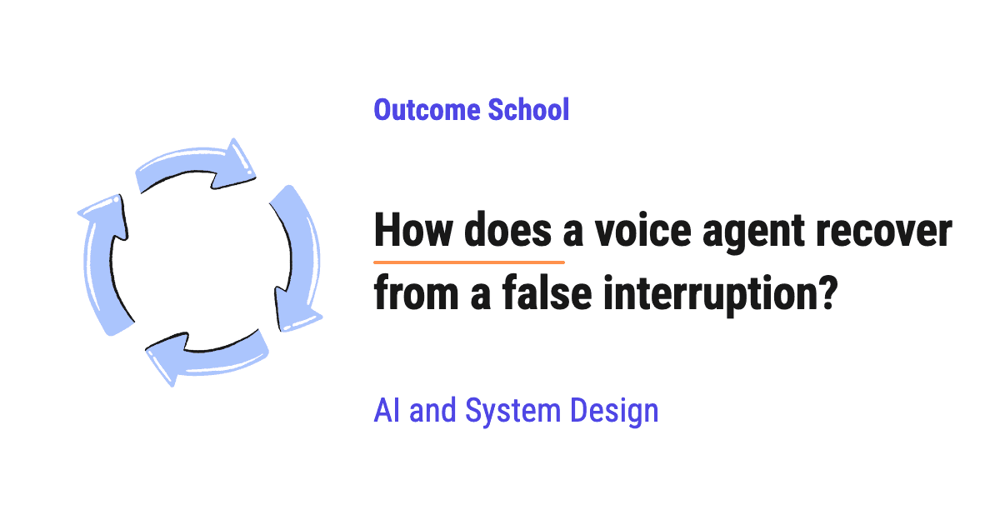

# How does a voice agent recover from a false interruption?

> Archived from <https://outcomeschool.com/blog/false-interruption-recovery> on 2026-11-25.

A voice agent recovers from a false interruption by pausing its speech instead of stopping it, waiting a short moment to check if the user really said something, and then continuing from where it paused if the user did not.

In this blog, we will learn about how a voice agent recovers from a false interruption. We will also see what a false interruption is, why pausing works better than stopping, how the agent decides that an interruption was false, how it continues speaking from the right place, how it keeps the conversation history correct, and how to tune the waiting time.

We will cover the following:
<ul><li>What is a false interruption?</li><li>What goes wrong without recovery</li><li>Pause, do not stop</li><li>How does the agent decide that an interruption was false?</li><li>How does the agent continue speaking?</li><li>When the interruption turns out to be real</li><li>Keeping the conversation history correct</li><li>A complete example from start to end</li><li>Tuning the waiting time</li></ul>
I am <strong>Amit Shekhar</strong>, Founder @ <a target="_blank" rel="noopener noreferrer" href="https://outcomeschool.com">Outcome School</a>, I have taught and mentored many developers, and their efforts landed them high-paying tech jobs, helped many tech companies in solving their unique problems, and created many open-source libraries being used by top companies. I am passionate about sharing knowledge through open-source, blogs, and videos.

I teach <a target="_blank" rel="noopener noreferrer" href="https://outcomeschool.com/program/ai-and-machine-learning">AI and Machine Learning</a> at Outcome School.

Let&#x27;s get started.
<h2 id="what-is-a-false-interruption">What is a false interruption?</h2>
Before jumping into a false interruption, we must know what a normal interruption is in a voice agent.

A voice agent is a program that talks with us using voice. We speak, it listens, it thinks using an LLM (Large Language Model), and it speaks back. While the agent is speaking, we can start talking over it, and the agent stops to listen to us. This is called <a target="_blank" rel="noopener noreferrer" href="what-is-barge-in-in-a-voice-ai-agent.md"><strong>barge-in</strong></a>. It is what makes a voice agent feel like a real conversation and not like a recorded message.

To support barge-in, the agent <a target="_blank" rel="noopener noreferrer" href="half-duplex-vs-full-duplex-voice-agents.md">keeps listening even while it is speaking</a>. The moment it hears something that sounds like the user&#x27;s voice, it treats it as an interruption.

But, the agent does not hear only words. It hears every sound that reaches the microphone. In the first fraction of a second, a cough or a loud &quot;hmm&quot; can look a lot like the start of a sentence.

<strong>A false interruption is a moment when the agent thinks the user wants to take over the conversation, but the user did not really mean to interrupt.</strong>

Some common causes of a false interruption are:
<ul><li>The user coughs, sneezes, or clears their throat.</li><li>The user says a short &quot;uh-huh&quot;, &quot;okay&quot;, or &quot;hmm&quot; just to show that they are listening.</li><li>A door closes, a dog barks, or a car honks near the user.</li><li>Someone else in the room says something.</li><li>A TV or radio is playing in the background.</li><li>The agent&#x27;s own voice comes back into the microphone from the speaker. This is called an <strong>echo</strong>.</li></ul>
In all these cases, the user still wants the agent to continue. But a simple agent hears a sound and stops.
<h2 id="what-goes-wrong-without-recovery">What goes wrong without recovery</h2>
Let&#x27;s say we have a voice agent for a bank. The user asks, &quot;How can I reset my card PIN?&quot;

The agent starts speaking: &quot;Sure. First, open the app and go to the Cards section. Then, tap on Reset PIN and...&quot;

At this moment, the user coughs.

A simple agent hears the cough, treats it as an interruption, and <a target="_blank" rel="noopener noreferrer" href="stopping-speech-on-interruption.md">stops speaking right away</a>. It also throws away the rest of its answer, because it thinks the user wants to say something new.

Now, the agent waits for the user to speak. But the user has nothing to say. The user was only coughing.

So, there is silence. After a few seconds, the user gets confused and says, &quot;Hello? Are you there?&quot; or &quot;You stopped in the middle.&quot;

This creates the following problems:
<ul><li>The user never hears the rest of the steps.</li><li>There is an awkward silence that makes the agent feel broken.</li><li>The user has to ask the same question again.</li><li>The agent spends extra time and money to create a new answer.</li></ul>
This is why a voice agent needs a way to recover from a false interruption. Now, let&#x27;s see how it does that.
<h2 id="pause-do-not-stop">Pause, do not stop</h2>
The best way to learn this is by taking an example.

Suppose we are reading a story aloud to a friend. In the middle, our friend sneezes. We do not throw away the book and wait for them to start a new topic. We pause for a moment, see that they are fine, and continue from the same line.

A voice agent can do the same thing. Let&#x27;s see how the approaches improved one by one to reach this behavior.

<strong>Approach 1: Stop and throw away.</strong> The agent stops speaking on any sound and throws away the rest of its reply. This is what we saw above. The issue with this approach is that a single cough loses the whole answer. Let&#x27;s see how the next approach solve this issue.

<strong>Approach 2: Stop, then create the answer again.</strong> The agent stops on any sound. If the user says nothing, the agent asks the LLM to create a new reply. The issue with this approach is that it is slow and the new reply often repeats the start of the old one, so the user hears the same lines again. Let&#x27;s see how the next approach solve this issue.

<strong>Approach 3: Pause and hold.</strong> The agent pauses its audio the moment it hears a possible interruption, but it keeps the rest of the reply ready. If the interruption turns out to be false, it continues from where it paused. If the interruption turns out to be real, it stops for good and listens.

Approach 3 is how a voice agent recovers from a false interruption.

Here is the difference between pausing and stopping:
<ul><li><strong>Stopping</strong> means the rest of the reply is gone.</li><li><strong>Pausing</strong> means the rest of the reply is still there, waiting.</li></ul>
The pause gives the agent time to decide, without losing anything.

<strong>Planning your move into AI?</strong>

No matter which tech domain you work in today, with your effort, you can transition to these roles:
<ul><li>AI Engineer</li><li>Forward Deployed Engineer</li><li>AI Agent Engineer</li><li>Harness Engineer</li><li>Voice AI Engineer</li><li>AI Architect</li><li>LLM Engineer</li><li>LLM Inference Engineer</li><li>Gen AI Engineer</li><li>MLOps Engineer</li><li>ML Engineer</li><li>Deep Learning Engineer</li></ul>
Our <a target="_blank" rel="noopener noreferrer" href="https://outcomeschool.com/program/ai-and-machine-learning">AI and Machine Learning Program</a> at Outcome School takes you there.
<h2 id="how-does-the-agent-decide-that-an-interruption-was-false">How does the agent decide that an interruption was false?</h2>
Now, the question is: after pausing, how does the agent know that the sound was not a real interruption?

The answer is: it waits for a short time after the sound ends and checks what the user did in that time. This short time is called the <strong>false interruption timeout</strong>. For example, LiveKit Agents uses 2 seconds for this timeout by default.

During this waiting time, the agent checks the following things.

<strong>Check 1: Did the user keep speaking?</strong> A small model called <strong>VAD (Voice Activity Detection)</strong> tells the agent whether a piece of audio contains human speech, and for how long. If the speech lasts only a fraction of a second and then stops, it is often not a real interruption.

<strong>Check 2: Did the user say any real words?</strong> The agent keeps sending the user&#x27;s audio to a speech-to-text model. If no words come back, the sound was most likely a cough, a bang, or background noise.

<strong>Check 3: Were the words only a filler?</strong> If the text is only &quot;uh-huh&quot;, &quot;okay&quot;, &quot;yeah&quot;, or &quot;hmm&quot;, the user was just showing that they are listening. These short sounds are called <a target="_blank" rel="noopener noreferrer" href="backchannels-in-voice-agents.md"><strong>backchannels</strong></a>. They are not a request to take over. But, if the filler is followed by more words, like &quot;okay, but what about my old card?&quot;, then it is a real interruption. This is one more reason why the agent waits for a short time instead of deciding on the first word.

Some newer systems also use a small audio model trained to tell a real barge-in apart from other sounds, like coughs and backchannels. It listens to the sound itself and gives a decision, without waiting for the full text.

If the user stays quiet, or says only a filler, until the timeout ends, the agent marks the interruption as false.

We have a detailed blog on <a target="_blank" rel="noopener noreferrer" href="interruption-vs-background-noise.md">how a voice agent tells a real interruption from a cough or background noise</a> that explains these checks step by step.
<h2 id="how-does-the-agent-continue-speaking">How does the agent continue speaking?</h2>
Now that we have learned how the agent decides, it&#x27;s time to learn how it continues speaking. Once the agent knows the interruption was false, it needs to continue speaking from the right place.

To do this, the agent must track how much of its reply has already been played to the user. Let&#x27;s understand this with our bank example.

The agent&#x27;s full reply is:

&quot;Sure. First, open the app and go to the Cards section. Then, tap on Reset PIN and enter your new PIN twice.&quot;

The voice for this reply is created by a text-to-speech model and played in <a target="_blank" rel="noopener noreferrer" href="streaming-tts.md">small pieces of audio</a>. The agent keeps a count of how much audio has been played. Many text-to-speech models also tell the agent the time at which each word is spoken, so the agent can match the audio position to the exact word.

When the user coughed, the agent had played up to &quot;Then, tap on Reset PIN and&quot;. The agent pauses exactly here and remembers this point.

After the timeout, the agent continues from that point: &quot;...enter your new PIN twice.&quot;

Since the rest of the audio was already ready and only paused, nothing new has to be created. The user hears a short gap, and then the answer continues.

An agent can also step back a little and repeat the start of the current sentence, so that the user does not hear a word cut in half. Both ways work, and the choice depends on our use case.

<strong>Note:</strong> Resuming works only when the audio output supports pausing. If the audio output can only play or stop, for example in some talking-avatar video setups, the agent cannot freeze the audio in place, and it must fall back to stopping.

<strong>A quick note for you</strong>

No matter which tech domain you work in, get familiar with these topics:
<ul><li>LLM</li><li>RAG</li><li>MCP</li><li>Agent</li><li>Fine-tuning</li><li>Quantization</li></ul>
We put it all together in one video:

<a target="_blank" rel="noopener noreferrer" href="https://www.youtube.com/watch?v=lnfWvX66FUk">AI Engineering Explained: LLM, RAG, MCP, Agent, Fine-Tuning, and Quantization</a>

No need to stop reading - bookmark it and watch later when you get time. Future you will thank you.

Now, let&#x27;s get back to the topic.
<h2 id="when-the-interruption-turns-out-to-be-real">When the interruption turns out to be real</h2>
Now, let&#x27;s see the other case. Not every interruption is false. Many times, the user really wants to speak.

Let&#x27;s take our bank example again. The agent has just said &quot;Then, tap on Reset PIN and&quot;, and the user says, &quot;Wait, I do not have the app.&quot;

Here, the speech-to-text model returns real words, and they are not a filler. So, the agent decides that the interruption is real. It does not need to wait for the timeout to end.

Now, the agent does the following:
<ul><li>It stops the paused audio for good and throws away the rest of the reply.</li><li>It <a target="_blank" rel="noopener noreferrer" href="truncating-context-on-interruption.md">cuts the conversation history</a> at the point where it stopped.</li><li>It listens to the full message from the user.</li><li>It sends the message to the LLM to create a new reply.</li></ul>
So, if the interruption is real, the agent turns the pause into a stop. We will learn why cutting the history matters in the next section.
<h2 id="keeping-the-conversation-history-correct">Keeping the conversation history correct</h2>
Now, there is one more thing to handle. The LLM keeps a history of the conversation, and it must match what the user actually heard.

Let&#x27;s see both cases.

<strong>Case 1: The interruption was false.</strong> The agent continued and finished the full reply. So, the full reply goes into the history. The LLM correctly believes that the user heard everything.

<strong>Case 2: The interruption was real.</strong> The agent stopped after &quot;Then, tap on Reset PIN and&quot;. The user never heard the rest. So, the agent must cut the reply in the history at the exact point where it stopped.

If the agent does not cut the history, the LLM believes the user heard &quot;enter your new PIN twice&quot;, even though they did not. Then, later in the conversation, the LLM can say &quot;As I mentioned, enter your PIN twice&quot;, and the user will be confused.

This is why tracking the played audio position is important. It is used both to continue speaking and to keep the history correct.

To learn Memory in Agents, Context Engineering, and how to Design a Real-Time Voice AI Agent from the ground up, check out our <a target="_blank" rel="noopener noreferrer" href="https://outcomeschool.com/program/ai-and-machine-learning">AI and Machine Learning Program</a> at Outcome School.
<h2 id="a-complete-example-from-start-to-end">A complete example from start to end</h2>
Now, let&#x27;s put everything together and walk through one full example. For the sake of understanding, let say the false interruption timeout is 2 seconds, and it starts counting once the sound ends.

<strong>Step 1:</strong> The user asks, &quot;How can I reset my card PIN?&quot; The agent starts speaking the answer.

<strong>Step 2:</strong> At 0.0 seconds, while the agent is speaking, the user coughs. The VAD reports a sound that can be speech.

<strong>Step 3:</strong> Within a fraction of a second, the agent pauses the audio. It remembers that it has played up to &quot;Then, tap on Reset PIN and&quot;.

<strong>Step 4:</strong> At 0.3 seconds, the cough ends. The agent starts the 2-second false interruption timeout and keeps listening.

<strong>Step 5:</strong> The speech-to-text model returns no words, and the user stays quiet.

<strong>Step 6:</strong> At 2.3 seconds, the timeout ends. The agent marks the interruption as false.

<strong>Step 7:</strong> Right after 2.3 seconds, the agent continues from the paused point: &quot;...enter your new PIN twice.&quot;

<strong>Step 8:</strong> The full reply goes into the conversation history.

We can see this flow in a diagram as below:

<pre><code class="code-highlight">+-----------------------------+
|      Agent is speaking      |
+-----------------------------+
               ↓
+-----------------------------+
|  VAD hears possible speech  |
+-----------------------------+
               ↓
+-----------------------------+
|  Pause audio, save position |
+-----------------------------+
               ↓
+-----------------------------+
|  Check the words until the  |
|         timeout ends        |
+-----------------------------+
               ↓
       +-------+-------+
       ↓               ↓
 Noise/filler     Real words
       ↓               ↓
+-------------+ +-------------+
| Resume from | |  Stop, cut  |
| saved point | |   history,  |
|             | |    listen   |
+-------------+ +-------------+
</code></pre>

Here, we can see that every interruption first goes into a pause. Only after the check does the agent decide whether to resume or to stop.

<strong>Stay updated:</strong> Subscribe to our <a target="_blank" rel="noopener noreferrer" href="https://outcomeschool.substack.com/subscribe">newsletter</a> to get our latest AI and Machine Learning blogs straight to your inbox.
<h2 id="tuning-the-waiting-time">Tuning the waiting time</h2>
Now, let&#x27;s discuss the length of the false interruption timeout.

<strong>If the timeout is too short:</strong> The agent resumes too quickly. A user who takes a breath before their real sentence, or whose words take a moment to turn into text, gets talked over again. This feels rude.

<strong>If the timeout is too long:</strong> After a cough, the user hears a long silence before the agent continues, and starts wondering if the agent has frozen. This feels slow and broken.

So, we must pick a value that is long enough to catch real speech and short enough that a cough does not create an awkward gap.

A few other settings help along with the timeout:
<ul><li>A minimum speech length, so that very short sounds, like a tap on the table, do not even cause a pause.</li><li>A minimum number of words, so that a single filler word does not count as an interruption.</li><li>Echo cancellation, which removes the agent&#x27;s own voice from the microphone audio, so that the echo does not trigger a pause.</li></ul>
We must test these settings with real users and real background noise, because a quiet office and a busy street behave very differently.

Now we must have understood how a voice agent recovers from a false interruption, how it pauses instead of stopping, how it decides that an interruption was false, how it continues speaking from the right place, and how it keeps the conversation history correct.
<h2 id="frequently-asked-questions">Frequently Asked Questions</h2><h3 id="what-is-the-false-interruption-timeout">What is the false interruption timeout?</h3>
The false interruption timeout is the short time a voice agent waits after a sound ends before it decides that the interruption was false. During this time, it checks whether the user kept speaking and said real words. For example, LiveKit Agents uses 2 seconds for this timeout by default.
<h3 id="does-the-agent-create-a-new-reply-after-a-false-interruption">Does the agent create a new reply after a false interruption?</h3>
No. When the agent pauses instead of stopping, the rest of its reply is still ready. Once it decides the interruption was false, it continues from the exact point where it paused, so nothing new has to be created. The user hears only a short gap, and then the answer continues.
<h3 id="can-every-voice-agent-pause-and-resume-its-audio">Can every voice agent pause and resume its audio?</h3>
No. Resuming works only when the audio output supports pausing. If the audio output can only play or stop, for example in some talking-avatar video setups, the agent cannot freeze the audio in place. In that case, it must fall back to stopping.
<h3 id="how-can-we-stop-the-agents-own-voice-from-causing-a-false-interruption">How can we stop the agent&#x27;s own voice from causing a false interruption?</h3>
We can use echo cancellation. The agent&#x27;s own voice can come back into the microphone from the speaker, and this echo can look like the user speaking. Echo cancellation removes the agent&#x27;s own voice from the microphone audio, so that the echo does not trigger a pause.

That&#x27;s it for now.

Thanks

<strong>Amit Shekhar</strong> Founder @ <a target="_blank" rel="noopener noreferrer" href="https://outcomeschool.com">Outcome School</a>

You can connect with me on:
<ul><li><a target="_blank" rel="noopener noreferrer" href="https://x.com/amitiitbhu">X</a></li><li><a target="_blank" rel="noopener noreferrer" href="https://www.linkedin.com/in/amit-shekhar-iitbhu">LinkedIn</a></li><li><a target="_blank" rel="noopener noreferrer" href="https://github.com/amitshekhariitbhu">GitHub</a></li></ul>
Follow Outcome School on:
<ul><li><a target="_blank" rel="noopener noreferrer" href="https://x.com/outcome_school">X</a></li><li><a target="_blank" rel="noopener noreferrer" href="https://youtube.com/@OutcomeSchool">YouTube</a></li><li><a target="_blank" rel="noopener noreferrer" href="https://www.linkedin.com/company/outcomeschool">LinkedIn</a></li><li><a target="_blank" rel="noopener noreferrer" href="http://github.com/OutcomeSchool">GitHub</a></li></ul>
<a target="_blank" rel="noopener noreferrer" href="https://outcomeschool.com/blog"><strong>Read all of our high-quality blogs here.</strong></a>

