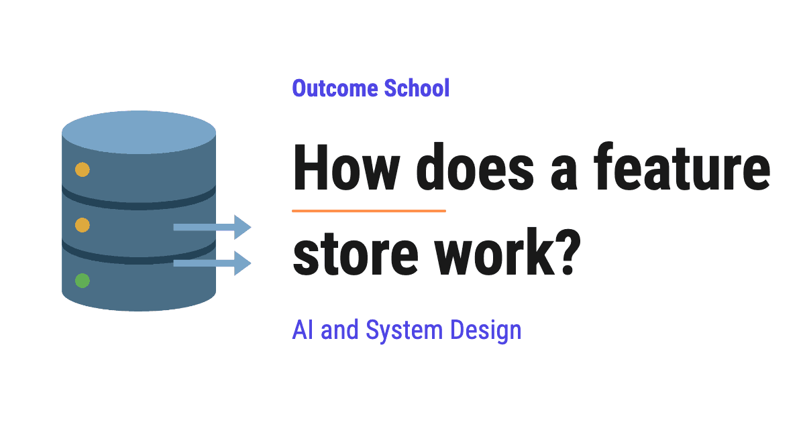

# How does a feature store work?

> Archived from <https://outcomeschool.com/blog/feature-store> on 2026-11-25.

A feature store is a central place that stores, manages, and serves features for machine learning, both for training and for live predictions.

In this blog, we will learn about how a feature store works. We will also see the problem before feature stores, how the offline store and the online store serve training and live predictions, the training-serving skew problem, point-in-time correctness, and when to use a feature store.

We will cover the following:
<ul><li>What is a feature?</li><li>What is a feature store?</li><li>The problem before feature stores</li><li>How a feature store works</li><li>The offline store and the online store</li><li>The training-serving skew problem</li><li>A simple end-to-end example</li><li>Point-in-time correctness</li><li>When to use a feature store</li></ul>
I am <strong>Amit Shekhar</strong>, Founder @ <a target="_blank" rel="noopener noreferrer" href="https://outcomeschool.com">Outcome School</a>, I have taught and mentored many developers, and their efforts landed them high-paying tech jobs, helped many tech companies in solving their unique problems, and created many open-source libraries being used by top companies. I am passionate about sharing knowledge through open-source, blogs, and videos.

I teach <a target="_blank" rel="noopener noreferrer" href="https://outcomeschool.com/program/ai-and-machine-learning">AI and Machine Learning</a> at Outcome School.

Let&#x27;s get started.
<h3 id="what-is-a-feature">What is a feature?</h3>
Before we learn about a feature store, we must understand what a feature is.

A <strong>feature</strong> is a single piece of information about something that we feed into a <a target="_blank" rel="noopener noreferrer" href="machine-learning.md">machine learning</a> model.

Let&#x27;s say we are building a model to detect if a credit card payment is fraud. The model needs facts about that payment. Each fact is a feature.

Here are a few features for one customer:
<ul><li>The number of payments made in the last hour.</li><li>The total money spent in the last 7 days.</li><li>The country where the card is being used.</li><li>The average amount spent per payment in the last 30 days.</li></ul>
A machine learning model usually does not read raw data directly. It needs these clean, ready-to-use facts. We have a detailed blog on <a target="_blank" rel="noopener noreferrer" href="feature-engineering.md">Feature Engineering</a> that explains how we create such features from raw data.

The subject of a feature can be a customer, a product, a payment, or anything we care about.

Now that we know what a feature is, let&#x27;s learn what a feature store is.
<h3 id="what-is-a-feature-store">What is a feature store?</h3>
A <strong>feature store</strong> is a central place that stores, manages, and serves features for machine learning.

It is a special database built only for features.

But it is not just a normal database. A normal database keeps raw data. A feature store keeps the cleaned, ready-to-use features, and it serves them to two very different places.

A feature store sits between our raw data and our machine learning model. It prepares features once and then hands them out whenever they are needed.
<h3 id="the-problem-before-feature-stores">The problem before feature stores</h3>
To understand why a feature store is so useful, we must first see life without one.

Let&#x27;s say a company has three teams building three different models.
<ul><li>Team A builds a fraud detection model.</li><li>Team B builds a model that <a target="_blank" rel="noopener noreferrer" href="recommendation-system.md">recommends products</a>.</li><li>Team C builds a model that predicts which customer will leave.</li></ul>
All three teams need a feature like &quot;total money the customer spent in the last 30 days&quot;.

The problem is that each team writes its own code to calculate this feature. Team A writes one version. Team B writes a slightly different version. Team C writes yet another version.

This causes three big problems.

<strong>Problem 1: Wasted effort.</strong> The same feature is built three times. This is repeated work that helps no one.

<strong>Problem 2: Different answers.</strong> Team A counts only completed payments. Team B also counts refunds. So, the same feature gives different numbers in different teams. This is confusing and error-prone.

<strong>Problem 3: A hidden bug.</strong> We will explain it fully in the training-serving skew section.

So, here comes the feature store to the rescue.

A feature store lets us build a feature once, store it in one place, and let every team and every model use that exact same feature. This removes the repeated work and the different answers.

<strong>Planning your move into AI?</strong>

No matter which tech domain you work in today, with your effort, you can transition to these roles:
<ul><li>AI Engineer</li><li>Forward Deployed Engineer</li><li>AI Agent Engineer</li><li>Harness Engineer</li><li>Voice AI Engineer</li><li>AI Architect</li><li>LLM Engineer</li><li>LLM Inference Engineer</li><li>Gen AI Engineer</li><li>MLOps Engineer</li><li>ML Engineer</li><li>Deep Learning Engineer</li></ul>
Our <a target="_blank" rel="noopener noreferrer" href="https://outcomeschool.com/program/ai-and-machine-learning">AI and Machine Learning Program</a> at Outcome School takes you there.
<h3 id="how-a-feature-store-works">How a feature store works</h3>
Now, let&#x27;s understand how a feature store actually works, step by step.

There are three main stages. We will walk through each one.

Here is the flow:

<pre><code class="code-highlight">   Raw data
 (every payment)
       |
       ↓
+----------------+
| Feature        |   Stage 1: create the features
| pipeline       |   (calculate from raw data)
+----------------+
       |
       ↓
+----------------+
| Feature store  |   Stage 2: store the features
+----------------+
       |
       ↓
   Stage 3: serve the features
       |
   +---+-----------+
   |               |
   ↓               ↓
Training      Live prediction
(lots of      (one customer,
 old data)     right now, fast)
</code></pre>

Here, we can see that raw data goes into a feature pipeline, the result is kept in the feature store, and from there the same features are served to two very different places: training and live prediction.

<strong>Stage 1:</strong> We create the features.

First, we take our raw data. Raw data is the unprocessed information sitting in our systems, like a long list of every payment ever made.

Then, we write a calculation that turns this raw data into a feature. For example, we group all payments by customer and add them up to get &quot;total spent in the last 30 days&quot;.

This calculation is sometimes called a <strong>feature pipeline</strong>. A pipeline is simply a series of steps that takes raw data in and gives clean features out.

<strong>Stage 2:</strong> We store the features.

After the features are calculated, we save them inside the feature store. The feature store keeps them organized and labeled, so any team can find and reuse them.

<strong>Stage 3:</strong> We serve the features.

Serving means giving the features to whoever asks for them. Features are needed in two very different situations.

The first situation is <strong>training</strong>. Training is when we teach the model using lots of old data. Here, we need millions of past feature values at once.

The second situation is <strong>serving a live prediction</strong>. This is when a real customer is doing something right now, and we need the model to make a fast decision in milliseconds. We have a detailed blog on <a target="_blank" rel="noopener noreferrer" href="model-serving.md">Model Serving</a> that explains how a model answers such live requests end to end.

These two situations have completely different needs. Training needs huge amounts of data but can take its time. Live prediction needs very little data but must be extremely fast.

So, how does one feature store handle both needs? The answer is that it uses two separate storage parts inside it.

Let&#x27;s learn about both.
<h3 id="the-offline-store-and-the-online-store">The offline store and the online store</h3>
A feature store usually has two parts. They work together but serve different purposes.

The first part is the <strong>offline store</strong>.

The offline store keeps a very large history of feature values. It remembers what each feature was at many points in the past.

This store is built to hold a huge amount of data. It is not built for speed. It is built for size.

We use the offline store for training. When we train a model, we pull years of feature history from here. We do not mind if it takes a few minutes, because training itself takes time.

The second part is the <strong>online store</strong>.

The online store keeps only the latest value of each feature. It does not keep history. It keeps just the freshest number.

This store is built for speed. It can return a feature in a few milliseconds.

We use the online store for live predictions. When a customer makes a payment right now, the fraud model asks the online store for that customer&#x27;s latest features, gets them instantly, and makes a fast decision.

Let me tabulate the differences between the offline store and the online store for your better understanding.
<table><thead><tr><th>Point</th><th>Offline store</th><th>Online store</th></tr></thead><tbody><tr><td>Keeps</td><td>Full history of features</td><td>Only the latest feature value</td></tr><tr><td>Built for</td><td>Large size</td><td>High speed</td></tr><tr><td>Speed</td><td>Slower, takes minutes</td><td>Very fast, milliseconds</td></tr><tr><td>Used for</td><td>Training the model</td><td>Live predictions</td></tr><tr><td>Amount of data</td><td>Very large</td><td>Small per request</td></tr></tbody></table>
Here, we can see that the two stores have opposite strengths. The offline store is big and slow. The online store is small and fast. Together, they cover both of our needs.

<strong>A quick note for you</strong>

No matter which tech domain you work in, get familiar with these topics:
<ul><li>LLM</li><li>RAG</li><li>MCP</li><li>Agent</li><li>Fine-tuning</li><li>Quantization</li></ul>
We put it all together in one video:

<a target="_blank" rel="noopener noreferrer" href="https://www.youtube.com/watch?v=lnfWvX66FUk">AI Engineering Explained: LLM, RAG, MCP, Agent, Fine-Tuning, and Quantization</a>

No need to stop reading - bookmark it and watch later when you get time. Future you will thank you.

Now, let&#x27;s get back to the topic.

The same feature calculation feeds both stores. We calculate the feature once, and the result goes into both the offline store and the online store. This is how the feature store solves the training-serving skew problem.

Let&#x27;s see it as below:

<pre><code class="code-highlight">      One feature calculation
          (run only once)
                  |
        +---------+---------+
        |                   |
        ↓                   ↓
+----------------+  +----------------+
| Offline store  |  | Online store   |
| full history   |  | latest value   |
| big and slow   |  | small and fast |
+----------------+  +----------------+
        |                   |
        ↓                   ↓
    Training         Live prediction
</code></pre>

Here, we can see that one calculation feeds both stores. The offline store keeps the full history for training, and the online store keeps the latest value for live prediction. Because both come from the same calculation, the numbers match.

Let&#x27;s understand that problem now.
<h3 id="the-training-serving-skew-problem">The training-serving skew problem</h3>
<strong>Training-serving skew</strong> is the bug where a feature is calculated one way during training and a different way during live prediction.

So, the model learns from features calculated one way, but at prediction time it gets features calculated a different way. As a result, its predictions become wrong.

Let&#x27;s see why this happens without a feature store.

When teams train a model, they often use one programming language and one set of tools to prepare features. For example, they prepare features in a large data system using one piece of code.

But when the model goes live and serves real customers, the features are often prepared again, using a different language and different code, because the live system needs to be fast.

Now, even a tiny difference between these two pieces of code creates a mismatch.

Let&#x27;s say during training, &quot;average spend&quot; is rounded to two decimal places. But during live serving, the new code does not round it. The model was taught on rounded numbers, but now it receives unrounded numbers.

The model behaves badly. Nobody notices for a long time, because the code runs without crashing. It just gives wrong predictions.

So, here comes the feature store to the rescue.

The feature store calculates each feature only once, with one piece of code. That single result is placed into both the offline store, used for training, and the online store, used for live serving.

Because both stores get their values from the same calculation, training and serving use the same feature logic. This removes the most common cause of training-serving skew, and it is one of the main reasons feature stores exist.

To learn Model Development and Training, along with Model Deployment and Serving, check out our <a target="_blank" rel="noopener noreferrer" href="https://outcomeschool.com/program/ai-and-machine-learning">AI and Machine Learning Program</a> at Outcome School.
<h3 id="a-simple-end-to-end-example">A simple end-to-end example</h3>
The best way to learn this is by taking an example. Let&#x27;s walk through one full story.

Suppose we run an online shopping app, and we want a model that decides whether to show a discount to a customer.

We decide to use one feature: &quot;number of orders the customer placed in the last 30 days&quot;.

<strong>Step 1:</strong> We calculate the feature.

We write one calculation that looks at all orders and counts how many each customer placed in the last 30 days.

For a customer named Riya, the answer is 12 orders.

<strong>Step 2:</strong> We store the feature.

This value of 12 is saved. It goes into the offline store as part of Riya&#x27;s history, and it goes into the online store as Riya&#x27;s latest value.

<strong>Step 3:</strong> We train the model.

To train, we pull millions of past values from the offline store. The model learns the pattern that customers with many orders respond well to discounts. The model is now trained.

<strong>Step 4:</strong> We serve a live prediction.

Now, Riya opens the app. We must decide in milliseconds whether to show her a discount.

The live system asks the online store for Riya&#x27;s feature. The online store instantly returns 12. The model receives 12, the same way it saw such numbers during training, and decides to show a discount.

Here, we can see that the value 12 came from one calculation. Training used it, and live serving used it. There is no mismatch. It works perfectly.

<strong>Stay updated:</strong> Subscribe to our <a target="_blank" rel="noopener noreferrer" href="https://outcomeschool.substack.com/subscribe">newsletter</a> to get our latest AI and Machine Learning blogs straight to your inbox.
<h3 id="point-in-time-correctness">Point-in-time correctness</h3>
Now, let&#x27;s learn one more important idea.

<strong>Point-in-time correctness</strong> means that when we train a model on past data, each feature value must be exactly what it was at that moment in the past, and not the value from later.

Let&#x27;s see why it is important with an example.

Suppose we are training a model to predict fraud for a payment Riya made on 1st January.

To train correctly, we need to know Riya&#x27;s &quot;total spent in the last 30 days&quot; as it was on 1st January. We must not use the value from 1st March, because on 1st January, that future value did not exist yet.

If we accidentally use the March value, we are teaching the model with information from the future. In real life, the model will never have future information. So, the model will look great during training and then fail badly in the real world.

This mistake is called <strong><a target="_blank" rel="noopener noreferrer" href="train-validation-test-split.md">data leakage</a></strong>. Leakage means future information leaks into the past during training, which is unrealistic.

So, here comes the feature store to the rescue again.

Because the offline store keeps the full history of every feature with timestamps, it can give us the correct value for each exact moment.

So, when we ask for Riya&#x27;s feature for 1st January, the offline store hands us the 1st January value and nothing from the future.

This careful matching of features to the correct past moment is point-in-time correctness. It keeps our training realistic.
<h3 id="when-to-use-a-feature-store">When to use a feature store</h3>
Now, let&#x27;s see when we actually need one.

A feature store is most useful in these situations.
<ul><li>We have many teams or many models reusing the same features. A feature store stops repeated work and keeps features consistent.</li><li>We need fast live predictions. The online store gives features in milliseconds.</li><li>We train on large amounts of history. The offline store handles huge data with point-in-time correctness.</li><li>We want to avoid training-serving skew. The feature store removes it by using one calculation for both training and serving.</li></ul>
But we do not always need one.

If we have a small project with one model and one person, a feature store can be extra effort that gives little benefit. In that case, simple files or a normal database are enough.

So, we use a feature store when our machine learning work grows large, shared, and needs both speed and consistency.

Now we must have understood how a feature store works, why we need it, and when to use it.
<h2 id="frequently-asked-questions">Frequently Asked Questions</h2><h3 id="is-a-feature-store-the-same-as-a-normal-database">Is a feature store the same as a normal database?</h3>
No. A feature store is not just a normal database. A normal database keeps raw data, while a feature store keeps the cleaned, ready-to-use features. It also serves those features to two very different places: training, which needs lots of old data, and live prediction, which needs one customer&#x27;s features right now.
<h3 id="what-is-a-feature-pipeline">What is a feature pipeline?</h3>
A feature pipeline is the calculation that turns raw data into features. It is simply a series of steps that takes raw data in and gives clean features out. For example, it can group all payments by customer and add them up to get &quot;total spent in the last 30 days&quot;.
<h3 id="why-does-the-online-store-keep-only-the-latest-feature-value">Why does the online store keep only the latest feature value?</h3>
The online store keeps only the latest value because it is built for speed. Live predictions need very little data but must be extremely fast, so the online store can return a feature in a few milliseconds. The full history lives in the offline store, which is used for training.
<h3 id="why-is-training-serving-skew-hard-to-notice">Why is training-serving skew hard to notice?</h3>
Training-serving skew is hard to notice because the code runs without crashing. The model simply receives features calculated a different way from the ones it was trained on, so it quietly gives wrong predictions. Even a tiny difference, like rounding a value during training but not during live serving, is enough to cause it.

That&#x27;s it for now.

Thanks

<strong>Amit Shekhar</strong> Founder @ <a target="_blank" rel="noopener noreferrer" href="https://outcomeschool.com">Outcome School</a>

You can connect with me on:
<ul><li><a target="_blank" rel="noopener noreferrer" href="https://x.com/amitiitbhu">X</a></li><li><a target="_blank" rel="noopener noreferrer" href="https://www.linkedin.com/in/amit-shekhar-iitbhu">LinkedIn</a></li><li><a target="_blank" rel="noopener noreferrer" href="https://github.com/amitshekhariitbhu">GitHub</a></li></ul>
Follow Outcome School on:
<ul><li><a target="_blank" rel="noopener noreferrer" href="https://x.com/outcome_school">X</a></li><li><a target="_blank" rel="noopener noreferrer" href="https://youtube.com/@OutcomeSchool">YouTube</a></li><li><a target="_blank" rel="noopener noreferrer" href="https://www.linkedin.com/company/outcomeschool">LinkedIn</a></li><li><a target="_blank" rel="noopener noreferrer" href="http://github.com/OutcomeSchool">GitHub</a></li></ul>
<a target="_blank" rel="noopener noreferrer" href="https://outcomeschool.com/blog"><strong>Read all of our high-quality blogs here.</strong></a>

