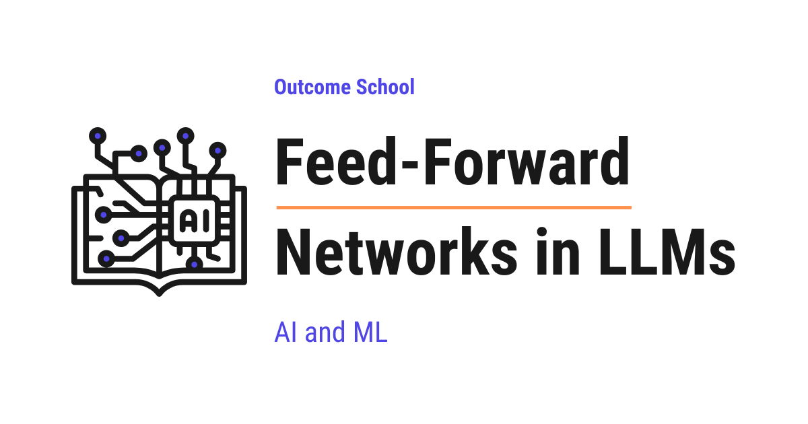

# What is the Feed-Forward Network in LLMs and What Does It Do?

> Archived from <https://outcomeschool.com/blog/feed-forward-networks-in-llms> on 2026-11-25.

The Feed-Forward Network in LLMs is a simple neural network inside every Transformer layer. After attention lets the words gather information from each other, the Feed-Forward Network processes each word on its own.

In this blog, we will learn about Feed-Forward Networks in LLMs - understanding what they are, how they work inside the Transformer architecture, why every Transformer layer needs one, and what role they play in making Large Language Models so powerful.

When we read about Transformers, we always hear about the attention mechanism. But there is another equally important component that does a huge amount of work inside every Transformer layer - the <strong>Feed-Forward Network (FFN)</strong>.

In fact, in most modern LLMs, the feed-forward network holds the majority of the model&#x27;s parameters. If we think of attention as the component that figures out relationships between words, the feed-forward network is what stores and applies the actual knowledge.

When we hear &quot;Feed-Forward Network&quot;, it sounds complex. But do not worry. If we break it down into its individual parts, every single piece is simple. Our goal is to explain feed-forward networks so clearly that by the end, we will be able to explain how they work to anyone.

We will cover the following:
<ul><li>What is a Feed-Forward Network?</li><li>Understanding Feed-Forward Networks with a Real-World Analogy</li><li>Where Does the Feed-Forward Network Sit in a Transformer?</li><li>How Does a Feed-Forward Network Work - Step by Step</li><li>The Expand-then-Contract Pattern</li><li>Why Does the FFN Expand and Then Contract?</li><li>ReLU and Activation Functions</li><li>What Does the Feed-Forward Network Actually Learn?</li><li>How Much of the Model is the Feed-Forward Network?</li><li>Feed-Forward Networks in Mixture of Experts</li><li>Why Feed-Forward Networks Are So Important</li></ul>
I am <strong>Amit Shekhar</strong>, Founder @ <a target="_blank" rel="noopener noreferrer" href="https://outcomeschool.com">Outcome School</a>, I have taught and mentored many developers, and their efforts landed them high-paying tech jobs, helped many tech companies in solving their unique problems, and created many open-source libraries being used by top companies. I am passionate about sharing knowledge through open-source, blogs, and videos.

I teach <a target="_blank" rel="noopener noreferrer" href="https://outcomeschool.com/program/ai-and-machine-learning">AI and Machine Learning</a> at Outcome School.

Let&#x27;s get started.
<h2 id="the-big-picture">The Big Picture</h2>
Before we go into the details, let&#x27;s understand the big picture.

A <strong>Feed-Forward Network (FFN)</strong> is a small <a target="_blank" rel="noopener noreferrer" href="neural-network.md">neural network</a> that sits inside every layer of a Transformer. After the attention mechanism figures out how words relate to each other, the feed-forward network takes each word&#x27;s representation and processes it individually - refining it, enriching it, and adding knowledge to it.

In simple words: <strong>Feed-Forward Network = The knowledge store and refiner inside each Transformer layer.</strong>

Think of it like this. Imagine a team meeting where everyone discusses a project. This is attention - words talking to each other. After the meeting, each team member goes back to their own desk and uses their own expertise to refine their notes and add deeper insights. This is the feed-forward network - each word being processed individually using stored knowledge.

So, attention is about how words talk to each other. The feed-forward network is about how each word processes what it heard.
<h2 id="what-is-a-feed-forward-network">What is a Feed-Forward Network?</h2>
A <strong>Feed-Forward Network</strong> is the simplest type of neural network. The word &quot;feed-forward&quot; means data flows in only one direction - forward. It goes from input to output, passing through one or more layers in between, without ever looping back.

Let&#x27;s break the name down:

<strong>Feed-Forward = Feed (pass data) + Forward (in one direction)</strong>

There are no loops, no cycles, and no going back. Data enters from one side and exits from the other. This is what makes it different from other types of neural networks like <strong><a target="_blank" rel="noopener noreferrer" href="how-do-rnns-and-transformers-differ.md">Recurrent Neural Networks (RNNs)</a></strong> where data can loop back on itself.

In its simplest form, a feed-forward network has an <strong>input layer</strong> where data comes in, a <strong>hidden layer</strong> where the actual processing happens, and an <strong>output layer</strong> where the result comes out.

<pre><code class="code-highlight">Input Layer       Hidden Layer       Output Layer
   [x1] ----\       [h1] ----\
              \--&gt;            ----&gt;   [y1]
   [x2] ------&gt;    [h2] ------&gt;      [y2]
              /---&gt;           ----&gt;   [y3]
   [x3] ----/       [h3] ----/
</code></pre>

Here, each connection between the layers has a <strong>weight</strong> (a number). The network multiplies the input values by these weights, adds them up, and passes the result through an <a target="_blank" rel="noopener noreferrer" href="activation-functions.md"><strong>activation function</strong></a> to produce the output. We will learn about activation functions in a later section.

<strong>Note:</strong> In the Transformer&#x27;s FFN, the structure is just two linear transformations with an activation function in between. The first linear transformation is the input-to-hidden step (W1), and the second one is the hidden-to-output step (W2), rather than distinct input, hidden, and output layers like traditional neural networks.

We have a detailed blog on <a target="_blank" rel="noopener noreferrer" href="multilayer-perceptron-mlp.md">Multilayer Perceptron (MLP)</a> that covers this classic layered network end to end.
<h2 id="understanding-feed-forward-networks-with-a-real-world-analogy">Understanding Feed-Forward Networks with a Real-World Analogy</h2>
The best way to learn this is by taking an example.

<strong>Let&#x27;s say we have a factory that makes custom furniture.</strong>

The factory has three stages:

<strong>Stage 1 (Input):</strong> Raw wood planks arrive at the factory. These are our raw materials - the input.

<strong>Stage 2 (Hidden - Expand):</strong> The wood planks go to a large workshop where many specialists work. One specialist cuts the wood. Another one sands it. Another one carves patterns. Another one drills holes. Another one checks for quality. This workshop is much bigger than the input area because the factory needs many specialists to work on different aspects of the wood at the same time.

<strong>Stage 3 (Output - Contract):</strong> After all the specialists have done their work, the refined pieces are assembled back into a finished piece of furniture. The output is compact - a single, refined product.

This is exactly how the feed-forward network works in a Transformer.
<h2 id="where-does-the-feed-forward-network-sit-in-a-transformer">Where Does the Feed-Forward Network Sit in a Transformer?</h2>
Every Transformer layer has two main sub-layers:
<ul><li><strong><a target="_blank" rel="noopener noreferrer" href="multi-head-attention-in-transformers.md">Multi-Head Attention</a></strong> - where words look at each other to understand relationships</li><li><strong>Feed-Forward Network</strong> - where each word is processed individually to refine its representation</li></ul>
The data flows through them in order. First, the input passes through the attention mechanism. Then, the output of attention passes through the feed-forward network. Each sub-layer also has a <strong>residual connection</strong> (skip connection) and <strong><a target="_blank" rel="noopener noreferrer" href="batch-normalization-vs-layer-normalization.md">layer normalization</a></strong> around it.

<pre><code class="code-highlight">         Input
           |
   -----------------
   | Multi-Head    |
   | Attention     |
   -----------------
           |
   Add &amp; Layer Norm
           |
   -----------------
   | Feed-Forward  |
   | Network       |
   -----------------
           |
   Add &amp; Layer Norm
           |
         Output
</code></pre>

This entire block is <strong>one Transformer layer</strong>. A typical LLM stacks many such layers on top of each other. For example, GPT-3 has 96 layers, and each layer has its own attention sub-layer and its own feed-forward network sub-layer. The diagram above shows the original Transformer&#x27;s post-norm arrangement (layer normalization after each sub-layer). Modern LLMs like GPT and LLaMA typically use <strong>pre-layer normalization</strong> (LayerNorm before each sub-layer), which helps with training stability.

Now, there is an important difference between these two sub-layers. The attention mechanism processes all words together - it lets every word look at every other word. But the feed-forward network processes each word <strong>independently</strong>. The same feed-forward network is applied to each word&#x27;s representation separately and independently. In practice, all tokens are processed in parallel (as a <a target="_blank" rel="noopener noreferrer" href="matrix-multiplication-in-neural-networks.md">batched matrix multiplication</a>), but the key point is that given the contextualized representations from attention, each token is processed independently by the FFN.

I will highly recommend reading our detailed blog on <a target="_blank" rel="noopener noreferrer" href="decoding-transformer-architecture.md">Transformer architecture</a> that explains how all the pieces fit together.
<h2 id="how-does-a-feed-forward-network-work---step-by-step">How Does a Feed-Forward Network Work - Step by Step</h2>
Now, let&#x27;s understand how the feed-forward network works step by step.

Each word&#x27;s representation is a vector of numbers. The feed-forward network takes this vector and passes it through two linear transformations with an activation function in between.

Here is what happens:

<strong>Step 1: First linear transformation (Expand)</strong>

The input vector is multiplied by a weight matrix and a bias is added. This transforms the input from a smaller dimension to a much larger dimension.

<pre><code class="code-highlight">hidden = input * W1 + b1
</code></pre>

Here, we can see that the input is multiplied by the weight matrix <code>W1</code> and a bias <code>b1</code> is added. If the input dimension is 4096, the hidden dimension is typically 16384 (4 times larger).

<strong>Step 2: Activation function</strong>

The result from Step 1 is passed through an <strong>activation function</strong> like <strong>ReLU</strong> or <strong>GELU</strong>. The activation function introduces non-linearity - meaning it allows the network to learn complex patterns that a simple linear transformation cannot capture. We will learn more about this in the activation function section.

<pre><code class="code-highlight">activated = ReLU(hidden)
</code></pre>

<strong>Step 3: Second linear transformation (Contract)</strong>

The activated output is multiplied by another weight matrix and a bias is added. This transforms the data back from the larger dimension to the original smaller dimension.

<pre><code class="code-highlight">output = activated * W2 + b2
</code></pre>

Here, <code>W2</code> is the weight matrix of the second layer and <code>b2</code> is the bias. The output has the same dimension as the input.

Putting it all together:

<pre><code class="code-highlight">FFN(x) = ReLU(x * W1 + b1) * W2 + b2
</code></pre>

Here, we can see the complete feed-forward network in one line. Two matrix multiplications, one activation function, and two bias additions. It is that simple.

<strong>Planning your move into AI?</strong>

No matter which tech domain you work in today, with your effort, you can transition to these roles:
<ul><li>AI Engineer</li><li>Forward Deployed Engineer</li><li>AI Agent Engineer</li><li>Harness Engineer</li><li>Voice AI Engineer</li><li>AI Architect</li><li>LLM Engineer</li><li>LLM Inference Engineer</li><li>Gen AI Engineer</li><li>MLOps Engineer</li><li>ML Engineer</li><li>Deep Learning Engineer</li></ul>
Our <a target="_blank" rel="noopener noreferrer" href="https://outcomeschool.com/program/ai-and-machine-learning">AI and Machine Learning Program</a> at Outcome School takes you there.
<h2 id="the-expand-then-contract-pattern">The Expand-then-Contract Pattern</h2>
Now, let&#x27;s understand a very important pattern in the FFN - the <strong>expand-then-contract</strong> pattern.

The input has a certain dimension (let&#x27;s call it <code>d_model</code>). The hidden layer expands this to a much larger dimension (typically <code>4 * d_model</code>). Then the output contracts it back to the original dimension <code>d_model</code>.

Let&#x27;s put this into perspective with real numbers:
<ul><li>In GPT-3 (175B), <code>d_model</code> = 12288. The hidden layer expands this to 4 * 12288 = <strong>49152</strong>. Then it contracts back to 12288.</li><li>In LLaMA 2 (7B), <code>d_model</code> = 4096. The hidden layer expands this to approximately <strong>11008</strong> (not exactly 4x because LLaMA 2 uses SwiGLU, which we will learn about shortly). Then it contracts back to 4096.</li></ul>
<pre><code class="code-highlight">Input (d_model)            Hidden (expanded)               Output (d_model)
  [4096 dims] --------&gt;     [11008 dims] --------&gt;          [4096 dims]
              Expand                       Contract
</code></pre>

So, the data starts small, becomes big in the middle, and becomes small again at the end.

This was all about the expand-then-contract pattern. Now, let&#x27;s understand why the FFN does this.
<h2 id="why-does-the-ffn-expand-and-then-contract">Why Does the FFN Expand and Then Contract?</h2>
Now, a natural question arises - why does the feed-forward network expand the dimension and then shrink it back? Why not just keep the same size throughout?

The answer is simple: <strong>the larger hidden layer gives the network more room to think.</strong>

Think of it like solving a math problem. We start with a small problem written on a sticky note (input). We need a large whiteboard (expanded hidden layer) to work through all the intermediate steps. Once we have the answer, we write it back on a small sticky note (output).

The expansion gives the network more space to extract patterns and transform the data. The contraction then compresses the result back to the size that the rest of the model expects.

This is a key design choice in Transformers. Without this expansion, the network would not have enough space to do the complex processing it needs.

<strong>A quick note for you</strong>

No matter which tech domain you work in, get familiar with these topics:
<ul><li>LLM</li><li>RAG</li><li>MCP</li><li>Agent</li><li>Fine-tuning</li><li>Quantization</li></ul>
We put it all together in one video:

<a target="_blank" rel="noopener noreferrer" href="https://www.youtube.com/watch?v=lnfWvX66FUk">AI Engineering Explained: LLM, RAG, MCP, Agent, Fine-Tuning, and Quantization</a>

No need to stop reading - bookmark it and watch later when you get time. Future you will thank you.

Now, let&#x27;s get back to the topic.
<h2 id="relu-and-activation-functions">ReLU and Activation Functions</h2>
We mentioned that an activation function is applied between the two linear layers. But what is an activation function and why do we need it?

Without an activation function, the feed-forward network would just be two matrix multiplications stacked together. And two linear operations combined are still a linear operation. This means the network could only learn simple, straight-line patterns - which is not useful for understanding language.

So, here comes the <strong>activation function</strong> to the rescue.

The activation function adds <strong>non-linearity</strong>, which allows the network to learn complex, curved, and irregular patterns.

<strong>ReLU (Rectified Linear Unit)</strong> is one of the simplest activation functions:

<pre><code class="code-highlight">ReLU(x) = max(0, x)
</code></pre>

It does one simple thing: if the number is positive, keep it as it is. If the number is negative, replace it with zero.

For example:
<ul><li>ReLU(5) = 5 (positive, keep it)</li><li>ReLU(-3) = 0 (negative, replace with zero)</li><li>ReLU(0) = 0</li></ul>
This simple operation is very powerful. By setting negative values to zero, ReLU creates <strong>sparsity</strong> - meaning many neurons in the hidden layer become inactive (output zero) for any given input. This sparsity helps the network specialize. Different neurons activate for different types of inputs, allowing different parts of the network to store different knowledge.

<strong>Note:</strong> Smoother activation functions like GELU reduce this explicit sparsity effect, but they tend to improve overall model performance.

<strong>GELU (Gaussian Error Linear Unit)</strong> is a smoother version of ReLU that is used in many modern LLMs like GPT and BERT. Instead of making a hard cutoff at zero, GELU gradually reduces small negative values. The idea is the same - it adds non-linearity - but it does so more smoothly.

<strong>SwiGLU</strong> is another activation function used in newer models like LLaMA. SwiGLU uses a gating mechanism that lets the network learn which parts of the information to keep and which to suppress. In practice, models using SwiGLU tend to perform better than those using ReLU or GELU.

<strong>Very important:</strong> SwiGLU changes the structure of the FFN. Instead of two weight matrices (W1 and W2), SwiGLU uses <strong>three</strong> weight matrices (W1, V, and W2). Do not worry if the formula below feels complex - the key takeaway is that SwiGLU adds a gating mechanism using an extra matrix, and the rest is just how the pieces connect. The formula becomes:

<pre><code class="code-highlight">SwiGLU(x) = (Swish(x * W1) ⊙ (x * V)) * W2
</code></pre>

Here, <code>*</code> represents matrix multiplication and <code>⊙</code> represents element-wise (Hadamard) multiplication. The input <code>x</code> is multiplied by two separate matrices (W1 and V), and their results are combined using element-wise multiplication (<code>⊙</code>). Because there is a third matrix, the total number of parameters would increase if we kept the same hidden dimension. So, the hidden dimension is reduced from 4x to roughly 2.7x to keep the parameter count similar. For example, LLaMA 2 7B has <code>d_model</code> = 4096 and a hidden dimension of 11008, which gives us 11008 / 4096 = approximately 2.69x instead of 4x.

<strong>Note:</strong> Larger variants like LLaMA 2 70B do not strictly follow the 2.7x rule. The 70B model has a hidden dimension of 28672 with <code>d_model</code> = 8192, giving a ratio of about 3.5x. The general principle of reducing from 4x to compensate for the third matrix holds, but the exact ratio varies across model sizes.

<strong>Note:</strong> The choice of activation function has evolved over time. The original Transformer paper used ReLU. Then GPT and BERT moved to GELU. And now many newer models use SwiGLU. The core idea remains the same - add non-linearity - but the specific function can be chosen based on our use case.

To learn Activation Functions, Neural Networks, and Feed-Forward Networks in depth, check out our <a target="_blank" rel="noopener noreferrer" href="https://outcomeschool.com/program/ai-and-machine-learning">AI and Machine Learning Program</a> at Outcome School.
<h2 id="what-does-the-feed-forward-network-actually-learn">What Does the Feed-Forward Network Actually Learn?</h2>
Now that we have understood how activation functions work and why they matter, let&#x27;s move to a deeper question. If attention learns relationships between words, what does the feed-forward network actually learn?

Research has shown that a large portion of the model&#x27;s stored knowledge resides in the feed-forward network weights. The FFN memorizes facts, patterns, and associations from the training data.

Let&#x27;s say we have a library. The attention mechanism is like a librarian who finds which books are related to each other and puts them together on a table. The feed-forward network is like the actual books on the shelves - they contain the knowledge.

Without the books, the librarian has nothing to work with. Without the librarian, the books just sit on the shelves unused. Both are needed.

Now, think of each neuron in the hidden layer as a <strong>pattern detector</strong>. Some neurons activate when they see patterns related to geography (like &quot;Paris is the capital of...&quot;). Other neurons activate for patterns related to grammar (like verb tenses). Others activate for patterns related to math, science, coding, and so on.

Let&#x27;s say the sentence is &quot;The capital of France is&quot;. After attention processes this sentence, each word has context from the other words. Now, the feed-forward network takes the representation of the last token and applies its stored knowledge. Certain neurons in the hidden layer activate strongly because they recognize the pattern &quot;capital of France&quot;. These activated neurons then contribute to producing an output that points towards &quot;Paris&quot;.

<strong>Note:</strong> Just for the sake of understanding, we are simplifying here. In reality, the knowledge is distributed across many neurons and many layers, not stored in one single neuron. But the core idea is the same - the FFN is where the model&#x27;s learned knowledge lives.

In simple words:
<ul><li><strong>Attention</strong> figures out which words are relevant to each other (relationships)</li><li><strong>Feed-Forward Network</strong> applies stored knowledge to each word&#x27;s enriched representation (facts and patterns)</li></ul>
This is why feed-forward networks hold the majority of the model&#x27;s parameters. They need to store a vast amount of knowledge from the training data.

<strong>Stay updated:</strong> Subscribe to our <a target="_blank" rel="noopener noreferrer" href="https://outcomeschool.substack.com/subscribe">newsletter</a> to get our latest AI and Machine Learning blogs straight to your inbox.
<h2 id="how-much-of-the-model-is-the-feed-forward-network">How Much of the Model is the Feed-Forward Network?</h2>
Let&#x27;s put this into perspective with real numbers.

In a standard Transformer layer, the feed-forward network uses roughly <strong>two-thirds (about 66%)</strong> of all the parameters in that layer. The attention mechanism uses the remaining one-third.

Here is why. In standard multi-head attention (without parameter sharing), the main parameter matrices are for Query (Q), Key (K), Value (V), and Output (O). Each of these is of size <code>d_model x d_model</code>. So attention has approximately <code>4 * d_model * d_model</code> parameters.

In the feed-forward network, we have two weight matrices: <code>W1</code> of size <code>d_model x 4*d_model</code> and <code>W2</code> of size <code>4*d_model x d_model</code>. So the FFN has approximately <code>2 * d_model * 4*d_model = 8 * d_model * d_model</code> parameters.

<pre><code class="code-highlight">Attention parameters:  ~4 * d_model^2
FFN parameters:        ~8 * d_model^2

FFN / Total = 8 / (8 + 4) = 8 / 12 = ~66%
</code></pre>

This means that in a model like GPT-3 with 175 billion parameters, roughly <strong>110-115 billion parameters</strong> are in the feed-forward networks across all layers (the rest goes to embeddings, layer norms, and the final projection head). That is a massive knowledge store.

<strong>Note:</strong> In modern models that use <strong><a target="_blank" rel="noopener noreferrer" href="grouped-query-attention.md">Grouped-Query Attention (GQA)</a></strong> or <strong>Multi-Query Attention (MQA)</strong>, the K and V matrices are smaller than Q and O. This means the attention parameters are fewer, and the FFN&#x27;s share becomes even larger than 66%.

If we want to go deep into Transformer Architecture, Multi-Head Attention, and LLM Internals end to end, check out our <a target="_blank" rel="noopener noreferrer" href="https://outcomeschool.com/program/ai-and-machine-learning">AI and Machine Learning Program</a> at Outcome School.
<h2 id="feed-forward-networks-in-mixture-of-experts">Feed-Forward Networks in Mixture of Experts</h2>
Now that we have understood how much of the model is the feed-forward network, let&#x27;s understand how some modern models use multiple feed-forward networks instead of one.

In standard Transformers, every token passes through the same feed-forward network in each layer. But in <strong>Mixture of Experts (MoE)</strong> models, the single feed-forward network is replaced with <strong>multiple feed-forward networks</strong> - each one called an <strong>expert</strong>.

A small <strong>router</strong> network decides which expert(s) each token should be sent to. Only a few experts (typically 2 out of 8 or 64) are activated for each token. The rest stay idle.

<pre><code class="code-highlight">                    Token
                      |
                   [Router]
                  /    |    \
               /       |       \
         [Expert 1] [Expert 2] ... [Expert N]
            (FFN)     (FFN)         (FFN)
              \        |
               \       |
            Selected Outputs Combined
</code></pre>

Instead of one large feed-forward network trying to be good at everything, we have many smaller feed-forward networks that can specialize in different types of patterns. The router learns which expert is best for each type of input.

The result is that we can have a model with a huge total number of parameters for knowledge capacity, while only using a fraction of them for each token, keeping the compute cost low.

We have a detailed blog on <a target="_blank" rel="noopener noreferrer" href="mixture-of-experts.md">Mixture of Experts</a> that explains the complete architecture.

To master Mixture of Experts, LLM Internals, and Transformer Architecture from the ground up, check out our <a target="_blank" rel="noopener noreferrer" href="https://outcomeschool.com/program/ai-and-machine-learning">AI and Machine Learning Program</a> at Outcome School.
<h2 id="why-feed-forward-networks-are-so-important">Why Feed-Forward Networks Are So Important</h2>
Now that we have understood how feed-forward networks work, let&#x27;s understand why they are so important inside LLMs.

<strong>Without the FFN, the model would have no knowledge.</strong> The attention mechanism figures out relationships between words. But the actual knowledge - facts, patterns, grammar rules, reasoning patterns - is stored in the parameters of the feed-forward network. The model would understand word relationships but would have no knowledge to apply.

<strong>The FFN refines what attention discovers.</strong> After attention processes the relationships between words, the feed-forward network refines each word&#x27;s representation. It takes the &quot;who is related to whom&quot; signal from attention and adds &quot;what do I know about this&quot; from its stored knowledge.

<strong>Without the activation function, the model could not learn complex patterns.</strong> Without the activation function in the FFN, the entire Transformer would be a series of linear operations. Linear operations alone cannot model the complexity of language. The FFN&#x27;s activation function is what gives the model the ability to learn complex, non-linear patterns.

<strong>The FFN holds the majority of the model&#x27;s parameters.</strong> About two-thirds of a Transformer&#x27;s parameters are in the feed-forward networks. This means the FFN is where the model&#x27;s capacity primarily lives. When we say a model has 70 billion parameters, about 46 billion of those are in the feed-forward networks.

<strong>The FFN processes each token independently, making it highly efficient.</strong> While attention requires all tokens to interact with each other, the FFN processes each token on its own. This makes the FFN highly parallelizable and computationally efficient.

In simple words: <strong>Attention moves information across tokens. FFN transforms information within a token.</strong>

Now, we have understood why feed-forward networks are so important. Without them, LLMs would have no place to store their knowledge.
<h2 id="quick-summary">Quick Summary</h2>
Let&#x27;s recap what we have learned:
<ul><li><strong>Feed-Forward Network (FFN)</strong> is a simple neural network inside every Transformer layer that processes each word independently after the attention mechanism.</li><li><strong>Feed-Forward means</strong> data flows in only one direction - from input to output, with no loops.</li><li><strong>The FFN has two linear layers</strong> with an activation function in between. The first layer expands the dimension (typically to 4x), and the second layer contracts it back to the original size.</li><li><strong>The expand-then-contract pattern</strong> gives the network a larger &quot;thinking space&quot; to process information before compressing it back.</li><li><strong>Activation functions</strong> (ReLU, GELU, SwiGLU) add non-linearity, allowing the network to learn complex patterns.</li><li><strong>The FFN acts as a knowledge store</strong>, memorizing facts, patterns, and associations from training data.</li><li><strong>About 66% of a Transformer&#x27;s parameters</strong> are in the feed-forward networks, making them the largest component.</li><li><strong>In Mixture of Experts models</strong>, the single FFN is replaced with multiple specialized FFNs (experts) with a router selecting which ones to activate.</li><li><strong>Attention is about relationships</strong> between words. <strong>FFN is about knowledge</strong> applied to each word individually.</li></ul><h2 id="frequently-asked-questions">Frequently Asked Questions</h2><h3 id="what-is-the-difference-between-attention-and-the-feed-forward-network-in-a-transformer">What is the difference between attention and the Feed-Forward Network in a Transformer?</h3>
Attention moves information across tokens, while the Feed-Forward Network transforms information within a token. Attention lets every word look at every other word to figure out relationships. The FFN then takes each word&#x27;s representation on its own and applies stored knowledge to refine it.
<h3 id="does-the-feed-forward-network-look-at-other-tokens">Does the Feed-Forward Network look at other tokens?</h3>
No. The Feed-Forward Network processes each token independently. The same FFN is applied to each word&#x27;s representation separately. In practice, all tokens are processed in parallel as a batched matrix multiplication, which makes the FFN highly parallelizable and computationally efficient.
<h3 id="why-cant-we-remove-the-activation-function-from-the-ffn">Why can&#x27;t we remove the activation function from the FFN?</h3>
Without the activation function, the FFN would just be two matrix multiplications stacked together, and two linear operations combined are still a linear operation. The network could then only learn simple, straight-line patterns. The activation function adds non-linearity, which lets the model learn complex patterns in language.
<h3 id="why-is-the-hidden-dimension-smaller-than-4x-in-models-that-use-swiglu">Why is the hidden dimension smaller than 4x in models that use SwiGLU?</h3>
SwiGLU uses three weight matrices instead of two, so keeping the same hidden dimension would increase the total number of parameters. To keep the parameter count similar, the hidden dimension is reduced from 4x to roughly 2.7x. For example, LLaMA 2 7B has a hidden dimension of 11008 with <code>d_model</code> of 4096.
<h3 id="does-grouped-query-attention-change-how-much-of-the-model-is-the-ffn">Does Grouped-Query Attention change how much of the model is the FFN?</h3>
Yes. With Grouped-Query Attention or Multi-Query Attention, the K and V matrices are smaller than Q and O. This means the attention parameters are fewer, so the FFN&#x27;s share of the parameters becomes even larger than the usual 66%.

That&#x27;s it for now.

Thanks

<strong>Amit Shekhar</strong> Founder @ <a target="_blank" rel="noopener noreferrer" href="https://outcomeschool.com">Outcome School</a>

You can connect with me on:
<ul><li><a target="_blank" rel="noopener noreferrer" href="https://x.com/amitiitbhu">X</a></li><li><a target="_blank" rel="noopener noreferrer" href="https://www.linkedin.com/in/amit-shekhar-iitbhu">LinkedIn</a></li><li><a target="_blank" rel="noopener noreferrer" href="https://github.com/amitshekhariitbhu">GitHub</a></li></ul>
Follow Outcome School on:
<ul><li><a target="_blank" rel="noopener noreferrer" href="https://x.com/outcome_school">X</a></li><li><a target="_blank" rel="noopener noreferrer" href="https://youtube.com/@OutcomeSchool">YouTube</a></li><li><a target="_blank" rel="noopener noreferrer" href="https://www.linkedin.com/company/outcomeschool">LinkedIn</a></li><li><a target="_blank" rel="noopener noreferrer" href="https://github.com/OutcomeSchool">GitHub</a></li></ul>
<a target="_blank" rel="noopener noreferrer" href="https://outcomeschool.com/blog"><strong>Read all of our high-quality blogs here.</strong></a>

