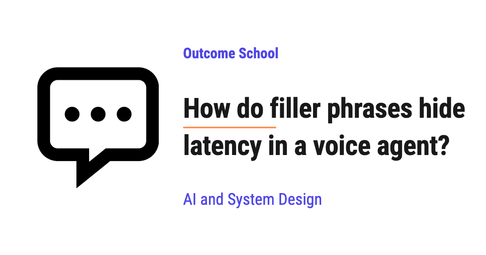

# How do filler phrases hide latency in a voice agent?

> Archived from <https://outcomeschool.com/blog/filler-phrases-in-voice-agents> on 2026-11-25.

Filler phrases hide latency in a voice agent by filling the silence with a short, natural line like &quot;Let me check that for you&quot; while the agent is still working on the real answer, so the user hears a reply right away instead of waiting in silence.

In this blog, we will learn about how filler phrases hide latency in a voice agent. We will also see why silence feels so bad on a voice call, what a filler phrase is, when the agent decides to say one, the different ways to produce it, how it fits into the conversation memory, what to do when the user interrupts it, and where it helps and where it hurts.

We will cover the following:
<ul><li>The problem: silence on a voice call</li><li>What is a filler phrase?</li><li>How a filler phrase hides latency</li><li>When should the agent say a filler phrase?</li><li>Ways to produce a filler phrase</li><li>Adding the filler phrase to the conversation memory</li><li>Handling an interruption during a filler phrase</li><li>Where filler phrases help and where they hurt</li></ul>
I am <strong>Amit Shekhar</strong>, Founder @ <a target="_blank" rel="noopener noreferrer" href="https://outcomeschool.com">Outcome School</a>, I have taught and mentored many developers, and their efforts landed them high-paying tech jobs, helped many tech companies in solving their unique problems, and created many open-source libraries being used by top companies. I am passionate about sharing knowledge through open-source, blogs, and videos.

I teach <a target="_blank" rel="noopener noreferrer" href="https://outcomeschool.com/program/ai-and-machine-learning">AI and Machine Learning</a> at Outcome School.

Let&#x27;s get started.
<h2 id="the-problem-silence-on-a-voice-call">The problem: silence on a voice call</h2>
Before jumping into filler phrases, we must understand the problem they solve.

A <a target="_blank" rel="noopener noreferrer" href="design-a-real-time-voice-ai-agent.md">voice agent</a> is an AI agent that we talk to with our voice, and it talks back with a voice. Most voice agents work as a <a target="_blank" rel="noopener noreferrer" href="cascaded-vs-speech-to-speech.md">pipeline of three steps</a>:
<ul><li><strong>Speech-to-Text (STT):</strong> It turns what the user said into text.</li><li><strong>LLM (Large Language Model):</strong> It reads that text and decides the reply.</li><li><strong>Text-to-Speech (TTS):</strong> It turns the reply text back into a voice.</li></ul>
Each step takes some time. The waiting time between the moment the user stops speaking and the moment the agent starts speaking is called <strong><a target="_blank" rel="noopener noreferrer" href="voice-to-voice-latency.md">latency</a></strong>.

In a normal human conversation, the gap between one person finishing and the other person starting is very short. Research on conversations across many languages has found that this gap is often around 200 milliseconds, which is one-fifth of a second.

Now, let&#x27;s say the user asks:

&quot;What is the status of my order number 4521?&quot;

To answer this, the agent cannot reply from memory. It has to <a target="_blank" rel="noopener noreferrer" href="how-does-function-calling-work-in-llms.md">call a tool</a>, which means our code has to look up the order in a database or call another service. The LLM recommends the tool and its input, and our code runs it. This lookup can take a second, two seconds, or even more.

So, the timeline looks like below:

<pre><code class="code-highlight">User stops speaking
        ↓
STT finishes the text
        ↓
LLM decides to look up the order
        ↓
Tool call runs (about 2 seconds)
        ↓
LLM writes the reply
        ↓
TTS speaks the reply
</code></pre>

During all of this, the user hears nothing. On a phone call, two or three seconds of silence feels very long. The user starts thinking:
<ul><li>&quot;Did it hear me?&quot;</li><li>&quot;Has the call dropped?&quot;</li><li>&quot;Should I say it again?&quot;</li></ul>
Then, the user says &quot;Hello?&quot; just as the agent starts speaking. Now, both are talking over each other, and the conversation breaks.

This silence is the real problem. We cannot always remove the waiting time, because the tool call needs its own time to finish. But we can change what the user hears during that time.

Here comes the filler phrase into the picture.
<h2 id="what-is-a-filler-phrase">What is a filler phrase?</h2>
<strong>A filler phrase is a short, natural line that a voice agent speaks while it is still preparing the real answer, so that the user is not left in silence.</strong>

Some common examples:
<ul><li>&quot;Let me check that for you.&quot;</li><li>&quot;One moment, please.&quot;</li><li>&quot;Sure, let me pull up your order.&quot;</li><li>&quot;Give me a second while I look that up.&quot;</li></ul>
Let&#x27;s say we call a customer care center and ask a human agent about our order. The human agent does not stay silent while typing into the computer. They say &quot;Sure, let me check that for you,&quot; and then they type. We are happy to wait, because we know someone is working on our request.

A voice agent does the same thing with a filler phrase.
<h2 id="how-a-filler-phrase-hides-latency">How a filler phrase hides latency</h2>
The best way to learn this is by taking an example.

Assume that the full reply for the order question takes 3,000 milliseconds to start without any filler phrase.

<strong>Without a filler phrase:</strong>

<pre><code class="code-highlight">0 ms       User stops speaking
           (silence)
3,000 ms   Agent: &quot;Your order 4521 is out for delivery.&quot;
</code></pre>

The user sits in silence for 3 seconds.

<strong>With a filler phrase:</strong>

<pre><code class="code-highlight">0 ms       User stops speaking
800 ms     Agent: &quot;Sure, let me check that for you.&quot;
           (tool call keeps running in the background)
3,000 ms   Agent: &quot;Your order 4521 is out for delivery.&quot;
</code></pre>

Here, we can notice that the real answer still arrives at 3,000 milliseconds. The total work did not get faster at all. But the user hears the agent start replying at 800 milliseconds. For the sake of example, these 800 milliseconds cover three things. The agent <a target="_blank" rel="noopener noreferrer" href="what-is-turn-taking-in-a-voice-ai-agent.md">makes sure that the user has finished speaking</a>, STT turns the speech into text, and the LLM decides to look up the order.

Here, we must understand that there are two kinds of latency:
<ul><li><strong>Actual latency:</strong> the time until the real answer is ready. The filler phrase does not change this.</li><li><strong>Perceived latency:</strong> the <a target="_blank" rel="noopener noreferrer" href="time-to-first-audio.md">time until the user hears something</a> that shows the agent is working. The filler phrase cuts this down a lot.</li></ul>
The filler phrase also takes time to speak. &quot;Sure, let me check that for you&quot; takes around 2 seconds to say out loud at a normal speaking speed. So, while the agent is speaking it, the tool call is running at the same time.

In our example, the filler phrase plays from about 800 milliseconds to about 2,800 milliseconds, and the real answer starts at 3,000 milliseconds.

Means, the time spent speaking the filler phrase overlaps with the time spent on the tool call, and the gap of silence after the filler phrase shrinks to only about 200 milliseconds.

This is how a filler phrase hides latency. It does not remove the wait. It fills the wait with speech.

<strong>Planning your move into AI?</strong>

No matter which tech domain you work in today, with your effort, you can transition to these roles:
<ul><li>AI Engineer</li><li>Forward Deployed Engineer</li><li>AI Agent Engineer</li><li>Harness Engineer</li><li>Voice AI Engineer</li><li>AI Architect</li><li>LLM Engineer</li><li>LLM Inference Engineer</li><li>Gen AI Engineer</li><li>MLOps Engineer</li><li>ML Engineer</li><li>Deep Learning Engineer</li></ul>
Our <a target="_blank" rel="noopener noreferrer" href="https://outcomeschool.com/program/ai-and-machine-learning">AI and Machine Learning Program</a> at Outcome School takes you there.
<h2 id="when-should-the-agent-say-a-filler-phrase">When should the agent say a filler phrase?</h2>
Now, the next big question is: should the agent say a filler phrase before every reply?

The answer is no.

If the user says &quot;Hi&quot; and the agent says &quot;One moment, please&quot; before saying &quot;Hello&quot;, it sounds strange. For a simple question, the reply is fast anyway, and a filler phrase only adds extra talking.

So, we need a rule for when to say it. There are two common triggers.

<strong>Trigger 1: Say it when a tool call starts.</strong>

We know that a tool call is often slow. So, the moment the LLM recommends a tool, like <code>get_order_status</code>, our code plays a filler phrase and runs the tool at the same time.

We can write the logic as below:

<pre><code class="code-highlight language-python">import asyncio

async def on_tool_call(tool_name, tool_args):
    # play the filler phrase and run the tool at the same time
    filler_task = asyncio.create_task(speak(&quot;Let me check that for you.&quot;))
    result = await run_tool(tool_name, tool_args)
    await filler_task  # let the filler phrase finish first
    return result
</code></pre>

Here, <code>speak</code> sends a line to TTS and plays it, and <code>run_tool</code> runs the tool. We have started speaking the filler phrase as a separate task, so it does not block the tool call. Then, we run the tool. Before we return the result, we wait for the filler phrase to finish, so that the real answer does not cut it off in the middle.

In a real agent, we play a filler phrase only for the tools that we know are slow. A tool that answers in 100 milliseconds does not need one.

<strong>Trigger 2: Say it when the wait crosses a time limit.</strong>

Sometimes, we do not know in advance if the reply will be slow. So, we start a timer when the user stops speaking. If the first part of the real answer has not arrived within a set time, for example 1,000 milliseconds, we play a filler phrase.

We can write the logic as below:

<pre><code class="code-highlight language-python">async def reply(user_text):
    answer_task = asyncio.create_task(generate_answer(user_text))
    try:
        # wait up to 1 second for the real answer
        answer = await asyncio.wait_for(asyncio.shield(answer_task), timeout=1.0)
    except asyncio.TimeoutError:
        await speak(&quot;One moment, please.&quot;)
        answer = await answer_task
    await speak(answer)
</code></pre>

Here, we can see that if the answer comes back within 1 second, the user never hears a filler phrase. The filler phrase plays only when the answer is slow. We have used <code>asyncio.shield</code> so that the timeout does not cancel the real answer while it is still being prepared.

Few important points:
<ul><li>For the sake of understanding, this code waits for the full answer. In a real agent, the answer is <a target="_blank" rel="noopener noreferrer" href="how-does-token-streaming-work.md">streamed</a>, and the timer only waits for the first part of it.</li><li>The time limit must be picked carefully. If it is too short, the agent says a filler phrase even for fast replies. If it is too long, the user already sits in silence before the filler phrase comes.</li></ul>
We can also use both triggers together: a filler phrase when a slow tool call starts, and a timer as a safety net for everything else.

<strong>A quick note for you</strong>

No matter which tech domain you work in, get familiar with these topics:
<ul><li>LLM</li><li>RAG</li><li>MCP</li><li>Agent</li><li>Fine-tuning</li><li>Quantization</li></ul>
We put it all together in one video:

<a target="_blank" rel="noopener noreferrer" href="https://www.youtube.com/watch?v=lnfWvX66FUk">AI Engineering Explained: LLM, RAG, MCP, Agent, Fine-Tuning, and Quantization</a>

No need to stop reading - bookmark it and watch later when you get time. Future you will thank you.

Now, let&#x27;s get back to the topic.
<h2 id="ways-to-produce-a-filler-phrase">Ways to produce a filler phrase</h2>
Now, let&#x27;s understand where the filler phrase audio comes from. There are three common options.

<strong>Option 1: Pre-recorded audio.</strong>

We generate the audio for a small set of filler phrases once, before any call starts, and save it. During the call, we play the saved audio.
<ul><li><strong>Advantage:</strong> It plays almost instantly, because there is no TTS step at that moment.</li><li><strong>Disadvantage:</strong> It always sounds the same, and it cannot mention anything specific to the user&#x27;s question.</li></ul>
<strong>Note:</strong> The pre-recorded audio must use the same voice as the agent. If the filler phrase comes in one voice and the answer in another, the user notices it immediately.

<strong>Option 2: Generated by TTS from a fixed list.</strong>

We keep a list of filler phrases as text, pick one, and send it to TTS during the call.
<ul><li><strong>Advantage:</strong> We can change the list easily, and the voice always matches.</li><li><strong>Disadvantage:</strong> It adds a small TTS delay before the filler phrase starts.</li></ul>
<strong>Option 3: Generated by the LLM itself.</strong>

We tell the LLM in <a target="_blank" rel="noopener noreferrer" href="voice-agent-system-prompt.md">its instructions</a> to say a short line before it calls a tool. For example: &quot;Before calling a tool, tell the user in one short sentence what you are about to do.&quot; This short line before a tool call is often called a <strong>preamble</strong>.

We must also tell the LLM to describe the action it is taking, to vary the wording across turns, and to skip the preamble for direct answers and quick tool calls.

So, for the order question, the LLM itself first writes &quot;Sure, let me look up order 4521 for you,&quot; and then it recommends the tool.
<ul><li><strong>Advantage:</strong> The filler phrase fits the question exactly, so it sounds more natural.</li><li><strong>Disadvantage:</strong> It is slower to start than pre-recorded audio, because it waits for both the LLM and TTS. Also, the LLM does not always follow the instruction.</li></ul>
Let me tabulate the differences between these three options for your better understanding so that you can decide which one to use based on your use case.
<table><thead><tr><th>Option</th><th>Speed to start</th><th>Sounds specific</th><th>Control</th></tr></thead><tbody><tr><td>Pre-recorded audio</td><td>Fastest</td><td>No</td><td>Full</td></tr><tr><td>TTS from a fixed list</td><td>Fast</td><td>No</td><td>Full</td></tr><tr><td>Generated by the LLM</td><td>Slower</td><td>Yes</td><td>Partial</td></tr></tbody></table>
One more thing to notice: with Option 1 and Option 2, we must keep a few different filler phrases and rotate them. If the agent says &quot;Let me check that for you&quot; five times in one call, it sounds like a machine. A simple rule is to never repeat the same filler phrase twice in a row.

<strong>Stay updated:</strong> Subscribe to our <a target="_blank" rel="noopener noreferrer" href="https://outcomeschool.substack.com/subscribe">newsletter</a> to get our latest AI and Machine Learning blogs straight to your inbox.
<h2 id="adding-the-filler-phrase-to-the-conversation-memory">Adding the filler phrase to the conversation memory</h2>
Now, let&#x27;s understand why the agent must remember its own filler phrase.

Our code keeps a <a target="_blank" rel="noopener noreferrer" href="ai-agent-memory.md">history of the conversation</a>, which means a list of everything the user said and everything the agent said. We send this history to the LLM every time we need the next reply.

Now, suppose the agent played &quot;Let me check that for you&quot; from pre-recorded audio, but our code never added it to the history. The LLM does not know that it already said this. So, its next reply can start with &quot;Let me check that for you&quot; again. The user hears the same line twice:

&quot;Let me check that for you. ... Let me check that for you. Your order is out for delivery.&quot;

To solve this, we must add the filler phrase to the history as an agent message, like below:

<pre><code class="code-highlight language-python">history.append({ &quot;role&quot;: &quot;assistant&quot;, &quot;content&quot;: &quot;Let me check that for you.&quot; })
</code></pre>

Here, we are telling the LLM that the agent already said this line. Now, the LLM continues from there and gives the real answer without repeating the filler phrase.

When the LLM itself writes the preamble, as in Option 3, the line is already part of its own output. So, this step matters mainly for Option 1 and Option 2.

To learn Memory in Agents, Tool use in Agents, and how to Design a Real-Time Voice AI Agent end to end, check out our <a target="_blank" rel="noopener noreferrer" href="https://outcomeschool.com/program/ai-and-machine-learning">AI and Machine Learning Program</a> at Outcome School.
<h2 id="handling-an-interruption-during-a-filler-phrase">Handling an interruption during a filler phrase</h2>
Now, let&#x27;s say the agent starts saying &quot;Let me check that for you,&quot; and the user <a target="_blank" rel="noopener noreferrer" href="what-is-barge-in-in-a-voice-ai-agent.md">cuts in</a> with &quot;Actually, it&#x27;s order 4522.&quot;

The agent must treat the filler phrase like any other agent speech:
<ul><li>Stop speaking the filler phrase right away.</li><li>Cancel the tool call that is running for the wrong order, if it is not finished yet.</li><li>Keep only the part of the filler phrase the user actually heard in the history.</li><li>Listen to the new request and start again.</li></ul><h2 id="where-filler-phrases-help-and-where-they-hurt">Where filler phrases help and where they hurt</h2>
Filler phrases help a lot, but they also have a cost. Let&#x27;s see both sides.

<strong>Where they help:</strong>
<ul><li>Tool calls, like looking up an order, booking a slot, or checking an account balance.</li><li>Long thinking steps, where the LLM needs more time before it can start the answer.</li><li>Phone calls, where silence makes users think the call has dropped.</li></ul>
<strong>Where they hurt:</strong>
<ul><li>Fast replies. A filler phrase before a quick answer only adds delay to the real answer.</li><li>Too many of them. If every reply starts with &quot;One moment&quot;, the agent sounds slow, even when it is not.</li><li>Wrong promises. If the filler phrase says &quot;Let me book that for you&quot; and the booking then fails, the user feels misled. A neutral line like &quot;Let me check that for you&quot; is safer.</li><li>Very long waits. A filler phrase covers a wait of a few seconds well. If the tool takes ten seconds, one filler phrase is not enough. The agent must say <a target="_blank" rel="noopener noreferrer" href="slow-tool-calls-in-voice-agents.md">another short update</a>, like &quot;This is taking a little longer than usual, thank you for waiting.&quot;</li></ul>
<strong>Note:</strong> A filler phrase is not a replacement for making the agent fast. We must still <a target="_blank" rel="noopener noreferrer" href="voice-agent-latency-budget.md">cut the real latency</a> wherever we can, using streaming, faster models, and faster tools. The filler phrase covers only the part of the wait that we cannot remove.

We have a detailed blog on <a target="_blank" rel="noopener noreferrer" href="speculative-generation-in-voice-agents.md">how speculative LLM generation starts replying before the user finishes</a> that covers another way to cut this wait.

Now we must have understood how filler phrases hide latency in a voice agent, when to use them, how to produce them, how to handle an interruption, and where they help and where they hurt.
<h2 id="frequently-asked-questions">Frequently Asked Questions</h2><h3 id="does-a-filler-phrase-make-a-voice-agent-answer-faster">Does a filler phrase make a voice agent answer faster?</h3>
No. A filler phrase does not make the real answer arrive any sooner, because the tool call still needs its own time to finish. It only cuts the perceived latency, which is the time until the user hears something that shows the agent is working. The actual latency, the time until the real answer is ready, stays the same.
<h3 id="what-is-a-preamble-in-a-voice-agent">What is a preamble in a voice agent?</h3>
A preamble is a short line that the LLM itself says before it calls a tool, like &quot;Sure, let me look up order 4521 for you.&quot; We get it by telling the LLM in its instructions to say one short sentence about what it is about to do. It fits the question exactly, but it is slower to start than pre-recorded audio.
<h3 id="why-should-a-voice-agent-not-repeat-the-same-filler-phrase">Why should a voice agent not repeat the same filler phrase?</h3>
If the agent says the same line, like &quot;Let me check that for you&quot;, again and again in one call, it sounds like a machine. So, we keep a few different filler phrases and rotate them. A simple rule is to never repeat the same filler phrase twice in a row.
<h3 id="what-should-a-voice-agent-say-when-a-tool-call-takes-very-long">What should a voice agent say when a tool call takes very long?</h3>
It should say another short update. One filler phrase covers a wait of a few seconds well, but if the tool takes ten seconds, it is not enough. The agent can say something like &quot;This is taking a little longer than usual, thank you for waiting&quot; so that the user does not sit in silence.
<h3 id="should-a-filler-phrase-promise-a-specific-action">Should a filler phrase promise a specific action?</h3>
No. It is safer to use a neutral line like &quot;Let me check that for you.&quot; If the filler phrase says &quot;Let me book that for you&quot; and the booking then fails, the user feels misled.

That&#x27;s it for now.

Thanks

<strong>Amit Shekhar</strong> Founder @ <a target="_blank" rel="noopener noreferrer" href="https://outcomeschool.com">Outcome School</a>

You can connect with me on:
<ul><li><a target="_blank" rel="noopener noreferrer" href="https://x.com/amitiitbhu">X</a></li><li><a target="_blank" rel="noopener noreferrer" href="https://www.linkedin.com/in/amit-shekhar-iitbhu">LinkedIn</a></li><li><a target="_blank" rel="noopener noreferrer" href="https://github.com/amitshekhariitbhu">GitHub</a></li></ul>
Follow Outcome School on:
<ul><li><a target="_blank" rel="noopener noreferrer" href="https://x.com/outcome_school">X</a></li><li><a target="_blank" rel="noopener noreferrer" href="https://youtube.com/@OutcomeSchool">YouTube</a></li><li><a target="_blank" rel="noopener noreferrer" href="https://www.linkedin.com/company/outcomeschool">LinkedIn</a></li><li><a target="_blank" rel="noopener noreferrer" href="http://github.com/OutcomeSchool">GitHub</a></li></ul>
<a target="_blank" rel="noopener noreferrer" href="https://outcomeschool.com/blog"><strong>Read all of our high-quality blogs here.</strong></a>

