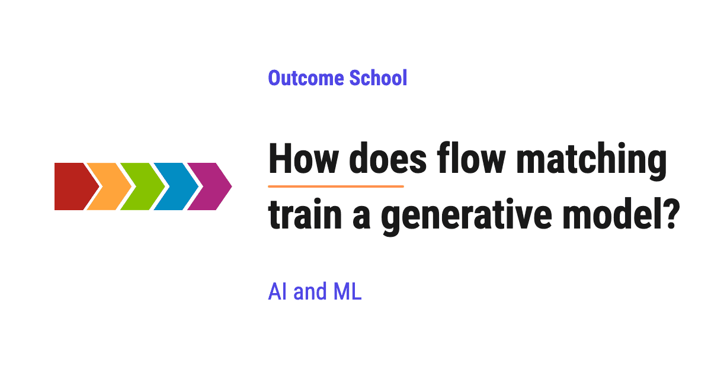

# How does flow matching train a generative model?

> Archived from <https://outcomeschool.com/blog/flow-matching> on 2026-11-25.

Flow matching trains a generative model by teaching it the direction and speed to move from a random noise point toward a real data point, like a photo. During training, it draws a straight line between a noise point and a real data point and asks the model to predict the movement along that line.

In this blog, we will learn about how flow matching trains a generative model. We will also see what velocity and a flow mean, how a straight line between noise and data gives a simple training target, why training on single pairs still works, how we generate new samples with small steps, how flow matching compares with diffusion, and where it works well and where it fails.

We will cover the following:
<ul><li>The core idea: moving from noise to data</li><li>What is velocity?</li><li>What is a flow?</li><li>The problem: we do not know the path</li><li>The trick: draw a straight line</li><li>How flow matching trains the model</li><li>A step-by-step example with numbers</li><li>Why training on single pairs still works</li><li>How we generate new samples</li><li>Code example</li><li>Flow matching vs diffusion</li><li>Where it works well and where it fails</li></ul>
I am <strong>Amit Shekhar</strong>, Founder @ <a target="_blank" rel="noopener noreferrer" href="https://outcomeschool.com">Outcome School</a>, I have taught and mentored many developers, and their efforts landed them high-paying tech jobs, helped many tech companies in solving their unique problems, and created many open-source libraries being used by top companies. I am passionate about sharing knowledge through open-source, blogs, and videos.

I teach <a target="_blank" rel="noopener noreferrer" href="https://outcomeschool.com/program/ai-and-machine-learning">AI and Machine Learning</a> at Outcome School.

Let&#x27;s get started.
<h2 id="the-core-idea-moving-from-noise-to-data">The core idea: moving from noise to data</h2>
A <a target="_blank" rel="noopener noreferrer" href="what-is-generative-ai.md"><strong>generative model</strong></a> learns from examples and then creates new examples that look like them. To a computer, a photo is a long list of numbers. So, creating a new photo means creating a new list of numbers that looks like a real photo.

Most modern generative models start from <strong>noise</strong>. Noise is a list of random numbers. As an image, it looks like the static on an old TV screen with no signal.

Random numbers are very easy to create. We can make as many as we want.

So, the plan is:
<ul><li>Start with a random noise point.</li><li>Slowly move it, step by step, until it becomes a realistic photo.</li></ul>
<pre><code class="language-text code-highlight">+----------------------------------------+
| Start: noise (random static)           |
+----------------------------------------+
                    ↓
+----------------------------------------+
| Journey: many small steps              |
+----------------------------------------+
                    ↓
+----------------------------------------+
| End: data (a real-looking cat photo)   |
+----------------------------------------+
</code></pre>

Here, we can see that creating an image becomes a journey. The model&#x27;s job is to guide this journey.

For the sake of understanding, let&#x27;s imagine every data point as a dot on a 2D map. In reality, a photo has millions of numbers, which means millions of directions, but the idea stays exactly the same.
<h2 id="what-is-velocity">What is velocity?</h2>
To guide a journey, we need to know the <strong>velocity</strong>.

<strong>Velocity means the direction and the speed of movement.</strong>

Let&#x27;s say we are at position 2 on a number line, and our velocity is +3 per second. After 1 second, we will be at position 5. If our velocity is -1, we move left to position 1.

On a 2D map, velocity is an arrow. The arrow points in the direction we must move, and its length shows how fast.

<pre><code class="language-text code-highlight">Position (2, 1) + velocity arrow (3, 1)
                   ↓
After 1 second, we reach (5, 2)
</code></pre>

Here, we added the velocity arrow to the current position to get the next position.
<h2 id="what-is-a-flow">What is a flow?</h2>
Now, imagine that every point on the map has its own arrow. It is like a river, where the water at every spot moves in a certain direction with a certain speed.

<strong>A flow is a smooth movement of points that follows these arrows over time.</strong>

If we drop a leaf anywhere in the river, the water carries it along a path. In the same way, if we drop a noise point on our map, the arrows carry it along a path.

We will use a time number <code>t</code> that goes from 0 to 1:
<ul><li>At <code>t = 0</code>, the point is pure noise.</li><li>At <code>t = 1</code>, the point is real-looking data.</li><li>In between, the point is partly noise and partly data.</li></ul>
So, a generative model based on flows needs to learn one thing: <strong>the arrow (velocity) at every position and every time.</strong>

We will call this learned function <code>v(x, t)</code>. It takes a position <code>x</code> and a time <code>t</code>, and returns the arrow.

If we learn <code>v(x, t)</code> well, we can drop any noise point into the river, follow the arrows from <code>t = 0</code> to <code>t = 1</code>, and get new data.
<h2 id="the-problem-we-do-not-know-the-path">The problem: we do not know the path</h2>
How do we teach the model the right arrows? We do not know the &quot;correct&quot; path from noise to data. Nobody tells us which noise point should become which cat photo.

Older methods, called <strong>continuous normalizing flows</strong>, tried to learn these arrows by simulating the whole journey again and again during training and checking how likely the real data was at the end. This was very slow and hard to scale to big images.

We need a much simpler way. So, here comes flow matching to the rescue.
<h2 id="the-trick-draw-a-straight-line">The trick: draw a straight line</h2>
Flow matching was introduced in 2022 in the paper &quot;Flow Matching for Generative Modeling&quot; by Yaron Lipman and colleagues. A very similar idea called <strong>rectified flow</strong> was published around the same time by Xingchao Liu and colleagues.

Instead of searching for the path, we <strong>decide</strong> the path ourselves.

<strong>Step 1:</strong> Pick one random noise point. Call it <code>x0</code>.

<strong>Step 2:</strong> Pick one real data point, for example one real cat photo. Call it <code>x1</code>.

<strong>Step 3:</strong> Draw a straight line from <code>x0</code> to <code>x1</code>.

<pre><code class="language-text code-highlight">   x0 (noise)  *-------------------------------*  x1 (real photo)
              t=0            t=0.5            t=1
                               *
                              xt (halfway mix)
</code></pre>

Any point on this line at time <code>t</code> is a simple mix of the two:

<strong>xt = (1 - t) * x0 + t * x1</strong>

Here, at <code>t = 0</code>, we get <code>x0</code>, which is pure noise. At <code>t = 1</code>, we get <code>x1</code>, which is the real photo. At <code>t = 0.5</code>, we get half noise and half photo.

If we move along this straight line at a steady speed from <code>t = 0</code> to <code>t = 1</code>, what is the velocity?

It is simply the difference between the end and the start:

<strong>velocity = x1 - x0</strong>

The velocity is the same at every point on this line, because it is a straight line with steady speed.

This gives us a clear training target. At the point <code>xt</code>, the correct arrow is <code>x1 - x0</code>. No simulation is needed.

<strong>Planning your move into AI?</strong>

No matter which tech domain you work in today, with your effort, you can transition to these roles:
<ul><li>AI Engineer</li><li>Forward Deployed Engineer</li><li>AI Agent Engineer</li><li>Harness Engineer</li><li>Voice AI Engineer</li><li>AI Architect</li><li>LLM Engineer</li><li>LLM Inference Engineer</li><li>Gen AI Engineer</li><li>MLOps Engineer</li><li>ML Engineer</li><li>Deep Learning Engineer</li></ul>
Our <a target="_blank" rel="noopener noreferrer" href="https://outcomeschool.com/program/ai-and-machine-learning">AI and Machine Learning Program</a> at Outcome School takes you there.
<h2 id="how-flow-matching-trains-the-model">How flow matching trains the model</h2>
Now, we have everything. Training goes like below:

<strong>Step 1:</strong> Pick a real data point <code>x1</code> from the training data.

<strong>Step 2:</strong> Create a random noise point <code>x0</code>.

<strong>Step 3:</strong> Pick a random time <code>t</code> between 0 and 1.

<strong>Step 4:</strong> Compute the mixed point <code>xt = (1 - t) * x0 + t * x1</code>.

<strong>Step 5:</strong> Ask the model to predict the velocity: <code>v(xt, t)</code>.

<strong>Step 6:</strong> Compare the prediction with the target <code>x1 - x0</code>. The error is the <a target="_blank" rel="noopener noreferrer" href="l1-and-l2-loss-functions.md">squared difference</a>, which we call the <strong>loss</strong>.

<strong>Step 7:</strong> Update the model parameters a little to reduce the loss.

We repeat this millions of times, with different photos, different noise, and different times.

<strong>loss = average of (v(xt, t) - (x1 - x0))^2</strong>

Here, the loss is small when the predicted arrow is close to the target arrow. Training makes it smaller and smaller.

Flow matching turns training into a simple <a target="_blank" rel="noopener noreferrer" href="linear-regression-vs-logistic-regression.md">regression problem</a>, which means predicting a number and comparing it with a known correct number.
<h2 id="a-step-by-step-example-with-numbers">A step-by-step example with numbers</h2>
The best way to learn this is by taking an example. Let&#x27;s use a 1D number line to keep it very simple.

Let&#x27;s say:
<ul><li>Noise point <code>x0 = -2</code></li><li>Real data point <code>x1 = 6</code></li><li>Random time <code>t = 0.25</code></li></ul>
<strong>Step 1:</strong> Compute the mixed point.

<pre><code class="language-text code-highlight">   xt = (1 - 0.25) * (-2) + 0.25 * 6
      = 0.75 * (-2) + 1.5
      = -1.5 + 1.5
      = 0
</code></pre>

So, at <code>t = 0.25</code>, the point is at position 0.

<strong>Step 2:</strong> Compute the target velocity.

<pre><code class="language-text code-highlight">   target = x1 - x0 = 6 - (-2) = 8
</code></pre>

So, the correct arrow is +8. Means, move to the right with speed 8.

<strong>Step 3:</strong> Check the model&#x27;s guess.

Let&#x27;s say the model predicts <code>v(0, 0.25) = 5</code>.

<pre><code class="language-text code-highlight">   loss = (5 - 8)^2 = 9
</code></pre>

The loss is 9. The model is too slow. So, training updates the model to predict a bigger number next time at this position and time.

<strong>Step 4:</strong> Check that the target makes sense.

From position 0 at <code>t = 0.25</code>, if we move with velocity 8 for the remaining time of 0.75, we travel 8 * 0.75 = 6. So, we reach 0 + 6 = 6, which is exactly <code>x1</code>.

<strong>A quick note for you</strong>

No matter which tech domain you work in, get familiar with these topics:
<ul><li>LLM</li><li>RAG</li><li>MCP</li><li>Agent</li><li>Fine-tuning</li><li>Quantization</li></ul>
We put it all together in one video:

<a target="_blank" rel="noopener noreferrer" href="https://www.youtube.com/watch?v=lnfWvX66FUk">AI Engineering Explained: LLM, RAG, MCP, Agent, Fine-Tuning, and Quantization</a>

No need to stop reading - bookmark it and watch later when you get time. Future you will thank you.

Now, let&#x27;s get back to the topic.
<h2 id="why-training-on-single-pairs-still-works">Why training on single pairs still works</h2>
Now, the next big question is:

During training, we pair a random noise point with a random photo. But the same noise point could be paired with a cat photo in one step and a dog photo in another step. So, the target arrow at the same position keeps changing. How can the model learn one correct arrow?

The answer is: the model learns the <strong>average</strong> arrow.

When a model is trained with squared error, and it sees many different targets for the same input, the best answer it can give is the average of those targets.

Let&#x27;s say, at some position, half the training pairs say &quot;go up&quot; and half say &quot;go right&quot;. The model learns &quot;go up and to the right&quot;, the average direction.

<pre><code class="language-text code-highlight">   pair A says:  ^  (toward a cat photo)
   pair B says:  &gt;  (toward a dog photo)
   model learns: /  (average direction)
</code></pre>

Here, we can see that the model blends all the possible directions at that point.

The flow matching paper proved that following these averaged arrows carries noise to the full data distribution, which means the whole collection of realistic data. Training with these per-pair targets is called <strong>conditional flow matching</strong>: each training target is computed for one specific pair, but the model ends up learning the overall flow.

Because of this averaging, the real paths are not perfectly straight. But they are often much straighter than the paths in older methods, and this helps a lot during generation.
<h2 id="how-we-generate-new-samples">How we generate new samples</h2>
Once training is done, we generate new samples as below:

<strong>Step 1:</strong> Create a new random noise point <code>x</code>. Set <code>t = 0</code>.

<strong>Step 2:</strong> Choose a number of steps, for example 4. So, each step size is <code>dt = 1 / 4 = 0.25</code>.

<strong>Step 3:</strong> At each step, ask the model for the arrow, and move a little:

<strong>x = x + v(x, t) * dt</strong>

<strong>t = t + dt</strong>

<strong>Step 4:</strong> After the last step, <code>t = 1</code>, and <code>x</code> is our new sample.

This way of moving with small steps is called the <strong>Euler method</strong>. It is the simplest way to follow arrows.

Let&#x27;s continue our 1D example. Just for the sake of understanding, assume all our training data is the single point 6, and the model has learned well:

<pre><code class="language-text code-highlight">   t=0.00   x=-2.0   model arrow=+8   --&gt;  x = -2.0 + 8*0.25 = 0.0
   t=0.25   x= 0.0   model arrow=+8   --&gt;  x =  0.0 + 8*0.25 = 2.0
   t=0.50   x= 2.0   model arrow=+8   --&gt;  x =  2.0 + 8*0.25 = 4.0
   t=0.75   x= 4.0   model arrow=+8   --&gt;  x =  4.0 + 8*0.25 = 6.0
   t=1.00   x= 6.0   done
</code></pre>

Here, we can see that the point travels from noise at -2 to data at 6 in just 4 steps.

Because the paths are fairly straight, we need only a small number of steps. A curved path needs many small steps to follow it correctly, while a straight path can be covered in a few big steps.

<strong>Stay updated:</strong> Subscribe to our <a target="_blank" rel="noopener noreferrer" href="https://outcomeschool.substack.com/subscribe">newsletter</a> to get our latest AI and Machine Learning blogs straight to your inbox.
<h2 id="code-example">Code example</h2>
Let&#x27;s see the full training step and the generation loop in <a target="_blank" rel="noopener noreferrer" href="how-does-pytorch-work.md">PyTorch</a> as below:

<pre><code class="code-highlight language-python">import torch
import torch.nn as nn

model = nn.Sequential(nn.Linear(3, 128), nn.ReLU(), nn.Linear(128, 2))  # input: x (2 numbers) + t
optimizer = torch.optim.Adam(model.parameters(), lr=1e-3)

def train_step(x1):                       # x1: a batch of real 2D points
    x0 = torch.randn_like(x1)             # random noise
    t = torch.rand(x1.shape[0], 1)        # random time between 0 and 1
    xt = (1 - t) * x0 + t * x1            # point on the straight line
    target = x1 - x0                      # correct velocity
    pred = model(torch.cat([xt, t], dim=1))
    loss = ((pred - target) ** 2).mean()
    optimizer.zero_grad()
    loss.backward()
    optimizer.step()
    return loss.item()
</code></pre>

Here, we have:
<ul><li><code>model</code> is a small <a target="_blank" rel="noopener noreferrer" href="neural-network.md">neural network</a>. It takes the position <code>xt</code> (2 numbers) and the time <code>t</code> (1 number), and returns a velocity arrow (2 numbers).</li><li><code>torch.randn_like(x1)</code> creates noise of the same shape as the data.</li><li><code>torch.rand</code> picks a random time for each example.</li><li><code>xt</code> and <code>target</code> are exactly the two formulas we learned above.</li><li><code>loss</code> is the squared difference between the predicted arrow and the target arrow.</li><li><code>loss.backward()</code> and <code>optimizer.step()</code> update the model parameters to reduce the loss.</li></ul>
Now, let&#x27;s see the generation code as below:

<pre><code class="code-highlight language-python">@torch.no_grad()
def generate(num_samples, steps=20):
    x = torch.randn(num_samples, 2)       # start from noise
    dt = 1.0 / steps
    for i in range(steps):
        t = torch.full((num_samples, 1), i * dt)
        x = x + model(torch.cat([x, t], dim=1)) * dt   # follow the arrow
    return x
</code></pre>

Here, we start from random noise and take 20 small steps. At each step, the model gives the arrow, and we move the points a little. At the end, the points look like the training data.

For real images, the small network is replaced by a big network, often a <a target="_blank" rel="noopener noreferrer" href="decoding-transformer-architecture.md">Transformer</a>, and the 2 numbers become millions of numbers. But the training code stays almost the same.

To learn PyTorch, Neural Networks, and Loss Functions from the ground up, check out our <a target="_blank" rel="noopener noreferrer" href="https://outcomeschool.com/program/ai-and-machine-learning">AI and Machine Learning Program</a> at Outcome School.
<h2 id="flow-matching-vs-diffusion">Flow matching vs diffusion</h2>
Flow matching is closely related to <a target="_blank" rel="noopener noreferrer" href="diffusion-models.md"><strong>diffusion models</strong></a>. A diffusion model also starts from noise, but it learns by adding noise to data over many steps and predicting the noise to remove.

Let me tabulate the differences between flow matching and diffusion for your better understanding.
<table><thead><tr><th>Point</th><th>Diffusion</th><th>Flow Matching</th></tr></thead><tbody><tr><td>What the model predicts</td><td>Usually the noise that was added</td><td>The velocity, which means the direction and speed of movement</td></tr><tr><td>Path from noise to data</td><td>Fixed by a noise schedule, often curved</td><td>Usually a straight line between noise and data</td></tr><tr><td>Training target</td><td>Depends on a noise schedule with extra settings</td><td>Simply <code>x1 - x0</code></td></tr><tr><td>Steps needed to generate</td><td>Often 20 to 50 or more</td><td>Often fewer, because paths are straighter</td></tr><tr><td>Training difficulty</td><td>Simple, but needs careful schedule tuning</td><td>Simple, with fewer settings to tune</td></tr><tr><td>Used in</td><td>Stable Diffusion 1 and 2, DALL-E 2</td><td>Stable Diffusion 3, Flux, Meta Movie Gen</td></tr></tbody></table>
<strong>Note:</strong> The two ideas are closely related. With the right choices, a diffusion model can be rewritten as a kind of flow matching model. So, flow matching is best seen as a cleaner and simpler way of training the same family of models.

If we want to go deep into Diffusion Models and the rest of Generative AI, we have a complete program - check out our <a target="_blank" rel="noopener noreferrer" href="https://outcomeschool.com/program/ai-and-machine-learning">AI and Machine Learning Program</a> at Outcome School, where we cover them in depth.
<h2 id="where-it-works-well-and-where-it-fails">Where it works well and where it fails</h2>
<strong>Flow matching works well</strong> because:
<ul><li>Training is a simple regression with a very clear target.</li><li>It needs no simulation of the full journey during training.</li><li>Straighter paths allow good results with fewer steps, which makes generation faster.</li><li>It scales to big image, video, and audio models.</li></ul>
<strong>Flow matching has limits</strong> because:
<ul><li>The real paths are not perfectly straight, because of the averaging we saw. So, very few steps, like 1 or 2, still give lower quality without extra tricks.</li><li>Generation still needs many calls to the model, unlike some methods that create a sample in one step.</li><li>The quality still depends heavily on the network size, the data, and the compute used.</li></ul>
To make paths even straighter, researchers use an extra step called <strong>reflow</strong>. They generate pairs using the trained model and train again on those pairs. This allows generation in very few steps.

Now we must have understood how flow matching trains a generative model.
<h2 id="frequently-asked-questions">Frequently Asked Questions</h2><h3 id="is-flow-matching-the-same-as-rectified-flow">Is flow matching the same as rectified flow?</h3>
They are very similar ideas. Flow matching was introduced in 2022 in the paper &quot;Flow Matching for Generative Modeling&quot; by Yaron Lipman and colleagues. A very similar idea called rectified flow was published around the same time by Xingchao Liu and colleagues, so the two are closely linked.
<h3 id="what-is-conditional-flow-matching">What is conditional flow matching?</h3>
Conditional flow matching is training with per-pair targets. Each training target is computed for one specific pair of a noise point and a real data point, which is simply <code>x1 - x0</code>. Even so, the model ends up learning the overall flow, because it learns the average arrow at every position, and following these averaged arrows carries noise to the full data distribution.
<h3 id="which-image-models-use-flow-matching">Which image models use flow matching?</h3>
Stable Diffusion 3, Flux, and Meta Movie Gen use flow matching. Older models like Stable Diffusion 1 and 2 and DALL-E 2 use diffusion. Flow matching scales to big image, video, and audio models, and for real images the small network is replaced by a big network, often a Transformer.
<h3 id="what-is-reflow-in-flow-matching">What is reflow in flow matching?</h3>
Reflow is an extra step that makes the paths even straighter. Researchers generate pairs using the trained model and then train again on those pairs. This allows generation in very few steps, which matters because with plain flow matching, using only 1 or 2 steps still gives lower quality.

That&#x27;s it for now.

Thanks

<strong>Amit Shekhar</strong> Founder @ <a target="_blank" rel="noopener noreferrer" href="https://outcomeschool.com">Outcome School</a>

You can connect with me on:
<ul><li><a target="_blank" rel="noopener noreferrer" href="https://x.com/amitiitbhu">X</a></li><li><a target="_blank" rel="noopener noreferrer" href="https://www.linkedin.com/in/amit-shekhar-iitbhu">LinkedIn</a></li><li><a target="_blank" rel="noopener noreferrer" href="https://github.com/amitshekhariitbhu">GitHub</a></li></ul>
Follow Outcome School on:
<ul><li><a target="_blank" rel="noopener noreferrer" href="https://x.com/outcome_school">X</a></li><li><a target="_blank" rel="noopener noreferrer" href="https://youtube.com/@OutcomeSchool">YouTube</a></li><li><a target="_blank" rel="noopener noreferrer" href="https://www.linkedin.com/company/outcomeschool">LinkedIn</a></li><li><a target="_blank" rel="noopener noreferrer" href="http://github.com/OutcomeSchool">GitHub</a></li></ul>
<a target="_blank" rel="noopener noreferrer" href="https://outcomeschool.com/blog"><strong>Read all of our high-quality blogs here.</strong></a>

