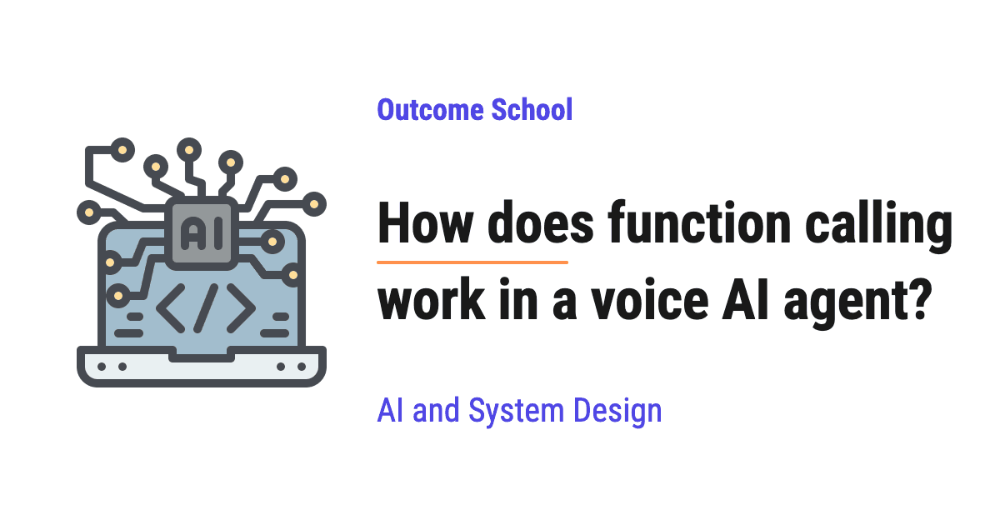

# How does function calling work in a voice AI agent?

> Archived from <https://outcomeschool.com/blog/function-calling-in-voice-agents> on 2026-11-25.

Function calling in a voice AI agent is the way the agent takes a real action, like checking an order or booking a table, while we are talking to it. The LLM reads what we said and recommends the right function and its inputs, our code runs that function, and the agent speaks the result back to us.

In this blog, we will learn about how function calling works in a voice AI agent. We will also see how we describe our functions to the LLM, how the LLM picks a function from what the user said, how our code runs it and sends the result back, how the agent turns that result into a spoken reply, what changes when the input is a voice instead of typed text, and how it works with a speech-to-speech model.

We will cover the following:
<ul><li>What is function calling?</li><li>Where function calling fits in a voice AI agent</li><li>Step 1: Describe the functions to the LLM</li><li>Step 2: The user speaks</li><li>Step 3: The LLM picks a function and its inputs</li><li>Step 4: Our code runs the function</li><li>Step 5: The result goes back to the LLM</li><li>Step 6: The agent speaks the answer</li><li>The complete flow in one diagram</li><li>What changes when the input is a voice</li><li>Function calling with a speech-to-speech model</li><li>Putting it all together in code</li></ul>
I am <strong>Amit Shekhar</strong>, Founder @ <a target="_blank" rel="noopener noreferrer" href="https://outcomeschool.com">Outcome School</a>, I have taught and mentored many developers, and their efforts landed them high-paying tech jobs, helped many tech companies in solving their unique problems, and created many open-source libraries being used by top companies. I am passionate about sharing knowledge through open-source, blogs, and videos.

I teach <a target="_blank" rel="noopener noreferrer" href="https://outcomeschool.com/program/ai-and-machine-learning">AI and Machine Learning</a> at Outcome School.

Let&#x27;s get started.
<h2 id="what-is-function-calling">What is function calling?</h2>
An LLM (Large Language Model) produces text. On its own, it cannot look at our database, it cannot check the weather right now, and it cannot book anything. It only knows what it learned during training and what we put in front of it.

But, we want our agent to do real work. Function calling solves this problem.

<strong>Function calling is a feature where we tell the LLM about the functions that our code has, and the LLM replies with the name of the function to run and the inputs to pass to it, instead of a normal text reply.</strong>

<strong>The LLM never runs the function itself.</strong> It only recommends which function to run and with what inputs. Our code, which we call the agent, reads that recommendation, runs the real function, and sends the result back to the LLM.

Let&#x27;s say we have a function <code>get_order_status(order_id)</code> in our code. The user asks, &quot;Where is my order 4521?&quot; The LLM does not answer from memory. It replies with something like below:

<pre><code class="language-json code-highlight">{ &quot;name&quot;: &quot;get_order_status&quot;, &quot;arguments&quot;: { &quot;order_id&quot;: &quot;4521&quot; } }
</code></pre>

Our code sees this, calls <code>get_order_status(&quot;4521&quot;)</code>, gets the answer from the database, and gives it back to the LLM. Then, the LLM writes the final reply for the user.

Function calling is also called <strong>tool calling</strong>, and the functions are often called <strong>tools</strong>. Both names mean the same thing in this blog. We have a detailed blog on <a target="_blank" rel="noopener noreferrer" href="how-does-function-calling-work-in-llms.md">how function calling works in LLMs</a> that explains this in depth.
<h2 id="where-function-calling-fits-in-a-voice-ai-agent">Where function calling fits in a voice AI agent</h2>
A voice AI agent is an <a target="_blank" rel="noopener noreferrer" href="ai-agent.md">AI agent</a> that we talk to with our voice, and it talks back with a voice. Many voice agents work as <a target="_blank" rel="noopener noreferrer" href="design-a-real-time-voice-ai-agent.md">a pipeline of three steps</a>:
<ul><li><strong>Speech-to-Text (STT):</strong> It turns what the user said into text.</li><li><strong>LLM:</strong> It reads that text and decides the reply.</li><li><strong>Text-to-Speech (TTS):</strong> It turns the reply text into a voice.</li></ul>
Function calling happens around the middle step. The LLM decides which function to call, and our code runs it. The STT and the TTS do not know anything about functions. They only move words in and out.

So, the LLM in a voice agent has two choices every time it replies:
<ul><li>Reply with text, which goes straight to the TTS and is spoken.</li><li>Reply with a function call, which goes to our code and is not spoken.</li></ul>
The best way to learn this is by taking an example. Let&#x27;s say we are building a voice agent for a restaurant. It has two functions:
<ul><li><code>check_table(date, time, guests)</code>: checks if a table is free.</li><li><code>book_table(date, time, guests, name)</code>: books the table.</li></ul>
Now, let&#x27;s follow one function call from start to end.
<h2 id="step-1-describe-the-functions-to-the-llm">Step 1: Describe the functions to the LLM</h2>
The LLM cannot use a function that it does not know about. So, before the phone call even starts, we write a description of every function.

Each description has three parts:
<ul><li><strong>Name:</strong> what the function is called.</li><li><strong>Description:</strong> in plain words, what it does and when to use it.</li><li><strong>Parameters:</strong> the inputs it needs, with their types, written in a format called JSON Schema.</li></ul>
We can write the description of <code>check_table</code> as below:

<pre><code class="language-json code-highlight">{
  &quot;type&quot;: &quot;function&quot;,
  &quot;name&quot;: &quot;check_table&quot;,
  &quot;description&quot;: &quot;Check if a table is free at the restaurant for a given date, time, and number of guests. Use this before booking.&quot;,
  &quot;parameters&quot;: {
    &quot;type&quot;: &quot;object&quot;,
    &quot;properties&quot;: {
      &quot;date&quot;: { &quot;type&quot;: &quot;string&quot;, &quot;description&quot;: &quot;Date in YYYY-MM-DD format&quot; },
      &quot;time&quot;: { &quot;type&quot;: &quot;string&quot;, &quot;description&quot;: &quot;Time in 24-hour HH:MM format&quot; },
      &quot;guests&quot;: { &quot;type&quot;: &quot;integer&quot;, &quot;description&quot;: &quot;Number of people&quot; }
    },
    &quot;required&quot;: [&quot;date&quot;, &quot;time&quot;, &quot;guests&quot;]
  }
}
</code></pre>

Here, we can see that the description tells the LLM when to use the function, and the parameters tell it exactly what to fill in. This text is all that the LLM knows about the function. So, a clear description leads to correct calls.

Similarly, we write a description for <code>book_table</code>. We send both descriptions to the LLM along with the <a target="_blank" rel="noopener noreferrer" href="voice-agent-system-prompt.md">system prompt</a>, so that it is available on every turn of the conversation.
<h2 id="step-2-the-user-speaks">Step 2: The user speaks</h2>
Now, the user calls the restaurant and says:

&quot;Do you have a table for four this Saturday at 8 in the evening?&quot;

The voice agent listens and <a target="_blank" rel="noopener noreferrer" href="endpointing-in-voice-agents.md">waits until the user has finished speaking</a>. Then, the STT turns the audio into the same words as text.

This text is added to the conversation as the user&#x27;s message, and the whole conversation, along with the function descriptions, goes to the LLM.
<h2 id="step-3-the-llm-picks-a-function-and-its-inputs">Step 3: The LLM picks a function and its inputs</h2>
The LLM reads the user&#x27;s words and the function descriptions. The user is asking about a free table, and <code>check_table</code> is the function for that. So, instead of writing a spoken reply, the LLM returns a function call.

It also has to fill the inputs. The user said &quot;this Saturday at 8 in the evening&quot;, but the function wants a date in <code>YYYY-MM-DD</code> format and a time in 24-hour format. Let&#x27;s say today is Sunday, 2026-10-18, and we put this date in the system prompt. Then, the LLM can work out that this Saturday is 2026-10-24. And &quot;8 in the evening&quot; becomes <code>20:00</code>.

The LLM replies with something like below:

<pre><code class="language-json code-highlight">{
  &quot;type&quot;: &quot;function_call&quot;,
  &quot;call_id&quot;: &quot;call_01&quot;,
  &quot;name&quot;: &quot;check_table&quot;,
  &quot;arguments&quot;: &quot;{ \&quot;date\&quot;: \&quot;2026-10-24\&quot;, \&quot;time\&quot;: \&quot;20:00\&quot;, \&quot;guests\&quot;: 4 }&quot;
}
</code></pre>

Here, we have:
<ul><li><code>name</code>: the function the LLM recommends.</li><li><code>arguments</code>: the inputs, written as a JSON string.</li><li><code>call_id</code>: a unique id for this call, so that we can match the result to it later.</li></ul>
This reply is not sent to the TTS. Nothing is spoken yet.

<strong>Planning your move into AI?</strong>

No matter which tech domain you work in today, with your effort, you can transition to these roles:
<ul><li>AI Engineer</li><li>Forward Deployed Engineer</li><li>AI Agent Engineer</li><li>Harness Engineer</li><li>Voice AI Engineer</li><li>AI Architect</li><li>LLM Engineer</li><li>LLM Inference Engineer</li><li>Gen AI Engineer</li><li>MLOps Engineer</li><li>ML Engineer</li><li>Deep Learning Engineer</li></ul>
Our <a target="_blank" rel="noopener noreferrer" href="https://outcomeschool.com/program/ai-and-machine-learning">AI and Machine Learning Program</a> at Outcome School takes you there.
<h2 id="step-4-our-code-runs-the-function">Step 4: Our code runs the function</h2>
Now, our code takes over. The real action happens in our code, not inside the LLM.

Our code does the following:
<ul><li>Reads the function name, <code>check_table</code>.</li><li>Parses the arguments from the JSON string.</li><li>Checks that the arguments are valid, for example, that <code>guests</code> is a number.</li><li>Calls the real <code>check_table</code> function, which asks the restaurant&#x27;s booking system.</li></ul>
Let&#x27;s say the booking system replies that a table is free at 8 PM. Our function returns a result like below:

<pre><code class="language-json code-highlight">{ &quot;available&quot;: true, &quot;time&quot;: &quot;20:00&quot;, &quot;table&quot;: &quot;T12&quot; }
</code></pre>

Here, <code>available</code> tells us that the table is free, and <code>table</code> is the id of that table.
<h2 id="step-5-the-result-goes-back-to-the-llm">Step 5: The result goes back to the LLM</h2>
The LLM still does not know the answer. So, our code adds the result to the conversation as a function result message, with the same <code>call_id</code>, as below:

<pre><code class="language-json code-highlight">{
  &quot;type&quot;: &quot;function_call_output&quot;,
  &quot;call_id&quot;: &quot;call_01&quot;,
  &quot;output&quot;: &quot;{ \&quot;available\&quot;: true, \&quot;time\&quot;: \&quot;20:00\&quot;, \&quot;table\&quot;: \&quot;T12\&quot; }&quot;
}
</code></pre>

Here, the <code>call_id</code> tells the LLM that this result belongs to the <code>check_table</code> call it made in Step 3.

Then, our code asks the LLM to continue. The LLM now sees everything: the user&#x27;s question, its own function call, and the result.

At this point, the LLM can make one more function call if it needs one. Or, it can write a normal text reply. This <a target="_blank" rel="noopener noreferrer" href="ai-agent-loop.md">loop</a> of call, run, and return can repeat as many times as the task needs.
<h2 id="step-6-the-agent-speaks-the-answer">Step 6: The agent speaks the answer</h2>
This time, the LLM writes a text reply like below:

<pre><code class="code-highlight">Yes, we have a table for four this Saturday at 8 PM. Shall I book it for you?
</code></pre>

This text goes to the TTS, and the user hears it. Many voice agents stream this, which means the <a target="_blank" rel="noopener noreferrer" href="streaming-tts.md">TTS starts speaking the first few words</a> while the LLM is still writing the rest.

The user says, &quot;Yes, please, the name is Rahul.&quot; Steps 2 to 6 run again, this time with <code>book_table</code>. Our code books the table, the result goes back to the LLM, and the agent says, &quot;Your table is booked, Rahul. See you on Saturday.&quot;

<strong>A quick note for you</strong>

No matter which tech domain you work in, get familiar with these topics:
<ul><li>LLM</li><li>RAG</li><li>MCP</li><li>Agent</li><li>Fine-tuning</li><li>Quantization</li></ul>
We put it all together in one video:

<a target="_blank" rel="noopener noreferrer" href="https://www.youtube.com/watch?v=lnfWvX66FUk">AI Engineering Explained: LLM, RAG, MCP, Agent, Fine-Tuning, and Quantization</a>

No need to stop reading - bookmark it and watch later when you get time. Future you will thank you.

Now, let&#x27;s get back to the topic.
<h2 id="the-complete-flow-in-one-diagram">The complete flow in one diagram</h2>
The whole journey of one function call is like below:

<pre><code class="code-highlight">User speaks
&quot;A table for four this Saturday at 8?&quot;
        ↓
STT turns the audio into text
        ↓
LLM reads the text and the function descriptions
        ↓
LLM returns a function call
check_table(2026-10-24, 20:00, 4)
        ↓
Our code runs check_table
        ↓
Booking system returns { available: true }
        ↓
Our code sends the result back to the LLM
        ↓
LLM writes the reply text
        ↓
TTS turns the text into a voice
        ↓
User hears &quot;Yes, we have a table...&quot;
</code></pre>

Here, we can see that the LLM is called twice for one question. The first time, it decides which function to call. The second time, it turns the result into a reply.
<h2 id="what-changes-when-the-input-is-a-voice">What changes when the input is a voice</h2>
Function calling in a voice agent uses the same idea as in a chat app. But a voice call adds a few problems that we must handle.

<strong>Problem 1: The STT can mishear the inputs.</strong>

In a chat, the user types &quot;order 4521&quot; and we get exactly that. On a call, the STT can write &quot;for five two one&quot; instead of &quot;4521&quot;, or it can mishear one digit and write &quot;4512&quot;. If the LLM passes the wrong value into the function, the function looks up the wrong order.

So, we tell the LLM in the system prompt to <a target="_blank" rel="noopener noreferrer" href="structured-inputs-in-voice-agents.md">read back important values</a> before using them: &quot;Just to confirm, your order number is 4 5 2 1, right?&quot; We also make our function check the format of the value and return a clear error if it is wrong, so that the LLM can ask the user again.

<strong>Problem 2: Some functions must not run without a clear yes.</strong>

Some functions change something in the real world, like booking a table, cancelling an order, or making a payment. If the agent acts on a misheard word, it can book or cancel the wrong thing.

For such functions, the agent first <a target="_blank" rel="noopener noreferrer" href="human-in-the-loop-agents.md">asks the user to confirm</a>, and our code runs the function only after the user clearly agrees. This is why our restaurant agent asked, &quot;Shall I book it for you?&quot; before calling <code>book_table</code>.

<strong>Problem 3: The user hears silence while the function runs.</strong>

In a chat, the user sees a loading spinner. On a call, there is no spinner. If the booking system takes three seconds, the user hears three seconds of silence and can think that the call has dropped.

To solve this, the agent often <a target="_blank" rel="noopener noreferrer" href="filler-phrases-in-voice-agents.md">speaks a short line</a>, like &quot;Let me check that for you,&quot; while the function runs. Many LLMs can return a short text and a function call in the same reply, so the agent can speak the text and run the function at the same time. We have a detailed blog on <a target="_blank" rel="noopener noreferrer" href="slow-tool-calls-in-voice-agents.md">how a voice agent hides the delay of a slow tool call</a> that covers this end to end.

<strong>Problem 4: The user can interrupt while the function runs.</strong>

The user can <a target="_blank" rel="noopener noreferrer" href="what-is-barge-in-in-a-voice-ai-agent.md">start talking again</a> while the function is still running. For example, &quot;Actually, make it 9 PM.&quot; The agent must decide what to do with the old call. If the function only reads data, like <code>check_table</code>, our code can drop the old result and run it again for 9 PM. If the function changes data, like <code>book_table</code>, our code must make sure that it does not create two bookings, one for 8 PM and one for 9 PM.

<strong>Problem 5: The result must be easy to say out loud.</strong>

A function can return a table, a long list, or a link. These look fine on a screen, but they are hard to follow when spoken. So, we tell the LLM to turn the result into short spoken sentences. For example, instead of reading out ten free time slots, the agent says, &quot;We have tables at 7, 8, and 9 PM. Which one works for you?&quot;

To learn Tool use in Agents, Agent Architecture, and how to Design a Real-Time Voice AI Agent, and to build an AI Coding Agent from scratch, check out our <a target="_blank" rel="noopener noreferrer" href="https://outcomeschool.com/program/ai-and-machine-learning">AI and Machine Learning Program</a> at Outcome School.
<h2 id="function-calling-with-a-speech-to-speech-model">Function calling with a speech-to-speech model</h2>
Some voice agents do not use the three-step pipeline. They use a <a target="_blank" rel="noopener noreferrer" href="cascaded-vs-speech-to-speech.md">speech-to-speech model</a>, which takes the user&#x27;s audio directly and produces the reply audio directly, without a separate STT and TTS.

Function calling still works in the same way here. The only difference is that the model listens to audio and speaks audio, instead of reading and writing text.

Let&#x27;s take the OpenAI Realtime API as an example. The flow works like below:
<ul><li>We send the function descriptions in the session settings at the start, with a <code>session.update</code> event.</li><li>The user speaks, and the model hears the audio directly.</li><li>When the model decides to call a function, it sends events with the function name and the arguments. The event <code>response.function_call_arguments.done</code> tells us that the arguments are complete.</li><li>Our code runs the function.</li><li>Our code sends the result back with a <code>conversation.item.create</code> event, as an item of type <code>function_call_output</code> with the same <code>call_id</code>.</li><li>Our code then sends a <code>response.create</code> event to ask the model for a new response, and the model speaks the answer in its own voice.</li></ul>
Here, we can notice that the same six steps happen in this flow too.

<strong>Stay updated:</strong> Subscribe to our <a target="_blank" rel="noopener noreferrer" href="https://outcomeschool.substack.com/subscribe">newsletter</a> to get our latest AI and Machine Learning blogs straight to your inbox.
<h2 id="putting-it-all-together-in-code">Putting it all together in code</h2>
Now, let&#x27;s see the code for the function calling part of our restaurant voice agent. For the sake of understanding, we will keep it short, and we will use helpers named <code>stt</code>, <code>llm</code>, and <code>tts_speak</code> for the STT, LLM, and TTS parts.

First, we write the real functions and a map from names to functions as below:

<pre><code class="code-highlight language-python">import json

def check_table(date, time, guests):
    # ask the restaurant&#x27;s booking system
    return {&quot;available&quot;: True, &quot;time&quot;: time, &quot;table&quot;: &quot;T12&quot;}

def book_table(date, time, guests, name):
    # create the booking in the booking system
    return {&quot;booked&quot;: True, &quot;booking_id&quot;: &quot;B-7781&quot;}

FUNCTIONS = {
    &quot;check_table&quot;: check_table,
    &quot;book_table&quot;: book_table,
}
</code></pre>

Here, <code>FUNCTIONS</code> lets our code find the real function from the name that the LLM returns.

After that, we write the loop that runs every time the user finishes speaking:

<pre><code class="code-highlight language-python">def handle_user_turn(audio, conversation):
    text = stt(audio)
    conversation.append({&quot;role&quot;: &quot;user&quot;, &quot;content&quot;: text})

    while True:
        reply = llm(conversation, tools=TOOL_DESCRIPTIONS)
        conversation.extend(reply.items)

        if not reply.function_calls:
            tts_speak(reply.text)
            return

        for call in reply.function_calls:
            args = json.loads(call.arguments)
            result = FUNCTIONS[call.name](**args)
            conversation.append({
                &quot;type&quot;: &quot;function_call_output&quot;,
                &quot;call_id&quot;: call.call_id,
                &quot;output&quot;: json.dumps(result),
            })
</code></pre>

Here, we have:
<ul><li><code>stt(audio)</code> turns the user&#x27;s voice into text, and we add it to the conversation.</li><li><code>llm(...)</code> gets the whole conversation and <code>TOOL_DESCRIPTIONS</code>, which is the list of function descriptions from Step 1.</li><li><code>conversation.extend(reply.items)</code> saves the LLM&#x27;s reply, including any function calls, so that the LLM can see its own calls in the next round.</li><li>If the reply has no function calls, it is a normal text reply. We speak it with <code>tts_speak</code> and stop.</li><li>If the reply has function calls, we find each real function in <code>FUNCTIONS</code>, run it with the arguments, and add the result with the same <code>call_id</code>.</li><li>The <code>while</code> loop then calls the LLM again, so that it can read the results and either call another function or write the final reply.</li></ul>
Here, I have kept only the important lines of the code and removed things like error handling, confirmation before booking, and filler speech for brevity.

Now we must have understood how function calling works in a voice AI agent, from describing the functions, to running them in our code, to speaking the result back to the user.
<h2 id="frequently-asked-questions">Frequently Asked Questions</h2><h3 id="does-the-llm-run-the-function-itself-in-a-voice-ai-agent">Does the LLM run the function itself in a voice AI agent?</h3>
No. The LLM never runs the function itself. It only recommends which function to run and with what inputs. Our code, which we call the agent, reads that recommendation, runs the real function, and sends the result back to the LLM, which then writes the reply that the TTS speaks.
<h3 id="is-function-calling-the-same-as-tool-calling">Is function calling the same as tool calling?</h3>
Yes. Function calling is also called tool calling, and the functions are often called tools. Both names mean the same thing: we tell the LLM about the functions our code has, and the LLM replies with the name of the function to run and the inputs to pass to it.
<h3 id="why-is-the-llm-called-twice-for-one-question">Why is the LLM called twice for one question?</h3>
The LLM is called once to decide which function to call and with what inputs. After our code runs the function and sends the result back, the LLM is called again to turn that result into a reply. If it needs more data, it can make another function call before it writes the final reply.
<h3 id="is-the-function-call-spoken-to-the-user">Is the function call spoken to the user?</h3>
No. A function call goes to our code and is not sent to the TTS, so nothing is spoken at that point. Only a normal text reply goes to the TTS. Many LLMs can return a short text and a function call in the same reply, so the agent can say &quot;Let me check that for you&quot; while the function runs.

That&#x27;s it for now.

Thanks

<strong>Amit Shekhar</strong> Founder @ <a target="_blank" rel="noopener noreferrer" href="https://outcomeschool.com">Outcome School</a>

You can connect with me on:
<ul><li><a target="_blank" rel="noopener noreferrer" href="https://x.com/amitiitbhu">X</a></li><li><a target="_blank" rel="noopener noreferrer" href="https://www.linkedin.com/in/amit-shekhar-iitbhu">LinkedIn</a></li><li><a target="_blank" rel="noopener noreferrer" href="https://github.com/amitshekhariitbhu">GitHub</a></li></ul>
Follow Outcome School on:
<ul><li><a target="_blank" rel="noopener noreferrer" href="https://x.com/outcome_school">X</a></li><li><a target="_blank" rel="noopener noreferrer" href="https://youtube.com/@OutcomeSchool">YouTube</a></li><li><a target="_blank" rel="noopener noreferrer" href="https://www.linkedin.com/company/outcomeschool">LinkedIn</a></li><li><a target="_blank" rel="noopener noreferrer" href="http://github.com/OutcomeSchool">GitHub</a></li></ul>
<a target="_blank" rel="noopener noreferrer" href="https://outcomeschool.com/blog"><strong>Read all of our high-quality blogs here.</strong></a>

