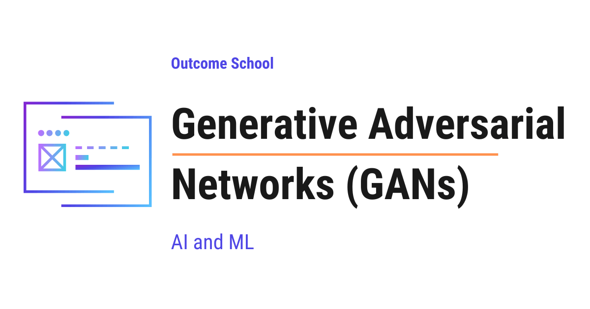

# What are Generative Adversarial Networks (GANs) and How Do They Work?

> Archived from <https://outcomeschool.com/blog/generative-adversarial-networks> on 2026-11-25.

A Generative Adversarial Network (GAN) is a Machine Learning system where two neural networks compete against each other, and through this competition, one of them learns to create new data that looks real.

In this blog, we will learn about Generative Adversarial Networks (GANs), one of the most fascinating ideas in Machine Learning that can create brand new images, faces, and art that never existed before.

We will cover the following:
<ul><li>What is a Generative Adversarial Network (GAN)?</li><li>The two players: Generator vs Discriminator</li><li>The counterfeiter vs police analogy</li><li>The adversarial training loop</li><li>The loss function and the minimax game in simple words</li><li>A tiny PyTorch-style code sketch</li><li>The mode collapse problem</li><li>Training stability</li><li>Types of GANs (DCGAN, Conditional GAN, StyleGAN, CycleGAN)</li><li>Real-world applications of GANs</li></ul>
I am <strong>Amit Shekhar</strong>, Founder @ <a target="_blank" rel="noopener noreferrer" href="https://outcomeschool.com">Outcome School</a>, I have taught and mentored many developers, and their efforts landed them high-paying tech jobs, helped many tech companies in solving their unique problems, and created many open-source libraries being used by top companies. I am passionate about sharing knowledge through open-source, blogs, and videos.

I teach <a target="_blank" rel="noopener noreferrer" href="https://outcomeschool.com/program/ai-and-machine-learning">AI and Machine Learning</a> at Outcome School.

Let&#x27;s get started.
<h3 id="what-is-a-generative-adversarial-network-gan">What is a Generative Adversarial Network (GAN)?</h3>
A <strong>Generative Adversarial Network (GAN)</strong> is a Machine Learning system where two <a target="_blank" rel="noopener noreferrer" href="neural-network.md">neural networks</a> compete against each other, and through this competition, one of them learns to create new data that looks real.

In simple words, a GAN is a system that learns to create fake things so convincing that they look completely real.

Let&#x27;s break the name down:
<blockquote>
GAN = Generative + Adversarial + Network
</blockquote><ul><li><a target="_blank" rel="noopener noreferrer" href="what-is-generative-ai.md"><strong>Generative</strong></a> means it generates, which means it creates new things, like new images.</li><li><strong>Adversarial</strong> means there is a fight, a competition between two sides.</li><li><strong>Network</strong> means we are using neural networks, which are the brains of Machine Learning.</li></ul>
So, a GAN is two neural networks fighting each other to learn how to create new data.

Let&#x27;s say we want a computer to draw new human faces that no one has ever seen. These faces should look like real photographs, but they belong to no real person. A GAN can do exactly this.

The most interesting part is that a GAN learns to do this all by itself, just by looking at many real examples, and that too without anyone telling it exactly what to draw.
<h3 id="the-two-players-generator-vs-discriminator">The two players: Generator vs Discriminator</h3>
A GAN has two neural networks inside it. These are the two players of the game.

<strong>Generator:</strong> The first network is the <strong>Generator</strong>. Its job is to create fake data. It takes some random numbers as input and turns them into something, for example, a picture of a face.

<strong>Discriminator:</strong> The second network is the <strong>Discriminator</strong>. Its job is to look at a picture and decide one thing only, which means it answers a simple question: is this picture real or fake?

So, we have one network that creates fakes, and another network that catches fakes.

Here, the random numbers given to the Generator are very important. We call this random input the <strong>noise</strong> or the <a target="_blank" rel="noopener noreferrer" href="variational-autoencoders.md"><strong>latent vector</strong></a>. A latent vector is just a small list of random numbers that acts like a seed. The Generator turns this random noise into a meaningful image. By changing the noise, we get a different image every time.

The Generator never sees the real images directly. It only learns from the feedback given by the Discriminator. This is the beauty of a GAN.
<h3 id="the-counterfeiter-vs-police-analogy">The counterfeiter vs police analogy</h3>
The best way to learn this is by taking an example.

Let&#x27;s say there is a <strong>counterfeiter</strong>, a person who makes fake currency notes. And there is the <strong>police</strong>, whose job is to catch fake notes.

Here is how the story goes:
<ul><li>In the beginning, the counterfeiter is very bad at making fake notes. The notes look obviously fake.</li><li>The police easily catch every fake note. This is easy in the start.</li><li>But, the counterfeiter learns from getting caught. He improves and makes slightly better notes.</li><li>Now, the police must also become smarter to catch these better fakes.</li><li>This back and forth continues. Both keep getting better and better.</li><li>Finally, the counterfeiter becomes so good that the fake notes look exactly like real notes, and even the police cannot tell the difference.</li></ul>
In our GAN:
<ul><li>The counterfeiter is the <strong>Generator</strong>.</li><li>The police is the <strong>Discriminator</strong>.</li><li>The fake notes are the <strong>fake images</strong>.</li></ul>
So, both networks push each other to improve. The Generator becomes better at creating, and the Discriminator becomes better at judging. When the Generator wins, which means the Discriminator can no longer tell real from fake, our GAN is ready.

This is how two competing networks together produce something amazing.
<h3 id="the-adversarial-training-loop">The adversarial training loop</h3>
Now, let&#x27;s understand how the training actually happens, step by step.

Training a GAN means letting the two networks compete in repeated rounds. In each round, we train the Discriminator a little, and then we train the Generator a little.

<strong>Step 1:</strong> We take some real images from our dataset, for example, real photos of faces.

<strong>Step 2:</strong> The Generator takes random noise and creates some fake images.

<strong>Step 3:</strong> We show both the real images and the fake images to the Discriminator. We tell it which ones are real and which ones are fake. The Discriminator learns to tell them apart. So, the Discriminator gets better at catching fakes.

<strong>Step 4:</strong> Now, it is the Generator&#x27;s turn. The Generator creates new fake images and shows them to the Discriminator. This time, the Generator wants to fool the Discriminator. If the Discriminator catches the fake, the Generator learns from this mistake and improves.

<strong>Step 5:</strong> We repeat these steps again and again, thousands of times.

Let&#x27;s see a simple diagram of this loop as below:

<pre><code class="code-highlight">
  Random Noise

       |
       v

  [ Generator ] ----&gt; Fake Images

                          |
  Real Images ----------&gt; |

                          v

                  [ Discriminator ] ----&gt; Real or Fake?

                          |
                          v

              Feedback to both networks

</code></pre>

Here, we can see that the feedback goes back to both networks. The Discriminator uses the feedback to catch fakes better. The Generator uses the feedback to create better fakes.

Over time, the Generator becomes so good that its fake images look just like real images. This is how the adversarial training loop works.

<strong>Planning your move into AI?</strong>

No matter which tech domain you work in today, with your effort, you can transition to these roles:
<ul><li>AI Engineer</li><li>Forward Deployed Engineer</li><li>AI Agent Engineer</li><li>Harness Engineer</li><li>Voice AI Engineer</li><li>AI Architect</li><li>LLM Engineer</li><li>LLM Inference Engineer</li><li>Gen AI Engineer</li><li>MLOps Engineer</li><li>ML Engineer</li><li>Deep Learning Engineer</li></ul>
Our <a target="_blank" rel="noopener noreferrer" href="https://outcomeschool.com/program/ai-and-machine-learning">AI and Machine Learning Program</a> at Outcome School takes you there.
<h3 id="the-loss-function-and-the-minimax-game-in-simple-words">The loss function and the minimax game in simple words</h3>
Now, let&#x27;s understand the maths part, but in very simple words. Do not worry, we will learn it slowly.

In Machine Learning, a <strong>loss</strong> is a number that tells us how wrong a network is. A high loss means the network is doing a bad job. A low loss means it is doing a good job. The network learns by trying to reduce its own loss.

In a GAN, the two networks have opposite goals. This is called a <strong>minimax game</strong>.

In simple words:
<ul><li>The Discriminator wants to <strong>maximize</strong> its success, which means it wants to correctly catch every fake and approve every real.</li><li>The Generator wants to <strong>minimize</strong> the Discriminator&#x27;s success, which means it wants the Discriminator to fail at catching fakes.</li></ul>
So, one player is trying to win, and the other is trying to make the first player lose. This is why we call it a minimax game. One side maximizes, the other side minimizes.

Let&#x27;s understand with simple numbers. The Discriminator gives a score between 0 and 1 for each image:
<ul><li>A score close to 1 means &quot;I think this is real.&quot;</li><li>A score close to 0 means &quot;I think this is fake.&quot;</li></ul>
Now:
<ul><li>When the Discriminator sees a real image, it wants to give a score close to 1.</li><li>When the Discriminator sees a fake image, it wants to give a score close to 0.</li><li>But the Generator wants the Discriminator to give a score close to 1 for fake images, because that means the fake fooled the Discriminator.</li></ul>
So, both are pulling in opposite directions. They reach a balance point when the Discriminator can no longer tell real from fake, which means it gives a score of around 0.5 for everything, which is just like guessing. At this point, the Generator has won, and the fake images look truly real.

We can picture this tug-of-war on the score line as below:

<pre><code class="code-highlight">
  Discriminator pushes fake images this way
  &lt;----------------------

  0.0 ----------- 0.5 ----------- 1.0
  &quot;fake&quot;        &quot;unsure&quot;        &quot;real&quot;
                (balance
                 point)

                       ----------------------&gt;
                       Generator pushes fake images this way

</code></pre>

Here, we can see that the score line runs from 0.0, which means fake, to 1.0, which means real, with 0.5 in the middle as the unsure balance point. The Discriminator tries to push the score of fake images toward 0.0, while the Generator tries to push the score of those same fake images toward 1.0. They pull in opposite directions, and when they meet at the 0.5 balance point, the Discriminator is only guessing and the fakes look real.

This is how the minimax game drives both networks to improve until the fakes become perfect.

To understand how loss functions and Optimizers train a neural network to reduce its mistakes, we cover these in depth in our <a target="_blank" rel="noopener noreferrer" href="https://outcomeschool.com/program/ai-and-machine-learning">AI and Machine Learning Program</a> at Outcome School.
<h3 id="a-tiny-pytorch-style-code-sketch">A tiny PyTorch-style code sketch</h3>
Now, let&#x27;s see a small code sketch so that the idea becomes concrete. We will use PyTorch-style Python. <a target="_blank" rel="noopener noreferrer" href="how-does-pytorch-work.md">PyTorch</a> is a popular Python library used to build neural networks. This is just for the sake of understanding, so we keep it short.

First, let&#x27;s see the Generator as below:

<pre><code class="code-highlight language-python">import torch.nn as nn

# The Generator turns random noise into an image
class Generator(nn.Module):
    def __init__(self):
        super().__init__()
        self.net = nn.Sequential(
            nn.Linear(100, 256),   # input is 100 random numbers
            nn.ReLU(),
            nn.Linear(256, 784),   # output is a 28x28 image (784 pixels)
            nn.Tanh()
        )

    def forward(self, noise):
        return self.net(noise)
</code></pre>

Here, we can see the Generator:
<ul><li>It takes <code>100</code> random numbers as input. This is the noise.</li><li>It passes them through some layers.</li><li>It outputs <code>784</code> numbers, which form a small <code>28x28</code> image.</li></ul>
Now, let&#x27;s see the Discriminator as below:

<pre><code class="code-highlight language-python"># The Discriminator decides if an image is real or fake
class Discriminator(nn.Module):
    def __init__(self):
        super().__init__()
        self.net = nn.Sequential(
            nn.Linear(784, 256),   # input is the image (784 pixels)
            nn.ReLU(),
            nn.Linear(256, 1),     # output is a single score
            nn.Sigmoid()           # squeezes the score between 0 and 1
        )

    def forward(self, image):
        return self.net(image)
</code></pre>

Here, we can see the Discriminator:
<ul><li>It takes an image of <code>784</code> pixels as input.</li><li>It passes them through some layers.</li><li>It outputs a single number between 0 and 1, which is the real-or-fake score.</li></ul>
Now, let&#x27;s see the heart of the training loop as below:

<pre><code class="code-highlight language-python"># First, train the Discriminator on real and fake images
real_score = discriminator(real_images)
fake_images = generator(noise)
fake_score = discriminator(fake_images.detach())

d_loss = loss_fn(real_score, ones) + loss_fn(fake_score, zeros)
d_loss.backward()
d_optimizer.step()

# Then, train the Generator to fool the Discriminator
fake_score = discriminator(generator(noise))
g_loss = loss_fn(fake_score, ones)   # Generator wants fakes labeled as real
g_loss.backward()
g_optimizer.step()
</code></pre>

Here, we can notice the key idea:
<ul><li>For the Discriminator, real images are labeled <code>ones</code> (real) and fake images are labeled <code>zeros</code> (fake). It learns to tell them apart.</li><li>For the Generator, the fake images are labeled <code>ones</code>, because the Generator wants the Discriminator to believe the fakes are real.</li><li><code>detach()</code> is used so that we do not update the Generator while training the Discriminator.</li></ul>
This is how the two networks are trained one after the other in every round.

<strong>A quick note for you</strong>

No matter which tech domain you work in, get familiar with these topics:
<ul><li>LLM</li><li>RAG</li><li>MCP</li><li>Agent</li><li>Fine-tuning</li><li>Quantization</li></ul>
We put it all together in one video:

<a target="_blank" rel="noopener noreferrer" href="https://www.youtube.com/watch?v=lnfWvX66FUk">AI Engineering Explained: LLM, RAG, MCP, Agent, Fine-Tuning, and Quantization</a>

No need to stop reading - bookmark it and watch later when you get time. Future you will thank you.

Now, let&#x27;s get back to the topic.
<h3 id="the-mode-collapse-problem">The mode collapse problem</h3>
Now, let&#x27;s discuss a common problem in GANs called <strong>mode collapse</strong>.

<strong>Mode collapse</strong> happens when the Generator stops being creative and keeps producing the same output again and again.

Let&#x27;s say we are training a GAN to create images of all digits from 0 to 9. But the Generator discovers that creating only the digit &quot;8&quot; fools the Discriminator very well. So, it gets lazy and keeps creating only &quot;8&quot; again and again, ignoring all other digits.

This is bad, because our GAN was supposed to create a variety of images, but now it produces only one type. The Generator collapsed into a single mode, which means a single kind of output. This is why we call it mode collapse.

Let&#x27;s compare the good case and the collapsed case like below:

<pre><code class="code-highlight">
  GOOD case (variety):

  [ Generator ] ----&gt; 0 1 2 3 4 5 6 7 8 9

  COLLAPSED case (mode collapse):

  [ Generator ] ----&gt; 8 8 8 8 8 8 8 8 8 8

</code></pre>

Here, we can see that in the good case the Generator produces a variety of digits from 0 to 9, just as we wanted. But in the collapsed case the Generator keeps producing only the digit &quot;8&quot; again and again. The output has lost all its variety, and this is exactly what mode collapse looks like.

So, mode collapse means the GAN loses variety and keeps repeating itself.

There are techniques to reduce this problem, for example, changing the loss function, adding more variety in training, and using improved GAN designs. But we must always watch out for mode collapse while training a GAN.
<h3 id="training-stability">Training stability</h3>
Now, let&#x27;s understand why GANs are known to be hard to train.

In a normal Machine Learning model, we train one network, and we just try to reduce one loss. It is simple. But in a GAN, we are training two networks that fight each other. This makes the training delicate.

Here are the common issues we face:
<ul><li><strong>One side becomes too strong.</strong> If the Discriminator becomes too good too fast, the Generator gets no useful feedback and stops learning. If the Generator becomes too good too fast, the Discriminator gets confused.</li><li><strong>The training does not settle.</strong> Since both keep changing, the balance can keep shifting, and the networks may never reach a calm point.</li><li><strong>Mode collapse</strong>, which we just learned about.</li></ul>
So, training a GAN is like balancing two children on a see-saw. If one side is too heavy, the see-saw stops working. We must keep both sides balanced.

To improve training stability, we can do the following:
<ul><li>Keep the learning of both networks at a similar pace.</li><li>Use better network designs like DCGAN.</li><li>Use improved loss functions that give smoother feedback.</li></ul>
This is how we keep our GAN training stable.

Diffusion Models later improved on this very instability, which is why they have largely overtaken GANs for image generation today. We have a detailed blog on <a target="_blank" rel="noopener noreferrer" href="diffusion-models.md">Diffusion Models</a> that covers this end to end.

<strong>Stay updated:</strong> Subscribe to our <a target="_blank" rel="noopener noreferrer" href="https://outcomeschool.substack.com/subscribe">newsletter</a> to get our latest AI and Machine Learning blogs straight to your inbox.
<h3 id="types-of-gans-dcgan-conditional-gan-stylegan-cyclegan">Types of GANs (DCGAN, Conditional GAN, StyleGAN, CycleGAN)</h3>
After the first GAN was introduced, many improved versions came into the picture. Now, let&#x27;s briefly understand the most popular ones.

<strong>DCGAN (Deep Convolutional GAN):</strong> This GAN uses <a target="_blank" rel="noopener noreferrer" href="convolutional-neural-network-cnn.md">convolutional layers</a>, which are special layers that are very good at understanding images. DCGAN made GANs much better and more stable at generating clear images. It is one of the most common starting points for image generation.

<strong>Conditional GAN (cGAN):</strong> In a normal GAN, we cannot control what the Generator creates. We just get a random image. In a <strong>Conditional GAN</strong>, we can give an extra instruction, called a condition. For example, we can tell it to create the digit &quot;7&quot; specifically, and it will create a &quot;7&quot;. So, a Conditional GAN gives us control over the output.

<strong>StyleGAN:</strong> This is a very advanced GAN created by NVIDIA. It is famous for creating extremely realistic human faces. StyleGAN also lets us control the style of the image, for example, the hair, the age, or the expression of a face. The website that shows &quot;this person does not exist&quot; is powered by StyleGAN.

<strong>CycleGAN:</strong> This GAN is used to convert one type of image into another type without needing matching pairs of images. For example, it can turn a photo of a horse into a zebra, or turn a summer scene into a winter scene, or turn a normal photo into a painting in the style of a famous artist. CycleGAN learns the translation between two worlds of images.

Let me tabulate the differences between these GAN types so that you can decide which one to use based on your use case:
<table><thead><tr><th>GAN Type</th><th>Main Idea</th><th>Common Use</th></tr></thead><tbody><tr><td>DCGAN</td><td>Uses convolutional layers for images</td><td>Clear, stable image generation</td></tr><tr><td>Conditional GAN</td><td>Adds a condition to control output</td><td>Generating a specific category</td></tr><tr><td>StyleGAN</td><td>Controls style and detail of images</td><td>Highly realistic faces</td></tr><tr><td>CycleGAN</td><td>Translates one image type to another</td><td>Style transfer, photo conversion</td></tr></tbody></table>
This is how different GANs solve different kinds of problems.

We have a complete program on Generative AI - covering Variational Autoencoders (VAEs), Autoregressive Models, Diffusion Models, and Multimodal Generative Models - check out our <a target="_blank" rel="noopener noreferrer" href="https://outcomeschool.com/program/ai-and-machine-learning">AI and Machine Learning Program</a> at Outcome School.
<h3 id="real-world-applications-of-gans">Real-world applications of GANs</h3>
Now, let&#x27;s see where GANs are actually used in the real world. This is the most exciting part.
<ul><li><strong>Image generation:</strong> GANs can create brand new images of faces, animals, objects, and more. These images look real but belong to no real thing.</li><li><strong>Deepfakes:</strong> GANs can swap one person&#x27;s face onto another person&#x27;s video. This is powerful technology, and we must use it responsibly, because it can also be misused to spread false information.</li><li><strong>Super-resolution:</strong> GANs can take a blurry, low-quality image and turn it into a sharp, high-quality image. This is very useful for old photos and low-quality videos.</li><li><strong>Art and design:</strong> GANs can create original digital art, paintings, and designs. Artists use GANs as a creative tool.</li><li><strong>Photo editing:</strong> GANs can change a person&#x27;s hairstyle, age, or expression in a photo. They can also remove or add objects in an image.</li><li><strong>Data generation:</strong> Sometimes we do not have enough real data to train a model. GANs can create extra realistic data to help train other Machine Learning models.</li><li><strong>Medical imaging:</strong> GANs can help create medical images for research and can improve the quality of scans.</li></ul>
So, now we know where we can use GANs.

Because this generated content can look completely real, we also need a way to tell machine-made content apart from human-made content. We have a detailed blog on <a target="_blank" rel="noopener noreferrer" href="how-does-llm-watermarking-work.md">How Does LLM Watermarking Work?</a> that explains how a hidden signal is placed inside generated content and read back later.

GANs changed the way computers create. With just two networks competing against each other, we can generate images, art, and data that look completely real. This is the power of a Generative Adversarial Network, and that too learned almost entirely by the machine on its own.
<h2 id="frequently-asked-questions">Frequently Asked Questions</h2><h3 id="does-the-generator-in-a-gan-ever-see-real-images">Does the Generator in a GAN ever see real images?</h3>
No. The Generator never sees the real images directly. It takes random noise as input and only learns from the feedback given by the Discriminator. When the Discriminator catches a fake, the Generator learns from this mistake and improves its next fakes.
<h3 id="what-does-it-mean-when-the-discriminator-gives-a-score-of-05">What does it mean when the Discriminator gives a score of 0.5?</h3>
A score of around 0.5 means the Discriminator can no longer tell real from fake and is just guessing. This is the balance point of the minimax game. At this point, the Generator has won, and the fake images look truly real.
<h3 id="can-we-control-what-a-gan-generates">Can we control what a GAN generates?</h3>
Yes, with a Conditional GAN. In a normal GAN, we cannot control what the Generator creates, and we just get a random image. A Conditional GAN takes an extra instruction called a condition, so we can ask it to create a specific category, for example, the digit &quot;7&quot;.
<h3 id="are-gans-still-the-best-choice-for-image-generation">Are GANs still the best choice for image generation?</h3>
Not today, since Diffusion Models have largely overtaken GANs for image generation. Diffusion Models improved on the training instability of GANs. GANs are hard to train because two networks fight each other, which can lead to one side becoming too strong, training that does not settle, and mode collapse.
<h3 id="why-do-we-call-detach-when-training-the-discriminator">Why do we call <code>detach()</code> when training the Discriminator?</h3>
We call <code>detach()</code> so that we do not update the Generator while training the Discriminator. In each round, the two networks are trained one after the other. First the Discriminator learns to tell real from fake, and then the Generator is trained to fool the Discriminator.

That&#x27;s it for now.

Thanks

<strong>Amit Shekhar</strong> Founder @ <a target="_blank" rel="noopener noreferrer" href="https://outcomeschool.com">Outcome School</a>

You can connect with me on:
<ul><li><a target="_blank" rel="noopener noreferrer" href="https://x.com/amitiitbhu">X</a></li><li><a target="_blank" rel="noopener noreferrer" href="https://www.linkedin.com/in/amit-shekhar-iitbhu">LinkedIn</a></li><li><a target="_blank" rel="noopener noreferrer" href="https://github.com/amitshekhariitbhu">GitHub</a></li></ul>
Follow Outcome School on:
<ul><li><a target="_blank" rel="noopener noreferrer" href="https://x.com/outcome_school">X</a></li><li><a target="_blank" rel="noopener noreferrer" href="https://youtube.com/@OutcomeSchool">YouTube</a></li><li><a target="_blank" rel="noopener noreferrer" href="https://www.linkedin.com/company/outcomeschool">LinkedIn</a></li><li><a target="_blank" rel="noopener noreferrer" href="https://github.com/OutcomeSchool">GitHub</a></li></ul>
<a target="_blank" rel="noopener noreferrer" href="https://outcomeschool.com/blog"><strong>Read all of our high-quality blogs here.</strong></a>

