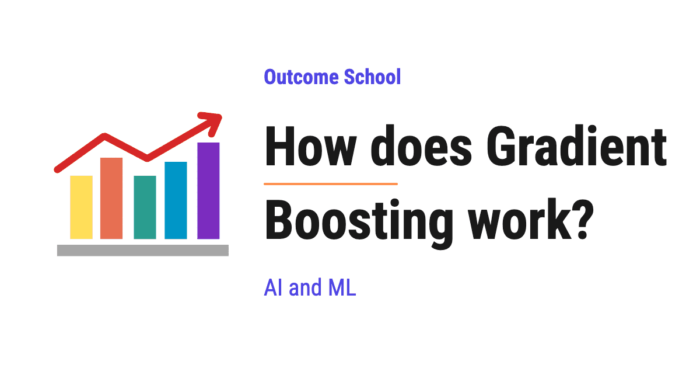

# How does Gradient Boosting work?

> Archived from <https://outcomeschool.com/blog/gradient-boosting> on 2026-11-25.

Gradient Boosting is a <a target="_blank" rel="noopener noreferrer" href="machine-learning.md">Machine Learning</a> method that builds many small, weak models one after another, where each new model learns to fix the mistakes left by all the models before it. When we add up all these small fixes, we get one strong and accurate model.

In this blog, we will learn about how Gradient Boosting works. We will also see what boosting, weak learners, and residuals are, how each new tree learns from the mistakes of the previous trees with a step-by-step example, what the learning rate does, where the word &quot;gradient&quot; comes from, how it differs from a Random Forest, and where it works well and where it fails.

We will cover the following:
<ul><li>The problem with one model</li><li>What is boosting?</li><li>What is a weak learner?</li><li>What are residuals?</li><li>How does Gradient Boosting work? A step-by-step example</li><li>What is the learning rate?</li><li>Why is it called &quot;Gradient&quot; Boosting?</li><li>Seeing it in code</li><li>Overfitting and the important settings</li><li>Gradient Boosting vs Random Forest</li><li>Popular libraries and where Gradient Boosting works well</li></ul>
I am <strong>Amit Shekhar</strong>, Founder @ <a target="_blank" rel="noopener noreferrer" href="https://outcomeschool.com">Outcome School</a>, I have taught and mentored many developers, and their efforts landed them high-paying tech jobs, helped many tech companies in solving their unique problems, and created many open-source libraries being used by top companies. I am passionate about sharing knowledge through open-source, blogs, and videos.

I teach <a target="_blank" rel="noopener noreferrer" href="https://outcomeschool.com/program/ai-and-machine-learning">AI and Machine Learning</a> at Outcome School.

Let&#x27;s get started.
<h2 id="the-problem-with-one-model">The problem with one model</h2>
Before jumping into Gradient Boosting, we must understand the problem it solves.

Let&#x27;s say we want to predict the price of a house. We can train one model, for example one <a target="_blank" rel="noopener noreferrer" href="decision-trees-and-random-forests.md">Decision Tree</a>. A <strong>Decision Tree</strong> is a model that predicts by asking a series of yes-or-no questions, like &quot;Is the size more than 1500 square feet?&quot;, and then gives an answer at the end.

If we keep the tree small, it is too simple and misses a lot of the pattern. If we make the tree very big, it starts memorizing the training data, including its random accidents, and then fails on new houses. This memorizing problem is called <strong><a target="_blank" rel="noopener noreferrer" href="bias-variance-tradeoff.md">overfitting</a></strong>.

So, one model alone is either too weak or too fragile. The following question arises: can we combine many simple models to get one strong model?

The answer is yes. One of the ways to do this is <strong>boosting</strong>.
<h2 id="what-is-boosting">What is boosting?</h2>
<strong>Boosting is a method in which we train many simple models one after another, and each new model focuses on the mistakes made by the models before it.</strong>

The best way to learn this is by taking an example.

Suppose a golfer wants to put the ball into the hole, which is 100 meters away.
<ul><li><strong>Shot 1:</strong> The golfer hits the ball. It goes 80 meters. The ball is still 20 meters short.</li><li><strong>Shot 2:</strong> The golfer does not start again from the beginning. He hits from where the ball is, and only tries to cover the remaining 20 meters. The ball goes 15 meters. Now, it is 5 meters short.</li><li><strong>Shot 3:</strong> He tries to cover the remaining 5 meters. The ball goes 4 meters. Now, it is 1 meter short.</li><li><strong>Shot 4:</strong> A small tap, and the ball is in the hole.</li></ul>
Here, we can notice that each shot only fixes what is left from the previous shots. No single shot was perfect, but all the shots added together reached the target.

Boosting works exactly like this. The first model makes a rough guess. The second model learns to fix what the first one got wrong. The third model fixes what is still wrong after the first two. And so on.
<h2 id="what-is-a-weak-learner">What is a weak learner?</h2>
In boosting, each single model is intentionally kept simple. Such a model is called a <strong>weak learner</strong>.

<strong>A weak learner is a simple model that is only a little better than random guessing on its own.</strong>

In Gradient Boosting, the weak learner is almost always a small Decision Tree. It asks only a few questions, for example only 2 or 3 levels deep. A tree with only one question is called a <strong>decision stump</strong>.

Why do we keep them weak? Because a small tree cannot memorize the data. Each one learns only a small, safe piece of the pattern. Many small, safe pieces added together give a strong model that does not overfit easily.
<h2 id="what-are-residuals">What are residuals?</h2>
Now, we must learn one important word before we see the full process.

<strong>A residual is the difference between the correct answer and the current prediction. It is the mistake that is still left.</strong>

<strong>Residual = Correct Answer - Current Prediction</strong>

Let&#x27;s say a house was sold for 50 lakh, and our model predicted 60 lakh.

<pre><code class="language-text code-highlight">Residual = 50 - 60 = -10
</code></pre>

Here, the residual is -10. Means, our prediction is 10 lakh too high, and we must go down by 10 to reach the correct answer.

If the residual is positive, our prediction is too low. If the residual is negative, our prediction is too high. If the residual is 0, our prediction is perfect.

In the golf example, the residual is the remaining distance to the hole after each shot.
<h2 id="how-does-gradient-boosting-work-a-step-by-step-example">How does Gradient Boosting work? A step-by-step example</h2>
Now, it&#x27;s time to see the full process with real numbers. For the sake of understanding, we will use only 3 houses.
<table><thead><tr><th>House</th><th>Size</th><th>Correct Price (lakh)</th></tr></thead><tbody><tr><td>A</td><td>Small</td><td>40</td></tr><tr><td>B</td><td>Small</td><td>50</td></tr><tr><td>C</td><td>Big</td><td>90</td></tr></tbody></table>
<strong>Step 1:</strong> Start with a simple first guess.

We do not use any tree yet. We predict the average price for every house.

<pre><code class="language-text code-highlight">Average = (40 + 50 + 90) / 3 = 60
</code></pre>

So, our first prediction is 60 for every house.

<strong>Step 2:</strong> Calculate the residuals.
<table><thead><tr><th>House</th><th>Correct</th><th>Prediction</th><th>Residual</th></tr></thead><tbody><tr><td>A</td><td>40</td><td>60</td><td>-20</td></tr><tr><td>B</td><td>50</td><td>60</td><td>-10</td></tr><tr><td>C</td><td>90</td><td>60</td><td>+30</td></tr></tbody></table>
Here, we can see that we are too high for the small houses and too low for the big house.

<strong>Step 3:</strong> Train a small tree to predict the residuals.

<strong>The new tree does not learn the prices. It learns the residuals, which means the mistakes.</strong>

Our small tree asks just one question: &quot;Is the house small?&quot;

<pre><code class="language-text code-highlight">            [Is the house small?]
              /             \
            Yes              No
            /                  \
  Average residual of A, B    Residual of C
   = (-20 + -10) / 2           = +30
   = -15
</code></pre>

So, Tree 1 says: &quot;For small houses, go down by 15. For big houses, go up by 30.&quot;

<strong>Step 4:</strong> Update the predictions, but only by a small step.

We do not add the full correction. We multiply it by a small number called the <strong>learning rate</strong>. Let&#x27;s use a learning rate of 0.5 for this example.

<strong>New Prediction = Old Prediction + Learning Rate * Tree&#x27;s Output</strong>
<table><thead><tr><th>House</th><th>Old</th><th>Tree 1 output</th><th>New Prediction</th></tr></thead><tbody><tr><td>A</td><td>60</td><td>-15</td><td>60 + 0.5 x -15 = 52.5</td></tr><tr><td>B</td><td>60</td><td>-15</td><td>60 + 0.5 x -15 = 52.5</td></tr><tr><td>C</td><td>60</td><td>+30</td><td>60 + 0.5 x 30 = 75</td></tr></tbody></table>
<strong>Step 5:</strong> Calculate the new residuals and repeat.
<table><thead><tr><th>House</th><th>Correct</th><th>Prediction</th><th>New Residual</th></tr></thead><tbody><tr><td>A</td><td>40</td><td>52.5</td><td>-12.5</td></tr><tr><td>B</td><td>50</td><td>52.5</td><td>-2.5</td></tr><tr><td>C</td><td>90</td><td>75</td><td>+15</td></tr></tbody></table>
Here, we can see that every mistake got smaller. Now, Tree 2 learns these new residuals. It asks the same question and outputs -7.5 for small houses (the average of -12.5 and -2.5) and +15 for the big house.
<table><thead><tr><th>House</th><th>Old</th><th>Tree 2 output</th><th>New Prediction</th></tr></thead><tbody><tr><td>A</td><td>52.5</td><td>-7.5</td><td>52.5 + 0.5 x -7.5 = 48.75</td></tr><tr><td>B</td><td>52.5</td><td>-7.5</td><td>52.5 + 0.5 x -7.5 = 48.75</td></tr><tr><td>C</td><td>75</td><td>+15</td><td>75 + 0.5 x 15 = 82.5</td></tr></tbody></table>
Let&#x27;s see how the prediction for House C moves closer to the correct answer of 90:

<pre><code class="language-text code-highlight">Start:        60
After Tree 1: 75
After Tree 2: 82.5
After Tree 3: 86.25
After Tree 4: 88.1
...           (keeps getting closer to 90)
</code></pre>

This is exactly like the golfer. Each tree covers part of the remaining distance.

<strong>Note:</strong> Houses A and B have the same size, so our tiny trees cannot tell them apart. They will both settle around 45, the average of 40 and 50. With more <a target="_blank" rel="noopener noreferrer" href="feature-engineering.md">features</a>, like the number of rooms or the location, the trees can ask more questions and separate them too.

<strong>The final model is the first guess plus all the small corrections added together:</strong>

<strong>Final Prediction = First Guess + Learning Rate * Tree 1 + Learning Rate * Tree 2 + Learning Rate * Tree 3 + ...</strong>

This is how Gradient Boosting works. In real use, we build hundreds or thousands of such small trees.

<strong>Planning your move into AI?</strong>

No matter which tech domain you work in today, with your effort, you can transition to these roles:
<ul><li>AI Engineer</li><li>Forward Deployed Engineer</li><li>AI Agent Engineer</li><li>Harness Engineer</li><li>Voice AI Engineer</li><li>AI Architect</li><li>LLM Engineer</li><li>LLM Inference Engineer</li><li>Gen AI Engineer</li><li>MLOps Engineer</li><li>ML Engineer</li><li>Deep Learning Engineer</li></ul>
Our <a target="_blank" rel="noopener noreferrer" href="https://outcomeschool.com/program/ai-and-machine-learning">AI and Machine Learning Program</a> at Outcome School takes you there.
<h2 id="what-is-the-learning-rate">What is the learning rate?</h2>
<strong>The learning rate is a small number, usually between 0.01 and 0.3, that controls how much of each tree&#x27;s correction we actually apply.</strong>

Why not apply the full correction at once? Let&#x27;s go back to the golfer. If the golfer hits very hard every time, he will keep overshooting the hole, going past it, then coming back, and so on. Small, careful shots near the hole work better.

In the same way:
<ul><li>A <strong>big learning rate</strong> learns fast, but each tree can over-correct, and the model can overfit.</li><li>A <strong>small learning rate</strong> learns slowly and carefully. It needs more trees, but usually gives a better model on new data.</li></ul>
So, there is a balance between the learning rate and the number of trees. If we make the learning rate smaller, we need more trees.
<h2 id="why-is-it-called-gradient-boosting">Why is it called &quot;Gradient&quot; Boosting?</h2>
Now, the question is: where does the word &quot;gradient&quot; come from?

We already know Boosting. Now, let&#x27;s understand Gradient.

First, we need the idea of a <strong>loss</strong>. <strong>A loss is a single number that tells us how bad our predictions are.</strong> A common loss for numbers is the average of the squared residuals. Bigger mistakes give a bigger loss.

Our goal is to make the loss as small as possible.

Now, think of the loss as a hill, and we are standing somewhere on it. We want to reach the bottom, where the loss is lowest. The <strong>gradient</strong> tells us which direction is uphill and how steep it is. So, if we walk in the opposite direction of the gradient, we go downhill. This idea of walking downhill step by step is called <strong><a target="_blank" rel="noopener noreferrer" href="math-behind-gradient-descent.md">gradient descent</a></strong>.

When the loss is the <a target="_blank" rel="noopener noreferrer" href="l1-and-l2-loss-functions.md">squared error</a>, the downhill direction for each prediction is exactly the residual (up to a constant number that does not change the direction). Means, when each new tree learns the residuals, it is actually learning the downhill direction, and adding it takes one step down the hill.

Let&#x27;s check this with House C. Its prediction was 60 and the correct price was 90. The residual is +30, which says &quot;move up&quot;. And moving up is exactly what reduces the loss for House C. Also, the bigger the mistake, the steeper the hill, and the bigger the residual. So, the residual tells us both the direction and how hard to push.

So:
<ul><li>Each tree points in the direction that reduces the loss.</li><li>The learning rate decides how big a step we take.</li><li>Adding trees one by one is walking downhill one step at a time.</li></ul>
This is why it is called Gradient Boosting.

The best thing about this view is that it works for any loss, not just squared error. For a yes-or-no problem, like &quot;Will this customer leave or not?&quot;, we use a different loss, and each tree learns the downhill direction of that loss. These directions are called <strong>pseudo-residuals</strong>. The full process stays the same.

<strong>A quick note for you</strong>

No matter which tech domain you work in, get familiar with these topics:
<ul><li>LLM</li><li>RAG</li><li>MCP</li><li>Agent</li><li>Fine-tuning</li><li>Quantization</li></ul>
We put it all together in one video:

<a target="_blank" rel="noopener noreferrer" href="https://www.youtube.com/watch?v=lnfWvX66FUk">AI Engineering Explained: LLM, RAG, MCP, Agent, Fine-Tuning, and Quantization</a>

No need to stop reading - bookmark it and watch later when you get time. Future you will thank you.

Now, let&#x27;s get back to the topic.
<h2 id="seeing-it-in-code">Seeing it in code</h2>
Now, let&#x27;s see Gradient Boosting in Python using the <code>scikit-learn</code> library. We will use a built-in dataset of 442 diabetes patients. Each patient has 10 measurements, like age and blood pressure, and the answer is a number that shows how much the disease progressed after one year.

<pre><code class="code-highlight language-python">from sklearn.datasets import load_diabetes
from sklearn.model_selection import train_test_split
from sklearn.ensemble import GradientBoostingRegressor
from sklearn.metrics import mean_absolute_error

X, y = load_diabetes(return_X_y=True)
X_train, X_test, y_train, y_test = train_test_split(
    X, y, test_size=0.3, random_state=42)

model = GradientBoostingRegressor(
    n_estimators=200, learning_rate=0.05, max_depth=2, random_state=42)
model.fit(X_train, y_train)

# Check the error after 1, 10, 50, 100, and 200 trees
for i, pred in enumerate(model.staged_predict(X_test), start=1):
    if i in [1, 10, 50, 100, 200]:
        print(f&quot;trees={i:3d}  test error={mean_absolute_error(y_test, pred):.1f}&quot;)
</code></pre>

Here, we have done the following:
<ul><li>We have loaded the data and kept 30% of the patients aside as a <strong><a target="_blank" rel="noopener noreferrer" href="train-validation-test-split.md">test set</a></strong>, which means patients that the model never sees while learning.</li><li>We have created a <code>GradientBoostingRegressor</code> with <code>n_estimators=200</code>, which means 200 trees, <code>learning_rate=0.05</code>, and <code>max_depth=2</code>, which means each tree asks at most 2 levels of questions. These are our weak learners.</li><li><code>random_state=42</code> fixes the random choices, so that we get the same result every time.</li><li><code>staged_predict</code> gives us the predictions after each tree is added, so that we can watch the model improve.</li><li><code>mean_absolute_error</code> is the average size of the mistake on the test patients. Lower is better.</li></ul>
This will print the following:

<pre><code class="language-text code-highlight">trees=  1  test error=63.0
trees= 10  test error=53.7
trees= 50  test error=43.2
trees=100  test error=41.9
trees=200  test error=42.1
</code></pre>

Here, we can see that the error drops quickly as we add trees, from 63.0 with one tree to 41.9 with 100 trees. But, after 100 trees, the error on new patients starts going slightly up again, to 42.1. The extra trees have started learning the random accidents in the training data. This is overfitting, and it leads us to the next section.
<h2 id="overfitting-and-the-important-settings">Overfitting and the important settings</h2>
Gradient Boosting keeps fixing mistakes on the training data. If we let it run for too long, it starts fixing even the random accidents in the training data, which do not repeat in new data.

These are the main settings that we use to control this:
<ul><li><strong>Number of trees (<code>n_estimators</code>):</strong> Too few trees means underfitting, which means the model is too simple. Too many trees means overfitting.</li><li><strong>Learning rate (<code>learning_rate</code>):</strong> Smaller is safer, but needs more trees.</li><li><strong>Tree depth (<code>max_depth</code>):</strong> Keep trees small, usually 2 to 8 levels. Bigger trees learn faster but overfit faster.</li><li><strong>Subsampling (<code>subsample</code>):</strong> Train each tree on a random part of the data, like 80%. This adds some randomness and helps the model work better on new data.</li><li><strong><a target="_blank" rel="noopener noreferrer" href="early-stopping.md">Early stopping</a>:</strong> Keep some data aside, watch the error on it after each tree, and stop adding trees when that error stops improving.</li></ul>
<strong>Note:</strong> Early stopping is the simplest way to pick the number of trees. It automatically stops near the best point, like the 100 trees in our example.

To master Hyperparameter Tuning along with Evaluation and Testing from the ground up, check out our <a target="_blank" rel="noopener noreferrer" href="https://outcomeschool.com/program/ai-and-machine-learning">AI and Machine Learning Program</a> at Outcome School.
<h2 id="gradient-boosting-vs-random-forest">Gradient Boosting vs Random Forest</h2>
Both Gradient Boosting and Random Forest combine many Decision Trees. But they combine them in very different ways.

A <strong>Random Forest</strong> builds many big trees <strong>at the same time</strong>, each on a random sample of the data, and then takes a vote or an average. Each tree works alone, without knowing about the others. This way of combining is called <strong>bagging</strong>.

<strong>Gradient Boosting</strong> builds small trees <strong>one after another</strong>, and each tree learns from the mistakes of the trees before it. The trees work as a team.

Let me tabulate the differences between Gradient Boosting and Random Forest for your better understanding so that you can decide which one to use based on your use case.
<table><thead><tr><th>Point</th><th>Random Forest</th><th>Gradient Boosting</th></tr></thead><tbody><tr><td>How trees are built</td><td>All at the same time, independently</td><td>One after another, in sequence</td></tr><tr><td>What each tree learns</td><td>The original answers</td><td>The mistakes of previous trees</td></tr><tr><td>Size of each tree</td><td>Big, deep trees</td><td>Small, shallow trees</td></tr><tr><td>How answers are combined</td><td>Vote or average</td><td>Sum of small corrections</td></tr><tr><td>Main thing it reduces</td><td>Variance (shakiness)</td><td>Bias (being too simple)</td></tr><tr><td>Accuracy</td><td>Very good</td><td>Often the best on table-like data</td></tr><tr><td>Tuning effort</td><td>Works well with default settings</td><td>Needs careful tuning</td></tr><tr><td>Risk of overfitting</td><td>Low</td><td>Higher, if trees are too many</td></tr><tr><td>Training speed</td><td>Can train trees in parallel</td><td>Trees must wait for each other</td></tr></tbody></table>
So, if we want a strong model quickly with little tuning, a Random Forest is a great start. If we want the highest accuracy on table-like data and can spend time on tuning, Gradient Boosting usually does better.

<strong>Stay updated:</strong> Subscribe to our <a target="_blank" rel="noopener noreferrer" href="https://outcomeschool.substack.com/subscribe">newsletter</a> to get our latest AI and Machine Learning blogs straight to your inbox.
<h2 id="popular-libraries-and-where-gradient-boosting-works-well">Popular libraries and where Gradient Boosting works well</h2>
In real projects, we mostly use one of these libraries:
<ul><li><strong>XGBoost:</strong> One of the most popular libraries. It adds extra controls to prevent overfitting and is very fast.</li><li><strong>LightGBM:</strong> Built by Microsoft. It is very fast on large data and uses less memory.</li><li><strong>CatBoost:</strong> Built by Yandex. It handles text-like category columns, such as &quot;City&quot; or &quot;Color&quot;, very well without extra work.</li></ul>
All of them follow the same core idea that we learned in this blog: start with a simple guess, then keep adding small trees that fix the remaining mistakes.

Gradient Boosting works very well on <strong>table-like data</strong>, which means data in rows and columns, like a spreadsheet of customers, sales, or loans. It is used for tasks like fraud detection, predicting which customers will leave, and ranking search results.

But, it is not the best choice for images, audio, or long text. For those, <a target="_blank" rel="noopener noreferrer" href="neural-network.md">neural networks</a> work much better. It also struggles when the data is very small and noisy, because it keeps chasing the mistakes and ends up learning the random accidents in the data. In such cases, a simpler model or a Random Forest is safer.

Now we must have understood how Gradient Boosting works.
<h2 id="frequently-asked-questions">Frequently Asked Questions</h2><h3 id="can-gradient-boosting-be-used-for-classification">Can Gradient Boosting be used for classification?</h3>
Yes. Gradient Boosting also works for yes-or-no problems, like &quot;Will this customer leave or not?&quot;. We use a different loss for such problems, and each new tree learns the downhill direction of that loss. These directions are called pseudo-residuals. The full process stays the same: start with a simple guess and keep adding small trees.
<h3 id="how-many-trees-should-we-use-in-gradient-boosting">How many trees should we use in Gradient Boosting?</h3>
There is no fixed number. Too few trees means the model is too simple, and too many trees means it overfits. A smaller learning rate needs more trees. The simplest way to pick the number is early stopping: watch the error on data kept aside after each tree, and stop adding trees when that error stops improving.
<h3 id="what-is-the-difference-between-bagging-and-boosting">What is the difference between bagging and boosting?</h3>
Bagging trains many models at the same time, each on a random sample of the data, and then takes a vote or an average. Each model works alone. Boosting trains small models one after another, and each new model learns from the mistakes of the models before it. Random Forest uses bagging, and Gradient Boosting uses boosting.
<h3 id="is-gradient-boosting-good-for-images-and-text">Is Gradient Boosting good for images and text?</h3>
No. Gradient Boosting is not the best choice for images, audio, or long text. For those, neural networks work much better. Gradient Boosting shines on table-like data, which means data in rows and columns, like a spreadsheet of customers, sales, or loans, and is used for tasks like fraud detection and ranking search results.

That&#x27;s it for now.

Thanks

<strong>Amit Shekhar</strong> Founder @ <a target="_blank" rel="noopener noreferrer" href="https://outcomeschool.com">Outcome School</a>

You can connect with me on:
<ul><li><a target="_blank" rel="noopener noreferrer" href="https://x.com/amitiitbhu">X</a></li><li><a target="_blank" rel="noopener noreferrer" href="https://www.linkedin.com/in/amit-shekhar-iitbhu">LinkedIn</a></li><li><a target="_blank" rel="noopener noreferrer" href="https://github.com/amitshekhariitbhu">GitHub</a></li></ul>
Follow Outcome School on:
<ul><li><a target="_blank" rel="noopener noreferrer" href="https://x.com/outcome_school">X</a></li><li><a target="_blank" rel="noopener noreferrer" href="https://youtube.com/@OutcomeSchool">YouTube</a></li><li><a target="_blank" rel="noopener noreferrer" href="https://www.linkedin.com/company/outcomeschool">LinkedIn</a></li><li><a target="_blank" rel="noopener noreferrer" href="http://github.com/OutcomeSchool">GitHub</a></li></ul>
<a target="_blank" rel="noopener noreferrer" href="https://outcomeschool.com/blog"><strong>Read all of our high-quality blogs here.</strong></a>

