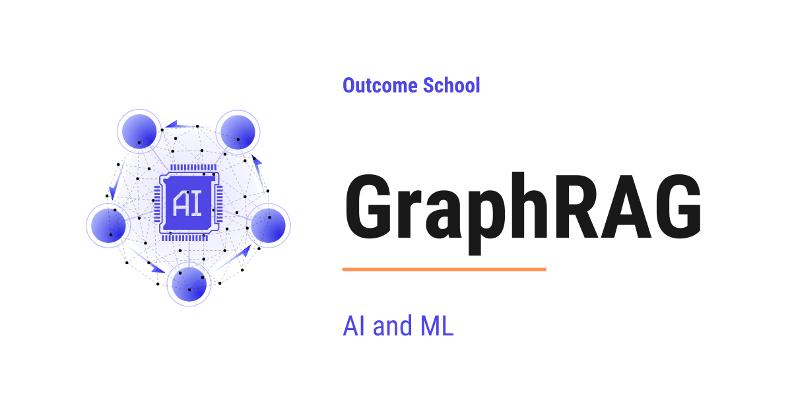

# What is GraphRAG? How Knowledge Graphs Improve RAG

> Archived from <https://outcomeschool.com/blog/graphrag> on 2026-11-25.

GraphRAG is a type of RAG that uses a knowledge graph to find better, more connected information before answering. In simple words, it knows not just the facts in our data, but also how those facts are related to each other.

In this blog, we will learn about GraphRAG and how it improves retrieval by using a knowledge graph along with <a target="_blank" rel="noopener noreferrer" href="how-does-a-vector-database-work.md">vector search</a>.

We will cover the following:
<ul><li>What is GraphRAG?</li><li>Why normal RAG is not enough</li><li>The big picture of GraphRAG</li><li>How GraphRAG builds the knowledge graph</li><li>How GraphRAG answers a question</li><li>Local search vs Global search</li><li>When to use GraphRAG</li><li>Trade-offs of GraphRAG</li><li>Quick Summary</li></ul>
I am <strong>Amit Shekhar</strong>, Founder @ <a target="_blank" rel="noopener noreferrer" href="https://outcomeschool.com">Outcome School</a>, I have taught and mentored many developers, and their efforts landed them high-paying tech jobs, helped many tech companies in solving their unique problems, and created many open-source libraries being used by top companies. I am passionate about sharing knowledge through open-source, blogs, and videos.

I teach <a target="_blank" rel="noopener noreferrer" href="https://outcomeschool.com/program/ai-and-machine-learning">AI and Machine Learning</a> at Outcome School.

Let&#x27;s get started.
<h3 id="what-is-graphrag">What is GraphRAG?</h3>
Imagine asking our company knowledge base, &quot;How is our CEO connected to our biggest customer through past projects?&quot; and getting a clean, connected answer instead of a pile of unrelated chunks. That is what GraphRAG enables.

Let&#x27;s start with the name itself.

<strong>GraphRAG = Graph + RAG.</strong>

The &quot;Graph&quot; part is a <strong>knowledge graph</strong>, where each important thing in our documents becomes a node, and each relation between those things becomes a connection.

The &quot;RAG&quot; part is <strong><a target="_blank" rel="noopener noreferrer" href="retrieval-augmented-generation-rag.md">Retrieval-Augmented Generation</a></strong>, where we fetch relevant information from our data and pass it to the LLM along with the question, so the LLM can answer correctly.

In simple words:

<strong>GraphRAG = RAG that uses a knowledge graph to find better, more connected information before answering.</strong>

For the sake of understanding, we can think of a knowledge graph like a small Wikipedia of our own data, where every important thing is a page, and every link between two pages tells us how they are related.

GraphRAG is one of several advanced flavors of RAG. Another one is <a target="_blank" rel="noopener noreferrer" href="agentic-rag.md">Agentic RAG</a>, where the agent decides what to retrieve and when. A related trick is <a target="_blank" rel="noopener noreferrer" href="how-does-hyde-work.md">HyDE</a>, where we search with a hypothetical answer instead of the raw question to retrieve better chunks.
<h3 id="why-normal-rag-is-not-enough">Why normal RAG is not enough</h3>
Before we go into GraphRAG, we must first understand where normal RAG struggles.

Normal RAG works like this:
<ul><li>We split our documents into small <a target="_blank" rel="noopener noreferrer" href="chunking-strategies-for-rag.md">chunks</a>.</li><li>We convert each chunk into an <a target="_blank" rel="noopener noreferrer" href="what-are-embeddings.md">embedding</a> (a vector of numbers).</li><li>When the user asks a question, we convert the question into an embedding too.</li><li>We find the chunks whose embeddings are closest to the question.</li><li>We pass those chunks to the LLM as context.</li></ul>
This works well for simple questions where the answer sits inside one or two chunks.

But here is the catch.

Suppose our documents talk about many people, companies, products, and events. The user asks:
<blockquote>
&quot;How is Person A connected to Company X through their work history?&quot;
</blockquote>
To answer this, we need to:
<ul><li>Find Person A.</li><li>Find their previous companies.</li><li>Find which of those companies are linked to Company X.</li><li>Combine all of this into one answer.</li></ul>
Normal RAG cannot do this well. It picks chunks that look similar to the question, but it does not actually <strong>follow the connections</strong> between people, companies, and events. The information is scattered across many chunks, and <a target="_blank" rel="noopener noreferrer" href="how-does-approximate-nearest-neighbor-ann-search-work.md">similarity search</a> alone cannot stitch them together.

This kind of question is called a <strong>multi-hop question</strong>, because answering it needs more than one hop across pieces of information.

Do you see the problem? The information is connected like a web, but normal RAG treats every chunk as an island.

This is where GraphRAG comes into the picture.
<h3 id="the-big-picture-of-graphrag">The big picture of GraphRAG</h3>
Before we go into the details, let&#x27;s understand the big picture.

GraphRAG works in two phases:
<ul><li><strong>Indexing phase:</strong> We read all our documents once and build a knowledge graph out of them. This graph stores every important thing (entity) and how it is connected to other things (relation).</li><li><strong>Query phase:</strong> When the user asks a question, we look up the relevant part of the graph, follow the connections, collect the right information, and pass it to the LLM as context.</li></ul>
So the heavy work is done once during indexing, and every user question then runs through the lighter query phase.

We can picture the full flow like below:

<pre><code class="code-highlight">   INDEXING PHASE (run once)
   ----------------------------------------------------
   Documents
       |
       v
   Split into Chunks
       |
       v
   Extract Entities + Relations  (using LLM)
       |
       v
   Build Knowledge Graph
       |
       v
   Group nodes into Communities
       |
       v
   Write Community Summaries  (using LLM)
       |
       v
   Stored: Graph + Embeddings + Summaries

   ----------------------------------------------------

   QUERY PHASE (run for every question)
   ----------------------------------------------------
   User Question
       |
       v
   Find starting entities (embedding similarity + extraction)
       |
       v
   Walk connections + collect chunks + summaries
       |
       v
   Pass everything to the LLM as context
       |
       v
   Final Answer
</code></pre>

<strong>Planning your move into AI?</strong>

No matter which tech domain you work in today, with your effort, you can transition to these roles:
<ul><li>AI Engineer</li><li>Forward Deployed Engineer</li><li>AI Agent Engineer</li><li>Harness Engineer</li><li>Voice AI Engineer</li><li>AI Architect</li><li>LLM Engineer</li><li>LLM Inference Engineer</li><li>Gen AI Engineer</li><li>MLOps Engineer</li><li>ML Engineer</li><li>Deep Learning Engineer</li></ul>
Our <a target="_blank" rel="noopener noreferrer" href="https://outcomeschool.com/program/ai-and-machine-learning">AI and Machine Learning Program</a> at Outcome School takes you there.

Now, let&#x27;s decode each phase.
<h3 id="how-graphrag-builds-the-knowledge-graph">How GraphRAG builds the knowledge graph</h3>
This is the <strong>indexing phase</strong>. It happens once, before any user asks a question.

Let&#x27;s say our documents contain a paragraph like this:
<blockquote>
&quot;Alice worked at Acme as an engineer. Acme was acquired by Globex in 2020. Bob was the CEO of Globex at that time.&quot;
</blockquote>
A normal RAG pipeline would just split this into chunks and store the embeddings.

GraphRAG does more. It uses an LLM to read the text and pull out two things:
<ul><li><strong>Entities:</strong> the important things mentioned, like people, companies, dates, products. Here, the entities are <code>Alice</code>, <code>Acme</code>, <code>Globex</code>, <code>Bob</code>.</li><li><strong>Relations:</strong> how those entities are connected, like &quot;works at&quot;, &quot;acquired&quot;, &quot;CEO of&quot;. Here, the relations are <code>Alice -&gt; works at -&gt; Acme</code>, <code>Globex -&gt; acquired -&gt; Acme</code>, <code>Bob -&gt; CEO of -&gt; Globex</code>.</li></ul>
We can picture the graph like below:

<pre><code class="code-highlight">   Alice ----(works at)----&gt; Acme
                              ^
                              |
                          (acquired)
                              |
   Bob ------(CEO of)----&gt; Globex
</code></pre>

Here, every entity is a <strong>node</strong> and every relation is an <strong>edge</strong> that connects two nodes.

GraphRAG repeats this for every chunk in our documents. Slowly, a large knowledge graph is built. The same entity from different chunks gets merged into one node, so all information about <code>Globex</code> ends up at the same place.

There is one more step. Once the graph is built, GraphRAG groups closely connected nodes into <strong>communities</strong>. A community is a small cluster of nodes that talk about a similar theme, like &quot;Acme acquisition story&quot; or &quot;Bob&#x27;s career&quot;. For each community, an LLM writes a short <strong>community summary</strong> in plain English.

So after indexing, we have:
<ul><li>A graph of entities and relations.</li><li>Embeddings for each entity, relation, chunk, and community summary.</li><li>Community summaries for groups of related entities.</li></ul>
Recomputing all of these embeddings on every re-index gets expensive, so we have a detailed blog on <a target="_blank" rel="noopener noreferrer" href="how-does-an-embedding-cache-work.md">how an Embedding Cache works</a> that explains how to skip the ones that have not changed.

<strong>Note:</strong> GraphRAG does not throw away embeddings. It keeps them and uses them along with the graph. So at query time, we can find the right starting point in the graph using embeddings, and then walk the connections from there.

Our knowledge layer is ready now.

To learn RAG, Vector Databases, embeddings, and LLM fundamentals in depth, check out our <a target="_blank" rel="noopener noreferrer" href="https://outcomeschool.com/program/ai-and-machine-learning">AI and Machine Learning Program</a> at Outcome School.
<h3 id="how-graphrag-answers-a-question">How GraphRAG answers a question</h3>
This is the <strong>query phase</strong>. It happens every time a user asks something.

Let&#x27;s say the user asks:
<blockquote>
&quot;How is Alice connected to Bob?&quot;
</blockquote>
GraphRAG handles this in a few simple steps:
<ul><li><strong>Step 1:</strong> Convert the question into an embedding and find the most relevant entities in the graph by embedding similarity. Also pick up any entities mentioned directly in the question. Here, the starting entities are <code>Alice</code> and <code>Bob</code>.</li><li><strong>Step 2:</strong> Walk the connections starting from these nodes. From <code>Alice</code>, we reach <code>Acme</code>. From <code>Acme</code>, we reach <code>Globex</code>. From <code>Globex</code>, we reach <code>Bob</code>. We have a path now.</li><li><strong>Step 3:</strong> Collect the relevant nodes, edges, original text chunks, and community summaries along this path, and pass all of this to the LLM as context with the original question.</li><li><strong>Step 4:</strong> The LLM generates a clean, connected answer.</li></ul>
The answer would look like:
<blockquote>
&quot;Alice worked at Acme. Acme was later acquired by Globex, where Bob was the CEO. So Alice is connected to Bob through the Acme-Globex acquisition.&quot;
</blockquote>
Here, we can see that the answer pulls information from three different sentences in the original document and stitches them together using the graph. Normal RAG would have struggled here because no single chunk contains the full chain.

This is the power of GraphRAG. It does not just find similar chunks. It walks the relations and brings back a connected story. It works perfectly.

The problem is solved.

<strong>A quick note for you</strong>

No matter which tech domain you work in, get familiar with these topics:
<ul><li>LLM</li><li>RAG</li><li>MCP</li><li>Agent</li><li>Fine-tuning</li><li>Quantization</li></ul>
We put it all together in one video:

<a target="_blank" rel="noopener noreferrer" href="https://www.youtube.com/watch?v=lnfWvX66FUk">AI Engineering Explained: LLM, RAG, MCP, Agent, Fine-Tuning, and Quantization</a>

No need to stop reading - bookmark it and watch later when you get time. Future you will thank you.

Now, let&#x27;s get back to the topic.
<h3 id="local-search-vs-global-search">Local search vs Global search</h3>
GraphRAG supports two different ways of searching the graph, based on the type of question.

<strong>Local search</strong> is used when the question is about a specific entity or a small region of the graph.

For example: &quot;What is Alice&#x27;s role at Acme?&quot;

Here, we only need to look at the area of the graph around <code>Alice</code> and <code>Acme</code>. We collect a small subgraph, the connected text chunks, and pass them to the LLM.

<strong>Global search</strong> is used when the question is about the whole dataset and needs a high-level understanding.

For example: &quot;What are the major themes across all our company documents?&quot;

Here, no single subgraph is enough. We need a wider view. So GraphRAG uses the <strong>community summaries</strong> that were created during indexing, and it does this in two steps:
<ul><li><strong>Map step:</strong> For each community summary, the LLM produces a small partial answer in parallel, along with a relevance score.</li><li><strong>Reduce step:</strong> The LLM takes the highest-scoring partial answers and combines them into one final answer.</li></ul>
This map-then-reduce style allows global search to scale across thousands of communities without overflowing the context window.

In simple words:
<ul><li><strong>Local search</strong> = zoom in on a specific part of the graph.</li><li><strong>Global search</strong> = zoom out, ask each community a small question (map), then merge the answers (reduce).</li></ul>
This is how GraphRAG handles both narrow and wide questions using the same underlying graph.

If we want to go deep into RAG, <a target="_blank" rel="noopener noreferrer" href="context-engineering.md">Context Engineering</a>, embeddings, and Vector Databases, we have a complete program on this - check out our <a target="_blank" rel="noopener noreferrer" href="https://outcomeschool.com/program/ai-and-machine-learning">AI and Machine Learning Program</a> at Outcome School.
<h3 id="when-to-use-graphrag">When to use GraphRAG</h3>
GraphRAG is not always the right choice. It is most useful when:
<ul><li>Our documents have many connected entities, like people, products, companies, events.</li><li>Users ask questions that need information from multiple chunks combined together.</li><li>Users ask high-level questions about the whole dataset, not just one fact.</li><li>The dataset is rich in relationships, like research papers, legal documents, company knowledge bases, or news archives.</li></ul>
For example, a law firm has thousands of court cases, judgements, and contracts. A lawyer asks, &quot;Which judges have ruled in our favor on intellectual property cases involving our top three clients?&quot; To answer this, the system must connect judges, cases, rulings, and clients across many documents. Normal RAG cannot do this. GraphRAG makes our life easy here.

If our use case is simple, where one chunk is usually enough to answer a question, then normal RAG is faster, cheaper, and good enough.

Also, not every knowledge graph has to be extracted by an LLM. Teams write one by hand too, as plain markdown files that link to each other, and OKF is the open standard for exactly that. We have a detailed blog on <a target="_blank" rel="noopener noreferrer" href="what-is-okf-open-knowledge-format.md">What is OKF (Open Knowledge Format)?</a> that explains how those links turn a folder of files into a graph an agent can walk.

<strong>Stay updated:</strong> Subscribe to our <a target="_blank" rel="noopener noreferrer" href="https://outcomeschool.substack.com/subscribe">newsletter</a> to get our latest AI and Machine Learning blogs straight to your inbox.
<h3 id="trade-offs-of-graphrag">Trade-offs of GraphRAG</h3>
GraphRAG is powerful, but it comes with a trade-off:
<ul><li><strong>Indexing is expensive.</strong> Building the graph needs many LLM calls to extract entities, relations, and community summaries. This takes time and money.</li><li><strong>Storage is heavier.</strong> We store the graph, embeddings, and summaries together, not just chunks.</li><li><strong>Updates are not free.</strong> When new documents arrive, the graph and summaries must be updated, not just the embedding store.</li><li><strong>Engineering is more complex.</strong> We must maintain a graph database or graph structure along with the vector store.</li></ul>
Let me tabulate the differences between normal RAG and GraphRAG for your better understanding so that you can decide which one to use based on your use case.
<table><thead><tr><th>Aspect</th><th>Normal RAG</th><th>GraphRAG</th></tr></thead><tbody><tr><td>Retrieval style</td><td>Similarity search on chunks</td><td>Walk a knowledge graph + similarity search</td></tr><tr><td>Best for</td><td>Single-fact questions</td><td>Multi-hop and high-level questions</td></tr><tr><td>Indexing cost</td><td>Low</td><td>High (many LLM calls)</td></tr><tr><td>Storage</td><td>Vector store of chunks</td><td>Graph + vectors + community summaries</td></tr><tr><td>Engineering effort</td><td>Simple</td><td>More complex</td></tr><tr><td>Answer quality on connected data</td><td>Limited</td><td>Much better</td></tr></tbody></table>
So GraphRAG makes retrieval much smarter, but it costs more to set up and maintain. I personally believe that GraphRAG is worth the cost only when our data is rich in relationships and our users genuinely ask multi-hop questions. For everything else, normal RAG is the better starting point.
<h3 id="quick-summary">Quick Summary</h3>
Let&#x27;s recap what we have learned:
<ul><li><strong>GraphRAG = Graph + RAG.</strong> It is RAG that uses a knowledge graph alongside vector search.</li><li><strong>Normal RAG limitation.</strong> Normal RAG cannot follow connections across multiple chunks, so multi-hop questions are hard.</li><li><strong>Indexing phase.</strong> GraphRAG uses an LLM to extract entities and relations from documents and build a knowledge graph. It also creates community summaries.</li><li><strong>Query phase.</strong> GraphRAG finds the starting entities by embedding similarity, walks the graph, collects connected nodes, edges, chunks, and summaries, and sends them to the LLM.</li><li><strong>Local search.</strong> Used for specific questions about a small area of the graph.</li><li><strong>Global search.</strong> Used for big-picture questions, powered by community summaries with a map-then-reduce step.</li><li><strong>When to use it.</strong> When data is connection-rich and questions span multiple entities.</li><li><strong>Trade-off.</strong> Better answers, but higher indexing cost, storage, and complexity.</li></ul><h2 id="frequently-asked-questions">Frequently Asked Questions</h2><h3 id="does-graphrag-replace-embeddings-and-vector-search">Does GraphRAG replace embeddings and vector search?</h3>
No. GraphRAG does not throw away embeddings. It keeps embeddings for each entity, relation, chunk, and community summary, and uses them along with the graph. At query time, embeddings help find the right starting point in the graph, and then GraphRAG walks the connections from there.
<h3 id="is-graphrag-always-better-than-normal-rag">Is GraphRAG always better than normal RAG?</h3>
No. GraphRAG gives much better answers on connected data, but indexing is expensive, storage is heavier, and engineering is more complex. If one chunk is usually enough to answer a question, normal RAG is faster, cheaper, and good enough. GraphRAG is worth the cost only when the data is rich in relationships and users ask multi-hop questions.
<h3 id="what-is-a-multi-hop-question-in-rag">What is a multi-hop question in RAG?</h3>
A multi-hop question is a question that needs more than one hop across pieces of information to answer. For example, &quot;How is Person A connected to Company X through their work history?&quot; needs us to find Person A, their previous companies, and the link to Company X. Normal RAG struggles here because similarity search alone cannot stitch scattered chunks together.
<h3 id="what-happens-in-graphrag-when-new-documents-are-added">What happens in GraphRAG when new documents are added?</h3>
When new documents arrive, the graph and the community summaries must be updated, not just the embedding store. This is one of the trade-offs of GraphRAG. Building the graph needs many LLM calls to extract entities, relations, and summaries, which takes time and money.
<h3 id="does-a-knowledge-graph-always-have-to-be-built-by-an-llm">Does a knowledge graph always have to be built by an LLM?</h3>
No. Not every knowledge graph has to be extracted by an LLM. Teams also write one by hand as plain markdown files that link to each other, and OKF is the open standard for exactly that. GraphRAG itself uses an LLM to extract entities and relations during the indexing phase.

That&#x27;s it for now.

Thanks

<strong>Amit Shekhar</strong> Founder @ <a target="_blank" rel="noopener noreferrer" href="https://outcomeschool.com">Outcome School</a>

You can connect with me on:
<ul><li><a target="_blank" rel="noopener noreferrer" href="https://x.com/amitiitbhu">X</a></li><li><a target="_blank" rel="noopener noreferrer" href="https://www.linkedin.com/in/amit-shekhar-iitbhu">LinkedIn</a></li><li><a target="_blank" rel="noopener noreferrer" href="https://github.com/amitshekhariitbhu">GitHub</a></li></ul>
Follow Outcome School on:
<ul><li><a target="_blank" rel="noopener noreferrer" href="https://x.com/outcome_school">X</a></li><li><a target="_blank" rel="noopener noreferrer" href="https://youtube.com/@OutcomeSchool">YouTube</a></li><li><a target="_blank" rel="noopener noreferrer" href="https://www.linkedin.com/company/outcomeschool">LinkedIn</a></li><li><a target="_blank" rel="noopener noreferrer" href="https://github.com/OutcomeSchool">GitHub</a></li></ul>
<a target="_blank" rel="noopener noreferrer" href="https://outcomeschool.com/blog"><strong>Read all of our high-quality blogs here.</strong></a>

