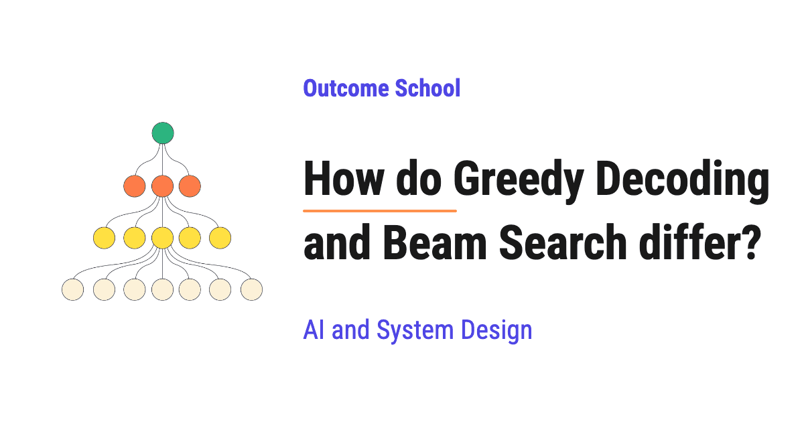

# How do Greedy Decoding and Beam Search differ?

> Archived from <https://outcomeschool.com/blog/greedy-decoding-vs-beam-search> on 2026-11-25.

Greedy Decoding and Beam Search differ in how many paths they keep while an LLM writes text. Greedy Decoding always picks the single best next word and never looks back, while Beam Search keeps a few of the best sentence options alive at every step and picks the best complete sentence at the end.

In this blog, we will learn about how Greedy Decoding and Beam Search differ. We will also see what decoding means, how Greedy Decoding works step by step, where it fails, how Beam Search fixes that failure by keeping multiple options, the cost and the problems of Beam Search, and when to use which one.

We will cover the following:
<ul><li>How does an LLM write text?</li><li>What is decoding?</li><li>What is Greedy Decoding?</li><li>The problem with Greedy Decoding</li><li>What is Beam Search?</li><li>How does Beam Search work step by step?</li><li>Greedy Decoding vs Beam Search on the same example</li><li>Greedy Decoding and Beam Search in code</li><li>Two practical details of Beam Search</li><li>The problems with Beam Search</li><li>Greedy Decoding vs Beam Search</li><li>When to use which one</li></ul>
I am <strong>Amit Shekhar</strong>, Founder @ <a target="_blank" rel="noopener noreferrer" href="https://outcomeschool.com">Outcome School</a>, I have taught and mentored many developers, and their efforts landed them high-paying tech jobs, helped many tech companies in solving their unique problems, and created many open-source libraries being used by top companies. I am passionate about sharing knowledge through open-source, blogs, and videos.

I teach <a target="_blank" rel="noopener noreferrer" href="https://outcomeschool.com/program/ai-and-machine-learning">AI and Machine Learning</a> at Outcome School.

Let&#x27;s get started.
<h2 id="how-does-an-llm-write-text">How does an LLM write text?</h2>
Before jumping into Greedy Decoding and Beam Search, we must know <a target="_blank" rel="noopener noreferrer" href="large-language-model-llm.md">how an LLM writes text</a>.

An LLM (Large Language Model) writes text one small piece at a time. These small pieces are called <strong><a target="_blank" rel="noopener noreferrer" href="tokenization-in-llms.md">tokens</a></strong>. For the sake of understanding, we can think of one token as one word.

At every step, the LLM looks at all the words written so far and gives a <strong>probability</strong> to every word it knows. A bigger number means more likely.

Let&#x27;s say the text so far is &quot;The&quot;. The LLM gives probabilities like below:

<pre><code class="language-text code-highlight">Text so far: &quot;The&quot;

Next word    Probability
nice         0.5
dog          0.4
car          0.1
</code></pre>

Here, the LLM thinks &quot;nice&quot; is the most likely next word, &quot;dog&quot; is also quite likely, and &quot;car&quot; is less likely.

Then, one word is chosen and added to the text. Now the text becomes, for example, &quot;The nice&quot;. The LLM again gives probabilities for the next word. This repeats until the text is complete.

So, an LLM does not write the full sentence at once. It writes it word by word. We have a detailed blog on <a target="_blank" rel="noopener noreferrer" href="autoregressive-models.md">Autoregressive Models</a> that explains this in depth.
<h2 id="what-is-decoding">What is decoding?</h2>
Now, the question is: at every step, which word do we pick?

The LLM only gives us probabilities. It does not pick the word. We need a rule that picks a word from those probabilities.

<strong>Decoding is the rule that decides which next word to pick from the probabilities given by the LLM, step after step, until the text is complete.</strong>

There are many decoding rules. In this blog, we will focus on the two classic rules: Greedy Decoding and Beam Search.

Before we start, one more important idea. The <strong>score of a full sentence</strong> is found by multiplying the probabilities of all its words:

<strong>Score of &quot;The nice woman&quot; = P(nice) * P(woman after &quot;The nice&quot;)</strong>

Here, <code>P</code> means probability. A higher score means the LLM believes the whole sentence is more likely. Our goal is to find a sentence with a high total score.

Now, let&#x27;s learn our first rule.
<h2 id="what-is-greedy-decoding">What is Greedy Decoding?</h2>
<strong>Greedy Decoding is a decoding rule that always picks the word with the highest probability at every step.</strong>

The name comes from the word <strong>greedy</strong>. A greedy person grabs whatever looks best right now, without thinking about what comes later. Greedy Decoding does exactly this.

Suppose we are driving to a city, and at every crossing we simply take the road that looks the widest. We never check a map. We never think, &quot;This road is wide now, but where will it take me later?&quot;. Often, this works fine. But sometimes, a wide road leads to a traffic jam, while a small road would have taken us to the city much faster.

Greedy Decoding works the same way. At every step, it takes the widest road, which means the word with the highest probability.

Let&#x27;s see it on our example. We will add 2 words after &quot;The&quot;.

<strong>Step 1:</strong> The text is &quot;The&quot;. The probabilities are:

<pre><code class="language-text code-highlight">nice  0.5   &lt;- highest, pick this
dog   0.4
car   0.1
</code></pre>

Greedy Decoding picks &quot;nice&quot;. The text becomes &quot;The nice&quot;.

<strong>Step 2:</strong> The text is &quot;The nice&quot;. The probabilities are:

<pre><code class="language-text code-highlight">woman  0.4   &lt;- highest, pick this
house  0.3
guy    0.3
</code></pre>

Greedy Decoding picks &quot;woman&quot;. The text becomes &quot;The nice woman&quot;.

The score of this sentence is:

<pre><code class="language-text code-highlight">0.5 * 0.4 = 0.20
</code></pre>

This is how Greedy Decoding works. It is very simple and very fast, because at every step it does only one thing: pick the top word.

To learn LLM Fundamentals and LLM Internals, including how an LLM picks every next token, check out our <a target="_blank" rel="noopener noreferrer" href="https://outcomeschool.com/program/ai-and-machine-learning">AI and Machine Learning Program</a> at Outcome School.
<h2 id="the-problem-with-greedy-decoding">The problem with Greedy Decoding</h2>
Let&#x27;s look at what would have happened if we had picked &quot;dog&quot; in Step 1, even though it was only the second best.

<pre><code class="language-text code-highlight">Text so far: &quot;The dog&quot;

Next word    Probability
has          0.9
runs         0.05
and          0.05
</code></pre>

After &quot;The dog&quot;, the LLM is very confident that the next word is &quot;has&quot;. So, the sentence &quot;The dog has&quot; has the score:

<pre><code class="language-text code-highlight">0.4 * 0.9 = 0.36
</code></pre>

Let&#x27;s compare:

<pre><code class="language-text code-highlight">&quot;The nice woman&quot;  -&gt; 0.5 * 0.4 = 0.20   (picked by Greedy Decoding)
&quot;The dog has&quot;     -&gt; 0.4 * 0.9 = 0.36   (missed by Greedy Decoding)
</code></pre>

Here, we can see that &quot;The dog has&quot; is a better sentence as per the LLM itself. Its score is 0.36, which is almost double of 0.20. But Greedy Decoding missed it, because &quot;dog&quot; was not the top word at Step 1.

The main problem with Greedy Decoding is this: <strong>a word that looks best now can lead to a worse sentence later, and a word that looks second best now can lead to a better sentence later.</strong> Greedy Decoding never goes back to fix its early choice.

So, how can we solve this? One idea is to check every possible sentence. But this is impossible. If the LLM knows 50,000 tokens and we want a sentence of 10 tokens, the number of possible sentences is 50,000 multiplied by itself 10 times. No computer can check all of them.

We need something in the middle. Not just one path like Greedy Decoding, and not every path. So, here comes Beam Search to the rescue.
<h2 id="what-is-beam-search">What is Beam Search?</h2>
This was all about Greedy Decoding. Now, it&#x27;s time to learn about Beam Search.

<strong>Beam Search is a decoding rule that keeps the top few partial sentences at every step, instead of just one. At the end, it picks the complete sentence with the highest total score.</strong>

The number of sentences it keeps at every step is called the <strong>beam width</strong>. Let&#x27;s say the beam width is 2. Then, Beam Search always keeps the 2 best partial sentences alive.

The name comes from a <strong>beam</strong> of light, like a torch. A torch does not light up the whole dark room. It lights up only a narrow area in front of us. Beam Search does the same. It does not explore every possible sentence. It explores only a narrow set of the most promising ones.

<strong>Note:</strong> Beam Search with a beam width of 1 is exactly the same as Greedy Decoding. It keeps only one sentence, which means it always picks the top word.

<strong>Planning your move into AI?</strong>

No matter which tech domain you work in today, with your effort, you can transition to these roles:
<ul><li>AI Engineer</li><li>Forward Deployed Engineer</li><li>AI Agent Engineer</li><li>Harness Engineer</li><li>Voice AI Engineer</li><li>AI Architect</li><li>LLM Engineer</li><li>LLM Inference Engineer</li><li>Gen AI Engineer</li><li>MLOps Engineer</li><li>ML Engineer</li><li>Deep Learning Engineer</li></ul>
Our <a target="_blank" rel="noopener noreferrer" href="https://outcomeschool.com/program/ai-and-machine-learning">AI and Machine Learning Program</a> at Outcome School takes you there.
<h2 id="how-does-beam-search-work-step-by-step">How does Beam Search work step by step?</h2>
Let&#x27;s use the same example and a beam width of 2.

<strong>Step 1:</strong> Start with &quot;The&quot;. Look at all possible next words, and keep the top 2.

<pre><code class="language-text code-highlight">Candidates:
&quot;The nice&quot;   0.5      &lt;- keep
&quot;The dog&quot;    0.4      &lt;- keep
&quot;The car&quot;    0.1      &lt;- drop
</code></pre>

Now, we have 2 partial sentences alive: &quot;The nice&quot; and &quot;The dog&quot;.

<strong>Step 2:</strong> Extend each alive sentence with every possible next word, and compute the score of each new sentence.

<pre><code class="language-text code-highlight">From &quot;The nice&quot; (0.5):
&quot;The nice woman&quot;   0.5 * 0.4  = 0.20
&quot;The nice house&quot;   0.5 * 0.3  = 0.15
&quot;The nice guy&quot;     0.5 * 0.3  = 0.15

From &quot;The dog&quot; (0.4):
&quot;The dog has&quot;      0.4 * 0.9  = 0.36
&quot;The dog runs&quot;     0.4 * 0.05 = 0.02
&quot;The dog and&quot;      0.4 * 0.05 = 0.02
</code></pre>

Now, we put all 6 candidates together and keep only the top 2:

<pre><code class="language-text code-highlight">&quot;The dog has&quot;      0.36   &lt;- keep
&quot;The nice woman&quot;   0.20   &lt;- keep
others                    &lt;- drop
</code></pre>

<strong>Step 3:</strong> We have reached the end of our example. The best complete sentence is &quot;The dog has&quot; with a score of 0.36.

Here, we can see that Beam Search found the better sentence that Greedy Decoding missed. In Step 1, Beam Search did not throw away &quot;dog&quot; just because it was second. It kept it alive, and in Step 2, &quot;dog&quot; proved to be the better path.

We can draw it like below:

<pre><code class="language-text code-highlight">                        The
            /            |            \
   nice (0.5)        dog (0.4)      car (0.1)
  /     |    \     /     |     \    (dropped)
woman house guy   has   runs  and
0.20  0.15  0.15  0.36  0.02  0.02

Greedy picks:      The -&gt; nice -&gt; woman  = 0.20
Beam (2) picks:    The -&gt; dog -&gt; has     = 0.36
</code></pre>

This is how Beam Search works. At every step, it expands all alive sentences, scores them, and keeps only the top few.

In a real LLM, the number of candidates at every step is much bigger. If the beam width is 5 and the LLM knows 50,000 tokens, there are 5 * 50,000 = 250,000 candidates at every step. But Beam Search still keeps only the top 5. This is what keeps it practical, while checking every possible sentence is impossible.
<h2 id="greedy-decoding-vs-beam-search-on-the-same-example">Greedy Decoding vs Beam Search on the same example</h2>
Let&#x27;s put both results side by side:

<pre><code class="language-text code-highlight">Rule                     Sentence          Score
Greedy Decoding          The nice woman    0.20
Beam Search (width 2)    The dog has       0.36
</code></pre>

Here, Beam Search gives a sentence that the LLM itself considers almost twice as likely.

But this does not mean Beam Search always wins. Sometimes, the greedy path is already the best path. In that case, both give the same answer, and Beam Search does extra work. Beam Search is also not guaranteed to find the very best sentence. It only looks at a few paths, so it can also miss a great sentence that was hiding outside the beam. It is better at avoiding the short-sighted mistakes of Greedy Decoding.

<strong>A quick note for you</strong>

No matter which tech domain you work in, get familiar with these topics:
<ul><li>LLM</li><li>RAG</li><li>MCP</li><li>Agent</li><li>Fine-tuning</li><li>Quantization</li></ul>
We put it all together in one video:

<a target="_blank" rel="noopener noreferrer" href="https://www.youtube.com/watch?v=lnfWvX66FUk">AI Engineering Explained: LLM, RAG, MCP, Agent, Fine-Tuning, and Quantization</a>

No need to stop reading - bookmark it and watch later when you get time. Future you will thank you.

Now, let&#x27;s get back to the topic.
<h2 id="greedy-decoding-and-beam-search-in-code">Greedy Decoding and Beam Search in code</h2>
Now, let&#x27;s see the code for both rules in Python. We will use a tiny fake LLM in the form of a dictionary, just for the sake of understanding.

<pre><code class="code-highlight language-python"># Toy model: probability of the next word, given the words so far
next_word_probs = {
    (&quot;The&quot;,): {&quot;nice&quot;: 0.5, &quot;dog&quot;: 0.4, &quot;car&quot;: 0.1},
    (&quot;The&quot;, &quot;nice&quot;): {&quot;woman&quot;: 0.4, &quot;house&quot;: 0.3, &quot;guy&quot;: 0.3},
    (&quot;The&quot;, &quot;dog&quot;): {&quot;has&quot;: 0.9, &quot;runs&quot;: 0.05, &quot;and&quot;: 0.05},
    (&quot;The&quot;, &quot;car&quot;): {&quot;is&quot;: 0.3, &quot;drives&quot;: 0.5, &quot;turns&quot;: 0.2},
}
</code></pre>

Here, each key is the text so far, and each value holds the probabilities of the next word. A real LLM computes these probabilities. Our dictionary just stores them.

Now, let&#x27;s write Greedy Decoding as below:

<pre><code class="code-highlight language-python">def greedy(start, steps):
    seq, score = start, 1.0
    for _ in range(steps):
        probs = next_word_probs[seq]
        word = max(probs, key=probs.get)  # pick the single best word
        seq, score = seq + (word,), score * probs[word]
    return seq, score
</code></pre>

Here, we have:
<ul><li><code>seq</code> holds the words so far, and <code>score</code> holds the total score, which starts at 1.0.</li><li>In every step, <code>max(probs, key=probs.get)</code> finds the word with the highest probability.</li><li>We add that word to the sentence and multiply its probability into the score.</li></ul>
Now, let&#x27;s write Beam Search as below:

<pre><code class="code-highlight language-python">def beam_search(start, steps, beam_width):
    beams = [(start, 1.0)]
    for _ in range(steps):
        candidates = []
        for seq, score in beams:
            for word, p in next_word_probs[seq].items():
                candidates.append((seq + (word,), score * p))
        # keep only the best `beam_width` sequences
        candidates.sort(key=lambda c: c[1], reverse=True)
        beams = candidates[:beam_width]
    return beams[0]
</code></pre>

Here, we have:
<ul><li><code>beams</code> holds all the alive sentences with their scores. At the start, there is only one: &quot;The&quot; with a score of 1.0.</li><li>In every step, we extend every alive sentence with every possible next word and collect all of them in <code>candidates</code>.</li><li>Then, we sort the candidates by score, from highest to lowest, and keep only the top <code>beam_width</code> of them.</li><li>At the end, <code>beams[0]</code> is the sentence with the highest score.</li></ul>
Now, let&#x27;s run both:

<pre><code class="code-highlight language-python">seq, score = greedy((&quot;The&quot;,), steps=2)
print(&quot;Greedy:&quot;, &quot; &quot;.join(seq), round(score, 2))

seq, score = beam_search((&quot;The&quot;,), steps=2, beam_width=2)
print(&quot;Beam:  &quot;, &quot; &quot;.join(seq), round(score, 2))
</code></pre>

It will print the following:

<pre><code class="language-text code-highlight">Greedy: The nice woman 0.2
Beam:   The dog has 0.36
</code></pre>

Here, we can see the same result that we found by hand. It works perfectly.

In real projects, we do not write this ourselves. For example, in the Hugging Face Transformers library, we can choose the rule using the <code>generate</code> function as below:

<pre><code class="code-highlight language-python"># Greedy Decoding
output = model.generate(**inputs, max_new_tokens=20, do_sample=False, num_beams=1)

# Beam Search with beam width 5
output = model.generate(**inputs, max_new_tokens=20, do_sample=False, num_beams=5)
</code></pre>

Here, <code>do_sample=False</code> means the model does not pick words randomly. <code>num_beams=1</code> gives Greedy Decoding, and <code>num_beams=5</code> gives Beam Search with a beam width of 5. <code>max_new_tokens=20</code> means the model writes at most 20 new tokens.

If we want to go deep into LLM Internals and build a Large Language Model (LLM) from scratch, we can check out our <a target="_blank" rel="noopener noreferrer" href="https://outcomeschool.com/program/ai-and-machine-learning">AI and Machine Learning Program</a> at Outcome School.
<h2 id="two-practical-details-of-beam-search">Two practical details of Beam Search</h2>
In real use, Beam Search needs two more ideas to work well.

<strong>Detail 1: Adding logs instead of multiplying probabilities.</strong>

When we multiply many probabilities, the score becomes tiny very fast. For example, if we multiply 0.1 by itself 50 times, the first non-zero digit appears only at the 50th place after the decimal point. Computers can lose accuracy with such tiny numbers.

So, in practice, we use the <strong>logarithm</strong> of each probability, called the <strong><a target="_blank" rel="noopener noreferrer" href="logprobs-in-llms.md">log probability</a></strong>, and we add them instead of multiplying them. For the sake of understanding, we can think of the logarithm as a tool that turns multiplication into addition. Adding log probabilities gives the same ranking as multiplying probabilities, without the tiny numbers.

<strong>Detail 2: Length normalization.</strong>

Every new word multiplies the score by a number smaller than 1. So, longer sentences always get smaller scores. Because of this, Beam Search tends to prefer short sentences and can stop too early.

To fix this, we take the total log probability of a sentence and divide it by its length, or by its length raised to some power. This means we look at the average score per word instead of the total. This is called <strong>length normalization</strong>. It makes short and long sentences fair to compare. In Hugging Face, this is controlled by the <code>length_penalty</code> setting.

Also, a sentence is marked as complete when the LLM produces a special <strong><a target="_blank" rel="noopener noreferrer" href="stop-tokens-in-llms.md">end-of-sequence</a></strong> token, which means the sentence is finished. Complete sentences are kept aside, and Beam Search continues with the others.

<strong>Stay updated:</strong> Subscribe to our <a target="_blank" rel="noopener noreferrer" href="https://outcomeschool.substack.com/subscribe">newsletter</a> to get our latest AI and Machine Learning blogs straight to your inbox.
<h2 id="the-problems-with-beam-search">The problems with Beam Search</h2>
Beam Search is better at finding high-score sentences. But it comes with its own issues:
<ul><li><strong>More work:</strong> With a beam width of 5, the LLM must process 5 sentences at every step instead of 1. So, it needs more computation and more memory, and it is slower.</li><li><strong>Boring and repetitive text:</strong> Beam Search picks what the LLM thinks is most likely. But the most likely text is often safe, generic, and repetitive. Humans do not always speak in the most predictable way. For open-ended writing like stories or chat, Beam Search often produces dull text, and sometimes repeats the same phrase again and again.</li><li><strong>Bigger is not always better:</strong> Increasing the beam width finds sentences with higher scores, but very large beam widths can make the output shorter and blander. So, small beam widths are common in practice.</li></ul>
<strong>Note:</strong> Greedy Decoding also suffers from repetition, because it always picks the safest word. This is why chat assistants usually use neither of these two for creative replies. They use <strong><a target="_blank" rel="noopener noreferrer" href="how-do-top-k-and-top-p-sampling-work.md">sampling</a></strong>, which means picking the next word randomly based on the probabilities, to make the text more natural and varied. We have a detailed blog on <a target="_blank" rel="noopener noreferrer" href="how-does-temperature-control-llm-output.md">how Temperature controls LLM output</a> that explains how sampling can be made more or less random.
<h2 id="greedy-decoding-vs-beam-search">Greedy Decoding vs Beam Search</h2>
Let me tabulate the differences between Greedy Decoding and Beam Search for your better understanding so that you can decide which one to use based on your use case.
<table><thead><tr><th>Feature</th><th>Greedy Decoding</th><th>Beam Search</th></tr></thead><tbody><tr><td>Paths kept at each step</td><td>1</td><td>Beam width, for example 2 to 10</td></tr><tr><td>How it picks</td><td>Top word at every step</td><td>Top few partial sentences at every step</td></tr><tr><td>Can fix an early bad choice</td><td>No</td><td>Yes, partly</td></tr><tr><td>Quality of the total score</td><td>Lower</td><td>Usually higher</td></tr><tr><td>Speed</td><td>Fastest</td><td>Slower, more work per step</td></tr><tr><td>Memory</td><td>Low</td><td>Higher</td></tr><tr><td>Output</td><td>Same every time</td><td>Same every time</td></tr><tr><td>Typical use</td><td>Quick answers, short outputs, simple tasks</td><td>Translation, summarization, speech to text</td></tr><tr><td>Weakness</td><td>Short-sighted, misses better sentences</td><td>Costly, can be generic and repetitive</td></tr></tbody></table>
Here, we can notice that both rules give the same output every time for the same input. Neither of them uses randomness. Such rules are called <strong>deterministic</strong>.
<h2 id="when-to-use-which-one">When to use which one</h2>
<strong>Use Greedy Decoding when:</strong>
<ul><li>We want the fastest answer with the least cost.</li><li>The task has one clear correct answer, like extracting a date, answering a simple factual question, or a short classification.</li><li>We are running on a small device with limited memory.</li></ul>
<strong>Use Beam Search when:</strong>
<ul><li>The task needs one accurate output that closely follows the input, like translating a sentence from English to Hindi, summarizing an article, or converting speech to text.</li><li>A small mistake early in the output can spoil the whole result.</li><li>We can afford more time and computation.</li></ul>
<strong>Use neither, and prefer sampling, when:</strong>
<ul><li>We want creative, natural, and varied text, like stories, poems, or friendly chat.</li></ul>
Now we must have understood how Greedy Decoding and Beam Search differ and when to use which one.
<h2 id="frequently-asked-questions">Frequently Asked Questions</h2><h3 id="is-beam-search-with-a-beam-width-of-1-the-same-as-greedy-decoding">Is Beam Search with a beam width of 1 the same as Greedy Decoding?</h3>
Yes. Beam Search with a beam width of 1 is exactly the same as Greedy Decoding. It keeps only one partial sentence at every step, which means it always picks the word with the highest probability. A bigger beam width keeps more sentences alive, which is what lets Beam Search fix an early bad choice.
<h3 id="does-beam-search-always-find-the-best-sentence">Does Beam Search always find the best sentence?</h3>
No. Beam Search is not guaranteed to find the very best sentence. It only looks at a few paths at every step, so it can miss a great sentence that was hiding outside the beam. It is better at avoiding the short-sighted mistakes of Greedy Decoding, but it does not check every possible sentence.
<h3 id="are-greedy-decoding-and-beam-search-deterministic">Are Greedy Decoding and Beam Search deterministic?</h3>
Yes. Both Greedy Decoding and Beam Search give the same output every time for the same input, because neither of them uses randomness. Rules like these are called deterministic. Sampling is different, because it picks the next word randomly based on the probabilities.
<h3 id="why-do-chat-assistants-not-use-greedy-decoding-or-beam-search-for-creative-replies">Why do chat assistants not use Greedy Decoding or Beam Search for creative replies?</h3>
Because both of them tend to produce safe, generic, and repetitive text. Greedy Decoding always picks the safest word, and Beam Search picks what the LLM thinks is most likely. For creative replies, chat assistants usually use sampling, which picks the next word randomly based on the probabilities, to make the text more natural and varied.
<h3 id="how-do-we-choose-greedy-decoding-or-beam-search-in-hugging-face-transformers">How do we choose Greedy Decoding or Beam Search in Hugging Face Transformers?</h3>
We choose the rule using the <code>generate</code> function. With <code>do_sample=False</code>, setting <code>num_beams=1</code> gives Greedy Decoding, and setting <code>num_beams=5</code> gives Beam Search with a beam width of 5. The <code>length_penalty</code> setting controls length normalization for Beam Search.

That&#x27;s it for now.

Thanks

<strong>Amit Shekhar</strong> Founder @ <a target="_blank" rel="noopener noreferrer" href="https://outcomeschool.com">Outcome School</a>

You can connect with me on:
<ul><li><a target="_blank" rel="noopener noreferrer" href="https://x.com/amitiitbhu">X</a></li><li><a target="_blank" rel="noopener noreferrer" href="https://www.linkedin.com/in/amit-shekhar-iitbhu">LinkedIn</a></li><li><a target="_blank" rel="noopener noreferrer" href="https://github.com/amitshekhariitbhu">GitHub</a></li></ul>
Follow Outcome School on:
<ul><li><a target="_blank" rel="noopener noreferrer" href="https://x.com/outcome_school">X</a></li><li><a target="_blank" rel="noopener noreferrer" href="https://youtube.com/@OutcomeSchool">YouTube</a></li><li><a target="_blank" rel="noopener noreferrer" href="https://www.linkedin.com/company/outcomeschool">LinkedIn</a></li><li><a target="_blank" rel="noopener noreferrer" href="http://github.com/OutcomeSchool">GitHub</a></li></ul>
<a target="_blank" rel="noopener noreferrer" href="https://outcomeschool.com/blog"><strong>Read all of our high-quality blogs here.</strong></a>

