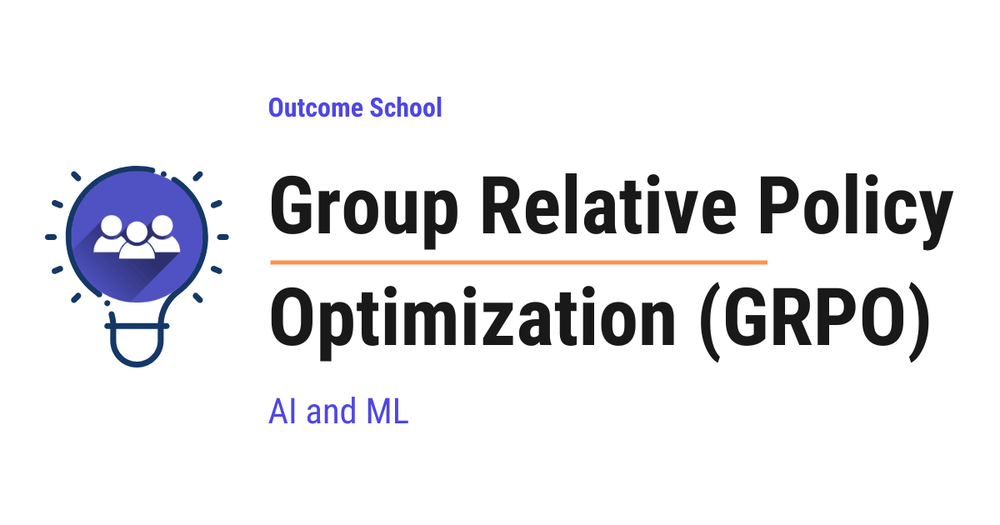

# What is Group Relative Policy Optimization (GRPO) and How Does It Work?

> Archived from <https://outcomeschool.com/blog/group-relative-policy-optimization-grpo> on 2026-11-25.

Group Relative Policy Optimization (GRPO) is a reinforcement learning algorithm used to train Large Language Models. It asks the model to produce many answers for the same question, scores them, and teaches the model to prefer the answers that scored above the group average.

In this blog, we are going to learn about Group Relative Policy Optimization (GRPO). We will also see how GRPO works step-by-step and when to use it based on our use case.

We will cover the following:
<ul><li>What is GRPO?</li><li>Why do we need GRPO?</li><li>The problem with PPO.</li><li>How does GRPO work?</li><li>Step-by-step example.</li><li>The GRPO objective in simple words.</li><li>Advantages of GRPO.</li><li>Practical things to keep in mind.</li><li>When to use GRPO.</li><li>Conclusion.</li></ul>
I am <strong>Amit Shekhar</strong>, Founder @ <a target="_blank" rel="noopener noreferrer" href="https://outcomeschool.com">Outcome School</a>, I have taught and mentored many developers, and their efforts landed them high-paying tech jobs, helped many tech companies in solving their unique problems, and created many open-source libraries being used by top companies. I am passionate about sharing knowledge through open-source, blogs, and videos.

I teach <a target="_blank" rel="noopener noreferrer" href="https://outcomeschool.com/program/ai-and-machine-learning">AI and Machine Learning</a> at Outcome School.

Let&#x27;s get started.
<h3 id="what-is-grpo">What is GRPO?</h3>
<strong>Group Relative Policy Optimization</strong> is a <a target="_blank" rel="noopener noreferrer" href="reinforcement-learning.md">reinforcement learning</a> algorithm used to train Large Language Models. It improves the model by comparing a group of answers for the same question and pushing the model toward the better answers.

In simple words, GRPO does not need a separate value model to predict an expected reward at every step. Instead, it asks the model to produce many answers for the same question, scores all of them, and then teaches the model to prefer the answers that scored above the group average. Do not worry, we will learn about the value model in detail in the next sections.

Let&#x27;s decompose the name:

<strong>GRPO = Group + Relative + Policy + Optimization</strong>
<ul><li><strong>Group</strong>: We generate a group of answers for the same question.</li><li><strong>Relative</strong>: We compare each answer relative to the others in the group.</li><li><strong>Policy</strong>: The policy is our Language Model that decides which words to generate.</li><li><strong>Optimization</strong>: We update the model so that it generates better answers next time.</li></ul>
We have a detailed blog on <a target="_blank" rel="noopener noreferrer" href="markov-decision-process-mdp.md">Markov Decision Process (MDP)</a> that explains how an LLM generating text can be seen as a policy picking one token at a time.

GRPO was introduced by DeepSeek and was used to train their popular <a target="_blank" rel="noopener noreferrer" href="large-reasoning-models.md">reasoning models</a>. It is one of the key reasons their training was so efficient.

Let&#x27;s say a teacher asks the same math question to 8 students in a class. Some students get it right, some get it wrong. The teacher does not give an absolute score to each student. Instead, the teacher looks at the class average and tells each student: &quot;You did better than the class average, keep doing this.&quot; or &quot;You did worse than the class average, try to do what the toppers did.&quot; This is exactly the spirit of GRPO.
<h3 id="why-do-we-need-grpo">Why Do We Need GRPO?</h3>
We need GRPO because training Large Language Models with reinforcement learning is very expensive. The older approach, PPO, requires multiple large models running at the same time, which costs a lot of memory and compute. GRPO removes the most expensive part of PPO and still trains strong models.

Before jumping into GRPO in detail, we must first understand the problem with PPO. Once we see the cost of PPO, the design of GRPO will feel very natural.
<h3 id="the-problem-with-ppo">The Problem with PPO</h3>
PPO stands for <strong><a target="_blank" rel="noopener noreferrer" href="proximal-policy-optimization-ppo.md">Proximal Policy Optimization</a></strong>. PPO is a popular reinforcement learning algorithm used to train Language Models. It works, but it has a big cost.

The best known example of PPO used this way is OpenAI&#x27;s InstructGPT, which turned GPT-3 into an instruction-following model. We have a detailed blog on <a target="_blank" rel="noopener noreferrer" href="decoding-instructgpt.md">Decoding InstructGPT</a> that explains how that pipeline works.

In PPO, we use multiple models during training. The two most important ones for our discussion are:
<ul><li><strong>The policy model</strong>: This is the Language Model we are training. It generates the answer.</li><li><strong>The value model</strong>: This is a separate model that predicts how good a partial answer is at every step.</li></ul>
The value model is also called the critic.

<strong>Note:</strong> The value model is not the same as a <a target="_blank" rel="noopener noreferrer" href="reward-model.md">reward model</a>. A reward model gives a final score for a complete answer. The value model predicts the expected future reward at every step while the answer is still being generated. PPO uses both a reward model and a value model. GRPO keeps the reward model but removes the value model. This is the key point we must remember.

Now, the next big question arises: if we already have a reward model, why do we need a value model at all?

The reward model only gives one score for the complete answer. But the Language Model generates the answer one word at a time. We need to know which words helped and which words hurt. The reward model cannot tell us this because it only sees the full answer at the end.

This is where the value model comes in. The value model predicts the expected future reward at every step. Using this, we can calculate something called the <strong><a target="_blank" rel="noopener noreferrer" href="actor-critic.md">advantage</a></strong>, which tells us how much better or worse each decision was compared to what was expected.

In simple words:
<ul><li>The reward model scores the full answer.</li><li>The value model helps us assign credit to each step inside the answer.</li></ul>
Without the value model, every word would get the same credit or blame for the final reward, which makes training unstable. So, the value model gives us a per-step learning signal. This is why PPO uses both models.

<strong>Planning your move into AI?</strong>

No matter which tech domain you work in today, with your effort, you can transition to these roles:
<ul><li>AI Engineer</li><li>Forward Deployed Engineer</li><li>AI Agent Engineer</li><li>Harness Engineer</li><li>Voice AI Engineer</li><li>AI Architect</li><li>LLM Engineer</li><li>LLM Inference Engineer</li><li>Gen AI Engineer</li><li>MLOps Engineer</li><li>ML Engineer</li><li>Deep Learning Engineer</li></ul>
Our <a target="_blank" rel="noopener noreferrer" href="https://outcomeschool.com/program/ai-and-machine-learning">AI and Machine Learning Program</a> at Outcome School takes you there.

Now, the reverse question may also arise: if the value model predicts the reward, why do we still need a reward model?

The reason is simple. The value model is a learned predictor. It learns to predict what the reward will be at each step. But to learn this, it needs the actual reward as the truth. The reward model provides this truth.

In simple words:
<ul><li>The reward model gives the actual score for the answer.</li><li>The value model learns to predict what the reward model will say at each step.</li></ul>
Without the reward model, the value model has nothing to learn from. So, the reward model is the source of truth, and the value model is a learned approximator. They are not duplicates. They serve different roles.

But, here is the catch. The value model is almost the same size as the policy model. So, we are training two very large models at the same time. This means:
<ul><li>We need a lot of memory.</li><li>We need a lot of compute.</li><li>Training becomes slow and expensive.</li><li>The value model itself is hard to train accurately.</li></ul>
Now, the question is: can we get rid of the value model and still train the policy correctly? The answer is yes. We can keep the reward model and remove the value model. So, here comes GRPO to the rescue.
<h3 id="how-does-grpo-work">How Does GRPO Work?</h3>
The main idea of GRPO is very simple.

<strong>Instead of using a separate value model to provide a baseline for each answer, GRPO uses the average score of a group of answers as the baseline.</strong>

That&#x27;s the beauty of GRPO. The group itself becomes the baseline.

Now, an important question arises: if PPO needed the value model to give credit to each step inside the answer, how does GRPO work without one?

The answer is simple. GRPO does not try to assign credit to each step inside a single answer. Instead, it generates many complete answers for the same question and compares them as full sequences.

GRPO does not ask which word inside an answer was good or bad. It asks which complete answer was better than the group average. Then, every word in a good answer gets a small push to be more likely, and every word in a bad answer gets a small push to be less likely. Over many training examples, the model learns the patterns that lead to good answers.

In simple words:
<ul><li>PPO assigns credit to each step inside one answer using the value model.</li><li>GRPO assigns credit to each full answer using the group average.</li></ul>
This works very well for tasks where the final answer is what matters, like math, code, and reasoning. For these tasks, we do not need to know which word in the middle was the best. We only need to know which complete answer was the best, and that is exactly what GRPO learns.

Let&#x27;s break it down step by step.

<strong>Step 1:</strong> Take a question from the training data.

<strong>Step 2:</strong> Ask the current policy model to generate a group of answers for the same question. Let&#x27;s say we generate 8 answers.

<strong>Step 3:</strong> Score each of the 8 answers using a reward function. The reward can come from:
<ul><li>A reward model trained on <a target="_blank" rel="noopener noreferrer" href="decoding-deep-rl-from-human-preferences.md">human preferences</a>.</li><li>A rule-based check, for example, did the answer solve the math problem correctly.</li><li>A code execution check, for example, did the generated code pass the test cases.</li></ul>
<strong>Note:</strong> Remember, the reward model used here is not the value model we discussed in PPO. The reward model only gives a final score for each complete answer. We are not using a value model in GRPO.

<strong>Step 4:</strong> Calculate the average reward of the group. This average is our baseline.

<strong>Step 5:</strong> For each answer, calculate the <strong>relative advantage</strong>:
<ul><li>If the answer scored above the average, it gets a positive advantage.</li><li>If the answer scored below the average, it gets a negative advantage.</li></ul>
<strong>Step 6:</strong> Update the policy model. We push the model to make answers with positive advantage more likely, and answers with negative advantage less likely.

That is the full idea. Notice that we never trained a separate value model. The group itself acts as the baseline. This is the core insight of GRPO and the reason it saves so much compute.

<strong>A quick note for you</strong>

No matter which tech domain you work in, get familiar with these topics:
<ul><li>LLM</li><li>RAG</li><li>MCP</li><li>Agent</li><li>Fine-tuning</li><li>Quantization</li></ul>
We put it all together in one video:

<a target="_blank" rel="noopener noreferrer" href="https://www.youtube.com/watch?v=lnfWvX66FUk">AI Engineering Explained: LLM, RAG, MCP, Agent, Fine-Tuning, and Quantization</a>

No need to stop reading - bookmark it and watch later when you get time. Future you will thank you.

Now, let&#x27;s get back to the topic.
<h3 id="step-by-step-example">Step-by-Step Example</h3>
The best way to learn this is by taking an example.

Let&#x27;s say the question is:
<blockquote>
What is 12 + 7?
</blockquote>
The correct answer is 19.

We ask our current policy model to generate 4 answers for this same question. We use a simple rule-based reward: 1 if the answer is correct, 0 if it is wrong.
<ul><li>Answer 1: &quot;The answer is 19.&quot; Reward = 1</li><li>Answer 2: &quot;It is 18.&quot; Reward = 0</li><li>Answer 3: &quot;19.&quot; Reward = 1</li><li>Answer 4: &quot;I think it is 20.&quot; Reward = 0</li></ul>
Now, let&#x27;s calculate the group average.
<ul><li>Group average reward = (1 + 0 + 1 + 0) / 4 = 0.5</li></ul>
Now, let&#x27;s calculate the relative advantage for each answer:
<ul><li>Answer 1: 1 - 0.5 = +0.5 (above average, good)</li><li>Answer 2: 0 - 0.5 = -0.5 (below average, bad)</li><li>Answer 3: 1 - 0.5 = +0.5 (above average, good)</li><li>Answer 4: 0 - 0.5 = -0.5 (below average, bad)</li></ul>
In practice, GRPO also divides this difference by the standard deviation of the rewards in the group, so the advantages are normalized. But the core idea is the same.

Here, we can notice that the bad answers get a negative signal and the good answers get a positive signal. The model has been told what to do more and what to do less, all without a value model.

Now, we update the policy model:
<ul><li>Increase the probability of generating Answer 1 and Answer 3 next time.</li><li>Decrease the probability of generating Answer 2 and Answer 4 next time.</li></ul>
This is how the model slowly learns to produce more correct answers without ever needing a separate value model.

If we want to go deep into Reinforcement Learning, PPO, and GRPO, check out our <a target="_blank" rel="noopener noreferrer" href="https://outcomeschool.com/program/ai-and-machine-learning">AI and Machine Learning Program</a> at Outcome School.
<h3 id="the-grpo-objective-in-simple-words">The GRPO Objective in Simple Words</h3>
GRPO uses an objective function that has three parts. Do not worry, we will understand each part in simple words.

<strong>Part 1: The policy ratio</strong>

For each answer in the group, we compare the probability of producing that answer under the new policy versus the old policy. This ratio tells us how much the policy has changed for that answer.

<strong>Part 2: The clipping</strong>

We do not want the new policy to move too far from the old policy in one step. So, we clip the ratio inside a small range, for example between 0.8 and 1.2. This keeps training stable. This is the same idea as PPO.

<strong>Part 3: The KL penalty</strong>

We add a penalty that keeps the new policy close to a reference model. The reference model is usually the model right after <a target="_blank" rel="noopener noreferrer" href="how-does-fine-tuning-work.md">supervised fine-tuning</a>. This prevents the model from drifting too far and forgetting what it already learned.

Putting it all together:
<ul><li>Multiply the clipped ratio by the group-based advantage.</li><li>Subtract the <a target="_blank" rel="noopener noreferrer" href="kl-divergence.md">KL penalty</a>.</li><li>Average this over all answers in the group and over all questions in the batch.</li></ul>
That is the full GRPO objective. The key change compared to PPO is that the advantage now comes from the group, not from a value model.

Let&#x27;s see the simplified pseudocode for one training step of GRPO as below:

<pre><code class="language-python code-highlight"># question: a single training prompt
# policy: the current Language Model we are training
# reward_fn: a function that scores an answer
# G: group size, for example 8

answers = [policy.generate(question) for _ in range(G)]
rewards = [reward_fn(question, a) for a in answers]

mean_r = mean(rewards)
std_r = std(rewards)
advantages = [(r - mean_r) / (std_r + 1e-8) for r in rewards]

# update the policy using the clipped ratio, advantages, and KL penalty
loss = grpo_loss(policy, old_policy, ref_policy, answers, advantages)
loss.backward()
optimizer.step()
</code></pre>

Here, we can see that the only thing we need from the reward function is a score for each full answer. We do not need any value model. The group gives us the baseline for free.

<strong>Stay updated:</strong> Subscribe to our <a target="_blank" rel="noopener noreferrer" href="https://outcomeschool.substack.com/subscribe">newsletter</a> to get our latest AI and Machine Learning blogs straight to your inbox.
<h3 id="advantages-of-grpo">Advantages of GRPO</h3>
Let me tabulate the advantages of GRPO compared to PPO.
<table><thead><tr><th>Aspect</th><th>PPO</th><th>GRPO</th></tr></thead><tbody><tr><td>Value model needed</td><td>Yes</td><td>No</td></tr><tr><td>Reward model needed</td><td>Yes</td><td>Yes</td></tr><tr><td>Memory usage</td><td>High</td><td>Lower</td></tr><tr><td>Compute cost</td><td>High</td><td>Lower</td></tr><tr><td>Training speed</td><td>Slower</td><td>Faster</td></tr><tr><td>Baseline</td><td>Learned by value model</td><td>Average reward of the group</td></tr><tr><td>Implementation</td><td>Complex</td><td>Simpler</td></tr><tr><td>Best fit</td><td>Open-ended tasks</td><td>Reasoning tasks with verifiable rewards</td></tr></tbody></table>
Here, we can see that GRPO removes the need for a value model, which is the most expensive part of PPO. This makes training much cheaper and easier to scale.

A few more advantages:
<ul><li><strong>Simpler implementation</strong>: We do not need to design and train a separate critic.</li><li><strong>Better for verifiable rewards</strong>: GRPO works very well when we can check the answer with a rule, for example math problems, code problems, and logic problems.</li><li><strong>Strong reasoning models</strong>: GRPO was used to train DeepSeek&#x27;s reasoning models, which showed strong performance on math and coding benchmarks.</li></ul>
GRPO is also what trains Sakana&#x27;s Fugu-Ultra to write effective multi-model workflows. We have a detailed blog on <a target="_blank" rel="noopener noreferrer" href="decoding-sakana-fugu.md">Sakana Fugu</a> that explains how it uses GRPO to learn good orchestration.
<h3 id="practical-things-to-keep-in-mind">Practical Things to Keep in Mind</h3>
There are a few practical things we must know when using GRPO.

<strong>The group size matters.</strong> The group size is the number of answers we generate per question. A typical choice is 8 to 64. A larger group gives us a more stable baseline, but it also costs more compute. A smaller group is cheaper, but the average can be noisy. We must pick the group size based on our use case.

<strong>All answers in a group can sometimes get the same reward.</strong> Let&#x27;s say all 8 answers are wrong, or all 8 answers are correct. Then the group average equals every individual reward, and the advantage becomes zero. In this case, the model gets no learning signal from this question. This is fine when it happens occasionally, but if it happens too often, we must pick harder or easier questions to balance the training data.

<strong>The reward function must be good.</strong> GRPO is only as good as the reward signal we give it. If the reward function is wrong, the model will learn the wrong behavior. For verifiable tasks like math and code, this is easy. For open-ended tasks, we need a strong reward model.

<strong>The reference model keeps things in check.</strong> The KL penalty against a reference model is very important. Without it, the model can drift and start producing strange outputs that score high on the reward function but are not actually useful. This is called <a target="_blank" rel="noopener noreferrer" href="reward-hacking.md">reward hacking</a>.

To master RLHF, Fine-tuning, and Reasoning Models, check out our <a target="_blank" rel="noopener noreferrer" href="https://outcomeschool.com/program/ai-and-machine-learning">AI and Machine Learning Program</a> at Outcome School.
<h3 id="when-to-use-grpo">When to Use GRPO</h3>
So, now we know where we can use GRPO. GRPO is a great fit in the following situations:
<ul><li>When we want to train a Large Language Model with reinforcement learning.</li><li>When we have a reward signal, especially a rule-based or <a target="_blank" rel="noopener noreferrer" href="reinforcement-learning-with-verifiable-rewards-rlvr.md">verifiable reward</a>.</li><li>When we want to save memory and compute by avoiding a separate value model.</li><li>When we are training reasoning models that need to think step by step before answering.</li></ul>
GRPO is now one of the most popular algorithms for training reasoning models. Many open-source teams have adopted it because it is simple, efficient, and effective. It makes our life easier.
<h3 id="conclusion">Conclusion</h3>
Now, we have understood Group Relative Policy Optimization.

GRPO is a reinforcement learning algorithm that trains Large Language Models by comparing a group of answers and pushing the model toward the better ones. The key idea is that the group average acts as the baseline, which removes the need for a separate value model. This makes training much cheaper, simpler, and faster than PPO.

GRPO has been used to train strong reasoning models, especially for tasks with verifiable rewards like math and code. Hence, it is one of the most important developments in modern AI training.
<h2 id="frequently-asked-questions">Frequently Asked Questions</h2><h3 id="does-grpo-still-use-a-reward-model">Does GRPO still use a reward model?</h3>
Yes. GRPO keeps the reward model but removes the value model. The reward that scores each complete answer can come from a reward model trained on human preferences, a rule-based check like whether a math answer is correct, or a code execution check like whether the code passes the test cases.
<h3 id="what-happens-in-grpo-when-all-answers-in-a-group-get-the-same-reward">What happens in GRPO when all answers in a group get the same reward?</h3>
The advantage becomes zero, so the model gets no learning signal from that question. This happens when all answers are wrong or all answers are correct, because the group average then equals every individual reward. It is fine occasionally, but if it happens too often, we must pick harder or easier questions to balance the training data.
<h3 id="what-group-size-should-we-use-in-grpo">What group size should we use in GRPO?</h3>
A typical group size is 8 to 64 answers per question. A larger group gives a more stable baseline, but it costs more compute. A smaller group is cheaper, but the average can be noisy. So, we pick the group size based on our use case.
<h3 id="is-grpo-a-good-fit-for-open-ended-tasks">Is GRPO a good fit for open-ended tasks?</h3>
GRPO works best for reasoning tasks with verifiable rewards, like math, code, and logic problems, while PPO is the better fit for open-ended tasks. GRPO is only as good as the reward signal we give it. For open-ended tasks, we need a strong reward model.
<h3 id="why-does-grpo-need-a-kl-penalty-against-a-reference-model">Why does GRPO need a KL penalty against a reference model?</h3>
The KL penalty keeps the new policy close to a reference model, which is usually the model right after supervised fine-tuning. Without it, the model can drift and start producing strange outputs that score high on the reward function but are not actually useful. This is called reward hacking.

That&#x27;s it for now.

Thanks

<strong>Amit Shekhar</strong> Founder @ <a target="_blank" rel="noopener noreferrer" href="https://outcomeschool.com">Outcome School</a>

You can connect with me on:
<ul><li><a target="_blank" rel="noopener noreferrer" href="https://x.com/amitiitbhu">X</a></li><li><a target="_blank" rel="noopener noreferrer" href="https://www.linkedin.com/in/amit-shekhar-iitbhu">LinkedIn</a></li><li><a target="_blank" rel="noopener noreferrer" href="https://github.com/amitshekhariitbhu">GitHub</a></li></ul>
Follow Outcome School on:
<ul><li><a target="_blank" rel="noopener noreferrer" href="https://x.com/outcome_school">X</a></li><li><a target="_blank" rel="noopener noreferrer" href="https://youtube.com/@OutcomeSchool">YouTube</a></li><li><a target="_blank" rel="noopener noreferrer" href="https://www.linkedin.com/company/outcomeschool">LinkedIn</a></li><li><a target="_blank" rel="noopener noreferrer" href="https://github.com/OutcomeSchool">GitHub</a></li></ul>
<a target="_blank" rel="noopener noreferrer" href="https://outcomeschool.com/blog"><strong>Read all of our high-quality blogs here.</strong></a>

