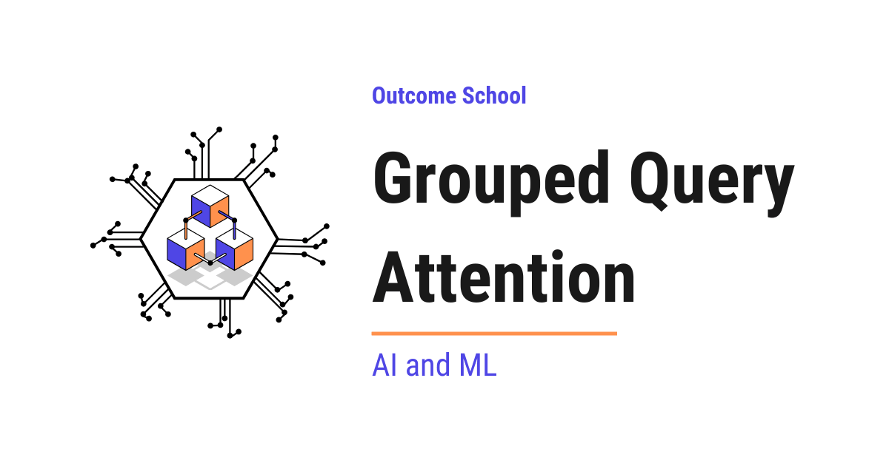

# What is Grouped Query Attention (GQA) and Why Do LLMs Use It?

> Archived from <https://outcomeschool.com/blog/grouped-query-attention> on 2026-11-25.

Grouped-Query Attention (GQA) is a strategy where the attention heads are divided into groups, and all the heads within a group share the same Key and Value, while each head still has its own Query.

In this blog, we will learn about Grouped-Query Attention (GQA) and how it differs from Multi-Head Attention (MHA).

We will also learn about Multi-Query Attention (MQA) along the way and see when to use which one.

Grouped-Query Attention is one of the most important optimizations in modern Large Language Models. It allows models to generate text much faster while using less memory, and that too without losing much quality.

Before jumping into Grouped-Query Attention, we must know how <a target="_blank" rel="noopener noreferrer" href="multi-head-attention-in-transformers.md">Multi-Head Attention</a> works. We have a detailed blog on <a target="_blank" rel="noopener noreferrer" href="decoding-transformer-architecture.md">Transformer Architecture</a> where we have explained Multi-Head Attention as well. I will highly recommend reading it first.

Today, we will cover the following topics:
<ul><li>The Big Picture</li><li>Quick Recap: Multi-Head Attention (MHA)</li><li>The Problem with Multi-Head Attention</li><li>What is Multi-Query Attention (MQA)?</li><li>What is Grouped-Query Attention (GQA)?</li><li>How Grouped-Query Attention Works</li><li>GQA is a Generalization of MHA and MQA</li><li>GQA vs MHA vs MQA</li><li>Real-World Use Cases</li><li>A Note on Terminology</li><li>Uptraining: Converting MHA to GQA</li><li>Quick Summary</li></ul>
I am <strong>Amit Shekhar</strong>, Founder @ <a target="_blank" rel="noopener noreferrer" href="https://outcomeschool.com">Outcome School</a>, I have taught and mentored many developers, and their efforts landed them high-paying tech jobs, helped many tech companies in solving their unique problems, and created many open-source libraries being used by top companies. I am passionate about sharing knowledge through open-source, blogs, and videos.

I teach <a target="_blank" rel="noopener noreferrer" href="https://outcomeschool.com/program/ai-and-machine-learning">AI and Machine Learning</a> at Outcome School.

Let&#x27;s get started.
<h2 id="the-big-picture">The Big Picture</h2>
Before we go into the details, let&#x27;s understand the big picture.

In Multi-Head Attention, every head keeps its own Key and Value. This is great for quality, but it makes the <a target="_blank" rel="noopener noreferrer" href="kv-cache-in-llms.md">KV Cache</a> very large during inference. Grouped-Query Attention keeps the same set of Queries, but it makes groups of heads share one Key and one Value. This shrinks the KV Cache by a lot while keeping the quality very close to Multi-Head Attention. It is one of the main <a target="_blank" rel="noopener noreferrer" href="kv-cache-compression.md">KV Cache Compression</a> techniques, the one that is built into the model design itself.

In simple words:

<strong>Grouped-Query Attention = Near Multi-Head Attention quality + Much smaller KV Cache through head grouping.</strong>
<h2 id="quick-recap-multi-head-attention-mha">Quick Recap: Multi-Head Attention (MHA)</h2>
In our blog on <a target="_blank" rel="noopener noreferrer" href="decoding-transformer-architecture.md">Transformer Architecture</a>, we have explained Multi-Head Attention in detail. Here is a quick recap.

In Multi-Head Attention, we run the attention mechanism multiple times in parallel. Each parallel run is called a <strong>head</strong>. Each head has its own separate set of weight matrices for <strong>Query (Q)</strong>, <strong>Key (K)</strong>, and <strong>Value (V)</strong>.

If we want to understand the math behind how Q, K, and V actually work in attention, we have a detailed blog on <a target="_blank" rel="noopener noreferrer" href="math-behind-attention-qkv.md">Math Behind Attention: Q, K, V</a>.

Let&#x27;s say we have a model with 8 heads. This means:
<ul><li>Head 1 has its own Q₁, K₁, V₁</li><li>Head 2 has its own Q₂, K₂, V₂</li><li>Head 3 has its own Q₃, K₃, V₃</li><li>... and so on for all 8 heads</li></ul>
Each head looks at the input from a different perspective. The outputs from all heads are concatenated and passed through a final projection to produce the result.

Think of it like a team of 8 detectives investigating a crime scene. Each detective has their own set of clues (K and V) and their own set of questions (Q). Each one investigates independently and finds different insights. When they share their findings, the team gets a complete picture.

This works great during training. But, here is the catch. There is a big problem during <strong>inference</strong> (i.e. when the model is actually generating text for the user). Let&#x27;s understand this problem.
<h2 id="the-problem-with-multi-head-attention">The Problem with Multi-Head Attention</h2>
When a language model generates text, it produces one word at a time. For each new word, the model needs to look back at all the previous words using the attention mechanism.

<strong>Note:</strong> Technically, language models work with <strong>tokens</strong> (small pieces of text) instead of whole words. But just for the sake of understanding, we will use the word &quot;word&quot; throughout this blog.

Now, here is the important part. To compute attention, the model needs the <strong>Key (K)</strong> and <strong>Value (V)</strong> for every previous word. If the model recomputes K and V for all previous words every time it generates a new word, it would be very slow.

So, the model stores the Key and Value of all previous words in memory. This stored memory is called the <a target="_blank" rel="noopener noreferrer" href="kv-cache-in-llms.md"><strong>KV Cache</strong></a>.

The best way to learn this is by taking an example.

Let&#x27;s say we are generating a sentence and we have already produced 1,000 words. The model has 8 heads. Each head stores its own Key and Value for all 1,000 words.

So, the KV Cache stores:
<ul><li>8 sets of Keys (one per head) x 1,000 words = 8,000 Key vectors</li><li>8 sets of Values (one per head) x 1,000 words = 8,000 Value vectors</li><li>Total: 16,000 vectors in memory</li></ul>
<strong>Note:</strong> This is per transformer layer. The full KV Cache multiplies this by the number of layers in the model. This is why long-context inference gets memory-hungry so fast.

Now, imagine a large model with 64 heads and a sequence length of 100,000 tokens. The KV Cache becomes extremely large. It takes up <a target="_blank" rel="noopener noreferrer" href="llm-gpu-memory.md">a huge amount of GPU memory</a>.

Going back to our detective analogy, each detective (head) maintains their own personal notebook (KV Cache) where they write down clues about every word they have seen. With 64 detectives and 100,000 words, that is 64 separate notebooks, each with 100,000 pages. That is a lot of paper.

<strong>This is the problem. The KV Cache in Multi-Head Attention grows very fast and takes up a lot of memory.</strong> This makes inference slow and expensive, especially for long sequences and large models.

So, we need a smarter approach that reduces the size of this KV Cache without losing the quality of the model&#x27;s output. First, let&#x27;s understand Multi-Query Attention (MQA), which was the first attempt to solve this problem. Then we will learn about Grouped-Query Attention (GQA), which is a better solution.

If we want to go deep into Multi-Head Attention, KV Cache, and Transformer internals, we have a complete program on it - check out our <a target="_blank" rel="noopener noreferrer" href="https://outcomeschool.com/program/ai-and-machine-learning">AI and Machine Learning Program</a> at Outcome School.
<h2 id="what-is-multi-query-attention-mqa">What is Multi-Query Attention (MQA)?</h2>
<strong>Multi-Query Attention (MQA) is a strategy where all heads share the same Key and Value, but each head still has its own Query.</strong>

Let&#x27;s decompose the term:

<strong>Multi-Query Attention = Multiple Queries + Single shared Key and Value</strong>

In Multi-Head Attention, each head has its own Q, K, and V. In Multi-Query Attention, each head has its own Q, but all heads share <strong>one single K</strong> and <strong>one single V</strong>.

Let&#x27;s say we have 8 heads:

<strong>Multi-Head Attention (MHA):</strong>
<ul><li>Head 1: Q₁, K₁, V₁</li><li>Head 2: Q₂, K₂, V₂</li><li>Head 3: Q₃, K₃, V₃</li><li>... (8 separate K and V sets)</li></ul>
<strong>Multi-Query Attention (MQA):</strong>
<ul><li>Head 1: Q₁, K_shared, V_shared</li><li>Head 2: Q₂, K_shared, V_shared</li><li>Head 3: Q₃, K_shared, V_shared</li><li>... (only 1 K and 1 V set for all heads)</li></ul>
Now, the KV Cache only needs to store 1 set of Keys and 1 set of Values instead of 8. The KV Cache becomes 8 times smaller.

Going back to our detective analogy, in MQA, all 8 detectives share a single notebook of clues. They still ask their own different questions (Q), but they are all looking at the same evidence. This saves a lot of paper (memory), but it limits their ability to find different insights.

<strong>The problem with MQA:</strong>

MQA reduces memory by a lot, but there is a trade-off. Since all heads share the same Key and Value, the model loses some of its ability to look at the input from different perspectives. The quality of the output can drop, and training can also become unstable.

We need something in between. Something that reduces memory like MQA but maintains quality like MHA.

<strong>Planning your move into AI?</strong>

No matter which tech domain you work in today, with your effort, you can transition to these roles:
<ul><li>AI Engineer</li><li>Forward Deployed Engineer</li><li>AI Agent Engineer</li><li>Harness Engineer</li><li>Voice AI Engineer</li><li>AI Architect</li><li>LLM Engineer</li><li>LLM Inference Engineer</li><li>Gen AI Engineer</li><li>MLOps Engineer</li><li>ML Engineer</li><li>Deep Learning Engineer</li></ul>
Our <a target="_blank" rel="noopener noreferrer" href="https://outcomeschool.com/program/ai-and-machine-learning">AI and Machine Learning Program</a> at Outcome School takes you there.

So, here comes <strong>Grouped-Query Attention</strong> to the rescue.
<h2 id="what-is-grouped-query-attention-gqa">What is Grouped-Query Attention (GQA)?</h2>
<strong>Grouped-Query Attention (GQA) is a strategy where heads are divided into groups, and all heads within a group share the same Key and Value, while each head still has its own Query.</strong>

Let&#x27;s decompose the term:

<strong>Grouped-Query Attention = Grouped Queries + Shared Key and Value per group</strong>

In simple words, instead of giving every head its own K and V (like MHA) or giving all heads a single shared K and V (like MQA), GQA divides the heads into groups and lets each group share one K and V.

The best way to learn this is by taking an example.

Let&#x27;s say we have 8 heads and we divide them into 2 groups (4 heads per group):

<strong>Group 1:</strong> Head 1, Head 2, Head 3, Head 4 - share K_group1, V_group1

<strong>Group 2:</strong> Head 5, Head 6, Head 7, Head 8 - share K_group2, V_group2

So:
<ul><li>Head 1: Q₁, K_group1, V_group1</li><li>Head 2: Q₂, K_group1, V_group1</li><li>Head 3: Q₃, K_group1, V_group1</li><li>Head 4: Q₄, K_group1, V_group1</li><li>Head 5: Q₅, K_group2, V_group2</li><li>Head 6: Q₆, K_group2, V_group2</li><li>Head 7: Q₇, K_group2, V_group2</li><li>Head 8: Q₈, K_group2, V_group2</li></ul>
Now, instead of storing 8 sets of K and V (like MHA), we only store 2 sets. The KV Cache becomes 4 times smaller.

And instead of using just 1 shared K and V (like MQA), we use 2 sets. So, the model still has some ability to look at the input from different perspectives.

Going back to our detective analogy, in GQA, we divide the 8 detectives into 2 teams. Each team of 4 detectives shares one notebook of clues. This way, we need only 2 notebooks instead of 8 (much less paper), but we still have 2 different sets of clues (better than 1). Each team can discover different things.

GQA is the sweet spot between MHA and MQA. It gives us the memory savings close to MQA while keeping the quality close to MHA.

<strong>Note:</strong> In GQA, only the Key and Value are shared within a group. The Query is still separate for every head. This is important because the Query is what allows each head to look at the input from a different perspective. By keeping the Queries separate, GQA preserves the diversity of attention patterns. The KV Cache shrinks because we only store the Key and Value during inference, not the Query.

Now, let&#x27;s understand how GQA actually works step by step.
<h2 id="how-grouped-query-attention-works">How Grouped-Query Attention Works</h2>
Let&#x27;s walk through the process step by step.

<strong>Step 1:</strong> Divide the heads into groups. The number of groups is a setting that we choose before training. Let&#x27;s say we have 8 heads and 2 groups.

<strong>Step 2:</strong> Each head computes its own Query (Q) using its own weight matrix. So, all 8 heads have their own separate Queries. This is the same as MHA.

<strong>Step 3:</strong> Each group computes one shared Key (K) and one shared Value (V) using the group&#x27;s weight matrices. Group 1 computes K_group1 and V_group1. Group 2 computes K_group2 and V_group2.

<strong>Step 4:</strong> Each head runs the attention mechanism using its own Query but with the shared Key and Value of its group. Heads 1 to 4 use K_group1 and V_group1. Heads 5 to 8 use K_group2 and V_group2.

<strong>Step 5:</strong> The outputs from all heads are concatenated and passed through the final projection, just like in MHA.

The result is the same type of output as MHA. But the KV Cache is much smaller because we only store K and V for each group, not for each head.

This is how Grouped-Query Attention works.

Now, let&#x27;s see something very interesting about GQA.

To master GQA, MQA, Multi-Head Attention, and the math behind Q/K/V from the ground up, check out our <a target="_blank" rel="noopener noreferrer" href="https://outcomeschool.com/program/ai-and-machine-learning">AI and Machine Learning Program</a> at Outcome School.
<h2 id="gqa-is-a-generalization-of-mha-and-mqa">GQA is a Generalization of MHA and MQA</h2>
Here is something beautiful about GQA. It is actually a generalization of both MHA and MQA. Let&#x27;s understand how.
<ul><li>
<strong>When the number of groups = number of heads:</strong> Each group has exactly 1 head. Each head gets its own K and V. This is exactly <strong>Multi-Head Attention (MHA)</strong>.
</li><li>
<strong>When the number of groups = 1:</strong> All heads are in one group. All heads share the same K and V. This is exactly <strong>Multi-Query Attention (MQA)</strong>.
</li><li>
<strong>When the number of groups is between 1 and number of heads:</strong> This is <strong>Grouped-Query Attention (GQA)</strong>.
</li></ul>
So, MHA and MQA are just special cases of GQA. By changing the number of groups, we can control the trade-off between quality and memory. That&#x27;s the beauty of Grouped-Query Attention.

<strong>A quick note for you</strong>

No matter which tech domain you work in, get familiar with these topics:
<ul><li>LLM</li><li>RAG</li><li>MCP</li><li>Agent</li><li>Fine-tuning</li><li>Quantization</li></ul>
We put it all together in one video:

<a target="_blank" rel="noopener noreferrer" href="https://www.youtube.com/watch?v=lnfWvX66FUk">AI Engineering Explained: LLM, RAG, MCP, Agent, Fine-Tuning, and Quantization</a>

No need to stop reading - bookmark it and watch later when you get time. Future you will thank you.

Now, let&#x27;s get back to the topic.

Now that we have learned about all three, let&#x27;s compare them.
<h2 id="gqa-vs-mha-vs-mqa">GQA vs MHA vs MQA</h2>
Before we compare the numbers, let&#x27;s first see the three architectures visually side by side.

<pre><code class="code-highlight">MHA (8 query heads, 8 KV sets - one per head):

  [Q1]  [Q2]  [Q3]  [Q4]  [Q5]  [Q6]  [Q7]  [Q8]
   |     |     |     |     |     |     |     |
   v     v     v     v     v     v     v     v
  [K1]  [K2]  [K3]  [K4]  [K5]  [K6]  [K7]  [K8]
  [V1]  [V2]  [V3]  [V4]  [V5]  [V6]  [V7]  [V8]

MQA (8 query heads, 1 KV set - shared by all heads):

  [Q1]  [Q2]  [Q3]  [Q4]  [Q5]  [Q6]  [Q7]  [Q8]
    \     \    \    |     |    /    /     /
     +-----+----+---+-----+---+----+-----+
                       |
                       v
                  [K_shared]
                  [V_shared]

GQA (8 query heads, 2 groups - 1 KV set per group):

  [Q1] [Q2] [Q3] [Q4]       [Q5] [Q6] [Q7] [Q8]
    \   |    |   /             \   |    |   /
     +--+----+--+                +-+----+-+
            |                          |
            v                          v
       [K_group1]                 [K_group2]
       [V_group1]                 [V_group2]
</code></pre>

Here, we can see the difference clearly:
<ul><li>In <strong>MHA</strong>, each Query has its own private Key and Value. 8 Queries, 8 KV sets. Maximum quality, maximum memory.</li><li>In <strong>MQA</strong>, all Queries point to a single shared Key and Value. 8 Queries, 1 KV set. Minimum memory, but reduced diversity.</li><li>In <strong>GQA</strong>, Queries are divided into groups, and each group shares one Key and Value. 8 Queries, 2 KV sets. A balance of both worlds.</li></ul>
Now, let me tabulate the differences between GQA, MHA, and MQA for your better understanding so that you can decide which one to use based on your use case.
<table><thead><tr><th>Feature</th><th>MHA</th><th>MQA</th><th>GQA</th></tr></thead><tbody><tr><td>Key-Value sets</td><td>One per head</td><td>One for all heads</td><td>One per group</td></tr><tr><td>KV Cache size</td><td>Largest</td><td>Smallest</td><td>In between</td></tr><tr><td>Output quality</td><td>Best</td><td>Can degrade</td><td>Close to MHA</td></tr><tr><td>Memory usage during inference</td><td>Highest</td><td>Lowest</td><td>In between</td></tr><tr><td>Inference speed</td><td>Slowest</td><td>Fastest</td><td>Fast</td></tr><tr><td>Example (8 heads, 2 groups)</td><td>8 KV sets</td><td>1 KV set</td><td>2 KV sets</td></tr></tbody></table>
<strong>In simple words:</strong> MHA gives the best quality but uses the most memory. MQA uses the least memory but can lose quality. GQA is the sweet spot - it uses much less memory than MHA while keeping quality very close to MHA.

Now, let&#x27;s see some real-world use cases.
<h2 id="real-world-use-cases">Real-World Use Cases</h2>
GQA is now used in many popular large language models:
<ul><li><strong>LLaMA 2 (34B and 70B):</strong> Uses GQA with 8 KV groups. The 70B model has 64 query heads, so the KV Cache is 8 times smaller compared to standard MHA. (Meta described the 34B in the paper but never publicly released its weights.) The smaller LLaMA 2 models (7B and 13B) still use standard MHA.</li><li><strong>LLaMA 3:</strong> Uses GQA across all model sizes for faster inference.</li><li><strong>Mistral 7B:</strong> Uses GQA with 32 query heads and 8 KV groups. It also pairs GQA with <a target="_blank" rel="noopener noreferrer" href="how-does-sliding-window-attention-work.md">Sliding Window Attention</a> so that long inputs stay cheap.</li></ul>
These models use GQA because it allows them to handle longer sequences and serve more users at the same time, and that too while keeping the quality of the output very high.

Serving many users on one GPU also means managing the KV Cache memory carefully at serving time, and we have a detailed blog on <a target="_blank" rel="noopener noreferrer" href="how-does-vllm-work.md">vLLM</a> that explains how a serving system handles this.

GQA is especially useful for:
<ul><li><strong>Long conversations:</strong> When the model needs to remember thousands of previous words, GQA keeps the KV Cache manageable.</li><li><strong>Serving many users:</strong> Smaller KV Cache means more users can be served on the same GPU.</li><li><strong><a target="_blank" rel="noopener noreferrer" href="cloud-vs-on-device-model-deployment.md">Edge deployment</a>:</strong> Reduced memory makes it easier to run models on devices with limited resources.</li></ul>
GQA has become <a target="_blank" rel="noopener noreferrer" href="evolution-of-llm-architecture.md">a standard technique in modern LLMs</a>. It enables us to have faster inference and lower memory usage without meaningfully sacrificing quality. It makes our life easy.

To learn LLM Internals, KV Cache, and Model Deployment and Serving end to end, check out our <a target="_blank" rel="noopener noreferrer" href="https://outcomeschool.com/program/ai-and-machine-learning">AI and Machine Learning Program</a> at Outcome School.
<h2 id="a-note-on-terminology">A Note on Terminology</h2>
In the actual code of popular models (like the configurations in HuggingFace or LLaMA), the number of groups is called <code>num_key_value_heads</code>. The number of query heads is called <code>num_attention_heads</code>.

So, the number of heads per group is simply:

<strong>Heads per group = <code>num_attention_heads</code> / <code>num_key_value_heads</code></strong>

Let&#x27;s say we read about a model that has 32 query heads and 8 KV heads. This means there are 8 groups, and each group has 4 heads sharing the same Key and Value.

This terminology is good to know because when we read the configuration of a real model, we will see <code>num_key_value_heads</code> directly instead of the word &quot;groups&quot;.
<h2 id="uptraining-converting-mha-to-gqa">Uptraining: Converting MHA to GQA</h2>
Now, the next big question is: do we always need to train a GQA model from scratch? The answer is no.

The original GQA paper showed that we can take an existing Multi-Head Attention model and convert it into a GQA model very cheaply. This is called <strong>uptraining</strong>.

The process is simple:

<strong>Step 1:</strong> Take an existing MHA model that has already been trained.

<strong>Step 2:</strong> For each group, take all the Key weight matrices of the heads in that group and average them. Do the same for the Value weight matrices. This gives us one shared Key and one shared Value per group.

<strong>Step 3:</strong> <a target="_blank" rel="noopener noreferrer" href="how-does-fine-tuning-work.md">Fine-tune</a> the model for a short time. The original paper showed that uptraining with just around 5% of the original pre-training compute is enough to recover quality close to full MHA.

This is one of the main reasons GQA was adopted so quickly. Labs did not have to throw away their existing MHA models or spend huge compute to train new ones. They could just uptrain them into GQA.

Now, we have understood Grouped-Query Attention and how it differs from Multi-Head Attention. We also learned about Multi-Query Attention, how GQA is a generalization of both MHA and MQA, the terminology used in real code, and how existing MHA models can be uptrained into GQA.

<strong>Stay updated:</strong> Subscribe to our <a target="_blank" rel="noopener noreferrer" href="https://outcomeschool.substack.com/subscribe">newsletter</a> to get our latest AI and Machine Learning blogs straight to your inbox.
<h2 id="quick-summary">Quick Summary</h2>
Let&#x27;s recap what we have learned:
<ul><li><strong>Multi-Head Attention (MHA):</strong> Every head has its own Query, Key, and Value. Best quality, but the KV Cache becomes very large during inference.</li><li><strong>The KV Cache problem:</strong> During text generation, the model stores the Key and Value of every previous word for every head. With many heads and long sequences, this takes a huge amount of GPU memory.</li><li><strong>Multi-Query Attention (MQA):</strong> All heads share one single Key and one single Value, while each head still has its own Query. The KV Cache becomes very small, but the output quality can drop.</li><li><strong>Grouped-Query Attention (GQA):</strong> Heads are divided into groups. Each group shares one Key and one Value, while each head still has its own Query. This is the sweet spot between MHA and MQA.</li><li><strong>GQA is a generalization:</strong> When the number of groups equals the number of heads, GQA becomes MHA. When the number of groups is 1, GQA becomes MQA. Anything in between is GQA.</li><li><strong>Importance:</strong> GQA gives us memory savings close to MQA while keeping quality close to MHA. It is now used in many popular models like LLaMA 2, LLaMA 3, and Mistral 7B.</li><li><strong>Uptraining:</strong> We do not need to train a GQA model from scratch. We can take an existing MHA model, average the K and V weights within each group, and fine-tune for a short time to convert it into a GQA model. This is one of the main reasons GQA was adopted so quickly.</li></ul><h2 id="frequently-asked-questions">Frequently Asked Questions</h2><h3 id="why-does-gqa-share-the-key-and-value-but-not-the-query">Why does GQA share the Key and Value but not the Query?</h3>
The Query is what allows each head to look at the input from a different perspective, so keeping it separate preserves the diversity of attention patterns. Also, the KV Cache only stores the Key and Value during inference, not the Query. So, sharing only the Key and Value is what shrinks the KV Cache.
<h3 id="does-grouped-query-attention-reduce-model-quality">Does Grouped-Query Attention reduce model quality?</h3>
Only slightly. GQA keeps the output quality very close to Multi-Head Attention while using much less memory. Multi-Query Attention, which shares a single Key and Value across all heads, can lose more quality and can even make training unstable. GQA sits in between, which is why it is called the sweet spot.
<h3 id="is-gqa-mainly-useful-during-training-or-during-inference">Is GQA mainly useful during training or during inference?</h3>
GQA is mainly useful during inference. Multi-Head Attention works great during training, but when the model generates text one word at a time, it stores the Key and Value of every previous word in the KV Cache. GQA shrinks this KV Cache, which helps with long conversations, serving many users on the same GPU, and edge deployment.
<h3 id="how-do-we-find-the-number-of-gqa-groups-in-a-models-configuration">How do we find the number of GQA groups in a model&#x27;s configuration?</h3>
The number of groups is called <code>num_key_value_heads</code>, and the number of query heads is called <code>num_attention_heads</code>. Heads per group is <code>num_attention_heads</code> divided by <code>num_key_value_heads</code>. For example, a model with 32 query heads and 8 KV heads has 8 groups, and each group has 4 heads sharing the same Key and Value.
<h3 id="do-all-llama-2-models-use-grouped-query-attention">Do all LLaMA 2 models use Grouped-Query Attention?</h3>
No. In LLaMA 2, the 34B and 70B models use GQA with 8 KV groups, while the smaller 7B and 13B models still use standard Multi-Head Attention. LLaMA 3 uses GQA across all model sizes, and Mistral 7B also uses GQA.

That&#x27;s it for now.

Thanks

<strong>Amit Shekhar</strong> Founder @ <a target="_blank" rel="noopener noreferrer" href="https://outcomeschool.com">Outcome School</a>

You can connect with me on:
<ul><li><a target="_blank" rel="noopener noreferrer" href="https://x.com/amitiitbhu">X</a></li><li><a target="_blank" rel="noopener noreferrer" href="https://www.linkedin.com/in/amit-shekhar-iitbhu">LinkedIn</a></li><li><a target="_blank" rel="noopener noreferrer" href="https://github.com/amitshekhariitbhu">GitHub</a></li></ul>
Follow Outcome School on:
<ul><li><a target="_blank" rel="noopener noreferrer" href="https://x.com/outcome_school">X</a></li><li><a target="_blank" rel="noopener noreferrer" href="https://youtube.com/@OutcomeSchool">YouTube</a></li><li><a target="_blank" rel="noopener noreferrer" href="https://www.linkedin.com/company/outcomeschool">LinkedIn</a></li><li><a target="_blank" rel="noopener noreferrer" href="https://github.com/OutcomeSchool">GitHub</a></li></ul>
<a target="_blank" rel="noopener noreferrer" href="https://outcomeschool.com/blog"><strong>Read all of our high-quality blogs here.</strong></a>

