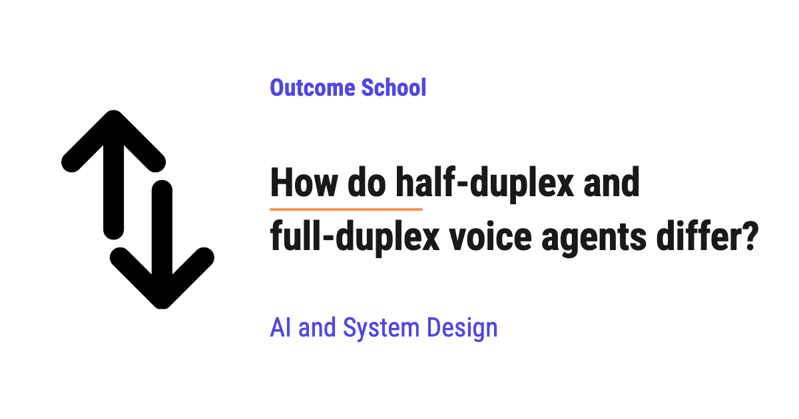

# How do half-duplex and full-duplex voice agents differ?

> Archived from <https://outcomeschool.com/blog/half-duplex-vs-full-duplex-voice-agents> on 2026-11-25.

A half-duplex voice agent takes turns, which means it either listens or speaks, but never does both at once. A full-duplex voice agent listens and speaks at the same time, just like two people on a phone call.

In this blog, we will learn about how half-duplex and full-duplex voice agents differ. We will also see what the word duplex means, how a half-duplex voice agent works step by step, why it feels slow and unnatural, how barge-in tries to fix it, how a full-duplex voice agent listens and speaks together, and when to use which one.

We will cover the following:
<ul><li>What does duplex mean?</li><li>What is a half-duplex voice agent?</li><li>How a half-duplex voice agent works step by step</li><li>The problems with half-duplex</li><li>Barge-in on top of half-duplex</li><li>What is a full-duplex voice agent?</li><li>How a full-duplex voice agent works</li><li>The same conversation in both agents</li><li>Half-duplex vs full-duplex</li><li>When to use which one</li></ul>
I am <strong>Amit Shekhar</strong>, Founder @ <a target="_blank" rel="noopener noreferrer" href="https://outcomeschool.com">Outcome School</a>, I have taught and mentored many developers, and their efforts landed them high-paying tech jobs, helped many tech companies in solving their unique problems, and created many open-source libraries being used by top companies. I am passionate about sharing knowledge through open-source, blogs, and videos.

I teach <a target="_blank" rel="noopener noreferrer" href="https://outcomeschool.com/program/ai-and-machine-learning">AI and Machine Learning</a> at Outcome School.

Let&#x27;s get started.
<h2 id="what-does-duplex-mean">What does duplex mean?</h2>
In communication systems, the word <strong>duplex</strong> tells us how two sides of a conversation can send information to each other.

There are two types that matter for us:
<ul><li><strong>Half-duplex:</strong> Both sides can talk, but only one side at a time.</li><li><strong>Full-duplex:</strong> Both sides can talk at the same time.</li></ul>
The best way to learn this is by taking an example.

Think about a walkie-talkie. We press the button and speak. While we are holding the button, we cannot hear the other person. When we release the button, the other person can speak. This is half-duplex.

Now, think about a normal phone call. We can speak and hear at the same moment. If the other person says &quot;hmm&quot; while we are talking, we hear it. If we both start talking together, we both hear it and one of us stops. This is full-duplex.

Let&#x27;s see the difference as below:

<pre><code class="code-highlight">Half-duplex (walkie-talkie)

Person A:  speaks --------&gt;
Person B:                   speaks --------&gt;

Full-duplex (phone call)

Person A:  speaks -----------------------&gt;
Person B:        hmm      yes     speaks --&gt;
</code></pre>

Here, we can see that in half-duplex, the two lines never overlap. In full-duplex, they can overlap at any time.

The same idea applies to voice agents. A <strong>voice agent</strong> is an AI system that we talk to using our voice, and it replies to us in a voice. The question is: does it behave like a walkie-talkie or like a phone call?
<h2 id="what-is-a-half-duplex-voice-agent">What is a half-duplex voice agent?</h2>
<strong>A half-duplex voice agent is a voice agent that either listens or speaks at any given moment, but never does both together.</strong>

It waits for us to finish speaking. Then it thinks. Then it speaks. While it is speaking, it is not really listening to what we say. It works in <a target="_blank" rel="noopener noreferrer" href="what-is-turn-taking-in-a-voice-ai-agent.md">turns</a>.

Many voice agents in production are half-duplex at their core. They are built as a chain of separate parts that work one after another.
<h2 id="how-a-half-duplex-voice-agent-works-step-by-step">How a half-duplex voice agent works step by step</h2>
A half-duplex voice agent is usually <a target="_blank" rel="noopener noreferrer" href="design-a-real-time-voice-ai-agent.md">built as a pipeline</a>, where the output of one step becomes the input of the next step.

Let&#x27;s see the pipeline as below:

<pre><code class="code-highlight">       User speaks
            ↓
+-----------------------+
|  VAD (detects speech  |
|  and silence)         |
+-----------------------+
            ↓
+-----------------------+
|  ASR (speech to text) |
+-----------------------+
            ↓
+-----------------------+
|  LLM (writes reply)   |
+-----------------------+
            ↓
+-----------------------+
|  TTS (text to speech) |
+-----------------------+
            ↓
      Agent speaks
</code></pre>

Let&#x27;s understand each part.

<strong>Step 1:</strong> The <strong>VAD (Voice Activity Detection)</strong> listens to the microphone and decides whether someone is speaking or not. When the system sees silence for a fixed time, for example 700 milliseconds, it <a target="_blank" rel="noopener noreferrer" href="endpointing-in-voice-agents.md">decides that the user has finished the turn</a>.

<strong>Step 2:</strong> The <strong>ASR (Automatic Speech Recognition)</strong> converts the user&#x27;s speech into text. For example, the sound of &quot;book a table for two&quot; becomes the text &quot;book a table for two&quot;.

<strong>Step 3:</strong> The <strong>LLM (Large Language Model)</strong> reads that text and writes a reply in text. For example, &quot;Sure, for what time?&quot;

<strong>Step 4:</strong> The <strong>TTS (Text to Speech)</strong> converts the reply text into a voice.

<strong>Step 5:</strong> The agent plays that voice through the speaker.

Then, the agent goes back to listening, and the whole cycle starts again.

In real systems, these parts often pass partial results to each other to save time. But, the agent still waits for the user&#x27;s turn to end before it replies.

Here, we can notice that at any moment, only one direction is active. Either the user is talking and the agent is listening, or the agent is talking and the user is expected to listen. This is exactly the walkie-talkie behavior.

<strong>Planning your move into AI?</strong>

No matter which tech domain you work in today, with your effort, you can transition to these roles:
<ul><li>AI Engineer</li><li>Forward Deployed Engineer</li><li>AI Agent Engineer</li><li>Harness Engineer</li><li>Voice AI Engineer</li><li>AI Architect</li><li>LLM Engineer</li><li>LLM Inference Engineer</li><li>Gen AI Engineer</li><li>MLOps Engineer</li><li>ML Engineer</li><li>Deep Learning Engineer</li></ul>
Our <a target="_blank" rel="noopener noreferrer" href="https://outcomeschool.com/program/ai-and-machine-learning">AI and Machine Learning Program</a> at Outcome School takes you there.
<h2 id="the-problems-with-half-duplex">The problems with half-duplex</h2>
The half-duplex design is simple and it works. But, the following issues arise when we try to make it feel like a real human conversation.

<strong>Problem 1: The waiting gap.</strong> The agent must first wait for the silence timer to finish. Then, the ASR, the LLM, and the TTS each take some time. <a target="_blank" rel="noopener noreferrer" href="voice-agent-latency-budget.md">All these delays add up</a>. So, there is a <a target="_blank" rel="noopener noreferrer" href="voice-to-voice-latency.md">noticeable gap between the moment we stop talking and the moment the agent starts talking</a>. In a human conversation, this gap is usually very short, often around 200 milliseconds.

<strong>Problem 2: It cuts people off.</strong> In its simplest form, the agent decides that our turn is over only by looking at silence. Let&#x27;s say we say &quot;My number is 98765...&quot; and pause to remember the rest. The agent sees silence, thinks we are done, and <a target="_blank" rel="noopener noreferrer" href="voice-agents-cutting-users-off.md">starts replying in the middle of our sentence</a>. <a target="_blank" rel="noopener noreferrer" href="silence-vs-model-based-turn-detection.md">Turn detection models that also look at the words and the tone</a> reduce this problem, but the agent still has to decide that the turn is over before it can reply.

<strong>Problem 3: It cannot hear us while it speaks.</strong> Suppose the agent is reading out a long list of flight options, and we already heard the one we want. We say &quot;the second one&quot;. A pure half-duplex agent does not hear us, because it is not listening while it speaks. It keeps reading the full list.

<strong>Problem 4: No small listening sounds.</strong> In a real conversation, we say &quot;hmm&quot;, &quot;okay&quot;, &quot;right&quot; while the other person is talking. These are called <a target="_blank" rel="noopener noreferrer" href="backchannels-in-voice-agents.md"><strong>backchannels</strong></a>. They tell the speaker &quot;I am following you, continue&quot;. A half-duplex agent cannot produce them while we talk, because it is not allowed to speak during our turn. And if we say &quot;hmm&quot; while it speaks, it either ignores it or treats it as a new turn.

All these problems have the same root cause: the agent can only do one thing at a time.
<h2 id="barge-in-on-top-of-half-duplex">Barge-in on top of half-duplex</h2>
To solve Problem 3, many half-duplex voice agents add a feature called <strong>barge-in</strong>.

<strong>Barge-in is the ability of the user to interrupt the agent while the agent is speaking.</strong>

We have a detailed blog on <a target="_blank" rel="noopener noreferrer" href="what-is-barge-in-in-a-voice-ai-agent.md">barge-in in a voice AI agent</a> that explains how it works step by step.

While the agent is speaking, the system keeps a listener, often the same VAD, active on the microphone. If it detects that the user has started speaking, it <a target="_blank" rel="noopener noreferrer" href="stopping-speech-on-interruption.md">stops the agent&#x27;s voice immediately</a> and goes back to listening.

Let&#x27;s see this as below:

<pre><code class="code-highlight">Agent:  &quot;Flight one is at 9 AM, flight two is at--&quot; (stops)
User:                                  &quot;the first one&quot;
</code></pre>

Here, the agent stops speaking as soon as the user starts, and goes back to listening.

Barge-in helps, but it does not make the agent full-duplex. The listener during speech has only one job, which is to detect the interruption and stop the agent. What we said is handled later as a new turn, after the agent has already stopped. The agent still cannot keep speaking while it understands what we say. It just switches from speaking to listening faster.

Barge-in also brings its own problems:
<ul><li>A cough, a door closing, or a person talking in the background <a target="_blank" rel="noopener noreferrer" href="interruption-vs-background-noise.md">can stop the agent by mistake</a>.</li><li>A simple &quot;hmm&quot; from the user, which means &quot;continue&quot;, can also stop the agent.</li><li>The agent&#x27;s own voice coming back into the microphone can trigger a <a target="_blank" rel="noopener noreferrer" href="false-interruption-recovery.md">false interruption</a>. To prevent this, the system needs <strong>echo cancellation</strong>, which removes the agent&#x27;s own voice from the microphone signal.</li></ul>
So, barge-in makes half-duplex better, but the basic rule stays the same: one direction at a time.

<strong>A quick note for you</strong>

No matter which tech domain you work in, get familiar with these topics:
<ul><li>LLM</li><li>RAG</li><li>MCP</li><li>Agent</li><li>Fine-tuning</li><li>Quantization</li></ul>
We put it all together in one video:

<a target="_blank" rel="noopener noreferrer" href="https://www.youtube.com/watch?v=lnfWvX66FUk">AI Engineering Explained: LLM, RAG, MCP, Agent, Fine-Tuning, and Quantization</a>

No need to stop reading - bookmark it and watch later when you get time. Future you will thank you.

Now, let&#x27;s get back to the topic.

Now, let&#x27;s move to the other side.
<h2 id="what-is-a-full-duplex-voice-agent">What is a full-duplex voice agent?</h2>
<strong>A full-duplex voice agent is a voice agent that listens and speaks at the same time, continuously, just like a person on a phone call.</strong>

It does not wait for our turn to end before it starts thinking. It does not stop hearing us while it speaks. Both directions stay open all the time.

Because of this, a full-duplex voice agent can do things that a half-duplex agent cannot:
<ul><li>It can <a target="_blank" rel="noopener noreferrer" href="agent-side-backchannels.md">say &quot;hmm&quot; or &quot;okay&quot; while we are talking</a>.</li><li>It can hear us while it is speaking, and understand what we said, not only detect that we said something.</li><li>It can decide by itself whether to stop, continue, or adjust its reply when we speak over it.</li><li>It can start replying very quickly, because it has been listening and thinking all along.</li></ul>
A well-known example is <strong>Moshi</strong>, a full-duplex speech model released by the AI research lab Kyutai in 2024.
<h2 id="how-a-full-duplex-voice-agent-works">How a full-duplex voice agent works</h2>
Many full-duplex voice agents are not built as a chain of separate parts. Instead, <a target="_blank" rel="noopener noreferrer" href="cascaded-vs-speech-to-speech.md">a single model works directly on audio</a>. Let&#x27;s understand the central idea by taking Moshi as the example.

First, the audio is cut into small time slices. In Moshi, each slice is 80 milliseconds long, which means there are 12.5 slices every second. Each slice of sound is converted into a small group of numbers called <strong>audio tokens</strong>. A <strong>token</strong> is a small piece that the model can read and write, just like an LLM reads and writes <a target="_blank" rel="noopener noreferrer" href="tokenization-in-llms.md">text tokens</a>.

Then, the model keeps two streams of audio tokens running side by side:
<ul><li><strong>User stream:</strong> what the user is saying right now.</li><li><strong>Agent stream:</strong> what the agent is saying right now.</li></ul>
At every time slice, the model reads the latest piece of the user stream and writes the next piece of the agent stream. This happens again and again, 12.5 times every second, without stopping. Because the model sees both streams together, it knows exactly when the two voices overlap.

Just for the sake of understanding, let&#x27;s show one word per time slice, as below:

<pre><code class="code-highlight">Time slice:    1      2      3      4      5      6
User stream:   book   a      table  -      -      -
Agent stream:  -      -      hmm    -      sure   for
</code></pre>

Here, <code>-</code> means silence. We can see that:
<ul><li>In slices 1 and 2, the user is speaking and the agent is silent.</li><li>In slice 3, the user is still speaking and the agent says &quot;hmm&quot; at the same time. This is a backchannel.</li><li>In slice 4, both are silent for a moment, and the model decides that the user has finished.</li><li>From slice 5, the agent starts its reply.</li></ul>
<strong>Very important:</strong> Silence is also an output. When the agent should not speak, the model writes audio tokens that sound like silence in the agent stream. So, the model is always deciding, at every time slice, whether to stay quiet or to speak. There is no separate silence timer that decides when our turn ends. The model learns this behavior from training on conversations, including real recorded conversations between people.

Moshi also predicts the text of its own words, slightly ahead of the matching audio tokens. Kyutai calls this the <strong>Inner Monologue</strong>. It helps the model keep its words meaningful while it is producing sound.

As per the Moshi paper, this design gives a theoretical delay of 160 milliseconds, and around 200 milliseconds in practice on a single GPU. This is close to the gap we see in human conversations.

This is how a full-duplex voice agent listens and speaks together.

To learn Multimodal AI and how to Design a Real-Time Voice AI Agent from the ground up, we can check out our <a target="_blank" rel="noopener noreferrer" href="https://outcomeschool.com/program/ai-and-machine-learning">AI and Machine Learning Program</a> at Outcome School.
<h2 id="the-same-conversation-in-both-agents">The same conversation in both agents</h2>
Let&#x27;s say the user wants to book a table at a restaurant.

<strong>In a half-duplex voice agent:</strong>

<pre><code class="code-highlight">User:   &quot;I want to book a table for... umm...&quot;
        (pauses to think)
Agent:  &quot;Sure, for how many people?&quot;      (cuts in at the pause)
User:   &quot;...four people, at 8 PM.&quot;
        (silence timer runs)
Agent:  (gap while ASR, LLM, and TTS run)
Agent:  &quot;Great, a table for four at 8 PM. Would you also like...&quot;
User:   &quot;no, that&#x27;s all&quot;
Agent:  (barge-in stops the voice, then it waits for a new turn)
</code></pre>

<strong>In a full-duplex voice agent:</strong>

<pre><code class="code-highlight">User:   &quot;I want to book a table for... umm...&quot;
Agent:                           &quot;hmm&quot;    (backchannel, waits)
User:   &quot;...four people, at 8 PM.&quot;
Agent:  &quot;Great, a table for four at 8 PM. Would you also--&quot;
User:                                      &quot;no, that&#x27;s all&quot;
Agent:  &quot;Okay, have a great dinner.&quot;      (understood and adjusted)
</code></pre>

Here, we can notice the differences:
<ul><li>The half-duplex agent cut in at the pause, because it only looked at silence. The full-duplex agent said &quot;hmm&quot; and waited, because it understood that the sentence was not finished.</li><li>The half-duplex agent had a gap before replying. The full-duplex agent replied quickly.</li><li>When the user interrupted, the half-duplex agent only stopped and had to start a new turn. The full-duplex agent understood what the user said and replied to it.</li></ul>
<strong>Stay updated:</strong> Subscribe to our <a target="_blank" rel="noopener noreferrer" href="https://outcomeschool.substack.com/subscribe">newsletter</a> to get our latest AI and Machine Learning blogs straight to your inbox.
<h2 id="half-duplex-vs-full-duplex">Half-duplex vs full-duplex</h2>
Let me tabulate the differences between half-duplex and full-duplex voice agents for your better understanding so that you can decide which one to use based on your use case.
<table><thead><tr><th>Point</th><th>Half-duplex voice agent</th><th>Full-duplex voice agent</th></tr></thead><tbody><tr><td>Listening and speaking</td><td>One at a time</td><td>Both at the same time</td></tr><tr><td>Architecture</td><td>Pipeline of VAD, ASR, LLM, TTS</td><td>Often a single speech model</td></tr><tr><td>End of turn</td><td>Decided by silence or a turn detector</td><td>Decided by the model at every time slice</td></tr><tr><td>Response gap</td><td>Longer, delays of each part add up</td><td>Shorter, around 200 ms for Moshi</td></tr><tr><td>Interruptions</td><td>Barge-in stops the agent</td><td>Agent hears, understands, and adjusts</td></tr><tr><td>Backchannels like &quot;hmm&quot;</td><td>Not possible while the user talks</td><td>Possible</td></tr><tr><td>Control over each part</td><td>High, each part can be swapped</td><td>Low, everything is inside one model</td></tr><tr><td>Tool calls and business logic</td><td>Easy, the LLM works on text</td><td>Harder, the model works mainly on audio</td></tr><tr><td>Debugging</td><td>Easy, we can read the text at each step</td><td>Harder, most of the work happens on audio</td></tr></tbody></table><h2 id="when-to-use-which-one">When to use which one</h2>
Now, the question is: which one must we use?

<strong>Half-duplex voice agent:</strong>

<strong>Advantages:</strong>
<ul><li>Each part can be chosen and replaced separately. We can use the best ASR, the best LLM, and the best TTS for our use case.</li><li>The LLM works on text, so it is easy to add <a target="_blank" rel="noopener noreferrer" href="how-does-function-calling-work-in-llms.md">tool calls</a>, connect to databases, and follow business rules.</li><li>It is easy to debug, because we can read the text that went in and out of every step.</li><li>It is mature and reliable for structured tasks.</li></ul>
<strong>Disadvantages:</strong>
<ul><li>There is a gap before every reply.</li><li>It can cut users off at pauses.</li><li>It cannot produce backchannels.</li><li>Interruptions are handled with barge-in, which can stop the agent by mistake.</li></ul>
<strong>Full-duplex voice agent:</strong>

<strong>Advantages:</strong>
<ul><li>The conversation feels natural, close to talking with a person.</li><li>The response gap is very short.</li><li>When trained well, it handles pauses, interruptions, and <a target="_blank" rel="noopener noreferrer" href="overlapping-speech-in-voice-agents.md">overlapping speech</a> in a natural way.</li><li>It can produce backchannels.</li></ul>
<strong>Disadvantages:</strong>
<ul><li>Everything is inside one model, so it is harder to control what it says.</li><li>Adding tools and business rules is harder, because the model works mainly on audio and not on text.</li><li>It needs training data with overlapping speech between two people, which is hard to collect.</li><li>It can talk over the user or stay silent at the wrong time if it has not learned the timing well.</li></ul>
So, if we are building a customer support agent that must check orders, call APIs, and follow strict rules, a half-duplex voice agent with good turn detection and barge-in is often the practical choice. If we are building a companion, a language practice partner, or any experience where natural flow matters the most, a full-duplex voice agent is often the better choice.

Now we must have understood how half-duplex and full-duplex voice agents differ, how each one works, and when to use which one.
<h2 id="frequently-asked-questions">Frequently Asked Questions</h2><h3 id="is-barge-in-the-same-as-full-duplex">Is barge-in the same as full-duplex?</h3>
No. Barge-in is not the same as full-duplex. Barge-in only lets the user interrupt a half-duplex agent: the listener detects that the user started speaking and stops the agent&#x27;s voice. What the user said is handled later as a new turn. A full-duplex agent hears and understands the user while it keeps speaking.
<h3 id="what-is-a-backchannel-in-a-voice-conversation">What is a backchannel in a voice conversation?</h3>
A backchannel is a small listening sound like &quot;hmm&quot;, &quot;okay&quot;, or &quot;right&quot; that we say while the other person is talking. It tells the speaker &quot;I am following you, continue&quot;. A half-duplex agent cannot produce backchannels while the user talks, but a full-duplex agent can.
<h3 id="what-is-moshi">What is Moshi?</h3>
Moshi is a full-duplex speech model released by the AI research lab Kyutai in 2024. It works directly on audio in 80 millisecond slices and keeps a user stream and an agent stream running side by side. As per the Moshi paper, its delay is around 200 milliseconds in practice on a single GPU.
<h3 id="how-does-a-full-duplex-voice-agent-decide-when-to-stay-silent">How does a full-duplex voice agent decide when to stay silent?</h3>
A full-duplex voice agent treats silence as an output. At every time slice, the model decides whether to stay quiet or to speak, and when it should not speak, it writes audio tokens that sound like silence. There is no separate silence timer. The model learns this behavior from training on conversations.

That&#x27;s it for now.

Thanks

<strong>Amit Shekhar</strong> Founder @ <a target="_blank" rel="noopener noreferrer" href="https://outcomeschool.com">Outcome School</a>

You can connect with me on:
<ul><li><a target="_blank" rel="noopener noreferrer" href="https://x.com/amitiitbhu">X</a></li><li><a target="_blank" rel="noopener noreferrer" href="https://www.linkedin.com/in/amit-shekhar-iitbhu">LinkedIn</a></li><li><a target="_blank" rel="noopener noreferrer" href="https://github.com/amitshekhariitbhu">GitHub</a></li></ul>
Follow Outcome School on:
<ul><li><a target="_blank" rel="noopener noreferrer" href="https://x.com/outcome_school">X</a></li><li><a target="_blank" rel="noopener noreferrer" href="https://youtube.com/@OutcomeSchool">YouTube</a></li><li><a target="_blank" rel="noopener noreferrer" href="https://www.linkedin.com/company/outcomeschool">LinkedIn</a></li><li><a target="_blank" rel="noopener noreferrer" href="http://github.com/OutcomeSchool">GitHub</a></li></ul>
<a target="_blank" rel="noopener noreferrer" href="https://outcomeschool.com/blog"><strong>Read all of our high-quality blogs here.</strong></a>

