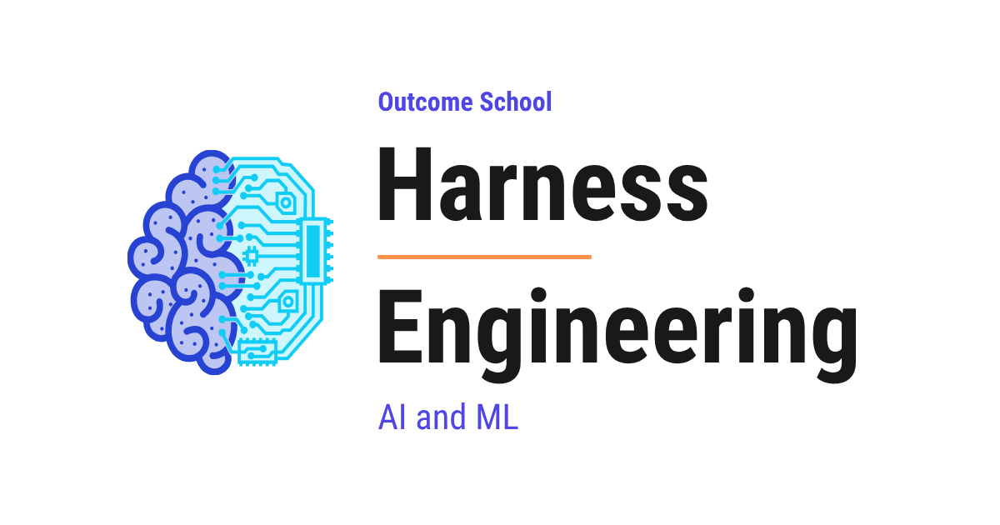

# What is Harness Engineering?

> Archived from <https://outcomeschool.com/blog/harness-engineering-in-ai> on 2026-11-25.

Harness Engineering is everything we do to build the control layer around an AI model, which manages its inputs, outputs, tools, memory, errors, and evaluation, so that the model becomes actually usable in production.

In this blog, we will learn about Harness Engineering in AI. We will understand what a harness is, why we need it, and how it is used in AI Agents and evaluation systems.

We will cover the following:
<ul><li>What is a Harness in AI?</li><li>Why do we need Harness Engineering?</li><li>Components of an AI Harness</li><li>Harness Engineering for AI Agents</li><li>Harness Engineering for Evaluation</li><li>Best Practices in Harness Engineering</li><li>Putting It All Together</li></ul>
I am <strong>Amit Shekhar</strong>, Founder @ <a target="_blank" rel="noopener noreferrer" href="https://outcomeschool.com">Outcome School</a>, I have taught and mentored many developers, and their efforts landed them high-paying tech jobs, helped many tech companies in solving their unique problems, and created many open-source libraries being used by top companies. I am passionate about sharing knowledge through open-source, blogs, and videos.

I teach <a target="_blank" rel="noopener noreferrer" href="https://outcomeschool.com/program/ai-and-machine-learning">AI and Machine Learning</a> at Outcome School.

Let&#x27;s get started.
<h2 id="what-is-a-harness-in-ai">What is a Harness in AI?</h2>
Let&#x27;s break the term:

<strong>Harness Engineering = Harness + Engineering</strong>

<strong>Harness</strong> means a control layer that helps you effectively use and manage a system..

<strong>Engineering</strong> means building it in a systematic and reliable way.

So, <strong>Harness Engineering</strong> is everything you do to build that control layer around the AI model to make it actually usable in production.

In simple words, the AI model alone is not enough. We need a layer of code around it that manages inputs, outputs, tools, memory, errors, and evaluation. This layer is the <strong>harness</strong>.

Just for the sake of understanding, let&#x27;s say we have a very powerful engine. The engine alone cannot drive us anywhere. We need a car body, steering, brakes, fuel system, and dashboard around it. Together, they make the engine useful. The car body and all the parts around the engine - that is the harness.

Similarly, an AI model like an LLM is the engine. The harness is everything around it that makes the model useful in a real application.
<h2 id="why-do-we-need-harness-engineering">Why Do We Need Harness Engineering?</h2>
An AI model by itself can only process the input we give and return the output. But in real-world applications, we need much more than that.

We want to use the model effectively so for that we need to:
<ul><li>Use tools like search engines, databases, and APIs</li><li>Remember past conversations</li><li>Handle errors gracefully when something goes wrong</li><li>Follow specific instructions and formats</li><li>Evaluate for quality and correctness</li><li>Deploy and monitor in production</li></ul>
Without a harness, the model is just a raw engine with no control. The harness gives us that control.

So, We need <strong>Harness Engineering</strong> for building this control layer around AI models.

Consider any AI-powered product we use today - a coding assistant, a chatbot, or an AI search engine. All of them have a harness around the model. The quality of the harness directly affects the quality of the product. <strong>A great model with a poor harness will give a poor experience. A good model with a great harness will give an excellent experience.</strong>

<strong>Planning your move into AI?</strong>

No matter which tech domain you work in today, with your effort, you can transition to these roles:
<ul><li>AI Engineer</li><li>Forward Deployed Engineer</li><li>AI Agent Engineer</li><li>Harness Engineer</li><li>Voice AI Engineer</li><li>AI Architect</li><li>LLM Engineer</li><li>LLM Inference Engineer</li><li>Gen AI Engineer</li><li>MLOps Engineer</li><li>ML Engineer</li><li>Deep Learning Engineer</li></ul>
Our <a target="_blank" rel="noopener noreferrer" href="https://outcomeschool.com/program/ai-and-machine-learning">AI and Machine Learning Program</a> at Outcome School takes you there.
<h2 id="components-of-an-ai-harness">Components of an AI Harness</h2>
Now, let&#x27;s understand the key components that make up an AI harness.

<strong>Prompt Management</strong>

This is the component that manages what goes into the model. It handles <a target="_blank" rel="noopener noreferrer" href="system-prompt.md">system prompts</a>, user messages, templates, and context. It makes sure the model gets the right instructions every time. This is the discipline known as <a target="_blank" rel="noopener noreferrer" href="context-engineering.md">Context Engineering</a>. Procedures that are too long to keep in the prompt at all times can live outside it as <a target="_blank" rel="noopener noreferrer" href="what-are-agent-skills.md">Agent Skills</a>, which the harness loads only when a task matches.

<strong>Tool Orchestration</strong>

Many AI applications need the model to get assistant from external tools. For example, a coding assistant needs to read files, run commands, or search the web. The harness manages which tools are available, how they are called, and how the results are passed back to the model.

<strong>Memory Management</strong>

In a conversation, the model needs to remember what was said earlier. The harness manages this memory. It decides what to keep, what to remove, and how to <a target="_blank" rel="noopener noreferrer" href="how-does-context-compaction-work.md">compress old messages</a> when the conversation gets too long.

<strong>Error Handling</strong>

Things can go wrong. The model can generate invalid output. A <a target="_blank" rel="noopener noreferrer" href="how-does-function-calling-work-in-llms.md">tool call</a> can fail. The API can return an error. The harness handles all these cases so the application does not crash.

<strong>Input and Output Processing</strong>

The harness processes user input before sending it to the model. It also processes the model output before showing it to the user. This includes parsing, formatting, validation, and filtering.

<a target="_blank" rel="noopener noreferrer" href="how-do-llm-guardrails-work.md"><strong>Guardrails</strong></a>

These are safety checks built into the harness. They make sure the model does not generate harmful content, does not leak sensitive information, and stays within the boundaries of what it is supposed to do.

<strong>A quick note for you</strong>

No matter which tech domain you work in, get familiar with these topics:
<ul><li>LLM</li><li>RAG</li><li>MCP</li><li>Agent</li><li>Fine-tuning</li><li>Quantization</li></ul>
We put it all together in one video:

<a target="_blank" rel="noopener noreferrer" href="https://www.youtube.com/watch?v=lnfWvX66FUk">AI Engineering Explained: LLM, RAG, MCP, Agent, Fine-Tuning, and Quantization</a>

No need to stop reading - bookmark it and watch later when you get time. Future you will thank you.

Now, let&#x27;s get back to the topic.

This was all about the key components of an AI harness. Now, let&#x27;s move to the next section.
<h2 id="harness-engineering-for-ai-agents">Harness Engineering for AI Agents</h2>
Now, let&#x27;s understand how Harness Engineering is used for AI Agents.

An <a target="_blank" rel="noopener noreferrer" href="ai-agent.md"><strong>AI Agent</strong></a> is a system that uses tools, makes decisions, and takes multiple actions to complete complex tasks. It can read files, write code, search the internet, send messages, and more. The agent keeps working in a loop <a target="_blank" rel="noopener noreferrer" href="ai-is-only-as-good-as-our-definition-of-done.md">until the task is done</a>.

The harness for an AI Agent is more complex because it needs to manage the entire <a target="_blank" rel="noopener noreferrer" href="ai-agent-loop.md">agent loop</a>. Designing that loop deliberately - the step budget, the observations, and the exit conditions - is <a target="_blank" rel="noopener noreferrer" href="what-is-loop-engineering.md">Loop Engineering</a>.

Here is how the agent harness works:

<strong>Step 1:</strong> The harness takes the user task and prepares the initial prompt with system instructions, available tools, and context.

<strong>Step 2:</strong> The harness sends this to the model and gets a response.

<strong>Step 3:</strong> The harness checks if the model recommends to use a tool. If yes, the harness executes the tool and sends the result back to the model.

<strong>Step 4:</strong> The harness repeats Steps 2 and 3 until the model says the task is complete.

<strong>Step 5:</strong> The harness presents the final result to the user.

This entire loop is managed by the harness. The model does the thinking, but the harness does the managing.

Here, we can see that without the harness, the agent cannot function. The harness is what turns a simple model into a powerful agent.

Claude Code is a real-world example of exactly this kind of agent harness. We have a detailed blog on <a target="_blank" rel="noopener noreferrer" href="how-does-claude-code-work.md">how Claude Code works</a> that walks through it step by step.

<strong>Note:</strong> The model itself does not execute any tool. It only decides which tool to call. The harness is the one that actually executes the tool and feeds the result back to the model.

Let&#x27;s understand with a simple example:

<pre><code class="code-highlight">User: &quot;Find the weather in Delhi and send it to my email&quot;

Harness Step 1: Prepare prompt with tools [weather_api, email_api]
Harness Step 2: Send to model
Model Response: &quot;I will first check the weather. Call weather_api(city=&#x27;Delhi&#x27;)&quot;
Harness Step 3: Execute weather_api -&gt; Result: &quot;32°C, Sunny&quot;
Harness Step 4: Send result back to model
Model Response: &quot;Now I will send the email. Call email_api(to=&#x27;user@email.com&#x27;, body=&#x27;Weather in Delhi: 32°C, Sunny&#x27;)&quot;
Harness Step 5: Execute email_api -&gt; Result: &quot;Email sent&quot;
Harness Step 6: Send result back to model
Model Response: &quot;Done. I found the weather in Delhi (32°C, Sunny) and sent it to your email.&quot;
Harness Step 7: Present final response to user
</code></pre>

Here, the model decided what to do, but the harness executed every action and managed the entire flow. This is how Harness Engineering works for AI Agents.

To build an AI Coding Agent from scratch and master tool use, agent memory, and the full agent architecture, check out our <a target="_blank" rel="noopener noreferrer" href="https://outcomeschool.com/program/ai-and-machine-learning">AI and Machine Learning Program</a> at Outcome School.
<h2 id="harness-engineering-for-evaluation">Harness Engineering for Evaluation</h2>
Now, let&#x27;s understand how Harness Engineering is used for evaluating AI models.

An <strong>evaluation harness</strong> is a framework that runs a set of tests on an AI model and measures how well it performs.

For example, suppose we want to test if our model can answer math questions correctly. The evaluation harness will:
<ul><li>Load a dataset of math questions with known correct answers</li><li>Send each question to the model one by one</li><li>Compare the model answer with the correct answer</li><li>Calculate an overall score</li></ul>
This is similar to how we test software. We write test cases, run them, and check the results. The evaluation harness does the same thing for AI models.

The evaluation harness helps us answer important questions like:
<ul><li>How accurate is the model?</li><li>Did the model get better or worse after we made changes?</li><li>How does one model compare to another?</li><li>Where does the model fail?</li></ul>
Without an evaluation harness, we would have to test the model manually, which is slow and not reliable. The evaluation harness makes our life easy.

For open-ended outputs like chatbot replies where a single correct answer does not exist, the evaluation harness often uses <a target="_blank" rel="noopener noreferrer" href="llm-as-a-judge.md">LLM as a Judge</a> to score quality where rule-based metrics fall short.

For AI Agents specifically, evaluation goes beyond the final answer - we must score the trajectory, the tool calls, and the plan as well. We have a detailed blog on <a target="_blank" rel="noopener noreferrer" href="ai-agent-evaluation.md">AI Agent Evaluation</a> that covers this in depth.

<strong>Stay updated:</strong> Subscribe to our <a target="_blank" rel="noopener noreferrer" href="https://outcomeschool.substack.com/subscribe">newsletter</a> to get our latest AI and Machine Learning blogs straight to your inbox.

This was all about Harness Engineering for Evaluation. Now, let&#x27;s look at some best practices.
<h2 id="best-practices-in-harness-engineering">Best Practices in Harness Engineering</h2>
Now, let&#x27;s look at some best practices we must follow when building an AI harness.

<strong>Keep the harness modular.</strong> Each component like prompt management, tool orchestration, and memory management must be separate. This makes it easy to change one part without breaking others.

<strong>Log everything.</strong> Every input, output, tool call, and error must be logged. This helps us debug issues and understand what the model is doing.

<strong>Add guardrails from day one.</strong> Do not wait until something goes wrong. Build safety checks into the harness from the beginning.

<strong>Make tools reliable.</strong> If a tool fails, the harness must handle it gracefully. It can retry, use a fallback, or inform the model about the failure.

<strong>Test the harness, not just the model.</strong> The harness itself can have bugs. We must write tests for the harness code just like we test any other software.

<strong>Monitor in production.</strong> Once deployed, the harness must be monitored for latency, errors, cost, and quality. This helps us catch issues early. We have a detailed blog on <a target="_blank" rel="noopener noreferrer" href="ai-agent-observability.md">AI Agent Observability</a> that explains this in depth.

I will highly recommend following these practices from the start. It saves a lot of time in the long run.
<h2 id="putting-it-all-together">Putting It All Together</h2>
Now, let&#x27;s visualize how all the components of a harness work together:

<pre><code class="code-highlight">User Input
    ↓
[Input Processing] → Clean and format the input
    ↓
[Prompt Management] → Build the prompt with context and instructions
    ↓
[AI Model (LLM)] → Generate a response
    ↓
[Output Processing] → Parse and validate the output
    ↓
[Tool Orchestration] → Execute any tool calls if needed
    ↓
[Memory Management] → Store the conversation for future reference
    ↓
[Guardrails] → Check for safety and compliance
    ↓
Final Output to User
</code></pre>

Here, we can see that the AI model is just one part of the system. The harness is everything else. And in many real-world applications, the harness code is much larger than the model integration code.

This is how all the components of a harness work together to make an AI model useful in the real world.

As I keep saying: the model is the brain, but the harness is what makes the brain useful.
<h2 id="frequently-asked-questions">Frequently Asked Questions</h2><h3 id="does-the-ai-model-execute-tools-by-itself">Does the AI model execute tools by itself?</h3>
No. The model itself does not execute any tool. It only decides which tool to call. The harness is the one that actually executes the tool and feeds the result back to the model, and it keeps repeating this loop until the model says the task is complete.
<h3 id="is-a-better-model-more-important-than-a-better-harness">Is a better model more important than a better harness?</h3>
Not always. The quality of the harness directly affects the quality of the product. A great model with a poor harness will give a poor experience, while a good model with a great harness will give an excellent experience. The model is the brain, but the harness is what makes the brain useful.
<h3 id="is-harness-engineering-the-same-as-context-engineering">Is Harness Engineering the same as Context Engineering?</h3>
No. Context Engineering is one part of Harness Engineering. Prompt management, which handles system prompts, user messages, templates, and context, is the discipline known as Context Engineering. The harness also covers tool orchestration, memory management, error handling, input and output processing, and guardrails.
<h3 id="how-does-an-evaluation-harness-score-open-ended-outputs">How does an evaluation harness score open-ended outputs?</h3>
For open-ended outputs like chatbot replies, where a single correct answer does not exist, the evaluation harness often uses LLM as a Judge to score quality. This is needed where rule-based metrics fall short. For AI Agents, evaluation also goes beyond the final answer to score the trajectory, the tool calls, and the plan.
<h3 id="do-we-need-to-test-the-harness-code-separately-from-the-model">Do we need to test the harness code separately from the model?</h3>
Yes. The harness itself can have bugs, so we must write tests for the harness code just like we test any other software. In many real-world applications, the harness code is much larger than the model integration code.

That&#x27;s it for now.

Thanks

<strong>Amit Shekhar</strong> Founder @ <a target="_blank" rel="noopener noreferrer" href="https://outcomeschool.com">Outcome School</a>

You can connect with me on:
<ul><li><a target="_blank" rel="noopener noreferrer" href="https://x.com/amitiitbhu">X</a></li><li><a target="_blank" rel="noopener noreferrer" href="https://www.linkedin.com/in/amit-shekhar-iitbhu">LinkedIn</a></li><li><a target="_blank" rel="noopener noreferrer" href="https://github.com/amitshekhariitbhu">GitHub</a></li></ul>
Follow Outcome School on:
<ul><li><a target="_blank" rel="noopener noreferrer" href="https://x.com/outcome_school">X</a></li><li><a target="_blank" rel="noopener noreferrer" href="https://youtube.com/@OutcomeSchool">YouTube</a></li><li><a target="_blank" rel="noopener noreferrer" href="https://www.linkedin.com/company/outcomeschool">LinkedIn</a></li><li><a target="_blank" rel="noopener noreferrer" href="https://github.com/OutcomeSchool">GitHub</a></li></ul>
<a target="_blank" rel="noopener noreferrer" href="https://outcomeschool.com/blog"><strong>Read all of our high-quality blogs here.</strong></a>

