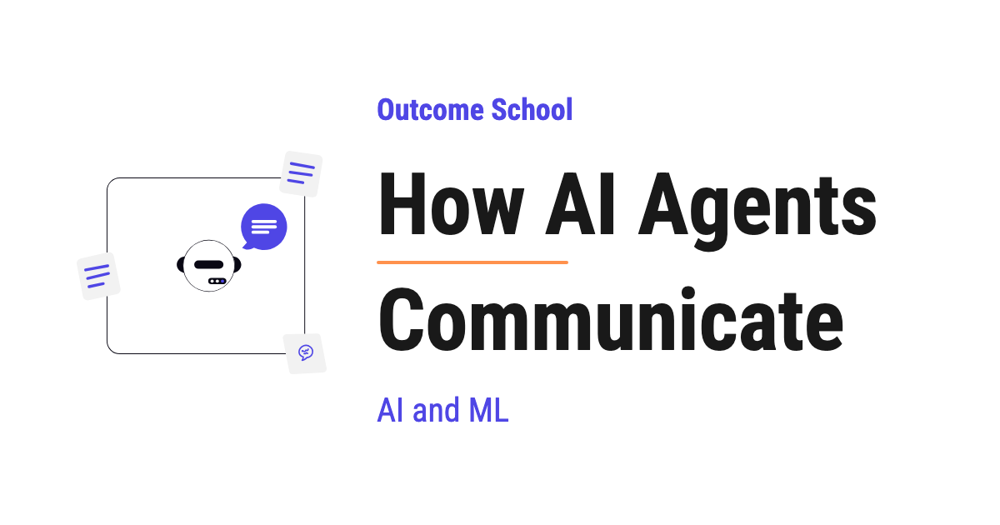

# How AI Agents Communicate

> Archived from <https://outcomeschool.com/blog/how-ai-agents-communicate> on 2026-11-25.

AI agents communicate by sending messages to each other to share information, ask for help, and work together to finish a task. They can talk directly, through a central coordinator, by broadcasting, or through shared memory.

In this blog, we will learn about how AI agents communicate. We will understand why agents need to communicate, the main ways they talk to each other, the message format, and the protocols that make agents work together to finish complex tasks.

We will cover the following:
<ul><li>What is agent communication?</li><li>Why do agents need to communicate?</li><li>What agents need in order to communicate</li><li>How a message flows between agents</li><li>The ways AI agents communicate</li><li>Direct Communication</li><li>Centralized Communication</li><li>Broadcast Communication</li><li>Shared Memory Communication</li><li>What a message looks like</li><li>The rules agents follow to talk</li><li>Challenges when agents communicate</li><li>Best Practices</li></ul>
I am <strong>Amit Shekhar</strong>, Founder @ <a target="_blank" rel="noopener noreferrer" href="https://outcomeschool.com">Outcome School</a>, I have taught and mentored many developers, and their efforts landed them high-paying tech jobs, helped many tech companies in solving their unique problems, and created many open-source libraries being used by top companies. I am passionate about sharing knowledge through open-source, blogs, and videos.

I teach <a target="_blank" rel="noopener noreferrer" href="https://outcomeschool.com/program/ai-and-machine-learning">AI and Machine Learning</a> at Outcome School.

Let&#x27;s get started.
<h2 id="what-is-agent-communication">What is agent communication?</h2>
<strong>Agent communication is the way two or more AI agents send messages to each other to share information, ask for help, and work together to finish a task.</strong>

Before we go further, let&#x27;s quickly recall <a target="_blank" rel="noopener noreferrer" href="ai-agent.md">what an AI agent is</a>. An AI agent is a system that uses an LLM to think, plan, and take actions to complete a task on our behalf. Now, when we have many such agents, they must talk to each other, and that talking is what we call agent communication.

In simple words, one agent alone can do only so much. A real task often needs many agents, where each agent is good at one thing. One agent searches for information. Another agent writes the answer. Another agent checks the answer. For all of them to work together, they must share their progress and pass results to each other.

Let&#x27;s say we are building a travel planner. One agent finds the flights. One agent finds the hotels. One agent finds the local activities. A main agent collects all of this and builds the final trip plan. None of this works if the agents cannot pass information to each other. So, here comes agent communication to the rescue.

Think of it like a team in an office. One person handles design, one handles code, one handles testing. They talk to each other through messages, emails, and meetings. Without this communication, the team cannot ship a product. In the same way, AI agents need a clean way to communicate to finish a task together.
<h2 id="why-do-agents-need-to-communicate">Why do agents need to communicate?</h2>
A single agent can handle a simple task. But, real tasks are big and have many parts. We break a big task into smaller parts and give each part to a specialized agent. Now, these agents must share their work. This is why agents need to communicate.

Here are the main reasons agents need to communicate:
<ul><li>To let each agent focus on one job and become good at it.</li><li>To pass the output of one agent as the input of another agent.</li><li>To let agents ask each other for help when they get stuck.</li><li>To split a big task into smaller tasks that run across many agents.</li><li>To let agents work in parallel and finish faster.</li><li>To let agents check and correct each other&#x27;s work.</li><li>To build large systems where many agents act like a team.</li></ul>
Without communication, every agent works alone in its own box. With communication, agents become a team that can solve much bigger problems together.

We have a detailed blog on <a target="_blank" rel="noopener noreferrer" href="multi-agent-systems.md">Multi-Agent Systems</a> that explains how these agents are organized into a working team.
<h2 id="what-agents-need-in-order-to-communicate">What agents need in order to communicate</h2>
Before we learn how agents communicate, we must know the main parts that make it possible.
<ul><li><strong>Sender</strong> - The agent that creates and sends the message.</li><li><strong>Receiver</strong> - The agent that gets the message and acts on it.</li><li><strong>Message</strong> - The actual information that is being shared, like a question, a result, or an instruction.</li><li><strong>Protocol</strong> - The agreed set of rules that decides the format of the message and how it is sent. Both agents must follow the same protocol.</li><li><strong>Channel</strong> - The path through which the message travels, like a network call, a queue, or a shared memory.</li><li><strong>Shared Context</strong> - The common memory or state that agents can read from and write to.</li></ul>
These are the building blocks. Agents put these pieces together so that messages flow cleanly from one agent to another.
<h2 id="how-a-message-flows-between-agents">How a message flows between agents</h2>
Now, let&#x27;s see how a message actually flows from one agent to another, step by step. The steps are:
<ul><li><strong>Step 1:</strong> Agent A finishes its part of the task and prepares a message.</li><li><strong>Step 2:</strong> Agent A formats the message based on the agreed protocol.</li><li><strong>Step 3:</strong> Agent A sends the message to Agent B through the channel.</li><li><strong>Step 4:</strong> Agent B receives the message and reads it.</li><li><strong>Step 5:</strong> Agent B does its work using the information in the message.</li><li><strong>Step 6:</strong> Agent B sends a reply or passes a new message to the next agent.</li><li><strong>Step 7:</strong> This continues until the full task is finished.</li></ul>
We can picture this flow like below:

<pre><code class="language-text code-highlight">   request:   Agent A  ──▶  Channel  ──▶  Agent B
   reply:     Agent A  ◀──  Channel  ◀──  Agent B
</code></pre>

Here, we can see that Agent A formats the message and sends it through the channel to Agent B, and Agent B&#x27;s reply travels back through the same channel. At every step, an agent can also store the message in shared memory, log it, and check it for safety. This back-and-forth flow of messages is the heart of how agents communicate.

Now, it&#x27;s time to learn the main ways agents communicate.
<h2 id="the-ways-ai-agents-communicate">The ways AI agents communicate</h2>
There are four main ways AI agents communicate. We use these patterns again and again, and we will learn about each one in detail.
<ul><li><strong>Direct Communication</strong> - One agent talks straight to another agent.</li><li><strong>Centralized Communication</strong> - A main agent sits in the middle and routes all messages.</li><li><strong>Broadcast Communication</strong> - One agent sends a message to many agents at once.</li><li><strong>Shared Memory Communication</strong> - Agents talk through a common memory instead of direct messages.</li></ul>
In real projects, we mix many of these patterns inside the same system. Now, let&#x27;s discuss each one.
<h2 id="direct-communication">Direct Communication</h2>
<strong>Direct Communication means one agent sends a message straight to another agent, without anyone in the middle.</strong>

The best way to learn this is by taking an example. Let&#x27;s say we have a research agent and a writing agent. The research agent finds the facts and sends them straight to the writing agent. The writing agent uses these facts to write the article, and if it needs more facts, it sends a request straight back to the research agent.

We can picture it like below:

<pre><code class="language-text code-highlight">Research Agent  ◀───────▶  Writing Agent
</code></pre>

Here, the two agents talk to each other directly, in both directions. There is no manager in the middle. This is the simplest way agents can communicate.

<strong>Advantage:</strong>
<ul><li>Simple to set up and understand.</li><li>Fast, because there is no extra layer in the middle.</li></ul>
<strong>Disadvantage:</strong>
<ul><li>Hard to manage when there are many agents, because every agent must know how to reach every other agent.</li><li>If we add a new agent, we must connect it to all the others by hand.</li></ul>
<strong>Planning your move into AI?</strong>

No matter which tech domain you work in today, with your effort, you can transition to these roles:
<ul><li>AI Engineer</li><li>Forward Deployed Engineer</li><li>AI Agent Engineer</li><li>Harness Engineer</li><li>Voice AI Engineer</li><li>AI Architect</li><li>LLM Engineer</li><li>LLM Inference Engineer</li><li>Gen AI Engineer</li><li>MLOps Engineer</li><li>ML Engineer</li><li>Deep Learning Engineer</li></ul>
Our <a target="_blank" rel="noopener noreferrer" href="https://outcomeschool.com/program/ai-and-machine-learning">AI and Machine Learning Program</a> at Outcome School takes you there.

This was all about Direct Communication. Now, let&#x27;s learn about Centralized Communication.
<h2 id="centralized-communication">Centralized Communication</h2>
<strong>Centralized Communication means a main agent sits in the middle, and all other agents talk to this main agent instead of talking to each other directly.</strong>

The main agent is often called the <a target="_blank" rel="noopener noreferrer" href="ai-orchestration.md">orchestrator</a> or the manager. It receives messages, decides which agent must act next, and routes the message to the right agent.

Let&#x27;s say we are building a customer support system. The main agent reads the user&#x27;s question. If it is a billing question, the main agent sends it to the billing agent. If it is a technical question, the main agent sends it to the technical agent. The billing agent and the technical agent never talk to each other. They only talk to the main agent.

We can picture it like below:

<pre><code class="language-text code-highlight">              ┌──────────────┐
   User ◀──▶  │  Main Agent  │
              └──────────────┘
              ▲          ▲
              │          │
              ▼          ▼
          Billing    Technical
           Agent       Agent
</code></pre>

Here, the main agent is the brain that controls the flow of all messages. Notice that every arrow points both ways, because each agent receives work from the main agent and sends its result back to it.

<strong>Advantage:</strong>
<ul><li>Easy to manage, because all messages go through one place.</li><li>Easy to add a new agent, because we only connect it to the main agent.</li><li>Easy to log and monitor, because all messages pass through one point.</li></ul>
<strong>Disadvantage:</strong>
<ul><li>The main agent can become a bottleneck if there is too much traffic.</li><li>If the main agent fails, the whole system fails.</li></ul>
This is how Centralized Communication works. Now, let&#x27;s move to Broadcast Communication.
<h2 id="broadcast-communication">Broadcast Communication</h2>
<strong>Broadcast Communication means one agent sends the same message to many agents at once, and any agent that is interested can act on it.</strong>

This is also called the publish-subscribe pattern. One agent publishes a message. Many agents subscribe to that type of message. When the message is published, all subscribed agents receive it.

Let&#x27;s say we are building a news system. One agent publishes a new article. A summary agent, a translation agent, and a fact-check agent all subscribe to new articles. The moment the article is published, all three agents receive it and start their own work in parallel.

We can picture it like below:

<pre><code class="language-text code-highlight">                                  ┌──▶ Summary Agent
   News Agent ──▶ [Broker] ───────┼──▶ Translation Agent
   (Publisher)                    └──▶ Fact-check Agent
</code></pre>

Here, the sender does not send to the agents directly. It just publishes the message to the broker, and the broker delivers it to every agent that has subscribed. This is why the sender does not need to know who is listening.

<strong>Advantage:</strong>
<ul><li>Very flexible, because the sender does not need to know the receivers.</li><li>Easy to add new agents, because they just subscribe to the messages they care about.</li><li>Good for running many agents in parallel.</li></ul>
<strong>Disadvantage:</strong>
<ul><li>Harder to track which agent did what.</li><li>Can create a lot of traffic if too many agents listen to too many messages.</li></ul>
<strong>A quick note for you</strong>

No matter which tech domain you work in, get familiar with these topics:
<ul><li>LLM</li><li>RAG</li><li>MCP</li><li>Agent</li><li>Fine-tuning</li><li>Quantization</li></ul>
We put it all together in one video:

<a target="_blank" rel="noopener noreferrer" href="https://www.youtube.com/watch?v=lnfWvX66FUk">AI Engineering Explained: LLM, RAG, MCP, Agent, Fine-Tuning, and Quantization</a>

No need to stop reading - bookmark it and watch later when you get time. Future you will thank you.

Now, let&#x27;s get back to the topic.

This was all about Broadcast Communication. Now, it&#x27;s time to learn about Shared Memory Communication.
<h2 id="shared-memory-communication">Shared Memory Communication</h2>
<strong>Shared Memory Communication means agents do not send messages to each other directly. Instead, they read from and write to a common memory that all of them can access.</strong>

This common memory is often called a blackboard. One agent writes its result on the blackboard. Another agent reads that result, does its work, and writes its own result back. This continues until the task is done.

Let&#x27;s say we are solving a complex math problem with many agents. The first agent writes the known values on the blackboard. The second agent reads them, solves one part, and writes the partial answer. The third agent reads the partial answer and finishes the solution. No agent sends a direct message. They all talk through the shared blackboard.

We can picture it like below:

<pre><code class="language-text code-highlight">   Agent 1 ◀──▶ ┌───────────────────┐ ◀──▶ Agent 2
                │   Shared Memory   │
                │   (Blackboard)    │
   Agent 3 ◀──▶ └───────────────────┘ ◀──▶ Agent 4
</code></pre>

Here, the shared memory is the single place where all the work comes together. Every arrow points both ways, because each agent reads from the blackboard and writes back to it.

<strong>Advantage:</strong>
<ul><li>Agents do not need to know about each other, only about the shared memory.</li><li>Easy to add new agents that read and write the same memory.</li><li>Good for tasks where many agents build on the same growing result.</li></ul>
<strong>Disadvantage:</strong>
<ul><li>We must handle the case where two agents write at the same time.</li><li>The shared memory can become messy if too many agents write to it without rules.</li></ul>
This way we can use Shared Memory Communication to let many agents work on the same problem together.

Now that we have learned about all four patterns, let me put them in a table for your better understanding so that you can decide which one to use based on your use case.
<table><thead><tr><th>Pattern</th><th>How agents talk</th><th>Real-world analogy</th><th>Best for</th></tr></thead><tbody><tr><td>Direct</td><td>One agent to another, no middleman</td><td>Two people talking face to face</td><td>A few agents in a fixed flow</td></tr><tr><td>Centralized</td><td>All agents talk to one main agent</td><td>A manager routing tasks</td><td>Clear control and easy logging</td></tr><tr><td>Broadcast</td><td>One agent sends to many at once</td><td>A teacher announcing to a class</td><td>Many agents reacting in parallel</td></tr><tr><td>Shared Memory</td><td>Agents read and write a common memory</td><td>A whiteboard everyone writes on</td><td>Many agents building one result</td></tr></tbody></table>
In real projects, we often mix these patterns. For example, a main agent can use Centralized Communication to control the overall flow and decide which agent runs next. Then, inside one of those steps, a group of agents can use Shared Memory Communication to read and write the same data while they work together. The right mix depends on our use case.

To learn how to design these communication patterns into real systems - Multi-Agent Systems, Orchestration and Routing, and Agent Architecture - check out our <a target="_blank" rel="noopener noreferrer" href="https://outcomeschool.com/program/ai-and-machine-learning">AI and Machine Learning Program</a> at Outcome School.
<h2 id="what-a-message-looks-like">What a message looks like</h2>
Now, the next big question is: what does a message between two agents actually look like? The answer is, a message is usually a small structured block of data that both agents can understand.

A good message often has the following parts:
<ul><li><strong>Sender</strong> - Which agent sent the message.</li><li><strong>Receiver</strong> - Which agent the message is for.</li><li><strong>Type</strong> - The kind of message, like a request, a result, or an error.</li><li><strong>Content</strong> - The actual information, like the question, the answer, or the data.</li><li><strong>Context</strong> - Extra information that helps the receiver, like the task id or past history.</li></ul>
A simple message can look like below. It is written in JSON, which is just a simple text format used to store data in a clear and readable way.

<pre><code class="code-highlight language-json">{
  &quot;sender&quot;: &quot;research_agent&quot;,
  &quot;receiver&quot;: &quot;writing_agent&quot;,
  &quot;type&quot;: &quot;result&quot;,
  &quot;content&quot;: &quot;Here are the five key facts about the topic...&quot;,
  &quot;context&quot;: {
    &quot;task_id&quot;: &quot;trip-123&quot;,
    &quot;step&quot;: &quot;research&quot;
  }
}
</code></pre>

Here, we can see that the message clearly says who sent it, who it is for, what type it is, and what it contains. Because the format is fixed, both agents can read it without confusion. This is why a clear message format is so important when agents communicate.

<strong>Stay updated:</strong> Subscribe to our <a target="_blank" rel="noopener noreferrer" href="https://outcomeschool.substack.com/subscribe">newsletter</a> to get our latest AI and Machine Learning blogs straight to your inbox.
<h2 id="the-rules-agents-follow-to-talk">The rules agents follow to talk</h2>
A protocol is the agreed set of rules that all agents follow to talk to each other. Both agents must follow the same protocol, just like two people must speak the same language to understand each other.

Here are some popular protocols and standards:
<ul><li><strong><a target="_blank" rel="noopener noreferrer" href="what-is-mcp-model-context-protocol.md">MCP (Model Context Protocol)</a></strong> - An open standard that connects agents and models to tools and data sources in a common way. It helps an agent use external tools without custom code for each one.</li><li><strong>A2A (Agent2Agent Protocol)</strong> - A standard made for agents to talk to other agents, even when they are built by different teams or companies.</li><li><strong>HTTP and REST APIs</strong> - The classic way, where one agent calls another agent&#x27;s API over the network.</li><li><strong>Message Queues</strong> - Tools like Kafka or RabbitMQ that let agents send messages through a queue, so the sender and receiver do not have to be online at the same time.</li></ul>
One good thing to know is that this space is coming together, not breaking apart. Both MCP and A2A now sit under the Linux Foundation, and they work together. We use MCP to connect an agent to its tools, and we use A2A to connect one agent to another agent. So, instead of every team building its own rules, we now have common standards that everyone can share. There is one more open standard worth knowing here, called OKF, which writes down what our data and systems actually mean, so an agent knows what it is looking at once a protocol connects it. We have a detailed blog on <a target="_blank" rel="noopener noreferrer" href="what-is-okf-open-knowledge-format.md">What is OKF (Open Knowledge Format)?</a> that covers this end to end.

We do not have to pick just one. We can use a simple API call for two agents in the same system, and a standard protocol like A2A when agents from different companies must talk. The right choice depends on our use case.

If we want to go deep into protocols like the Model Context Protocol (MCP) and the full multi-agent architecture, we have a complete program on this - check out our <a target="_blank" rel="noopener noreferrer" href="https://outcomeschool.com/program/ai-and-machine-learning">AI and Machine Learning Program</a> at Outcome School.
<h2 id="challenges-when-agents-communicate">Challenges when agents communicate</h2>
Here are the main challenges:
<ul><li><strong>Different formats</strong> - If two agents use different message formats, they cannot understand each other. We need a common protocol.</li><li><strong>Message loss</strong> - A message can get lost on the network. We must plan for retries and confirmations.</li><li><strong>Latency</strong> - Every message adds delay. The more agents talk, the slower the system becomes.</li><li><strong>Loops</strong> - Two agents can keep sending messages back and forth forever. We must add limits to stop endless loops.</li><li><strong>Wrong information</strong> - One agent can send wrong or made-up information, and the next agent will trust it. One mistake can spread across all agents.</li><li><strong>Security</strong> - A bad message can trick an agent into doing something harmful. We must check every message.</li><li><strong>Order of messages</strong> - Messages can arrive in the wrong order. We must handle this so that agents do not act on old information.</li><li><strong><a target="_blank" rel="noopener noreferrer" href="ai-agent-observability.md">Observability</a></strong> - With many messages flowing in many directions, it becomes hard to know what is happening inside the system.</li></ul>
Now that we have learned about the challenges, it&#x27;s time to learn the best practices that help us solve them.
<h2 id="best-practices">Best Practices</h2>
Here are the best practices for agent communication:
<ul><li><strong>Use a common protocol</strong> - Pick one protocol and make all agents follow it. This removes confusion and makes agents understand each other.</li><li><strong>Keep messages small and clear</strong> - A message must carry only what the receiver needs. Smaller messages are faster and easier to debug.</li><li><strong>Add a maximum number of messages</strong> - Always set a limit on how many messages can flow for one task. This stops endless loops between agents.</li><li><strong>Validate every message</strong> - Check every incoming message before acting on it. This keeps the system safe from bad or harmful messages.</li><li><strong>Log every message</strong> - Log who sent what, when, and to whom. We will need these logs to debug and improve the system.</li><li><strong>Handle failures gracefully</strong> - Plan for lost messages, timeouts, and retries. A reliable system expects failures and recovers from them.</li><li><strong>Give each agent one clear job</strong> - When each agent has a single focused job, the messages stay simple and the system stays clean.</li><li><strong>Keep a shared context</strong> - Store the task state in a shared place so that every agent works with the same up-to-date information.</li><li><strong>Keep humans in the loop for critical actions</strong> - For high-stakes actions like making a payment or sending an email, ask for human approval before the action runs.</li></ul>
This is how AI agents communicate.
<h2 id="frequently-asked-questions">Frequently Asked Questions</h2><h3 id="what-is-the-difference-between-mcp-and-a2a">What is the difference between MCP and A2A?</h3>
MCP connects an agent to its tools, while A2A connects one agent to another agent. MCP is an open standard that connects agents and models to tools and data sources in a common way. A2A is made for agents to talk to other agents, even when they are built by different teams or companies. Both now sit under the Linux Foundation and work together.
<h3 id="can-we-mix-different-agent-communication-patterns-in-one-system">Can we mix different agent communication patterns in one system?</h3>
Yes. In real projects, we often mix these patterns. For example, a main agent can use Centralized Communication to control the overall flow and decide which agent runs next. Then, inside one of those steps, a group of agents can use Shared Memory Communication to read and write the same data. The right mix depends on our use case.
<h3 id="is-direct-communication-a-good-choice-when-we-have-many-agents">Is Direct Communication a good choice when we have many agents?</h3>
No. Direct Communication is simple and fast, but it becomes hard to manage with many agents, because every agent must know how to reach every other agent. Adding a new agent means connecting it to all the others by hand. Centralized Communication is easier to manage here, because we only connect the new agent to the main agent.
<h3 id="how-do-we-stop-two-ai-agents-from-messaging-each-other-forever">How do we stop two AI agents from messaging each other forever?</h3>
We set a maximum number of messages that can flow for one task. Two agents can keep sending messages back and forth forever, so this limit stops endless loops. Logging every message also helps us see who sent what, when, and to whom, which makes such problems easier to debug.
<h3 id="what-happens-if-one-agent-sends-wrong-information-to-another-agent">What happens if one agent sends wrong information to another agent?</h3>
The next agent will trust it, and one mistake can spread across all agents. A bad message can even trick an agent into doing something harmful. This is why we must validate every incoming message before acting on it and keep humans in the loop for high-stakes actions like making a payment or sending an email.

That&#x27;s it for now.

Thanks

<strong>Amit Shekhar</strong> Founder @ <a target="_blank" rel="noopener noreferrer" href="https://outcomeschool.com">Outcome School</a>

You can connect with me on:
<ul><li><a target="_blank" rel="noopener noreferrer" href="https://x.com/amitiitbhu">X</a></li><li><a target="_blank" rel="noopener noreferrer" href="https://www.linkedin.com/in/amit-shekhar-iitbhu">LinkedIn</a></li><li><a target="_blank" rel="noopener noreferrer" href="https://github.com/amitshekhariitbhu">GitHub</a></li></ul>
Follow Outcome School on:
<ul><li><a target="_blank" rel="noopener noreferrer" href="https://x.com/outcome_school">X</a></li><li><a target="_blank" rel="noopener noreferrer" href="https://youtube.com/@OutcomeSchool">YouTube</a></li><li><a target="_blank" rel="noopener noreferrer" href="https://www.linkedin.com/company/outcomeschool">LinkedIn</a></li><li><a target="_blank" rel="noopener noreferrer" href="https://github.com/OutcomeSchool">GitHub</a></li></ul>
<a target="_blank" rel="noopener noreferrer" href="https://outcomeschool.com/blog"><strong>Read all of our high-quality blogs here.</strong></a>

