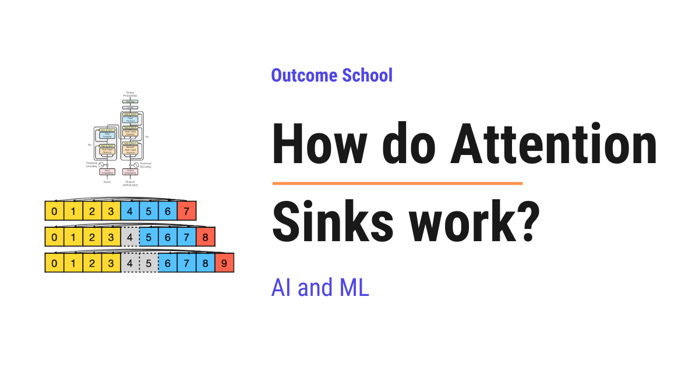

# How do Attention Sinks work?

> Archived from <https://outcomeschool.com/blog/how-do-attention-sinks-work> on 2026-11-25.

Attention sinks are the first few tokens of the text that always get a huge share of the attention in a Large Language Model. If we keep these tokens while dropping the old ones, the model can handle very long conversations without breaking.

In this blog, we will learn about how attention sinks work in Large Language Models. We will also see why streaming long conversations becomes a problem, why the first tokens become a sink that the naive fix breaks, and how StreamingLLM uses attention sinks in the real world to keep models running.

We will cover the following:
<ul><li>What is a Large Language Model?</li><li>What is attention?</li><li>The problem of streaming with long conversations</li><li>The naive fix and why it fails</li><li>What is an attention sink?</li><li>Why the first tokens become a sink</li><li>A step-by-step numeric walkthrough</li><li>The fix in code</li><li>StreamingLLM and modern attention sinks</li><li>Importance of attention sinks</li></ul>
I am <strong>Amit Shekhar</strong>, Founder @ <a target="_blank" rel="noopener noreferrer" href="https://outcomeschool.com">Outcome School</a>, I have taught and mentored many developers, and their efforts landed them high-paying tech jobs, helped many tech companies in solving their unique problems, and created many open-source libraries being used by top companies. I am passionate about sharing knowledge through open-source, blogs, and videos.

I teach <a target="_blank" rel="noopener noreferrer" href="https://outcomeschool.com/program/ai-and-machine-learning">AI and Machine Learning</a> at Outcome School.

Let&#x27;s get started.
<h3 id="what-is-a-large-language-model">What is a Large Language Model?</h3>
Before jumping into attention sinks, we must know what a Large Language Model is.

A <strong>Large Language Model</strong> is an AI model that reads text and predicts the next word.

In simple words, it is a very good guessing machine. We give it some words, and it guesses the word that comes next. Then it adds that word and guesses again. It keeps doing this, one word at a time.

Let&#x27;s say we type &quot;The sky is&quot;. The model guesses &quot;blue&quot;. Now the text becomes &quot;The sky is blue&quot;. The model reads all of it again and guesses the next word. This is how a model like ChatGPT writes long answers, one word after another.

<strong>Note:</strong> The model actually works with small pieces of words called <strong><a target="_blank" rel="noopener noreferrer" href="tokenization-in-llms.md">tokens</a></strong>. A token can be a full word, a part of a word, or even a single letter. For the sake of understanding, we can think of a token as a word.

This is how a Large Language Model works. Now, let&#x27;s understand attention.
<h3 id="what-is-attention">What is attention?</h3>
When the model guesses the next word, it does not look at all the past words equally. Some past words matter more than others.

<strong><a target="_blank" rel="noopener noreferrer" href="self-attention-in-transformers.md">Attention</a></strong> is the method the model uses to decide which earlier words to focus on while guessing the next word.

In simple words, attention is like focus. When we read a sentence, we focus on the important words and ignore the rest. The model does the same thing.

Let&#x27;s say we have the sentence &quot;Amit kept his keys on the table, and later he could not find them.&quot;

To understand the word &quot;them&quot;, the model must focus back on the word &quot;keys&quot;. That focusing is attention. The model gives a high score to &quot;keys&quot; and low scores to the other words.

So, attention is just a set of scores. Each past word gets a score that says how important it is for the current word. A high score means high focus. A low score means low focus.

One very important rule: all these scores must add up to 1. This is like sharing one full pie among all the past words. If one word takes a big slice, the others get smaller slices. The model is forced to give away the full pie every single time.

This is how attention works. Now, let&#x27;s see the problem that creates the need for attention sinks.
<h3 id="the-problem-of-streaming-with-long-conversations">The problem of streaming with long conversations</h3>
Suppose we are building a chatbot. We want to talk to it for hours and hours without restarting it. The conversation keeps growing longer and longer.

Here is the catch. The model has a limit on how many words it can hold in its memory at once. We call this the <strong><a target="_blank" rel="noopener noreferrer" href="context-window.md">context window</a></strong>.

In simple words, the context window is the size of the model&#x27;s short-term memory. If the limit is 4000 words, the model can only keep the last 4000 words in mind.

When the conversation crosses this limit, we have a problem. We must remove some old words to make room for new ones. If we do not remove them, the model runs out of memory and slows down or crashes.

We have a detailed blog on <a target="_blank" rel="noopener noreferrer" href="kv-cache-in-llms.md">KV Cache in LLMs</a> that explains why this memory keeps growing with every new word.

<strong>Planning your move into AI?</strong>

No matter which tech domain you work in today, with your effort, you can transition to these roles:
<ul><li>AI Engineer</li><li>Forward Deployed Engineer</li><li>AI Agent Engineer</li><li>Harness Engineer</li><li>Voice AI Engineer</li><li>AI Architect</li><li>LLM Engineer</li><li>LLM Inference Engineer</li><li>Gen AI Engineer</li><li>MLOps Engineer</li><li>ML Engineer</li><li>Deep Learning Engineer</li></ul>
Our <a target="_blank" rel="noopener noreferrer" href="https://outcomeschool.com/program/ai-and-machine-learning">AI and Machine Learning Program</a> at Outcome School takes you there.

So, the question is: which old words do we throw away?
<h3 id="the-naive-fix-and-why-it-fails">The naive fix and why it fails</h3>
The most obvious idea is simple. When memory is full, throw away the oldest words and keep only the most recent ones. This is called a <strong><a target="_blank" rel="noopener noreferrer" href="how-does-sliding-window-attention-work.md">sliding window</a></strong>.

In simple words, a sliding window keeps a window of recent words and lets the old ones fall off the back, like a moving train window where old scenery slides away.

Let&#x27;s say the window holds 4 words. The conversation is:

<pre><code class="language-text code-highlight">Word1 Word2 Word3 Word4 Word5 Word6
</code></pre>

When Word5 arrives, we drop Word1. When Word6 arrives, we drop Word2. We always keep the latest 4 words.

Let&#x27;s visualize this as below:

<pre><code class="language-text code-highlight">Window holds 4 words. New words enter on the right.

Start:     [ Word1 Word2 Word3 Word4 ]
                ^
                first word

Word5 in:  Word1 dropped
           [ Word2 Word3 Word4 Word5 ]

Word6 in:  Word2 dropped
           [ Word3 Word4 Word5 Word6 ]
</code></pre>

Here, we can see that the oldest word falls off the left every time a new word enters on the right. Word1, the very first word, is the first one to be thrown away.

This sounds perfect. But when researchers tried it, something strange happened. The moment the very first words were dropped, the model broke down. Its answers turned into complete nonsense. The quality fell off a cliff.

This was very surprising. The first words were old chit-chat from hours ago. They had nothing to do with the current topic. So why did dropping them destroy the model?

The issue with this approach is that those first words were secretly doing an important job. Let&#x27;s see how the next idea explains and solves this issue.
<h3 id="what-is-an-attention-sink">What is an attention sink?</h3>
When researchers studied the attention scores, they found a clear pattern. The first few words of the text were always getting a huge share of the attention, no matter what the current word was.

This is the discovery. The model dumps a lot of its attention onto the first few tokens. These tokens are called <strong>attention sinks</strong>.

Let&#x27;s break the name down for the sake of understanding.

<strong>Attention Sink = Attention + Sink</strong>

A sink is the drain in a kitchen where extra water flows away. An attention sink is the place where extra attention flows away. The first tokens act like a drain that soaks up the leftover focus.

We can picture the flow as below:

<pre><code class="language-text code-highlight">Full pie of attention (must add up to 1.0)
     |
     | useful focus            leftover focus
     |    |                         |
     v    v                         v
  +-----------+              +--------------+
  | important |              | first token  |
  |   words   |              | (the sink)   |
  +-----------+              +--------------+
                                   |
                                   v
                            extra attention
                            drains away here
</code></pre>

Here, we can see that the model splits its full pie into two parts. The useful focus goes to the important words, and the leftover focus drains away onto the first token, the sink. Nothing is lost, because the drain always has room for the extra.

In simple words, an attention sink is a token that the model uses as a dumping ground for attention it does not need anywhere else.

Now we understand why the sliding window failed. When we dropped the first words, we dropped the drain itself. The leftover attention had nowhere to go, so the whole system broke.

This is the heart of the topic. Now, let&#x27;s understand why the first tokens become this drain.

To learn the Attention Mechanism, Self-Attention, and LLM Internals, and to build a Large Language Model (LLM) from scratch, check out our <a target="_blank" rel="noopener noreferrer" href="https://outcomeschool.com/program/ai-and-machine-learning">AI and Machine Learning Program</a> at Outcome School.
<h3 id="why-the-first-tokens-become-a-sink">Why the first tokens become a sink</h3>
Remember the rule from before. All attention scores must add up to 1. The model is forced to give away the full pie on every single word.

But here is the real situation. Many times, the current word does not actually need to focus on anything. It already has enough information by itself.

Let&#x27;s say the model is processing a simple word that needs no past context. The model still has a full pie of attention to give away. It cannot keep any for itself. It must put the slices somewhere.

So, the model needs a safe drain. It needs a token that it can dump extra attention onto without changing the meaning of anything.

Which token makes the safest drain? The first token. Every word in the text can always see the first token, because the first token is always there from the very beginning. It is visible to everyone. This makes it the perfect common drain.

We have a detailed blog on <a target="_blank" rel="noopener noreferrer" href="causal-masking-in-attention.md">Causal Masking in Attention</a> that explains how a token is blocked from looking forward, which is what keeps the first token visible to every other token.

So, the model learns a habit. When in doubt, dump the extra attention on the first token. This is why the first tokens become attention sinks.

<strong>A quick note for you</strong>

No matter which tech domain you work in, get familiar with these topics:
<ul><li>LLM</li><li>RAG</li><li>MCP</li><li>Agent</li><li>Fine-tuning</li><li>Quantization</li></ul>
We put it all together in one video:

<a target="_blank" rel="noopener noreferrer" href="https://www.youtube.com/watch?v=lnfWvX66FUk">AI Engineering Explained: LLM, RAG, MCP, Agent, Fine-Tuning, and Quantization</a>

No need to stop reading - bookmark it and watch later when you get time. Future you will thank you.

Now, let&#x27;s get back to the topic.

This is how and why attention sinks form. Now, let&#x27;s see this with real numbers.
<h3 id="a-step-by-step-numeric-walkthrough">A step-by-step numeric walkthrough</h3>
Learning by example is the best way to learn. Let&#x27;s take a tiny example with 4 words and follow the attention pie.

Assume that we are processing the 4th word. The model has to spread its full pie of attention (a total of 1.0) across the words it can see.

<strong>Step 1:</strong> The current word truly cares only about Word3. So Word3 deserves a big slice.

<strong>Step 2:</strong> But the full pie must add up to 1.0. After giving Word3 its fair share, there is leftover attention that nothing really needs.

<strong>Step 3:</strong> The model dumps that leftover onto Word1, the sink.

The scores look like below:

<pre><code class="language-text code-highlight">Word1 (the sink): 0.55
Word2:            0.02
Word3:            0.40
Word4 (current):  0.03
Total:            1.00
</code></pre>

Here, we can see that Word1 grabbed 0.55, which is more than half the pie, even though it is old chit-chat. Word3, the word that actually matters, got 0.40. The rest is tiny leftovers.

Now, suppose we run the naive sliding window and drop Word1 to save memory. The 0.55 slice that used to go to the sink now has nowhere to go. The model is still forced to make the pie add up to 1.0, so it spreads that 0.55 across the remaining words by force.

The new, broken scores:

<pre><code class="language-text code-highlight">Word2: 0.10
Word3: 0.80
Word4: 0.10
Total: 1.00
</code></pre>

Here, we can notice that Word3 was wrongly pumped up from 0.40 to 0.80. Every other word also got distorted. The model&#x27;s focus is now completely wrong, so its next guess turns into nonsense.

This is exactly why dropping the first token destroys the model. The drain is gone, and the dirty water spills everywhere. Now, let&#x27;s see the fix.
<h3 id="the-fix-in-code">The fix in code</h3>
So, here comes the simple fix to the rescue. The idea is easy. When we slide the window to save memory, we must always keep the first few sink tokens and never drop them.

In simple words, keep the drain and slide the rest.

The structure looks like below:

<pre><code class="language-text code-highlight">Full conversation:
  Word1 Word2 Word3 ...  Word97 Word98 Word99 Word100
  ^^^^^                          ^^^^^^^^^^^^^^^^^^^^^
  sinks                          recent window

Broken version (sinks dropped):
  [ Word97 Word98 Word99 Word100 ]
  no drain -&gt; attention spills -&gt; nonsense

Fixed version (sinks kept):
  [ Word1 ] + [ Word97 Word98 Word99 Word100 ]
    keep        keep recent
    drain
  middle is thrown away
</code></pre>

Here, we can see that the broken version keeps only the recent words and loses the drain. The fixed version keeps the first sink tokens, joins them with the recent window, and throws away only the middle. The drain stays, so the leftover attention always has a home.

Let&#x27;s see the code for a normal sliding window first, the broken version:

<pre><code class="code-highlight language-python">def naive_sliding_window(tokens, window_size):
    # keep only the most recent words
    return tokens[-window_size:]
</code></pre>

Here, we have kept only the last <code>window_size</code> words. This drops the first tokens, which means we drop the sink. This is the version that breaks.

Now, our updated code that keeps the sink:

<pre><code class="code-highlight language-python">def streaming_window(tokens, num_sinks, window_size):
    # always keep the first few sink tokens
    sinks = tokens[:num_sinks]
    # keep the most recent words
    recent = tokens[-window_size:]
    return sinks + recent
</code></pre>

Here, we can see what we have done:
<ul><li>We keep <code>num_sinks</code> tokens from the very start. These are the attention sinks, the drain.</li><li>We keep the recent <code>window_size</code> tokens, which hold the current topic.</li><li>We join them together and throw away only the middle.</li></ul>
The drain stays in place. The leftover attention always has a home. The model keeps working perfectly even after hours of conversation. The problem is solved.

<strong>Note:</strong> Researchers found that keeping just the first 4 tokens as sinks is usually enough to keep the model stable.

This is how the fix works in practice. Now, let&#x27;s learn about the method that made this popular.

If we want to go deep into KV Cache, Paged Attention, and LLM Inference Engineering, we cover all of it end to end in our <a target="_blank" rel="noopener noreferrer" href="https://outcomeschool.com/program/ai-and-machine-learning">AI and Machine Learning Program</a> at Outcome School.
<h3 id="streamingllm-and-modern-attention-sinks">StreamingLLM and modern attention sinks</h3>
The idea of keeping the sink tokens was introduced in a method called <strong>StreamingLLM</strong>.

In simple words, StreamingLLM is a technique that lets a model keep talking forever without its answers turning into nonsense. It keeps a few sink tokens plus a sliding window of recent tokens, exactly like the code we just saw.

With this trick, a model can handle millions of words of conversation while using only a small, fixed amount of memory. It never crashes and never turns to nonsense. Keeping only the sinks plus a recent window is a form of token eviction, one of the <a target="_blank" rel="noopener noreferrer" href="kv-cache-compression.md">KV Cache Compression</a> techniques that keep this memory small.

There is one more step forward. Some newer models add a special, dedicated sink token on purpose. It is a built-in drain that the model is trained to dump extra attention onto. This is sometimes called a <strong>learnable attention sink</strong>, and <a target="_blank" rel="noopener noreferrer" href="decoding-deepseek-v4.md">DeepSeek-V4</a> uses learnable sinks in exactly this way.

In simple words, instead of borrowing the first real word as a drain, the model gets its own private drain that holds no meaning. This is even cleaner, because the drain is no longer mixed up with a real word.

So, modern models do not rely on luck. They build the drain into the design from day one. This is how attention sinks moved from a surprising discovery to a planned feature.

<strong>Stay updated:</strong> Subscribe to our <a target="_blank" rel="noopener noreferrer" href="https://outcomeschool.substack.com/subscribe">newsletter</a> to get our latest AI and Machine Learning blogs straight to your inbox.
<h3 id="importance-of-attention-sinks">Importance of attention sinks</h3>
Now, we have understood attention sinks fully. Let&#x27;s see why they are important.
<ul><li>They let chatbots run long conversations without slowing down or breaking.</li><li>They keep memory usage small and fixed, even for endless chats.</li><li>They explain a strange behavior that confused researchers for a long time.</li><li>They turned a hidden quirk of the model into a useful design tool.</li></ul>
The big lesson is beautiful in its simplicity. The model needed a safe place to throw away the attention it could not use. It quietly chose the first token as that place. Once we understood this, we just had to protect that place, and everything worked.

This way we can use attention sinks to solve the interesting problem of running Large Language Models forever without losing quality.
<h2 id="frequently-asked-questions">Frequently Asked Questions</h2><h3 id="do-attention-sink-tokens-carry-important-meaning">Do attention sink tokens carry important meaning?</h3>
Not necessarily. The first tokens can be old chit-chat that has nothing to do with the current topic. They become sinks because every word in the text can always see the first token, so the model learns to use it as a safe drain for the attention it does not need anywhere else.
<h3 id="why-cant-the-model-just-give-less-attention-when-it-needs-nothing">Why can&#x27;t the model just give less attention when it needs nothing?</h3>
Because all attention scores must add up to 1. The model is forced to give away the full pie of attention on every single word, even when the current word does not need to focus on anything. So, it needs a safe place to put the leftover slices, and the first token becomes that place.
<h3 id="how-many-sink-tokens-should-we-keep-in-a-streaming-window">How many sink tokens should we keep in a streaming window?</h3>
Keeping just the first 4 tokens as sinks is usually enough to keep the model stable. We join these sink tokens with a sliding window of recent tokens and throw away only the middle. This way, the leftover attention always has a home.
<h3 id="does-streamingllm-use-more-memory-as-the-conversation-grows">Does StreamingLLM use more memory as the conversation grows?</h3>
No. StreamingLLM keeps a few sink tokens plus a sliding window of recent tokens, so it uses only a small, fixed amount of memory. With this, a model can handle millions of words of conversation without crashing or turning to nonsense.
<h3 id="what-is-the-difference-between-the-first-token-sink-and-a-learnable-attention-sink">What is the difference between the first-token sink and a learnable attention sink?</h3>
A learnable attention sink is a special, dedicated token that the model is trained to dump extra attention onto. Instead of borrowing the first real word as a drain, the model gets its own private drain that holds no meaning. This is even cleaner, because the drain is no longer mixed up with a real word.

That&#x27;s it for now.

Thanks

<strong>Amit Shekhar</strong> Founder @ <a target="_blank" rel="noopener noreferrer" href="https://outcomeschool.com">Outcome School</a>

You can connect with me on:
<ul><li><a target="_blank" rel="noopener noreferrer" href="https://x.com/amitiitbhu">X</a></li><li><a target="_blank" rel="noopener noreferrer" href="https://www.linkedin.com/in/amit-shekhar-iitbhu">LinkedIn</a></li><li><a target="_blank" rel="noopener noreferrer" href="https://github.com/amitshekhariitbhu">GitHub</a></li></ul>
Follow Outcome School on:
<ul><li><a target="_blank" rel="noopener noreferrer" href="https://x.com/outcome_school">X</a></li><li><a target="_blank" rel="noopener noreferrer" href="https://youtube.com/@OutcomeSchool">YouTube</a></li><li><a target="_blank" rel="noopener noreferrer" href="https://www.linkedin.com/company/outcomeschool">LinkedIn</a></li><li><a target="_blank" rel="noopener noreferrer" href="http://github.com/OutcomeSchool">GitHub</a></li></ul>
<a target="_blank" rel="noopener noreferrer" href="https://outcomeschool.com/blog"><strong>Read all of our high-quality blogs here.</strong></a>

