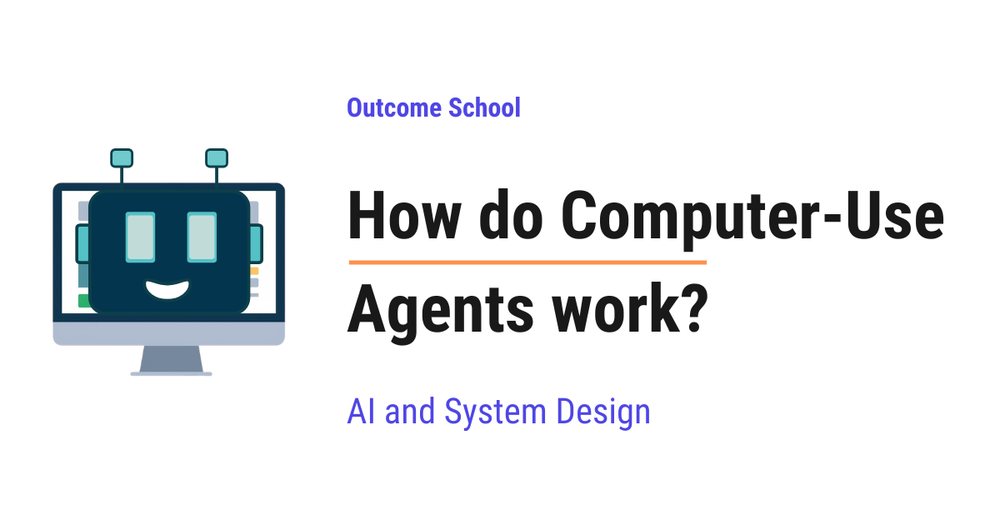

# How do Computer-Use Agents work?

> Archived from <https://outcomeschool.com/blog/how-do-computer-use-agents-work> on 2026-11-25.

A computer-use agent is an AI program that can operate a computer the way a human does. It looks at the screen, moves the mouse, clicks buttons, and types on the keyboard to complete the goal we give it.

In this blog, we will learn about how computer-use agents work.

We will cover the following:
<ul><li>What is a computer-use agent?</li><li>Why do we need a computer-use agent?</li><li>The perceive, think, act loop</li><li>How does the agent see the screen?</li><li>How does the agent decide what to do?</li><li>How does the agent take actions?</li><li>A step-by-step walkthrough with an example</li><li>The system prompt and tools</li><li>Safety and guardrails</li><li>Limitations of computer-use agents</li><li>Conclusion</li></ul>
I am <strong>Amit Shekhar</strong>, Founder @ <a target="_blank" rel="noopener noreferrer" href="https://outcomeschool.com">Outcome School</a>, I have taught and mentored many developers, and their efforts landed them high-paying tech jobs, helped many tech companies in solving their unique problems, and created many open-source libraries being used by top companies. I am passionate about sharing knowledge through open-source, blogs, and videos.

I teach <a target="_blank" rel="noopener noreferrer" href="https://outcomeschool.com/program/ai-and-machine-learning">AI and Machine Learning</a> at Outcome School.

Let&#x27;s get started.
<h3 id="what-is-a-computer-use-agent">What is a computer-use agent?</h3>
A <strong>computer-use agent</strong> is an AI program that can operate a computer the way a human does. It looks at the screen, moves the mouse, clicks buttons, and types on the keyboard.

In simple words, we give it a goal in plain language, and it uses the computer to complete that goal.

Let&#x27;s decompose the name to make it clear:
<blockquote>
Computer-Use Agent = Computer + Use + Agent
</blockquote><ul><li><strong>Computer</strong> is the machine with a screen, a mouse, and a keyboard.</li><li><strong>Use</strong> means it actually operates that machine, just like we do.</li><li><strong>Agent</strong> means it acts on its own to reach a goal, step by step, without us guiding every click.</li></ul>
So, a computer-use agent is an AI that uses a computer on our behalf to get a task done.

Let&#x27;s say we tell it, &quot;Open the browser and book a table for two at 7 PM.&quot; The agent will find the browser icon, click it, type the website address, fill the form, and click the book button. We did not write any code for these clicks. We only gave the goal in plain words.

We have a detailed blog on <a target="_blank" rel="noopener noreferrer" href="ai-agent.md">AI Agent Explained</a> that covers what an AI agent is from the ground up.
<h3 id="why-do-we-need-a-computer-use-agent">Why do we need a computer-use agent?</h3>
Before computer-use agents, automating a task on a computer was hard for us.

Let&#x27;s say we wanted a program to book that table automatically. We had two old approaches, and both had problems.

<strong>Approach 1: Write a script for every step.</strong>

We write code that says click here, type this, click there. This works only if the screen never changes. The moment the website changes its design, the script breaks. The button moves, and our code clicks the wrong place.

The issue with this approach is that it is fragile and breaks easily. Let&#x27;s see how the next approach solve this issue.

<strong>Approach 2: Use a special connection called an API.</strong>

An <strong>API</strong> is a direct doorway that a website or app provides for programs to talk to it. It is reliable and fast. But, here is the catch. Not every website or app gives us this doorway.

The issue with this approach is that most apps do not offer this doorway. So, we are stuck for those apps.

So, here comes the computer-use agent to the rescue.

The computer-use agent does not need a special doorway. It uses the same screen, mouse, and keyboard that we use. If a human can do the task by looking at the screen, the agent can do it too. This is the big idea, and it makes our life easy.

For the apps that do give us that doorway, an open standard called MCP now gives the model one common way to reach them, which stays far more reliable than clicking through a screen. We have a detailed blog on <a target="_blank" rel="noopener noreferrer" href="what-is-mcp-model-context-protocol.md">What is MCP (Model Context Protocol)?</a> that explains this in depth.
<h3 id="the-perceive-think-act-loop">The perceive, think, act loop</h3>
Every computer-use agent runs on one simple cycle. We can call it the <a target="_blank" rel="noopener noreferrer" href="ai-agent-loop.md"><strong>perceive, think, act loop</strong></a>.

In simple words, the agent keeps repeating three steps until the task is done:
<ul><li><strong>Perceive:</strong> Look at the current screen.</li><li><strong>Think:</strong> Decide the next single action.</li><li><strong>Act:</strong> Perform that action on the computer.</li></ul>
After acting, the screen changes. So, the agent looks again, thinks again, and acts again. The loop continues until the goal is reached. Do not worry, we will learn about each of these three steps in detail.

We can picture the flow as below:

<pre><code class="language-text code-highlight">        +-----------------------------+
        |                             |
        v                             |
   +----------+   +---------+   +----------+
   | Perceive |--&gt;|  Think  |--&gt;|   Act    |
   | (see the |   | (decide |   | (click,  |
   |  screen) |   |  next   |   |  type,   |
   |          |   | action) |   |  scroll) |
   +----------+   +---------+   +----------+
        ^                             |
        |     screen changes,         |
        +-----so look again ----------+

   The loop repeats until the goal is reached.
</code></pre>

Here, we can see that the three steps form a circle. The agent moves from <code>Perceive</code> to <code>Think</code> to <code>Act</code>, and then the screen changes, so it goes back to <code>Perceive</code> and starts the next round. The loop keeps spinning until the goal is reached.

Let&#x27;s understand this loop with a simple analogy.

Consider a person playing a video game. The person looks at the screen, decides to jump, and presses the jump button. The screen updates, so the person looks again and decides the next move. A computer-use agent works exactly like this person.

Let me tabulate the loop against the human player for your better understanding.
<table><thead><tr><th>Step</th><th>Human Player</th><th>Computer-Use Agent</th></tr></thead><tbody><tr><td>Perceive</td><td>Eyes look at the screen</td><td>Takes a screenshot of the screen</td></tr><tr><td>Think</td><td>Brain decides the next move</td><td>The AI model decides the next action</td></tr><tr><td>Act</td><td>Hand presses the button</td><td>Sends a click or keystroke to the computer</td></tr></tbody></table>
<strong>Planning your move into AI?</strong>

No matter which tech domain you work in today, with your effort, you can transition to these roles:
<ul><li>AI Engineer</li><li>Forward Deployed Engineer</li><li>AI Agent Engineer</li><li>Harness Engineer</li><li>Voice AI Engineer</li><li>AI Architect</li><li>LLM Engineer</li><li>LLM Inference Engineer</li><li>Gen AI Engineer</li><li>MLOps Engineer</li><li>ML Engineer</li><li>Deep Learning Engineer</li></ul>
Our <a target="_blank" rel="noopener noreferrer" href="https://outcomeschool.com/program/ai-and-machine-learning">AI and Machine Learning Program</a> at Outcome School takes you there.

Now, we have understood the core loop. Let&#x27;s understand each of these three steps in detail.
<h3 id="how-does-the-agent-see-the-screen">How does the agent see the screen?</h3>
The agent cannot see the screen the way we do with our eyes. So, the system takes a <strong>screenshot</strong>, which is a picture of the current screen, and sends it to the AI model.

In simple words, the screenshot is the eyes of the agent.

The AI model used here is a <a target="_blank" rel="noopener noreferrer" href="multimodal-ai.md"><strong>vision model</strong></a>. A vision model can look at an image and understand what is inside it. It can read the text on the screen, find the buttons, and understand the layout.

But, here is the catch. The model needs to know the exact position of things on the screen to click them.

A screen is measured in <strong>pixels</strong>, which are the tiny dots that make up the picture. Every spot on the screen has an address written as two numbers, the horizontal position and the vertical position. We write this address as <code>(x, y)</code>.

So, when the model looks at the screenshot, it finds the button and reports its address, for example <code>(640, 400)</code>. This address tells the computer exactly where to click.

Let&#x27;s visualize this as below:

<pre><code class="language-text code-highlight">   Screen (measured in pixels)

   (0,0)                              (1280,0)
     +------------------------------------+
     |                                    |
     |          +-------------+           |
     |          |   Search    | &lt;-- button at (640, 400)
     |          +-------------+           |
     |                                    |
     |  [browser]                         |
     |   icon at (50, 760)                |
     +------------------------------------+
   (0,800)                          (1280,800)

   x grows to the right --&gt;
   y grows downward     v
</code></pre>

Here, we can see that every spot on the screen has an address written as <code>(x, y)</code>. The <code>x</code> value grows as we move to the right, and the <code>y</code> value grows as we move downward. The model reads the screenshot, finds the <code>Search</code> button, and reports its address as <code>(640, 400)</code> so the computer knows exactly where to click.

Some agents also read a hidden text list of everything on the screen, called the <strong>accessibility tree</strong>. In simple words, it is a plain list that says, &quot;There is a button named Search at this position.&quot; This helps the agent find buttons without guessing. Many agents use both the screenshot and this list together.

This is how the agent sees and locates things on the screen.

If we want to go deep into how a single model reads an image and reasons over it in words - Multimodal AI and LLM Fundamentals - we cover it in depth in our <a target="_blank" rel="noopener noreferrer" href="https://outcomeschool.com/program/ai-and-machine-learning">AI and Machine Learning Program</a> at Outcome School.
<h3 id="how-does-the-agent-decide-what-to-do">How does the agent decide what to do?</h3>
Now that the agent can see, it must decide the next action. This is the <strong>think</strong> step.

Here, a special kind of AI model comes into the picture. It is built on a <strong>Large Language Model</strong>, which is an AI trained to understand language and reason about it. We join this language ability with the vision model from the previous step. So, the same model can both see the screen and reason about the next step in words.

We give the model three things:
<ul><li><strong>The goal:</strong> what we want, in plain language.</li><li><strong>The current screenshot:</strong> what the screen looks like right now.</li><li><strong>The history:</strong> the actions already taken so far.</li></ul>
The model looks at all three and answers one question, &quot;What is the single next action that moves me closer to the goal?&quot;

The model thinks like this, &quot;The goal is to book a table. The screen shows a browser. The browser is closed. So, my next action is to click the browser icon at <code>(50, 760)</code>.&quot;

The model does not decide all steps at once. It decides only the next step. This is important. Because after the action, the screen changes, and the new screenshot may be different from what the model expected. So, deciding one step at a time keeps the agent flexible.

This is how the agent thinks.
<h3 id="how-does-the-agent-take-actions">How does the agent take actions?</h3>
Now we reach the <strong>act</strong> step. The model has decided an action in words. But words alone cannot click a mouse. So, the system translates the model&#x27;s decision into a real command for the computer.

The agent can perform a small set of basic actions. These are the same actions we perform every day:
<ul><li><code>click(x, y)</code> to click at a position.</li><li><code>type(&quot;some text&quot;)</code> to type text.</li><li><code>scroll(direction)</code> to scroll the page up or down.</li><li><code>key(&quot;Enter&quot;)</code> to press a special key.</li><li><code>screenshot()</code> to take a fresh picture of the screen.</li></ul>
The model outputs its choice in a clean, structured form so the system can read it easily. This form is called <strong>JSON</strong>, which is just a simple way of writing data using labels and values so a program can understand it. Let&#x27;s see an example of what the model returns as below:

<pre><code class="code-highlight language-json">{
  &quot;reasoning&quot;: &quot;The browser is closed. I will open it first.&quot;,
  &quot;action&quot;: &quot;click&quot;,
  &quot;x&quot;: 50,
  &quot;y&quot;: 760
}
</code></pre>

Here, we can see that the model returned three useful things. The <code>reasoning</code> explains why it chose this action, which helps us trust it. The <code>action</code> is <code>click</code>. The <code>x</code> and <code>y</code> are the address on the screen where the click must happen.

The system reads this and performs a real mouse click at <code>(50, 760)</code>. The browser opens, a new screenshot is taken, and the loop continues.

This is how the agent turns a decision into a real action on the computer.

<strong>A quick note for you</strong>

No matter which tech domain you work in, get familiar with these topics:
<ul><li>LLM</li><li>RAG</li><li>MCP</li><li>Agent</li><li>Fine-tuning</li><li>Quantization</li></ul>
We put it all together in one video:

<a target="_blank" rel="noopener noreferrer" href="https://www.youtube.com/watch?v=lnfWvX66FUk">AI Engineering Explained: LLM, RAG, MCP, Agent, Fine-Tuning, and Quantization</a>

No need to stop reading - bookmark it and watch later when you get time. Future you will thank you.

Now, let&#x27;s get back to the topic.
<h3 id="a-step-by-step-walkthrough-with-an-example">A step-by-step walkthrough with an example</h3>
The best way to learn this is by taking an example. Let&#x27;s say our goal is, &quot;Search for the weather in London.&quot;

Let&#x27;s walk through the loop step by step.

<strong>Step 1:</strong> The system takes a screenshot. The screen shows a desktop with a browser icon. The model thinks, &quot;I need a browser. I will click the browser icon.&quot; It returns a click action at the icon position. The system clicks. The browser opens.

<strong>Step 2:</strong> A new screenshot is taken. The model sees an empty browser with an address bar. It thinks, &quot;I will click the address bar first.&quot; It returns a click on the address bar. The system clicks.

<strong>Step 3:</strong> A new screenshot is taken. The address bar is now active. The model thinks, &quot;Now I will type the search.&quot; It returns a type action with the text <code>weather in London</code>. The system types it.

<strong>Step 4:</strong> A new screenshot is taken. The text is in the bar. The model thinks, &quot;Now I will press Enter to search.&quot; It returns a key action for <code>Enter</code>. The system presses Enter.

<strong>Step 5:</strong> A new screenshot is taken. The search results show the weather of London. The model thinks, &quot;The goal is complete.&quot; So, it returns a done action and stops.

Let me show this as a small table so we can see the loop clearly.
<table><thead><tr><th>Step</th><th>What the model sees</th><th>Action taken</th></tr></thead><tbody><tr><td>1</td><td>Desktop with browser icon</td><td>Click the browser icon</td></tr><tr><td>2</td><td>Empty browser</td><td>Click the address bar</td></tr><tr><td>3</td><td>Active address bar</td><td>Type <code>weather in London</code></td></tr><tr><td>4</td><td>Text in the bar</td><td>Press <code>Enter</code></td></tr><tr><td>5</td><td>Weather results</td><td>Done</td></tr></tbody></table>
Here, we can notice the pattern. Look, decide one action, do it, look again. The agent never plans all five steps in advance. It reacts to each new screenshot. This is what makes it work even when the screen behaves in an unexpected way.

This way we can use the perceive, think, act loop to solve the interesting problem of operating any app.

<strong>Stay updated:</strong> Subscribe to our <a target="_blank" rel="noopener noreferrer" href="https://outcomeschool.substack.com/subscribe">newsletter</a> to get our latest AI and Machine Learning blogs straight to your inbox.
<h3 id="the-system-prompt-and-tools">The system prompt and tools</h3>
Now, the question is, how does the model know what actions it is allowed to take? The answer is the <a target="_blank" rel="noopener noreferrer" href="system-prompt.md"><strong>system prompt</strong></a> and the <a target="_blank" rel="noopener noreferrer" href="how-does-function-calling-work-in-llms.md"><strong>tools</strong></a>.

A <strong>system prompt</strong> is a set of starting instructions we give the model before the task begins. It tells the model who it is and how it must behave.

In simple words, the system prompt is the rulebook for the agent.

A simplified system prompt looks like below:

<pre><code class="language-text code-highlight">You are a computer-use agent.
You can see the screen through screenshots.
You can perform these actions: click, type, scroll, key, screenshot.
Always return one action at a time in JSON format.
Explain your reasoning before each action.
Stop when the goal is complete.
</code></pre>

Here, we have told the model three important things. We told it what it is, a computer-use agent. We told it the actions it is allowed to use. We told it the format to reply in, which is the structured JSON we saw earlier.

The list of allowed actions is often called the <strong>tools</strong> of the agent. A tool is simply one capability the agent can use, like clicking or typing. The model picks the right tool for each step.

This is how the model learns its role and its powers before it begins.

To master the system prompt, Tool use in Agents, Agent Architecture, and the ReAct Pattern - and to build an AI Coding Agent from scratch - check out our <a target="_blank" rel="noopener noreferrer" href="https://outcomeschool.com/program/ai-and-machine-learning">AI and Machine Learning Program</a> at Outcome School.
<h3 id="safety-and-guardrails">Safety and guardrails</h3>
A computer-use agent can do real things on a real computer. So, safety is very important.

Let&#x27;s say the agent is filling a form and reaches a button that says delete account. We do not want the agent to click it without our permission.

So, here comes the idea of <a target="_blank" rel="noopener noreferrer" href="how-do-llm-guardrails-work.md"><strong>guardrails</strong></a> to the rescue. A guardrail is a safety rule that stops the agent from doing dangerous actions on its own.

A few common guardrails:
<ul><li><strong>Human approval:</strong> For risky actions like payments or deleting data, the agent <a target="_blank" rel="noopener noreferrer" href="human-in-the-loop-agents.md">pauses and asks us first</a>.</li><li><strong>Blocked actions:</strong> Some actions, like changing system settings, are simply not allowed.</li><li><strong>Limited area:</strong> The agent often runs inside a safe, separate space so it cannot touch our important personal files.</li></ul>
These guardrails make sure the agent stays helpful and does not cause harm. We must always keep a human in control for sensitive tasks.
<h3 id="limitations-of-computer-use-agents">Limitations of computer-use agents</h3>
Now that we have learned how the agent works, it is time to understand its limits. Computer-use agents are powerful, but they are not perfect.
<ul><li><strong>They can be slow.</strong> Each step needs a screenshot and a model decision. Many steps mean many rounds, and that takes time.</li><li><strong>They can do mistakes.</strong> The model may misread the screen and click the wrong button.</li><li><strong>They can get stuck.</strong> If a screen looks confusing, the agent may keep trying the same action again and again.</li><li><strong>They cost more.</strong> Looking at images and reasoning at every step uses a lot of computing power.</li></ul>
This is why, for now, we use them mostly for tasks where a special doorway, the API, does not exist. When an API is available, we prefer it, because it is faster and more reliable.

When the whole task happens inside a web browser, a Browser Agent can also read the page structure and click each element by its number, instead of finding its position on a screenshot. We have a detailed blog on <a target="_blank" rel="noopener noreferrer" href="how-do-browser-agents-work.md">How do Browser Agents work?</a> that explains this step by step.

The technology is improving very fast. The agents are getting better at seeing the screen, deciding actions, and recovering from mistakes.
<h3 id="conclusion">Conclusion</h3>
Now we must have understood how computer-use agents work.

A computer-use agent looks at the screen, decides one action, and performs it, again and again, until the goal is reached. This is the perceive, think, act loop. It uses a vision model to see, a language model to reason, and a small set of actions like click and type to act.

The beauty of this idea is simple. If a human can do a task by looking at the screen and using the mouse and keyboard, the agent can do it too, without any special doorway into the app.
<h2 id="frequently-asked-questions">Frequently Asked Questions</h2><h3 id="should-we-use-a-computer-use-agent-or-an-api">Should we use a computer-use agent or an API?</h3>
When an API is available, we prefer the API, because it is faster and more reliable. Computer-use agents are slower, cost more, and can misread the screen. So, for now, we use them mostly for tasks where the app does not offer an API. For apps that do offer one, MCP gives the model one common way to reach them.
<h3 id="does-a-computer-use-agent-plan-all-the-steps-in-advance">Does a computer-use agent plan all the steps in advance?</h3>
No. The model decides only the single next action. After each action, the screen changes, and the new screenshot may be different from what the model expected. Deciding one step at a time keeps the agent flexible, so it works even when the screen behaves in an unexpected way.
<h3 id="why-is-a-computer-use-agent-better-than-a-click-script-when-a-website-changes">Why is a computer-use agent better than a click script when a website changes?</h3>
A click script only works if the screen never changes, so it breaks when the button moves. A computer-use agent looks at a fresh screenshot at every step, finds the button wherever it is, and then decides where to click. If a human can do the task by looking at the screen, the agent can do it too.
<h3 id="does-a-computer-use-agent-only-use-screenshots-to-see-the-screen">Does a computer-use agent only use screenshots to see the screen?</h3>
Not always. Some agents also read a hidden text list of everything on the screen, called the accessibility tree, which says things like &quot;There is a button named Search at this position.&quot; This helps the agent find buttons without guessing. Many agents use both the screenshot and this list together.
<h3 id="can-a-computer-use-agent-click-risky-buttons-like-delete-account-on-its-own">Can a computer-use agent click risky buttons like delete account on its own?</h3>
It should not, and guardrails stop it. For risky actions like payments or deleting data, the agent pauses and asks us first. Some actions are blocked entirely, and the agent often runs inside a safe, separate space so it cannot touch our important personal files.

That&#x27;s it for now.

Thanks

<strong>Amit Shekhar</strong> Founder @ <a target="_blank" rel="noopener noreferrer" href="https://outcomeschool.com">Outcome School</a>

You can connect with me on:
<ul><li><a target="_blank" rel="noopener noreferrer" href="https://x.com/amitiitbhu">X</a></li><li><a target="_blank" rel="noopener noreferrer" href="https://www.linkedin.com/in/amit-shekhar-iitbhu">LinkedIn</a></li><li><a target="_blank" rel="noopener noreferrer" href="https://github.com/amitshekhariitbhu">GitHub</a></li></ul>
Follow Outcome School on:
<ul><li><a target="_blank" rel="noopener noreferrer" href="https://x.com/outcome_school">X</a></li><li><a target="_blank" rel="noopener noreferrer" href="https://youtube.com/@OutcomeSchool">YouTube</a></li><li><a target="_blank" rel="noopener noreferrer" href="https://www.linkedin.com/company/outcomeschool">LinkedIn</a></li><li><a target="_blank" rel="noopener noreferrer" href="https://github.com/OutcomeSchool">GitHub</a></li></ul>
<a target="_blank" rel="noopener noreferrer" href="https://outcomeschool.com/blog"><strong>Read all of our high-quality blogs here.</strong></a>

