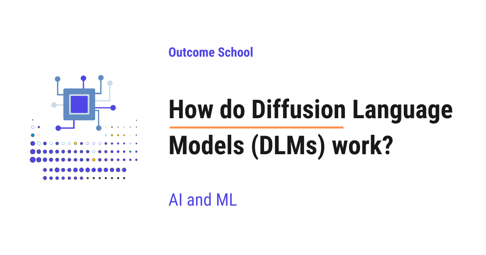

# How do Diffusion Language Models (DLMs) work?

> Archived from <https://outcomeschool.com/blog/how-do-diffusion-language-models-dlms-work> on 2026-11-25.

A Diffusion Language Model (DLM) is a type of AI model that writes text by starting from pure gibberish and slowly cleaning it up into a clear sentence. It does not write one word at a time from left to right like the usual LLMs.

In this blog, we will learn about Diffusion Language Models (DLMs), a new way to make models write text. They promise to generate words in a different way than the LLMs we use today, and that too much faster in many cases.

We will cover the following:
<ul><li>What is a Diffusion Language Model?</li><li>How do today&#x27;s language models write text?</li><li>The problem with the usual approach</li><li>Where the diffusion idea comes from</li><li>What does &quot;noise&quot; mean for text?</li><li>The two phases: forward and reverse</li><li>How a DLM actually generates text, step by step</li><li>A tiny end-to-end example</li><li>A simple code-style walk-through</li><li>DLMs vs the usual language models</li><li>Advantages of DLMs</li><li>Limitations of DLMs</li><li>The current state</li></ul>
I am <strong>Amit Shekhar</strong>, Founder @ <a target="_blank" rel="noopener noreferrer" href="https://outcomeschool.com">Outcome School</a>, I have taught and mentored many developers, and their efforts landed them high-paying tech jobs, helped many tech companies in solving their unique problems, and created many open-source libraries being used by top companies. I am passionate about sharing knowledge through open-source, blogs, and videos.

I teach <a target="_blank" rel="noopener noreferrer" href="https://outcomeschool.com/program/ai-and-machine-learning">AI and Machine Learning</a> at Outcome School.

Let&#x27;s get started.
<h3 id="what-is-a-diffusion-language-model">What is a Diffusion Language Model?</h3>
<strong>A Diffusion Language Model is a type of AI model that writes text by starting from a piece of pure gibberish and slowly cleaning it up into a clear, meaningful sentence.</strong>

In simple words, it does not write a sentence one word at a time from left to right. Instead, it starts with a rough, messy version of the whole sentence and then refines it again and again until it becomes correct.

Let&#x27;s understand the term: Diffusion

<strong>Diffusion</strong> is a word borrowed from nature. It means something spreading out and mixing, like a drop of ink slowly spreading into a glass of water until everything is blurry.

So, a Diffusion Language Model is a model that learns to take blurry, mixed-up text and turn it back into clean text.

Do not worry, we will learn about each part in detail.
<h3 id="how-do-todays-language-models-write-text">How do today&#x27;s language models write text?</h3>
Before jumping into diffusion, we must understand how the popular LLMs today write text. This will help us see why diffusion is interesting.

LLMs are built on an architecture called the <strong><a target="_blank" rel="noopener noreferrer" href="decoding-transformer-architecture.md">Transformer</a></strong>, which is just a powerful kind of AI brain that is very good at understanding language. These models write in a style called <a target="_blank" rel="noopener noreferrer" href="autoregressive-models.md"><strong>autoregressive</strong> generation</a>.

Let&#x27;s decompose that word:
<blockquote>
Autoregressive = Auto + Regressive
</blockquote>
In simple words, it means the model predicts the next word based on all the words that came before it. It writes one word, looks at everything written so far, then writes the next word, and keeps going.

Let&#x27;s say we ask the model to complete this sentence: &quot;The sky is&quot;.

The model writes one word at a time, like below:

<pre><code class="code-highlight">Step 1:  The sky is ___            -&gt;  picks &quot;blue&quot;
Step 2:  The sky is blue ___       -&gt;  picks &quot;and&quot;
Step 3:  The sky is blue and ___   -&gt;  picks &quot;clear&quot;
</code></pre>

Here, we can see that the model adds one word in each step. It can never pick the third word before it has picked the second word. Each word waits for the one before it.

This is how today&#x27;s language models write text. It works very well, and that is why it feel so natural.

If we want to understand how language models like this work under the hood, we build a Large Language Model (LLM) from scratch in our <a target="_blank" rel="noopener noreferrer" href="https://outcomeschool.com/program/ai-and-machine-learning">AI and Machine Learning Program</a> at Outcome School.
<h3 id="the-problem-with-the-usual-approach">The problem with the usual approach</h3>
Now, the question is: if this works so well, why do we need anything new?

The issue with this approach is <strong>speed</strong>. Because the model writes strictly one word after another, it cannot do them at the same time. If a sentence has 100 words, the model must take 100 turns, one after another. It cannot jump ahead.

Let&#x27;s say we are writing a long essay. Writing one word, waiting, then the next word, waiting, then the next, is slow. We are stuck in a single line, moving forward one step at a time. We cannot go back and fix an earlier word either, because we have already moved past it.

Now, the next big question is: what if a model could work on the whole sentence at once, fixing many words together instead of one at a time?

So, here comes the Diffusion Language Model to the rescue.
<h3 id="where-the-diffusion-idea-comes-from">Where the diffusion idea comes from</h3>
Before jumping into text, we must know where this idea was born.

The diffusion idea first became famous for creating images. Tools that turn a text prompt into a beautiful picture often use a method called <strong>diffusion</strong>.

Here is the simple idea behind <a target="_blank" rel="noopener noreferrer" href="diffusion-models.md">image diffusion</a>. We take a clear photo and slowly add random dots of noise to it, again and again, until the photo becomes complete static, like an old TV with no signal. Then we train a model to do the reverse: start from pure static and slowly remove the noise until a clear picture appears.

We can picture it like below:

<pre><code class="code-highlight">Clear image  -&gt;  add noise  -&gt;  more noise  -&gt;  pure static
                                                     |
                                                     v  (now reverse it)
Clear image  &lt;-  remove noise  &lt;-  less noise  &lt;-  pure static
</code></pre>

Here, we can see that the model learns to walk backward, from total mess to a clean image, one small cleanup step at a time.

Now, the next big question is: can we do the same thing for text instead of images? The answer is yes, and that is exactly what a Diffusion Language Model does.
<h3 id="what-does-noise-mean-for-text">What does &quot;noise&quot; mean for text?</h3>
For an image, adding noise was easy. We just add random dots to the pixels.

But text is different. A sentence is made of words, not pixels. We cannot add a &quot;half word&quot;. So we need a different idea of noise for text.

For text, <strong>noise means hiding or replacing words with a blank or a random word.</strong>

In simple words, to make a clean sentence noisy, we hide some of its words. The more words we hide, the noisier the sentence becomes. When every word is hidden, the sentence is pure noise. This is just like the ink drop spreading in water until everything is blurry.

Let&#x27;s say our clean sentence is &quot;The cat sat on the mat&quot;. We use the symbol <code>[?]</code> for a hidden word. Adding more and more noise looks like below:

<pre><code class="code-highlight">Clean:        The cat sat on the mat
A little noise: The cat [?] on the mat
More noise:     The [?] [?] on [?] mat
Pure noise:     [?] [?] [?] [?] [?] [?]
</code></pre>

Here, we can see that as we add more noise, more words turn into <code>[?]</code>. At the end, the whole sentence is just blanks. This blank-filled sentence is the text version of &quot;pure static&quot;.

This way of hiding words is called <strong>masking</strong>, and the hidden spot is called a <strong>mask</strong>. So, for text, adding noise simply means masking more words.

This is how we bring the idea of noise into the world of text. It makes our life easy, because hiding words is something a computer can do instantly.

<strong>Planning your move into AI?</strong>

No matter which tech domain you work in today, with your effort, you can transition to these roles:
<ul><li>AI Engineer</li><li>Forward Deployed Engineer</li><li>AI Agent Engineer</li><li>Harness Engineer</li><li>Voice AI Engineer</li><li>AI Architect</li><li>LLM Engineer</li><li>LLM Inference Engineer</li><li>Gen AI Engineer</li><li>MLOps Engineer</li><li>ML Engineer</li><li>Deep Learning Engineer</li></ul>
Our <a target="_blank" rel="noopener noreferrer" href="https://outcomeschool.com/program/ai-and-machine-learning">AI and Machine Learning Program</a> at Outcome School takes you there.
<h3 id="the-two-phases-forward-and-reverse">The two phases: forward and reverse</h3>
A Diffusion Language Model works in two phases. Let&#x27;s understand each one.

<strong>The forward phase (adding noise):</strong> This is the easy part, and it happens only during training. We take a clean sentence from our training data and slowly hide its words until the whole sentence is masked. We do not need any intelligence for this. We are just deleting words on purpose.

<strong>The reverse phase (removing noise):</strong> This is the hard part, and this is what the model actually learns. The model takes a masked sentence and tries to guess the hidden words to make it clean again. It does this again and again, filling in more words each time.

We can picture both phases like below:

<pre><code class="code-highlight">FORWARD (training only, just hide words)
The cat sat on the mat  -&gt;  The [?] sat on [?] mat  -&gt;  [?] [?] [?] [?] [?] [?]

REVERSE (what the model learns to do)
[?] [?] [?] [?] [?] [?]  -&gt;  The [?] sat on [?] mat  -&gt;  The cat sat on the mat
</code></pre>

Here, we can see that the forward phase destroys the sentence and the reverse phase rebuilds it. The model only needs to become very good at the reverse phase. The forward phase is just a teacher creating practice questions.

So, during training, we hide words and ask the model to guess them. By practicing on millions of sentences, the model gets very good at filling in blanks. This is how it learns. It is just like a student who keeps solving fill-in-the-blanks exercises until the answers come naturally.
<h3 id="how-a-dlm-actually-generates-text-step-by-step">How a DLM actually generates text, step by step</h3>
Now comes the most interesting part. Till now, we have learned how the model is trained. Now it&#x27;s time to learn how it writes a brand new sentence for us.

It starts with a sentence that is all blanks and refines it step by step. Let&#x27;s understand the full process.

<strong>Step 1: Start from pure noise.</strong> The model begins with a sentence where every word is masked. It is a blank canvas of <code>[?]</code> symbols.

<strong>Step 2: Guess all the words at once.</strong> Here is the beauty of it. Unlike the usual models, the DLM looks at every blank at the same time and makes a guess for each one in a single pass. It does not go left to right. It works on the whole sentence together.

<strong>Step 3: Keep the confident words, blank out the rest.</strong> Some guesses will be good and some will be shaky. The model keeps the words it is most confident about and turns the unsure ones back into <code>[?]</code>. This is the key trick that makes the result better over time. Do not worry, we will see this with a clear example soon.

<strong>Step 4: Repeat.</strong> The model looks at the partly-filled sentence and guesses the remaining blanks again, now with more context to help it. It keeps the confident ones and blanks the rest.

<strong>Step 5: Stop when nothing is masked.</strong> After a few rounds, there are no blanks left. The sentence is complete.

We can picture the whole generation like below:

<pre><code class="code-highlight">Round 1:  [?]  [?]  [?]  [?]  [?]      (start, all masked)
            |    |    |    |    |
            v    v    v    v    v       (guess all at once, keep the confident ones)
Round 2:  The  [?]  [?]   is  [?]
            |    |    |    |    |
            v    v    v    v    v       (guess the rest again)
Round 3:  The  food [?]   is good
            |    |    |    |    |
            v    v    v    v    v
Round 4:  The  food here  is good       (done, no blanks left)
</code></pre>

Here, we can see that the model fills in the easy, confident words first, like &quot;The&quot; and &quot;is&quot;. Then it uses those words as hints to fill in the harder words like &quot;food&quot;, &quot;here&quot;, and &quot;good&quot;. Step by step, the messy blank sentence becomes a clean, meaningful one.

This is how a Diffusion Language Model generates text. The big difference is that it can fix many words in parallel, instead of one at a time. It enables us to do complex things very simply.

<strong>A quick note for you</strong>

No matter which tech domain you work in, get familiar with these topics:
<ul><li>LLM</li><li>RAG</li><li>MCP</li><li>Agent</li><li>Fine-tuning</li><li>Quantization</li></ul>
We put it all together in one video:

<a target="_blank" rel="noopener noreferrer" href="https://www.youtube.com/watch?v=lnfWvX66FUk">AI Engineering Explained: LLM, RAG, MCP, Agent, Fine-Tuning, and Quantization</a>

No need to stop reading - bookmark it and watch later when you get time. Future you will thank you.

Now, let&#x27;s get back to the topic.
<h3 id="a-tiny-end-to-end-example">A tiny end-to-end example</h3>
The best way to learn this is by taking an example. Let&#x27;s say we ask the model to answer: &quot;What is the capital of France?&quot;

The model needs to produce a short answer of, let&#x27;s say, 4 word-slots. It starts with all of them masked.

<pre><code class="code-highlight">Question: What is the capital of France?
Answer slots:  [?]  [?]  [?]  [?]
</code></pre>

<strong>Round 1:</strong> The model guesses every slot at once. Suppose it produces:

<pre><code class="code-highlight">The   is   capital   Paris
</code></pre>

The model is very confident about &quot;Paris&quot; and fairly confident about &quot;The&quot;. It is unsure about &quot;is&quot; and &quot;capital&quot; in those spots. So it keeps the confident words and blanks the rest.

<pre><code class="code-highlight">The   [?]   [?]   Paris
</code></pre>

<strong>Round 2:</strong> Now the model looks at &quot;The [?] [?] Paris&quot; and guesses the two blanks again. With &quot;The&quot; and &quot;Paris&quot; already in place, the context is clearer. This time it produces:

<pre><code class="code-highlight">The   capital   is   Paris
</code></pre>

Here, we can see that the answer is now correct and complete. The model used the words it was sure about as anchors to figure out the rest.

So, in just two rounds, the model went from total blanks to a correct answer. This way we can use a Diffusion Language Model to write text by refining the whole sentence together.
<h3 id="a-simple-code-style-walk-through">A simple code-style walk-through</h3>
Now, let&#x27;s see this idea in a small, simplified code-style form using Python. This is just for the sake of understanding, not a real library. We can write it as below:

<pre><code class="code-highlight language-python"># A simplified view of how a DLM generates text

sentence = [&quot;[?]&quot;, &quot;[?]&quot;, &quot;[?]&quot;, &quot;[?]&quot;]   # start: everything masked

for current_round in range(num_rounds):
    # 1. Ask the model to guess EVERY position at once
    guesses, confidence = model.predict_all(sentence)

    # 2. Keep only the most confident guesses, mask the rest
    for i in range(len(sentence)):
        if confidence[i] &gt; threshold:
            sentence[i] = guesses[i]      # lock in this word
        else:
            sentence[i] = &quot;[?]&quot;           # send it back to be re-guessed

    # 3. Stop early if no masks are left
    if &quot;[?]&quot; not in sentence:
        break

print(sentence)   # the final clean sentence
</code></pre>

Here, we have written the core loop of a Diffusion Language Model. Let me explain each part.
<ul><li><code>sentence</code> starts as a list full of <code>[?]</code>, which means every position is masked.</li><li><code>model.predict_all(sentence)</code> is the key step. The model guesses all positions at the same time and also tells us how confident it is about each guess.</li><li>The <code>if confidence[i] &gt; threshold</code> check keeps the words the model is sure about and sends the unsure ones back to <code>[?]</code> to be guessed again next round. Here, <code>threshold</code> is just a confidence bar we set, for example &quot;only keep words the model is more than 90 percent sure about&quot;.</li><li>The loop repeats, and each round the sentence gets cleaner.</li><li>When there are no <code>[?]</code> left, we stop, and the sentence is ready.</li></ul>
Notice that there is no left-to-right loop here. The model works on the whole sentence in every round. This is the heart of the difference. Here, we can see that many words can be decided together.

<strong>Stay updated:</strong> Subscribe to our <a target="_blank" rel="noopener noreferrer" href="https://outcomeschool.substack.com/subscribe">newsletter</a> to get our latest AI and Machine Learning blogs straight to your inbox.
<h3 id="dlms-vs-the-usual-language-models">DLMs vs the usual language models</h3>
Now that we have learned how a DLM works, it&#x27;s time to compare it with the usual autoregressive models we discussed earlier.

The usual model is a <a target="_blank" rel="noopener noreferrer" href="encoder-vs-decoder-in-transformers.md">decoder-only</a> Transformer that writes left to right, one word at a time. The diffusion model fills the whole sentence and refines it over a few rounds. We can picture the contrast like below:

<pre><code class="code-highlight">Autoregressive (usual):                 Diffusion (DLM):

word1                                    [?] [?] [?] [?] [?]   (all at once)
word1 word2                                    |
word1 word2 word3                              v
word1 word2 word3 word4                  the [?] cat on mat   (refine)
... one new word each step                     |
                                               v
                                         the big cat on mat   (refine again)

one direction, one word per step         whole sentence, refined over rounds
</code></pre>

Here, we can see the core difference. The usual model takes as many steps as there are words. The diffusion model takes a small number of refinement rounds that does not grow with every extra word, and it works on many words together in each round.

Let me tabulate the differences between Autoregressive Models and Diffusion Language Models for your better understanding.
<table><thead><tr><th>Feature</th><th>Autoregressive Model</th><th>Diffusion Language Model</th></tr></thead><tbody><tr><td>Writing order</td><td>Left to right, one word at a time</td><td>Whole sentence at once, refined in rounds</td></tr><tr><td>Parallel work</td><td>No, each word waits for the previous</td><td>Yes, many words decided together</td></tr><tr><td>Number of steps</td><td>Equal to the number of words</td><td>A small number of rounds, not tied to the word count</td></tr><tr><td>Can revise earlier words</td><td>No, once written it stays</td><td>Yes, it can re-mask and fix words</td></tr></tbody></table>
One important thing to clear up: Diffusion Language Models (DLMs) often use a Transformer-based architecture internally, similar to the large language models. The difference is not the brain, it is the way the text is written. The usual model writes one word at a time, and the diffusion model fills and refines the whole sentence together.

We have a complete program on this - in our <a target="_blank" rel="noopener noreferrer" href="https://outcomeschool.com/program/ai-and-machine-learning">AI and Machine Learning Program</a> at Outcome School, we cover Autoregressive Models, Diffusion Models, and the rest of generative AI in depth.
<h3 id="advantages-of-dlms">Advantages of DLMs</h3><ul><li><strong>Speed through parallel work:</strong> Because the model decides many words together, it can produce text in far fewer steps than writing one word at a time. This can make generation much faster.</li><li><strong>It can fix its own mistakes:</strong> A word that was placed early can be sent back to <code>[?]</code> and corrected in a later round. The usual model cannot undo a word once it is written.</li><li><strong>Whole-sentence view:</strong> The model sees the entire sentence in every round, so a word near the end can influence a word near the start. This global view can help with consistency.</li><li><strong>Good control over the output:</strong> Since the model fills in blanks, it is naturally suited to tasks where we give a partial sentence and ask it to complete the missing parts.</li></ul><h3 id="limitations-of-dlms">Limitations of DLMs</h3><ul><li><strong>Choosing how many rounds is tricky:</strong> Too few rounds give messy text, and too many rounds slow things down. Finding the right balance takes care.</li><li><strong>Fixed length can be awkward:</strong> Many DLM setups need to know how many word-slots to fill ahead of time. The usual models can simply keep writing until they decide to stop, which feels more natural for open-ended writing.</li><li><strong>Less mature tooling:</strong> The usual autoregressive models have years of tuning, tools, and tricks behind them. DLMs are catching up but are still younger.</li><li><strong>Quality is still being proven:</strong> For some tasks, the very best autoregressive models are still ahead on quality, though the gap keeps shrinking.</li></ul>
So, DLMs are a promising direction, but they are still an active area of research.
<h3 id="the-current-state">The current state</h3>
Now, let&#x27;s discuss where things stand today, in 2026.

Diffusion for text started as a research idea, but it has moved quickly into real, working models. Researchers have built large diffusion-based language models that can chat, answer questions, and write code, and some of them run noticeably faster than the usual word-by-word models because of the parallel refinement.

A few important points about the current state:
<ul><li>Several real diffusion-style language models are now in use, and the main selling point is high speed. Their speed is measured in <strong>tokens</strong> per second, where a token is a small chunk of a word. For example, <strong>Mercury</strong> from Inception Labs can generate over a thousand tokens per second on a single chip, which is several times faster than the usual word-by-word models. Google has released <strong>DiffusionGemma</strong>, an open model that anyone can download and run, and it reaches a similar speed on a single chip. <strong>LLaDA</strong> is another popular open model that anyone can download and run.</li><li>Newer diffusion models can also <strong>reason</strong>. They no longer just write fast, they can solve hard math and coding problems too, which earlier diffusion models struggled with.</li><li>Many practical systems are <strong>hybrids</strong>. They borrow the strong Transformer brain from the usual models and add the diffusion-style refinement on top, so they get the best of both worlds. A common trick is to start from a normal trained model and then continue training it with the diffusion idea, instead of starting from scratch.</li></ul>
So, now we know where Diffusion Language Models fit and how they work.
<h2 id="frequently-asked-questions">Frequently Asked Questions</h2><h3 id="do-diffusion-language-models-use-a-transformer">Do Diffusion Language Models use a Transformer?</h3>
Often, yes. Diffusion Language Models often use a Transformer-based architecture internally, similar to the usual large language models. The difference is not the brain, it is the way the text is written. The usual model writes one word at a time, while the diffusion model fills and refines the whole sentence together.
<h3 id="are-diffusion-language-models-better-than-autoregressive-llms">Are Diffusion Language Models better than autoregressive LLMs?</h3>
Not in every way yet. DLMs can be much faster because they decide many words together, and they can fix their own mistakes. But for some tasks, the very best autoregressive models are still ahead on quality, though the gap keeps shrinking. DLMs also have less mature tooling and are still an active area of research.
<h3 id="can-a-diffusion-language-model-change-a-word-it-already-wrote">Can a Diffusion Language Model change a word it already wrote?</h3>
Yes. A word placed in an early round can be sent back to a mask and corrected in a later round. The model keeps only the words it is confident about and re-guesses the rest. The usual autoregressive model cannot undo a word once it is written.
<h3 id="does-a-diffusion-language-model-need-to-know-the-output-length-in-advance">Does a Diffusion Language Model need to know the output length in advance?</h3>
Often, yes. Many DLM setups need to know how many word-slots to fill ahead of time. The usual autoregressive models can simply keep writing until they decide to stop, which feels more natural for open-ended writing.
<h3 id="do-we-have-to-train-a-diffusion-language-model-from-scratch">Do we have to train a Diffusion Language Model from scratch?</h3>
No. A common trick is to start from a normal trained model and then continue training it with the diffusion idea, instead of starting from scratch. Many practical systems are hybrids that borrow the strong Transformer brain from the usual models and add diffusion-style refinement on top.

That&#x27;s it for now.

Thanks

<strong>Amit Shekhar</strong> Founder @ <a target="_blank" rel="noopener noreferrer" href="https://outcomeschool.com">Outcome School</a>

You can connect with me on:
<ul><li><a target="_blank" rel="noopener noreferrer" href="https://x.com/amitiitbhu">X</a></li><li><a target="_blank" rel="noopener noreferrer" href="https://www.linkedin.com/in/amit-shekhar-iitbhu">LinkedIn</a></li><li><a target="_blank" rel="noopener noreferrer" href="https://github.com/amitshekhariitbhu">GitHub</a></li></ul>
Follow Outcome School on:
<ul><li><a target="_blank" rel="noopener noreferrer" href="https://x.com/outcome_school">X</a></li><li><a target="_blank" rel="noopener noreferrer" href="https://youtube.com/@OutcomeSchool">YouTube</a></li><li><a target="_blank" rel="noopener noreferrer" href="https://www.linkedin.com/company/outcomeschool">LinkedIn</a></li><li><a target="_blank" rel="noopener noreferrer" href="https://github.com/OutcomeSchool">GitHub</a></li></ul>
<a target="_blank" rel="noopener noreferrer" href="https://outcomeschool.com/blog"><strong>Read all of our high-quality blogs here.</strong></a>

