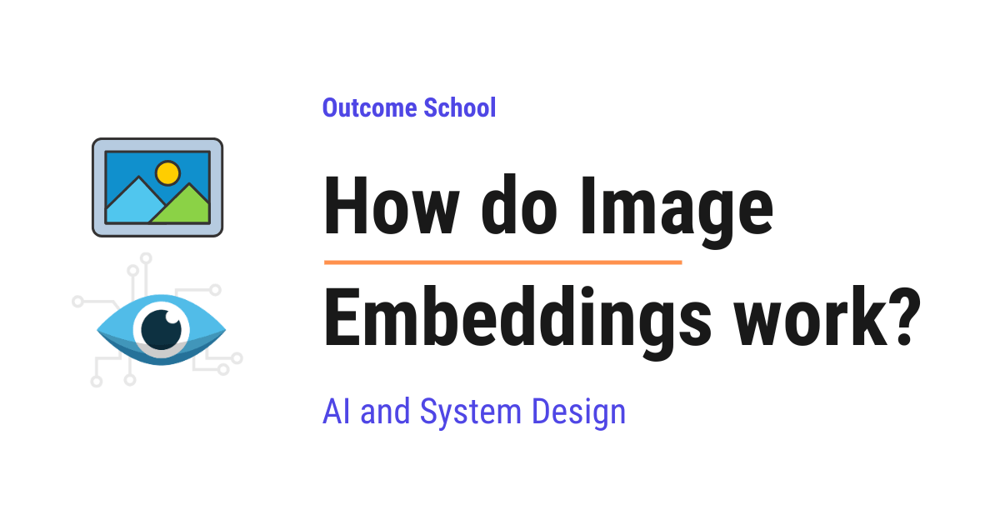

# How do Image Embeddings work?

> Archived from <https://outcomeschool.com/blog/how-do-image-embeddings-work> on 2026-11-25.

An image embedding is a list of numbers that represents the meaning of an image. A model converts the image into these numbers, and similar images get similar numbers, so the computer can compare them easily.

In this blog, we will learn about how image embeddings work. We will also see why we need image embeddings, how a computer turns a picture into numbers, how we measure the similarity between two of them, and where they are used in the real world.

We will cover the following:
<ul><li>What is an embedding?</li><li>What is an image embedding?</li><li>Why do we need image embeddings?</li><li>How does a computer see an image?</li><li>How are image embeddings created?</li><li>A simple numeric walkthrough</li><li>How do we measure similarity between two embeddings?</li><li>A code example</li><li>Where are image embeddings used?</li><li>Summary</li></ul>
I am <strong>Amit Shekhar</strong>, Founder @ <a target="_blank" rel="noopener noreferrer" href="https://outcomeschool.com">Outcome School</a>, I have taught and mentored many developers, and their efforts landed them high-paying tech jobs, helped many tech companies in solving their unique problems, and created many open-source libraries being used by top companies. I am passionate about sharing knowledge through open-source, blogs, and videos.

I teach <a target="_blank" rel="noopener noreferrer" href="https://outcomeschool.com/program/ai-and-machine-learning">AI and Machine Learning</a> at Outcome School.

Let&#x27;s get started.
<h2 id="what-is-an-embedding">What is an embedding?</h2>
An <strong><a target="_blank" rel="noopener noreferrer" href="what-are-embeddings.md">embedding</a></strong> is a list of numbers that represents the meaning of something.

In simple words, an embedding turns a real-world thing into a group of numbers. These numbers capture what the thing actually means.

Let&#x27;s say we have a word, a sentence, or an image. A computer cannot understand any of these directly. A computer only understands numbers. So, we convert the thing into a list of numbers. That list of numbers is called an embedding.

This list of numbers is also called a <strong>vector</strong>. A vector is just a fixed-size list of numbers, like <code>[0.21, 0.87, 0.05, 0.64]</code>.

So, here is the simple idea:
<blockquote>
An embedding is a list of numbers that captures the meaning of something.
</blockquote>
Now, we have understood what an embedding is. It is time to learn about what an image embedding is.
<h2 id="what-is-an-image-embedding">What is an image embedding?</h2>
An <strong>image embedding</strong> is a list of numbers that represents the meaning of an image.

In simple words, we take an image, and we convert it into a list of numbers. That list of numbers captures what is inside the image.

Let&#x27;s say we have a photo of a cat. We pass this photo through a special model. This model gives us back a list of numbers, something like <code>[0.91, 0.12, 0.77, 0.03, ...]</code>. This list of numbers is the image embedding of the cat photo.

The most important point is this:
<blockquote>
Two images that look similar in meaning will have embeddings that are close to each other.
</blockquote>
So, the embedding of one cat photo will be close to the embedding of another cat photo. But the embedding of a cat photo will be far from the embedding of a car photo.

This is the whole magic of image embeddings. Similar images give similar numbers. Different images give different numbers.

This was all about what an image embedding is. Now, the question is, why do we even need it.
<h2 id="why-do-we-need-image-embeddings">Why do we need image embeddings?</h2>
Let&#x27;s say we are building an app like Google Photos. We have one million photos stored. Now, a user types &quot;beach&quot; in the search box. We must show all the beach photos.

But here is the catch. The photos do not have any labels. Nobody has written &quot;beach&quot; under each photo. So, how do we find the beach photos?

We cannot compare the raw photos pixel by pixel. That is slow, and it does not understand meaning. Two beach photos taken at different angles look completely different at the pixel level, but they mean the same thing.

So, here comes the image embedding into the picture.

We convert every photo into an embedding. We convert the word &quot;beach&quot; into an embedding too. Then we simply <a target="_blank" rel="noopener noreferrer" href="how-does-approximate-nearest-neighbor-ann-search-work.md">find the photo embeddings that are closest</a> to the &quot;beach&quot; embedding. Those are our beach photos.

This way we can use image embeddings to solve the interesting problem of <a target="_blank" rel="noopener noreferrer" href="how-does-semantic-search-work.md">searching images by meaning</a>, not by exact pixels.

Finding the closest embeddings quickly across millions of photos is exactly what a vector database is built for. We have a detailed blog on <a target="_blank" rel="noopener noreferrer" href="how-does-a-vector-database-work.md">how a Vector Database works</a> that explains this end to end.

Now, the next big question is, how does a computer even see an image in the first place.
<h2 id="how-does-a-computer-see-an-image">How does a computer see an image?</h2>
Before jumping into embeddings, we must know how a computer reads an image.

An image is made up of tiny dots called <strong>pixels</strong>. A pixel is the smallest dot of color in an image. When we zoom into any photo a lot, we start seeing these small square dots. Each dot is a pixel.

Each pixel is stored as numbers. For a color image, every pixel has three numbers, one for red, one for green, and one for blue. Each of these numbers usually goes from 0 to 255.

So, for the sake of understanding, a small image of 100 by 100 pixels has 100 multiplied by 100, which is 10,000 pixels. And each pixel has 3 color numbers. So, the full image is 10,000 multiplied by 3, which is 30,000 numbers.

We can picture a single pixel as below:

<pre><code class="code-highlight language-text">        One pixel
           |
           v
      +---------+
      |  pixel  |
      +---------+
       /   |   \
      v    v    v
    Red  Green  Blue
    210   180    90
   (each value goes from 0 to 255)
</code></pre>

Here, we can see that one single pixel is stored as three numbers, one for red, one for green, and one for blue. Every pixel in the image is stored in this same way, so the full image becomes a very big list of these color numbers.

This is the raw image. It is just a big list of color numbers.

But here is the problem. These raw numbers only tell us the color of each dot. They do not tell us the meaning. They do not tell us &quot;this is a cat&quot;. Two cat photos can have totally different raw numbers because of lighting, angle, and background.

So, we need to convert these raw color numbers into meaningful numbers. Those meaningful numbers are the image embedding.

<strong>Note:</strong> The raw pixels tell us how the image looks. The embedding tells us what the image means. This difference is the heart of the whole topic.

<strong>Planning your move into AI?</strong>

No matter which tech domain you work in today, with your effort, you can transition to these roles:
<ul><li>AI Engineer</li><li>Forward Deployed Engineer</li><li>AI Agent Engineer</li><li>Harness Engineer</li><li>Voice AI Engineer</li><li>AI Architect</li><li>LLM Engineer</li><li>LLM Inference Engineer</li><li>Gen AI Engineer</li><li>MLOps Engineer</li><li>ML Engineer</li><li>Deep Learning Engineer</li></ul>
Our <a target="_blank" rel="noopener noreferrer" href="https://outcomeschool.com/program/ai-and-machine-learning">AI and Machine Learning Program</a> at Outcome School takes you there.

Now that we understand raw pixels, it is time to learn how the embedding is actually created.
<h2 id="how-are-image-embeddings-created">How are image embeddings created?</h2>
Image embeddings are created using a <strong>neural network</strong>.

In simple words, a neural network is a model that learns patterns from examples. We do not write rules for it by hand. Instead, we show it many examples, and it learns on its own.

For images, we use a special type of neural network called a <strong>CNN</strong>, which stands for <strong><a target="_blank" rel="noopener noreferrer" href="convolutional-neural-network-cnn.md">Convolutional Neural Network</a></strong>. We can also use a newer type called a <strong><a target="_blank" rel="noopener noreferrer" href="decoding-vision-transformer-vit.md">Vision Transformer</a></strong>. Do not worry about the exact names. The idea behind both is the same.

Let&#x27;s understand the idea with a simple analogy.

Suppose a child has never seen a cat. We show the child thousands of cat photos. Slowly, the child learns the pattern. Cats have pointy ears, whiskers, fur, and a tail. Now the child can recognize a cat even in a brand new photo.

A neural network learns in the same way. We show it millions of photos. It slowly learns the patterns, like edges, shapes, ears, eyes, and textures.

Here is how it works step by step.

<strong>Step 1:</strong> The raw image, which is a big list of color numbers, goes into the neural network.

<strong>Step 2:</strong> The first layers of the network look for very simple patterns, like edges and corners.

<strong>Step 3:</strong> The next layers combine these simple patterns into bigger patterns, like an eye, an ear, or a wheel.

<strong>Step 4:</strong> The deeper layers combine these into full objects, like a full cat face or a full car.

<strong>Step 5:</strong> Near the end, the network produces a short list of numbers that summarizes everything it found in the image. This short list of numbers is the image embedding.

Let&#x27;s visualize this flow as below:

<pre><code class="code-highlight language-text">   Raw image
 (color numbers)
       |
       v
+-----------------+
|  Early layers   |  finds edges and corners
+-----------------+
       |
       v
+-----------------+
|  Middle layers  |  finds parts (eye, ear, wheel)
+-----------------+
       |
       v
+-----------------+
|  Deep layers    |  finds full objects (cat, car)
+-----------------+
       |
       v
+-----------------+
|  Final layer    |  summarizes everything found
+-----------------+
       |
       v
   Embedding
[0.91, 0.12, 0.77, ...]
</code></pre>

Here, we can see that the raw image enters at the top, and each layer of the network understands a little more than the layer before it. The early layers see only simple edges, the middle layers see parts, and the deep layers see full objects. At the very end, the network turns all of this understanding into a short list of numbers, which is the image embedding.

So, the embedding is the network&#x27;s summary of the meaning of the image.

Let me map this flow to our child analogy for your better understanding:
<table><thead><tr><th>In the neural network</th><th>In the child analogy</th></tr></thead><tbody><tr><td>Raw image (color numbers)</td><td>Looking at the photo with eyes</td></tr><tr><td>Early layers finding edges</td><td>Noticing simple lines and corners</td></tr><tr><td>Middle layers finding parts</td><td>Noticing ears, eyes, and whiskers</td></tr><tr><td>Deep layers finding objects</td><td>Recognizing the full cat</td></tr><tr><td>Final embedding</td><td>The understanding &quot;this is a cat&quot;</td></tr></tbody></table>
The best part is this. After the network is trained on millions of images, it learns to place similar images close together in the number space. This happens automatically during training, and that too without us writing any rule for it.

To learn how Embeddings are created and how Contrastive Learning places similar items close together, we build a Neural Network from scratch in our <a target="_blank" rel="noopener noreferrer" href="https://outcomeschool.com/program/ai-and-machine-learning">AI and Machine Learning Program</a> at Outcome School.

Now, we have understood how embeddings are created. The best way to learn this further is by taking a simple numeric example.
<h2 id="a-simple-numeric-walkthrough">A simple numeric walkthrough</h2>
Let&#x27;s say, just for the sake of understanding, that our embedding has only 3 numbers. In real life, an embedding has hundreds or even thousands of numbers, but 3 numbers are enough to learn the idea.

Assume that we have three photos. We pass each photo through the neural network, and we get the following embeddings:
<ul><li>Cat photo A: <code>[0.90, 0.10, 0.05]</code></li><li>Cat photo B: <code>[0.88, 0.12, 0.07]</code></li><li>Car photo C: <code>[0.10, 0.95, 0.85]</code></li></ul>
Here, we can notice something very important. The two cat photos, A and B, have very similar numbers. The car photo C has very different numbers.

We can picture where these embeddings sit as below:

<pre><code class="code-highlight language-text">   Number space

   Cat A  Cat B
    (.)   (.)            &lt;-- close together

                          (.) Car C    &lt;-- far away
</code></pre>

Here, we can see that the embedding of Cat A and the embedding of Cat B land very close to each other because they mean the same thing. The embedding of Car C lands far away because it means something different. This is exactly how a computer keeps similar images near each other and different images apart, using only numbers.

This is exactly what we wanted. Similar meaning gives similar numbers. Different meaning gives different numbers.

So, if we ask the computer &quot;which photo is most similar to Cat photo A&quot;, the computer will compare the numbers and answer &quot;Cat photo B&quot;. It will not pick the car photo, because its numbers are far away.

This is how a computer understands the meaning of images using only numbers.

<strong>A quick note for you</strong>

No matter which tech domain you work in, get familiar with these topics:
<ul><li>LLM</li><li>RAG</li><li>MCP</li><li>Agent</li><li>Fine-tuning</li><li>Quantization</li></ul>
We put it all together in one video:

<a target="_blank" rel="noopener noreferrer" href="https://www.youtube.com/watch?v=lnfWvX66FUk">AI Engineering Explained: LLM, RAG, MCP, Agent, Fine-Tuning, and Quantization</a>

No need to stop reading - bookmark it and watch later when you get time. Future you will thank you.

Now, let&#x27;s get back to the topic.

Now, the question is, how exactly does the computer measure that two lists of numbers are close or far. Let&#x27;s understand that now.
<h2 id="how-do-we-measure-similarity-between-two-embeddings">How do we measure similarity between two embeddings?</h2>
To find how similar two embeddings are, we measure the distance between them.

In simple words, if two lists of numbers are close to each other, the images are similar. If they are far apart, the images are different.

The most common method to measure this is called <strong><a target="_blank" rel="noopener noreferrer" href="cosine-similarity.md">cosine similarity</a></strong>.

In simple words, cosine similarity checks whether two lists of numbers point in the same direction. If they point in the same direction, the similarity is high. If they point in different directions, the similarity is low.

The cosine similarity value goes from -1 to 1.
<ul><li>A value close to 1 means the two images are very similar.</li><li>A value close to 0 means they are not related.</li><li>A value close to -1 means they are opposite.</li></ul>
Let&#x27;s take our earlier example. Cat photo A is <code>[0.90, 0.10, 0.05]</code> and Cat photo B is <code>[0.88, 0.12, 0.07]</code>. These two point in almost the same direction, so the cosine similarity will be very close to 1. This tells us they are very similar.

This is how we find similar images using their embeddings.

To master Embeddings, Vector Databases, and Multimodal AI, check out our <a target="_blank" rel="noopener noreferrer" href="https://outcomeschool.com/program/ai-and-machine-learning">AI and Machine Learning Program</a> at Outcome School.

Now that we have learned the theory, it is time to see a small code example.
<h2 id="a-code-example">A code example</h2>
Let&#x27;s see the code for creating an image embedding and comparing two images. We will use Python, which is the most common language for machine learning.

First, we load a ready-made model and create embeddings for two images as below:

<pre><code class="code-highlight language-python">from sentence_transformers import SentenceTransformer
from PIL import Image

# Load a ready-made model that can create image embeddings
model = SentenceTransformer(&quot;clip-ViT-B-32&quot;)

# Open two images from our computer
cat_image = Image.open(&quot;cat.jpg&quot;)
dog_image = Image.open(&quot;dog.jpg&quot;)

# Convert each image into an embedding (a list of numbers)
cat_embedding = model.encode(cat_image)
dog_embedding = model.encode(dog_image)

print(cat_embedding.shape)
</code></pre>

Here, we have done a few simple things.
<ul><li>We loaded a ready-made model called <code>clip-ViT-B-32</code>. This model already knows how to turn images into embeddings, so we do not have to train anything ourselves.</li><li>We opened two image files, one cat and one dog.</li><li>We called <code>model.encode()</code> on each image. This gives us back the embedding, which is the list of numbers.</li></ul>
This will print the following:

<pre><code class="code-highlight">(512,)
</code></pre>

Here, we can see that each embedding is a list of 512 numbers. So, this model summarizes the full image into 512 meaningful numbers.

Now, let&#x27;s compare these two embeddings to see how similar the images are as below:

<pre><code class="code-highlight language-python">from sentence_transformers import util

# Measure how similar the two embeddings are
similarity = util.cos_sim(cat_embedding, dog_embedding)

print(similarity)
</code></pre>

Here, we have used <code>cos_sim</code>, which calculates the cosine similarity between the two embeddings. It tells us how close the two images are in meaning.

A cat and a dog are both animals, so the value will be somewhat high. If we compared a cat with a car instead, the value would be much lower, because a cat and a car are very different in meaning.

This is how, with only a few lines of code, we can convert images into numbers and compare their meaning. It works perfectly.

<strong>Note:</strong> The same <code>clip-ViT-B-32</code> model can also turn a word like &quot;beach&quot; into an embedding. So, we can compare a word embedding with image embeddings, and that is exactly how searching photos by typing words works.

Models that connect text and images in the same embedding space like this are called multimodal models. We have a detailed blog on <a target="_blank" rel="noopener noreferrer" href="multimodal-ai.md">Multimodal AI</a> that explains how it works.

<strong>Stay updated:</strong> Subscribe to our <a target="_blank" rel="noopener noreferrer" href="https://outcomeschool.substack.com/subscribe">newsletter</a> to get our latest AI and Machine Learning blogs straight to your inbox.

Now, we have understood the full flow. Let&#x27;s see where image embeddings are used in real life.
<h2 id="where-are-image-embeddings-used">Where are image embeddings used?</h2>
Image embeddings are used in many products that we use every day. Here are a few real use cases:
<ul><li><strong>Image search:</strong> We search for photos by typing words like &quot;beach&quot; or &quot;birthday&quot;, and the app finds matching photos by comparing embeddings.</li><li><strong>Similar product search:</strong> On shopping apps, we upload a photo of a shoe, and the app shows similar shoes by comparing embeddings.</li><li><strong>Duplicate photo detection:</strong> The phone gallery groups similar or duplicate photos together by comparing their embeddings.</li><li><strong>Face grouping:</strong> Photo apps group all photos of the same person together using embeddings.</li><li><strong><a target="_blank" rel="noopener noreferrer" href="recommendation-system.md">Recommendation systems</a>:</strong> Apps recommend images or videos similar to the ones we liked, using embeddings.</li></ul>
So, now we know where we can use image embeddings.
<h2 id="summary">Summary</h2>
Let&#x27;s quickly recap everything in simple words.

A computer cannot understand an image directly. It only understands numbers. The raw image is just a big list of color numbers, and these raw numbers do not capture meaning.

So, we pass the image through a neural network. The network summarizes the image into a short list of meaningful numbers. This list of numbers is the image embedding.

Similar images get similar embeddings, and different images get different embeddings. We measure how similar two embeddings are using cosine similarity. This lets us search, group, and compare images by their meaning, not by their exact pixels.

This is how image embeddings work. They turn pictures into numbers that carry meaning, and that too in a way a computer can compare very easily.
<h2 id="frequently-asked-questions">Frequently Asked Questions</h2><h3 id="why-cant-we-just-compare-raw-pixels-to-find-similar-images">Why can&#x27;t we just compare raw pixels to find similar images?</h3>
Raw pixels only tell us the color of each dot, not the meaning of the image. Two cat photos can have totally different raw numbers because of lighting, angle, and background. Comparing pixel by pixel is also slow. An embedding captures what the image means, so similar images end up close to each other.
<h3 id="can-we-search-images-using-a-text-query">Can we search images using a text query?</h3>
Yes. A model like <code>clip-ViT-B-32</code> can turn both images and a word like &quot;beach&quot; into embeddings in the same space. We then compare the word embedding with the image embeddings and pick the closest ones. Models that connect text and images in the same embedding space like this are called multimodal models.
<h3 id="do-we-need-to-train-our-own-model-to-create-image-embeddings">Do we need to train our own model to create image embeddings?</h3>
No. We can load a ready-made model like <code>clip-ViT-B-32</code>, which already knows how to turn images into embeddings. With just a few lines of Python, we can encode images with <code>model.encode()</code> and compare them with cosine similarity, without training anything ourselves.
<h3 id="how-many-numbers-are-there-in-an-image-embedding">How many numbers are there in an image embedding?</h3>
In real life, an image embedding has hundreds or even thousands of numbers. For example, the <code>clip-ViT-B-32</code> model summarizes a full image into a list of 512 numbers. Small examples with only 3 numbers are used just to understand the idea.
<h3 id="do-photos-need-labels-to-be-searchable-with-image-embeddings">Do photos need labels to be searchable with image embeddings?</h3>
No. Photos do not need anyone to write labels like &quot;beach&quot; under them. We convert every photo into an embedding and the search word into an embedding too. Then we find the photo embeddings closest to the search embedding, which lets us search images by meaning.

That&#x27;s it for now.

Thanks

<strong>Amit Shekhar</strong> Founder @ <a target="_blank" rel="noopener noreferrer" href="https://outcomeschool.com">Outcome School</a>

You can connect with me on:
<ul><li><a target="_blank" rel="noopener noreferrer" href="https://x.com/amitiitbhu">X</a></li><li><a target="_blank" rel="noopener noreferrer" href="https://www.linkedin.com/in/amit-shekhar-iitbhu">LinkedIn</a></li><li><a target="_blank" rel="noopener noreferrer" href="https://github.com/amitshekhariitbhu">GitHub</a></li></ul>
Follow Outcome School on:
<ul><li><a target="_blank" rel="noopener noreferrer" href="https://x.com/outcome_school">X</a></li><li><a target="_blank" rel="noopener noreferrer" href="https://youtube.com/@OutcomeSchool">YouTube</a></li><li><a target="_blank" rel="noopener noreferrer" href="https://www.linkedin.com/company/outcomeschool">LinkedIn</a></li><li><a target="_blank" rel="noopener noreferrer" href="https://github.com/OutcomeSchool">GitHub</a></li></ul>
<a target="_blank" rel="noopener noreferrer" href="https://outcomeschool.com/blog"><strong>Read all of our high-quality blogs here.</strong></a>

