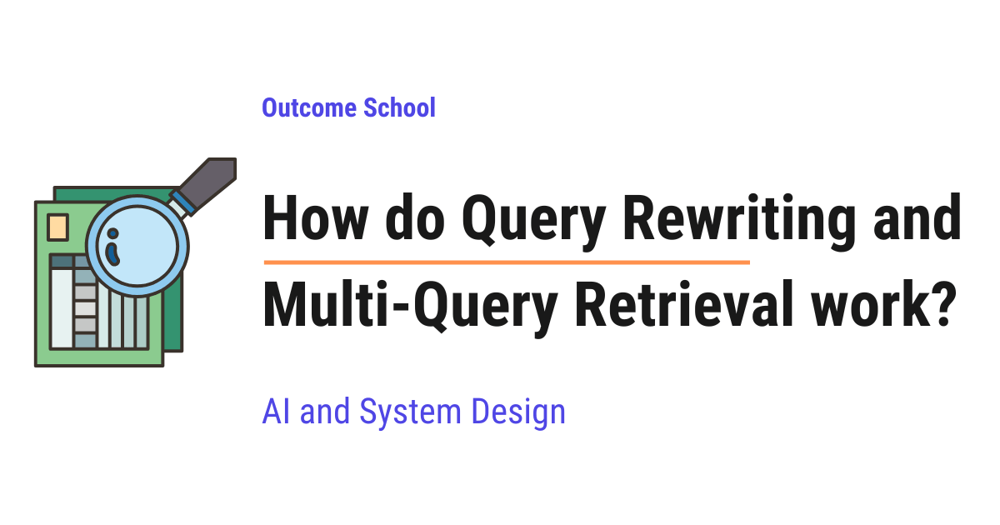

# How do Query Rewriting and Multi-Query Retrieval work?

> Archived from <https://outcomeschool.com/blog/how-do-query-rewriting-and-multi-query-retrieval-work> on 2026-11-25.

Query Rewriting and Multi-Query Retrieval are two ways of improving the search step of an AI system. Query Rewriting uses an LLM to turn the user&#x27;s messy question into one clear search query, and Multi-Query Retrieval uses an LLM to turn the question into several different search queries, searches with all of them, and merges the results.

In this blog, we will learn about how Query Rewriting and Multi-Query Retrieval work. We will also see why the user&#x27;s raw question is often a bad search query, how Query Rewriting fixes vague, follow-up, and badly worded questions, how Multi-Query Retrieval searches from many angles, how the results from many searches are merged using Reciprocal Rank Fusion, how they differ from each other, and when to use which one.

We will cover the following:
<ul><li>The problem: the user&#x27;s question is not a good search query</li><li>What is Query Rewriting?</li><li>How does Query Rewriting work?</li><li>Types of Query Rewriting</li><li>Query Rewriting in code</li><li>The problem that Query Rewriting does not solve</li><li>What is Multi-Query Retrieval?</li><li>How does Multi-Query Retrieval work?</li><li>How do we merge the results? Reciprocal Rank Fusion</li><li>Multi-Query Retrieval in code</li><li>Query Rewriting vs Multi-Query Retrieval</li><li>Where they work well and where they fail</li></ul>
I am <strong>Amit Shekhar</strong>, Founder @ <a target="_blank" rel="noopener noreferrer" href="https://outcomeschool.com">Outcome School</a>, I have taught and mentored many developers, and their efforts landed them high-paying tech jobs, helped many tech companies in solving their unique problems, and created many open-source libraries being used by top companies. I am passionate about sharing knowledge through open-source, blogs, and videos.

I teach <a target="_blank" rel="noopener noreferrer" href="https://outcomeschool.com/program/ai-and-machine-learning">AI and Machine Learning</a> at Outcome School.

Let&#x27;s get started.
<h2 id="the-problem-the-users-question-is-not-a-good-search-query">The problem: the user&#x27;s question is not a good search query</h2>
Query Rewriting and Multi-Query Retrieval are used in the retrieval step of <strong><a target="_blank" rel="noopener noreferrer" href="retrieval-augmented-generation-rag.md">RAG</a></strong> (Retrieval-Augmented Generation), where we search our documents, pick the pieces of text called <strong><a target="_blank" rel="noopener noreferrer" href="chunking-strategies-for-rag.md">chunks</a></strong> that are most related to the question, and give them to an LLM before it answers.

The flow looks like below:

<pre><code class="language-text code-highlight">User question -&gt; Retriever -&gt; Top chunks -&gt; LLM -&gt; Answer
</code></pre>

<strong>If retrieval brings the wrong chunks, the LLM often gives a wrong answer.</strong>

And retrieval depends completely on the text we search with. That text is called the <strong>search query</strong>.

In a simple RAG system, we search with the user&#x27;s question exactly as they typed it. But real users do not type perfect search queries.

Let&#x27;s see a few real situations:
<ul><li><strong>Follow-up questions:</strong> The user first asks, &quot;What is the refund policy of the Pro plan?&quot;. Then they ask, &quot;And what about the Basic one?&quot;. If we search with &quot;And what about the Basic one?&quot;, the retriever has no idea that we are talking about refunds.</li><li><strong>Vague questions:</strong> &quot;My thing is not working after the update.&quot; Which thing? Which update?</li><li><strong>Different words:</strong> The user asks, &quot;How do I get my money back?&quot;, but our documents say &quot;refund process&quot;. A keyword search does not match them.</li><li><strong>Extra noise:</strong> &quot;Hi, hope you are well, quick question, my manager asked me, how many leaves do we get in a year?&quot;. Most of these words are not useful for search.</li><li><strong>Many questions in one:</strong> &quot;Compare the battery life and price of phone A and phone B.&quot; This needs information from several different places.</li></ul>
In all these cases, the retriever brings poor chunks, and the LLM gives a poor answer.

So, here comes Query Rewriting to the rescue.
<h2 id="what-is-query-rewriting">What is Query Rewriting?</h2>
<strong>Query Rewriting is a step where an LLM rewrites the user&#x27;s question into a clear, complete, and search-friendly query before we search.</strong>

It is like going to a big library and asking the librarian, &quot;I want that book about the boy wizard&quot;. The librarian does not search for &quot;boy wizard&quot;. The librarian searches for &quot;Harry Potter&quot;. The librarian rewrote our query.

The flow now looks like below:

<pre><code class="language-text code-highlight">User question -&gt; LLM rewrites -&gt; Clear query -&gt; Retriever -&gt; Top chunks -&gt; LLM -&gt; Answer
</code></pre>

The answer is still written using the user&#x27;s original question. Only the search uses the rewritten query.
<h2 id="how-does-query-rewriting-work">How does Query Rewriting work?</h2>
The best way to learn this is by taking an example.

<strong>Step 1:</strong> The user is chatting with a support bot.

<pre><code class="language-text code-highlight">User: What is the refund policy of the Pro plan?
Bot:  You can get a full refund within 30 days.
User: And what about the Basic one?
</code></pre>

<strong>Step 2:</strong> Before searching, we send the chat history and the latest question to an LLM with an instruction like below:

<pre><code class="language-text code-highlight">Given the conversation and the latest question, rewrite the latest
question as a standalone search query that contains all the needed
details. Return only the query.
</code></pre>

<strong>Step 3:</strong> The LLM returns:

<pre><code class="language-text code-highlight">Refund policy of the Basic plan
</code></pre>

<strong>Step 4:</strong> We search with &quot;Refund policy of the Basic plan&quot;. Now, the retriever finds the right chunk about Basic plan refunds.

<strong>Step 5:</strong> We give that chunk and the user&#x27;s question to the LLM, and it answers correctly.

<strong>Planning your move into AI?</strong>

No matter which tech domain you work in today, with your effort, you can transition to these roles:
<ul><li>AI Engineer</li><li>Forward Deployed Engineer</li><li>AI Agent Engineer</li><li>Harness Engineer</li><li>Voice AI Engineer</li><li>AI Architect</li><li>LLM Engineer</li><li>LLM Inference Engineer</li><li>Gen AI Engineer</li><li>MLOps Engineer</li><li>ML Engineer</li><li>Deep Learning Engineer</li></ul>
Our <a target="_blank" rel="noopener noreferrer" href="https://outcomeschool.com/program/ai-and-machine-learning">AI and Machine Learning Program</a> at Outcome School takes you there.
<h2 id="types-of-query-rewriting">Types of Query Rewriting</h2>
Query Rewriting is one idea, but it is used in a few different ways, depending upon our use case:
<ul><li><strong>Standalone rewriting:</strong> Turns a follow-up question into a complete question, using the chat history. Like the refund example above. This is the most common type in chat applications.</li><li><strong>Clarifying and cleaning:</strong> Removes noise, fixes spelling, and keeps only the important words. &quot;Hi, quick question, how many leaves do we get in a year?&quot; becomes &quot;Annual leave policy number of days&quot;.</li><li><strong>Expanding:</strong> Adds words that the documents are likely to use. &quot;How do I get my money back?&quot; becomes &quot;refund process, return money, get refund&quot;.</li><li><strong>Step-back rewriting:</strong> Turns a very specific question into a more general one, so that we find the background information. &quot;Why did my order #4521 get delayed in Mumbai?&quot; becomes &quot;Reasons for order delivery delays&quot;.</li></ul>
All of them follow the same pattern: an LLM changes the query, and then we search. A close cousin of these is <a target="_blank" rel="noopener noreferrer" href="how-does-hyde-work.md">HyDE</a>, where the LLM writes a hypothetical answer instead of a query, and we search with that answer.
<h2 id="query-rewriting-in-code">Query Rewriting in code</h2>
Now, let&#x27;s see the code for a simple Query Rewriting step. Here, <code>call_llm</code> sends a prompt to an LLM and returns its text, and <code>retriever.search</code> searches our chunks. We are hiding their details for the sake of understanding.

<pre><code class="code-highlight language-python">def rewrite_query(chat_history, question):
    prompt = f&quot;&quot;&quot;Given the conversation and the latest question, rewrite the
latest question as a standalone search query. Return only the query.

Conversation:
{chat_history}

Latest question: {question}&quot;&quot;&quot;
    return call_llm(prompt).strip()

def answer(chat_history, question):
    search_query = rewrite_query(chat_history, question)
    chunks = retriever.search(search_query, top_k=5)
    return call_llm(f&quot;Context:\n{chunks}\n\nQuestion: {question}\nAnswer:&quot;)
</code></pre>

Here, we have:
<ul><li><code>rewrite_query</code> builds a prompt with the chat history and the latest question, and asks the LLM for one clean search query.</li><li>In <code>answer</code>, we first rewrite the question, then search with the rewritten query.</li><li>Finally, we give the found chunks and the original question to the LLM to write the answer.</li></ul>
Here, we can notice that the user never sees the rewritten query. It is used only for searching.

<strong>A quick note for you</strong>

No matter which tech domain you work in, get familiar with these topics:
<ul><li>LLM</li><li>RAG</li><li>MCP</li><li>Agent</li><li>Fine-tuning</li><li>Quantization</li></ul>
We put it all together in one video:

<a target="_blank" rel="noopener noreferrer" href="https://www.youtube.com/watch?v=lnfWvX66FUk">AI Engineering Explained: LLM, RAG, MCP, Agent, Fine-Tuning, and Quantization</a>

No need to stop reading - bookmark it and watch later when you get time. Future you will thank you.

Now, let&#x27;s get back to the topic.
<h2 id="the-problem-that-query-rewriting-does-not-solve">The problem that Query Rewriting does not solve</h2>
Query Rewriting gives us one better query. But one query, however good, looks at the question from only one angle.

Let&#x27;s say the user asks, &quot;Is the new phone good for gaming?&quot;. The useful information can be in many places:
<ul><li>A chunk about the processor.</li><li>A chunk about the screen refresh rate.</li><li>A chunk about heating and battery during long use.</li></ul>
A single query like &quot;new phone gaming performance&quot; can find the first chunk but miss the others, because they use very different words.

Also, if the LLM rewrites the query in a slightly wrong way, we have no backup. One bad rewrite means bad retrieval.

So, the question is: what if we search from many angles at the same time?

Here comes Multi-Query Retrieval into the picture.
<h2 id="what-is-multi-query-retrieval">What is Multi-Query Retrieval?</h2>
<strong>Multi-Query Retrieval is a method where an LLM creates several different versions of the user&#x27;s question, we search with each version separately, and then we merge all the results into one list.</strong>

It is like looking for a lost key at home. If we only look in the bedroom, we can miss it. If three family members look in the bedroom, the kitchen, and the car at the same time, the chance of finding the key is much higher.
<h2 id="how-does-multi-query-retrieval-work">How does Multi-Query Retrieval work?</h2>
Let&#x27;s take the same gaming example.

<strong>Step 1:</strong> The user asks, &quot;Is the new phone good for gaming?&quot;.

<strong>Step 2:</strong> We ask the LLM to create, let say, 3 different search queries for the same question:

<pre><code class="language-text code-highlight">Query 1: new phone processor and graphics performance
Query 2: new phone display refresh rate and touch response
Query 3: new phone heating and battery life during heavy use
</code></pre>

<strong>Step 3:</strong> We search with each query separately. Each search returns its own top chunks.

<pre><code class="language-text code-highlight">Query 1 -&gt; [processor chunk, benchmark chunk, ...]
Query 2 -&gt; [display chunk, touch chunk, ...]
Query 3 -&gt; [battery chunk, heating chunk, ...]
</code></pre>

<strong>Step 4:</strong> We merge all the results into one list and remove the duplicates, because the same chunk can come from more than one query.

<strong>Step 5:</strong> We give the merged chunks and the original question to the LLM, and it writes a complete answer covering speed, display, and battery.

The flow looks like below:

<pre><code class="language-text code-highlight">                     /--&gt; Query 1 -&gt; Retriever -&gt; results 1 \
User question -&gt; LLM ---&gt; Query 2 -&gt; Retriever -&gt; results 2 --&gt; Merge -&gt; LLM -&gt; Answer
                     \--&gt; Query 3 -&gt; Retriever -&gt; results 3 /
</code></pre>

<strong>Note:</strong> Many systems also keep the user&#x27;s original question as one of the queries, so that we never lose what a plain search would have found.

Similarly, Multi-Query Retrieval solves the &quot;many questions in one&quot; problem that we saw earlier. For &quot;Compare the battery life and price of phone A and phone B&quot;, the LLM can split it into smaller questions like &quot;phone A battery life&quot;, &quot;phone A price&quot;, &quot;phone B battery life&quot;, and &quot;phone B price&quot;. Splitting a big question into smaller questions like this is called <strong>query decomposition</strong>.
<h2 id="how-do-we-merge-the-results-reciprocal-rank-fusion">How do we merge the results? Reciprocal Rank Fusion</h2>
Now, the next big question is: how do we merge the lists?

The simplest way is to take all the chunks from all the lists, remove the duplicates, and keep them. This is called taking the <strong>union</strong>. It works, but it does not tell us which chunks are the most important.

A better way is <strong>Reciprocal Rank Fusion</strong>, or <strong>RRF</strong>. When Multi-Query Retrieval is combined with RRF, it is often called <strong>RAG-Fusion</strong>.

<strong>RRF gives each chunk a score based on its position in each list, and adds these scores across all the lists.</strong>

The formula is as below:

<strong>RRF score of a chunk = sum over all lists of 1 / (k + rank)</strong>

Here, <code>rank</code> is the position of the chunk in that list (1 for the top), and <code>k</code> is a constant, commonly 60.

Here, &quot;reciprocal&quot; just means &quot;1 divided by&quot;. A chunk at the top of a list gets a bigger score than a chunk at the bottom. A chunk that appears in many lists collects score from each of them.

Let&#x27;s see an example with 3 queries and their top 3 chunks:

<pre><code class="language-text code-highlight">Query 1 -&gt; [D2, D5, D1]
Query 2 -&gt; [D5, D3, D2]
Query 3 -&gt; [D5, D2, D4]
</code></pre>

Now, we calculate with <code>k = 60</code>:

<pre><code class="language-text code-highlight">D5: 1/(60+2) + 1/(60+1) + 1/(60+1) = 0.0161 + 0.0164 + 0.0164 = 0.0489
D2: 1/(60+1) + 1/(60+3) + 1/(60+2) = 0.0164 + 0.0159 + 0.0161 = 0.0484
D3: 1/(60+2)                        = 0.0161
D1: 1/(60+3)                        = 0.0159
D4: 1/(60+3)                        = 0.0159
</code></pre>

The final order is D5, D2, D3, and then D1 and D4 with the same score.

Here, we can see that D5 wins because it was near the top of all three lists. D2 is a close second. D3, D1, and D4 appeared in only one list each, so they come later.

RRF only needs the positions, not the raw scores. So, it works even when the lists come from different kinds of search. This is also why RRF is the most common way to merge keyword search and semantic search results in <a target="_blank" rel="noopener noreferrer" href="how-does-hybrid-search-work.md">Hybrid Search</a>.

To master RAG, Vector Databases, and Design a RAG System (Chat with Your Documents), and to build an AI Tutor from scratch, check out our <a target="_blank" rel="noopener noreferrer" href="https://outcomeschool.com/program/ai-and-machine-learning">AI and Machine Learning Program</a> at Outcome School.
<h2 id="multi-query-retrieval-in-code">Multi-Query Retrieval in code</h2>
Now, let&#x27;s see the code for Multi-Query Retrieval with RRF. We can write the code as below:

<pre><code class="code-highlight language-python">def generate_queries(question, n=3):
    prompt = f&quot;&quot;&quot;Write {n} different search queries for the question below.
Each query must look at the question from a different angle.
Return one query per line.

Question: {question}&quot;&quot;&quot;
    lines = call_llm(prompt).strip().split(&quot;\n&quot;)
    return [question] + [line.strip() for line in lines if line.strip()]

def rrf_merge(result_lists, k=60):
    scores = {}
    for results in result_lists:
        for rank, chunk_id in enumerate(results, start=1):
            scores[chunk_id] = scores.get(chunk_id, 0) + 1 / (k + rank)
    return sorted(scores, key=scores.get, reverse=True)

def multi_query_search(question, top_k=5):
    queries = generate_queries(question)
    result_lists = [retriever.search(q, top_k=top_k) for q in queries]
    return rrf_merge(result_lists)[:top_k]
</code></pre>

Here, we have:
<ul><li><code>generate_queries</code> asks the LLM for <code>n</code> different queries, one per line, and also keeps the original question in the list.</li><li><code>retriever.search</code> returns a list of chunk ids for each query, best first.</li><li><code>rrf_merge</code> goes through every list, gives each chunk <code>1 / (k + rank)</code>, and adds the scores. Then, it sorts the chunks by the total score. Duplicates are handled automatically, because the same chunk id simply collects more score.</li><li><code>multi_query_search</code> connects everything and returns the best <code>top_k</code> chunks.</li></ul><h2 id="query-rewriting-vs-multi-query-retrieval">Query Rewriting vs Multi-Query Retrieval</h2>
Let me tabulate the differences between Query Rewriting and Multi-Query Retrieval for your better understanding.
<table><thead><tr><th>Point</th><th>Query Rewriting</th><th>Multi-Query Retrieval</th></tr></thead><tbody><tr><td>Output of the LLM step</td><td>One better query</td><td>Several different queries</td></tr><tr><td>Number of searches</td><td>One</td><td>One per query</td></tr><tr><td>Main strength</td><td>Fixes follow-ups, vague, and noisy questions</td><td>Finds information spread across different places</td></tr><tr><td>Safety against a bad rewrite</td><td>No backup</td><td>Other queries act as backup</td></tr><tr><td>Merging step needed</td><td>No</td><td>Yes, union or RRF</td></tr><tr><td>Speed and cost</td><td>Fast, one extra LLM call</td><td>Slower, one extra LLM call plus many searches</td></tr><tr><td>Best for</td><td>Chat applications with follow-up questions</td><td>Broad or multi-part questions</td></tr></tbody></table>
<strong>Note:</strong> We can use both together. First, rewrite the follow-up question into a standalone question. Then, create multiple queries from that clean question.

In <a target="_blank" rel="noopener noreferrer" href="agentic-rag.md">Agentic RAG</a>, an agent goes one step further and decides on its own when to rewrite the query and when to search again.

<strong>Stay updated:</strong> Subscribe to our <a target="_blank" rel="noopener noreferrer" href="https://outcomeschool.substack.com/subscribe">newsletter</a> to get our latest AI and Machine Learning blogs straight to your inbox.
<h2 id="where-they-work-well-and-where-they-fail">Where they work well and where they fail</h2>
<strong>Advantages:</strong>
<ul><li>Both improve retrieval without changing our documents or our retriever.</li><li>Query Rewriting makes follow-up questions in a chat work correctly.</li><li>Multi-Query Retrieval finds more of the useful chunks, which is called better <strong><a target="_blank" rel="noopener noreferrer" href="precision-vs-recall.md">recall</a></strong>.</li><li>Both work with any retriever: keyword search, <a target="_blank" rel="noopener noreferrer" href="how-does-a-vector-database-work.md">vector search</a>, or both.</li></ul>
<strong>Disadvantages:</strong>
<ul><li>Both add an extra LLM call before search, which adds time and cost.</li><li>The LLM can change the meaning while rewriting. For example, it can drop an important detail like a version number. We must test our rewriting prompt carefully.</li><li>Multi-Query Retrieval can bring in chunks that are only loosely related, which adds noise to the prompt. A <a target="_blank" rel="noopener noreferrer" href="how-does-a-reranker-work.md">reranker</a> after the merge step can reorder the chunks by true relevance, so that only the best ones reach the LLM.</li><li>For simple, clear questions, they add cost without much benefit.</li></ul>
Query Rewriting and Multi-Query Retrieval improve the question side of the search. We can also improve the chunk side by adding a short note to every chunk about where it comes from in the document. We have a detailed blog on <a target="_blank" rel="noopener noreferrer" href="how-does-contextual-retrieval-work.md">how Contextual Retrieval works</a> that explains this end to end.

Now, we must have understood how Query Rewriting and Multi-Query Retrieval work, how they differ, and when to use which one.
<h2 id="frequently-asked-questions">Frequently Asked Questions</h2><h3 id="does-the-user-see-the-rewritten-query">Does the user see the rewritten query?</h3>
No. The user never sees the rewritten query. It is used only for searching. The final answer is still written using the user&#x27;s original question, together with the chunks that the rewritten query found.
<h3 id="can-we-use-query-rewriting-and-multi-query-retrieval-together">Can we use Query Rewriting and Multi-Query Retrieval together?</h3>
Yes. We can use both together. First, we rewrite the follow-up question into a standalone question using the chat history. Then, we create multiple queries from that clean question, search with each of them, and merge the results.
<h3 id="why-keep-the-original-question-as-one-of-the-queries-in-multi-query-retrieval">Why keep the original question as one of the queries in Multi-Query Retrieval?</h3>
Many systems keep the user&#x27;s original question as one of the queries so that we never lose what a plain search would have found. The other queries also act as a backup against one bad rewrite.
<h3 id="what-value-of-k-is-used-in-reciprocal-rank-fusion">What value of k is used in Reciprocal Rank Fusion?</h3>
The constant k is commonly set to 60. Each chunk gets 1 / (k + rank) from every list it appears in, and these scores are added. A chunk near the top of many lists collects the highest total score.

That&#x27;s it for now.

Thanks

<strong>Amit Shekhar</strong> Founder @ <a target="_blank" rel="noopener noreferrer" href="https://outcomeschool.com">Outcome School</a>

You can connect with me on:
<ul><li><a target="_blank" rel="noopener noreferrer" href="https://x.com/amitiitbhu">X</a></li><li><a target="_blank" rel="noopener noreferrer" href="https://www.linkedin.com/in/amit-shekhar-iitbhu">LinkedIn</a></li><li><a target="_blank" rel="noopener noreferrer" href="https://github.com/amitshekhariitbhu">GitHub</a></li></ul>
Follow Outcome School on:
<ul><li><a target="_blank" rel="noopener noreferrer" href="https://x.com/outcome_school">X</a></li><li><a target="_blank" rel="noopener noreferrer" href="https://youtube.com/@OutcomeSchool">YouTube</a></li><li><a target="_blank" rel="noopener noreferrer" href="https://www.linkedin.com/company/outcomeschool">LinkedIn</a></li><li><a target="_blank" rel="noopener noreferrer" href="http://github.com/OutcomeSchool">GitHub</a></li></ul>
<a target="_blank" rel="noopener noreferrer" href="https://outcomeschool.com/blog"><strong>Read all of our high-quality blogs here.</strong></a>

