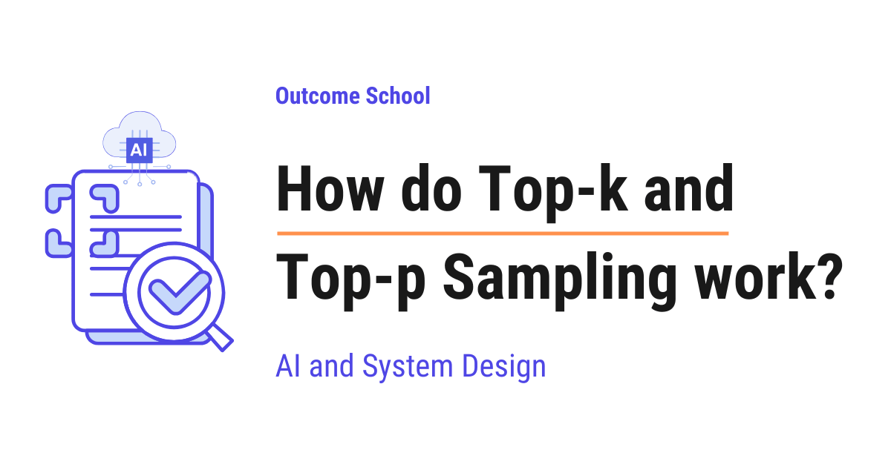

# How do Top-k and Top-p Sampling work?

> Archived from <https://outcomeschool.com/blog/how-do-top-k-and-top-p-sampling-work> on 2026-11-25.

Top-k Sampling keeps only the k most likely tokens and picks randomly from them, whereas Top-p Sampling keeps the smallest group of top tokens whose probabilities add up to at least p, and picks randomly from that group.

In this blog, we will learn about how Top-k and Top-p Sampling work, the two most common ways an LLM decides which word to write next when it is replying to us. We will also see how an LLM picks one token at a time, why always picking the best token gives boring text, why picking from every token gives silly text, how Top-k keeps a fixed number of tokens, how Top-p keeps tokens based on their total probability, how both of them work with temperature, and when to use which one.

We will cover the following:
<ul><li>How an LLM picks the next token</li><li>The problem with always picking the best token</li><li>The problem with picking from every token</li><li>What is Top-k Sampling?</li><li>Step-by-step example of Top-k Sampling</li><li>The problem with Top-k Sampling</li><li>What is Top-p Sampling?</li><li>Step-by-step example of Top-p Sampling</li><li>Top-k vs Top-p Sampling</li><li>How Top-k and Top-p work with Temperature</li><li>When to use which one</li></ul>
I am <strong>Amit Shekhar</strong>, Founder @ <a target="_blank" rel="noopener noreferrer" href="https://outcomeschool.com">Outcome School</a>, I have taught and mentored many developers, and their efforts landed them high-paying tech jobs, helped many tech companies in solving their unique problems, and created many open-source libraries being used by top companies. I am passionate about sharing knowledge through open-source, blogs, and videos.

I teach <a target="_blank" rel="noopener noreferrer" href="https://outcomeschool.com/program/ai-and-machine-learning">AI and Machine Learning</a> at Outcome School.

Let&#x27;s get started.
<h2 id="how-an-llm-picks-the-next-token">How an LLM picks the next token</h2>
Before jumping into Top-k and Top-p Sampling, we must know <a target="_blank" rel="noopener noreferrer" href="large-language-model-llm.md">how an LLM writes text</a>.

An LLM does not write a full sentence in one go. It writes one token at a time.

A <strong><a target="_blank" rel="noopener noreferrer" href="tokenization-in-llms.md">token</a></strong> is a small piece of text. It can be a full word like &quot;cat&quot;, a part of a word like &quot;ing&quot;, or even a comma. For the sake of understanding, we can think of a token as a word.

Let&#x27;s say we give the LLM the text &quot;The cat sat on the&quot;. Now, the LLM has to decide the next token.

Inside the LLM, there is a list of every token it knows. This list is called the <strong>vocabulary</strong>. It is huge, it contains tens of thousands of tokens.

For every token in the vocabulary, the LLM gives a score. A higher score means the LLM thinks that token is a better fit as the next token. These raw scores are called <a target="_blank" rel="noopener noreferrer" href="logits-in-machine-learning.md"><strong>logits</strong></a>.

Then, the LLM converts these scores into probabilities using a function called <a target="_blank" rel="noopener noreferrer" href="activation-functions.md"><strong>softmax</strong></a>. Do not worry, we do not need to go deep into softmax here. In simple words, softmax takes all the scores and turns them into percentages that add up to 100%. A probability is just the chance of that token being the next one. 40% means 40 chances out of 100.

We have a detailed blog on <a target="_blank" rel="noopener noreferrer" href="math-behind-cross-entropy-loss.md">Cross-Entropy Loss</a> that explains logits and softmax step by step.

So, for &quot;The cat sat on the&quot;, the LLM gives probabilities like below:
<table><thead><tr><th>Token</th><th>Probability</th></tr></thead><tbody><tr><td>mat</td><td>40%</td></tr><tr><td>floor</td><td>25%</td></tr><tr><td>sofa</td><td>15%</td></tr><tr><td>bed</td><td>10%</td></tr><tr><td>roof</td><td>5%</td></tr><tr><td>every other token</td><td>5% in total</td></tr></tbody></table>
Here, we can see that &quot;mat&quot; has the highest probability, and thousands of other tokens together share the remaining 5%.

<strong>Note:</strong> We are showing only a few tokens in the table just for the sake of understanding. In a real LLM, this table has one row for every token in the vocabulary.

Now, the LLM has to pick one token from this list. This picking step is called <strong>sampling</strong>. The rule we follow while picking is called the <strong>decoding strategy</strong>.

Once a token is picked, it is added to the text, and the whole process repeats for the next token. This continues till the reply is complete. This way of writing, one token at a time, is called autoregressive generation, and we have a detailed blog on <a target="_blank" rel="noopener noreferrer" href="autoregressive-models.md">Autoregressive Models</a> that explains it in depth.

So, Top-k and Top-p Sampling are all about one question: from this list of probabilities, which token do we pick?

Let&#x27;s see the simple approaches first, and then we will see why we need Top-k and Top-p.
<h2 id="the-problem-with-always-picking-the-best-token">The problem with always picking the best token</h2>
The simplest approach is to always pick the token with the highest probability. This is called <strong><a target="_blank" rel="noopener noreferrer" href="greedy-decoding-vs-beam-search.md">Greedy Decoding</a></strong>.

In our example, it will always pick &quot;mat&quot;.

<strong>Advantage:</strong> It is simple and fast.

<strong>Disadvantage:</strong> The text becomes boring and repetitive. Ask the same question twice, and we get the exact same answer. Many times, the LLM gets stuck in a loop like &quot;I think that I think that I think that&quot;.

And, the most likely token at every step does not always give the most natural sentence overall. We humans do not always use the most common word. A little variety makes the text feel natural.

The issue with this approach is that there is no variety at all. Let&#x27;s see how the next approach solve this issue.
<h2 id="the-problem-with-picking-from-every-token">The problem with picking from every token</h2>
The opposite approach is to pick randomly from every token in the vocabulary based on its probability. This is called <strong>Pure Sampling</strong>.

Picking randomly based on probability is like a lottery. Suppose we have a box with 100 tickets. &quot;mat&quot; gets 40 tickets, &quot;floor&quot; gets 25 tickets, &quot;sofa&quot; gets 15 tickets, &quot;bed&quot; gets 10 tickets, &quot;roof&quot; gets 5 tickets, and the remaining 5 tickets are shared by every other token. We close our eyes and pick one ticket. The token written on that ticket is our next token.

Means, &quot;mat&quot; gets picked 40% of the time, &quot;floor&quot; gets picked 25% of the time, and so on.

<strong>Advantage:</strong> The text has variety. Every reply is different.

<strong>Disadvantage:</strong> Remember that thousands of other tokens together share 5%. Each one of them has a very tiny probability. But there are so many of them that together, one of them gets picked 5% of the time.

So, the LLM writes &quot;The cat sat on the banana&quot; or &quot;The cat sat on the democracy&quot;. This looks silly.

And, this is not a one-time problem. The LLM writes hundreds of tokens in a reply. If even one silly token gets picked, the LLM builds the rest of the sentence on top of that silly token, and the whole reply goes off track.

The issue with this approach is that we let the LLM pick from the bad tokens at the bottom of the list. We need a way to keep the variety but cut off the bad tokens.

So, here comes the Top-k Sampling to the rescue.
<h2 id="what-is-top-k-sampling">What is Top-k Sampling?</h2>
<strong>Top-k Sampling is a decoding strategy in which we keep only the k tokens with the highest probability, throw away all the others, and then pick randomly from those k tokens.</strong>

Top-k = Top + k
<ul><li>Top: the tokens with the highest probability</li><li>k: how many of them we keep</li></ul>
In simple words, we cut the list down to a fixed size k, and we run our lottery only on that short list.

Let&#x27;s say we go to a restaurant and ask the waiter to pick a dish for us. A greedy waiter always picks the number one dish, every single time. A pure sampling waiter picks from the whole menu, even the dishes that nobody orders. Top-k is like a waiter who looks only at the 3 most popular dishes and picks one of them. The dishes that nobody orders are never picked.

Here, k is a number that we choose. It is a setting, not something the LLM learns. Common values are between 10 and 50.

<strong>Planning your move into AI?</strong>

No matter which tech domain you work in today, with your effort, you can transition to these roles:
<ul><li>AI Engineer</li><li>Forward Deployed Engineer</li><li>AI Agent Engineer</li><li>Harness Engineer</li><li>Voice AI Engineer</li><li>AI Architect</li><li>LLM Engineer</li><li>LLM Inference Engineer</li><li>Gen AI Engineer</li><li>MLOps Engineer</li><li>ML Engineer</li><li>Deep Learning Engineer</li></ul>
Our <a target="_blank" rel="noopener noreferrer" href="https://outcomeschool.com/program/ai-and-machine-learning">AI and Machine Learning Program</a> at Outcome School takes you there.
<h2 id="step-by-step-example-of-top-k-sampling">Step-by-step example of Top-k Sampling</h2>
The best way to learn this is by taking an example.

Let&#x27;s take our example &quot;The cat sat on the&quot; with k = 3.

<strong>Step 1: Sort the tokens by probability, from highest to lowest.</strong>
<table><thead><tr><th>Token</th><th>Probability</th></tr></thead><tbody><tr><td>mat</td><td>40%</td></tr><tr><td>floor</td><td>25%</td></tr><tr><td>sofa</td><td>15%</td></tr><tr><td>bed</td><td>10%</td></tr><tr><td>roof</td><td>5%</td></tr><tr><td>every other token</td><td>5% in total</td></tr></tbody></table>
<strong>Step 2: Keep only the top k tokens.</strong>

With k = 3, we keep &quot;mat&quot;, &quot;floor&quot;, and &quot;sofa&quot;. Everything else is thrown away.
<table><thead><tr><th>Token</th><th>Probability</th></tr></thead><tbody><tr><td>mat</td><td>40%</td></tr><tr><td>floor</td><td>25%</td></tr><tr><td>sofa</td><td>15%</td></tr></tbody></table>
<strong>Step 3: Re-scale the probabilities so that they add up to 100% again.</strong>

Now, the three tokens add up to only 80%. So, we take each one as a share of that 80%. This is called <strong>renormalization</strong>.
<table><thead><tr><th>Token</th><th>New Probability</th></tr></thead><tbody><tr><td>mat</td><td>40 / 80 = 50%</td></tr><tr><td>floor</td><td>25 / 80 = 31.25%</td></tr><tr><td>sofa</td><td>15 / 80 = 18.75%</td></tr></tbody></table>
<strong>Step 4: Pick one token randomly based on the new probabilities.</strong>

So, &quot;mat&quot; gets picked half of the time, &quot;floor&quot; gets picked around one-third of the time, and &quot;sofa&quot; gets picked around one-fifth of the time.

&quot;banana&quot; and &quot;democracy&quot; can never be picked. Problem Solved!

Let&#x27;s see the code for Top-k Sampling, as below:

<pre><code class="language-python code-highlight">import torch

def top_k_sampling(logits, k):
    # keep only the k highest scores
    top_values, top_indices = torch.topk(logits, k)
    # convert the kept scores into probabilities
    probs = torch.softmax(top_values, dim=-1)
    # pick one token randomly based on the probabilities
    chosen = torch.multinomial(probs, num_samples=1)
    return top_indices[chosen]
</code></pre>

Here, we have:
<ul><li><code>torch.topk</code> gives us the k highest scores and their positions in the vocabulary.</li><li><code>torch.softmax</code> converts those k scores into probabilities that add up to 100%. This does the renormalization for us.</li><li><code>torch.multinomial</code> runs the lottery and picks one token based on the probabilities.</li><li>Finally, we return the position of the chosen token in the vocabulary.</li></ul>
<strong>Note:</strong> Here, we apply softmax only on the k kept scores instead of all the scores. This gives exactly the same result as applying softmax on all the scores and then re-scaling the top k. So, we get the renormalization for free.

This is how Top-k Sampling works.

To learn LLM Internals and PyTorch, and to build a Large Language Model (LLM) from scratch, check out our <a target="_blank" rel="noopener noreferrer" href="https://outcomeschool.com/program/ai-and-machine-learning">AI and Machine Learning Program</a> at Outcome School.
<h2 id="the-problem-with-top-k-sampling">The problem with Top-k Sampling</h2>
Top-k Sampling works well in our example. But, here is the catch.

The value of k is fixed. It does not change based on the situation. And, the situation changes at every token.

Let&#x27;s see two very different situations.

<strong>Situation 1: The next token is obvious.</strong>

Let&#x27;s say the text is &quot;The capital of France is&quot;. The LLM is very sure here.
<table><thead><tr><th>Token</th><th>Probability</th></tr></thead><tbody><tr><td>Paris</td><td>95%</td></tr><tr><td>the</td><td>2%</td></tr><tr><td>a</td><td>1%</td></tr><tr><td>located</td><td>1%</td></tr><tr><td>every other token</td><td>1% in total</td></tr></tbody></table>
With k = 3, we keep &quot;Paris&quot;, &quot;the&quot;, and &quot;a&quot;. But, &quot;the&quot; and &quot;a&quot; are weak choices here. We are forcing weak tokens into the list just because k says we need three. So, once in a while, the LLM writes &quot;The capital of France is the&quot;, which is a poor start.

<strong>Situation 2: The next token has many good options.</strong>

Let&#x27;s say the text is &quot;My favourite colour is&quot;. Many answers are equally good.
<table><thead><tr><th>Token</th><th>Probability</th></tr></thead><tbody><tr><td>blue</td><td>12%</td></tr><tr><td>red</td><td>11%</td></tr><tr><td>green</td><td>11%</td></tr><tr><td>black</td><td>10%</td></tr><tr><td>purple</td><td>10%</td></tr><tr><td>yellow</td><td>9%</td></tr><tr><td>white</td><td>9%</td></tr><tr><td>pink</td><td>8%</td></tr><tr><td>every other token</td><td>20% in total</td></tr></tbody></table>
With k = 3, we keep only &quot;blue&quot;, &quot;red&quot;, and &quot;green&quot;. But, &quot;black&quot;, &quot;purple&quot;, and &quot;yellow&quot; are just as good. We are cutting off good tokens just because k says we can keep only three. So, the LLM never says &quot;black&quot;, &quot;purple&quot;, or &quot;yellow&quot;, and its answers feel limited.

So, the same k = 3 is too many in Situation 1 and too few in Situation 2.

The issue with this approach is that a fixed number k cannot adapt to how confident the LLM is. Let&#x27;s see how the next approach solve this issue.

Here comes the Top-p Sampling into the picture.
<h2 id="what-is-top-p-sampling">What is Top-p Sampling?</h2>
<strong>Top-p Sampling is a decoding strategy in which we keep the smallest group of top tokens whose probabilities add up to at least p, throw away all the others, and then pick randomly from that group.</strong>

Top-p = Top + p
<ul><li>Top: the tokens with the highest probability</li><li>p: the total probability we want to cover</li></ul>
In simple words, instead of saying &quot;keep 3 tokens&quot;, we say &quot;keep enough tokens to cover 90% of the probability&quot;.

Top-p Sampling is also called <strong>Nucleus Sampling</strong>. Nucleus means the core or the center of something. The small group of tokens that we keep is the core of the list, hence the name. It was introduced in 2019 in a research paper named &quot;The Curious Case of Neural Text Degeneration&quot;.

Let&#x27;s go back to our restaurant. Top-p is like a waiter who looks at the dishes that together make up 90% of all the orders. On a day when almost everyone orders one dish, that is just one dish. On a day when the orders are spread out, that is many dishes. The waiter adapts to the day.

Here, p is a number between 0 and 1 that we choose. Common values are between 0.9 and 0.95.

The size of the group is not fixed anymore. It becomes small when the LLM is sure and big when the LLM is unsure. This is the key difference from Top-k.

<strong>A quick note for you</strong>

No matter which tech domain you work in, get familiar with these topics:
<ul><li>LLM</li><li>RAG</li><li>MCP</li><li>Agent</li><li>Fine-tuning</li><li>Quantization</li></ul>
We put it all together in one video:

<a target="_blank" rel="noopener noreferrer" href="https://www.youtube.com/watch?v=lnfWvX66FUk">AI Engineering Explained: LLM, RAG, MCP, Agent, Fine-Tuning, and Quantization</a>

No need to stop reading - bookmark it and watch later when you get time. Future you will thank you.

Now, let&#x27;s get back to the topic.
<h2 id="step-by-step-example-of-top-p-sampling">Step-by-step example of Top-p Sampling</h2>
Let&#x27;s take our example &quot;The cat sat on the&quot; with p = 0.9, which means 90%.

<strong>Step 1: Sort the tokens by probability, from highest to lowest.</strong>
<table><thead><tr><th>Token</th><th>Probability</th></tr></thead><tbody><tr><td>mat</td><td>40%</td></tr><tr><td>floor</td><td>25%</td></tr><tr><td>sofa</td><td>15%</td></tr><tr><td>bed</td><td>10%</td></tr><tr><td>roof</td><td>5%</td></tr><tr><td>every other token</td><td>5% in total</td></tr></tbody></table>
<strong>Step 2: Add the probabilities from the top, one by one, till the total reaches p.</strong>
<table><thead><tr><th>Token</th><th>Probability</th><th>Running Total</th></tr></thead><tbody><tr><td>mat</td><td>40%</td><td>40%</td></tr><tr><td>floor</td><td>25%</td><td>65%</td></tr><tr><td>sofa</td><td>15%</td><td>80%</td></tr><tr><td>bed</td><td>10%</td><td>90%</td></tr></tbody></table>
The total reaches 90% at &quot;bed&quot;. So, we stop here.

<strong>Step 3: Keep the tokens up to that point and throw away all the others.</strong>

We keep &quot;mat&quot;, &quot;floor&quot;, &quot;sofa&quot;, and &quot;bed&quot;. &quot;roof&quot; and every other token is thrown away.

<strong>Step 4: Re-scale the probabilities so that they add up to 100% again.</strong>

The four tokens add up to 90%. So, we take each one as a share of that 90%.
<table><thead><tr><th>Token</th><th>New Probability</th></tr></thead><tbody><tr><td>mat</td><td>40 / 90 = 44.4%</td></tr><tr><td>floor</td><td>25 / 90 = 27.8%</td></tr><tr><td>sofa</td><td>15 / 90 = 16.7%</td></tr><tr><td>bed</td><td>10 / 90 = 11.1%</td></tr></tbody></table>
<strong>Step 5: Pick one token randomly based on the new probabilities.</strong>

This is how Top-p Sampling works.

Now, let&#x27;s see how the same p = 0.9 handles the two situations where Top-k struggled.

<strong>Situation 1: &quot;The capital of France is&quot;</strong>
<table><thead><tr><th>Token</th><th>Probability</th><th>Running Total</th></tr></thead><tbody><tr><td>Paris</td><td>95%</td><td>95%</td></tr></tbody></table>
&quot;Paris&quot; alone crosses 90%. So, we keep only &quot;Paris&quot;. The weak tokens &quot;the&quot; and &quot;a&quot; are thrown away. The group has just one token.

<strong>Situation 2: &quot;My favourite colour is&quot;</strong>
<table><thead><tr><th>Token</th><th>Probability</th><th>Running Total</th></tr></thead><tbody><tr><td>blue</td><td>12%</td><td>12%</td></tr><tr><td>red</td><td>11%</td><td>23%</td></tr><tr><td>green</td><td>11%</td><td>34%</td></tr><tr><td>black</td><td>10%</td><td>44%</td></tr><tr><td>purple</td><td>10%</td><td>54%</td></tr><tr><td>yellow</td><td>9%</td><td>63%</td></tr><tr><td>white</td><td>9%</td><td>72%</td></tr><tr><td>pink</td><td>8%</td><td>80%</td></tr></tbody></table>
These eight tokens reach only 80%. So, we keep going into the tokens below &quot;pink&quot; till the total reaches 90%. The group has many tokens. All the good colours stay in the list.

So, the same p = 0.9 gave one token in Situation 1 and many tokens in Situation 2. The group size adapted itself to how confident the LLM was. All problems got solved.

Let&#x27;s see the code for Top-p Sampling, as below:

<pre><code class="language-python code-highlight">import torch

def top_p_sampling(logits, p):
    # convert all the scores into probabilities
    probs = torch.softmax(logits, dim=-1)
    # sort from highest to lowest
    sorted_probs, sorted_indices = torch.sort(probs, descending=True)
    # running total of the probabilities
    cumulative = torch.cumsum(sorted_probs, dim=-1)
    # running total before this token
    before = cumulative - sorted_probs
    # if the total before this token already reached p, we do not need it
    sorted_probs[before &gt;= p] = 0.0
    # re-scale so that the kept probabilities add up to 1
    sorted_probs = sorted_probs / sorted_probs.sum()
    # pick one token randomly based on the probabilities
    chosen = torch.multinomial(sorted_probs, num_samples=1)
    return sorted_indices[chosen]
</code></pre>

Here, we have:
<ul><li><code>torch.softmax</code> converts all the scores into probabilities.</li><li><code>torch.sort</code> puts the probabilities in order from highest to lowest.</li><li><code>torch.cumsum</code> gives the running total, just like the &quot;Running Total&quot; column in our table.</li><li><code>before</code> is the running total without the current token. If that total has already reached p, then the current token is not needed, so we set its probability to zero. This keeps the token which makes the total reach p and removes everything after it.</li><li>We divide by the sum to re-scale the kept probabilities. This is the renormalization.</li><li><code>torch.multinomial</code> runs the lottery and picks one token.</li><li>Finally, we return the position of the chosen token in the vocabulary.</li></ul>
This was all about Top-p Sampling. Now, let&#x27;s compare both of them.
<h2 id="top-k-vs-top-p-sampling">Top-k vs Top-p Sampling</h2>
Let me tabulate the differences between Top-k and Top-p Sampling for your better understanding so that you can decide which one to use based on your use case.
<table><thead><tr><th></th><th>Top-k Sampling</th><th>Top-p Sampling</th></tr></thead><tbody><tr><td>What we fix</td><td>The number of tokens to keep</td><td>The total probability to cover</td></tr><tr><td>Size of the kept group</td><td>Always exactly k</td><td>Changes at every token</td></tr><tr><td>When the LLM is very sure</td><td>Still keeps k tokens, some of them weak</td><td>Keeps very few tokens, sometimes just one</td></tr><tr><td>When the LLM is unsure</td><td>Still keeps only k tokens, cuts off good ones</td><td>Keeps many tokens</td></tr><tr><td>Other name</td><td>No other name</td><td>Nucleus Sampling</td></tr><tr><td>Common values</td><td>10 to 50</td><td>0.9 to 0.95</td></tr><tr><td>Work needed</td><td>Less, only find the top k</td><td>More, sort everything and keep a running total</td></tr></tbody></table>
If we want to master LLM Fundamentals, LLM Inference Engineering, and Prompt Engineering in depth, explore our <a target="_blank" rel="noopener noreferrer" href="https://outcomeschool.com/program/ai-and-machine-learning">AI and Machine Learning Program</a> at Outcome School.
<h2 id="how-top-k-and-top-p-work-with-temperature">How Top-k and Top-p work with Temperature</h2>
Many of you must be knowing about <strong><a target="_blank" rel="noopener noreferrer" href="how-does-temperature-control-llm-output.md">Temperature</a></strong>. Temperature is another setting that controls how random the output of an LLM is.

Temperature divides all the scores by the temperature value before they are converted into probabilities. A low temperature like 0.2 makes the top token even more likely, so the probabilities become sharp. Means, one token stands out clearly. A high temperature like 1.5 brings all the tokens closer to each other, so the probabilities become flat. Means, many tokens look almost equally likely.

Top-k and Top-p do not change the shape of the probabilities. They only cut the list.

So, they do different jobs:
<ul><li>Temperature decides how sharp or how flat the probabilities are.</li><li>Top-k and Top-p decide how many tokens stay in the list.</li></ul>
Now, the question is: can we use all three together? Yes, we can. Inside the LLM, they are usually applied in the below order:

Scores -&gt; Temperature -&gt; Top-k -&gt; Top-p -&gt; Convert to probabilities -&gt; Pick one token

First, temperature reshapes the scores. Then, Top-k cuts the list to k tokens. Then, Top-p cuts it further if needed. Finally, we run the lottery on whatever is left. Many tools set k = 50 and p = 0.95 by default.

When we call an LLM API, we pass these as settings named <code>top_k</code>, <code>top_p</code>, and <code>temperature</code> along with our prompt. We do not have to write the sampling code ourselves. The code we saw above is what runs behind these settings.

<strong>Note:</strong> If we set k to a very large number or p to 1.0, then that filter does nothing, and we get Pure Sampling back. If we set k = 1 or p very close to 0, then only the top token survives, and we get Greedy Decoding back. So, Greedy Decoding and Pure Sampling are just the two ends of the same idea. Top-k and Top-p let us pick any point in between.
<h2 id="when-to-use-which-one">When to use which one</h2><ul><li>For tasks where the answer must be correct, like answering a factual question, writing code, or summarizing a document, we want less randomness. Use a small k like 10, or a p like 0.9, along with a low temperature. The LLM must not take chances here.</li><li>For creative tasks, like writing a story or a poem, we want more variety. Use a larger k like 50, or a p like 0.95, along with a slightly higher temperature.</li><li>When we are not sure, Top-p is the safer default because it adapts itself at every token. This is why almost every LLM API exposes Top-p as a setting, while Top-k is not always available.</li></ul>
Now we must have understood how Top-k and Top-p Sampling work.

<strong>Stay updated:</strong> Subscribe to our <a target="_blank" rel="noopener noreferrer" href="https://outcomeschool.substack.com/subscribe">newsletter</a> to get our latest AI and Machine Learning blogs straight to your inbox.
<h2 id="frequently-asked-questions">Frequently Asked Questions</h2><h3 id="can-we-use-top-k-and-top-p-together">Can we use Top-k and Top-p together?</h3>
Yes. Inside the LLM, they are usually applied in order: temperature reshapes the scores, Top-k cuts the list to k tokens, and then Top-p cuts it further if needed. Finally, one token is picked from whatever is left. Many tools set k = 50 and p = 0.95 by default.
<h3 id="what-happens-if-we-set-top_p-to-10">What happens if we set top_p to 1.0?</h3>
The Top-p filter does nothing, and we get Pure Sampling back. The same happens when we set k to a very large number. On the other side, if we set k = 1 or p very close to 0, only the top token survives, and we get Greedy Decoding back.
<h3 id="is-top-p-better-than-top-k">Is Top-p better than Top-k?</h3>
Top-p is the safer default when we are not sure, because it adapts itself at every token. It keeps very few tokens when the LLM is sure and many tokens when the LLM is unsure. This is why almost every LLM API exposes Top-p as a setting, while Top-k is not always available. Top-k does need less work, since it only finds the top k.
<h3 id="is-top-p-the-same-as-temperature">Is Top-p the same as temperature?</h3>
No. Temperature decides how sharp or how flat the probabilities are by dividing the scores before they become probabilities. Top-k and Top-p do not change the shape of the probabilities. They only decide how many tokens stay in the list.
<h3 id="do-we-need-to-write-top-k-or-top-p-code-when-we-use-an-llm-api">Do we need to write Top-k or Top-p code when we use an LLM API?</h3>
No. When we call an LLM API, we pass settings named <code>top_k</code>, <code>top_p</code>, and <code>temperature</code> along with our prompt. The sampling code runs behind these settings, so we do not have to write it ourselves.

That&#x27;s it for now.

Thanks

<strong>Amit Shekhar</strong> Founder @ <a target="_blank" rel="noopener noreferrer" href="https://outcomeschool.com">Outcome School</a>

You can connect with me on:
<ul><li><a target="_blank" rel="noopener noreferrer" href="https://x.com/amitiitbhu">X</a></li><li><a target="_blank" rel="noopener noreferrer" href="https://www.linkedin.com/in/amit-shekhar-iitbhu">LinkedIn</a></li><li><a target="_blank" rel="noopener noreferrer" href="https://github.com/amitshekhariitbhu">GitHub</a></li></ul>
Follow Outcome School on:
<ul><li><a target="_blank" rel="noopener noreferrer" href="https://x.com/outcome_school">X</a></li><li><a target="_blank" rel="noopener noreferrer" href="https://youtube.com/@OutcomeSchool">YouTube</a></li><li><a target="_blank" rel="noopener noreferrer" href="https://www.linkedin.com/company/outcomeschool">LinkedIn</a></li><li><a target="_blank" rel="noopener noreferrer" href="http://github.com/OutcomeSchool">GitHub</a></li></ul>
<a target="_blank" rel="noopener noreferrer" href="https://outcomeschool.com/blog"><strong>Read all of our high-quality blogs here.</strong></a>

