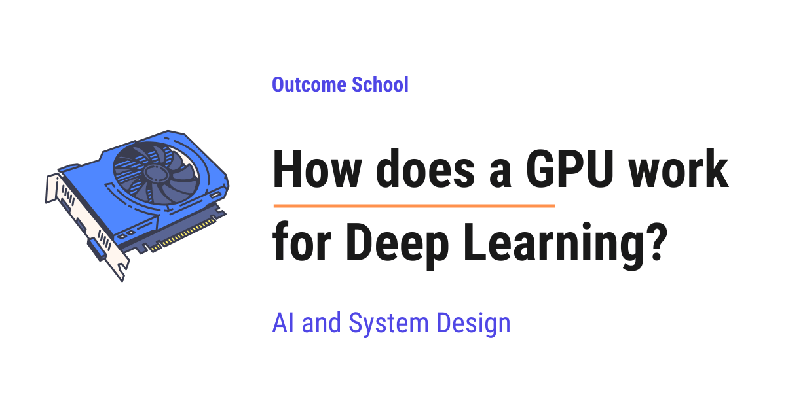

# How does a GPU work for Deep Learning?

> Archived from <https://outcomeschool.com/blog/how-does-a-gpu-work-for-deep-learning> on 2026-11-25.

A GPU works for Deep Learning by doing a huge number of simple calculations at the same time. Deep learning is mostly matrix multiplication, which can be split into many small parallel calculations, so the GPU makes it very fast.

In this blog, we will learn about how a GPU works for Deep Learning. We will also see why the GPU is perfect for deep learning, how they do so much math at the same time, and why companies like NVIDIA power almost all of modern AI.

We will cover the following:
<ul><li>What is a GPU?</li><li>Why is the GPU perfect for deep learning?</li><li>CPU vs GPU</li><li>The math professor and the thousands of students</li><li>Why deep learning is mostly matrix multiplication</li><li>Serial work vs parallel work</li><li>GPU memory (VRAM) and memory bandwidth</li><li>Why the model must fit in VRAM</li><li>Tensor Cores and lower precision (FP16, BF16, INT8)</li><li>CUDA and the software stack (cuDNN)</li><li>Training vs inference on GPUs</li><li>Multiple GPUs working together</li><li>Why NVIDIA GPUs power modern AI</li></ul>
I am <strong>Amit Shekhar</strong>, Founder @ <a target="_blank" rel="noopener noreferrer" href="https://outcomeschool.com">Outcome School</a>, I have taught and mentored many developers, and their efforts landed them high-paying tech jobs, helped many tech companies in solving their unique problems, and created many open-source libraries being used by top companies. I am passionate about sharing knowledge through open-source, blogs, and videos.

I teach <a target="_blank" rel="noopener noreferrer" href="https://outcomeschool.com/program/ai-and-machine-learning">AI and Machine Learning</a> at Outcome School.

Let&#x27;s get started.
<h3 id="what-is-a-gpu">What is a GPU?</h3>
A <strong>GPU</strong> is a special chip inside a computer that is very good at doing a huge number of simple calculations at the same time.

GPU stands for <strong>Graphics Processing Unit</strong>. As the name says, it was first made to draw graphics, like the images in video games.

Let&#x27;s think about why graphics need so much calculation. A screen is made of tiny dots called pixels. A normal screen has millions of these pixels. To draw a game, the computer must decide the color of each one of these millions of pixels, many times every second.

That is a huge amount of work. But here is the interesting part. Each pixel can be calculated on its own, without waiting for the others. They are independent.

So, engineers built a chip that could do millions of small, independent calculations together. That chip is the GPU.

Later, people noticed something. Deep learning needs exactly the same kind of work. It also needs millions of small, independent calculations done at the same time. So, the GPU, which was made for games, became the heart of modern AI.
<h3 id="why-is-the-gpu-perfect-for-deep-learning">Why is the GPU perfect for deep learning?</h3>
Before we go deeper, let us quickly remember what deep learning is.

<strong>Deep learning</strong> is a way of teaching a computer to learn patterns from data using something called a <strong><a target="_blank" rel="noopener noreferrer" href="neural-network.md">neural network</a></strong>.

In simple words, a neural network is a big collection of numbers, called <strong>weights</strong>, that get adjusted again and again until the computer starts giving correct answers.

Now, the important question is: what does a neural network actually do with these numbers?

The answer is simple. It does a lot of multiplication and addition. That is the main work, repeated millions and millions of times.

A CPU can do this work too, but it does it slowly because it does only a few calculations at a time. A GPU can do thousands of these calculations at the same time.

So, here comes the GPU to the rescue. It is built for exactly the kind of work deep learning needs.

To understand this clearly, we must first understand the difference between a CPU and a GPU.
<h3 id="cpu-vs-gpu">CPU vs GPU</h3>
A <strong>CPU</strong> is the main brain of a computer. CPU stands for <strong>Central Processing Unit</strong>.

A CPU has a small number of very powerful <strong>cores</strong>. A core is the part that actually does the calculation. A normal laptop CPU has something like 4, 8, or 16 cores.

Each CPU core is very smart and very fast. It can handle complicated tasks, make decisions, and switch between many different jobs quickly. This is why the CPU runs our operating system, our apps, and almost everything on the computer.

A <strong>GPU</strong> is different. A GPU has thousands of smaller, simpler cores.

Each GPU core is not as smart as a CPU core. It is not good at complicated decision-making. But it is very good at doing one simple thing: multiply and add numbers. And because there are thousands of them, they can do thousands of these simple jobs all at the same time.

Let me tabulate the difference between a CPU and a GPU for your better understanding.
<table><thead><tr><th>Point</th><th>CPU</th><th>GPU</th></tr></thead><tbody><tr><td>Number of cores</td><td>A few (4 to 64)</td><td>Thousands</td></tr><tr><td>Power of each core</td><td>Very powerful and smart</td><td>Simpler</td></tr><tr><td>Best at</td><td>Complex tasks, decisions, running apps</td><td>Many simple calculations at once</td></tr><tr><td>Style of work</td><td>A few things, very fast</td><td>A huge number of things, together</td></tr></tbody></table>
So, the CPU is built for a few hard jobs done quickly. The GPU is built for a massive number of easy jobs done together.

We can picture the two chips side by side as below:

<pre><code class="code-highlight">        CPU                              GPU
+-------------------+      +-------------------------------+
|  +-----+ +-----+  |      | [] [] [] [] [] [] [] [] [] [] |
|  |Core | |Core |  |      | [] [] [] [] [] [] [] [] [] [] |
|  +-----+ +-----+  |      | [] [] [] [] [] [] [] [] [] [] |
|  +-----+ +-----+  |      | [] [] [] [] [] [] [] [] [] [] |
|  |Core | |Core |  |      | [] [] [] [] [] [] [] [] [] [] |
|  +-----+ +-----+  |      | [] [] [] [] [] [] [] [] [] [] |
+-------------------+      +-------------------------------+
   A few big cores              Thousands of small cores
</code></pre>

Here, we can see that the CPU has a few large, powerful cores, while the GPU has thousands of small, simple cores packed together. The CPU&#x27;s big cores are great for a few hard jobs, and the GPU&#x27;s many small cores are great for a huge number of easy jobs done at the same time.

Now, the best way to understand this is by taking an example.
<h3 id="the-math-professor-and-the-thousands-of-students">The math professor and the thousands of students</h3>
Let&#x27;s say we have a giant worksheet with one million simple sums on it. Each sum is something like <code>3 x 4</code> or <code>7 + 2</code>. Nothing hard. Just a million of them.

<strong>Approach 1: One math professor.</strong>

Imagine one brilliant math professor. This professor is extremely smart and very fast. The professor sits down and starts solving the sums one after another.

The professor is fast, but there is only one professor. So, even at high speed, solving one million sums one by one takes a long time.

This professor is like a <strong>CPU core</strong>. Very powerful, but it does the sums in a line, one after the other.

<strong>The issue with this approach is that one worker, however fast, still does the sums one at a time. Let&#x27;s see how the next approach solves this issue.</strong>

<strong>Approach 2: Thousands of students.</strong>

Now imagine a big hall with thousands of school students. Each student is not as fast or as clever as the professor. But each student can easily do a simple sum like <code>3 x 4</code>.

We give one sum to each student. All of them solve their sum at the same moment. In one go, thousands of sums are done together.

This is like a <strong>GPU</strong>. Thousands of simple workers, all solving simple sums at the same time.

For one hard problem, the professor wins. But for a million simple sums, the thousands of students finish much faster, because they all work together.

This is the whole idea. Deep learning is exactly the second kind of problem. It is a giant pile of small, simple sums. So, the GPU, with its thousands of small workers, is the perfect tool.

<strong>Planning your move into AI?</strong>

No matter which tech domain you work in today, with your effort, you can transition to these roles:
<ul><li>AI Engineer</li><li>Forward Deployed Engineer</li><li>AI Agent Engineer</li><li>Harness Engineer</li><li>Voice AI Engineer</li><li>AI Architect</li><li>LLM Engineer</li><li>LLM Inference Engineer</li><li>Gen AI Engineer</li><li>MLOps Engineer</li><li>ML Engineer</li><li>Deep Learning Engineer</li></ul>
Our <a target="_blank" rel="noopener noreferrer" href="https://outcomeschool.com/program/ai-and-machine-learning">AI and Machine Learning Program</a> at Outcome School takes you there.

But why is deep learning a giant pile of simple sums? Let us understand that now.
<h3 id="why-deep-learning-is-mostly-matrix-multiplication">Why deep learning is mostly matrix multiplication</h3>
This is the most important idea in the whole blog, so let us go slowly.

Inside a neural network, the numbers are not stored as a single long list. They are arranged in grids of numbers. A grid of numbers is called a <strong>matrix</strong>.

In simple words, a <strong>matrix</strong> is just numbers arranged in rows and columns, like a table.

For example, a small matrix looks like this:

<pre><code class="code-highlight">[ 1  2 ]
[ 3  4 ]
</code></pre>

A neural network takes the input data as a matrix, and it has its own weights stored as a matrix. To produce an answer, it combines these two matrices using an operation called <a target="_blank" rel="noopener noreferrer" href="matrix-multiplication-in-neural-networks.md"><strong>matrix multiplication</strong></a>.

We do not need the full math. We only need to understand what matrix multiplication really is at heart.

<strong>Matrix multiplication is just a huge number of &quot;multiply and add&quot; steps.</strong>

To get one single number in the result, we multiply some numbers together and then add them up. That single small action is called a <strong>multiply-add</strong>. Then we repeat this for every position in the result.

Let me show a tiny example so it feels real.

Suppose we multiply these two matrices:

<pre><code class="code-highlight">[ 1  2 ]     [ 5  6 ]
[ 3  4 ]  x  [ 7  8 ]
</code></pre>

To get the top-left number of the result, we take the first row <code>[1, 2]</code> and the first column <code>[5, 7]</code>, then we do:

<pre><code class="code-highlight">(1 x 5) + (2 x 7) = 5 + 14 = 19
</code></pre>

That is one multiply-add chain for one position. We then repeat the same idea for the other three positions to fill the result.

Now, here is the key point. Each result position is calculated on its own. The top-left number does not need the top-right number. They are <strong>independent</strong>.

In a real neural network, these matrices are not 2 by 2. They have thousands of rows and thousands of columns. So, a single matrix multiplication can be <strong>millions of multiply-add operations</strong>, and all of them are independent.

Millions of small, independent multiply-add operations. This is exactly the worksheet of a million simple sums from our example. And we already know who is best at that kind of work. The GPU, with its thousands of cores, all working together.

This is why we keep saying it: <strong>deep learning is mostly matrix multiplication, and matrix multiplication is millions of small independent sums done at the same time.</strong>

To learn how neural networks turn data into these matrix multiplications, and even build a Neural Network from scratch, check out our <a target="_blank" rel="noopener noreferrer" href="https://outcomeschool.com/program/ai-and-machine-learning">AI and Machine Learning Program</a> at Outcome School.
<h3 id="serial-work-vs-parallel-work">Serial work vs parallel work</h3>
Now, let us put two important words clearly side by side.

<strong>Serial</strong> means doing things one after another, in a line. First finish one, then start the next.

<strong>Parallel</strong> means doing many things at the same time, together.

A CPU mostly works in a serial way for this kind of math. It is like the single professor. It does multiply-add number one, then number two, then number three. Even though each step is fast, doing millions of them in a line takes time.

A GPU works in a parallel way. It is like the thousands of students. It hands out thousands of multiply-add operations to its thousands of cores, and they all finish together.

Here is a simple picture of the difference:

<pre><code class="code-highlight">CPU (serial):
  add 1 -&gt; add 2 -&gt; add 3 -&gt; add 4 -&gt; ... -&gt; add 1,000,000

GPU (parallel):
  add 1 ---|
  add 2 ---|
  add 3 ---|---&gt; all done together, in batches
  add 4 ---|
  ...   ---|
</code></pre>

Because the multiply-add operations in matrix multiplication are independent, they are a perfect fit for parallel work. Nothing has to wait for anything else.

So, the GPU finishes the same mountain of math much faster than the CPU. That speed is exactly what deep learning needs, because training a model means doing this math billions of times over.

This is how the GPU turns days of work into hours, and hours into minutes.

<strong>A quick note for you</strong>

No matter which tech domain you work in, get familiar with these topics:
<ul><li>LLM</li><li>RAG</li><li>MCP</li><li>Agent</li><li>Fine-tuning</li><li>Quantization</li></ul>
We put it all together in one video:

<a target="_blank" rel="noopener noreferrer" href="https://www.youtube.com/watch?v=lnfWvX66FUk">AI Engineering Explained: LLM, RAG, MCP, Agent, Fine-Tuning, and Quantization</a>

No need to stop reading - bookmark it and watch later when you get time. Future you will thank you.

Now, let&#x27;s get back to the topic.
<h3 id="gpu-memory-vram-and-memory-bandwidth">GPU memory (VRAM) and memory bandwidth</h3>
Doing the math fast is only half the story. The GPU also needs all those numbers close to it so it can work without waiting.

For this, a GPU has its own special memory called <strong>VRAM</strong>, which stands for <strong>Video Random Access Memory</strong>.

Put simply, VRAM is the GPU&#x27;s own personal workspace. It is where the GPU keeps the numbers it is currently working on, such as the model&#x27;s weights and the data being processed.

Think of it like a desk. The bigger the desk, the more papers we can spread out and work on at once. VRAM is that desk for the GPU.

Now, there is one more important word: <strong>memory bandwidth</strong>.

<strong>Memory bandwidth</strong> is how fast the GPU can move numbers between its memory and its cores.

Let&#x27;s say we have a desk full of papers, but a very narrow door to bring papers in and out. Even with a big desk, work slows down because papers cannot move quickly. A wide door means papers move fast. Memory bandwidth is the width of that door.

GPUs are built with very high memory bandwidth. This means the thousands of cores never sit idle waiting for numbers. The numbers keep flowing in fast, and the cores keep working.

We can picture how the numbers flow inside the GPU as below:

<pre><code class="code-highlight">+-----------------------------+
|   VRAM (the big desk)       |
|   weights + data live here  |
+-----------------------------+
              |
              |  memory bandwidth
              |  (how wide the door is)
              v
+-----------------------------+
|   Thousands of GPU cores    |
|   do the multiply-add math  |
+-----------------------------+
</code></pre>

Here, we can see that the numbers sit in VRAM, the GPU&#x27;s big desk, and then travel down to the thousands of cores through the memory bandwidth, the door. A wider door means the cores are fed faster and never wait, so the math keeps moving without pause.

So, two things matter for a GPU: how many calculations it can do, and how fast it can feed numbers to those calculations. A good GPU is strong at both.
<h3 id="why-the-model-must-fit-in-vram">Why the model must fit in VRAM</h3>
This brings us to a very practical point that everyone working with AI runs into.

<strong>To train or run a model on a GPU, the model and its data must fit inside the VRAM.</strong>

Remember, VRAM is the GPU&#x27;s desk. If the model is too big for the desk, we simply cannot spread it out to work on it.

Let&#x27;s understand the size with a simple idea. Every weight in a neural network is a number, and each number takes up some space in memory. A large model has billions of weights. Billions of numbers take up a lot of space.

For example, a model with billions of weights can need <a target="_blank" rel="noopener noreferrer" href="llm-gpu-memory.md">many gigabytes of VRAM just to hold the weights</a>. During training, it needs even more space to hold extra working numbers.

This is why we hear about GPUs with large VRAM, such as 24 GB, 40 GB, or 80 GB. The bigger the model, the more VRAM we need.

<strong>Note:</strong> This is also why very large models are split across many GPUs. One GPU&#x27;s desk is not big enough, so several GPUs share the load. We will talk about multiple GPUs a little later.

So, when we choose a GPU for deep learning, we do not only look at its speed. We also look at how much VRAM it has, because that decides how big a model we can run.
<h3 id="tensor-cores-and-lower-precision-fp16-bf16-int8">Tensor Cores and lower precision (FP16, BF16, INT8)</h3>
We now know the GPU has thousands of normal cores doing multiply-add operations. But GPU makers added something even better for deep learning.

These special units are called <strong>Tensor Cores</strong>.

A <strong>Tensor Core</strong> is a special unit inside the GPU built to do matrix multiplication even faster than a normal core.

In simple words, a normal core does a few multiply-adds at a time. A Tensor Core is designed to chew through a whole small block of matrix math in one shot. Since deep learning is mostly matrix math, Tensor Cores give a big speed boost.

To go even faster, Tensor Cores use something called <strong>lower precision</strong>. Let us understand what that means.

A number on a computer can be stored with more detail or less detail.
<ul><li><strong>FP32</strong> means a number stored with 32 bits of detail. This is high precision, very accurate, but it takes more space and time.</li><li><strong>FP16</strong> and <strong>BF16</strong> mean a number stored with 16 bits of detail. This is lower precision, a little less exact, but it takes half the space and is faster to compute.</li><li><strong>INT8</strong> means a number stored as a small whole number using only 8 bits. This is even lower precision, even smaller, and even faster.</li></ul>
Here, FP stands for <strong>floating point</strong>, which simply means a number that can have a decimal part, like <code>3.14</code>. BF stands for <strong>brain floating point</strong>, a format made specially for deep learning. INT stands for <strong>integer</strong>, which means a whole number.

Now, the natural question is: if lower precision is less exact, why use it?

The answer is that deep learning does not always need perfect precision. A neural network is doing approximate pattern matching, not exact bank accounting. A tiny rounding here and there usually does not change the final answer in a meaningful way.

So, by using FP16 or BF16, the GPU does the math roughly twice as fast and uses half the memory, with almost no loss in the quality of the model. This is a wonderful trade, and it is why lower precision is used so much in deep learning.

INT8 is often used for <strong>inference</strong>, which means using a model after it is trained, to make it run even faster and lighter. We will explain inference clearly in the next section.

Deliberately converting a trained model&#x27;s numbers down to this lower precision is called <strong>quantization</strong>. We have a detailed blog on <a target="_blank" rel="noopener noreferrer" href="how-does-model-quantization-work.md">how Model Quantization works</a> that explains how we do it without losing much accuracy.

So, Tensor Cores plus lower precision are a big reason modern GPUs are so fast at deep learning.

If we want to go deep into Quantization, Model Compression, and the optimizations that make models smaller and faster, our <a target="_blank" rel="noopener noreferrer" href="https://outcomeschool.com/program/ai-and-machine-learning">AI and Machine Learning Program</a> at Outcome School covers them end to end.
<h3 id="cuda-and-the-software-stack-cudnn">CUDA and the software stack (cuDNN)</h3>
So far we have talked about the GPU hardware. But hardware alone is not enough. We need software to tell the GPU what to do. This is where <strong><a target="_blank" rel="noopener noreferrer" href="how-do-cuda-kernels-work.md">CUDA</a></strong> comes into the picture.

<strong>CUDA</strong> is the software platform from NVIDIA that lets programmers run their code on the GPU.

Here is the simple idea. Normal code is written for the CPU. CUDA is the bridge that lets a program send its heavy math to the GPU instead.

On top of CUDA, NVIDIA built another library called <strong>cuDNN</strong>, which stands for <strong>CUDA Deep Neural Network library</strong>.

cuDNN is a ready-made toolbox of highly optimized deep learning operations, such as matrix multiplication and the building blocks of neural networks. The NVIDIA engineers spent huge effort making these operations run as fast as possible on the GPU.

Now, here is the part that makes life easy for us. Most people never write CUDA or cuDNN directly. We use deep learning frameworks like <strong><a target="_blank" rel="noopener noreferrer" href="how-does-pytorch-work.md">PyTorch</a></strong> or <strong><a target="_blank" rel="noopener noreferrer" href="how-does-the-machine-learning-library-tensorflow-work.md">TensorFlow</a></strong>.

These frameworks sit on top of cuDNN, which sits on top of CUDA, which sits on top of the GPU.

Let us see the full stack as a simple picture:

<pre><code class="code-highlight">Our Python code (PyTorch / TensorFlow)
            |
          cuDNN   (fast deep learning operations)
            |
          CUDA    (bridge to the GPU)
            |
          GPU     (the hardware doing the math)
</code></pre>

So, when we write a few simple lines in PyTorch, all these layers work together to run our math on the thousands of GPU cores.

For example, in PyTorch we move our work to the GPU with one short line as below:

<pre><code class="code-highlight language-python">import torch

# create a tensor (a matrix of numbers) and send it to the GPU
x = torch.randn(1000, 1000).to(&quot;cuda&quot;)
y = torch.randn(1000, 1000).to(&quot;cuda&quot;)

# this matrix multiplication now runs on the GPU
result = x @ y
</code></pre>

Here, we can see that <code>.to(&quot;cuda&quot;)</code> moves our numbers onto the GPU. After that, the multiplication <code>x @ y</code> runs on the GPU using all those cores and Tensor Cores. We wrote simple code, and CUDA and cuDNN did the heavy lifting underneath.

NVIDIA builds one more layer on top of this stack, meant only for running a finished large language model as fast as the hardware allows. We have a detailed blog on <a target="_blank" rel="noopener noreferrer" href="how-does-tensorrt-llm-work.md">how TensorRT-LLM works</a> that walks through it step by step.

This is how the software stack lets us use the full power of the GPU without writing low-level code.
<h3 id="training-vs-inference-on-gpus">Training vs inference on GPUs</h3>
We have used the words training and inference. Now, let us understand both clearly, because the GPU is used in both, but in different ways.

<strong>Training</strong> is the phase where the model learns. We show the model lots of data, it makes guesses, we measure how wrong it is, and then it adjusts its weights to do better next time. This loop repeats again and again over huge amounts of data.

Training is extremely heavy. It does the matrix math forward to make a guess, and then it does even more math backward to update the weights. So, training needs a lot of GPU power and a lot of VRAM. This is the most expensive part of building an AI model.

<strong>Inference</strong> is the phase where we use the already trained model to get answers. For example, when we type a question into a chatbot and it replies, that is inference.

Inference is lighter than training. It only does the forward math to produce an answer. It does not do the backward updating, because the model is already trained.

Let me tabulate the difference between training and inference for your better understanding.
<table><thead><tr><th>Point</th><th>Training</th><th>Inference</th></tr></thead><tbody><tr><td>Goal</td><td>Teach the model</td><td>Use the trained model</td></tr><tr><td>Math involved</td><td>Forward and backward</td><td>Forward only</td></tr><tr><td>GPU power needed</td><td>Very high</td><td>Lower</td></tr><tr><td>When it happens</td><td>Once, while building</td><td>Every time a user asks</td></tr></tbody></table>
The lower precision like INT8 is often used in inference, because we want answers to come out fast and cheap once the model is already trained.

So, the GPU helps us both build the model and then <a target="_blank" rel="noopener noreferrer" href="model-serving.md">serve it to users</a>.

To master model training, fine-tuning, and LLM Inference Engineering from the ground up, check out our <a target="_blank" rel="noopener noreferrer" href="https://outcomeschool.com/program/ai-and-machine-learning">AI and Machine Learning Program</a> at Outcome School.
<h3 id="multiple-gpus-working-together">Multiple GPUs working together</h3>
Sometimes one GPU is simply not enough. The model can be too big to fit in one GPU&#x27;s VRAM, or the training can be so heavy that one GPU would take too long.

So, here comes the idea of using <a target="_blank" rel="noopener noreferrer" href="distributed-training.md"><strong>multiple GPUs working together</strong></a>.

There are two main ways to do this. Let us understand both in simple words.

<strong>Data parallelism.</strong> We put a full copy of the model on each GPU. Then we split the training data into pieces and give a different piece to each GPU. Each GPU trains on its piece at the same time, and then they share what they learned and stay in sync. This makes training faster because many GPUs learn together.

<strong>Model parallelism.</strong> When the model is too big to fit on one GPU, we cut the model itself into parts and put different parts on different GPUs. Each GPU holds and runs only its part, and they pass results to each other. This lets us run a model that is far larger than any single GPU&#x27;s VRAM.

For the GPUs to work together well, they must talk to each other very fast. NVIDIA built a high-speed connection called <strong>NVLink</strong> for this, so GPUs can pass numbers between them quickly without slowing down.

Here is a simple picture of data parallelism:

<pre><code class="code-highlight">        Training data split into pieces
        /            |            \
    GPU 1          GPU 2          GPU 3
  (full model)  (full model)  (full model)
        \            |            /
          share and stay in sync
</code></pre>

So, by combining many GPUs, we can train very large models that one GPU could never handle alone.

<strong>Stay updated:</strong> Subscribe to our <a target="_blank" rel="noopener noreferrer" href="https://outcomeschool.substack.com/subscribe">newsletter</a> to get our latest AI and Machine Learning blogs straight to your inbox.
<h3 id="why-nvidia-gpus-power-modern-ai">Why NVIDIA GPUs power modern AI</h3>
Now, let us tie everything together and answer a question many people ask: why is NVIDIA the name we hear behind almost all modern AI?

There are a few clear reasons.

First, NVIDIA GPUs have the right hardware. Thousands of cores, special Tensor Cores, large VRAM, high memory bandwidth, and fast NVLink connections between GPUs. All of this is exactly what deep learning needs.

Second, and this is just as important, NVIDIA built the software too. CUDA and cuDNN have been around for many years and are deeply trusted. The most popular frameworks, PyTorch and TensorFlow, are built to work smoothly on top of them. So, when a researcher writes code, it just works on NVIDIA GPUs.

This combination of strong hardware and mature software is why NVIDIA became the default choice.

NVIDIA is not the only company building chips for this. Google built its own accelerator, the TPU, for the same job. We have a detailed blog on <a target="_blank" rel="noopener noreferrer" href="how-does-a-google-tpu-work.md">how a Google TPU works</a> that walks through it step by step. Others went one step further and built a chip that only runs already-trained language models, and we have a detailed blog on <a target="_blank" rel="noopener noreferrer" href="how-does-an-lpu-work.md">how an LPU works</a> that explains that design in depth.

This is why <strong>large language models</strong>, the kind of AI behind chatbots and writing assistants, are trained on huge clusters of NVIDIA GPUs. These models have billions of weights and need billions of matrix multiplications. Training them can take thousands of GPUs running together for weeks.

Let us recall the whole journey in one breath. Deep learning is mostly matrix multiplication. Matrix multiplication is millions of small, independent multiply-add operations. A GPU has thousands of cores that do these operations in parallel, Tensor Cores that do them even faster at lower precision, and fast VRAM to feed them. CUDA and cuDNN let our simple code use all of this power. And when one GPU is not enough, many GPUs join hands to train the largest models in the world.

This is how a GPU works for Deep Learning.
<h2 id="frequently-asked-questions">Frequently Asked Questions</h2><h3 id="can-we-train-a-deep-learning-model-on-a-cpu-instead-of-a-gpu">Can we train a deep learning model on a CPU instead of a GPU?</h3>
Yes, but it is slow. A CPU can do the multiply-and-add work too, but it does only a few calculations at a time, mostly in a serial way. A GPU has thousands of cores that do these independent calculations in parallel, which is why it turns days of work into hours for deep learning.
<h3 id="does-using-fp16-or-bf16-hurt-model-quality">Does using FP16 or BF16 hurt model quality?</h3>
Usually, almost not at all. A neural network is doing approximate pattern matching, so a tiny rounding here and there usually does not change the final answer in a meaningful way. With FP16 or BF16, the GPU does the math roughly twice as fast and uses half the memory, which is a wonderful trade.
<h3 id="do-we-need-to-write-cuda-code-to-use-a-gpu-for-deep-learning">Do we need to write CUDA code to use a GPU for deep learning?</h3>
No. Most people never write CUDA or cuDNN directly. We use frameworks like PyTorch or TensorFlow, which sit on top of cuDNN and CUDA. In PyTorch, we can move our numbers to the GPU with <code>.to(&quot;cuda&quot;)</code>, and the math then runs on the GPU cores and Tensor Cores.
<h3 id="what-happens-if-a-model-is-too-big-for-one-gpus-vram">What happens if a model is too big for one GPU&#x27;s VRAM?</h3>
We cannot run it on that single GPU, so we split it across multiple GPUs. This is called model parallelism, where different parts of the model sit on different GPUs and pass results to each other. NVIDIA built NVLink so these GPUs can pass numbers between them quickly.
<h3 id="does-inference-need-as-much-gpu-power-as-training">Does inference need as much GPU power as training?</h3>
No. Training does the matrix math forward and then even more math backward to update the weights, so it needs a lot of GPU power and VRAM. Inference only does the forward math, so it is lighter. Lower precision like INT8 is often used in inference to make answers come out fast and cheap.

That&#x27;s it for now.

Thanks

<strong>Amit Shekhar</strong> Founder @ <a target="_blank" rel="noopener noreferrer" href="https://outcomeschool.com">Outcome School</a>

You can connect with me on:
<ul><li><a target="_blank" rel="noopener noreferrer" href="https://x.com/amitiitbhu">X</a></li><li><a target="_blank" rel="noopener noreferrer" href="https://www.linkedin.com/in/amit-shekhar-iitbhu">LinkedIn</a></li><li><a target="_blank" rel="noopener noreferrer" href="https://github.com/amitshekhariitbhu">GitHub</a></li></ul>
Follow Outcome School on:
<ul><li><a target="_blank" rel="noopener noreferrer" href="https://x.com/outcome_school">X</a></li><li><a target="_blank" rel="noopener noreferrer" href="https://youtube.com/@OutcomeSchool">YouTube</a></li><li><a target="_blank" rel="noopener noreferrer" href="https://www.linkedin.com/company/outcomeschool">LinkedIn</a></li><li><a target="_blank" rel="noopener noreferrer" href="https://github.com/OutcomeSchool">GitHub</a></li></ul>
<a target="_blank" rel="noopener noreferrer" href="https://outcomeschool.com/blog"><strong>Read all of our high-quality blogs here.</strong></a>

