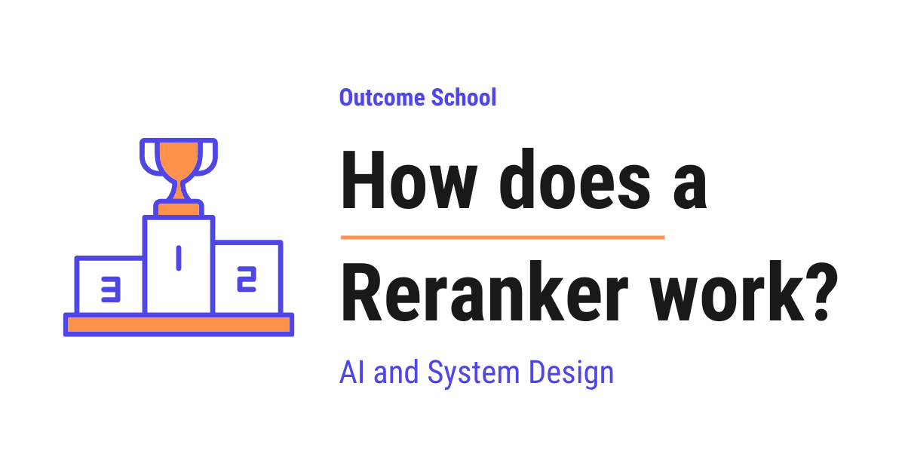

# How does a Reranker work?

> Archived from <https://outcomeschool.com/blog/how-does-a-reranker-work> on 2026-11-25.

A Reranker is a model that takes a list of documents and reorders them, putting the most relevant ones at the top for a given question. In simple words, it is a smart sorter that sits after the first fast search.

In this blog, we will learn about how a Reranker works. We will also see where it sits in a search and RAG pipeline, why we need it, and how it makes our answers more accurate.

We will cover the following:
<ul><li>What is a Reranker?</li><li>Where a Reranker sits in a search / RAG pipeline</li><li>The two-stage retrieval idea</li><li>Why first-stage retrieval is fast but not precise</li><li>Bi-encoder vs Cross-encoder</li><li>How a Reranker scores documents step by step</li><li>The accuracy vs latency and cost trade-off</li><li>Late-interaction models like ColBERT</li><li>Real examples of Rerankers</li><li>Why Rerankers matter for RAG</li></ul>
I am <strong>Amit Shekhar</strong>, Founder @ <a target="_blank" rel="noopener noreferrer" href="https://outcomeschool.com">Outcome School</a>, I have taught and mentored many developers, and their efforts landed them high-paying tech jobs, helped many tech companies in solving their unique problems, and created many open-source libraries being used by top companies. I am passionate about sharing knowledge through open-source, blogs, and videos.

I teach <a target="_blank" rel="noopener noreferrer" href="https://outcomeschool.com/program/ai-and-machine-learning">AI and Machine Learning</a> at Outcome School.

Let&#x27;s get started.
<h3 id="what-is-a-reranker">What is a Reranker?</h3>
<strong>A Reranker is a model that takes a list of documents and reorders them, putting the most relevant ones at the top for a given question.</strong>

In simple words, a Reranker is a smart sorter. We give it a question and a small pile of documents. It reads each document carefully against the question and decides which one answers the question best. Then it arranges them from most relevant to least relevant.

Let&#x27;s say we go to a library and ask the librarian for books on &quot;healthy cooking&quot;. A junior helper quickly runs around and brings us 50 books that have the words &quot;healthy&quot; or &quot;cooking&quot; somewhere on the cover. That is a fast but rough first pass.

Now, a senior librarian sits down, opens each of those 50 books, and actually reads a few pages. She knows that one book is about cooking for athletes, another is a diet plan, and another only mentions cooking once in passing. She reorders the pile so the best matches are on top.

That senior librarian is the Reranker.

So, the Reranker does not search the whole world. It only re-arranges a shortlist that someone else already gathered. It does not invent new documents and it does not go and find more. It simply reorders what it is given. This single idea is the heart of everything we will learn today.
<h3 id="where-a-reranker-sits-in-a-search--rag-pipeline">Where a Reranker sits in a search / RAG pipeline</h3>
Before we go deeper, we must understand where the Reranker lives in a real system.

Most modern search systems and AI question-answering systems follow a pipeline. A pipeline is just a series of steps where the output of one step becomes the input of the next step.

Let&#x27;s talk about <strong><a target="_blank" rel="noopener noreferrer" href="retrieval-augmented-generation-rag.md">RAG</a></strong> for a moment, because Rerankers are very popular there. RAG stands for <strong>Retrieval-Augmented Generation</strong>. In simple words, it is a technique where, before an AI model answers our question, we first fetch some relevant documents and hand them to the model so it can answer using real facts instead of guessing.

So in RAG, the flow looks like below:

<pre><code class="code-highlight">Question
   |
   v
[ Retriever ]   --&gt; fetches many candidate documents (fast, rough)
   |
   v
[ Reranker ]    --&gt; reorders the candidates by true relevance (slow, precise)
   |
   v
[ LLM ]         --&gt; reads the best documents and writes the final answer
   |
   v
Answer
</code></pre>

Here, the <strong>LLM</strong> is the AI model that writes the final answer in plain language. LLM stands for Large Language Model. We can see that the Reranker sits right in the middle. It comes after the first fetch and before the AI writes the answer. Its only job is to clean up and reorder what the first step found, so that the AI reads the best material.

We have a detailed blog on <a target="_blank" rel="noopener noreferrer" href="agentic-rag.md">Agentic RAG</a> that covers how modern RAG systems retrieve and reason over multiple sources.

Now, the question is, why do we need two separate steps at all? Why not let one model do everything? To answer that, we need to understand the two-stage retrieval idea.
<h3 id="the-two-stage-retrieval-idea">The two-stage retrieval idea</h3>
Imagine we have a huge collection of documents. It can be millions of web pages, or thousands of company documents, or the chapters of many books. We call this big collection the <strong>corpus</strong>.

When a user asks a question, in theory the perfect approach would be to carefully read every single document in the corpus and pick the best ones. But reading millions of documents carefully for every question would take forever. It would be too slow and too expensive.

So, here comes the two-stage approach to the rescue.

<strong>Stage 1 - Retrieval:</strong> A fast retriever quickly scans the entire corpus and pulls out a list of maybe 100 or 200 candidate documents that look roughly related to the question. This stage is built for speed. It is allowed to be a little sloppy.

<strong>Stage 2 - Reranking:</strong> The Reranker takes only that shortlist of 100 or 200 candidates and reads each one carefully against the question. It then reorders them and we keep only the top few, for example the top 5 or top 10.

Let&#x27;s see this with a simple picture:

<pre><code class="code-highlight">Corpus (1,000,000 documents)
        |
        |  Stage 1: fast retriever
        v
   100 candidates  (rough shortlist)
        |
        |  Stage 2: reranker
        v
   Top 5 documents  (carefully reordered, most relevant)
</code></pre>

Here, we can notice the trick. We never run the slow, careful model on all one million documents. We only run it on the 100 that survived the first stage. This way we get both speed and accuracy.

This is the central idea. The first stage trades precision for speed. The second stage trades speed for precision. Together, they give us the best of both.

<strong>Planning your move into AI?</strong>

No matter which tech domain you work in today, with your effort, you can transition to these roles:
<ul><li>AI Engineer</li><li>Forward Deployed Engineer</li><li>AI Agent Engineer</li><li>Harness Engineer</li><li>Voice AI Engineer</li><li>AI Architect</li><li>LLM Engineer</li><li>LLM Inference Engineer</li><li>Gen AI Engineer</li><li>MLOps Engineer</li><li>ML Engineer</li><li>Deep Learning Engineer</li></ul>
Our <a target="_blank" rel="noopener noreferrer" href="https://outcomeschool.com/program/ai-and-machine-learning">AI and Machine Learning Program</a> at Outcome School takes you there.
<h3 id="why-first-stage-retrieval-is-fast-but-not-precise">Why first-stage retrieval is fast but not precise</h3>
Now, let&#x27;s understand the first stage better, because understanding its weakness is exactly why the Reranker exists.

There are two common ways to do first-stage retrieval, and many real systems combine both into what is called <a target="_blank" rel="noopener noreferrer" href="how-does-hybrid-search-work.md">Hybrid Search</a>. Let&#x27;s understand both in simple words.

<strong><a target="_blank" rel="noopener noreferrer" href="bm25.md">BM25</a> (keyword search):</strong> This is the classic way. It matches the words in the question with the words in the documents. If the question says &quot;healthy cooking&quot;, it looks for documents that contain those exact words and rewards documents where the rarer, more meaningful words appear more often. It is fast and it works well, but it only understands exact words. It does not understand meaning. If a document says &quot;nutritious recipes&quot; instead of &quot;healthy cooking&quot;, BM25 will struggle, because the words are different even though the meaning is the same.

<strong>Vector search (<a target="_blank" rel="noopener noreferrer" href="how-does-semantic-search-work.md">semantic search</a>):</strong> This is the modern way. Here, every document is converted into a list of numbers called an <strong><a target="_blank" rel="noopener noreferrer" href="what-are-embeddings.md">embedding</a></strong>. An embedding is a way to represent the meaning of a piece of text as a point in space. Texts with similar meaning end up close to each other, and texts with different meaning end up far apart. When a question comes, we turn the question into an embedding too, and then we look for the documents whose embeddings are closest to the question&#x27;s embedding.

We have a detailed blog on <a target="_blank" rel="noopener noreferrer" href="how-does-a-vector-database-work.md">how a Vector Database works</a> that explains embeddings and vector search in depth.

Vector search is wonderful because it understands meaning, not just words. But it is still not perfect.

Here is the catch. In vector search, the question and the documents are turned into embeddings completely separately, ahead of time. The model never gets to look at the question and a document together. It compresses an entire document into one fixed list of numbers before it ever sees our question. A lot of fine detail is lost in that compression.

Let&#x27;s say we ask, &quot;Which medicine should I avoid if I have high blood pressure?&quot; A document that talks a lot about blood pressure and medicines in general will look very close in vector space, even if it never actually says which medicine to avoid. The embedding captures the broad topic, but it can miss the precise answer.

So, first-stage retrieval is fast and gives us a good rough shortlist. But it often puts a &quot;kind of related&quot; document above the &quot;exactly right&quot; document. It gets us into the right neighborhood, but not to the right house.

One way to improve the first stage itself is <a target="_blank" rel="noopener noreferrer" href="how-does-hyde-work.md">HyDE</a>, where we search with a hypothetical answer instead of the raw question, so the query is shaped more like the documents we want. Another is <a target="_blank" rel="noopener noreferrer" href="how-do-query-rewriting-and-multi-query-retrieval-work.md">Multi-Query Retrieval</a>, where an LLM writes several versions of the question, we search with each of them, and we merge the results.

This is exactly the gap the Reranker fills. To understand how it does a better job, we must learn about two types of models.
<h3 id="bi-encoder-vs-cross-encoder">Bi-encoder vs Cross-encoder</h3>
This is the most important part of the blog, so let&#x27;s go slowly.

A first-stage retriever using vector search is built on a <strong>bi-encoder</strong>. The Reranker is built on a <strong>cross-encoder</strong>. The names sound similar, but the difference between them is the whole secret.

<strong>Bi-encoder:</strong> The word &quot;bi&quot; means two. A bi-encoder uses two separate passes. It encodes the question on its own, and it encodes each document on its own, into separate embeddings. The question never meets the document inside the model. Only at the very end do we compare the two embeddings to see how close they are.

Let&#x27;s picture it like below:

<pre><code class="code-highlight">BI-ENCODER (used for fast retrieval)

  Question  --&gt;  [encoder]  --&gt;  [ vector A ]
                                       \
                                        compare distance --&gt; score
                                       /
  Document  --&gt;  [encoder]  --&gt;  [ vector B ]
</code></pre>

Here, the big advantage is speed. Because each document is encoded by itself, we can encode all our documents once, in advance, and store their embeddings. When a question arrives, we only encode the question and compare. That is why vector search over millions of documents can be very fast. The structure that makes this fast over so many vectors is <a target="_blank" rel="noopener noreferrer" href="how-does-approximate-nearest-neighbor-ann-search-work.md">Approximate Nearest Neighbor (ANN) search</a>, which skips most of the comparisons.

But the disadvantage is precision. The model decided what each document &quot;means&quot; without ever knowing what we would ask. It had to guess in advance which details matter.

<strong>Cross-encoder:</strong> The word &quot;cross&quot; means crossing or combining. A cross-encoder takes the question and one document and feeds them in together, joined as a single input. The model reads them side by side and can directly relate each word of the question to each word of the document. At the end, it outputs a single number, a <strong>relevance score</strong>, that says how well this document answers this question.

Let&#x27;s picture it like below:

<pre><code class="code-highlight">CROSS-ENCODER (used for reranking)

  Question + Document  --&gt;  [ model reads them together ]  --&gt;  relevance score (for example, 0.92)
</code></pre>

Here, the advantage is accuracy. Because the model sees the question and the document at the same time, it can catch fine details. It can notice that the document really does name the exact medicine to avoid, and not just talk about medicines in general.

But the disadvantage is speed. The cross-encoder must run fresh for every single question-document pair. Nothing can be prepared in advance, because the question is new every time. If we had a million documents, we would have to run the cross-encoder a million times for one question. That is far too slow.

Let me tabulate the differences between a bi-encoder and a cross-encoder for your better understanding so that you can decide which one to use based on your use case.
<table><thead><tr><th>Point</th><th>Bi-encoder</th><th>Cross-encoder</th></tr></thead><tbody><tr><td>How it reads</td><td>Question and document separately</td><td>Question and document together</td></tr><tr><td>Output</td><td>One embedding per text</td><td>One relevance score per pair</td></tr><tr><td>Speed</td><td>Very fast</td><td>Slow</td></tr><tr><td>Precision</td><td>Good, but loses fine detail</td><td>High, catches fine detail</td></tr><tr><td>Can precompute?</td><td>Yes, embed documents in advance</td><td>No, must run per question</td></tr><tr><td>Best used for</td><td>First-stage retrieval over the full corpus</td><td>Reranking a small shortlist</td></tr></tbody></table>
So now we can clearly see the plan. We use the fast bi-encoder to shortlist many candidates, and then we use the accurate cross-encoder to reorder only that shortlist. The Reranker is the cross-encoder.

To go deep into Embeddings and Vector Databases, we have a complete program on this - check out our <a target="_blank" rel="noopener noreferrer" href="https://outcomeschool.com/program/ai-and-machine-learning">AI and Machine Learning Program</a> at Outcome School.
<h3 id="how-a-reranker-scores-documents-step-by-step">How a Reranker scores documents step by step</h3>
Now, let&#x27;s walk through exactly what a Reranker does when a question comes in. We will use small numbers for the sake of understanding.

Suppose the user asks: &quot;What is the capital of France?&quot;

The first-stage retriever returns 4 candidate documents:
<ul><li>Document 1: &quot;France is a country in Europe known for its food and culture.&quot;</li><li>Document 2: &quot;Paris is the capital and largest city of France.&quot;</li><li>Document 3: &quot;The Eiffel Tower is located in Paris and is very famous.&quot;</li><li>Document 4: &quot;Berlin is the capital of Germany.&quot;</li></ul>
<strong>Step 1:</strong> The Reranker pairs the question with each document, one at a time. So we form 4 pairs.

<strong>Step 2:</strong> It feeds each pair into the cross-encoder, which reads the question and that document together and produces a relevance score. A higher score means more relevant.

Let&#x27;s say the scores come out like below:

<pre><code class="code-highlight">Question: &quot;What is the capital of France?&quot;

(Question + Document 1)  --&gt;  cross-encoder  --&gt;  0.34
(Question + Document 2)  --&gt;  cross-encoder  --&gt;  0.97
(Question + Document 3)  --&gt;  cross-encoder  --&gt;  0.55
(Question + Document 4)  --&gt;  cross-encoder  --&gt;  0.21
</code></pre>

Here, we can see that Document 2 scored the highest, because it directly says Paris is the capital of France. Document 3 scored in the middle because it mentions Paris but does not actually answer the question. Document 4 scored low because it is about Germany, even though it shares the word &quot;capital&quot;. The exact numbers do not matter on their own. What matters is the order they give us.

<strong>Step 3:</strong> The Reranker sorts the documents by score, from highest to lowest.

After sorting, the order becomes: Document 2, Document 3, Document 1, Document 4.

We can picture this reordering as below:

<pre><code class="code-highlight">   BEFORE (first-stage order)            AFTER (reranked order)

   +-----------------------+             +-----------------------+
   | 1. Document 1  (0.34) |             | 1. Document 2  (0.97) |
   | 2. Document 4  (0.21) |   rerank    | 2. Document 3  (0.55) |
   | 3. Document 2  (0.97) |   -------&gt;  | 3. Document 1  (0.34) |
   | 4. Document 3  (0.55) |             | 4. Document 4  (0.21) |
   +-----------------------+             +-----------------------+
</code></pre>

Here, we can notice that the first-stage order on the left is messy, because Document 4 about Germany was placed high just for sharing the word &quot;capital&quot;, while the truly correct Document 2 was buried lower. After reranking on the right, the documents are sorted purely by their relevance score, so Document 2 rises to the very top and Document 4 sinks to the bottom.

<strong>Step 4:</strong> We keep only the top-k documents. If we choose top-2, we keep Document 2 and Document 3.

Notice something important. The first-stage retriever often places a document like Document 4 high, because it shares the strong word &quot;capital&quot; with the question. The Reranker fixed this mistake by actually understanding the meaning. It pushed the truly correct document, Document 2, to the very top.

This is how a Reranker works in practice. It scores, it sorts, and we take the top few. Problem Solved.

In a RAG system, those top-2 documents are then handed to the AI model, which reads them and writes a clean answer like &quot;The capital of France is Paris.&quot; The better the documents we hand over, the better the final answer. The Reranker makes sure we hand over the best documents.

<strong>A quick note for you</strong>

No matter which tech domain you work in, get familiar with these topics:
<ul><li>LLM</li><li>RAG</li><li>MCP</li><li>Agent</li><li>Fine-tuning</li><li>Quantization</li></ul>
We put it all together in one video:

<a target="_blank" rel="noopener noreferrer" href="https://www.youtube.com/watch?v=lnfWvX66FUk">AI Engineering Explained: LLM, RAG, MCP, Agent, Fine-Tuning, and Quantization</a>

No need to stop reading - bookmark it and watch later when you get time. Future you will thank you.

Now, let&#x27;s get back to the topic.
<h3 id="the-accuracy-vs-latency-and-cost-trade-off">The accuracy vs latency and cost trade-off</h3>
Now, we must talk about the cost, because this is exactly why we do not just rerank everything. Two things matter here. One is <strong>latency</strong>, which simply means how long the user waits for an answer. The other is the money cost of running the model.

A cross-encoder is powerful but slow and expensive to run. Every question-document pair needs a full pass through the model. So the more documents we rerank, the more time and money it takes.

Let&#x27;s say running the cross-encoder on one pair takes a tiny moment. Running it on 100 pairs is fine, it stays fast enough for a user to wait. But running it on one million pairs for every question would be painfully slow and would cost a fortune.

This is the whole reason for the two-stage design. We let the cheap, fast bi-encoder handle the millions, and we save the expensive, accurate cross-encoder for the small shortlist.

<pre><code class="code-highlight">Run cross-encoder on ALL 1,000,000 docs  --&gt;  extremely slow and costly  (we avoid this)

Run cross-encoder on TOP 100 only         --&gt;  fast enough and very accurate  (we do this)
</code></pre>

So, the Reranker gives us a careful, high-quality reordering, but we apply it only where it pays off. We balance accuracy against latency and cost by choosing how many candidates to rerank. A common choice is to retrieve 100 to 200 candidates and rerank them down to the top 5 or top 10, which also keeps the final prompt short, so a genuinely relevant document does not get <a target="_blank" rel="noopener noreferrer" href="lost-in-the-middle-problem-in-llms.md">lost in the middle</a> of a long prompt.

<strong>Note:</strong> The number of candidates we rerank is a knob we can tune. More candidates means higher accuracy but more cost and a slower response. Fewer candidates means faster and cheaper but we risk missing a good document that the first stage ranked low. We pick the balance based on our use case.
<h3 id="late-interaction-models-like-colbert">Late-interaction models like ColBERT</h3>
We have seen two extremes. The bi-encoder is fast but rough. The cross-encoder is precise but slow. Now, the next question is, can we have something in the middle? The answer is yes.

There is a family of models called <strong>late-interaction models</strong>, and the most well-known one is called <strong><a target="_blank" rel="noopener noreferrer" href="decoding-colbert.md">ColBERT</a></strong>, which is short for <strong>Contextualized Late Interaction over BERT</strong>.

In simple words, a late-interaction model is a clever middle ground between a bi-encoder and a cross-encoder.

Let&#x27;s understand the idea gently. A normal bi-encoder squeezes a whole document into one single embedding. ColBERT does not do that. Instead, it keeps a separate small embedding for each word in the document, and it can compute these document embeddings in advance, just like a bi-encoder. That keeps it fast.

Then, at question time, it compares the words of the question against the words of the document in a fine-grained way and adds up the best matches. This word-by-word comparison happens late, which is why it is called &quot;late interaction&quot;. It recovers a lot of the fine detail that a normal bi-encoder loses.

So, ColBERT sits between the two worlds. It is more precise than a plain bi-encoder because it compares at the word level, and it is faster than a cross-encoder because it precomputes the document side. We can think of it as a faster, lighter way to get some of the Reranker&#x27;s accuracy.

<strong>Stay updated:</strong> Subscribe to our <a target="_blank" rel="noopener noreferrer" href="https://outcomeschool.substack.com/subscribe">newsletter</a> to get our latest AI and Machine Learning blogs straight to your inbox.

Now, an important question is, where exactly does ColBERT fit in our pipeline? This matters, because ColBERT can sit in two different places. We can picture both placements as below:

<pre><code class="code-highlight">Option A - ColBERT as the Reranker (Stage 2 only):

   Question --&gt; [ Retriever ] --&gt; [ ColBERT ] --&gt; [ LLM ] --&gt; Answer

Option B - ColBERT as Retriever and Reranker together (Stage 1 + Stage 2):

   Question --&gt; [ ColBERT ] --&gt; [ LLM ] --&gt; Answer
</code></pre>

Here, we can see that in Option A, ColBERT replaces only the Reranker box, while a normal fast retriever still does the rough first-stage fetch. In Option B, because ColBERT precomputes a small embedding for every word in every document, it can do the first-stage retrieval itself, so it collapses the Retriever and the Reranker into a single step. This is special to ColBERT. A plain cross-encoder can never do Option B, because it must read the question and the document together, so it can only work on a small shortlist that some other retriever has already prepared.

So, how do we choose between the two? Each one has its own advantage over the other.

<strong>Advantage of Option A:</strong> It is easy to add to a system we already have, because we keep our existing fast retriever and simply let ColBERT rerank the short shortlist it produces. If we encode that shortlist on the fly, we can even keep the index small.

<strong>Advantage of Option B:</strong> It gives better <a target="_blank" rel="noopener noreferrer" href="precision-vs-recall.md">recall</a>, because ColBERT searches the whole corpus at the word level itself, so a weak first stage cannot drop a good document before it reaches reranking. The cost is a much larger index, because ColBERT must store a separate embedding for every word in every document of the whole corpus, not just for a small shortlist.

There is one more detail worth knowing, which is how ColBERT handles the document side.

<strong>Note:</strong> There are two ways to handle the document side when we use ColBERT. The common way is to pre-encode every document once, store these word-level embeddings, and at question time encode only the question and compare it against the stored embeddings. This is the standard ColBERT approach. It gives very low latency, but it needs a larger index. The other way is to skip storing them and encode the shortlisted documents on the fly at question time, which keeps storage low but makes each question slower. We can summarize the trade-off as below:
<table><thead><tr><th>Approach</th><th>Storage</th><th>Query latency</th></tr></thead><tbody><tr><td>Pre-encode and store (standard)</td><td>High</td><td>Low</td></tr><tr><td>Encode on the fly</td><td>Low</td><td>High</td></tr></tbody></table>
Here, we can see that pre-encoding is the usual choice for large systems, because storing the embeddings once lets every later question run fast. We have a detailed blog on <a target="_blank" rel="noopener noreferrer" href="how-does-an-embedding-cache-work.md">how an Embedding Cache works</a> that explains how storing and reusing them this way cuts both cost and latency.

For most beginners, the key takeaway is simply this. Bi-encoder is fast and rough, cross-encoder is slow and precise, and ColBERT is a useful middle option.

To master RAG, Vector Databases, and embeddings from the ground up, we have a complete program - check out our <a target="_blank" rel="noopener noreferrer" href="https://outcomeschool.com/program/ai-and-machine-learning">AI and Machine Learning Program</a> at Outcome School.
<h3 id="real-examples-of-rerankers">Real examples of Rerankers</h3>
Now that we understand the idea, let&#x27;s see some real Rerankers that people use in production today.

<strong>BGE reranker:</strong> BGE is a family of open-source models. The BGE reranker is a cross-encoder we can download and run on our own machines. Because it is open-source and free to use, it is very popular for teams who want full control and want to avoid sending their data to an outside service.

<strong>ColBERT:</strong> As we just learned, ColBERT is the well-known late-interaction model. It is used both as a retriever and as a reranker, and it is a good option when we want strong accuracy with better speed than a full cross-encoder.

So, whether we choose a hosted reranking service or a self-hosted option such as a BGE reranker, the core working is the same. The model reads the question together with each candidate document and produces a relevance score, and we reorder by that score.
<h3 id="why-rerankers-matter-for-rag">Why Rerankers matter for RAG</h3>
Let&#x27;s close by tying everything back to the big picture.

In a RAG system, the AI model can only answer well if we feed it good documents. If the first-stage retriever puts mediocre documents at the top, the AI reads mediocre material and writes a weak or even wrong answer. This is one of the most common reasons RAG answers disappoint people.

The Reranker fixes exactly this. It takes the rough shortlist and makes sure the genuinely relevant documents rise to the top before they ever reach the AI. When we feed in better documents, we get back a better answer.

Let&#x27;s say a company has a help system built on RAG. Without a Reranker, a user asks &quot;How do I get a refund?&quot; and the system feeds the AI a document about shipping, because it happened to share some words. The answer comes out confused. With a Reranker, the refund policy document is correctly pushed to the top, and the AI gives a clear, correct answer.

This is the quiet power of a Reranker. It is a small, focused step, but it lifts the quality of the entire system. It makes our life easier.

So, to recap the full journey. A fast first-stage retriever uses a bi-encoder to pull a rough shortlist from a huge corpus. A Reranker, built on a cross-encoder, reads the question together with each shortlisted document, scores the relevance, and reorders them so the best ones land on top. We run this slow, careful step only on the shortlist to balance accuracy against latency and cost, and we can reach for a middle-ground model like ColBERT when we want speed and precision together.

This is how a Reranker works.
<h2 id="frequently-asked-questions">Frequently Asked Questions</h2><h3 id="can-a-reranker-find-documents-that-the-retriever-missed">Can a Reranker find documents that the retriever missed?</h3>
No. A Reranker does not search the whole corpus, and it does not go and find more documents. It only reorders the shortlist that the first-stage retriever already gathered. If we rerank too few candidates, we risk missing a good document that the first stage ranked low.
<h3 id="can-we-use-a-cross-encoder-directly-as-the-retriever">Can we use a cross-encoder directly as the retriever?</h3>
No. A cross-encoder must read the question and each document together, so nothing can be prepared in advance. Running it on a million documents for every question would be far too slow and costly. This is why the cross-encoder is used only on a small shortlist that a fast bi-encoder has already prepared.
<h3 id="how-many-documents-should-a-reranker-rerank">How many documents should a Reranker rerank?</h3>
A common choice is to retrieve 100 to 200 candidates and rerank them down to the top 5 or top 10. More candidates means higher accuracy but more cost and a slower response. Keeping only a few top documents also keeps the final prompt short, so a relevant document does not get lost in the middle.
<h3 id="can-we-run-a-reranker-on-our-own-machines">Can we run a Reranker on our own machines?</h3>
Yes. The BGE reranker is an open-source cross-encoder that we can download and run on our own machines. It is popular with teams who want full control and want to avoid sending their data to an outside service. Whether hosted or self-hosted, the core working stays the same.
<h3 id="do-the-relevance-scores-from-a-reranker-mean-anything-on-their-own">Do the relevance scores from a Reranker mean anything on their own?</h3>
Not really. The exact numbers do not matter on their own. What matters is the order they give us. The Reranker scores each question-document pair, sorts the documents from highest to lowest score, and we keep the top few.

That&#x27;s it for now.

Thanks

<strong>Amit Shekhar</strong> Founder @ <a target="_blank" rel="noopener noreferrer" href="https://outcomeschool.com">Outcome School</a>

You can connect with me on:
<ul><li><a target="_blank" rel="noopener noreferrer" href="https://x.com/amitiitbhu">X</a></li><li><a target="_blank" rel="noopener noreferrer" href="https://www.linkedin.com/in/amit-shekhar-iitbhu">LinkedIn</a></li><li><a target="_blank" rel="noopener noreferrer" href="https://github.com/amitshekhariitbhu">GitHub</a></li></ul>
Follow Outcome School on:
<ul><li><a target="_blank" rel="noopener noreferrer" href="https://x.com/outcome_school">X</a></li><li><a target="_blank" rel="noopener noreferrer" href="https://youtube.com/@OutcomeSchool">YouTube</a></li><li><a target="_blank" rel="noopener noreferrer" href="https://www.linkedin.com/company/outcomeschool">LinkedIn</a></li><li><a target="_blank" rel="noopener noreferrer" href="https://github.com/OutcomeSchool">GitHub</a></li></ul>
<a target="_blank" rel="noopener noreferrer" href="https://outcomeschool.com/blog"><strong>Read all of our high-quality blogs here.</strong></a>

