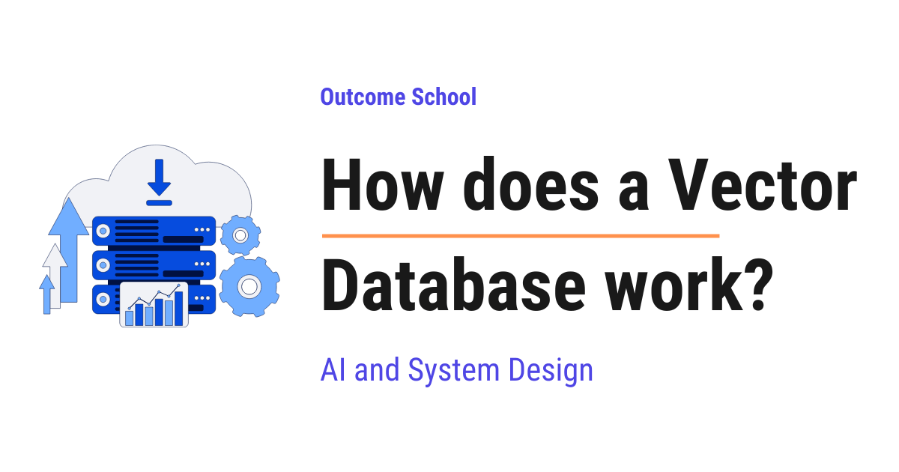

# How does a Vector Database work?

> Archived from <https://outcomeschool.com/blog/how-does-a-vector-database-work> on 2026-11-25.

A Vector Database is a special kind of database that stores data as lists of numbers and helps us find items that are similar in meaning, not just items that match exactly.

In this blog, we will learn about how a Vector Database works. This is one of the most important pieces behind modern AI search, <a target="_blank" rel="noopener noreferrer" href="recommendation-system.md">recommendations</a>, and tools like ChatGPT that answer questions from our own documents.

We will cover the following:
<ul><li>What is a Vector Database?</li><li>A quick recap of embeddings</li><li>Why normal databases fall short</li><li>What a Vector Database actually stores</li><li>How do we measure similarity?</li><li>Cosine similarity</li><li>Dot product</li><li>Euclidean distance</li><li>The nearest neighbour problem</li><li>Why brute force is too slow</li><li>Approximate Nearest Neighbour (ANN) and indexing</li><li>HNSW explained simply</li><li>IVF explained simply</li><li>PQ explained simply</li><li>A small code example</li><li>Real-world applications of Vector Databases</li></ul>
I am <strong>Amit Shekhar</strong>, Founder @ <a target="_blank" rel="noopener noreferrer" href="https://outcomeschool.com">Outcome School</a>, I have taught and mentored many developers, and their efforts landed them high-paying tech jobs, helped many tech companies in solving their unique problems, and created many open-source libraries being used by top companies. I am passionate about sharing knowledge through open-source, blogs, and videos.

I teach <a target="_blank" rel="noopener noreferrer" href="https://outcomeschool.com/program/ai-and-machine-learning">AI and Machine Learning</a> at Outcome School.

Let&#x27;s get started.
<h3 id="what-is-a-vector-database">What is a Vector Database?</h3>
A <strong>Vector Database</strong> is a special kind of database that stores data as numbers and helps us find items that are similar in meaning, not just items that match exactly.

In simple words, a normal database is good at finding exact matches. A vector database is good at finding things that are close in meaning.

Let&#x27;s decompose the term:

<strong>Vector Database = Vector + Database</strong>

A <strong>Database</strong> is just an organized place to store data so that we can find it later. A <strong>Vector</strong> is simply a list of numbers, for example <code>[0.21, 0.87, 0.13]</code>.

So, a Vector Database is a database built to store lists of numbers and to quickly find the lists that are most similar to a given list.

Now, the obvious question is: why would we store data as a list of numbers? To answer that, we must first recall what embeddings are.
<h3 id="a-quick-recap-of-embeddings">A quick recap of embeddings</h3>
Before jumping into vector databases, we must know about <a target="_blank" rel="noopener noreferrer" href="https://www.youtube.com/watch?v=LedXW6xl21s">embeddings</a>, because vectors come from embeddings.

An <strong><a target="_blank" rel="noopener noreferrer" href="what-are-embeddings.md">embedding</a></strong> is a list of numbers that represents the meaning of something, for example a word, a sentence, an image, or a song.

A special AI model reads our data and turns it into these numbers. The model is trained in such a way that things with similar meaning get similar numbers. Since calling embedding models costs both time and money, we have a detailed blog on <a target="_blank" rel="noopener noreferrer" href="how-does-an-embedding-cache-work.md">how an Embedding Cache works</a> that explains how to avoid recomputing them for the same text.

Let&#x27;s say we turn three words into embeddings:

<pre><code class="code-highlight">&quot;king&quot;   -&gt;  [0.91, 0.12, 0.55]

&quot;queen&quot;  -&gt;  [0.89, 0.15, 0.58]

&quot;banana&quot; -&gt;  [0.10, 0.95, 0.03]
</code></pre>

Here, we can see that <code>king</code> and <code>queen</code> have numbers that are close to each other, because they are related in meaning. The word <code>banana</code> has very different numbers, because it has nothing to do with kings and queens.

This is the key idea: <strong>similar meaning gives similar numbers.</strong> Each embedding is a vector, and that is exactly what we store inside a vector database.

If we are curious how a model learns to place similar meanings close together and push different ones apart, we have a detailed blog on <a target="_blank" rel="noopener noreferrer" href="contrastive-learning.md">Contrastive Learning</a> that explains how it works.

Now that we have recalled embeddings, let&#x27;s understand why a normal database is not enough.
<h3 id="why-normal-databases-fall-short">Why normal databases fall short</h3>
A normal database, for example MySQL or PostgreSQL, is excellent at exact matching.

Suppose we search for the word <code>apple</code>. A normal database will find every row that contains exactly the word <code>apple</code>. This works perfectly when we know the exact value we are looking for.

But, here is the catch. What if the user searches for <code>fruit that keeps the doctor away</code>? A normal database will look for those exact words. It does not understand that the answer is <code>apple</code>. It has no sense of meaning.

Let&#x27;s say we have these documents:
<ul><li>&quot;An apple a day keeps the doctor away.&quot;</li><li>&quot;Bananas are rich in potassium.&quot;</li><li>&quot;The doctor recommended eating more fruits.&quot;</li></ul>
If we search <code>healthy fruit advice from a doctor</code>, a normal database will struggle, because none of the documents contain that exact phrase. It matches words, not meaning.

We can picture this difference like below:

<pre><code class="code-highlight">Query: &quot;healthy fruit advice from a doctor&quot;

        |                              |
        v                              v

  Normal Database                 Vector Database
  (matches EXACT words)           (matches MEANING)

        |                              |
        v                              v

  No row has these                Finds the apple article
  exact words                     and the doctor article

        |                              |
        v                              v

  Result: misses the meaning      Result: closest in meaning
</code></pre>

Here, we can see that the same query goes to both, but the normal database fails because no row contains those exact words, while the vector database succeeds because it looks at meaning and returns the closest matches.

<strong>Note:</strong> Out of the box, a normal database matches exact words and falls short here. Some databases can now add vector search through an extension, for example PostgreSQL with <code>pgvector</code>. But they do this using the very same vector search ideas we are about to learn. So the real question is not normal database versus vector database. It is whether the database can search by meaning at all.

So, we need a system that understands meaning and finds the closest matches even when the exact words are different. This is where the vector database comes into the picture.
<h3 id="what-a-vector-database-actually-stores">What a Vector Database actually stores</h3>
A vector database stores three things together for each item:
<ul><li><strong>The vector</strong> - the list of numbers (the embedding) that represents the meaning.</li><li><strong>The original data</strong> - the actual text, image link, or product, so that we can show it back to the user.</li><li><strong>The metadata</strong> - extra information like category, date, author, or price, used for filtering.</li></ul>
Let&#x27;s say we store an article about apples. Inside the vector database, it looks like below:

<pre><code class="code-highlight">ID:        101

Vector:    [0.91, 0.12, 0.55, ... ]

Data:      &quot;An apple a day keeps the doctor away.&quot;

Metadata:  { &quot;category&quot;: &quot;health&quot;, &quot;year&quot;: 2024 }
</code></pre>

Here, we can see that the vector carries the meaning, the data is what we show to the user, and the metadata helps us filter results, for example showing only articles from the year 2024.

There are two ways to use this metadata while searching. We can filter first and then run the similarity search only on the items that pass the filter, which is called <strong>pre-filtering.</strong> Or we can run the similarity search first and then drop the results that do not match the filter, which is called <strong>post-filtering.</strong> Pre-filtering is usually the better choice, because it does not waste the search on items we will throw away anyway.

This is how a vector database keeps both the meaning and the original content side by side.

To learn Embeddings, Vector Databases, and how they power search by meaning in depth, check out our <a target="_blank" rel="noopener noreferrer" href="https://outcomeschool.com/program/ai-and-machine-learning">AI and Machine Learning Program</a> at Outcome School.
<h3 id="how-do-we-measure-similarity">How do we measure similarity?</h3>
Now we have a bunch of vectors stored. When a user searches, we convert their search into a vector too. Then we need to find the stored vectors that are most similar to it.

But, how do we measure how similar two vectors are? We use a similarity metric. A <strong>similarity metric</strong> is just a formula that takes two vectors and gives back a number that tells us how close they are.

There are three common metrics: <a target="_blank" rel="noopener noreferrer" href="cosine-similarity.md">cosine similarity</a>, dot product, and euclidean distance. Do not worry, we will learn about each of them in detail, with a formula, an example, and a diagram.
<h3 id="cosine-similarity">Cosine similarity</h3>
<strong>Cosine similarity</strong> measures the angle between two vectors. It does not care how long the vectors are. It only cares about the direction they point in.

In simple words, if two vectors point in the same direction, they are similar, even if one is longer than the other.

The result is always between -1 and 1:
<ul><li>A value close to <strong>1</strong> means the vectors point in almost the same direction, so they are very similar.</li><li>A value close to <strong>0</strong> means the vectors are at a right angle, so they are unrelated.</li><li>A value close to <strong>-1</strong> means the vectors point in opposite directions, so they are very different.</li></ul>
We can picture it like below:

<pre><code class="code-highlight">small angle  -&gt;  cosine near 1  (very similar)

       B
      /
     /
    /
   +---------- A

right angle  -&gt;  cosine near 0  (unrelated)

   B
   |
   |
   |
   +---------- A
</code></pre>

Here, we can see that a small angle means the arrows point almost the same way, which gives a value near 1. A right angle means they are unrelated, which gives a value near 0.

The formula is as below:

<pre><code class="code-highlight">cosine similarity = (A · B) / (|A| × |B|)
</code></pre>

Here, <code>A · B</code> is the <strong>dot product</strong>, which we get by multiplying the matching numbers of the two vectors and adding them up. <code>|A|</code> and <code>|B|</code> are the lengths, or sizes, of the two vectors. We will look at the dot product more closely in the very next section, but this one line is all we need for now.

Let&#x27;s see it in action with an example. Suppose we have two vectors:

<pre><code class="code-highlight">A = [2, 3]
B = [4, 6]
</code></pre>

Notice that B is just A with every number doubled, so both point in the exact same direction.

<strong>Step 1:</strong> Multiply the matching numbers and add them up. This gives the dot product.

<pre><code class="code-highlight">A · B = (2 × 4) + (3 × 6) = 8 + 18 = 26
</code></pre>

<strong>Step 2:</strong> Find the length of A. The length is found by squaring each number, adding them, and taking the square root.

<pre><code class="code-highlight">|A| = √(2² + 3²) = √(4 + 9) = √13 ≈ 3.61
</code></pre>

<strong>Step 3:</strong> Find the length of B in the same way.

<pre><code class="code-highlight">|B| = √(4² + 6²) = √(16 + 36) = √52 ≈ 7.21
</code></pre>

<strong>Step 4:</strong> Divide the dot product by the two lengths multiplied together.

<pre><code class="code-highlight">cosine similarity = 26 / (3.61 × 7.21) ≈ 26 / 26.0 ≈ 1.0
</code></pre>

The result is 1.0, which means the two vectors are as similar as possible. This matches what we expected, because they point in the same direction.

<strong>Note:</strong> The full range of cosine similarity is -1 to 1. But many modern <a target="_blank" rel="noopener noreferrer" href="embedding-model.md">embedding models</a> give us normalized vectors, and with those the value usually stays between 0 and 1 in practice. So in real text search, we rarely see negative values.

This is why cosine similarity is the most popular choice for text and <a target="_blank" rel="noopener noreferrer" href="how-does-semantic-search-work.md">semantic search</a>. Two sentences with the same meaning point in the same direction, even if one is much longer than the other.
<h3 id="dot-product">Dot product</h3>
<strong>Dot product</strong> is the simplest of the three. We multiply the matching numbers of the two vectors and add up all the results into a single number.

The formula is as below:

<pre><code class="code-highlight">A · B = (a₁ × b₁) + (a₂ × b₂) + (a₃ × b₃) + ...
</code></pre>

In simple words, we line up the two lists of numbers, multiply them position by position, and add everything together.

Let&#x27;s see it with an example. Suppose we have:

<pre><code class="code-highlight">A = [1, 2, 3]
B = [4, 5, 6]
</code></pre>

Then the dot product is below:

<pre><code class="code-highlight">A · B = (1 × 4) + (2 × 5) + (3 × 6)
      =    4    +   10    +   18
      =            32
</code></pre>

We can picture the same idea like below:

<pre><code class="code-highlight">A:    1      2      3
      ×      ×      ×        (multiply each matching pair)
B:    4      5      6
      =      =      =
      4   +  10  +  18   =   32     (then add the results)
</code></pre>

Here, we can see that each number in A is multiplied with the number right below it in B, and then all of them are added to give a single number, 32.

A larger dot product means more similarity. Let&#x27;s check this with one more vector:

<pre><code class="code-highlight">C = [0, 0, 1]

A · C = (1 × 0) + (2 × 0) + (3 × 1) = 0 + 0 + 3 = 3
</code></pre>

Here, we can see that A and B give 32, while A and C give only 3. So A is much more similar to B than to C.

But, here is the catch. The dot product is affected by the size of the vectors, not just their direction. A longer vector can give a bigger dot product even when the direction is not a great match. This is why the dot product works best when all vectors are <strong>normalized</strong>, which means scaled to the same length. When the vectors are the same length, the dot product and cosine similarity agree with each other.

This is why the dot product is a fast and popular choice when our vectors are already normalized.

<strong>Planning your move into AI?</strong>

No matter which tech domain you work in today, with your effort, you can transition to these roles:
<ul><li>AI Engineer</li><li>Forward Deployed Engineer</li><li>AI Agent Engineer</li><li>Harness Engineer</li><li>Voice AI Engineer</li><li>AI Architect</li><li>LLM Engineer</li><li>LLM Inference Engineer</li><li>Gen AI Engineer</li><li>MLOps Engineer</li><li>ML Engineer</li><li>Deep Learning Engineer</li></ul>
Our <a target="_blank" rel="noopener noreferrer" href="https://outcomeschool.com/program/ai-and-machine-learning">AI and Machine Learning Program</a> at Outcome School takes you there.
<h3 id="euclidean-distance">Euclidean distance</h3>
<strong>Euclidean distance</strong> measures the straight-line distance between two points. It is the same distance we would measure with a ruler between two dots on paper.

For this metric, we treat each vector as a point in space. The closer the two points are, the more similar they are. So, unlike the previous two metrics, here a <strong>smaller</strong> value means <strong>more</strong> similar.

The formula is as below:

<pre><code class="code-highlight">distance = √( (a₁ - b₁)² + (a₂ - b₂)² + ... )
</code></pre>

In simple words, we subtract the matching numbers, square each result, add them up, and take the square root.

Let&#x27;s see it with an example. Suppose we have two points:

<pre><code class="code-highlight">A = [1, 2]
B = [4, 6]
</code></pre>

<strong>Step 1:</strong> Subtract the matching numbers.

<pre><code class="code-highlight">(1 - 4) = -3      and      (2 - 6) = -4
</code></pre>

<strong>Step 2:</strong> Square each result.

<pre><code class="code-highlight">(-3)² = 9      and      (-4)² = 16
</code></pre>

<strong>Step 3:</strong> Add them and take the square root.

<pre><code class="code-highlight">distance = √(9 + 16) = √25 = 5
</code></pre>

So the distance between A and B is 5.

We can picture it on a simple grid like below:

<pre><code class="code-highlight"> y
 6 |                  B (4, 6)
 5 |                / :
 4 |              /   :  vertical gap = 4
 3 |            /     :
 2 | A (1, 2) ........:
 1 |          horizontal gap = 3
 0 +----------------------- x
   0   1   2   3   4   5
</code></pre>

Here, we can see that the horizontal gap is 3 and the vertical gap is 4, and the euclidean distance is just the length of the straight line joining the two points, which comes out to 5.

Let&#x27;s check with one more point:

<pre><code class="code-highlight">C = [1, 3]

distance from A = √( (1 - 1)² + (2 - 3)² ) = √(0 + 1) = 1
</code></pre>

Here, we can see that C is at a distance of 1 from A, while B is at a distance of 5. So C is much closer to A, which means C is more similar to A than B is.

This is why euclidean distance is a natural choice for image and spatial data, where the actual position and the gap between points carry meaning.

Now that we have learned all three metrics, let me tabulate the differences between them for your better understanding so that you can decide which one to use based on your use case.
<table><thead><tr><th>Metric</th><th>What it measures</th><th>Similar means</th><th>Common use</th></tr></thead><tbody><tr><td>Cosine similarity</td><td>Angle between vectors</td><td>Value close to 1</td><td>Text and semantic search</td></tr><tr><td>Dot product</td><td>Direction and size combined</td><td>Larger value</td><td>When vectors are normalized</td></tr><tr><td>Euclidean distance</td><td>Straight-line gap</td><td>Smaller distance</td><td>Image and spatial data</td></tr></tbody></table>
Here, we can notice that cosine similarity and dot product give a higher number for similar items, while euclidean distance gives a lower number for similar items. We just pick the metric that fits our data.

This is how we measure similarity. Now, let&#x27;s understand the actual problem of finding the closest vectors.
<h3 id="the-nearest-neighbour-problem">The nearest neighbour problem</h3>
When a user searches, we convert their query into a vector. Then we want to find the stored vectors that are nearest to it.

This is called the <strong>nearest neighbour problem.</strong> In simple words, given one vector, find the closest vectors from millions of stored vectors.

Let&#x27;s say the user searches <code>healthy fruit</code>. We turn it into a vector. Then we compare it against every stored vector and pick the top few that are most similar.

The top results will be the apple article and the banana article, because both are about healthy fruits, even though the user never typed those exact words. That is the magic of searching by meaning.

Let&#x27;s see the full journey of a search from start to finish as below:

<pre><code class="code-highlight">User query (text)
&quot;healthy fruit&quot;

      |
      v

Embedding Model
(turns text into numbers)

      |
      v

Query Vector
[0.90, 0.13, 0.56, ...]

      |
      v

Vector Database
(similarity search)

      |
      v

Top matching results
(apple article, banana article)
</code></pre>

Here, we can see that the user types plain text, the embedding model turns it into a query vector, the vector database compares that vector against the stored ones, and finally it returns the top matching results that are closest in meaning.

So, the goal is simple: find the nearest neighbours of the query vector. Now, the next big question is how to do this fast.
<h3 id="why-brute-force-is-too-slow">Why brute force is too slow</h3>
The simplest way to find the nearest neighbours is brute force.

In brute force, we compare the query vector with every single stored vector, one by one, and keep the closest ones.

Let&#x27;s say we have 10 vectors. Comparing against all 10 is easy and quick. But, real applications do not have 10 vectors. They have millions or even billions.

Suppose we have 100 million vectors, and each vector has 1000 numbers. For one search, we would do 100 million comparisons, and each comparison touches 1000 numbers. That is 100 billion calculations for a single search.

And, users expect results in a few milliseconds. Brute force simply cannot keep up at this scale.

The issue with this approach is that it is too slow for large data. Let&#x27;s see how the next approach solves this issue.
<h3 id="approximate-nearest-neighbour-ann-and-indexing">Approximate Nearest Neighbour (ANN) and indexing</h3>
So, here comes the idea of <a target="_blank" rel="noopener noreferrer" href="how-does-approximate-nearest-neighbor-ann-search-work.md"><strong>Approximate Nearest Neighbour</strong></a>, often written as <strong>ANN</strong>, to the rescue.

The key insight is this: we do not always need the perfect closest match. We need a very close match, returned very fast.

In simple words, ANN trades a tiny bit of accuracy for a huge gain in speed. Instead of checking every vector, it cleverly skips most of them and only checks the ones that are likely to be close.

Let&#x27;s compare the two approaches like below:

<pre><code class="code-highlight">Brute force (exact):
query  -&gt;  compare with ALL 100,000,000 vectors  -&gt;  perfect match, but very slow

ANN (approximate):
query  -&gt;  jump to the promising area  -&gt;  check only a few thousand  -&gt;  very close match, super fast
</code></pre>

Here, we can see that brute force checks everything to be perfectly correct, while ANN jumps close to the answer and checks only a small part of the data.

Now, the question is: how close is good enough? We measure this with <strong><a target="_blank" rel="noopener noreferrer" href="precision-vs-recall.md">recall</a>.</strong> Recall tells us how many of the truly closest vectors our search managed to find.

Let&#x27;s say the true top 10 closest vectors are the perfect answer. If ANN returns 9 of those 10, the recall is 90 percent. In most real applications, returning 9 out of 10 in a few milliseconds is far better than returning all 10 but taking several seconds.

To make this skipping possible, the vector database builds an <strong>index.</strong> An index is a smart structure that organizes the vectors in advance, so that during a search we can jump straight to the promising area instead of scanning everything.

Let&#x27;s understand this with a simple example. Suppose we want to find a friend living in a city. Brute force means knocking on every single door in the whole country. An index is like first going to the right city, then the right street, and only then checking a few houses. We reach the answer much faster.

Three of the most popular techniques here are HNSW, IVF, and Product Quantization, often written as PQ. HNSW and IVF help us decide which vectors to check, while PQ helps us shrink each vector to save memory. Let&#x27;s understand them one by one.
<h3 id="hnsw-explained-simply">HNSW explained simply</h3>
<strong>HNSW</strong> stands for <strong>Hierarchical Navigable Small World.</strong> The name sounds heavy, but the idea is simple. Let&#x27;s decompose it:
<ul><li><strong>Hierarchical</strong> means it is built in layers, stacked on top of each other.</li><li><strong>Navigable Small World</strong> means the points are connected to each other like friends in a social network, where we can reach anyone in just a few hops.</li></ul>
So, we can think of it as a layered map of connections, where similar vectors are linked to each other like friends in a network.

Let&#x27;s understand it layer by layer.

<strong>The top layer</strong> has very few points, spread far apart. It is like a map showing only big cities. We can jump across large distances quickly.

<strong>The middle layers</strong> have more points, closer together. It is like a map showing towns within a region.

<strong>The bottom layer</strong> has all the points, very close together. It is like a street-level map showing every house.

When we search, we start at the top layer and take big jumps toward the area near our query. Then we move down to the next layer and take smaller, more careful steps. We keep going down until we reach the bottom layer, where we find the final closest neighbours.

Here is a simple picture of the search. Let&#x27;s say we are looking for the point closest to our query, and the answer turns out to be <code>E</code>:

<pre><code class="code-highlight">Layer 2 (top):     A --------------- F        few points, big jumps
                                     |
                                     v
Layer 1 (middle):  A --- C --- D --- F        more points, medium steps
                           |
                           v
Layer 0 (bottom):  A-B-C-D-E-F-G-H            all points, fine steps  -&gt;  reach E
</code></pre>

Here, we can see that we begin with big jumps at the top, then take medium steps in the middle, and finally take fine steps at the bottom to land on the closest point <code>E</code>. We never had to check every single point.

Let&#x27;s walk through it once more in simple words:
<ul><li><strong>Step 1:</strong> Enter at the top layer, where only a few points exist. Move to the point closest to our query. This covers a lot of ground in one big jump.</li><li><strong>Step 2:</strong> Drop down to the middle layer. From the point we reached, move to an even closer neighbour.</li><li><strong>Step 3:</strong> Drop down to the bottom layer. Take small, careful steps among the closely packed points until we reach the nearest one.</li></ul>
This is how HNSW gives us very fast and very accurate searches. It is the most widely used index in modern vector databases.

<strong>A quick note for you</strong>

No matter which tech domain you work in, get familiar with these topics:
<ul><li>LLM</li><li>RAG</li><li>MCP</li><li>Agent</li><li>Fine-tuning</li><li>Quantization</li></ul>
We put it all together in one video:

<a target="_blank" rel="noopener noreferrer" href="https://www.youtube.com/watch?v=lnfWvX66FUk">AI Engineering Explained: LLM, RAG, MCP, Agent, Fine-Tuning, and Quantization</a>

No need to stop reading - bookmark it and watch later when you get time. Future you will thank you.

Now, let&#x27;s get back to the topic.
<h3 id="ivf-explained-simply">IVF explained simply</h3>
<strong>IVF</strong> stands for <strong>Inverted File Index.</strong> This is another clever way to speed up the search.

The idea is to group similar vectors into clusters before any search happens. This grouping is done once, in advance.

Let&#x27;s say we group all our vectors into a few clusters. Each cluster has a <strong>center point</strong>, which represents the average of that group. We can picture the clusters like below:

<pre><code class="code-highlight">   Cluster 1          Cluster 2          Cluster 3
  +----------+       +----------+       +----------+
  |  x    x  |       |  x   x   |       |  x  x  x |
  |    C1    |       |    C2    |       |    C3    |
  |  x    x  |       |   x   x  |       |   x   x  |
  +----------+       +----------+       +----------+

  C1, C2, C3 are the center points (the average of each group)
  each x marks one stored vector inside the cluster
</code></pre>

Here, we can see that the vectors are divided into groups, and each group has one center point that sits in the middle of it.

Now, when a user searches, we do the following.

First, we compare the query vector with only the cluster centers, not the millions of vectors. Then, we pick the few clusters whose centers are closest to the query. After that, we search only inside those few clusters and ignore the rest.

Let&#x27;s see the search journey like below:

<pre><code class="code-highlight">Query
  |
  v
Compare with cluster centers only      (cheap, just a few comparisons)
  |
  v
Pick the closest clusters              (say, the 3 nearest clusters)
  |
  v
Search only inside those clusters      (ignore all the other clusters)
</code></pre>

Here, we can see that IVF first narrows down to a few clusters, then searches only inside them.

Let&#x27;s put real numbers to see the saving. Suppose we have 100 million vectors split into 100 clusters, so each cluster holds 1 million vectors. If we search only the 3 closest clusters, we check 3 million vectors instead of 100 million. That is a huge saving, and the search becomes much faster than brute force.

<strong>Note:</strong> There is a small trade-off. If the true closest vector happens to sit in a cluster we skipped, we will miss it. To reduce this risk, we can search a few more clusters, which improves accuracy but takes a little more time. We tune this based on our use case.
<h3 id="pq-explained-simply">PQ explained simply</h3>
<strong>PQ</strong> stands for <strong>Product Quantization.</strong> As we just saw, HNSW and IVF help us pick which vectors to check. PQ is different. It does not pick vectors. It shrinks each vector so that it takes much less memory.

Let&#x27;s understand the memory problem first. Suppose each vector has 128 numbers, and each number takes 4 bytes. That is 512 bytes for a single vector. For 1 billion vectors, that is around 512 gigabytes, just to hold the vectors. This is very expensive to keep in memory.

So, the question is: can we store each vector in a smaller form, without losing too much of its meaning? This is exactly what PQ does. The idea of PQ is to compress each vector into a tiny code. Let&#x27;s understand it step by step.

<strong>Step 1:</strong> Split each vector into smaller pieces. For example, we cut a 128-number vector into 8 pieces, where each piece has 16 numbers.

<strong>Step 2:</strong> For each piece, we prepare a small set of common sample pieces in advance, called a <strong>codebook.</strong> We can think of it as a box of, for example, 256 ready-made sample pieces.

<strong>Step 3:</strong> For each piece of our vector, we find the closest sample in the codebook and store just that sample&#x27;s number, from 0 to 255, instead of the full 16 numbers.

So now, instead of storing 128 real numbers, we store only 8 small codes. Each code takes just 1 byte, so the whole vector becomes 8 bytes instead of 512 bytes. That is a 64 times saving in memory.

We can picture it like below:

<pre><code class="code-highlight">Original vector (128 numbers, 512 bytes)

[ piece 1 ][ piece 2 ][ piece 3 ] ... [ piece 8 ]
     |          |          |              |
     v          v          v              v
  code 37    code 12    code 200  ...   code 5      (each code is 1 byte)

Compressed vector (8 codes, 8 bytes)
</code></pre>

Here, we can see that each piece is replaced by the closest ready-made sample from its codebook, and we store only the sample&#x27;s number. The full vector shrinks from 512 bytes to just 8 bytes.

During a search, we compare using these small codes, which uses far less memory and runs faster.

<strong>Note:</strong> PQ trades a little accuracy for a huge saving in memory, because the compressed vector is only an approximation of the original. In practice, PQ is often combined with IVF, where IVF first narrows down to a few clusters and PQ keeps each vector small. This combination, called <strong>IVF-PQ</strong>, is what makes searching over billions of vectors affordable.

There are also simpler forms of compression called <strong>scalar quantization</strong> and <strong>binary quantization.</strong> They shrink each number to a smaller size, and they are easier to use than PQ. This makes them very popular in production when we want to save memory with less effort.

This was all about indexing and compression. Now, let&#x27;s see a small code example to make it concrete.

If we want to go deep into Vector Databases and how to design a RAG System (Chat with Your Documents), we have a complete program on this - check out our <a target="_blank" rel="noopener noreferrer" href="https://outcomeschool.com/program/ai-and-machine-learning">AI and Machine Learning Program</a> at Outcome School.
<h3 id="a-small-code-example">A small code example</h3>
Let&#x27;s see the code as below. We will use FAISS, a popular open-source library from Meta for vector search.

<pre><code class="code-highlight language-python">import faiss
import numpy as np

# Suppose each vector has 4 numbers (dimensions)
dimension = 4

# Create a simple index that uses euclidean distance
index = faiss.IndexFlatL2(dimension)

# Our stored vectors (each row is one item&#x27;s embedding)
vectors = np.array([
    [0.91, 0.12, 0.55, 0.10],   # apple article
    [0.10, 0.95, 0.03, 0.40],   # banana article
    [0.88, 0.15, 0.58, 0.12],   # doctor and fruit article
], dtype=&quot;float32&quot;)

# Add the vectors to the index
index.add(vectors)

# The user&#x27;s search, turned into a vector
query = np.array([[0.90, 0.13, 0.56, 0.11]], dtype=&quot;float32&quot;)

# Find the 2 nearest neighbours
distances, ids = index.search(query, 2)

print(ids)
print(distances)
</code></pre>

Here, we have done the following steps:
<ul><li>We created an index with <code>IndexFlatL2</code>, which uses euclidean distance.</li><li>We added three stored vectors to the index.</li><li>We created a query vector for the user&#x27;s search.</li><li>We asked for the top 2 nearest neighbours using <code>index.search</code>.</li></ul>
This will print the following:

<pre><code class="code-highlight">[[0 2]]

[[0.0004 0.0013]]
</code></pre>

Here, we can see that the closest matches are item <code>0</code> (the apple article) and item <code>2</code> (the doctor and fruit article), because their vectors are nearest to the query. The small distance values confirm they are very close in meaning.

One thing to notice here is that <code>IndexFlatL2</code> returns the <strong>squared</strong> euclidean distance. It skips the final square root step for speed. So the values <code>0.0004</code> and <code>0.0013</code> are the squared distances, not the plain distances from our earlier formula. The order of the results stays exactly the same either way, so the nearest item is still correctly the nearest.

<strong>Note:</strong> <code>IndexFlatL2</code> is brute force and is fine for small data. For millions of vectors, we would use an ANN index like HNSW or IVF, which FAISS also supports. The search code stays almost the same, but it runs far faster.

This is how, in just a few lines, we store vectors and find the most similar ones.

<strong>Stay updated:</strong> Subscribe to our <a target="_blank" rel="noopener noreferrer" href="https://outcomeschool.substack.com/subscribe">newsletter</a> to get our latest AI and Machine Learning blogs straight to your inbox.
<h3 id="real-world-applications-of-vector-databases">Real-world applications of Vector Databases</h3>
Now, let&#x27;s discuss where vector databases are actually used. They power many products we use every day.

<strong>Semantic search:</strong> This is search by meaning. When we type <code>cheap flights to the beach</code>, the system understands the intent and returns relevant results even if those exact words are missing.

<strong>RAG for LLMs:</strong> <strong><a target="_blank" rel="noopener noreferrer" href="retrieval-augmented-generation-rag.md">RAG</a></strong> stands for <strong>Retrieval Augmented Generation.</strong> This is how tools like ChatGPT answer questions from our own documents. First, our documents are cut into smaller <a target="_blank" rel="noopener noreferrer" href="chunking-strategies-for-rag.md">chunks</a>, converted into vectors, and stored in a vector database. Then, when we ask a question, the database finds the most relevant pieces. After that, those pieces are given to the LLM, which writes an answer based on them. This way, the AI answers using our private data instead of guessing. We have a detailed blog on <a target="_blank" rel="noopener noreferrer" href="agentic-rag.md">Agentic RAG</a> that explains how modern RAG systems retrieve and reason over multiple sources.

<strong>Recommendations:</strong> When a shopping site shows <code>products you may like</code>, it converts products and our taste into vectors, then finds products with similar vectors. This is how we get suggestions that actually match our interest.

<strong>Image search:</strong> When we search by uploading a photo, <a target="_blank" rel="noopener noreferrer" href="how-do-image-embeddings-work.md">the image is turned into a vector</a>. The vector database then finds images with similar vectors, giving us visually similar pictures.

<strong>Duplicate and fraud detection:</strong> Similar transactions or similar documents end up with similar vectors. The vector database quickly finds these near matches, which helps in catching duplicates and suspicious activity.

<strong>Semantic caching:</strong> An AI app can store past answers and reuse one whenever a new question means the same thing. It finds the closest saved question by vector similarity and skips calling the model again, which is exactly <a target="_blank" rel="noopener noreferrer" href="how-does-semantic-caching-work.md">how Semantic Caching works</a>.

As a next step, there are a few more ideas worth exploring once we are comfortable with the basics here. <strong><a target="_blank" rel="noopener noreferrer" href="how-does-hybrid-search-work.md">Hybrid search</a></strong> mixes vector search with traditional keyword search, so we get both meaning and exact word matches in one system. And beyond HNSW and IVF, we will come across other indexes like <strong>DiskANN</strong> and <strong>ScaNN</strong>, which are built to search very large data efficiently. These are good directions to explore as we go deeper. On the query side, <strong>HyDE</strong> improves what we search with - instead of the raw question, it searches with a hypothetical answer that looks more like the documents we want, and we have a detailed blog on <a target="_blank" rel="noopener noreferrer" href="how-does-hyde-work.md">how HyDE works</a> that covers this end to end. Once we have a shortlist of candidates, a <strong>Reranker</strong> can reorder them by true relevance before they reach the LLM - we have a detailed blog on <a target="_blank" rel="noopener noreferrer" href="how-does-a-reranker-work.md">how a Reranker works</a> that explains this step by step.

It is also worth knowing when we do not need a vector database at all. We have a detailed blog on <a target="_blank" rel="noopener noreferrer" href="vectorless-rag.md">Vectorless RAG</a> that covers how retrieval can work by reading the structure of a document instead of matching vectors.

This is how a vector database stores meaning as numbers and finds the most similar items at huge scale, which makes modern AI search, recommendations, and assistants possible.
<h2 id="frequently-asked-questions">Frequently Asked Questions</h2><h3 id="can-we-use-postgresql-instead-of-a-dedicated-vector-database">Can we use PostgreSQL instead of a dedicated vector database?</h3>
Yes, with an extension. Out of the box, a normal database matches exact words and falls short for search by meaning. But PostgreSQL can add vector search through <code>pgvector</code>, which uses the very same vector search ideas. So the real question is not normal database versus vector database, but whether the database can search by meaning at all.
<h3 id="is-pre-filtering-or-post-filtering-better-in-a-vector-database">Is pre-filtering or post-filtering better in a vector database?</h3>
Pre-filtering is usually the better choice. In pre-filtering, we filter by metadata first and then run the similarity search only on the items that pass. In post-filtering, we search first and then drop the results that do not match. Pre-filtering does not waste the search on items we will throw away anyway.
<h3 id="does-a-vector-database-always-return-the-exact-closest-matches">Does a vector database always return the exact closest matches?</h3>
No, not when it uses Approximate Nearest Neighbour search. ANN trades a tiny bit of accuracy for a huge gain in speed, and we measure how close it gets with recall. For example, returning 9 of the true top 10 in a few milliseconds is far better for most applications than returning all 10 in several seconds.
<h3 id="which-similarity-metric-should-we-use-for-text-search">Which similarity metric should we use for text search?</h3>
Cosine similarity is the most popular choice for text and semantic search. It measures the angle between two vectors and ignores their length, so two sentences with the same meaning score as similar even if one is much longer. The dot product also works well when the vectors are normalized, while Euclidean distance suits image and spatial data.
<h3 id="do-we-always-need-a-vector-database-for-rag">Do we always need a vector database for RAG?</h3>
No. Vectorless RAG is an approach where retrieval works by reading the structure of a document instead of matching vectors. In a typical RAG setup, though, our documents are cut into chunks, converted into vectors, and stored in a vector database, which then finds the most relevant pieces for the LLM.

That&#x27;s it for now.

Thanks

<strong>Amit Shekhar</strong> Founder @ <a target="_blank" rel="noopener noreferrer" href="https://outcomeschool.com">Outcome School</a>

You can connect with me on:
<ul><li><a target="_blank" rel="noopener noreferrer" href="https://x.com/amitiitbhu">X</a></li><li><a target="_blank" rel="noopener noreferrer" href="https://www.linkedin.com/in/amit-shekhar-iitbhu">LinkedIn</a></li><li><a target="_blank" rel="noopener noreferrer" href="https://github.com/amitshekhariitbhu">GitHub</a></li></ul>
Follow Outcome School on:
<ul><li><a target="_blank" rel="noopener noreferrer" href="https://x.com/outcome_school">X</a></li><li><a target="_blank" rel="noopener noreferrer" href="https://youtube.com/@OutcomeSchool">YouTube</a></li><li><a target="_blank" rel="noopener noreferrer" href="https://www.linkedin.com/company/outcomeschool">LinkedIn</a></li><li><a target="_blank" rel="noopener noreferrer" href="https://github.com/OutcomeSchool">GitHub</a></li></ul>
<a target="_blank" rel="noopener noreferrer" href="https://outcomeschool.com/blog"><strong>Read all of our high-quality blogs here.</strong></a>

