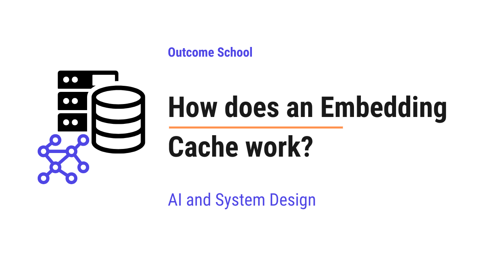

# How does an Embedding Cache work?

> Archived from <https://outcomeschool.com/blog/how-does-an-embedding-cache-work> on 2026-11-25.

An Embedding Cache is a place where we store the embeddings that we have already computed, so that the next time we need the embedding for the same text, we reuse the stored one instead of computing it again.

In this blog, we will learn about how an Embedding Cache works. We will also see what an embedding is, why an Embedding Cache saves us a lot of money and time, how the cache key is built, and where it is used in real systems like RAG and semantic search.

We will cover the following:
<ul><li>What is an embedding?</li><li>A quick recap of how we get an embedding</li><li>What is an Embedding Cache?</li><li>Why we need an Embedding Cache</li><li>The core idea behind an Embedding Cache</li><li>The cache key, a hash of the text plus the model</li><li>The request flow, a hit and a miss</li><li>Eviction, LRU and TTL</li><li>Where the cache lives, memory or disk</li><li>The benefits of an Embedding Cache</li><li>An Embedding Cache in the real world</li></ul>
I am <strong>Amit Shekhar</strong>, Founder @ <a target="_blank" rel="noopener noreferrer" href="https://outcomeschool.com">Outcome School</a>, I have taught and mentored many developers, and their efforts landed them high-paying tech jobs, helped many tech companies in solving their unique problems, and created many open-source libraries being used by top companies. I am passionate about sharing knowledge through open-source, blogs, and videos.

I teach <a target="_blank" rel="noopener noreferrer" href="https://outcomeschool.com/program/ai-and-machine-learning">AI and Machine Learning</a> at Outcome School.

Let&#x27;s get started.
<h3 id="what-is-an-embedding">What is an embedding?</h3>
Before we talk about an Embedding Cache, we must first understand what <a target="_blank" rel="noopener noreferrer" href="what-are-embeddings.md">an embedding</a> is.

<strong>An embedding is a list of numbers that represents the meaning of a piece of text.</strong>

In simple words, an embedding is the way a computer turns words into numbers, so that it can understand and compare them.

Let&#x27;s say we have the sentence &quot;I love dogs.&quot; A computer does not understand words the way we do. So, we pass this sentence through a special model, and it gives us back a long list of numbers, for example <code>[0.12, -0.85, 0.33, ...]</code>. This list of numbers is the embedding.

The magic is in what these numbers capture. Two pieces of text that mean similar things get embeddings that are close to each other. Two pieces of text that mean very different things get embeddings that are far apart. So, &quot;I love dogs&quot; and &quot;I adore puppies&quot; will have embeddings that sit close together, while &quot;I love dogs&quot; and &quot;The stock market crashed&quot; will have embeddings that sit far apart.

We can picture this closeness like below:

<pre><code class="code-highlight">   meaning space (close means similar, far means different)

      &quot;I love dogs&quot;  *
                      \
                       * &quot;I adore puppies&quot;   (close together, similar meaning)

                                        * &quot;The stock market crashed&quot;
                                          (far away, different meaning)
</code></pre>

Here, we can see that &quot;I love dogs&quot; and &quot;I adore puppies&quot; sit close together because they mean similar things, while &quot;The stock market crashed&quot; sits far away because it means something very different. The closer two embeddings sit, the more similar their meaning.

This is incredibly useful. Once text becomes numbers, the computer can measure how similar two pieces of text are just by checking how close their numbers are. This is the foundation of search systems that understand meaning, not just exact words.

Why similar meanings land close together and different ones land far apart comes down to how the model is trained - we have a detailed blog on <a target="_blank" rel="noopener noreferrer" href="contrastive-learning.md">Contrastive Learning</a> that explains this approach step by step.

Now, here is something important to notice. To get this list of numbers, we have to send the text to a model and ask it to compute the embedding. This step is not free. We will come back to this point soon, because it is the heart of the Embedding Cache.
<h3 id="a-quick-recap-of-how-we-get-an-embedding">A quick recap of how we get an embedding</h3>
To understand the Embedding Cache, we must understand one thing about how we get an embedding.

We do not compute embeddings by hand. We use an <strong><a target="_blank" rel="noopener noreferrer" href="embedding-model.md">embedding model</a></strong>. An embedding model is a special model whose only job is to take text and return its embedding, that list of numbers we just talked about.

So, the flow is simple. We send some text to the embedding model, and it sends back the embedding.

We can picture it as below:

<pre><code class="code-highlight">   &quot;I love dogs&quot;   --&gt;   [ Embedding Model ]   --&gt;   [0.12, -0.85, 0.33, ...]
       (text)                (does work)                  (the embedding)
</code></pre>

Here, we can see that the text goes in on the left, the embedding model does some work in the middle, and the list of numbers comes out on the right.

Now, here is the key point to remember.

<strong>Asking the embedding model to compute an embedding costs real money and real time.</strong>

Most embedding models run on a server, and we usually pay based on how much text we send. Even if we run the model on our own machine, computing an embedding uses real computing power and takes real time. So, every single embedding we compute has a cost, both in money and in delay.

So, if we ask the model to compute the embedding for the same text many times, we pay for the same work again and again. That is wasteful.

This is the foundation we needed. Now we are ready to understand the problem.

To learn how embeddings work and how they power modern AI systems, we cover Embeddings from the ground up in our <a target="_blank" rel="noopener noreferrer" href="https://outcomeschool.com/program/ai-and-machine-learning">AI and Machine Learning Program</a> at Outcome School.
<h3 id="what-is-an-embedding-cache">What is an Embedding Cache?</h3>
Now that we know how we get an embedding, let&#x27;s understand the Embedding Cache.

<strong>An Embedding Cache is a place where we store embeddings we have already computed, so that the next time we need the embedding for the same text, we grab the stored one instead of computing it again.</strong>

In simple words, an Embedding Cache means: compute the embedding once, then reuse it.

The word &quot;cache&quot; simply means a place where we store something so we can grab it quickly later, instead of making it again from scratch.

Let&#x27;s connect this to what we just learned. Computing an embedding costs money and time. So, the first time we compute the embedding for a piece of text, we save it in the cache. The next time we need the embedding for that exact same text, we do not call the embedding model at all. We simply look it up in the cache and return the saved list of numbers.

So, an Embedding Cache is about never paying to compute the embedding for the same text twice.

<strong>Planning your move into AI?</strong>

No matter which tech domain you work in today, with your effort, you can transition to these roles:
<ul><li>AI Engineer</li><li>Forward Deployed Engineer</li><li>AI Agent Engineer</li><li>Harness Engineer</li><li>Voice AI Engineer</li><li>AI Architect</li><li>LLM Engineer</li><li>LLM Inference Engineer</li><li>Gen AI Engineer</li><li>MLOps Engineer</li><li>ML Engineer</li><li>Deep Learning Engineer</li></ul>
Our <a target="_blank" rel="noopener noreferrer" href="https://outcomeschool.com/program/ai-and-machine-learning">AI and Machine Learning Program</a> at Outcome School takes you there.

Now, the question is, why do we even need this? Let&#x27;s see.
<h3 id="why-we-need-an-embedding-cache">Why we need an Embedding Cache</h3>
The same text comes up again and again, far more often than we would expect. Let&#x27;s understand this with two common situations.

The first situation is <strong>re-ingestion</strong>. Ingestion means the process of taking our documents, <a target="_blank" rel="noopener noreferrer" href="chunking-strategies-for-rag.md">breaking them into small pieces</a>, and computing an embedding for each piece so we can search them later. Now, suppose we update one paragraph in a large document and run the ingestion again. Most of the document did not change at all. But if we are not careful, we recompute the embedding for every single piece, even the ones that are exactly the same as before. We pay all over again for work we already did.

We can picture this re-ingestion like below:

<pre><code class="code-highlight">   document broken into pieces, then re-ingested after editing one piece

   piece 1   unchanged   --&gt;  reuse from cache   (free)
   piece 2   unchanged   --&gt;  reuse from cache   (free)
   piece 3   EDITED      --&gt;  compute again      (pay once)
   piece 4   unchanged   --&gt;  reuse from cache   (free)
   piece 5   unchanged   --&gt;  reuse from cache   (free)
</code></pre>

Here, we can see that only piece 3 changed, so only piece 3 needs a new embedding. With a cache, the four unchanged pieces are reused for free. Without a cache, we would recompute all five, paying for work we already did.

The second situation is <strong>repeated queries</strong>. Imagine we have a search system used by thousands of people. Many people search for the same popular things. Hundreds of users type the same query, such as &quot;return policy&quot; or &quot;reset my password.&quot; Each time, we need the embedding of that query to search. Without a cache, we compute the embedding for &quot;return policy&quot; hundreds of times, even though it is the exact same text every time.

Let&#x27;s put some numbers to it for the sake of understanding. Suppose:
<ul><li>A popular query is searched 1,000 times in a day.</li><li>Without a cache, we compute its embedding 1,000 times.</li><li>With a cache, we compute it once and reuse it 999 times.</li></ul>
That is 999 calls saved for just one popular query.

This causes two real problems when we have no cache:
<ul><li><strong>It is costly.</strong> We pay for every embedding we compute. Recomputing the same embedding again and again means we pay for the same work over and over.</li><li><strong>It is slow.</strong> Calling the embedding model adds delay. If the model runs on a server, we also wait for the network. Doing this for text we have already processed adds delay for no reason.</li></ul>
So, here comes the Embedding Cache to the rescue.
<h3 id="the-core-idea-behind-an-embedding-cache">The core idea behind an Embedding Cache</h3>
Let&#x27;s understand the core idea step by step.

We learned that computing an embedding is the costly part. The Embedding Cache takes a simple but powerful step.

<strong>The idea is to store every embedding we compute, paired with the text it came from. Before computing a new embedding, we first check the cache. If the embedding for that text is already there, we reuse it and skip the costly computation.</strong>

Let&#x27;s walk through it with our example.

<strong>Step 1:</strong> A user searches for &quot;return policy.&quot; We check the cache. The embedding is not there yet, because this is the first time. So, we call the embedding model, get the embedding, and save it in the cache. Then we use it for the search.

<strong>Step 2:</strong> Another user searches for &quot;return policy&quot; later in the day. We check the cache. This time, the embedding is already there, because we saved it in Step 1. So, we skip the embedding model completely and use the saved embedding directly.

So, the second search did not pay any cost to compute the embedding. It simply read the saved one.

Let&#x27;s see a simple diagram to make this clear as below:

<pre><code class="code-highlight">WITHOUT an embedding cache (every time):

   &quot;return policy&quot;  --&gt;  call the model  --&gt;  compute embedding   (slow, costly, repeated)

WITH an embedding cache (after the first time):

   &quot;return policy&quot;  --&gt;  found in cache  --&gt;  return saved embedding   (fast, cheap)
                         skip the model
</code></pre>

The problem is solved. We now compute the embedding for a piece of text only once. So, for our popular query searched 1,000 times, we pay for one computation and reuse it the other 999 times.

<strong>A quick note for you</strong>

No matter which tech domain you work in, get familiar with these topics:
<ul><li>LLM</li><li>RAG</li><li>MCP</li><li>Agent</li><li>Fine-tuning</li><li>Quantization</li></ul>
We put it all together in one video:

<a target="_blank" rel="noopener noreferrer" href="https://www.youtube.com/watch?v=lnfWvX66FUk">AI Engineering Explained: LLM, RAG, MCP, Agent, Fine-Tuning, and Quantization</a>

No need to stop reading - bookmark it and watch later when you get time. Future you will thank you.

Now, let&#x27;s get back to the topic.
<h3 id="the-cache-key-a-hash-of-the-text-plus-the-model">The cache key, a hash of the text plus the model</h3>
Now, there is one very important detail we must understand, because this is what makes the cache reliable.

To store and find something in a cache, we need a <strong>key</strong>. A key is a label we attach to a stored item, so we can find it again later. Think of it like the name on a folder in a filing cabinet. We need the right name to pull out the right folder.

So, the question is, what should we use as the key for an embedding?

The simplest answer is to use the text itself. But there are two problems with using the raw text directly. First, the text can be very long, like an entire paragraph, which makes for a clumsy key. Second, and much more important, the same text can be sent to different embedding models, and each model produces a different embedding for the same text.

Let&#x27;s understand this clearly. Suppose we have two embedding models, an older one and a newer one. We send &quot;return policy&quot; to both. They return different lists of numbers, because they are different models. The same thing happens if we simply upgrade one model to a new version, because a new version also produces different numbers. If our key was just the text &quot;return policy,&quot; then both models would try to use the same cache spot. The newer model would read the older model&#x27;s embedding and get the wrong numbers. This is called a <strong>collision</strong>, which means two different things accidentally landing on the same key.

So, here is the rule we must follow.

<strong>The cache key is built from the text plus the model name and version. This way, different models never collide.</strong>

To turn this into a short, neat key, we use a <strong>hash</strong>. A hash is a function that takes any input, no matter how long, and turns it into a short fixed-length string of characters. The same input always produces the same hash, and even a tiny change in the input produces a completely different hash. So, a hash is a perfect way to make a compact, unique key from a long piece of text.

We can picture the key like below:

<pre><code class="code-highlight">   text:  &quot;return policy&quot;
   model: &quot;text-embedding-v3&quot;
                  |
                  v
        combine them together
                  |
                  v
            apply a hash
                  |
                  v
   key:  &quot;a3f9c1...b27&quot;   (short, unique, model-specific)
</code></pre>

Here, we can see that we take the text and the model name together, then run them through a hash to get a short unique key. Because the model name is part of the key, the older model and the newer model get different keys for the same text, so they never read each other&#x27;s embeddings.

This is how the cache stays correct even when we use more than one embedding model.
<h3 id="the-request-flow-a-hit-and-a-miss">The request flow, a hit and a miss</h3>
Now, let&#x27;s put the whole thing together and walk through exactly what happens on a single request.

Before that, we must learn two simple words.

<strong>A cache hit means the embedding we are looking for is already in the cache.</strong> We found it, so we reuse it.

<strong>A cache miss means the embedding is not in the cache yet.</strong> We did not find it, so we have to compute it.

Let&#x27;s see the full flow as below:

<pre><code class="code-highlight">   request: need embedding for some text
                  |
                  v
        hash the text + model name  --&gt;  get the key
                  |
                  v
        is the key in the cache?
            |                 |
           YES               NO
        (cache HIT)       (cache MISS)
            |                 |
            v                 v
     return the saved    call the embedding model
        embedding         and compute it
                              |
                              v
                        store it in the cache
                        under the key
                              |
                              v
                        return the embedding
</code></pre>

Here, we can see the complete journey. First, we take the text and the model name and hash them to get the key. Then, we check whether that key is already in the cache. If it is a hit, we return the saved embedding right away and we are done, no model call needed. If it is a miss, we call the embedding model, compute the embedding, store it in the cache under that key, and then return it.

Notice the beautiful part. After a miss, we store the result. So, the very next time the same text comes in, it becomes a hit. The first request pays the cost, and every request after that for the same text is fast and free.

The problem is solved. Every piece of text is computed at most once.
<h3 id="eviction-lru-and-ttl">Eviction, LRU and TTL</h3>
Now, the next question is, does the cache keep growing forever? The answer is no. A cache has limited space, and we cannot store everything forever. So, at some point, we must remove old items to make room for new ones. This removing of items is called <strong>eviction</strong>.

In simple words, eviction is the cache throwing out some old stored items so it does not run out of space.

There are two common ways to decide what to evict. Let&#x27;s understand both.

The first way is <strong>LRU</strong>, which stands for <strong>Least Recently Used</strong>. The idea is simple. When the cache is full and we need room, we throw out the item that has not been used for the longest time. The thinking is that if we have not needed an embedding in a long while, we probably will not need it soon, so it is the safest one to remove.

Let&#x27;s understand LRU with a small example as below:

<pre><code class="code-highlight">   Cache is full. We need to add a new item.

   item A  --&gt;  last used 1 minute ago
   item B  --&gt;  last used 2 minutes ago
   item C  --&gt;  last used 30 minutes ago   &lt;-- least recently used, evict this one
</code></pre>

Here, we can see that item C has not been used for the longest time, so LRU picks it for eviction. We remove item C and use that freed space for the new item.

The second way is <strong>TTL</strong>, which stands for <strong>time to live</strong>. TTL is how long an item is allowed to stay in the cache before it expires and gets removed, no matter what. For example, if we set a TTL of one hour, then every stored embedding is removed one hour after it was saved.

TTL is useful when our text or our model can change over time and we do not want to keep old embeddings forever. The word &quot;stale&quot; simply means old and no longer fresh. LRU is useful when we simply have limited space and want to keep the items we use most often.

<strong>Note:</strong> We can even use both together. We keep popular items with LRU, and we still let everything expire after the TTL, so nothing stays stale forever. We choose the eviction strategy based on our use case.

So, eviction keeps our cache from growing out of control while keeping the useful items around.

<strong>Stay updated:</strong> Subscribe to our <a target="_blank" rel="noopener noreferrer" href="https://outcomeschool.substack.com/subscribe">newsletter</a> to get our latest AI and Machine Learning blogs straight to your inbox.
<h3 id="where-the-cache-lives-memory-or-disk">Where the cache lives, memory or disk</h3>
Now, let&#x27;s understand where this cache actually lives. There are two common choices, and each one fits a different need.

The first choice is <strong>in-memory</strong>, often using a tool called <strong>Redis</strong>. In-memory means the cache lives in the computer&#x27;s memory, which is the fast working space of a computer. Redis is a popular tool that stores data in memory and gives it back extremely quickly. Looking up an embedding from an in-memory cache is very fast, often a tiny fraction of a second. This is great for repeated queries in a live system, where speed matters the most.

The second choice is <strong>on disk</strong>. On disk means the cache lives in files on the hard drive. Disk is slower than memory, but it can hold far more data, and the data stays even if the program restarts. This is great for ingestion, where we may compute embeddings for millions of document pieces and want to keep them around for a long time, even across restarts.

We can compare the two as below:

<pre><code class="code-highlight">   IN-MEMORY (like Redis)        ON DISK
   ----------------------        ----------------------------
   very fast lookups             slower lookups
   limited space                 large space
   lost on restart               kept across restarts
   good for live queries         good for big ingestion jobs
</code></pre>

Here, we can see that in-memory is fast but limited and temporary, while on disk is slower but roomy and lasting. Many real systems use both together, a fast in-memory cache in front and a larger disk cache behind it.

So, we pick where the cache lives based on our use case.

Keeping an AI system fast and cheap at scale - decisions like where a cache lives and how we serve it - is exactly what LLM Inference Engineering is about, and we cover it end to end in our <a target="_blank" rel="noopener noreferrer" href="https://outcomeschool.com/program/ai-and-machine-learning">AI and Machine Learning Program</a> at Outcome School.
<h3 id="the-benefits-of-an-embedding-cache">The benefits of an Embedding Cache</h3>
Let&#x27;s quickly bring together the benefits, because they are the reason we use this technique.
<ul><li><strong>Lower cost.</strong> We pay to compute an embedding only the first time for any given text. Every repeat is served from the cache for free. For popular queries and for re-ingestion of mostly unchanged documents, this saves a huge amount of money.</li><li><strong>Lower latency.</strong> Latency means the delay before we get a result. Reading from the cache is far faster than calling the embedding model. This matters even more when the model runs on a server, because then we also skip the wait for the network. So, our system feels faster.</li></ul>
In simple words, an Embedding Cache makes our application cheaper and faster at the same time, without changing the quality of the results. The embeddings are exactly the same numbers we would have computed. We just avoid computing them more than once.

That&#x27;s the beauty of an Embedding Cache.
<h3 id="an-embedding-cache-in-the-real-world">An Embedding Cache in the real world</h3>
Now, let&#x27;s see where an Embedding Cache is used in real systems.

The first place is <strong><a target="_blank" rel="noopener noreferrer" href="retrieval-augmented-generation-rag.md">RAG</a></strong>. RAG stands for Retrieval-Augmented Generation. In simple words, it is a system where we first fetch some relevant documents and then send them to a large language model along with the user&#x27;s question. RAG depends on embeddings in two places. During ingestion, we compute an embedding for every piece of every document. During a query, we compute an embedding for the user&#x27;s question to find the matching pieces. An Embedding Cache helps in both places. It saves the embeddings of document pieces so re-ingestion does not recompute the unchanged ones, and it saves the embeddings of popular queries so we do not recompute them for every user.

The second place is <strong><a target="_blank" rel="noopener noreferrer" href="how-does-semantic-search-work.md">semantic search</a></strong>. Semantic search means searching by meaning instead of by exact words. The word &quot;semantic&quot; simply means related to meaning. In semantic search, we turn both the documents and the user&#x27;s query into embeddings, then we find the documents whose embeddings are closest to the query&#x27;s embedding. Finding those nearest embeddings fast across millions of documents is exactly what <a target="_blank" rel="noopener noreferrer" href="how-does-approximate-nearest-neighbor-ann-search-work.md">Approximate Nearest Neighbor (ANN) search</a> does. Just like in RAG, the same documents and the same popular queries come up again and again. So, an Embedding Cache cuts down the cost and the delay here too.

So, anywhere we keep computing embeddings for the same text, whether during document ingestion or for repeated and popular queries, an Embedding Cache helps us a lot.

The same embeddings also power <a target="_blank" rel="noopener noreferrer" href="how-does-semantic-caching-work.md">semantic caching</a>, where we reuse a past answer whenever a new question means the same thing as an old one, so we can skip calling the model again.

This is how an Embedding Cache works. We compute the embedding for a piece of text once, we store it under a key built from a hash of the text plus the model name and version, and then we reuse it on every later request for the same text, while eviction with LRU or TTL keeps the cache from growing forever, so we get cheaper and faster results.
<h2 id="frequently-asked-questions">Frequently Asked Questions</h2><h3 id="does-an-embedding-cache-change-the-quality-of-search-results">Does an Embedding Cache change the quality of search results?</h3>
No. An Embedding Cache does not change the quality of the results. The cached embeddings are exactly the same numbers we would have computed by calling the model again. We just avoid computing them more than once, which makes the application cheaper and faster at the same time.
<h3 id="what-is-the-difference-between-an-embedding-cache-and-a-semantic-cache">What is the difference between an Embedding Cache and a Semantic Cache?</h3>
An Embedding Cache reuses the embedding for the exact same text, so we skip calling the embedding model. Semantic caching reuses a past answer whenever a new question means the same thing as an old one, so we skip calling the model that writes the answer. Both rely on embeddings, but they save different work.
<h3 id="will-a-similar-but-not-identical-text-hit-the-embedding-cache">Will a similar but not identical text hit the Embedding Cache?</h3>
No. The cache key is a hash of the text plus the model name and version. The same input always produces the same hash, but even a tiny change in the input produces a completely different hash. So, only the exact same text sent to the same model becomes a cache hit.
<h3 id="what-happens-to-cached-embeddings-when-we-upgrade-the-embedding-model">What happens to cached embeddings when we upgrade the embedding model?</h3>
The new model version gets its own keys, so it never reads the old model&#x27;s embeddings. This is why the model name and version are part of the cache key. Without them, the new model could read the old embeddings and get the wrong numbers. A TTL also helps here, because old embeddings expire instead of staying stale forever.

That&#x27;s it for now.

Thanks

<strong>Amit Shekhar</strong> Founder @ <a target="_blank" rel="noopener noreferrer" href="https://outcomeschool.com">Outcome School</a>

You can connect with me on:
<ul><li><a target="_blank" rel="noopener noreferrer" href="https://x.com/amitiitbhu">X</a></li><li><a target="_blank" rel="noopener noreferrer" href="https://www.linkedin.com/in/amit-shekhar-iitbhu">LinkedIn</a></li><li><a target="_blank" rel="noopener noreferrer" href="https://github.com/amitshekhariitbhu">GitHub</a></li></ul>
Follow Outcome School on:
<ul><li><a target="_blank" rel="noopener noreferrer" href="https://x.com/outcome_school">X</a></li><li><a target="_blank" rel="noopener noreferrer" href="https://youtube.com/@OutcomeSchool">YouTube</a></li><li><a target="_blank" rel="noopener noreferrer" href="https://www.linkedin.com/company/outcomeschool">LinkedIn</a></li><li><a target="_blank" rel="noopener noreferrer" href="https://github.com/OutcomeSchool">GitHub</a></li></ul>
<a target="_blank" rel="noopener noreferrer" href="https://outcomeschool.com/blog"><strong>Read all of our high-quality blogs here.</strong></a>

