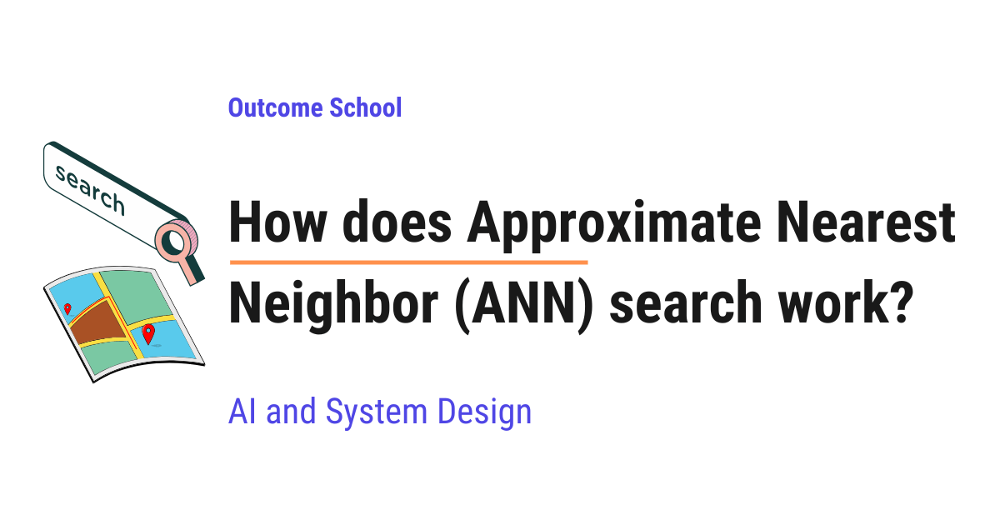

# How does Approximate Nearest Neighbor (ANN) search work?

> Archived from <https://outcomeschool.com/blog/how-does-approximate-nearest-neighbor-ann-search-work> on 2026-11-25.

Approximate Nearest Neighbor (ANN) Search finds an item that is very close to the true most similar one, but much faster, by using clever shortcuts and allowing a tiny chance of not being perfectly exact.

In this blog, we will learn about Approximate Nearest Neighbor (ANN) Search, the idea that lets apps find &quot;similar&quot; things in a huge collection in the blink of an eye. It powers search engines, <a target="_blank" rel="noopener noreferrer" href="recommendation-system.md">recommendation systems</a>, face matching, and the memory behind modern AI chatbots. We will also see why the naive approach fails, how trees, hashing, clustering, and graphs make the search fast, and where ANN search is used in the real world.

We will cover the following:
<ul><li>What is Nearest Neighbor Search?</li><li>How do we turn things into numbers (vectors)?</li><li>How do we measure &quot;closeness&quot;?</li><li>The naive approach and why it fails</li><li>What is Approximate Nearest Neighbor (ANN) Search?</li><li>The trade-off: speed vs accuracy</li><li>Approach 1: Trees (KD-Tree)</li><li>Approach 2: Hashing (LSH)</li><li>Approach 3: Clustering (IVF)</li><li>Approach 4: Graphs (HNSW)</li><li>A simple code example</li><li>Where ANN Search is used</li><li>Picking the right method</li></ul>
I am <strong>Amit Shekhar</strong>, Founder @ <a target="_blank" rel="noopener noreferrer" href="https://outcomeschool.com">Outcome School</a>, I have taught and mentored many developers, and their efforts landed them high-paying tech jobs, helped many tech companies in solving their unique problems, and created many open-source libraries being used by top companies. I am passionate about sharing knowledge through open-source, blogs, and videos.

I teach <a target="_blank" rel="noopener noreferrer" href="https://outcomeschool.com/program/ai-and-machine-learning">AI and Machine Learning</a> at Outcome School.

Let&#x27;s get started.
<h3 id="what-is-nearest-neighbor-search">What is Nearest Neighbor Search?</h3>
<strong>Nearest Neighbor Search means finding the item in a collection that is the most similar to a given item.</strong>

A <strong>neighbor</strong> is something that lives close to us. The <strong>nearest</strong> neighbor is the one that lives closest of all.

Let&#x27;s say we walk into a music app and play one song. The app then says, &quot;Here are songs similar to this one.&quot; To do that, the app looked at its whole library and found the songs that are closest in style to the one we played. That is nearest neighbor search.

Here are some everyday examples of the same idea:
<ul><li>We upload a photo, and the app finds similar-looking photos.</li><li>We type a question, and a search engine finds the most relevant answers.</li><li>We watch one video, and the app suggests the next similar video.</li></ul>
So, nearest neighbor search is simply &quot;find me the most similar thing&quot;. Now, the question is: how does a computer measure how similar two things are? For that, we first need numbers.
<h3 id="how-do-we-turn-things-into-numbers-vectors">How do we turn things into numbers (vectors)?</h3>
A computer does not understand a song, a photo, or a sentence directly. It only understands numbers. So, the first step is to turn every item into a list of numbers.

This list of numbers is called a <strong>vector</strong>.
<blockquote>
Vector = a list of numbers that describes an item
</blockquote>
In simple words, a vector is like a fingerprint made of numbers. Each item gets its own fingerprint.

Let&#x27;s say we describe a person using just two numbers: their age and their height. Then a person becomes a vector of two numbers, like below:

<pre><code class="code-highlight">   Person A  -&gt;  [ 25, 170 ]
   Person B  -&gt;  [ 27, 172 ]
   Person C  -&gt;  [ 60, 165 ]
</code></pre>

Here, we can see that each person is now a list of two numbers. Person A and Person B have similar numbers, so they are similar. Person C has a very different age, so Person C is far from the other two.

Real items like photos and sentences are not described by just two numbers. They are described by hundreds or even thousands of numbers. A special kind of model, called an <strong><a target="_blank" rel="noopener noreferrer" href="what-are-embeddings.md">embedding model</a></strong>, reads an item and produces this vector for us. We do not need to know how it works right now. We just need to know that it turns any item into a vector, and similar items get similar vectors. We have a detailed blog on <a target="_blank" rel="noopener noreferrer" href="contrastive-learning.md">Contrastive Learning</a> that explains how models learn to give similar items similar vectors.

So, every song, photo, and sentence becomes a point in space described by numbers. Now, let&#x27;s learn how to measure the distance between two such points.
<h3 id="how-do-we-measure-closeness">How do we measure &quot;closeness&quot;?</h3>
Once everything is a vector, &quot;similar&quot; becomes &quot;close&quot;, and &quot;different&quot; becomes &quot;far&quot;. So, we need a way to measure the distance between two vectors.

The most common way is <strong>Euclidean distance</strong>. This is just the straight-line distance between two points, the same distance we measure with a ruler.

Let&#x27;s take two simple vectors with two numbers each:

<pre><code class="code-highlight">   A = [ 1, 2 ]
   B = [ 4, 6 ]
</code></pre>

We find the difference in each number, square it, add them, and take the square root:
<ul><li>difference in first number: 4 - 1 = 3</li><li>difference in second number: 6 - 2 = 4</li><li>distance = square root of (3 squared + 4 squared) = square root of (9 + 16) = square root of 25 = 5</li></ul>
So, the distance between A and B is 5. A smaller distance means the two items are more similar.

We can picture these two points on a simple grid like below:

<pre><code class="code-highlight">   6 -|                 B (4,6)
   5 -|                /
   4 -|               /
   3 -|              /  distance = 5
   2 -|   A (1,2)---/
   1 -|
   0 -+----------------------
       0  1  2  3  4  5  6
</code></pre>

Here, we can see two points A and B on a grid. The straight line connecting them is the Euclidean distance, and its length is 5. The closer two points sit, the shorter this line, and the more similar the items are.

<strong>Note:</strong> There is another popular measure called <strong><a target="_blank" rel="noopener noreferrer" href="cosine-similarity.md">cosine similarity</a></strong>, which looks at the angle between two vectors instead of the gap between them. It is widely used for text. For now, we just need the core idea: there is a number that tells us how close two vectors are.

So, now finding the nearest neighbor means finding the vector with the smallest distance to our query. Let&#x27;s see the simplest way to do that.
<h3 id="the-naive-approach-and-why-it-fails">The naive approach and why it fails</h3>
The most obvious way to find the nearest neighbor is to check every single item.

We take our query vector, measure its distance to every vector in the collection, and keep the one with the smallest distance. This is called the <strong>brute-force</strong> approach, and it is also called <strong>exact</strong> search because it always gives the perfect answer.

Let&#x27;s see this approach like below:

<pre><code class="code-highlight">   query  ----compare----&gt;  item 1   (distance = 12)
   query  ----compare----&gt;  item 2   (distance = 3)   &lt;- closest so far
   query  ----compare----&gt;  item 3   (distance = 9)
   query  ----compare----&gt;  item 4   (distance = 7)
   ...
   query  ----compare----&gt;  item N   (distance = 5)
</code></pre>

Here, we can see that we compare the query against every single item, one by one, and pick the smallest distance. For a small collection, this works perfectly.

But, here is the catch. Real collections are huge.

Let&#x27;s say we have one billion vectors, and each vector has 1000 numbers. To answer one query, we must do one billion distance calculations, and each calculation touches 1000 numbers. That is a thousand billion operations for a single search. And large apps handle thousands of searches every second.

So, the brute-force approach is too slow. It does not scale. We need something much faster.

<strong>Planning your move into AI?</strong>

No matter which tech domain you work in today, with your effort, you can transition to these roles:
<ul><li>AI Engineer</li><li>Forward Deployed Engineer</li><li>AI Agent Engineer</li><li>Harness Engineer</li><li>Voice AI Engineer</li><li>AI Architect</li><li>LLM Engineer</li><li>LLM Inference Engineer</li><li>Gen AI Engineer</li><li>MLOps Engineer</li><li>ML Engineer</li><li>Deep Learning Engineer</li></ul>
Our <a target="_blank" rel="noopener noreferrer" href="https://outcomeschool.com/program/ai-and-machine-learning">AI and Machine Learning Program</a> at Outcome School takes you there.

So, here comes Approximate Nearest Neighbor Search to the rescue.
<h3 id="what-is-approximate-nearest-neighbor-ann-search">What is Approximate Nearest Neighbor (ANN) Search?</h3>
<strong>Approximate Nearest Neighbor Search means finding a neighbor that is very close to the true nearest one, but much faster, by allowing a tiny chance of not being perfectly exact.</strong>

In simple words, instead of checking every item, we use clever shortcuts that look at only a small part of the collection and still find an answer that is almost always correct.

Let&#x27;s decompose the term:
<blockquote>
Approximate Nearest Neighbor = Approximate + Nearest Neighbor
</blockquote>
<strong>Approximate</strong> means &quot;very close to correct, but not guaranteed to be perfect&quot;. <strong>Nearest Neighbor</strong> is the most similar item, which we already learned.

The best way to understand this is by taking an example. Suppose we are in a giant library and we want a book on cooking. The brute-force way is to read the title of every single book in the building. That is perfect but extremely slow.

The smart way is to walk straight to the &quot;Food and Cooking&quot; section and look only there. We may not find the single best cookbook in the entire building, but we will almost certainly find an excellent one, and we will find it in seconds.

That is exactly what ANN does. It organizes the data in advance so that, at search time, it can jump to the right neighborhood and ignore everything else.

So, ANN trades a tiny bit of accuracy for a massive gain in speed. For almost every real app, this trade is more than worth it.
<h3 id="the-trade-off-speed-vs-accuracy">The trade-off: speed vs accuracy</h3>
Before we learn the methods, we must understand the one idea that connects all of them: the trade-off between speed and accuracy.

In ANN, we measure quality using a number called <strong><a target="_blank" rel="noopener noreferrer" href="precision-vs-recall.md">recall</a></strong>.

<strong>Recall is the percentage of times the approximate answer matches the true nearest neighbor.</strong>

A recall of 100 percent means the approximate answer is always perfect. A recall of 95 percent means it is correct 95 times out of 100, and slightly off the other 5 times. In practice, being slightly off usually means returning the second or third closest item instead of the very closest, which is perfectly fine for most apps.

We can picture the trade-off like below:

<pre><code class="code-highlight">   brute-force        ANN (tuned for          ANN (tuned for
   (exact)            high accuracy)           high speed)

   recall: 100%       recall: ~99%             recall: ~90%
   speed:  slow       speed:  fast             speed:  very fast
</code></pre>

Here, we can see the whole picture. As we push for more speed, recall drops a little. As we push for more accuracy, speed drops a little. Every ANN method gives us a knob to balance these two, and we tune it based on our use case.

<strong>A quick note for you</strong>

No matter which tech domain you work in, get familiar with these topics:
<ul><li>LLM</li><li>RAG</li><li>MCP</li><li>Agent</li><li>Fine-tuning</li><li>Quantization</li></ul>
We put it all together in one video:

<a target="_blank" rel="noopener noreferrer" href="https://www.youtube.com/watch?v=lnfWvX66FUk">AI Engineering Explained: LLM, RAG, MCP, Agent, Fine-Tuning, and Quantization</a>

No need to stop reading - bookmark it and watch later when you get time. Future you will thank you.

Now, let&#x27;s get back to the topic.

Now, let&#x27;s learn the main approaches that make ANN fast. We will build them up one by one.
<h3 id="approach-1-trees-kd-tree">Approach 1: Trees (KD-Tree)</h3>
The first idea is to split the space into smaller and smaller regions, so we only search the region our query falls into.

A popular method here is the <strong>KD-Tree</strong>. The &quot;KD&quot; stands for &quot;K-Dimensional&quot;, which simply means it works with vectors that have many numbers.

In simple words, a KD-Tree keeps cutting the space in half, again and again. Each cut sends us down one branch and lets us ignore the other branch.

Let&#x27;s say all our points are spread on a flat board. First, we draw a vertical line that splits the points into left and right. Then, inside each side, we draw a horizontal line that splits them into top and bottom. We keep doing this, building a tree of cuts.

We can picture the tree like below:

<pre><code class="code-highlight">                    [ all points ]
               split by a vertical line
                 /                  \
        left region              right region
        /         \              /          \
   sub-region   sub-region   sub-region   sub-region
</code></pre>

Here, we can see that the whole space is cut into a tree of regions. When a query arrives, we follow the cuts down to the small region where it belongs, and we only compare against the few points in that region. We skip the rest of the tree.

<strong>The issue with this approach is that it works well only when each vector has few numbers.</strong> When vectors have hundreds of numbers, the cuts stop being helpful, and we end up checking almost everything anyway. This problem of high-dimensional data is famously called the <strong>curse of dimensionality</strong>.

So, trees are great for low-dimensional data but weak for the large, high-dimensional vectors used in modern AI. Let&#x27;s see how the next approach solves this issue.
<h3 id="approach-2-hashing-lsh">Approach 2: Hashing (LSH)</h3>
The next idea is to use a smart shortcut called <strong>hashing</strong>.

Normally, hashing turns an item into a short code, and very different items get very different codes. But for ANN, we use a special twist called <strong>Locality Sensitive Hashing</strong>, or <strong>LSH</strong>.

<strong>Locality Sensitive Hashing is a method that gives similar items the same code on purpose, so they land in the same bucket.</strong>

In simple words, LSH groups similar vectors into the same &quot;bucket&quot;. At search time, we look only inside the query&#x27;s bucket instead of the whole collection.

Let&#x27;s say we sort thousands of marbles into a few boxes, and we make sure that marbles of similar color always go into the same box. Later, to find marbles similar to a red one, we open only the red box. We ignore all the other boxes.

We can picture LSH like below:

<pre><code class="code-highlight">   all vectors  ---LSH---&gt;   Bucket 1: [ v3, v9, v14 ]
                             Bucket 2: [ v1, v7 ]
                             Bucket 3: [ v2, v5, v8, v11 ]   &lt;- query lands here

   query  ---LSH---&gt;  Bucket 3, so compare only with v2, v5, v8, v11
</code></pre>

Here, we can see that LSH first drops every vector into a bucket. When a query arrives, we run the same hashing on it, find its bucket, and compare only with the few vectors in that bucket. We skip every other bucket.

<strong>The advantage</strong> is that this is very fast and uses simple, fixed rules. <strong>The disadvantage</strong> is that the accuracy can be uneven. Sometimes a true neighbor lands in a different bucket and we miss it. To fix this, we use several hash tables at once, which uses more memory.

So, LSH is fast and simple, but to get high accuracy it needs extra memory. Let&#x27;s see how the next approach handles this.
<h3 id="approach-3-clustering-ivf">Approach 3: Clustering (IVF)</h3>
The next idea is to group nearby vectors into clusters in advance, and then search only the clusters closest to our query.

This method is called <strong>IVF</strong>, which stands for <strong>Inverted File Index</strong>. The name sounds heavy, but the idea is simple.

In simple words, we divide all the vectors into groups, where each group has a representative center point, and at search time we only open the few groups whose centers are nearest to the query.

The best way to learn this is by taking an example. Suppose we sort all the people in a country by which city they live in. Each city has a center. To find people near a given location, we first find the nearest city or two, and then look only at the people in those cities. We do not scan the whole country.

This happens in two phases.

<strong>Step 1: Build the clusters (done once, in advance).</strong> We group all the vectors into clusters. Each cluster gets a center point that represents it. This grouping step is often done using a method called <strong><a target="_blank" rel="noopener noreferrer" href="k-means-clustering.md">k-means</a></strong>, which simply finds natural groups in the data.

<strong>Step 2: Search (done for every query).</strong> When a query arrives, we first compare it only with the cluster centers, which are very few. We pick the nearest few clusters. Then we compare the query only with the vectors inside those chosen clusters.

We can picture IVF like below:

<pre><code class="code-highlight">   Cluster A (center cA): [ v1, v4, v8 ]
   Cluster B (center cB): [ v2, v6 ]
   Cluster C (center cC): [ v3, v5, v7, v9 ]

   Step 1: query vs centers -&gt;  cA, cB, cC   (pick nearest: cC)
   Step 2: query vs members of C only -&gt; v3, v5, v7, v9
</code></pre>

Here, we can see that we first compare the query against a handful of cluster centers, not the whole collection. Then we open only the nearest cluster and compare against the vectors inside it. Everything else is skipped.

There is a knob here called <code>nprobe</code>, which decides how many clusters we open. If we open more clusters, we get higher accuracy but slower speed. If we open fewer clusters, we get more speed but lower accuracy. We tune <code>nprobe</code> based on our use case.

So, IVF gives us a clean balance and scales to billions of vectors. But we can have an even smarter approach than this too.
<h3 id="approach-4-graphs-hnsw">Approach 4: Graphs (HNSW)</h3>
The most popular ANN method today is based on graphs. It is called <strong>HNSW</strong>, which stands for <strong>Hierarchical Navigable Small World</strong>.

The name is long, so let&#x27;s decompose it.

A <strong>graph</strong> is just a set of points connected by links. Here, each vector is a point, and we connect each vector to its nearby vectors with links. To find a neighbor, we hop from point to point along the links, always moving closer to the query. This is the &quot;Navigable&quot; part.

The <strong>Hierarchical</strong> part means we build several layers of this graph, stacked on top of each other. The top layer is sparse and has only a few points with long links. Each lower layer is denser. We start our search at the top, take big jumps to get close fast, and then drop into the lower, denser layers to fine-tune the answer.

The best way to understand this is by taking an example. Think of how we travel between two cities. First, we take a highway to cover most of the distance quickly, which is the top layer. Then, we take main roads, which is the middle layer. Finally, we take small local streets to reach the exact house, which is the bottom layer.

We can picture the layers like below:

<pre><code class="code-highlight">   Top layer (few points, long jumps)
      A -------------------- F
       \                    /
        \                  /
   Middle layer (more points)
      A ---- C ---- D ---- F
       \    /  \   /  \   /
   Bottom layer (all points, short hops)
      A - B - C - D - E - F - G   &lt;- final answer found here
</code></pre>

Here, we can see the journey. We enter at the top layer and take large jumps to get into the right area quickly. Then we move down layer by layer, taking smaller and smaller hops, until we reach the closest point in the dense bottom layer. We never touch the points that are far away.

This greedy hopping is extremely fast and gives very high accuracy. This is why HNSW is the default choice in most modern <a target="_blank" rel="noopener noreferrer" href="how-does-a-vector-database-work.md">vector databases</a>.

<strong>The advantage</strong> is excellent speed and accuracy together. <strong>The disadvantage</strong> is that the graph uses more memory and takes longer to build than the other methods. But for most apps, the search speed matters most, so HNSW wins.

So, now we have learned the four main families of ANN: trees, hashing, clustering, and graphs.

These four families are the engines inside modern Vector Databases. If we want to go deeper into Vector Databases, embeddings, and AI and ML System Design, we cover all of these in our <a target="_blank" rel="noopener noreferrer" href="https://outcomeschool.com/program/ai-and-machine-learning">AI and Machine Learning Program</a> at Outcome School.
<h3 id="a-simple-code-example">A simple code example</h3>
Now, let&#x27;s see ANN in action using a popular open-source library called FAISS, which is built for fast vector search. We will use the IVF method we just learned. Let&#x27;s see the code as below:

<pre><code class="code-highlight language-python">import faiss
import numpy as np

# Suppose we have 100000 vectors, each with 128 numbers
dimension = 128
data = np.random.random((100000, dimension)).astype(&quot;float32&quot;)

# Build an IVF index with 100 clusters
quantizer = faiss.IndexFlatL2(dimension)
index = faiss.IndexIVFFlat(quantizer, dimension, 100)

# Step 1: learn the clusters from the data
index.train(data)

# Step 2: add all the vectors into the index
index.add(data)

# Open 10 nearest clusters per query (the nprobe knob)
index.nprobe = 10

# Search: find the 5 nearest neighbors of one query vector
query = np.random.random((1, dimension)).astype(&quot;float32&quot;)
distances, neighbors = index.search(query, 5)

print(neighbors)
</code></pre>

Here, we have built an ANN search system, and let me explain each part.
<ul><li><code>data</code> is our collection of 100000 vectors, each with 128 numbers.</li><li><code>IndexIVFFlat(quantizer, dimension, 100)</code> creates an IVF index that splits the data into 100 clusters.</li><li><code>index.train(data)</code> is Step 1. It learns the cluster centers from the data.</li><li><code>index.add(data)</code> is Step 2. It places every vector into its nearest cluster.</li><li><code>index.nprobe = 10</code> is the knob. It tells the search to open the 10 nearest clusters per query. A higher value gives more accuracy but less speed.</li><li><code>index.search(query, 5)</code> finds the 5 nearest neighbors of the query, returning their distances and positions.</li></ul>
So, in just a few lines, we have built a fast search over 100000 vectors without comparing against every single one. It works perfectly.

The kind of search index we just built is exactly what powers RAG systems and the long-term memory of AI assistants. We have a complete program where we learn RAG and build an AI Tutor from scratch - check out our <a target="_blank" rel="noopener noreferrer" href="https://outcomeschool.com/program/ai-and-machine-learning">AI and Machine Learning Program</a> at Outcome School.
<h3 id="where-ann-search-is-used">Where ANN Search is used</h3>
Now, let&#x27;s discuss where ANN Search is used in the real world. We use it far more often than we realize.
<ul><li><strong><a target="_blank" rel="noopener noreferrer" href="how-does-semantic-search-work.md">Semantic search</a>:</strong> When a search bar understands the meaning of our words, not just exact keywords, ANN finds the closest matching documents.</li><li><strong>Recommendation systems:</strong> When an app suggests the next song, video, or product, ANN finds items similar to what we already liked.</li><li><strong>Image search:</strong> When we search by an image and get visually similar images, ANN is matching the <a target="_blank" rel="noopener noreferrer" href="how-do-image-embeddings-work.md">picture vectors</a>.</li><li><strong>Face recognition:</strong> When a phone or a photo app groups the same person together, ANN matches face vectors.</li><li><strong>RAG for AI chatbots:</strong> Modern AI assistants use a technique called <strong><a target="_blank" rel="noopener noreferrer" href="retrieval-augmented-generation-rag.md">Retrieval Augmented Generation</a></strong>, which means the model first fetches relevant facts from a large knowledge store before answering. ANN is the engine that fetches those relevant facts quickly. This is why ANN sits at the heart of vector databases like FAISS and Qdrant.</li><li><strong>Semantic caching:</strong> When an AI app reuses a past answer for a new question that means the same thing, ANN finds the closest saved question so the app can skip calling the model again. This is <a target="_blank" rel="noopener noreferrer" href="how-does-semantic-caching-work.md">how Semantic Caching works</a>.</li><li><strong>Detecting duplicates:</strong> When a platform finds near-duplicate articles, photos, or products, ANN spots the close matches.</li></ul>
So, now we know where we can use ANN Search.

In a search or RAG pipeline, ANN usually fetches a rough shortlist of candidates, and then a reranker reorders that shortlist so the most relevant items rise to the top. We have a detailed blog on <a target="_blank" rel="noopener noreferrer" href="how-does-a-reranker-work.md">how a Reranker works</a> that explains this step by step.

On the RAG side, there is also an approach that skips this whole numeric search. We have a detailed blog on <a target="_blank" rel="noopener noreferrer" href="vectorless-rag.md">Vectorless RAG</a> that explains how a model reaches the right section by reading the structure of a document instead of measuring distances.

<strong>Stay updated:</strong> Subscribe to our <a target="_blank" rel="noopener noreferrer" href="https://outcomeschool.substack.com/subscribe">newsletter</a> to get our latest AI and Machine Learning blogs straight to your inbox.
<h3 id="picking-the-right-method">Picking the right method</h3>
Now, let me tabulate the differences between the main ANN methods for your better understanding so that you can decide which one to use based on your use case.
<table><thead><tr><th>Method</th><th>Core idea</th><th>Strength</th><th>Weakness</th></tr></thead><tbody><tr><td>KD-Tree</td><td>Split space into regions</td><td>Simple, exact for few numbers</td><td>Fails for many numbers</td></tr><tr><td>LSH</td><td>Group similar items into buckets</td><td>Fast and simple</td><td>Needs extra memory for accuracy</td></tr><tr><td>IVF</td><td>Cluster and search nearest clusters</td><td>Scales to billions, balanced</td><td>Needs tuning of clusters</td></tr><tr><td>HNSW</td><td>Hop through a layered graph</td><td>Best speed and accuracy together</td><td>Uses more memory to build</td></tr></tbody></table>
For very large data where we want the best speed and accuracy and have enough memory, HNSW is usually the top choice. For huge data where we must save memory, IVF is excellent. For simple, low-dimensional data, a tree can be enough.

This was all about Approximate Nearest Neighbor Search.

ANN turns the slow task of comparing against everything into a fast task of looking only at the right neighborhood. We first turn items into vectors, then measure closeness as distance, and finally use a clever structure like a tree, hash buckets, clusters, or a graph to skip almost all the work. We give up a tiny bit of perfect accuracy and gain enormous speed, and that is exactly the trade that makes modern search, recommendations, and AI assistants feel instant.
<h2 id="frequently-asked-questions">Frequently Asked Questions</h2><h3 id="does-ann-search-always-return-the-exact-nearest-neighbor">Does ANN search always return the exact nearest neighbor?</h3>
No. ANN search does not guarantee the exact nearest neighbor. It allows a tiny chance of not being perfectly exact. When it is off, it usually returns the second or third closest item instead of the very closest, which is perfectly fine for most apps.
<h3 id="why-not-just-use-brute-force-search-instead-of-ann">Why not just use brute-force search instead of ANN?</h3>
Brute-force search is exact, but it is too slow for large collections. With one billion vectors of 1000 numbers each, one query needs a thousand billion operations. Large apps handle thousands of searches every second, so brute-force does not scale, and ANN looks at only a small part of the collection instead.
<h3 id="which-ann-method-should-we-use-hnsw-or-ivf">Which ANN method should we use, HNSW or IVF?</h3>
HNSW is usually the top choice when we want the best speed and accuracy together and have enough memory. IVF is excellent for huge data where we must save memory. HNSW uses more memory and takes longer to build, while IVF scales to billions of vectors but needs tuning of clusters.
<h3 id="why-does-a-kd-tree-not-work-well-for-ai-embeddings">Why does a KD-Tree not work well for AI embeddings?</h3>
A KD-Tree works well only when each vector has few numbers. Modern AI vectors have hundreds of numbers, and at that size the cuts stop being helpful, so we end up checking almost everything anyway. This problem is called the curse of dimensionality.
<h3 id="what-does-the-nprobe-setting-control-in-ivf">What does the nprobe setting control in IVF?</h3>
The <code>nprobe</code> setting decides how many clusters we open for each query. Opening more clusters gives higher accuracy but slower speed. Opening fewer clusters gives more speed but lower accuracy. We tune it based on our use case.

That&#x27;s it for now.

Thanks

<strong>Amit Shekhar</strong> Founder @ <a target="_blank" rel="noopener noreferrer" href="https://outcomeschool.com">Outcome School</a>

You can connect with me on:
<ul><li><a target="_blank" rel="noopener noreferrer" href="https://x.com/amitiitbhu">X</a></li><li><a target="_blank" rel="noopener noreferrer" href="https://www.linkedin.com/in/amit-shekhar-iitbhu">LinkedIn</a></li><li><a target="_blank" rel="noopener noreferrer" href="https://github.com/amitshekhariitbhu">GitHub</a></li></ul>
Follow Outcome School on:
<ul><li><a target="_blank" rel="noopener noreferrer" href="https://x.com/outcome_school">X</a></li><li><a target="_blank" rel="noopener noreferrer" href="https://youtube.com/@OutcomeSchool">YouTube</a></li><li><a target="_blank" rel="noopener noreferrer" href="https://www.linkedin.com/company/outcomeschool">LinkedIn</a></li><li><a target="_blank" rel="noopener noreferrer" href="https://github.com/OutcomeSchool">GitHub</a></li></ul>
<a target="_blank" rel="noopener noreferrer" href="https://outcomeschool.com/blog"><strong>Read all of our high-quality blogs here.</strong></a>

