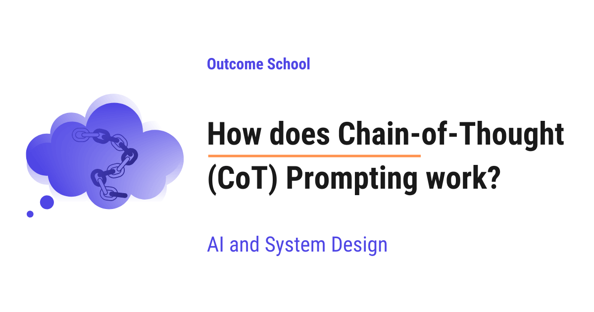

# How does Chain-of-Thought (CoT) Prompting work?

> Archived from <https://outcomeschool.com/blog/how-does-chain-of-thought-prompting-work> on 2026-11-25.

Chain-of-Thought (CoT) Prompting is a technique where we ask the model to write out its reasoning steps before giving the final answer. In simple words, we ask the model to think out loud first, and this makes its answers more accurate.

In this blog, we will learn about how Chain-of-Thought (CoT) Prompting works. We will also see why a model that jumps straight to the answer often gets it wrong, how making it reason step by step fixes this, the difference between zero-shot and few-shot CoT, and where this technique is truly useful.

We will cover the following:
<ul><li>What is a prompt?</li><li>What is an LLM?</li><li>The problem: when the model jumps straight to the answer</li><li>What is Chain-of-Thought (CoT) Prompting?</li><li>A simple example without CoT and with CoT</li><li>Zero-shot CoT vs Few-shot CoT</li><li>A step-by-step walkthrough of a reasoning chain</li><li>Why does Chain-of-Thought Prompting work?</li><li>Where Chain-of-Thought Prompting is useful</li><li>Things to keep in mind</li></ul>
I am <strong>Amit Shekhar</strong>, Founder @ <a target="_blank" rel="noopener noreferrer" href="https://outcomeschool.com">Outcome School</a>, I have taught and mentored many developers, and their efforts landed them high-paying tech jobs, helped many tech companies in solving their unique problems, and created many open-source libraries being used by top companies. I am passionate about sharing knowledge through open-source, blogs, and videos.

I teach <a target="_blank" rel="noopener noreferrer" href="https://outcomeschool.com/program/ai-and-machine-learning">AI and Machine Learning</a> at Outcome School.

Let&#x27;s get started.
<h3 id="what-is-a-prompt">What is a prompt?</h3>
Before jumping into Chain-of-Thought Prompting, we must know what a <strong>prompt</strong> is.

A <strong>prompt</strong> is the text instruction we give to an AI model. In simple words, a prompt is the question or the task we type in.

Let&#x27;s say we open a chat-based AI tool and type, &quot;What is the capital of France?&quot;. That sentence is the prompt. The model reads the prompt and gives us an answer.

So, a prompt is just our way of telling the model what we want.
<h3 id="what-is-an-llm-">What is an LLM ?</h3>
Now, let&#x27;s understand the kind of model we are talking about.

<strong>LLM = Large Language Model.</strong>

In simple words, an LLM is a model that has read a huge amount of text and learned to predict the next word. That is the most important idea here.

Let&#x27;s say we type, &quot;The sky is&quot;. The model has seen this kind of sentence many times, so it predicts the next word as &quot;blue&quot;. It keeps doing this, one word after another, until the full answer is formed.

So, an LLM builds its answer word by word. It does not see the whole answer at once. It writes the answer the same way we speak a sentence, one word at a time.

This one-word-at-a-time way of generating text is called autoregression. We have a detailed blog on <a target="_blank" rel="noopener noreferrer" href="autoregressive-models.md">autoregressive models</a> that explains it in depth.

This single idea will help us understand why Chain-of-Thought Prompting works so well.
<h3 id="the-problem-when-the-model-jumps-straight-to-the-answer">The problem: when the model jumps straight to the answer</h3>
Consider a simple math word problem.
<blockquote>
A shop has 12 apples. It sells 5 apples in the morning and buys 8 more in the evening. How many apples does the shop have now?
</blockquote>
The correct answer is 15. We get this by doing 12 - 5 = 7, and then 7 + 8 = 15.

Now, suppose we just ask the model for the answer directly. The model tries to predict the final number immediately. It has not worked out the small steps. For an easy problem, it may get it right. But for harder problems, it often jumps to a wrong number.

Why does this happen? Because we forced the model to produce the answer in one shot. We did not give it room to think step by step.

The model writes word by word, so if it commits to a final number too early, it has no chance to correct itself.

This is the core problem. So, here comes Chain-of-Thought Prompting to the rescue.
<h3 id="what-is-chain-of-thought-cot-prompting">What is Chain-of-Thought (CoT) Prompting?</h3>
<strong>Chain-of-Thought (CoT) Prompting is a technique where we ask the model to write out its reasoning steps before giving the final answer.</strong>

In simple words, instead of asking for the answer directly, we ask the model to &quot;think out loud&quot; first.

Let&#x27;s decompose the name to make it clearer.

<strong>Chain-of-Thought = Chain + of + Thought.</strong>

A <strong>thought</strong> is one small reasoning step. A <strong>chain</strong> is many small steps linked together, one after another. So a Chain-of-Thought is a series of small reasoning steps that lead us to the final answer.

Let&#x27;s say we are solving the apple problem. The thoughts in the chain are like this:
<ul><li>Thought 1: Start with 12 apples.</li><li>Thought 2: Sell 5, so 12 - 5 = 7 apples.</li><li>Thought 3: Buy 8 more, so 7 + 8 = 15 apples.</li><li>Final answer: 15.</li></ul>
Here, we can see that each thought builds on the previous one. This is the chain. This is how Chain-of-Thought Prompting guides the model.

<strong>Planning your move into AI?</strong>

No matter which tech domain you work in today, with your effort, you can transition to these roles:
<ul><li>AI Engineer</li><li>Forward Deployed Engineer</li><li>AI Agent Engineer</li><li>Harness Engineer</li><li>Voice AI Engineer</li><li>AI Architect</li><li>LLM Engineer</li><li>LLM Inference Engineer</li><li>Gen AI Engineer</li><li>MLOps Engineer</li><li>ML Engineer</li><li>Deep Learning Engineer</li></ul>
Our <a target="_blank" rel="noopener noreferrer" href="https://outcomeschool.com/program/ai-and-machine-learning">AI and Machine Learning Program</a> at Outcome School takes you there.

Let&#x27;s visualize the difference between the two ways as below:

<pre><code class="language-text code-highlight">   Without CoT (jump straight to the answer)

   Question --&gt; [ guess the final number ] --&gt; Answer (often wrong)

   With CoT (think step by step)

   Question
      |
      v
   Thought 1: start with 12 apples
      |
      v
   Thought 2: 12 - 5 = 7 apples
      |
      v
   Thought 3: 7 + 8 = 15 apples
      |
      v
   Final answer: 15 (more reliable)
</code></pre>

Here, we can see that without <code>CoT</code> the model goes from the question straight to the answer in one jump. With <code>CoT</code> the question flows through small thoughts, one after another, and only the last thought gives the final answer.
<h3 id="a-simple-example-without-cot-and-with-cot">A simple example without CoT and with CoT</h3>
The best way to learn this is by taking an example.

First, let&#x27;s see a prompt without Chain-of-Thought, as below:

<pre><code class="language-text code-highlight">Q: A shop has 12 apples. It sells 5 in the morning and buys 8 in the evening.
How many apples does it have now? Give only the final number.
</code></pre>

Here, we have told the model to give only the final number. The model is forced to jump straight to the answer with no thinking space. On harder problems, this often leads to mistakes.

Now, let&#x27;s add Chain-of-Thought to the same prompt, as below:

<pre><code class="language-text code-highlight">Q: A shop has 12 apples. It sells 5 in the morning and buys 8 in the evening.
How many apples does it have now? Let&#x27;s think step by step.
</code></pre>

Here, we have added one simple line at the end: &quot;Let&#x27;s think step by step.&quot; This small line is the trigger. It tells the model to write out its reasoning before the answer.

Now the model responds like below:

<pre><code class="language-text code-highlight">We start with 12 apples.
After selling 5, we have 12 - 5 = 7 apples.
After buying 8 more, we have 7 + 8 = 15 apples.
So, the final answer is 15.
</code></pre>

Here, we can notice that the model first writes the steps and only then gives the final answer. The reasoning is laid out clearly. This is Chain-of-Thought Prompting in action.

Problem Solved!

<strong>A quick note for you</strong>

No matter which tech domain you work in, get familiar with these topics:
<ul><li>LLM</li><li>RAG</li><li>MCP</li><li>Agent</li><li>Fine-tuning</li><li>Quantization</li></ul>
We put it all together in one video:

<a target="_blank" rel="noopener noreferrer" href="https://www.youtube.com/watch?v=lnfWvX66FUk">AI Engineering Explained: LLM, RAG, MCP, Agent, Fine-Tuning, and Quantization</a>

No need to stop reading - bookmark it and watch later when you get time. Future you will thank you.

Now, let&#x27;s get back to the topic.
<h3 id="zero-shot-cot-vs-few-shot-cot">Zero-shot CoT vs Few-shot CoT</h3>
Now, let&#x27;s learn that there are two common ways to do Chain-of-Thought Prompting.

The first one is <strong>Zero-shot CoT</strong>.

In simple words, &quot;zero-shot&quot; means we give zero examples. We just add a line like &quot;Let&#x27;s think step by step&quot; and the model starts reasoning on its own. This is the easiest way, and we already saw it above.

Let&#x27;s see the Zero-shot CoT prompt again, as below:

<pre><code class="language-text code-highlight">Q: If a train travels 60 km in 1 hour, how far does it travel in 3 hours?
Let&#x27;s think step by step.
</code></pre>

Here, we have given no example at all. We only added the magic line &quot;Let&#x27;s think step by step.&quot; The model figures out the steps by itself.

The second one is <strong>Few-shot CoT</strong>.

In simple words, &quot;few-shot&quot; means we give a few examples first. We show the model one or two solved problems with full reasoning. Then we ask our real question. The model copies the same step-by-step style.

Let&#x27;s see a Few-shot CoT prompt, as below:

<pre><code class="language-text code-highlight">Q: A box has 4 pens. We add 3 more pens. How many pens now?
A: We start with 4 pens. We add 3, so 4 + 3 = 7. The answer is 7.

Q: A jar has 10 candies. We eat 6. How many candies now?
A: We start with 10 candies. We eat 6, so 10 - 6 = 4. The answer is 4.

Q: A shelf has 8 books. We add 5 more. How many books now?
A:
</code></pre>

Here, we have given two solved examples first. Each example shows the reasoning, not just the answer. After seeing this pattern, the model answers the third question in the same step-by-step way. It will write, &quot;We start with 8 books. We add 5, so 8 + 5 = 13. The answer is 13.&quot;

So, Zero-shot CoT uses a simple instruction, and Few-shot CoT uses solved examples to teach the pattern.

Let me tabulate the differences between Zero-shot CoT and Few-shot CoT for your better understanding.
<table><thead><tr><th>Point</th><th>Zero-shot CoT</th><th>Few-shot CoT</th></tr></thead><tbody><tr><td>Examples given</td><td>None</td><td>A few solved examples</td></tr><tr><td>How reasoning is triggered</td><td>A line like &quot;Let&#x27;s think step by step&quot;</td><td>Showing solved examples with steps</td></tr><tr><td>Prompt length</td><td>Short</td><td>Longer</td></tr><tr><td>Effort to write</td><td>Very less</td><td>More, because we write examples</td></tr><tr><td>Best for</td><td>Quick, common problems</td><td>Harder or unusual problems</td></tr></tbody></table>
If we want to master Prompt Engineering, Chain of Thought (CoT) Prompting, and Prompt Chaining, we have a complete program on this - check out our <a target="_blank" rel="noopener noreferrer" href="https://outcomeschool.com/program/ai-and-machine-learning">AI and Machine Learning Program</a> at Outcome School.
<h3 id="a-step-by-step-walkthrough-of-a-reasoning-chain">A step-by-step walkthrough of a reasoning chain</h3>
Now, let&#x27;s take a slightly bigger problem and walk through the chain step by step.
<blockquote>
Suppose a class has 30 students. 12 of them play football. Half of the remaining students play cricket. How many students play cricket?
</blockquote>
Let&#x27;s follow the chain.

<strong>Step 1:</strong> Start with 30 students in total.

<strong>Step 2:</strong> 12 students play football. So the remaining students are 30 - 12 = 18.

<strong>Step 3:</strong> Half of the remaining 18 students play cricket. So 18 divided by 2 = 9.

<strong>Step 4:</strong> So, the final answer is 9 students play cricket.

We can picture how the result of each step flows into the next as below:

<pre><code class="language-text code-highlight">  Step 1            Step 2              Step 3            Step 4
+--------+      +-------------+     +-------------+     +--------+
| total  | ---&gt; | remaining   | --&gt; | cricket     | --&gt; | final  |
| = 30   |      | = 30 - 12   |     | = 18 / 2    |     | answer |
|        |      | = 18        |     | = 9         |     | = 9    |
+--------+      +-------------+     +-------------+     +--------+
                     ^                    ^
                     |                    |
              uses total from      uses remaining from
                  Step 1                Step 2
</code></pre>

Here, we can see that each step uses the result of the step before it. Step 2 needs the total from Step 1. Step 3 needs the remaining count from Step 2. This linking of steps is exactly why we call it a chain.

If the model tried to guess &quot;9&quot; in one shot, it could easily slip. But by working through each step, it stays on track. This is how Chain-of-Thought Prompting reduces mistakes.

<strong>Stay updated:</strong> Subscribe to our <a target="_blank" rel="noopener noreferrer" href="https://outcomeschool.substack.com/subscribe">newsletter</a> to get our latest AI and Machine Learning blogs straight to your inbox.
<h3 id="why-does-chain-of-thought-prompting-work">Why does Chain-of-Thought Prompting work?</h3>
Now, the next big question is: why does this simple trick work so well?

Remember the idea from earlier. An LLM writes its answer one word at a time, and each new word depends on the words written before it.

When the model writes out its reasoning, those reasoning words become part of what it reads next. So the model is now building its final answer on top of correct, visible steps, instead of guessing from nothing.

Let&#x27;s say we are doing a hard calculation in our head. It is easy to make a mistake. But if we write each step on paper, we are far more likely to get it right. Chain-of-Thought Prompting gives the model that same &quot;paper to write on&quot;.

Another reason is this. Breaking a big problem into small steps makes each step easy. The model is good at small, simple steps. By chaining many easy steps, it can solve a problem that looked hard as a whole.

So, the model is not getting smarter. We are just giving it room to think, and that too in a structured way. That&#x27;s the beauty of Chain-of-Thought Prompting.

Some newer models are trained to produce these reasoning steps on their own, without us adding any special prompt. We have a detailed blog on <a target="_blank" rel="noopener noreferrer" href="large-reasoning-models.md">large reasoning models</a> that explains how this works.
<h3 id="where-chain-of-thought-prompting-is-useful">Where Chain-of-Thought Prompting is useful</h3>
Now, we know how it works. Let&#x27;s see where we can use it.
<ul><li>Math word problems, where we need many small calculations.</li><li>Logic puzzles, where one wrong step breaks the whole answer.</li><li>Multi-step questions, where the answer depends on earlier facts.</li><li>Decision-making tasks, where we must weigh a few options before choosing.</li><li>Reading comprehension, where we must connect different parts of a passage.</li></ul>
In all of these, the answer is not a single fact. It needs several steps. Chain-of-Thought Prompting fits these cases perfectly.

When one wrong first step can break the whole answer, we can go one step further and let the model try many paths, judge them, and go back when a path fails. We have a detailed blog on <a target="_blank" rel="noopener noreferrer" href="how-does-tree-of-thoughts-work.md">Tree of Thoughts</a> that explains this step by step.
<h3 id="things-to-keep-in-mind">Things to keep in mind</h3>
Now, let&#x27;s discuss a few important points before we close.
<ul><li>Chain-of-Thought Prompting helps most on hard, multi-step problems. For very simple questions like &quot;What is the capital of France?&quot;, we do not need it. The answer is a single fact, so there is nothing to break into steps.</li><li>The reasoning the model writes is helpful, but it is not always perfect. The model can write steps that look correct but still reach a wrong answer. So, for important tasks, we must check the steps ourselves and not blindly trust them.</li><li>Writing out the steps means the model produces more text. More text takes a little more time and cost. For most tasks this is a fair trade for better answers, but we must keep it in mind based on our use case.</li></ul>
So, the idea is simple. Instead of asking the model for the answer directly, we ask it to think step by step. The model writes a chain of small thoughts, and each thought leads to the next, until we reach a reliable final answer.

This is how Chain-of-Thought Prompting works, and this is why such a small change in our prompt can make such a big difference.
<h2 id="frequently-asked-questions">Frequently Asked Questions</h2><h3 id="does-chain-of-thought-prompting-make-the-model-smarter">Does Chain-of-Thought Prompting make the model smarter?</h3>
No. The model is not getting smarter. We are just giving it room to think in a structured way. The reasoning words it writes become part of what it reads next, so it builds the final answer on top of visible steps instead of guessing from nothing.
<h3 id="should-we-use-chain-of-thought-prompting-for-simple-questions">Should we use Chain-of-Thought Prompting for simple questions?</h3>
No. It helps most on hard, multi-step problems. For a simple question like &quot;What is the capital of France?&quot;, the answer is a single fact, so there is nothing to break into steps. It fits math word problems, logic puzzles, and multi-step questions much better.
<h3 id="can-we-fully-trust-the-reasoning-steps-the-model-writes">Can we fully trust the reasoning steps the model writes?</h3>
No. The reasoning is helpful, but it is not always perfect. The model can write steps that look correct but still reach a wrong answer. So, for important tasks, we must check the steps ourselves and not blindly trust them.
<h3 id="does-chain-of-thought-prompting-increase-time-and-cost">Does Chain-of-Thought Prompting increase time and cost?</h3>
Yes. Writing out the steps means the model produces more text, and more text takes a little more time and cost. For most tasks, this is a fair trade for better answers, but we must keep it in mind based on our use case.
<h3 id="do-all-models-need-a-special-prompt-to-reason-step-by-step">Do all models need a special prompt to reason step by step?</h3>
No. Some newer models are trained to produce these reasoning steps on their own, without us adding any special prompt. For other models, a simple line like &quot;Let&#x27;s think step by step&quot; or a few solved examples triggers the reasoning.

That&#x27;s it for now.

Thanks

<strong>Amit Shekhar</strong> Founder @ <a target="_blank" rel="noopener noreferrer" href="https://outcomeschool.com">Outcome School</a>

You can connect with me on:
<ul><li><a target="_blank" rel="noopener noreferrer" href="https://x.com/amitiitbhu">X</a></li><li><a target="_blank" rel="noopener noreferrer" href="https://www.linkedin.com/in/amit-shekhar-iitbhu">LinkedIn</a></li><li><a target="_blank" rel="noopener noreferrer" href="https://github.com/amitshekhariitbhu">GitHub</a></li></ul>
Follow Outcome School on:
<ul><li><a target="_blank" rel="noopener noreferrer" href="https://x.com/outcome_school">X</a></li><li><a target="_blank" rel="noopener noreferrer" href="https://youtube.com/@OutcomeSchool">YouTube</a></li><li><a target="_blank" rel="noopener noreferrer" href="https://www.linkedin.com/company/outcomeschool">LinkedIn</a></li><li><a target="_blank" rel="noopener noreferrer" href="https://github.com/OutcomeSchool">GitHub</a></li></ul>
<a target="_blank" rel="noopener noreferrer" href="https://outcomeschool.com/blog"><strong>Read all of our high-quality blogs here.</strong></a>

