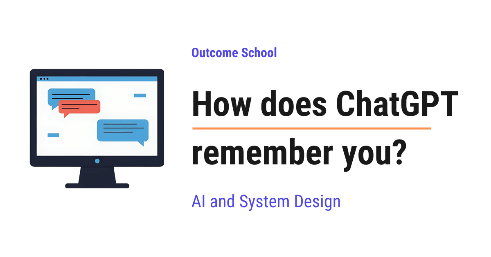

# How does ChatGPT remember you?

> Archived from <https://outcomeschool.com/blog/how-does-chatgpt-remember-you> on 2026-11-25.

ChatGPT remembers you by saving small notes about you outside the AI model and adding those notes back into the conversation whenever you chat. The model itself does not change when you chat with it, it reads your notes before it replies.

In this blog, we will learn about how ChatGPT remembers you. We will also see why an LLM forgets everything by default, what the context window is, how saved memories, chat history, and Custom Instructions work, how these memories are added to our message behind the scenes, how we can see and delete what it remembers, and where memory helps and where it fails.

We will cover the following:
<ul><li>Does ChatGPT really remember us?</li><li>Why does an LLM forget everything by default?</li><li>What is the context window?</li><li>How does ChatGPT remember within one chat?</li><li>What is ChatGPT Memory?</li><li>Saved memories: facts it writes down about us</li><li>Reference chat history: learning from past chats</li><li>Custom Instructions: what we tell it about ourselves</li><li>How are memories added into the prompt?</li><li>A complete example: from &quot;I am a vegetarian&quot; to a recipe suggestion</li><li>A simple code example</li><li>How can we see and delete memories?</li><li>Temporary Chat: talking without memory</li><li>Where memory helps and where it fails</li></ul>
I am <strong>Amit Shekhar</strong>, Founder @ <a target="_blank" rel="noopener noreferrer" href="https://outcomeschool.com">Outcome School</a>, I have taught and mentored many developers, and their efforts landed them high-paying tech jobs, helped many tech companies in solving their unique problems, and created many open-source libraries being used by top companies. I am passionate about sharing knowledge through open-source, blogs, and videos.

I teach <a target="_blank" rel="noopener noreferrer" href="https://outcomeschool.com/program/ai-and-machine-learning">AI and Machine Learning</a> at Outcome School.

Let&#x27;s get started.
<h2 id="does-chatgpt-really-remember-us">Does ChatGPT really remember us?</h2>
Let&#x27;s say Riya is a school teacher. On Monday, she tells ChatGPT: &quot;I am a vegetarian and I live in Bengaluru.&quot;

On Saturday, she opens a brand new chat and asks: &quot;Suggest a quick dinner recipe for tonight.&quot;

ChatGPT replies with a vegetarian recipe. It feels like talking to a friend who remembers her.

Now, the question is: does ChatGPT really remember us like a human does?

The answer is no, not in the way we think. The AI model inside ChatGPT does not remember anything at all. There is a separate system around the model that keeps notes about us and shows those notes to the model at the right time.

The AI model writes the replies. The note-keeping system does the remembering.
<h2 id="why-does-an-llm-forget-everything-by-default">Why does an LLM forget everything by default?</h2>
The AI model inside ChatGPT is an <strong>LLM</strong> (Large Language Model). An LLM is a model that has learned from a huge amount of text to <a target="_blank" rel="noopener noreferrer" href="autoregressive-models.md">predict the next word</a>. That is how it writes answers, one small piece at a time.

This learning is called <strong>training</strong>, and it happens once, before we ever use the model. After training, the model is frozen. When we chat with it, nothing inside the model changes. It does not learn our name. It does not store our chats.

An LLM is like a very smart person with no memory at all. Every time we talk to this person, they meet us for the first time.

Means, every reply depends only on the text that is sent to the model at that moment. Nothing else.
<h2 id="what-is-the-context-window">What is the context window?</h2>
<strong>The <a target="_blank" rel="noopener noreferrer" href="context-window.md">context window</a> is all the text that the LLM can read at one time before writing its reply.</strong>

Think of it as a desk. Whatever papers are kept on the desk, the LLM can read them. Whatever is not on the desk, the LLM cannot see.

The desk has a limited size. We cannot put unlimited papers on it. So, ChatGPT cannot keep everything about us on the desk, it must choose.

So, if we want the LLM to know something, that thing must be on the desk.

We have a detailed blog on <a target="_blank" rel="noopener noreferrer" href="context-engineering.md">Context Engineering</a> that explains how to choose what goes on this desk.
<h2 id="how-does-chatgpt-remember-within-one-chat">How does ChatGPT remember within one chat?</h2>
Suppose Riya is chatting like below:

<pre><code class="code-highlight">Riya: My name is Riya.
ChatGPT: Nice to meet you, Riya.
Riya: What is my name?
ChatGPT: Your name is Riya.
</code></pre>

How did it remember her name? We just learned that the model has no memory.

The answer is simple. When Riya sends her second message, ChatGPT does not send only &quot;What is my name?&quot; to the model. It sends the full conversation so far, like below:

<pre><code class="code-highlight">Riya: My name is Riya.
ChatGPT: Nice to meet you, Riya.
Riya: What is my name?
</code></pre>

Here, the model reads the whole conversation on the desk, finds &quot;My name is Riya&quot;, and answers.

So, within one chat, the memory is just the old messages being sent again with every new message.

When Riya starts a new chat, the desk is empty. The old chat is not on it. The model has no idea who she is.

We needed a solution for that, and ChatGPT Memory was introduced to solve this problem.
<h2 id="what-is-chatgpt-memory">What is ChatGPT Memory?</h2>
<strong>ChatGPT Memory is a feature that keeps useful information about us across different chats, so that we do not have to repeat ourselves every time.</strong>

In simple words, ChatGPT keeps a notebook about us. This notebook is kept outside the model, in a separate storage place. Before every reply, ChatGPT opens the notebook and puts the useful pages on the desk.

We have a detailed blog on <a target="_blank" rel="noopener noreferrer" href="ai-agent-memory.md">AI Agent Memory</a> that covers this idea end to end.

ChatGPT fills this notebook in two ways:
<ul><li><strong>Saved memories</strong>: clear facts that are written down as short notes.</li><li><strong>Reference chat history</strong>: useful details picked up from our past chats.</li></ul>
Along with these, there is one more thing called <strong>Custom Instructions</strong>, which we write ourselves.

We will learn about each of them in detail.
<h2 id="saved-memories-facts-it-writes-down-about-us">Saved memories: facts it writes down about us</h2>
<strong>Saved memories are short facts about us that ChatGPT writes down and keeps until we delete them.</strong>

There are two ways a fact gets saved.

First, we can ask directly, like below:

&quot;Remember that I am a vegetarian.&quot;

Second, ChatGPT can decide on its own that a fact will be useful in the future. For example, if Riya says &quot;I teach maths to class 8 students&quot;, ChatGPT can save that as a memory.

When a memory is saved, ChatGPT shows a small message like &quot;Memory updated&quot; in the chat.

The saved memories look like below:

<pre><code class="code-highlight">- Riya is a vegetarian.
- Riya lives in Bengaluru.
- Riya teaches maths to class 8 students.
</code></pre>

Here, we can see that these are not full chats. These are short notes. Short notes take very less space on the desk, so ChatGPT can bring them into any new chat.

<strong>Planning your move into AI?</strong>

No matter which tech domain you work in today, with your effort, you can transition to these roles:
<ul><li>AI Engineer</li><li>Forward Deployed Engineer</li><li>AI Agent Engineer</li><li>Harness Engineer</li><li>Voice AI Engineer</li><li>AI Architect</li><li>LLM Engineer</li><li>LLM Inference Engineer</li><li>Gen AI Engineer</li><li>MLOps Engineer</li><li>ML Engineer</li><li>Deep Learning Engineer</li></ul>
Our <a target="_blank" rel="noopener noreferrer" href="https://outcomeschool.com/program/ai-and-machine-learning">AI and Machine Learning Program</a> at Outcome School takes you there.
<h2 id="reference-chat-history-learning-from-past-chats">Reference chat history: learning from past chats</h2>
Saved memories need a clear fact to be written down. But many useful details are hidden inside our old chats, and nobody wrote them down as a note.

Here comes the reference chat history into the picture.

<strong>Reference chat history lets ChatGPT look at our past chats and use the useful parts in a new chat.</strong>

Let&#x27;s say last month Riya had a long chat about planning a trip to Goa in December. She never said &quot;remember this&quot;. Today, she asks: &quot;What should I pack for my trip?&quot; ChatGPT can connect this with her earlier Goa plan and suggest light cotton clothes and sunscreen.

But, ChatGPT cannot put all our old chats on the desk. There are too many of them, and the desk is limited. So, it picks only the small parts that look useful for the current chat, and puts only those on the desk.

Let me tabulate the differences between saved memories and reference chat history for your better understanding.
<table><thead><tr><th></th><th>Saved memories</th><th>Reference chat history</th></tr></thead><tbody><tr><td>What it is</td><td>Clear facts written as short notes</td><td>Useful details picked from past chats</td></tr><tr><td>How it is created</td><td>We ask, or ChatGPT decides to save</td><td>Picked from our old chats when needed</td></tr><tr><td>Can we see a list?</td><td>Yes, in the settings</td><td>No fixed list</td></tr><tr><td>How long it stays</td><td>Until we delete it</td><td>Changes as our chats change</td></tr></tbody></table><h2 id="custom-instructions-what-we-tell-it-about-ourselves">Custom Instructions: what we tell it about ourselves</h2>
<strong>Custom Instructions are a short piece of text that we write ourselves in the settings, telling ChatGPT about us and how we want it to reply.</strong>

For example, Riya can write like below:

<pre><code class="code-highlight">About me: I am a school teacher. I teach maths to class 8 students.
How to reply: Keep answers short and use simple examples.
</code></pre>

The difference is that we write Custom Instructions by hand, and ChatGPT never changes them on its own. Saved memories and chat history are collected by ChatGPT while we chat.

<strong>A quick note for you</strong>

No matter which tech domain you work in, get familiar with these topics:
<ul><li>LLM</li><li>RAG</li><li>MCP</li><li>Agent</li><li>Fine-tuning</li><li>Quantization</li></ul>
We put it all together in one video:

<a target="_blank" rel="noopener noreferrer" href="https://www.youtube.com/watch?v=lnfWvX66FUk">AI Engineering Explained: LLM, RAG, MCP, Agent, Fine-Tuning, and Quantization</a>

No need to stop reading - bookmark it and watch later when you get time. Future you will thank you.

Now, let&#x27;s get back to the topic.
<h2 id="how-are-memories-added-into-the-prompt">How are memories added into the prompt?</h2>
A <strong>prompt</strong> is the full text that is sent to the LLM. Means, the prompt is whatever is kept on the desk.

Before the LLM sees our new message, ChatGPT builds a bigger prompt. Just for the sake of understanding, the prompt looks like below:

<pre><code class="code-highlight">[Rules from the company that makes ChatGPT]
You are ChatGPT, a helpful assistant.

[Custom Instructions]
I am a school teacher. Keep answers short.

[Saved memories]
- Riya is a vegetarian.
- Riya lives in Bengaluru.

[Useful details from past chats]
- Riya often asks for South Indian dishes.

[Current chat]
Riya: Suggest a quick dinner recipe for tonight.
</code></pre>

Here, we can notice that Riya typed only one line. But the LLM receives many lines. Those extra lines are the memory.

One more thing to notice: the Goa trip is not in this prompt. It is not useful for a dinner recipe, so ChatGPT did not put it on the desk.

<strong>Note:</strong> The real prompt used inside ChatGPT is not public, and its exact format is different. This is a simplified picture, just for the sake of understanding.

<strong>Very important:</strong> The model is not remembering anything. It is reading. ChatGPT Memory is just the right notes put on the desk at the right time.

This is how ChatGPT remembers you.

To learn Context Engineering, Prompt Engineering, and Memory in Agents in depth, check out our <a target="_blank" rel="noopener noreferrer" href="https://outcomeschool.com/program/ai-and-machine-learning">AI and Machine Learning Program</a> at Outcome School.
<h2 id="a-complete-example-from-i-am-a-vegetarian-to-a-recipe-suggestion">A complete example: from &quot;I am a vegetarian&quot; to a recipe suggestion</h2>
Let&#x27;s put everything together, step by step.

<strong>Step 1:</strong> On Monday, in chat A, Riya types: &quot;Remember that I am a vegetarian.&quot;

<strong>Step 2:</strong> ChatGPT writes the note &quot;Riya is a vegetarian.&quot; into the notebook and shows &quot;Memory updated&quot;.

<strong>Step 3:</strong> Chat A ends. The model forgets everything, as always. But the note is safe in the notebook, because the notebook is outside the model.

<strong>Step 4:</strong> On Saturday, Riya opens a new chat B and types: &quot;Suggest a quick dinner recipe.&quot;

<strong>Step 5:</strong> Before sending this message to the model, ChatGPT opens the notebook and adds &quot;Riya is a vegetarian.&quot; to the prompt.

<strong>Step 6:</strong> The model reads the prompt, sees the note, and suggests a vegetable upma instead of a chicken curry.

The model never changed. Only the prompt changed.
<h2 id="a-simple-code-example">A simple code example</h2>
Now, let&#x27;s see the same idea in code. We can write the code as below:

<pre><code class="code-highlight language-python">memory_store = []  # our notebook, kept outside the model

def save_memory(note):
    memory_store.append(note)

def build_prompt(user_message):
    notes = &quot;\n&quot;.join(&quot;- &quot; + note for note in memory_store)
    return (
        &quot;You are a helpful assistant.\n&quot;
        &quot;What you know about the user:\n&quot; + notes + &quot;\n\n&quot;
        &quot;User: &quot; + user_message
    )

# Chat A on Monday
save_memory(&quot;Riya is a vegetarian.&quot;)

# Chat B on Saturday, a brand new chat
prompt = build_prompt(&quot;Suggest a quick dinner recipe.&quot;)
reply = call_llm(prompt)  # send the full prompt to the LLM
</code></pre>

Here, we have:
<ul><li><code>memory_store</code>: our notebook. It lives outside the LLM, so it is not erased when a chat ends.</li><li><code>save_memory</code>: writes a new note into the notebook.</li><li><code>build_prompt</code>: takes all the notes and puts them before the user&#x27;s message. Here, <code>\n</code> means &quot;start a new line&quot;.</li><li><code>call_llm</code>: sends the full prompt to the model. For the sake of example, assume that it is a function that talks to any LLM.</li></ul>
If we print the <code>prompt</code>, it will print the following:

<pre><code class="code-highlight">You are a helpful assistant.
What you know about the user:
- Riya is a vegetarian.

User: Suggest a quick dinner recipe.
</code></pre>

Here, we can see that the note from Monday is now on the desk in Saturday&#x27;s chat.

<strong>Note:</strong> In a real system, the notes are not kept in a simple list. They are saved in a database. So, they stay safe even when we close the app. Also, a real system picks only the useful notes for each chat, not all of them.

We have a complete program on designing Memory for a Personal AI Assistant, where we also build an AI Tutor from scratch - check out our <a target="_blank" rel="noopener noreferrer" href="https://outcomeschool.com/program/ai-and-machine-learning">AI and Machine Learning Program</a> at Outcome School.
<h2 id="how-can-we-see-and-delete-memories">How can we see and delete memories?</h2>
ChatGPT gives us control over what it remembers. We can:
<ul><li>Ask directly: &quot;What do you remember about me?&quot;</li><li>Open the settings, under <strong>Personalization</strong>, to see the list of saved memories and delete any of them.</li><li>Ask in the chat: &quot;Forget that I live in Bengaluru.&quot;</li><li>Update a fact by telling it: &quot;I have moved to Pune.&quot;</li><li>Turn off saved memories or reference chat history completely.</li></ul>
<strong>Note:</strong> Deleting a chat does not delete the saved memories that were created in that chat. A saved memory stays until we delete the memory itself.
<h2 id="temporary-chat-talking-without-memory">Temporary Chat: talking without memory</h2>
Sometimes, we want a chat that is not remembered at all. For example, Riya wants to plan a surprise birthday gift for her sister, and she does not want this to show up in her future chats.

So, here comes the <strong>Temporary Chat</strong> to the rescue.

A Temporary Chat does not use our saved memories, and it does not create new memories. It also does not appear in our chat history.

It is like talking to the LLM with a closed notebook.

<strong>Stay updated:</strong> Subscribe to our <a target="_blank" rel="noopener noreferrer" href="https://outcomeschool.substack.com/subscribe">newsletter</a> to get our latest AI and Machine Learning blogs straight to your inbox.
<h2 id="where-memory-helps-and-where-it-fails">Where memory helps and where it fails</h2>
Now, let&#x27;s see where memory works well and where it fails.

<strong>Where it helps:</strong>
<ul><li>We do not need to repeat ourselves in every chat.</li><li>Answers fit our needs, like our diet, our job, and the way we like replies.</li><li>Long work, like preparing for an exam, continues smoothly across many chats.</li></ul>
<strong>Where it fails:</strong>
<ul><li><strong>Old or wrong notes:</strong> If Riya moves to Pune but the note still says Bengaluru, the answers will be wrong until she fixes it.</li><li><strong>Missed details:</strong> The desk is limited, so sometimes ChatGPT does not pick the useful detail from our past chats.</li><li><strong>Unwanted notes:</strong> ChatGPT can save something we did not want it to keep. So, we must check our saved memories from time to time.</li><li><strong>No real understanding:</strong> It is still reading notes. It does not know us like a friend does.</li></ul>
The model itself never remembers anything. ChatGPT keeps notes about us outside the model, and before every reply, it puts the right notes on the desk for the model to read.
<h2 id="frequently-asked-questions">Frequently Asked Questions</h2><h3 id="does-chatgpt-memory-change-the-ai-model">Does ChatGPT Memory change the AI model?</h3>
No. The AI model inside ChatGPT is frozen after training, and nothing inside it changes when we chat. ChatGPT keeps notes about us outside the model, in a separate storage place, and adds the useful notes to the prompt before every reply. The model only reads them.
<h3 id="does-deleting-a-chat-also-delete-the-memories-saved-from-it">Does deleting a chat also delete the memories saved from it?</h3>
No. Deleting a chat does not delete the saved memories that were created in that chat. A saved memory stays until we delete the memory itself, either from the list under Personalization in the settings or by asking ChatGPT to forget it.
<h3 id="can-chatgpt-save-a-memory-without-us-asking">Can ChatGPT save a memory without us asking?</h3>
Yes. Along with the facts we ask it to remember, ChatGPT can decide on its own that a fact will be useful in the future and save it. When this happens, it shows a small &quot;Memory updated&quot; message in the chat. This is why we should check our saved memories from time to time.
<h3 id="does-chatgpt-send-all-our-past-chats-to-the-model">Does ChatGPT send all our past chats to the model?</h3>
No. The context window is limited, so ChatGPT cannot put all our old chats into it. It picks only the small parts of past chats that look useful for the current chat. For example, an old chat about a Goa trip is left out when we ask for a dinner recipe.
<h3 id="can-chatgpt-change-our-custom-instructions-on-its-own">Can ChatGPT change our Custom Instructions on its own?</h3>
No. We write Custom Instructions by hand in the settings, and ChatGPT never changes them on its own. Saved memories and chat history are different, because ChatGPT collects those while we chat.

That&#x27;s it for now.

Thanks

<strong>Amit Shekhar</strong> Founder @ <a target="_blank" rel="noopener noreferrer" href="https://outcomeschool.com">Outcome School</a>

You can connect with me on:
<ul><li><a target="_blank" rel="noopener noreferrer" href="https://x.com/amitiitbhu">X</a></li><li><a target="_blank" rel="noopener noreferrer" href="https://www.linkedin.com/in/amit-shekhar-iitbhu">LinkedIn</a></li><li><a target="_blank" rel="noopener noreferrer" href="https://github.com/amitshekhariitbhu">GitHub</a></li></ul>
Follow Outcome School on:
<ul><li><a target="_blank" rel="noopener noreferrer" href="https://x.com/outcome_school">X</a></li><li><a target="_blank" rel="noopener noreferrer" href="https://youtube.com/@OutcomeSchool">YouTube</a></li><li><a target="_blank" rel="noopener noreferrer" href="https://www.linkedin.com/company/outcomeschool">LinkedIn</a></li><li><a target="_blank" rel="noopener noreferrer" href="http://github.com/OutcomeSchool">GitHub</a></li></ul>
<a target="_blank" rel="noopener noreferrer" href="https://outcomeschool.com/blog"><strong>Read all of our high-quality blogs here.</strong></a>

