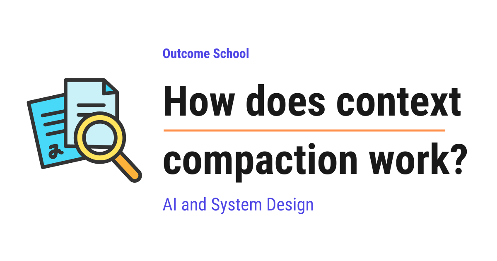

# How does context compaction work?

> Archived from <https://outcomeschool.com/blog/how-does-context-compaction-work> on 2026-11-25.

Context compaction is the technique of shrinking the old part of a long conversation into a short summary, so that the important facts stay, and the model&#x27;s context window gets free space again.

In this blog, we will learn about how context compaction works in Large Language Models. We will also see why long conversations overflow the context window, how summarization shrinks the older messages without losing the important points, and where compaction is used in real AI agents.

We will cover the following:
<ul><li>What is a Large Language Model?</li><li>What is the context window?</li><li>What is context?</li><li>The problem of long conversations</li><li>The naive fix and why it fails</li><li>What is context compaction?</li><li>How summarization powers compaction</li><li>A step-by-step walkthrough</li><li>Context compaction in code</li><li>Compaction in real AI agents</li><li>Why context compaction is important</li></ul>
I am <strong>Amit Shekhar</strong>, Founder @ <a target="_blank" rel="noopener noreferrer" href="https://outcomeschool.com">Outcome School</a>, I have taught and mentored many developers, and their efforts landed them high-paying tech jobs, helped many tech companies in solving their unique problems, and created many open-source libraries being used by top companies. I am passionate about sharing knowledge through open-source, blogs, and videos.

I teach <a target="_blank" rel="noopener noreferrer" href="https://outcomeschool.com/program/ai-and-machine-learning">AI and Machine Learning</a> at Outcome School.

Let&#x27;s get started.
<h3 id="what-is-a-large-language-model">What is a Large Language Model?</h3>
Before jumping into context compaction, we must know what a <a target="_blank" rel="noopener noreferrer" href="large-language-model-llm.md">Large Language Model</a> is.

A <strong>Large Language Model</strong> is a model that reads text and predicts the next word.

In simple words, it is a very good guessing machine. We give it some words, and it guesses the word that comes next. Then it adds that word and guesses again. It keeps doing this, one word at a time.

Let&#x27;s say we type &quot;I want to learn&quot;. The model guesses &quot;machine&quot;. Now the text becomes &quot;I want to learn machine&quot;. The model reads all of it again and guesses the next word. This is how a model writes long answers, one word after another.

<strong>Note:</strong> The model actually works with small pieces of words called <strong>tokens</strong>. A token can be a full word, a part of a word, or even a single letter. For the sake of understanding, we can think of a token as a word.

This is how a Large Language Model works. Now, let&#x27;s understand the context window.
<h3 id="what-is-the-context-window">What is the context window?</h3>
The model cannot read an unlimited amount of text. It has a limit on how many words it can hold at once.

The <strong><a target="_blank" rel="noopener noreferrer" href="context-window.md">context window</a></strong> is the maximum number of tokens the model can keep in front of it at one time.

In simple words, the context window is the size of the model&#x27;s short-term memory. If the limit is 4000 tokens, the model can only keep the last 4000 tokens in mind. Anything beyond that does not fit.

Let&#x27;s say the context window is like a small whiteboard. We can write only so many words on it. Once the whiteboard is full, we cannot add a single new word without first erasing something.

So, the context window is a fixed-size space. This single fact is the root of the whole problem we are going to solve. Now, let&#x27;s understand what we actually put inside this window.

<strong>Planning your move into AI?</strong>

No matter which tech domain you work in today, with your effort, you can transition to these roles:
<ul><li>AI Engineer</li><li>Forward Deployed Engineer</li><li>AI Agent Engineer</li><li>Harness Engineer</li><li>Voice AI Engineer</li><li>AI Architect</li><li>LLM Engineer</li><li>LLM Inference Engineer</li><li>Gen AI Engineer</li><li>MLOps Engineer</li><li>ML Engineer</li><li>Deep Learning Engineer</li></ul>
Our <a target="_blank" rel="noopener noreferrer" href="https://outcomeschool.com/program/ai-and-machine-learning">AI and Machine Learning Program</a> at Outcome School takes you there.
<h3 id="what-is-context">What is context?</h3>
Everything we send to the model in one go is called the <strong>context</strong>.

In simple words, the context is the full pile of text the model reads before it answers. It is the model&#x27;s working memory for this one task.

So context is all the words put together that the model looks at right now. In a chat, the context holds the system instructions, every past message, and the new question we just asked.

Assume that we are talking to a chatbot. The context is the running record of our whole conversation so far. The model reads this entire record every single time before it replies. That is how it <a target="_blank" rel="noopener noreferrer" href="how-does-chatgpt-remember-you.md">remembers what we said earlier</a>.

Here is the important point. The context lives inside the context window. The window is the box, and the context is the stuff we pack into the box.

Designing and managing everything that goes into this context is a skill of its own. We have a detailed blog on <a target="_blank" rel="noopener noreferrer" href="context-engineering.md">Context Engineering</a> that covers this in depth.

This is how context works. Now, let&#x27;s see the problem that creates the need for context compaction.
<h3 id="the-problem-of-long-conversations">The problem of long conversations</h3>
Suppose we are building a chatbot or an <a target="_blank" rel="noopener noreferrer" href="how-does-claude-code-work.md">AI coding assistant</a>. We want to use it for hours. The conversation keeps growing longer and longer. Every message we send and every answer the model gives is added to the context.

Here is the catch. The context box has a fixed size, but our conversation never stops growing. Sooner or later, the box becomes full.

Let&#x27;s visualize the box filling up as below:

<pre><code class="language-text code-highlight">Context window (a fixed box that holds 8 messages)

Early in chat:   [ msg1 msg2 ........................ ]   plenty of room
Later in chat:   [ msg1 msg2 msg3 msg4 msg5 msg6 .... ]   filling up
Very long chat:  [ msg1 msg2 msg3 msg4 msg5 ... msg8 ]   FULL, no room

New message msg9 arrives -&gt;  it does not fit. Now what?
</code></pre>

Here, we can see that the box fills up as the chat grows. When a new message arrives and the box is already full, we are stuck. We cannot add the new message without first removing something old.

When the context overflows, three bad things happen. First, the model cannot fit the new message, so it errors out or cuts off old text. Second, a fuller context makes the model slower and more expensive, because it must read more tokens every turn. Third, the model can get confused by too much old text and lose track of what matters.

There is one more catch even before the box is full. A model reads the start and the end of a long context much better than the middle. We have a detailed blog on <a target="_blank" rel="noopener noreferrer" href="lost-in-the-middle-problem-in-llms.md">The Lost in the Middle Problem in LLMs</a> that explains why the middle quietly gets ignored.

So, the question is: how do we keep the conversation going for hours without the box overflowing?
<h3 id="the-naive-fix-and-why-it-fails">The naive fix and why it fails</h3>
The most obvious idea is simple. When the box is full, throw away the oldest messages and keep only the most recent ones. This is called a <strong>sliding window</strong>.

In simple words, a sliding window keeps a window of recent messages and lets the old ones fall off the back, like a moving train window where old scenery slides away.

Dropping the oldest text is risky inside the model too, and we have a detailed blog on <a target="_blank" rel="noopener noreferrer" href="how-do-attention-sinks-work.md">Attention Sinks</a> that explains why the very first tokens must never fall out of the window.

Let&#x27;s see this with an example. Suppose the box holds 4 messages. The conversation is:

<pre><code class="language-text code-highlight">msg1 msg2 msg3 msg4 msg5 msg6
</code></pre>

Here, we have six messages, but the box holds only four. When msg5 arrives, we drop msg1. When msg6 arrives, we drop msg2. We always keep the latest 4 messages.

This sounds perfect. But, here is the catch. The old messages often hold facts we still need.

Let&#x27;s say msg1 was &quot;My name is Amit and I am building an Android app in Kotlin.&quot; Hours later we ask, &quot;What language am I using?&quot; If we already dropped msg1, the model has no idea. The fact is gone forever. The model either guesses wrong or says it does not know.

The issue with this approach is that throwing away old messages also throws away important facts hidden inside them. We lose memory, not just words. Let&#x27;s see how the next idea solves this issue.

If we want to go deep into Context Engineering, Memory in Agents, and Agent Architecture, and build an AI Coding Agent from scratch, check out our <a target="_blank" rel="noopener noreferrer" href="https://outcomeschool.com/program/ai-and-machine-learning">AI and Machine Learning Program</a> at Outcome School.
<h3 id="what-is-context-compaction">What is context compaction?</h3>
So, here comes context compaction to the rescue.

<strong>Context compaction</strong> is the technique of shrinking the old conversation into a short summary, so the important facts stay while the box gets free space again.

In simple words, instead of deleting old messages, we squeeze them. We replace a long pile of old text with a small note that keeps the key facts. The box gets emptier, but the memory survives.

Let&#x27;s break the term down for the sake of understanding.

<strong>Context Compaction = Context + Compaction</strong>

&quot;Context&quot; is all the text the model reads. &quot;Compaction&quot; means pressing something into a smaller size. So context compaction means pressing the text into a smaller size while keeping what matters.

Let&#x27;s say we have a 20-page diary of our day. We do not need all 20 pages tomorrow. We can write a half-page summary that keeps the important events and throw away the 20 pages. We lose the tiny details, but we keep the story. That half-page is the compacted context.

Let me map this idea to packing a suitcase so it stays clear in our mind:
<table><thead><tr><th>Packing a suitcase</th><th>Context compaction</th></tr></thead><tbody><tr><td>The suitcase</td><td>The context window (fixed size)</td></tr><tr><td>All the clothes</td><td>The full conversation history</td></tr><tr><td>The clothes overflowing</td><td>The context becoming full</td></tr><tr><td>Folding and vacuum-packing clothes</td><td>Summarizing old messages</td></tr><tr><td>The neatly packed suitcase</td><td>The compacted, smaller context</td></tr><tr><td>Throwing away trash, keeping clothes</td><td>Dropping filler, keeping key facts</td></tr></tbody></table>
Here, we can see that we do not throw away our clothes when the suitcase is full. We fold them tightly to make room. Context compaction does the same thing with words.

<strong>A quick note for you</strong>

No matter which tech domain you work in, get familiar with these topics:
<ul><li>LLM</li><li>RAG</li><li>MCP</li><li>Agent</li><li>Fine-tuning</li><li>Quantization</li></ul>
We put it all together in one video:

<a target="_blank" rel="noopener noreferrer" href="https://www.youtube.com/watch?v=lnfWvX66FUk">AI Engineering Explained: LLM, RAG, MCP, Agent, Fine-Tuning, and Quantization</a>

No need to stop reading - bookmark it and watch later when you get time. Future you will thank you.

Now, let&#x27;s get back to the topic.

This is the heart of the topic. Now, let&#x27;s understand the engine that makes compaction work.
<h3 id="how-summarization-powers-compaction">How summarization powers compaction</h3>
The way we shrink the old text is by <strong>summarization</strong>.

In simple words, summarization means asking the model itself to read the old messages and write a short note that keeps only the key points.

This is the clever part. The same Large Language Model that answers our questions is very good at summarizing text. So we use it for both jobs. We ask it, &quot;Read this old conversation and write a short summary of the important facts.&quot; It hands us a tiny note.

Let&#x27;s say the old messages are 3000 tokens long. We feed them to the model and ask for a summary. The model returns a 200-token note that still holds the user&#x27;s name, the project, the language, and the decisions made so far.

Now we throw away the 3000 tokens of raw old messages and keep only the 200-token summary. We just freed up 2800 tokens of space, and we did not lose the important facts. That is the whole trick.

We can picture this flow as below:

<pre><code class="language-text code-highlight">   Old messages          The model            Short summary
   (3000 tokens)        (summarizer)          (200 tokens)
  +-------------+                            +-----------+
  | msg1 msg2   |  --&gt;  +-----------+  --&gt;   | key facts |
  | msg3 ... old|       |  read and |        | name      |
  | raw history |       | summarize |        | project   |
  +-------------+       +-----------+        +-----------+

   Throw away 3000 raw tokens, keep the 200-token note.
</code></pre>

Here, we can see that the raw old messages go into the model and a tiny note comes out, so the same model that answers our questions is also the engine that shrinks the text.

One more thing to notice. We can do this again and again. When the box fills up next time, we summarize the new old messages along with the previous summary into a fresh, even shorter summary. So compaction repeats whenever the box gets full.

So, summarization is the engine, and compaction is the result. Now, let&#x27;s see this in action with concrete numbers.
<h3 id="a-step-by-step-walkthrough">A step-by-step walkthrough</h3>
Learning by example is the best way to learn. Let&#x27;s take a tiny example and follow the numbers.

Assume that our context window holds 1000 tokens. We set a rule: when the context crosses 800 tokens, we run compaction.

<strong>Step 1:</strong> The conversation grows. After many turns, the old messages take up 700 tokens and the recent messages take up 150 tokens. The total is 850 tokens. We have crossed the 800-token line, so it is time to compact.

<strong>Step 2:</strong> We take the 700 tokens of old messages and ask the model to summarize them. The model reads them and returns a short summary that is only 120 tokens long. This summary keeps the user&#x27;s name, the goal of the project, and the key decisions.

<strong>Step 3:</strong> We rebuild the context. We throw away the 700 tokens of old messages and put the 120-token summary in their place. We keep the 150 tokens of recent messages untouched, because they are fresh and detailed.

The new context looks like below:

<pre><code class="language-text code-highlight">Before compaction (850 tokens, over the limit):
  [ old messages: 700 ] + [ recent messages: 150 ]   -&gt; 850 (too big)

After compaction (270 tokens, plenty of room):
  [ summary: 120 ] + [ recent messages: 150 ]         -&gt; 270 (lots of space)

We freed up 580 tokens and kept every important fact.
</code></pre>

Here, we can see that the context dropped from 850 tokens to 270 tokens. We freed up 580 tokens of room. The recent messages stayed in full detail, and the old messages became a short summary that still holds the facts.

<strong>Step 4:</strong> The conversation continues. The model now reads the small summary plus the recent messages. It still knows our name and our project, so it answers correctly. When the box fills again later, we simply run compaction once more.

This is how the numbers work out. Now, let&#x27;s see it in code.
<h3 id="context-compaction-in-code">Context compaction in code</h3>
So, let&#x27;s see the code. First, we will see the naive sliding window, the broken version, as below:

<pre><code class="code-highlight language-python">def naive_sliding_window(messages, max_messages):
    # keep only the most recent messages
    return messages[-max_messages:]
</code></pre>

Here, we have kept only the last <code>max_messages</code> items. This drops the old messages completely, which means we lose every fact hidden inside them. This is the version that forgets.

Now, our updated code that compacts instead of deleting, like below:

<pre><code class="code-highlight language-python">def compact_context(messages, recent_count, summarize):
    # split the history into old and recent parts
    old = messages[:-recent_count]
    recent = messages[-recent_count:]

    # turn the old messages into one short summary
    summary = summarize(old)

    # rebuild: short summary first, then the recent messages
    return [summary] + recent
</code></pre>

Here, we can see what we have done:
<ul><li>We split the history into <code>old</code> messages and the last <code>recent_count</code> messages.</li><li>We call <code>summarize(old)</code>, which asks the model to compress the old messages into a short note.</li><li>We rebuild the context as the short <code>summary</code> followed by the detailed <code>recent</code> messages.</li></ul>
The old facts survive inside the summary. The recent details stay in full. The context becomes small again, so the conversation can keep going. The problem is solved.

<strong>Note:</strong> In practice, we do not compact after every message. We run compaction only when the context crosses a threshold, for example 80 percent of the window. This keeps the cost low.

<strong>Stay updated:</strong> Subscribe to our <a target="_blank" rel="noopener noreferrer" href="https://outcomeschool.substack.com/subscribe">newsletter</a> to get our latest AI and Machine Learning blogs straight to your inbox.

This is how the code works. Now, let&#x27;s see how real AI tools use this.
<h3 id="compaction-in-real-ai-agents">Compaction in real AI agents</h3>
Context compaction is not just an idea on paper. It is used heavily in modern <a target="_blank" rel="noopener noreferrer" href="ai-agent.md">AI agents</a> and coding assistants.

In simple words, an AI agent is a program that uses a Large Language Model to do many steps in a row, like reading files, running commands, and fixing code. Each step adds more text to the context. Over a long task, the context grows huge. Deciding when to compact, and what else that repeating cycle must control, is <a target="_blank" rel="noopener noreferrer" href="what-is-loop-engineering.md">Loop Engineering</a>.

Let&#x27;s say a coding assistant has been working for an hour. It has read dozens of files and run many commands. The raw history is now enormous and the box is almost full. Without compaction, the assistant would forget the early goal of the task.

So, the assistant runs context compaction in the background. It summarizes the old steps into a short note, such as &quot;Goal: fix the login bug. Already changed <code>auth.py</code> and <code>login.py</code>. Tests are passing.&quot; Then it keeps working with this small note plus the latest steps.

There is one more step forward. Good compaction keeps a few things in full and never summarizes them away. The original system instructions stay. The user&#x27;s main goal stays. The very latest messages stay in full detail. Only the messy middle gets compressed.

So, modern agents treat compaction as a planned feature, not an afterthought. They protect the most important parts and squeeze the rest. This is how an agent works on a long task for hours without ever losing the plot.

If we want to go deep into Context Engineering, Memory in Agents, and Agent Architecture, and build an AI Coding Agent from scratch, check out our <a target="_blank" rel="noopener noreferrer" href="https://outcomeschool.com/program/ai-and-machine-learning">AI and Machine Learning Program</a> at Outcome School.
<h3 id="why-context-compaction-is-important">Why context compaction is important</h3>
Now, we have understood context compaction fully. Let&#x27;s see why it&#x27;s important for all of us.
<ul><li>It lets chatbots and agents run for hours without overflowing the context window.</li><li>It keeps the important facts alive while throwing away only the filler.</li><li>It keeps cost and speed under control, because the model reads fewer tokens each turn.</li><li>It turns a hard memory limit into a smooth, never-ending conversation.</li></ul>
This way we can use context compaction to solve the interesting problem of holding long conversations inside a small, fixed memory without forgetting what matters.
<h2 id="frequently-asked-questions">Frequently Asked Questions</h2><h3 id="what-is-the-difference-between-context-compaction-and-a-sliding-window">What is the difference between context compaction and a sliding window?</h3>
A sliding window deletes the oldest messages, while context compaction summarizes them. With a sliding window, facts hidden in old messages are gone forever. With compaction, the old messages become a short summary that keeps the key facts, so the model still remembers them.
<h3 id="does-context-compaction-lose-any-information">Does context compaction lose any information?</h3>
Yes, but only the tiny details. Compaction replaces the long raw history with a short summary that keeps the important facts, like the user&#x27;s name, the project goal, and key decisions. Only the filler is dropped, so the model keeps the story while the context window gets free space again.
<h3 id="how-often-should-we-run-context-compaction">How often should we run context compaction?</h3>
We should run compaction only when the context crosses a threshold, not after every message. For example, we can compact when the context reaches 80 percent of the window. This keeps the cost low. When the context window fills up again later, we simply run compaction once more.
<h3 id="which-parts-of-the-context-should-never-be-summarized">Which parts of the context should never be summarized?</h3>
The original system instructions, the user&#x27;s main goal, and the very latest messages should stay in full. Good compaction protects these parts and compresses only the messy middle. This is how an agent keeps working on a long task for hours without losing the plot.
<h3 id="does-context-compaction-reduce-cost">Does context compaction reduce cost?</h3>
Yes. A fuller context makes the model slower and more expensive, because it must read more tokens every turn. Compaction shrinks the old history into a short summary, so the model reads fewer tokens each turn and cost and speed stay under control.

That&#x27;s it for now.

Thanks

<strong>Amit Shekhar</strong> Founder @ <a target="_blank" rel="noopener noreferrer" href="https://outcomeschool.com">Outcome School</a>

You can connect with me on:
<ul><li><a target="_blank" rel="noopener noreferrer" href="https://x.com/amitiitbhu">X</a></li><li><a target="_blank" rel="noopener noreferrer" href="https://www.linkedin.com/in/amit-shekhar-iitbhu">LinkedIn</a></li><li><a target="_blank" rel="noopener noreferrer" href="https://github.com/amitshekhariitbhu">GitHub</a></li></ul>
Follow Outcome School on:
<ul><li><a target="_blank" rel="noopener noreferrer" href="https://x.com/outcome_school">X</a></li><li><a target="_blank" rel="noopener noreferrer" href="https://youtube.com/@OutcomeSchool">YouTube</a></li><li><a target="_blank" rel="noopener noreferrer" href="https://www.linkedin.com/company/outcomeschool">LinkedIn</a></li><li><a target="_blank" rel="noopener noreferrer" href="https://github.com/OutcomeSchool">GitHub</a></li></ul>
<a target="_blank" rel="noopener noreferrer" href="https://outcomeschool.com/blog"><strong>Read all of our high-quality blogs here.</strong></a>

