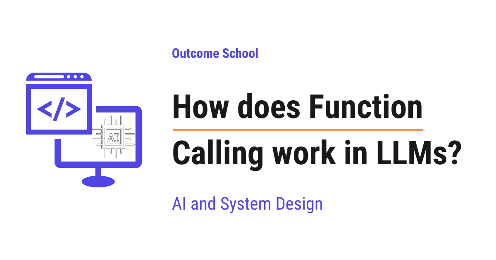

# How does Function Calling work in LLMs?

> Archived from <https://outcomeschool.com/blog/how-does-function-calling-work-in-llms> on 2026-11-25.

Function Calling is a way to let an LLM use external tools, APIs, and functions to get things done. The model does not run the function itself. It only tells our code which function to call and with which inputs.

In this blog, we will learn about how Function Calling works in LLMs. We will see what it is, why we need it, the key insight behind it, and how it powers AI agents and assistants step by step.

We will cover the following:
<ul><li>What is Function Calling?</li><li>Why We Need Function Calling</li><li>The Key Insight: The Model Does Not Run the Function</li><li>How Function Calling Works Step by Step</li><li>A Concrete Example: get_weather(city)</li><li>The Conversation Loop</li><li>Multi-Step and Parallel Function Calling</li><li>Relation to Structured Outputs and JSON Mode</li><li>Real-World Use: The Backbone of AI Agents</li><li>Quick Summary</li></ul>
I am <strong>Amit Shekhar</strong>, Founder @ <a target="_blank" rel="noopener noreferrer" href="https://outcomeschool.com">Outcome School</a>, I have taught and mentored many developers, and their efforts landed them high-paying tech jobs, helped many tech companies in solving their unique problems, and created many open-source libraries being used by top companies. I am passionate about sharing knowledge through open-source, blogs, and videos.

I teach <a target="_blank" rel="noopener noreferrer" href="https://outcomeschool.com/program/ai-and-machine-learning">AI and Machine Learning</a> at Outcome School.

Let&#x27;s get started.
<h3 id="what-is-function-calling">What is Function Calling?</h3>
<strong>Function Calling is a way to let an LLM use external tools, APIs, and functions to get things done.</strong> It is also called <strong>tool calling</strong>, and both names mean the same thing.

Before we go further, let&#x27;s make sure we understand a few words.

An <strong>LLM</strong> (Large Language Model) is the model behind tools like ChatGPT. It reads text and generates text. That is the only thing it does on its own.

A <strong>function</strong> is a small block of code that does one job. For example, a function can fetch today&#x27;s weather, send an email, or look up a price in a database.

An <strong>API</strong> is a doorway that lets one program ask another program for something. For example, a weather service gives us an API so our program can ask it for the current temperature.

So, in simple words, Function Calling means we give the LLM a list of functions it is allowed to use, and the LLM can ask for one of them to be run when it needs help from the outside world.

Let&#x27;s say we are building a chat assistant. A user asks, &quot;What is the weather in Paris right now?&quot; The LLM alone cannot answer this correctly, because it does not know the live weather. But if we connect a weather function to it, the assistant can get the real answer.

This is what Function Calling gives us. It is the bridge between the model that writes text and the real world that has live data and real actions.
<h3 id="why-we-need-function-calling">Why We Need Function Calling</h3>
To understand why we need it, we must first understand the limit of an LLM.

<strong>An LLM only generates text.</strong> It cannot fetch live data, and it cannot take real actions on its own.

Let&#x27;s make this concrete with a small story.

Suppose we ask a plain LLM, &quot;What is the weather in Paris right now?&quot;

The model was trained on text from the past. It has no live connection to a weather station. So it can only guess based on old patterns. It will often reply with a confident sentence that sounds correct but is actually made up. This made-up answer is called a <strong><a target="_blank" rel="noopener noreferrer" href="why-do-llms-hallucinate-the-token-level-explanation.md">hallucination</a></strong>.

Now suppose we ask, &quot;Send an email to my manager saying I will be late.&quot;

The LLM can write a perfect email. But it cannot actually send it. It has no hands. It can only produce text.

So we have two big gaps:
<ul><li><strong>Live data gap:</strong> the model does not know anything that happened after its training, and it cannot look things up.</li><li><strong>Action gap:</strong> the model cannot do anything in the real world - no sending, no booking, no saving, no paying.</li></ul>
We needed a solution for that, and Function Calling was introduced to solve this problem.

Here is the simple idea. Our application already knows how to fetch live weather and how to send emails - that is normal code we can write. The model is great at understanding language and deciding what to do. So, what if we let the model decide which function to use, and let our application actually run it?

This is exactly how Function Calling closes both gaps. It comes into the picture to connect the smart language model with the real tools our code already has.

<strong>Planning your move into AI?</strong>

No matter which tech domain you work in today, with your effort, you can transition to these roles:
<ul><li>AI Engineer</li><li>Forward Deployed Engineer</li><li>AI Agent Engineer</li><li>Harness Engineer</li><li>Voice AI Engineer</li><li>AI Architect</li><li>LLM Engineer</li><li>LLM Inference Engineer</li><li>Gen AI Engineer</li><li>MLOps Engineer</li><li>ML Engineer</li><li>Deep Learning Engineer</li></ul>
Our <a target="_blank" rel="noopener noreferrer" href="https://outcomeschool.com/program/ai-and-machine-learning">AI and Machine Learning Program</a> at Outcome School takes you there.
<h3 id="the-key-insight-the-model-does-not-run-the-function">The Key Insight: The Model Does Not Run the Function</h3>
This is the most important idea in the whole blog, so let&#x27;s slow down here.

<strong>The model does not execute the function. It only outputs a structured request to run it. Our application runs the function.</strong>

Let&#x27;s read that again, because most beginners get confused at this exact point.

The LLM never touches the weather service. It never sends the email. It cannot. All it can do is generate text.

So when the model decides a function is needed, it does the only thing it can do - it generates text. But this time the text is special. It is a neat, structured message that says, &quot;Please run the function named <code>get_weather</code> with the argument <code>city</code> set to <code>Paris</code>.&quot; Here, an <strong>argument</strong> simply means an input value we hand to a function.

This structured message is written in <strong>JSON</strong>. JSON is a simple text format for organizing data as key and value pairs. We will see real JSON in a moment.

So the flow is split between two players:

<pre><code class="code-highlight">LLM (the brain)                  Our Application (the hands)
-----------------                ---------------------------
Reads the question
Decides a tool is needed
Outputs JSON request       --&gt;   Reads the JSON request
  (name + arguments)             Runs the real function
                                 Gets the real result
Writes the final answer    &lt;--   Sends the result back
in plain English
</code></pre>

Here, we can see that the model is the brain and our application is the hands. The brain decides what to do, and the hands actually do it.

This split is what keeps everything safe and correct. Our code stays fully in control. The model can only suggest a function call. It can never run anything by itself. We decide whether to run it, and we decide what to do with the result.

This is the key insight. Once we understand this, the rest is easy.

This decide-then-run split is the foundation that real agents are built on. To go deep into the AI Agent, Agentic AI, and Agent Architecture, check out our <a target="_blank" rel="noopener noreferrer" href="https://outcomeschool.com/program/ai-and-machine-learning">AI and Machine Learning Program</a> at Outcome School, where we cover them from the ground up.
<h3 id="how-function-calling-works-step-by-step">How Function Calling Works Step by Step</h3>
Now, let&#x27;s walk through the full process from start to finish. There are five clear steps. We will go through each of them in detail.

Before we read each step, let&#x27;s see the full round-trip as one loop. We can picture it as below:

<pre><code class="code-highlight">       user prompt + tool schemas
                    |
                    v
        +-----------------------+
        |          LLM          |
        |  decides a tool is    |
        |  needed, emits a      |
        |  JSON function call   |
        +-----------------------+
                    |
       JSON call    |   (name + arguments)
                    v
        +-----------------------+
        |    Our Application    |
        |  runs the real        |
        |  function / API       |
        +-----------------------+
                    |
      real result   |   (live data)
                    v
        +-----------------------+
        |          LLM          |
        |  reads the result,    |
        |  writes the final     |
        |  plain answer         |
        +-----------------------+
                    |
                    v
           final answer to user
</code></pre>

Here, we can see that everything moves in a circle. The user prompt and the tool schemas go into the model. The model does not answer right away - it emits a JSON function call. That call goes to our application, which runs the real function and gets live data. The result travels back into the model, and only then does the model write the final answer for the user. The model and our application take turns, and our code runs every real action.

<strong>Step 1: We describe the available functions.</strong>

Before the conversation starts, we tell the model which functions exist. For each function, we provide three things:
<ul><li><strong>name</strong> - what the function is called, for example <code>get_weather</code>.</li><li><strong>description</strong> - a plain-English sentence saying what it does, for example &quot;Get the current weather for a city.&quot;</li><li><strong>parameters</strong> - the inputs the function needs, written as a <strong>JSON schema</strong>.</li></ul>
A <strong>JSON schema</strong> is just a description of the shape of the data. It says what fields exist, what type each field is (text, number, and etc.), and which ones are required. It does not contain real values. It is like a blank form that describes which boxes must be filled.

<strong>Step 2: The user asks a question.</strong>

The user types something, for example &quot;What is the weather in Paris?&quot; We send this message to the model together with the function descriptions from Step 1.

<strong>Step 3: The model decides and returns a JSON call.</strong>

The model reads the question and the function list. It understands that answering needs live weather. So it does not write a normal sentence. Instead it returns a structured JSON request naming the function <code>get_weather</code> and the argument <code>city</code> set to <code>Paris</code>.

<strong>Step 4: Our code executes the function.</strong>

Our application reads that JSON. It calls the real <code>get_weather</code> function with <code>city = &quot;Paris&quot;</code>. This function talks to the weather API and gets the real result, for example 18 degrees and sunny.

<strong>Step 5: We send the result back, and the model writes the final answer.</strong>

We send the weather result back to the model. Now the model has the live data it was missing. It writes a clean, natural sentence: &quot;The weather in Paris is currently 18 degrees and sunny.&quot;

That is the whole loop. The model asked for a tool, we ran it, we handed back the result, and the model finished the answer in plain language.

Let me put these five steps in one simple picture:

<pre><code class="code-highlight">Step 1: We describe functions  --&gt;  [ name, description, parameters ]
Step 2: User asks question     --&gt;  &quot;What is the weather in Paris?&quot;
Step 3: Model returns JSON      --&gt;  { &quot;name&quot;: &quot;get_weather&quot;,
                                        &quot;arguments&quot;: { &quot;city&quot;: &quot;Paris&quot; } }
Step 4: Our code runs it        --&gt;  get_weather(&quot;Paris&quot;) =&gt; 18C, sunny
Step 5: We send result back     --&gt;  model writes the final sentence
</code></pre>

This is how Function Calling works at a high level. Now, let&#x27;s make it fully concrete with real JSON.
<h3 id="a-concrete-example-get_weathercity">A Concrete Example: get_weather(city)</h3>
The best way to learn this is by taking an example. Let&#x27;s build the weather assistant end to end.

First, in Step 1, we describe our function to the model. We do this as below:

<pre><code class="code-highlight language-json">{
  &quot;name&quot;: &quot;get_weather&quot;,
  &quot;description&quot;: &quot;Get the current weather for a given city.&quot;,
  &quot;parameters&quot;: {
    &quot;type&quot;: &quot;object&quot;,
    &quot;properties&quot;: {
      &quot;city&quot;: {
        &quot;type&quot;: &quot;string&quot;,
        &quot;description&quot;: &quot;The name of the city, for example Paris.&quot;
      }
    },
    &quot;required&quot;: [&quot;city&quot;]
  }
}
</code></pre>

Here, we can see the three parts we talked about. The <code>name</code> is <code>get_weather</code>. The <code>description</code> tells the model what the function does. The <code>parameters</code> part is the JSON schema. It says there is one input called <code>city</code>, its <code>type</code> is <code>string</code> (which means text), and it is <code>required</code>. Notice there is no real city here yet - this is just the blank form that describes the shape.

Next, in Step 2, the user asks a question, and we send it to the model along with the description above.

In Step 3, the model decides the function is needed and returns a JSON call as below:

<pre><code class="code-highlight language-json">{
  &quot;name&quot;: &quot;get_weather&quot;,
  &quot;arguments&quot;: {
    &quot;city&quot;: &quot;Paris&quot;
  }
}
</code></pre>

Here, we can notice that the model filled in the blank form. It chose the function <code>get_weather</code> and set the argument <code>city</code> to <code>Paris</code>. The model did not run anything. It only produced this neat request. This is the structured request we kept talking about.

Now comes Step 4. Our application reads this JSON and calls the real function. In simple terms, our code runs:

<pre><code class="code-highlight language-python">result = get_weather(city=&quot;Paris&quot;)
# result = { &quot;temperature&quot;: 18, &quot;condition&quot;: &quot;sunny&quot; }
</code></pre>

Here, we have called the real <code>get_weather</code> function with <code>city</code> set to <code>Paris</code>. This function talks to the weather API and gives us back the live result - 18 degrees and sunny.

Finally, in Step 5, we send this result back to the model as a new message. The model now has the missing live data, so it writes the final answer:
<blockquote>
The weather in Paris is currently 18 degrees and sunny.
</blockquote>
Problem Solved! The user got a correct, live answer. The model supplied the language, and our function supplied the real data. This way we can use Function Calling to solve this kind of problem in a very simple way.

<strong>A quick note for you</strong>

No matter which tech domain you work in, get familiar with these topics:
<ul><li>LLM</li><li>RAG</li><li>MCP</li><li>Agent</li><li>Fine-tuning</li><li>Quantization</li></ul>
We put it all together in one video:

<a target="_blank" rel="noopener noreferrer" href="https://www.youtube.com/watch?v=lnfWvX66FUk">AI Engineering Explained: LLM, RAG, MCP, Agent, Fine-Tuning, and Quantization</a>

No need to stop reading - bookmark it and watch later when you get time. Future you will thank you.

Now, let&#x27;s get back to the topic.
<h3 id="the-conversation-loop">The Conversation Loop</h3>
Now, let&#x27;s understand the conversation as a back-and-forth, because the messages flow in a specific order.

A Function Calling conversation is not a single question and answer. It is a small loop of messages between us and the model. Each turn adds a new message to the history, and we keep the full history so the model always sees what happened before.

Let&#x27;s follow the messages one by one for our weather example:

<pre><code class="code-highlight">Message 1 (user)      : &quot;What is the weather in Paris?&quot;
Message 2 (model)     : function call -&gt; get_weather(city=&quot;Paris&quot;)
Message 3 (tool)      : result -&gt; { &quot;temperature&quot;: 18, &quot;condition&quot;: &quot;sunny&quot; }
Message 4 (model)     : &quot;The weather in Paris is 18 degrees and sunny.&quot;
</code></pre>

Here, we can see four messages. The user speaks first. The model replies, but instead of a sentence it asks for a tool. We run the tool and add the result as a special <code>tool</code> message. Then the model reads the result and writes the final sentence.

The important thing to notice is the role of each message. The <code>user</code> message is what the person typed. The <code>model</code> message can be either a normal sentence or a function call. The <code>tool</code> message is the result that our code feeds back.

So, after our code runs a function, we always send the result back into the same conversation. The model then decides what to do next. Sometimes it writes the final answer. Sometimes it asks for another function. This is the loop, and we keep it going until the model produces a normal answer with no more function calls.

This back-and-forth is exactly the loop an AI agent runs on. We have a detailed blog on the <a target="_blank" rel="noopener noreferrer" href="ai-agent-loop.md">AI Agent Loop</a> that explains how an agent keeps cycling through tool calls until the task is done.
<h3 id="multi-step-and-parallel-function-calling">Multi-Step and Parallel Function Calling</h3>
So far we used one function. But real tasks often need more. Let&#x27;s see two cases.

<strong>Multi-step function calling.</strong>

Sometimes the model needs functions to be run one after another, where the second request depends on the first.

Let&#x27;s say the user asks, &quot;What should I wear in Paris today?&quot; To answer well, the model first needs the weather. So it recommends <code>get_weather(city=&quot;Paris&quot;)</code>. Our code runs it and sends back &quot;18 degrees and sunny&quot;. Now the model has what it needs and writes the clothing advice. If the task needed even more data, the model could recommend another function before answering. Each round is one turn of the same loop we just learned.

<strong>Parallel function calling.</strong>

Sometimes the model needs several pieces of data that do not depend on each other. In that case it can ask for more than one function call at the same time.

Let&#x27;s say the user asks, &quot;Compare the weather in Paris and London.&quot; The two cities are independent, so the model can return two function calls together as below:

<pre><code class="code-highlight language-json">[
  { &quot;name&quot;: &quot;get_weather&quot;, &quot;arguments&quot;: { &quot;city&quot;: &quot;Paris&quot; } },
  { &quot;name&quot;: &quot;get_weather&quot;, &quot;arguments&quot;: { &quot;city&quot;: &quot;London&quot; } }
]
</code></pre>

Here, we can see two calls in one list. Our application runs both functions, collects both results, and sends them both back to the model. The model then writes one combined answer comparing the two cities.

<strong>Note:</strong> Even with multi-step and parallel calls, the key insight does not change. The model only suggests the calls. Our code always runs them. We stay in control the whole time.

This is how Function Calling scales from one simple tool to many tools working together.

This pattern of running a tool, reading the result, then deciding the next step is exactly how a <a target="_blank" rel="noopener noreferrer" href="react-agent.md">ReAct Agent</a> works, which we cover in a separate blog.

<strong>Stay updated:</strong> Subscribe to our <a target="_blank" rel="noopener noreferrer" href="https://outcomeschool.substack.com/subscribe">newsletter</a> to get our latest AI and Machine Learning blogs straight to your inbox.
<h3 id="relation-to-structured-outputs-and-json-mode">Relation to Structured Outputs and JSON Mode</h3>
We have seen that the model returns clean JSON for a function call. Now let&#x27;s connect this to two related ideas, because beginners often mix them up.

<strong>Structured outputs</strong> mean asking the model to return its answer in a fixed, predictable shape instead of free-flowing text. For example, we may want the answer always as JSON with the fields <code>name</code>, <code>age</code>, and <code>city</code>.

<strong>JSON mode</strong> is a setting that forces the model to reply only with valid JSON, never with extra words around it.

So how do these relate to Function Calling? They share the same foundation. Function Calling works because the model is able to produce a strict, well-formed JSON object that matches the schema we gave it. That ability to follow a schema is the same ability behind structured outputs and JSON mode.

Let me tabulate the difference between them for your better understanding:
<table><thead><tr><th>Idea</th><th>What it does</th><th>Who runs anything</th></tr></thead><tbody><tr><td>Structured outputs</td><td>Forces the answer into a fixed data shape</td><td>Nobody runs code; it is just the answer</td></tr><tr><td>JSON mode</td><td>Forces the reply to be valid JSON only</td><td>Nobody runs code; it is just the reply</td></tr><tr><td>Function Calling</td><td>Returns a JSON request naming a function and its arguments</td><td>Our application runs the real function</td></tr></tbody></table>
Here, we can see the key difference. Structured outputs and JSON mode are about the shape of the answer. Function Calling goes one step further - the JSON it returns is a request for our code to take a real action. Function Calling is structured output put to work.

Function Calling is where real tool-using agents begin. We cover Tool use in Agents, the Model Context Protocol (MCP), and how to build an AI Coding Agent from scratch in our <a target="_blank" rel="noopener noreferrer" href="https://outcomeschool.com/program/ai-and-machine-learning">AI and Machine Learning Program</a> at Outcome School.
<h3 id="real-world-use-the-backbone-of-ai-agents">Real-World Use: The Backbone of AI Agents</h3>
Now that we understand how it works, let&#x27;s see why it matters so much.

<strong>Function Calling is the backbone of AI agents and assistants.</strong>

An <strong><a target="_blank" rel="noopener noreferrer" href="ai-agent.md">AI agent</a></strong> is a system that does not just chat - it works toward a goal by taking actions. To take actions, it must use tools. And the way it uses tools is Function Calling. Without it, an agent would only be able to talk, never act.

Let&#x27;s look at a few real-world uses:
<ul><li>A travel assistant calls <code>search_flights</code>, then <code>book_flight</code>, then <code>send_confirmation_email</code>.</li><li>A coding assistant calls <code>read_file</code>, <code>edit_file</code>, and <code>run_tests</code> to fix a bug.</li><li>A support bot calls <code>lookup_order</code>, <code>check_refund_policy</code>, and <code>issue_refund</code>.</li><li>A data assistant calls <code>run_sql_query</code> to answer questions from a live database.</li></ul>
In every case the pattern is the same one we learned. We describe the tools. The user states a goal. The model recommends which tools to run and in what order. Our code runs them and feeds the results back. The model keeps going until the goal is done.

Describing those tools once, in a way that every AI application can reuse, is exactly what an open standard called MCP gives us. We have a detailed blog on <a target="_blank" rel="noopener noreferrer" href="what-is-mcp-model-context-protocol.md">What is MCP (Model Context Protocol)?</a> that covers this end to end.

This is why Function Calling is so powerful. It turns a model that can only write text into a system that can act in the real world, and that too in a safe and controlled way, because our code runs every action.

That last point is also our strongest security boundary. The model only asks, our code decides, so a model that has been tricked still cannot do what our code refuses to run. We have a detailed blog on <a target="_blank" rel="noopener noreferrer" href="prompt-injection-in-llms.md">Prompt Injection in LLMs</a> that explains how a model gets tricked and how we design around it.
<blockquote>
Function Calling is the bridge between language and action.
</blockquote><h3 id="quick-summary">Quick Summary</h3>
Let&#x27;s quickly recap everything we learned.
<ul><li><strong>Function Calling</strong> (also called tool calling) lets an LLM use external tools, APIs, and functions.</li><li>We need it because an LLM only generates text - it cannot fetch live data or take real actions on its own.</li><li>The key insight is that the model does not run the function. It only outputs a structured JSON request with the function name and arguments. Our application runs the function.</li><li>The flow has five steps: we describe the functions, the user asks, the model returns a JSON call, our code runs the function, and we send the result back so the model can write the final answer.</li><li>The conversation is a loop of <code>user</code>, <code>model</code>, and <code>tool</code> messages that continues until the model gives a normal answer.</li><li>The model can recommend functions in multiple steps or several in parallel, but our code always runs them.</li><li>Function Calling builds on the same schema-following ability behind structured outputs and JSON mode.</li><li>It is the backbone of AI agents and assistants, because it lets a text model take real, controlled actions.</li></ul>
This is how Function Calling works in LLMs.
<h2 id="frequently-asked-questions">Frequently Asked Questions</h2><h3 id="is-function-calling-the-same-as-tool-calling">Is Function Calling the same as tool calling?</h3>
Yes. Function Calling is also called tool calling, and both names mean the same thing. In both cases, we give the LLM a list of functions it is allowed to use, and the LLM can ask for one of them to be run when it needs help from the outside world.
<h3 id="what-is-the-difference-between-function-calling-and-mcp">What is the difference between Function Calling and MCP?</h3>
Function Calling is how the model asks for a tool to be run, with the function name and arguments in JSON. MCP is an open standard for describing those tools once, in a way that every AI application can reuse. So, MCP is about describing tools for reuse, and Function Calling is about the model requesting them.
<h3 id="is-function-calling-safe-if-the-model-gets-tricked">Is Function Calling safe if the model gets tricked?</h3>
It is our strongest security boundary. The model only asks for a function call, and our code decides whether to run it. So a model that has been tricked still cannot do what our code refuses to run. Our application stays fully in control of every real action.
<h3 id="does-the-model-always-return-a-function-call-when-tools-are-available">Does the model always return a function call when tools are available?</h3>
No. The model returns a function call only when it decides a tool is needed. After our code sends back a result, sometimes the model asks for another function, and sometimes it writes the final answer. The loop ends when the model gives a normal answer with no more function calls.

That&#x27;s it for now.

Thanks

<strong>Amit Shekhar</strong> Founder @ <a target="_blank" rel="noopener noreferrer" href="https://outcomeschool.com">Outcome School</a>

You can connect with me on:
<ul><li><a target="_blank" rel="noopener noreferrer" href="https://x.com/amitiitbhu">X</a></li><li><a target="_blank" rel="noopener noreferrer" href="https://www.linkedin.com/in/amit-shekhar-iitbhu">LinkedIn</a></li><li><a target="_blank" rel="noopener noreferrer" href="https://github.com/amitshekhariitbhu">GitHub</a></li></ul>
Follow Outcome School on:
<ul><li><a target="_blank" rel="noopener noreferrer" href="https://x.com/outcome_school">X</a></li><li><a target="_blank" rel="noopener noreferrer" href="https://youtube.com/@OutcomeSchool">YouTube</a></li><li><a target="_blank" rel="noopener noreferrer" href="https://www.linkedin.com/company/outcomeschool">LinkedIn</a></li><li><a target="_blank" rel="noopener noreferrer" href="https://github.com/OutcomeSchool">GitHub</a></li></ul>
<a target="_blank" rel="noopener noreferrer" href="https://outcomeschool.com/blog"><strong>Read all of our high-quality blogs here.</strong></a>

