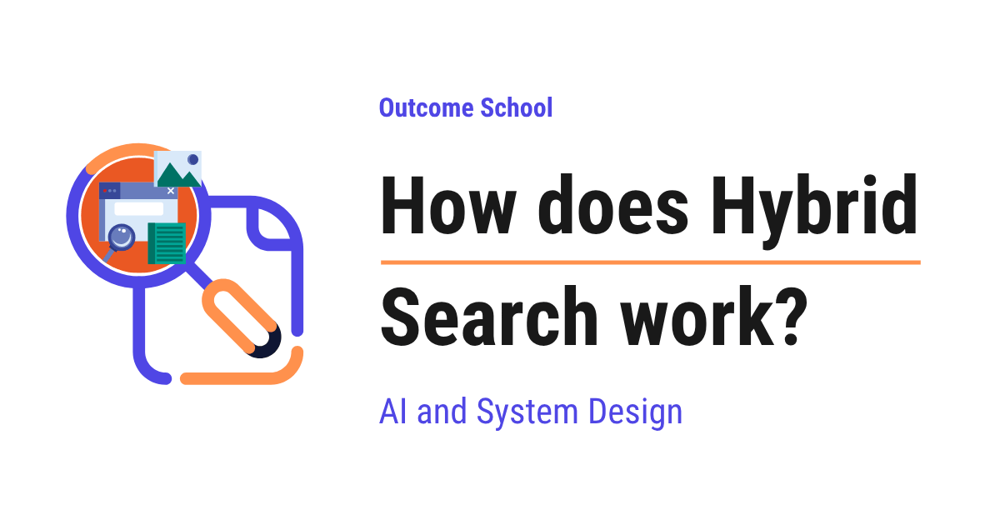

# How does Hybrid Search work?

> Archived from <https://outcomeschool.com/blog/how-does-hybrid-search-work> on 2026-11-25.

Hybrid Search is a technique that combines keyword search and semantic search, and merges their results into one final ranked list. This way, we get exact word matches and meaning-based matches together.

In this blog, we will learn about how Hybrid Search works. We will also see why we need it, the two kinds of search it combines, how their results are merged together, and where it is used in real systems like RAG.

We will cover the following:
<ul><li>What is keyword search?</li><li>Why keyword search alone is not enough</li><li>What is semantic search?</li><li>Why semantic search alone is not enough</li><li>What is Hybrid Search?</li><li>How Hybrid Search runs both searches</li><li>How the two result lists are combined</li><li>Reciprocal Rank Fusion (RRF)</li><li>Weighted score combination and normalization</li><li>Hybrid Search in the real world</li></ul>
I am <strong>Amit Shekhar</strong>, Founder @ <a target="_blank" rel="noopener noreferrer" href="https://outcomeschool.com">Outcome School</a>, I have taught and mentored many developers, and their efforts landed them high-paying tech jobs, helped many tech companies in solving their unique problems, and created many open-source libraries being used by top companies. I am passionate about sharing knowledge through open-source, blogs, and videos.

I teach <a target="_blank" rel="noopener noreferrer" href="https://outcomeschool.com/program/ai-and-machine-learning">AI and Machine Learning</a> at Outcome School.

Let&#x27;s get started.
<h3 id="what-is-keyword-search">What is keyword search?</h3>
Before we talk about Hybrid Search, we must first understand what keyword search is.

The first way is keyword search.

<strong>Keyword search finds documents that contain the same words as the query.</strong>

In simple words, it looks for an exact word match. If the user types the word &quot;refund&quot;, keyword search looks for documents that literally contain the word &quot;refund&quot;.

Let&#x27;s say our query is &quot;refund policy&quot;. Keyword search scans every document and asks a simple question: does this document contain the words &quot;refund&quot; and &quot;policy&quot;? The documents that contain these words, especially many times, get pushed to the top.

The most popular method for keyword search is called <strong><a target="_blank" rel="noopener noreferrer" href="bm25.md">BM25</a></strong>. Here, we just need to understand what it does in plain words.

BM25 gives each document a <strong>score</strong>, which is a number that tells us how well the document matches the query words. A higher score means a better match. BM25 looks at two simple things:
<ul><li>How often the query words appear in the document. More appearances usually mean a better match.</li><li>How rare the query word is across all documents. A rare word like &quot;refund&quot; matters more than a common word like &quot;the&quot;.</li></ul>
So, BM25 reads the query words, counts how they appear in each document, and gives every document a score. Then it sorts the documents from the highest score to the lowest. This sorted list is called a <strong>ranked list</strong>.

Keyword search is also called <strong>lexical search</strong>. The word &quot;lexical&quot; simply means &quot;relating to words&quot;. So lexical search is word-based search. Keep this word in mind, because we will use it later.

This is how keyword search works. It is fast, simple, and great at finding exact words. We have a detailed blog on <a target="_blank" rel="noopener noreferrer" href="inverted-index.md">how an Inverted Index works</a> that explains what makes this kind of word lookup so fast.

<strong>Planning your move into AI?</strong>

No matter which tech domain you work in today, with your effort, you can transition to these roles:
<ul><li>AI Engineer</li><li>Forward Deployed Engineer</li><li>AI Agent Engineer</li><li>Harness Engineer</li><li>Voice AI Engineer</li><li>AI Architect</li><li>LLM Engineer</li><li>LLM Inference Engineer</li><li>Gen AI Engineer</li><li>MLOps Engineer</li><li>ML Engineer</li><li>Deep Learning Engineer</li></ul>
Our <a target="_blank" rel="noopener noreferrer" href="https://outcomeschool.com/program/ai-and-machine-learning">AI and Machine Learning Program</a> at Outcome School takes you there.
<h3 id="why-keyword-search-alone-is-not-enough">Why keyword search alone is not enough</h3>
Now, here is the catch with keyword search.

Keyword search only understands words, not meaning. It cannot tell that two different words mean the same thing.

Let&#x27;s see the problem with an example. Suppose our document says &quot;how to return your shoes&quot;, but the user types &quot;how to send shoes back&quot;. A human knows these mean the same thing. But keyword search sees different words. The word &quot;return&quot; is not the same as &quot;send back&quot;. So keyword search may rank the correct document very low, or miss it completely.

This problem is called the <strong>synonym problem</strong>. A synonym is a different word with the same meaning, like &quot;car&quot; and &quot;automobile&quot;, or &quot;doctor&quot; and &quot;physician&quot;. Keyword search treats them as totally unrelated, because the letters are different.

So, the issue with keyword search is that it is blind to meaning. Let&#x27;s see how the next approach solves this issue.
<h3 id="what-is-semantic-search">What is semantic search?</h3>
The second way is <a target="_blank" rel="noopener noreferrer" href="how-does-semantic-search-work.md">semantic search</a>.

<strong>Semantic search finds documents that have the same meaning as the query, even if they use different words.</strong>

The word &quot;semantic&quot; simply means &quot;relating to meaning&quot;. So semantic search is meaning-based search.

In simple words, semantic search understands that &quot;send shoes back&quot; and &quot;return your shoes&quot; mean the same thing, and it brings up the right document even though the words are different.

Now, the question is, how does a computer understand meaning? The answer is something called an <strong><a target="_blank" rel="noopener noreferrer" href="what-are-embeddings.md">embedding</a></strong>.

<strong>An embedding is a list of numbers that represents the meaning of a piece of text.</strong>

Let&#x27;s understand this slowly, because it is the heart of semantic search. A special model called an <a target="_blank" rel="noopener noreferrer" href="embedding-model.md">embedding model</a> reads a piece of text and turns it into a long list of numbers. This list of numbers is called a <strong>vector</strong>. The amazing part is this: texts that mean similar things get similar lists of numbers, and texts that mean different things get very different lists of numbers.

So, the sentence &quot;return your shoes&quot; and the sentence &quot;send shoes back&quot; will produce two lists of numbers that are very close to each other, because they mean almost the same thing.

We can picture it as below:

<pre><code class="code-highlight">TEXT  -&gt;  EMBEDDING MODEL  -&gt;  VECTOR (a list of numbers)

&quot;return your shoes&quot;   -&gt;   [ 0.91, 0.12, 0.77, ... ]
&quot;send shoes back&quot;     -&gt;   [ 0.89, 0.15, 0.74, ... ]   &lt;- very close to the one above
&quot;order a pizza&quot;       -&gt;   [ 0.04, 0.88, 0.21, ... ]   &lt;- far away, different meaning
</code></pre>

Here, we can see that the first two texts mean almost the same thing, so their lists of numbers are very close. The third text means something completely different, so its list of numbers is far away.

So, to do semantic search, we first turn every document into a vector ahead of time. When the user types a query, we turn the query into a vector too. Then we look for the document vectors that are closest to the query vector. The closest vectors mean the most similar meaning. This is called <strong><a target="_blank" rel="noopener noreferrer" href="how-does-a-vector-database-work.md">vector search</a></strong>, because we are searching using vectors. Finding these closest vectors quickly across a huge number of documents is a whole technique in itself - we have a detailed blog on <a target="_blank" rel="noopener noreferrer" href="how-does-approximate-nearest-neighbor-ann-search-work.md">Approximate Nearest Neighbor (ANN) search</a> that explains how this works.

We can picture this closeness as points sitting in a space, like below:

<pre><code class="code-highlight">            far away (different meaning)
                                          *  &quot;order a pizza&quot;

       *  &quot;send shoes back&quot;   (the query)
        \
         \  close by
          \
           *  &quot;return your shoes&quot;

                 *  &quot;track my order&quot;
                    (a bit farther)
</code></pre>

Here, we can see that &quot;return your shoes&quot; sits very close to our query &quot;send shoes back&quot;, because they mean almost the same thing. &quot;Track my order&quot; sits a bit farther, and &quot;order a pizza&quot; sits far away, because it means something completely different. Vector search simply picks the points that sit closest to the query.

Just like keyword search, vector search also gives each document a score and returns a ranked list. Here, the score is a measure of how close the document vector is to the query vector. A higher closeness score means a better match in meaning.

This is how semantic search works. It understands meaning, so it handles synonyms and rephrasing beautifully.

To learn how embeddings and Vector Databases power meaning-based search, we cover them in depth in our <a target="_blank" rel="noopener noreferrer" href="https://outcomeschool.com/program/ai-and-machine-learning">AI and Machine Learning Program</a> at Outcome School.
<h3 id="why-semantic-search-alone-is-not-enough">Why semantic search alone is not enough</h3>
Now, semantic search sounds perfect. But it has its own catch.

Semantic search is great at meaning, but it can be weak at exact, precise terms.

Let&#x27;s see why with an example. Suppose a user searches for a specific product code like &quot;SKU-48217&quot;, or an exact error code like &quot;ERR_500&quot;, or a specific person&#x27;s name, or a rare technical term. These are exact strings that must match exactly, not soft ideas about meaning.

A product code does not really have a &quot;meaning&quot;. So semantic search may pull up documents that feel related but do not contain the exact code we asked for. It can quietly miss the one document that has the exact term.

So, here is the situation we are in:
<ul><li>Keyword search is great at exact words and codes, but blind to meaning.</li><li>Semantic search is great at meaning, but weak at exact codes and rare terms.</li></ul>
Each one is strong exactly where the other one is weak. So, here comes Hybrid Search to the rescue.
<h3 id="what-is-hybrid-search">What is Hybrid Search?</h3>
<strong>Hybrid Search is a technique that combines keyword search and semantic search, and merges their results into one final ranked list.</strong>

Let&#x27;s decompose the term to make it clear.
<blockquote>
Hybrid Search = Keyword Search + Semantic Search
</blockquote>
The word &quot;hybrid&quot; simply means a mix of two different things. So Hybrid Search is a mix of word-based search and meaning-based search.

In simple words, Hybrid Search runs both searches at the same time, and then combines what they found. This way, we get the exact-match power of keyword search and the meaning power of semantic search, together in one result.

Let&#x27;s say we ask two helpers to find a document for us. One helper is very good at spotting exact words and codes. The other helper is very good at understanding what we actually mean. If we listen to only one of them, we lose what the other one is good at. So we ask both, and then we combine their answers. This is exactly what Hybrid Search does.

Let&#x27;s connect it to what we learned. If the user searches for an exact code, keyword search catches it. If the user searches with different words for the same idea, semantic search catches it. Hybrid Search makes sure we do not lose either one.

So, Hybrid Search gives us the best of both worlds. Now, let&#x27;s understand exactly how it works step by step.
<h3 id="how-hybrid-search-runs-both-searches">How Hybrid Search runs both searches</h3>
Hybrid Search starts by running two separate searches on the same query.

<strong>Step 1:</strong> The user types a query, for example &quot;how to send shoes back&quot;.

<strong>Step 2:</strong> We run a lexical search using BM25. This is the keyword search. It returns a ranked list of documents, each with a BM25 score.

<strong>Step 3:</strong> At the same time, we run a vector search using embeddings. This is the semantic search. It turns the query into a vector, finds the closest document vectors, and returns its own ranked list of documents, each with a closeness score.

So, after this, we have two ranked lists. One list comes from keyword search, and one list comes from semantic search.

Let&#x27;s see it as below:

<pre><code class="code-highlight">                       Query: &quot;how to send shoes back&quot;
                                     |
                 +-------------------+-------------------+
                 |                                       |
          KEYWORD SEARCH                          SEMANTIC SEARCH
            (BM25)                                  (embeddings)
                 |                                       |
        ranked list A:                          ranked list B:
        1. Doc-7   (score 9.1)                  1. Doc-3   (score 0.95)
        2. Doc-2   (score 6.4)                  2. Doc-7   (score 0.88)
        3. Doc-9   (score 4.2)                  3. Doc-5   (score 0.81)
</code></pre>

Here, we can see that both searches looked at the same query but returned different lists. Keyword search put Doc-7 first because it shares exact words. Semantic search put Doc-3 first because it is closest in meaning. Notice that Doc-7 appears in both lists, which is a strong hint that it is a very good match.

<strong>A quick note for you</strong>

No matter which tech domain you work in, get familiar with these topics:
<ul><li>LLM</li><li>RAG</li><li>MCP</li><li>Agent</li><li>Fine-tuning</li><li>Quantization</li></ul>
We put it all together in one video:

<a target="_blank" rel="noopener noreferrer" href="https://www.youtube.com/watch?v=lnfWvX66FUk">AI Engineering Explained: LLM, RAG, MCP, Agent, Fine-Tuning, and Quantization</a>

No need to stop reading - bookmark it and watch later when you get time. Future you will thank you.

Now, let&#x27;s get back to the topic.

Now we have two lists. The next big question is: how do we combine them into one final list? Let&#x27;s see.
<h3 id="how-the-two-result-lists-are-combined">How the two result lists are combined</h3>
The step where we merge the two ranked lists into one final list is called <strong>fusion</strong>.

The word &quot;fusion&quot; simply means joining two things into one. So fusion means joining the keyword list and the semantic list into a single final ranking.

But, here is the catch. We cannot just add the two scores together directly. Look again at the example above. The BM25 score for Doc-7 was 9.1, while its semantic score was 0.88. These numbers live on completely different scales.

Let&#x27;s understand this scale problem. BM25 scores can be any number, like 2, 6, or even 40, with no fixed top value. Semantic closeness scores usually sit between 0 and 1. So if we simply add them, the big BM25 numbers would crush the small semantic numbers. The keyword search would always win, and the semantic search would barely count. That is unfair, and it defeats the whole purpose of combining them.

So, we need a fair way to combine the two lists. There are two popular methods. The first one cleverly avoids the score problem altogether, and the second one fixes the scales first. Let&#x27;s learn both.
<h3 id="reciprocal-rank-fusion-rrf">Reciprocal Rank Fusion (RRF)</h3>
The first and most popular method is called <strong>Reciprocal Rank Fusion</strong>, or <strong>RRF</strong>.

<strong>RRF combines the two lists using the position of each document in each list, not its raw score.</strong>

This is the clever trick. RRF ignores the messy raw scores completely. Instead, it only looks at the <strong>rank</strong>, which means the position of the document in the list. The document at the top is rank 1, the next is rank 2, and so on.

Why does this help? Because a position is just a position. Rank 1 means the same thing in both lists, whether the raw score was 9.1 or 0.88. So the scale problem disappears.

Let&#x27;s understand the word &quot;reciprocal&quot;. The reciprocal of a number is just 1 divided by that number. So the reciprocal of 2 is 1 divided by 2, which is 0.5. The reciprocal of 4 is 1 divided by 4, which is 0.25.

Here is the idea in plain words. For each document, RRF gives it points based on its rank in each list. A better rank, which means a smaller rank number, gives more points. We give points using the reciprocal of the rank. So:
<ul><li>A document at rank 1 gets 1 divided by 1, which is the most points.</li><li>A document at rank 2 gets 1 divided by 2, which is fewer points.</li><li>A document at rank 3 gets 1 divided by 3, which is even fewer points.</li></ul>
Then, for each document, we add up the points it earned from both lists. The document with the most total points goes to the top of the final list.

Let&#x27;s walk through our example. We will keep it simple just for the sake of understanding, as below:

<pre><code class="code-highlight">Doc-7:  rank 1 in keyword list  -&gt;  1/1 = 1.00
        rank 2 in semantic list -&gt;  1/2 = 0.50
        total = 1.00 + 0.50 = 1.50

Doc-3:  not in keyword list     -&gt;  0
        rank 1 in semantic list -&gt;  1/1 = 1.00
        total = 0 + 1.00 = 1.00

Doc-2:  rank 2 in keyword list  -&gt;  1/2 = 0.50
        not in semantic list    -&gt;  0
        total = 0.50 + 0 = 0.50
</code></pre>

Here, we can see that Doc-7 wins. It earned points from both lists, because it was near the top in both. Doc-3 was only strong in the semantic list, and Doc-2 was only strong in the keyword list. So Doc-7, which both searches agreed was good, rises to the top of the final list.

This is the beauty of RRF. A document that both searches like will naturally float to the top, because it collects points from both sides.

<strong>Note:</strong> In the real RRF formula, we add a small fixed number to the rank before dividing, to keep the top ranks from being too far ahead of the rest. We do not need that detail to understand the idea. The main point is that RRF uses ranks, not raw scores, so it avoids the scale problem completely.

So, RRF is simple, fair, and works very well in practice. This is why it is the most common fusion method in Hybrid Search. The same RRF is also used in <a target="_blank" rel="noopener noreferrer" href="how-do-query-rewriting-and-multi-query-retrieval-work.md">Multi-Query Retrieval</a>, where we search with several versions of the user&#x27;s question and merge all the result lists into one.

<strong>Stay updated:</strong> Subscribe to our <a target="_blank" rel="noopener noreferrer" href="https://outcomeschool.substack.com/subscribe">newsletter</a> to get our latest AI and Machine Learning blogs straight to your inbox.
<h3 id="weighted-score-combination-and-normalization">Weighted score combination and normalization</h3>
The second method is called <strong>weighted score combination</strong>.

<strong>In weighted score combination, we use the actual scores from both searches, but we first fix their scales, and then we blend them using weights.</strong>

We learned that the raw scores live on different scales, so we cannot add them directly. To solve this, we first do something called <strong>normalization</strong>.

<strong>Normalization means rescaling all the scores so that they fall into the same range, usually between 0 and 1.</strong>

In simple words, normalization is like converting two different units into one common unit, so we can compare them fairly.

After normalization, we apply a <strong>weight</strong> to each search. A weight is simply how much importance we give to each search. The weights let us tune the balance based on our use case.

Let&#x27;s see the simple formula in plain words, as below:

<pre><code class="code-highlight">final score = (weight_keyword  x  normalized keyword score)
            + (weight_semantic x  normalized semantic score)
</code></pre>

Here, we can see that the final score for a document is a blend of its normalized keyword score and its normalized semantic score, each multiplied by how much we trust that search.

Let&#x27;s say we set the keyword weight to 0.5 and the semantic weight to 0.5. That means we trust both searches equally. If our documents are full of exact codes and product names, we can raise the keyword weight, for example to 0.7, and lower the semantic weight to 0.3. If meaning matters more for our use case, we do the opposite.

So, the two steps for this method are simple. First, normalize the scores so they are on the same scale. Then, blend them using weights that match our use case.

Now, let me tabulate the differences between RRF and weighted score combination for your better understanding so that you can decide which one to use based on your use case.
<table><thead><tr><th>Point</th><th>Reciprocal Rank Fusion (RRF)</th><th>Weighted score combination</th></tr></thead><tbody><tr><td>What it uses</td><td>The rank (position) of each document</td><td>The actual normalized scores</td></tr><tr><td>Needs normalization</td><td>No, because ranks already share a scale</td><td>Yes, we must normalize first</td></tr><tr><td>Tuning control</td><td>Less control over balance</td><td>More control through weights</td></tr><tr><td>Ease of use</td><td>Very simple, works well by default</td><td>Needs more tuning to get right</td></tr></tbody></table>
Here, we can see that RRF is the easy, reliable default, while weighted score combination gives us finer control when we are ready to tune.

If we want to go deep into RAG and build an AI Tutor from scratch, we cover it in our <a target="_blank" rel="noopener noreferrer" href="https://outcomeschool.com/program/ai-and-machine-learning">AI and Machine Learning Program</a> at Outcome School.
<h3 id="hybrid-search-in-the-real-world">Hybrid Search in the real world</h3>
Now, let&#x27;s see where Hybrid Search is used in real systems.

The biggest place where Hybrid Search shines is <strong><a target="_blank" rel="noopener noreferrer" href="retrieval-augmented-generation-rag.md">RAG</a></strong>. RAG stands for <strong>Retrieval-Augmented Generation</strong>. In simple words, it is a system where we first fetch some relevant documents and then send them to a large language model along with the user&#x27;s question, so the model can answer using real, up-to-date information.

The quality of a RAG system depends heavily on the fetching step, which is called retrieval. If we fetch the wrong documents, the model gives a wrong answer, no matter how smart the model is.

There are also techniques that sharpen this retrieval step further, like HyDE, which searches with a hypothetical answer instead of the raw question, and <a target="_blank" rel="noopener noreferrer" href="how-does-contextual-retrieval-work.md">Contextual Retrieval</a>, which adds a short note about the source document to every chunk before indexing. We have a detailed blog on <a target="_blank" rel="noopener noreferrer" href="how-does-hyde-work.md">how HyDE works in RAG</a> that explains this step by step.

We can picture where Hybrid Search fits inside RAG, like below:

<pre><code class="code-highlight">   User question
        |
        v
  +--------------+     fetched documents       +-----+
  | HYBRID       | ------------------------&gt;   | LLM | --&gt; Answer
  | SEARCH       |                             +-----+
  | (retrieval)  |                                ^
  +--------------+                                |
                                            User question
</code></pre>

Here, we can see that the user question first goes into Hybrid Search, which fetches the most relevant documents. Those documents and the user question are then handed to the LLM together. The LLM reads both and produces the final answer. So if Hybrid Search fetches the right documents, the LLM has the right information to answer well.

This is exactly why Hybrid Search matters so much for RAG. The retrieval step must catch both exact terms and matching meaning. If a user asks about a specific error code, keyword search catches it. If a user asks the same thing in different words, semantic search catches it. Hybrid Search combines both, so the retrieval step rarely misses the right document. Better retrieval means better answers.

In many production RAG systems, one more step sits right after Hybrid Search - a reranker that reorders the fetched documents by true relevance before they reach the LLM. We have a detailed blog on <a target="_blank" rel="noopener noreferrer" href="how-does-a-reranker-work.md">how a reranker works</a> that covers this in depth.

Retrieval does not always have to involve vectors either. A common setup narrows a huge collection down to a handful of documents with a cheap search like this one, and then lets the model read the structure of those few. We have a detailed blog on <a target="_blank" rel="noopener noreferrer" href="vectorless-rag.md">Vectorless RAG</a> that explains how that second step works.

This is how Hybrid Search works. We run a keyword search with BM25 and a semantic search with embeddings, we get two ranked lists with their own scores, and then we fuse them into one final list, either with Reciprocal Rank Fusion using ranks, or with a weighted blend of normalized scores, so that we get the exact-match power of keywords and the meaning power of embeddings at the same time.
<h2 id="frequently-asked-questions">Frequently Asked Questions</h2><h3 id="is-hybrid-search-better-than-semantic-search-alone">Is Hybrid Search better than semantic search alone?</h3>
Yes, because it gives us the best of both worlds. Semantic search is great at meaning, but it can miss exact terms like a product code, an error code, or a rare technical term. Hybrid Search adds keyword search to catch those exact matches, so we get both exact words and matching meaning in one result.
<h3 id="can-we-simply-add-the-bm25-score-and-the-semantic-score-together">Can we simply add the BM25 score and the semantic score together?</h3>
No. The two scores live on completely different scales. BM25 scores can be any number with no fixed top value, while semantic closeness scores usually sit between 0 and 1. If we add them directly, the big BM25 numbers crush the small semantic numbers, and keyword search always wins.
<h3 id="should-we-use-rrf-or-weighted-score-combination">Should we use RRF or weighted score combination?</h3>
RRF is the easy, reliable default. It uses ranks instead of raw scores, so it needs no normalization and works well out of the box. Weighted score combination gives us finer control through weights, but we must normalize the scores first and spend more effort tuning it.
<h3 id="how-should-we-set-the-weights-in-weighted-score-combination">How should we set the weights in weighted score combination?</h3>
We set the weights based on our use case. Equal weights, like 0.5 and 0.5, mean we trust both searches equally. If our documents are full of exact codes and product names, we raise the keyword weight, for example to 0.7. If meaning matters more, we raise the semantic weight instead.

That&#x27;s it for now.

Thanks

<strong>Amit Shekhar</strong> Founder @ <a target="_blank" rel="noopener noreferrer" href="https://outcomeschool.com">Outcome School</a>

You can connect with me on:
<ul><li><a target="_blank" rel="noopener noreferrer" href="https://x.com/amitiitbhu">X</a></li><li><a target="_blank" rel="noopener noreferrer" href="https://www.linkedin.com/in/amit-shekhar-iitbhu">LinkedIn</a></li><li><a target="_blank" rel="noopener noreferrer" href="https://github.com/amitshekhariitbhu">GitHub</a></li></ul>
Follow Outcome School on:
<ul><li><a target="_blank" rel="noopener noreferrer" href="https://x.com/outcome_school">X</a></li><li><a target="_blank" rel="noopener noreferrer" href="https://youtube.com/@OutcomeSchool">YouTube</a></li><li><a target="_blank" rel="noopener noreferrer" href="https://www.linkedin.com/company/outcomeschool">LinkedIn</a></li><li><a target="_blank" rel="noopener noreferrer" href="https://github.com/OutcomeSchool">GitHub</a></li></ul>
<a target="_blank" rel="noopener noreferrer" href="https://outcomeschool.com/blog"><strong>Read all of our high-quality blogs here.</strong></a>

