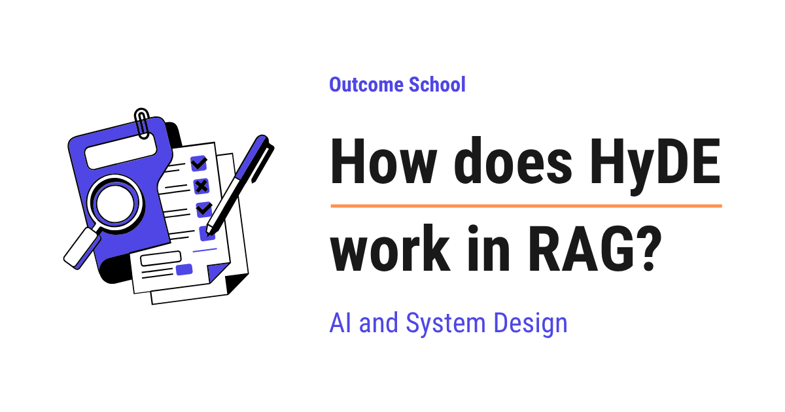

# How does HyDE work in RAG?

> Archived from <https://outcomeschool.com/blog/how-does-hyde-work> on 2026-11-25.

HyDE (Hypothetical Document Embeddings) is a technique in RAG where we first ask the AI model to write a fake answer to the question, and then we search using that fake answer instead of the question.

In this blog, we will learn about how HyDE works in RAG, which is the clever trick of searching with a fake answer. We will also see why searching with the plain question is weak, why a fake answer searches better, how HyDE works step by step with a worked example, and when to use it in the real world.

We will cover the following:
<ul><li>What is RAG in simple words?</li><li>What is the search problem in RAG?</li><li>Why searching with the question is weak</li><li>What is HyDE?</li><li>Why searching with a fake answer works better</li><li>How HyDE works step by step</li><li>A worked example of HyDE</li><li>A simple code example of HyDE</li><li>Advantages of HyDE</li><li>Disadvantages of HyDE</li><li>When to use HyDE</li><li>Summary</li></ul>
I am <strong>Amit Shekhar</strong>, Founder @ <a target="_blank" rel="noopener noreferrer" href="https://outcomeschool.com">Outcome School</a>, I have taught and mentored many developers, and their efforts landed them high-paying tech jobs, helped many tech companies in solving their unique problems, and created many open-source libraries being used by top companies. I am passionate about sharing knowledge through open-source, blogs, and videos.

I teach <a target="_blank" rel="noopener noreferrer" href="https://outcomeschool.com/program/ai-and-machine-learning">AI and Machine Learning</a> at Outcome School.

Let&#x27;s get started.
<h2 id="what-is-rag-in-simple-words">What is RAG in simple words?</h2>
Before jumping into HyDE, we must know what RAG is.

<strong>RAG stands for Retrieval-Augmented Generation. It is a way to make an AI model answer using our own documents instead of only using what it already knows.</strong>

RAG = Retrieval + Augmented + Generation.

Let&#x27;s break it down:
<ul><li><strong>Retrieval</strong> means searching and fetching the right pieces of text from our documents.</li><li><strong>Augmented</strong> means adding the retrieved information to the prompt (context) before sending it to the AI model.</li><li><strong>Generation</strong> means the AI model writing an answer using those pieces of text.</li></ul>
Let&#x27;s say we have a big company handbook with thousands of pages. A new employee asks, &quot;How many holidays do I get in a year?&quot; The AI model has never read our private handbook. So, it cannot answer correctly on its own.

So, here comes RAG to the rescue. First, RAG searches the handbook and finds the few lines that talk about holidays. Then, it gives those lines to the AI model. Finally, the model reads those lines and writes a clear answer.

This is how RAG lets the model answer from our own data. If we want a deeper look at the full RAG flow, we can read the blog on <a target="_blank" rel="noopener noreferrer" href="retrieval-augmented-generation-rag.md">how RAG works</a>.
<h2 id="what-is-the-search-problem-in-rag">What is the search problem in RAG?</h2>
The whole power of RAG depends on one thing. The search step must find the right text.

If the search brings the wrong pages, the model gets wrong information. And then the answer will also be wrong.

So, the search step is the heart of RAG. Now, let&#x27;s understand how this search actually happens.

The search in RAG does not work by matching exact words. It works by matching <strong>meaning</strong>.

To match meaning, we convert text into numbers. These numbers are called an <strong><a target="_blank" rel="noopener noreferrer" href="what-are-embeddings.md">embedding</a></strong>.

<strong>An embedding is a list of numbers that represents the meaning of a piece of text.</strong>

In simple words, an embedding is the meaning of text written in the language of numbers.

The important rule is simple. Two texts with similar meaning get similar numbers. Two texts with different meaning get different numbers.

We also cut our big documents into small pieces. Each small piece is called a <strong><a target="_blank" rel="noopener noreferrer" href="chunking-strategies-for-rag.md">chunk</a></strong>, which means a short block of text, like a single paragraph.

So, in RAG, we do the following. First, we convert every chunk of our document into an embedding and store it. Then, when a user asks a question, we convert the question into an embedding too. After that, we compare the question embedding with all the stored embeddings. Finally, we pick the chunks whose embeddings are closest to the question embedding.

This is how RAG finds the right text by <a target="_blank" rel="noopener noreferrer" href="how-does-semantic-search-work.md">comparing meaning</a>.

The store that holds all these embeddings and finds the closest ones is called a vector database. We have a detailed blog on <a target="_blank" rel="noopener noreferrer" href="how-does-a-vector-database-work.md">how a vector database works</a> that explains this in depth.
<h2 id="why-searching-with-the-question-is-weak">Why searching with the question is weak</h2>
Now, here is the catch.

A question and an answer often do not look alike. They live in different worlds.

Let&#x27;s say the user asks, &quot;Why is my laptop battery draining so fast?&quot;

The real answer inside our documents may say something like this:
<blockquote>
Background applications, high screen brightness, and old battery health reduce battery life. Closing unused apps and lowering brightness improves battery duration.
</blockquote>
Notice the problem. The question is short and uses words like &quot;draining&quot; and &quot;fast&quot;. The answer is detailed and uses words like &quot;background applications&quot;, &quot;brightness&quot;, and &quot;battery health&quot;.

A question and its answer are written in two different styles. So, their embeddings are not always close to each other.

Means, when we search using only the question, the meaning gap is large. The search may miss the perfect answer that is actually sitting in our documents.

This is the weakness of searching with the question. We are comparing a question to answers, but questions and answers are shaped differently.
<h2 id="what-is-hyde">What is HyDE?</h2>
So, here comes HyDE into the picture.

<strong>HyDE stands for Hypothetical Document Embeddings. It is a technique where we first ask the AI model to write a fake answer to the question, and then we search using that fake answer instead of the question.</strong>

In simple words, HyDE = Hypothetical + Document + Embeddings.

Let&#x27;s break it down:
<ul><li><strong>Hypothetical</strong> means imaginary or made-up. It is a guess answer.</li><li><strong>Document</strong> means a piece of text that looks like a real answer.</li><li><strong>Embeddings</strong> means the meaning of that text written as numbers.</li></ul>
The core idea is one beautiful trick. An answer looks like an answer. So, if we want to find a real answer, we must search using something that looks like an answer.

The question does not look like an answer. But a fake answer does look like an answer.

So, we tell the AI model, &quot;Pretend you know the answer and write it.&quot; This made-up answer is called the <strong>hypothetical document</strong>.

We do not show this fake answer to the user. We do not even trust that it is correct. We only use it as a better search key, which means the text we search with.

This is the heart of HyDE. We search with a fake answer to find the real answer.

<strong>Planning your move into AI?</strong>

No matter which tech domain you work in today, with your effort, you can transition to these roles:
<ul><li>AI Engineer</li><li>Forward Deployed Engineer</li><li>AI Agent Engineer</li><li>Harness Engineer</li><li>Voice AI Engineer</li><li>AI Architect</li><li>LLM Engineer</li><li>LLM Inference Engineer</li><li>Gen AI Engineer</li><li>MLOps Engineer</li><li>ML Engineer</li><li>Deep Learning Engineer</li></ul>
Our <a target="_blank" rel="noopener noreferrer" href="https://outcomeschool.com/program/ai-and-machine-learning">AI and Machine Learning Program</a> at Outcome School takes you there.
<h2 id="why-searching-with-a-fake-answer-works-better">Why searching with a fake answer works better</h2>
Now, the question is, why does a fake answer help when it may even contain wrong facts?

The answer is about shape, not facts.

When the model writes a fake answer about battery draining, it naturally uses words like &quot;background apps&quot;, &quot;screen brightness&quot;, and &quot;battery health&quot;. These are the same kinds of words that the real answer in our documents uses.

So, the fake answer and the real answer now look alike. Their embeddings become close. And close embeddings mean a strong search match.

Let&#x27;s picture this meaning space as below:

<pre><code class="code-highlight language-text">        Meaning space (similar meaning sits closer)

   [ Question ]                                  ----- far -----+
   &quot;battery draining fast&quot;                                      |
                                                                v
                                          +--------------------------+
   [ Fake answer ]  ----- close -------&gt;  | [ Real answer chunk ]    |
   &quot;background apps, brightness,          | &quot;background apps, high   |
    battery health&quot;                       |  brightness, battery     |
                                          |  health reduce life&quot;     |
                                          +--------------------------+
</code></pre>

Here, we can see that the question sits far from the real answer chunk, because it is shaped differently. The fake answer sits close to the real answer chunk, because both use the same answer-like words. So, searching with the fake answer lands much nearer to the real answer.
<blockquote>
We are not searching with the question. We are searching with something that is shaped like the answer.
</blockquote>
Even if the fake answer gets a fact wrong, it still points the search in the right direction. The wrong facts get thrown away later, because we only use the real documents to write the final answer.

This is how a fake answer becomes a powerful search key.

To learn how embeddings, Vector Databases, and RAG fit together, check out our <a target="_blank" rel="noopener noreferrer" href="https://outcomeschool.com/program/ai-and-machine-learning">AI and Machine Learning Program</a> at Outcome School.
<h2 id="how-hyde-works-step-by-step">How HyDE works step by step</h2>
The best way to learn this is by taking an example. Let&#x27;s walk through HyDE step by step.

<strong>Step 1:</strong> The user asks a question. For example, &quot;Why is my laptop battery draining so fast?&quot;

<strong>Step 2:</strong> We send this question to the AI model with a simple instruction. We say, &quot;Write a short answer to this question, even if you are not sure.&quot; The model writes a fake answer, which is our hypothetical document.

<strong>Step 3:</strong> We convert this fake answer into an embedding, which means we turn it into a list of numbers that holds its meaning.

<strong>Step 4:</strong> We compare this embedding with all the stored embeddings of our real document chunks. We pick the chunks that are closest in meaning.

<strong>Step 5:</strong> We take these real chunks and send them to the AI model along with the original question.

<strong>Step 6:</strong> The model reads the real chunks and writes the final answer. This final answer is based on our real documents, not on the fake one.

So, the fake answer is used only in the middle, only to improve the search. The final answer comes from real data.

We can picture the full flow as below:

<pre><code class="code-highlight language-text">   [ User question ]
          |
          v
   +-------------------+
   | AI model writes   |   &lt;- &quot;even if not sure&quot;
   | a fake answer     |
   +-------------------+
          |
          v
   +-------------------+
   | Turn fake answer  |
   | into embedding    |
   +-------------------+
          |
          v
   +-------------------+        +----------------------+
   | Search the stored | -----&gt; | Pick closest real    |
   | document chunks   |        | document chunks      |
   +-------------------+        +----------------------+
                                          |
              [ User question ] --------&gt; |
                                          v
                               +----------------------+
                               | AI model writes the  |
                               | final answer from    |
                               | real chunks only     |
                               +----------------------+
                                          |
                                          v
                                  [ Final answer ]
</code></pre>

Here, we can see that the fake answer is used only in the middle to improve the search. The real chunks and the original question flow into the last step, and the final answer is written from the real documents only.

This is how HyDE works from start to finish.

<strong>A quick note for you</strong>

No matter which tech domain you work in, get familiar with these topics:
<ul><li>LLM</li><li>RAG</li><li>MCP</li><li>Agent</li><li>Fine-tuning</li><li>Quantization</li></ul>
We put it all together in one video:

<a target="_blank" rel="noopener noreferrer" href="https://www.youtube.com/watch?v=lnfWvX66FUk">AI Engineering Explained: LLM, RAG, MCP, Agent, Fine-Tuning, and Quantization</a>

No need to stop reading - bookmark it and watch later when you get time. Future you will thank you.

Now, let&#x27;s get back to the topic.
<h2 id="a-worked-example-of-hyde">A worked example of HyDE</h2>
Let me tabulate the difference between the normal RAG search and the HyDE search for your better understanding.
<table><thead><tr><th>Stage</th><th>Normal RAG</th><th>HyDE</th></tr></thead><tbody><tr><td>What we search with</td><td>The user&#x27;s question</td><td>A fake answer written by the model</td></tr><tr><td>Shape of the search text</td><td>Short and question-like</td><td>Detailed and answer-like</td></tr><tr><td>Closeness to real answers</td><td>Often far in meaning</td><td>Often close in meaning</td></tr><tr><td>Final answer source</td><td>Real documents</td><td>Real documents</td></tr></tbody></table>
Here, we can see the key difference. Normal RAG searches with a question. HyDE searches with a fake answer. Both write the final answer from real documents, but HyDE usually finds better chunks to start with.

Now, let&#x27;s see the meaning gap with simple numbers, just for the sake of understanding.

Suppose closeness is measured from 0 to 1, where 1 means identical meaning and 0 means completely different meaning.
<ul><li>Question embedding compared to the real answer chunk: closeness is 0.55.</li><li>Fake answer embedding compared to the real answer chunk: closeness is 0.88.</li></ul>
Here, we can notice that the fake answer is much closer to the real answer. So, the search picks the correct chunk more easily with HyDE.

<strong>Note:</strong> These numbers are just for the sake of understanding. The real values depend on the model and the data.

<strong>Stay updated:</strong> Subscribe to our <a target="_blank" rel="noopener noreferrer" href="https://outcomeschool.substack.com/subscribe">newsletter</a> to get our latest AI and Machine Learning blogs straight to your inbox.
<h2 id="a-simple-code-example-of-hyde">A simple code example of HyDE</h2>
Now, let&#x27;s see the code for HyDE in a simple form. We will write it in <code>python</code> as below:

<pre><code class="code-highlight language-python">def hyde_search(question, model, vector_store):
    # Step 1: ask the model to write a fake answer
    prompt = &quot;Write a short answer to this question: &quot; + question
    fake_answer = model.generate(prompt)

    # Step 2: turn the fake answer into an embedding
    fake_answer_embedding = model.embed(fake_answer)

    # Step 3: search using the fake answer&#x27;s embedding
    top_chunks = vector_store.search(fake_answer_embedding, top_k=5)

    return top_chunks
</code></pre>

Here, we have done three simple things:
<ul><li>First, we ask the model to write a <code>fake_answer</code> to the question.</li><li>Then, we convert that <code>fake_answer</code> into a <code>fake_answer_embedding</code>, which is its meaning as numbers.</li><li>After that, we call <code>vector_store.search</code> with that embedding to get the top five closest chunks.</li></ul>
Notice that we never search with the original <code>question</code>. We search with the <code>fake_answer</code>. That is the whole trick of HyDE.

Now, let&#x27;s see how we use these chunks to write the final answer as below:

<pre><code class="code-highlight language-python">def answer_with_hyde(question, model, vector_store):
    chunks = hyde_search(question, model, vector_store)

    # combine the real chunks into one block of context
    context = &quot;\n&quot;.join(chunks)

    # ask the model to answer using only the real chunks
    final_prompt = (
        &quot;Use the context below to answer the question.\n&quot;
        &quot;Context: &quot; + context + &quot;\n&quot;
        &quot;Question: &quot; + question
    )
    return model.generate(final_prompt)
</code></pre>

Here, we can see the full flow. First, we get the real <code>chunks</code> using <code>hyde_search</code>. Then, we join them into one <code>context</code>, which means one block of helpful text. After that, we send the real <code>context</code> and the original <code>question</code> to the model. Finally, the model writes the answer using only the real documents.

So, the fake answer helped us find the chunks, but it never touched the final answer. The problem is solved.

If we want to go deep into RAG and build an AI Tutor from scratch, we cover it in our <a target="_blank" rel="noopener noreferrer" href="https://outcomeschool.com/program/ai-and-machine-learning">AI and Machine Learning Program</a> at Outcome School.
<h2 id="advantages-of-hyde">Advantages of HyDE</h2>
Now, let&#x27;s understand why HyDE is useful.

<strong>Advantages:</strong>
<ul><li>It closes the gap between questions and answers, because we search with answer-shaped text.</li><li>It often finds better chunks, which leads to better final answers.</li><li>It works well even when the user&#x27;s question is short or vague.</li><li>It needs no extra training of the model. We only change how we search.</li></ul><h2 id="disadvantages-of-hyde">Disadvantages of HyDE</h2>
But again, no technique is perfect. HyDE has some costs too.

<strong>Disadvantages:</strong>
<ul><li>It is slower, because we make an extra call to the model to write the fake answer.</li><li>It costs more, because that extra call uses extra computing power.</li><li>The fake answer can drift off topic, and then the search may go in the wrong direction.</li><li>For very simple questions, the question itself may already be enough, so HyDE adds cost without much gain.</li></ul>
So, HyDE makes our search smarter, but we pay with a little extra time and cost.
<h2 id="when-to-use-hyde">When to use HyDE</h2>
Now, the question is, when must we use HyDE.

We should use HyDE when our questions and answers look very different from each other. This happens a lot with short questions, support tickets, and search over technical documents.

But, for very short and direct lookups, plain RAG search may be enough. So, we must choose HyDE based on our use case.

A good practice is to test both. We can run plain RAG search and HyDE search on the same set of questions, and then we keep the one that finds better chunks for our data.

HyDE improves the question side of the search. Another way to improve the question side is to let an LLM rewrite the question into one clearer query, or into several different queries. We have a detailed blog on <a target="_blank" rel="noopener noreferrer" href="how-do-query-rewriting-and-multi-query-retrieval-work.md">how Query Rewriting and Multi-Query Retrieval work</a> that explains this in depth.

We can also improve the chunk side by adding a short note to every chunk that explains where it comes from in the document. We have a detailed blog on <a target="_blank" rel="noopener noreferrer" href="how-does-contextual-retrieval-work.md">how Contextual Retrieval works</a> that covers this end to end.
<h2 id="summary">Summary</h2>
Let&#x27;s quickly recap what we have learned.

RAG searches our documents by matching meaning using embeddings. But a question and its answer are shaped differently, so searching with the question alone is weak.

So, here comes HyDE. We ask the model to write a fake answer first. We search with that fake answer, because it is shaped like a real answer and lands close to the real chunks. Then, we write the final answer using only the real documents.

This way we can use HyDE to solve the search problem in RAG in a very simple way. We search with a fake answer to find the real one.
<h2 id="frequently-asked-questions">Frequently Asked Questions</h2><h3 id="is-the-fake-answer-in-hyde-shown-to-the-user">Is the fake answer in HyDE shown to the user?</h3>
No. The fake answer is never shown to the user, and we do not even trust that it is correct. We use it only as a better search key in the middle of the flow. The final answer is written from the real document chunks and the original question.
<h3 id="what-if-the-fake-answer-in-hyde-contains-wrong-facts">What if the fake answer in HyDE contains wrong facts?</h3>
It still helps the search. HyDE works because of shape, not facts. The fake answer uses the same kind of answer-like words as the real answer, so it lands close to the right chunks. The wrong facts get thrown away, because only the real documents are used to write the final answer.
<h3 id="does-hyde-require-training-or-fine-tuning-the-model">Does HyDE require training or fine-tuning the model?</h3>
No. HyDE needs no extra training of the model. We only change how we search. Instead of searching with the question embedding, we ask the model to write a fake answer, turn that into an embedding, and search with it.
<h3 id="does-hyde-help-when-the-users-question-is-short-or-vague">Does HyDE help when the user&#x27;s question is short or vague?</h3>
Yes. HyDE works well even when the user&#x27;s question is short or vague. A short question is often shaped very differently from the detailed answer in our documents. The fake answer fills in answer-like words, which closes that gap and helps the search find better chunks.

That&#x27;s it for now.

Thanks

<strong>Amit Shekhar</strong> Founder @ <a target="_blank" rel="noopener noreferrer" href="https://outcomeschool.com">Outcome School</a>

You can connect with me on:
<ul><li><a target="_blank" rel="noopener noreferrer" href="https://x.com/amitiitbhu">X</a></li><li><a target="_blank" rel="noopener noreferrer" href="https://www.linkedin.com/in/amit-shekhar-iitbhu">LinkedIn</a></li><li><a target="_blank" rel="noopener noreferrer" href="https://github.com/amitshekhariitbhu">GitHub</a></li></ul>
Follow Outcome School on:
<ul><li><a target="_blank" rel="noopener noreferrer" href="https://x.com/outcome_school">X</a></li><li><a target="_blank" rel="noopener noreferrer" href="https://youtube.com/@OutcomeSchool">YouTube</a></li><li><a target="_blank" rel="noopener noreferrer" href="https://www.linkedin.com/company/outcomeschool">LinkedIn</a></li><li><a target="_blank" rel="noopener noreferrer" href="https://github.com/OutcomeSchool">GitHub</a></li></ul>
<a target="_blank" rel="noopener noreferrer" href="https://outcomeschool.com/blog"><strong>Read all of our high-quality blogs here.</strong></a>

