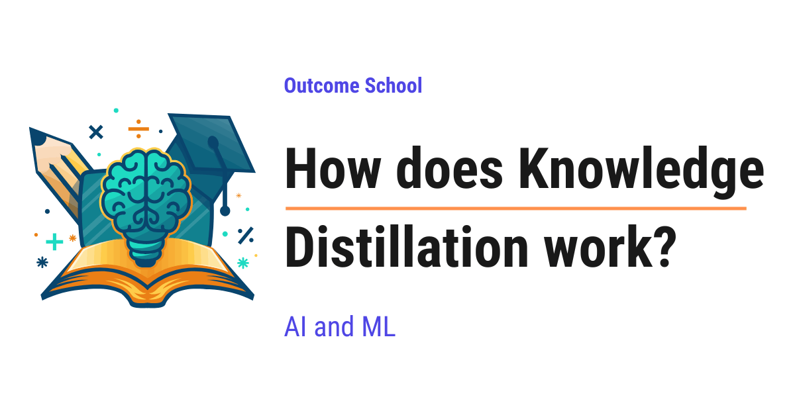

# How does Knowledge Distillation work?

> Archived from <https://outcomeschool.com/blog/how-does-knowledge-distillation-work> on 2026-11-25.

Knowledge Distillation is a technique where we train a small model to copy the behavior of a large model. The big model is the teacher, and the small model is the student.

In this blog, we will learn about how Knowledge Distillation works. We will also see why we need it, how a small model learns from a big model, and how this lets us run powerful AI on a phone, on an edge device, and at low cost.

We will cover the following:
<ul><li>What is Knowledge Distillation?</li><li>Why we need Knowledge Distillation</li><li>Hard labels vs soft labels</li><li>Dark knowledge</li><li>Temperature in the softmax</li><li>The distillation loss</li><li>A step-by-step training walkthrough</li><li>Types of Knowledge Distillation</li><li>Real examples of Knowledge Distillation</li><li>Wrapping up Knowledge Distillation</li></ul>
I am <strong>Amit Shekhar</strong>, Founder @ <a target="_blank" rel="noopener noreferrer" href="https://outcomeschool.com">Outcome School</a>, I have taught and mentored many developers, and their efforts landed them high-paying tech jobs, helped many tech companies in solving their unique problems, and created many open-source libraries being used by top companies. I am passionate about sharing knowledge through open-source, blogs, and videos.

I teach <a target="_blank" rel="noopener noreferrer" href="https://outcomeschool.com/program/ai-and-machine-learning">AI and Machine Learning</a> at Outcome School.

Let&#x27;s get started.
<h3 id="what-is-knowledge-distillation">What is Knowledge Distillation?</h3>
<strong>Knowledge Distillation is a technique where we train a small model to copy the behavior of a large model.</strong>

In simple words, we take a big, smart model and teach a small model to think like it.

The big model is called the <strong>teacher</strong>. The small model is called the <strong>student</strong>. The teacher already knows a lot. The student is new and small. Our goal is to pass the teacher&#x27;s knowledge into the student.

Let&#x27;s say we have a very experienced senior teacher in a school. This teacher has read thousands of books and has years of experience. But this teacher is expensive and slow, and there is only one of them. Now, we want many copies of a &quot;good enough&quot; teacher who can work fast and cheap. So, the senior teacher trains a young student until the student can answer almost as well. The student is not as deep as the senior, but the student is fast, cheap, and good enough for daily work.

This is exactly what Knowledge Distillation does, but with AI models.

Before we go deeper, let&#x27;s understand one basic thing. An AI model is, at its heart, a huge collection of numbers that have been adjusted during training so the model can make good predictions. A large model has many such numbers, so it is powerful but heavy. A small model has fewer numbers, so it is light but, on its own, less smart.

Knowledge Distillation is the bridge. We use the heavy, smart model to make the light model smarter than it could become on its own.

We can picture it as below:

<pre><code class="code-highlight">        +------------------------------+
        |  TEACHER (big, smart, slow)  |
        +------------------------------+
                       |
                       |  passes its knowledge
                       v
        +------------------------------+
        |  STUDENT (small, fast, cheap)|
        +------------------------------+
</code></pre>

Here, we can see that the big teacher model passes its knowledge down into the small student model. The teacher stays big, smart, and slow. The student ends up small, fast, and cheap, but it has learned to behave almost like the teacher.

This is the basic idea. Now, let&#x27;s understand why we even need this.
<h3 id="why-we-need-knowledge-distillation">Why we need Knowledge Distillation</h3>
Big models are very accurate. But big models are also slow and expensive.

A large model needs a lot of memory. It needs powerful and costly <a target="_blank" rel="noopener noreferrer" href="how-does-a-google-tpu-work.md">hardware</a>. It takes more time to give an answer. This delay between asking and getting the answer is called <strong>latency</strong>. High latency means the user waits longer.

Now, think about where we want to use AI.

We want AI on our phones. We want AI on small devices like a smartwatch, a camera, or a car. These small devices are called <strong>edge devices</strong>, because they sit at the &quot;edge&quot;, close to the user, far from big data centers. Edge devices have little memory and little battery. A huge model simply cannot fit there.

We also want AI to respond instantly. A chat reply that takes ten seconds feels broken. We want low latency.

And, we want AI to be cheap to run. Running a giant model for millions of users costs a lot of money.

<strong>So, the situation is this:</strong>
<ul><li>The big model is accurate but slow and expensive.</li><li>The small model is fast and cheap but less accurate on its own.</li></ul>
We want the best of both. We want a small, fast, cheap model that still keeps most of the accuracy of the big model.

So, here comes Knowledge Distillation to the rescue. It lets us shrink the brain into a smaller body while keeping most of the intelligence.

To go deep into Model Compression, Quantization and Optimizations, and Cloud vs On-device Deployment, check out our <a target="_blank" rel="noopener noreferrer" href="https://outcomeschool.com/program/ai-and-machine-learning">AI and Machine Learning Program</a> at Outcome School.

Now, to understand how the teacher passes its knowledge, we must first understand the difference between hard labels and soft labels.
<h3 id="hard-labels-vs-soft-labels">Hard labels vs soft labels</h3>
Let&#x27;s take a simple example. Suppose we are building a model that looks at a photo and decides what is in it. The possible answers are <code>cat</code>, <code>dog</code>, <code>car</code>, and <code>horse</code>. Each possible answer is called a <strong>class</strong>.

Now, suppose we show the model a photo of a cat.

A <strong>hard label</strong> is the single correct answer, and nothing more. For this photo, the hard label says: this is a <code>cat</code>. We can write it like this.

<pre><code class="code-highlight">cat   = 1
dog   = 0
car   = 0
horse = 0
</code></pre>

Here, we can see that the hard label gives full marks to <code>cat</code> and zero to everything else. It is just the plain truth, with no extra information.

Now, let&#x27;s look at what the teacher model actually produces. When the teacher sees the cat photo, it does not output just one word. It outputs a <strong>probability</strong> for every class. A probability is a number between 0 and 1 that tells us how confident the model is. All the probabilities add up to 1.

This full set of probabilities is called a <strong>soft label</strong> or a probability distribution. It can look like this.

<pre><code class="code-highlight">cat   = 0.90
dog   = 0.08
car   = 0.01
horse = 0.01
</code></pre>

Here, we can see that the teacher is 90% sure it is a <code>cat</code>. But it also gives a small 8% to <code>dog</code>, and almost nothing to <code>car</code> and <code>horse</code>.

So, the difference is simple.
<ul><li>A <strong>hard label</strong> says only &quot;it is a cat&quot;.</li><li>A <strong>soft label</strong> says &quot;it is mostly a cat, a little bit like a dog, and not at all like a car&quot;.</li></ul>
This small extra information turns out to be very powerful. Let&#x27;s understand why.
<h3 id="dark-knowledge">Dark knowledge</h3>
The soft label carries hidden information that the hard label throws away. This hidden information is called <strong>dark knowledge</strong>.

In simple words, dark knowledge is what the teacher knows about how the classes relate to each other.

Let&#x27;s go back to our cat photo. The teacher gave <code>dog</code> an 8% chance and <code>car</code> almost 0%. Think about what this is telling us. The teacher is saying: a cat looks somewhat like a dog, but a cat looks nothing like a car.

This is true knowledge about the world. Cats and dogs are both furry, four-legged animals, so they can be confused. A cat and a car have nothing in common, so they are never confused.

A hard label can never teach this. A hard label only says &quot;cat&quot;, and treats &quot;dog&quot; and &quot;car&quot; as equally wrong. But they are not equally wrong. Being a little bit &quot;dog&quot; is a reasonable mistake. Being &quot;car&quot; is a silly mistake.

So, when the student learns from the soft labels, it learns these relationships. It learns that cats and dogs are close. It learns that cats and cars are far apart. This is much richer than just memorizing the single right answer.

<strong>This is the heart of Knowledge Distillation. The soft labels of the teacher teach the student far more than a plain hard label ever could.</strong>

Let&#x27;s make this concrete with a comparison.

<pre><code class="code-highlight">   HARD LABEL                 SOFT LABEL (from teacher)
   -----------                -------------------------
   cat   = 1                  cat   = 0.90   &lt;- the answer
   dog   = 0                  dog   = 0.08   &lt;- &quot;a bit like a dog&quot;
   car   = 0                  car   = 0.01   &lt;- &quot;nothing like a car&quot;
   horse = 0                  horse = 0.01   &lt;- &quot;nothing like a horse&quot;

   Tells: only the answer     Tells: the answer + how classes relate
</code></pre>

Here, we can see that the soft label on the right is doing extra teaching that the hard label on the left simply cannot do.

<strong>Planning your move into AI?</strong>

No matter which tech domain you work in today, with your effort, you can transition to these roles:
<ul><li>AI Engineer</li><li>Forward Deployed Engineer</li><li>AI Agent Engineer</li><li>Harness Engineer</li><li>Voice AI Engineer</li><li>AI Architect</li><li>LLM Engineer</li><li>LLM Inference Engineer</li><li>Gen AI Engineer</li><li>MLOps Engineer</li><li>ML Engineer</li><li>Deep Learning Engineer</li></ul>
Our <a target="_blank" rel="noopener noreferrer" href="https://outcomeschool.com/program/ai-and-machine-learning">AI and Machine Learning Program</a> at Outcome School takes you there.

Now, there is one more problem. Sometimes the teacher is too confident. It can say <code>cat = 0.99</code> and give almost nothing to the others. When that happens, the useful dark knowledge becomes very tiny and hard to see. We need a way to bring out these small numbers. So, here comes temperature into the picture.
<h3 id="temperature-in-the-softmax">Temperature in the softmax</h3>
Before we explain temperature, we must understand one small step that happens inside the model.

When a model makes a prediction, it first produces raw scores for each class. These raw, unprocessed scores are called <a target="_blank" rel="noopener noreferrer" href="logits-in-machine-learning.md"><strong>logits</strong></a>. A logit can be any number, like <code>8.2</code> or <code>-1.4</code>. These raw scores are hard to read directly.

To turn these raw scores into clean probabilities that add up to 1, the model uses a function called the <a target="_blank" rel="noopener noreferrer" href="softmax-function.md"><strong>softmax</strong></a>. The softmax takes the logits and squashes them into nice probabilities between 0 and 1.

We have a detailed blog on <a target="_blank" rel="noopener noreferrer" href="math-behind-cross-entropy-loss.md">Cross-Entropy Loss</a> that explains logits and the softmax in depth.

Now comes the clever part. The softmax has a knob we can turn, called the <strong><a target="_blank" rel="noopener noreferrer" href="how-does-temperature-control-llm-output.md">temperature</a></strong>, often written as <code>T</code>.

In simple words, temperature controls how soft or how sharp the probabilities come out.
<ul><li>A <strong>low temperature</strong> (like <code>T = 1</code>) gives sharp probabilities. One class gets a very high value, and the rest get tiny values.</li><li>A <strong>high temperature</strong> (like <code>T = 4</code>) gives softer, more spread-out probabilities. The smaller values grow bigger and become easier to see.</li></ul>
Let&#x27;s see this with our cat example. At a normal temperature, the teacher is very confident.

<pre><code class="code-highlight">T = 1  (sharp):    cat = 0.95   dog = 0.04   car = 0.005   horse = 0.005
</code></pre>

Now, if we raise the temperature, the same prediction spreads out.

<pre><code class="code-highlight">T = 4  (soft):     cat = 0.70   dog = 0.22   car = 0.05    horse = 0.03
</code></pre>

Here, we can see that at the higher temperature, the <code>dog</code> value jumped from 0.04 to 0.22. The dark knowledge, which means the relationship between cat and dog, is now clear and loud. The student can learn from it much more easily.

So, during distillation, we raise the temperature so the teacher&#x27;s soft labels reveal these subtle relationships. The student gets a clearer, richer lesson.

<strong>Note:</strong> We use the higher temperature only during training. When the finished student is actually used in the real world, we go back to the normal temperature.

<strong>A quick note for you</strong>

No matter which tech domain you work in, get familiar with these topics:
<ul><li>LLM</li><li>RAG</li><li>MCP</li><li>Agent</li><li>Fine-tuning</li><li>Quantization</li></ul>
We put it all together in one video:

<a target="_blank" rel="noopener noreferrer" href="https://www.youtube.com/watch?v=lnfWvX66FUk">AI Engineering Explained: LLM, RAG, MCP, Agent, Fine-Tuning, and Quantization</a>

No need to stop reading - bookmark it and watch later when you get time. Future you will thank you.

Now, let&#x27;s get back to the topic.

Now, we have soft labels, dark knowledge, and temperature. The next question is: how exactly do we train the student using all this? The answer is the distillation loss.
<h3 id="the-distillation-loss">The distillation loss</h3>
To train any model, we need a way to measure how wrong it is. This measure of wrongness is called the <strong>loss</strong>. Training means slowly changing the model&#x27;s numbers to make the loss as small as possible. A smaller loss means the model is making better predictions.

In Knowledge Distillation, the student must do two things at the same time.

<strong>First,</strong> it must match the teacher&#x27;s soft labels. The student looks at a photo, produces its own soft probabilities, and we compare them to the teacher&#x27;s soft probabilities. We want them to be as close as possible. The measure of how different two probability distributions are is called <a target="_blank" rel="noopener noreferrer" href="kl-divergence.md"><strong>KL divergence</strong></a>. We do not need the math. We only need to know that a smaller KL divergence means the two distributions are more similar. This part is called the <strong>distillation loss</strong>.

<strong>Second,</strong> the student must also get the true answer right. We compare the student&#x27;s prediction to the real hard label, the actual truth. This part is the <strong>normal loss</strong>, the same loss we would use to train any model from scratch.

Now, why do we keep both? Because each one helps.
<ul><li>The distillation loss teaches the rich dark knowledge from the teacher.</li><li>The normal loss keeps the student grounded in the real, correct answers, so it does not blindly copy the teacher&#x27;s mistakes.</li></ul>
So, the total loss is a blend of the two.

<pre><code class="code-highlight">Total loss  =  part 1  +  part 2

part 1  =  weight       x  distillation loss   (student vs teacher soft labels)
part 2  =  (1 - weight) x  normal loss         (student vs true hard labels)
</code></pre>

Here, we can see that the total loss is just a weighted mix. The <code>weight</code> is a number we choose that decides how much the student must listen to the teacher versus the true answer. For example, we often give more weight to the teacher&#x27;s soft labels, because that is where the extra knowledge lives.

The flow looks like below:

<pre><code class="code-highlight">                    +----------------+        +----------------+
   same photo ---&gt;  |  TEACHER       |        |  STUDENT       |  &lt;--- same photo
                    |  (big model)   |        |  (small model) |
                    +----------------+        +----------------+
                            |                         |
                teacher     |                         |  student
                soft labels v                         v  soft labels
                    +------------------------------------------+
                    |  distillation loss  (student vs teacher) |
                    +------------------------------------------+
                                        |
                                        v
                              +--------------------+
                              |     TOTAL LOSS     |
                              |   (weighted mix)   |
                              +--------------------+
                                        ^
                                        |
                    +------------------------------------------+
                    |  normal loss  (student vs true label)    |
                    +------------------------------------------+
                            ^                         ^
                            |                         |
                    true hard label           student prediction
</code></pre>

Here, we can see that the same photo goes into both the teacher and the student. The distillation loss measures how far the student&#x27;s soft labels are from the teacher&#x27;s soft labels. The normal loss measures how far the student&#x27;s prediction is from the true hard label. Both losses are then blended into one total loss, which is the single number we make smaller during training.

This combined loss is the engine of Knowledge Distillation. By making this total loss small, the student learns the correct answers and the teacher&#x27;s wisdom together.

Now, let&#x27;s put all the pieces into one clear walkthrough.
<h3 id="a-step-by-step-training-walkthrough">A step-by-step training walkthrough</h3>
Let&#x27;s walk through exactly what happens when we distill knowledge from the teacher into the student. We will use our animal photo example.

<strong>Step 1:</strong> We start with a trained teacher model. The teacher is big and already accurate. We do not change the teacher at all during distillation. It only gives lessons.

<strong>Step 2:</strong> We take a fresh, small student model. The student starts with random numbers and knows nothing yet.

<strong>Step 3:</strong> We take a photo from our training data, for example, our cat photo.

<strong>Step 4:</strong> We pass the photo through the teacher. We use a high temperature so the teacher produces soft labels full of dark knowledge, like <code>cat = 0.70, dog = 0.22, car = 0.05, horse = 0.03</code>.

<strong>Step 5:</strong> We pass the same photo through the student. The student produces its own soft labels at the same high temperature, for example, <code>cat = 0.50, dog = 0.30, car = 0.15, horse = 0.05</code>.

<strong>Step 6:</strong> We calculate the distillation loss by comparing the student&#x27;s soft labels to the teacher&#x27;s soft labels using KL divergence. Right now they are different, so this loss is high.

<strong>Step 7:</strong> We also calculate the normal loss by comparing the student&#x27;s normal prediction to the true hard label, <code>cat = 1</code>. For this part, we use the normal temperature.

<strong>Step 8:</strong> We blend the two losses into the total loss using our chosen weight.

<strong>Step 9:</strong> We slightly adjust the student&#x27;s numbers to make this total loss smaller. This single adjustment is called one training step.

<strong>Step 10:</strong> We repeat Steps 3 to 9 for thousands of photos, again and again.

Slowly, the student&#x27;s soft labels start to match the teacher&#x27;s. The student learns not just the answers, but also the rich relationships between classes. After enough training, the student becomes a small, fast model that behaves almost like the big teacher.

We have a detailed blog on <a target="_blank" rel="noopener noreferrer" href="math-behind-gradient-descent.md">Gradient Descent</a> that explains how this adjustment to the model&#x27;s numbers works step by step.

This is how Knowledge Distillation actually trains the student. Now, let&#x27;s see the different types of it.
<h3 id="types-of-knowledge-distillation">Types of Knowledge Distillation</h3>
Everything we have learned so far is the most common form, but there are three main types. The difference is simply about which part of the teacher the student copies. Let&#x27;s keep it simple.

<strong>Response-based distillation.</strong> This is what we have been doing the whole time. The student copies the teacher&#x27;s final output, which means the soft labels at the end. The student watches what the teacher answers and learns to answer the same way. This is the simplest and most popular type.

<strong>Feature-based distillation.</strong> A model does not jump straight from input to answer. It processes the input step by step through inner stages called <strong>layers</strong>. The output of these inner stages is called a <strong>feature</strong>, which is the model&#x27;s internal understanding before the final answer. In feature-based distillation, the student copies these inner features of the teacher, not just the final output. It is like a student copying not only the senior&#x27;s final answer but also the rough working and notes the senior wrote on the way.

<strong>Relation-based distillation.</strong> Here, the student learns the relationships between different things the teacher saw. For example, the teacher can treat two photos as very similar to each other. The student learns to keep those same two photos similar in its own understanding. So, the student copies the connections the teacher draws between examples, not just single answers.

So, to summarize the three types simply.

<pre><code class="code-highlight">Response-based  -&gt;  copy the teacher&#x27;s FINAL answer (soft labels)
Feature-based   -&gt;  copy the teacher&#x27;s INNER understanding (features in layers)
Relation-based  -&gt;  copy the RELATIONSHIPS the teacher sees between examples
</code></pre>

Here, we can see that all three share the same goal. The student tries to behave like the teacher. They only differ in which part of the teacher&#x27;s behavior the student copies. We can pick one based on our use case.

To master Knowledge Distillation, SLMs and Model Distillation, and Model Compression in depth, check out our <a target="_blank" rel="noopener noreferrer" href="https://outcomeschool.com/program/ai-and-machine-learning">AI and Machine Learning Program</a> at Outcome School.

Now, let&#x27;s look at where Knowledge Distillation is used in the real world.
<h3 id="real-examples-of-knowledge-distillation">Real examples of Knowledge Distillation</h3>
<strong>DistilBERT.</strong> BERT is a famous language model used to understand text. It is powerful but big. DistilBERT is a distilled version of BERT. It is much smaller and faster, around 40% smaller and about 60% faster, while keeping roughly 97% of BERT&#x27;s language understanding. This is a perfect example of the trade we want: a much lighter model that keeps almost all the accuracy.

<strong>Smaller chat models.</strong> Many small chat models are distilled from much larger chat models. The large model acts as the teacher and produces high-quality answers. The small model is trained to copy those answers. The result is a compact chat model that can run cheaply and reply fast, while still sounding close to the big one. We have a detailed blog on <a target="_blank" rel="noopener noreferrer" href="small-language-models-slms.md">Small Language Models (SLMs)</a> that covers these compact models end to end.

<strong><a target="_blank" rel="noopener noreferrer" href="cloud-vs-on-device-model-deployment.md">On-device AI</a>.</strong> This is where distillation truly shines. When we want AI to run directly on a phone, a smartwatch, or a camera, the model must be tiny and quick. We distill a big, accurate model into a small student that fits on the device. So, features like offline translation, voice typing, and smart photo sorting can run right on the device, without sending data to a server. This means faster results, lower cost, and better privacy, because our data stays on the device. On-device models like these are usually shipped in the GGUF format. We have a detailed blog on <a target="_blank" rel="noopener noreferrer" href="how-does-gguf-work.md">how GGUF works</a> that explains how these models are packed into one file.

So, now we know where we can use Knowledge Distillation, and why it matters so much for real products.

Distillation is one way to get a smaller model. Another is quantization, where we keep the same model but store its numbers using fewer bits. We have a detailed blog on <a target="_blank" rel="noopener noreferrer" href="how-does-model-quantization-work.md">how Model Quantization works</a> that explains this from the ground up.

<strong>Stay updated:</strong> Subscribe to our <a target="_blank" rel="noopener noreferrer" href="https://outcomeschool.substack.com/subscribe">newsletter</a> to get our latest AI and Machine Learning blogs straight to your inbox.
<h3 id="wrapping-up-knowledge-distillation">Wrapping up Knowledge Distillation</h3>
Let&#x27;s quickly recap everything in simple words.

A big model, the teacher, is accurate but slow and expensive. A small model, the student, is fast and cheap but less smart on its own. Knowledge Distillation trains the student to copy the teacher, so we get a small model that keeps most of the big model&#x27;s accuracy.

The key idea is that the teacher does not just give the right answer. It gives soft labels, a full set of probabilities over all classes. These soft labels carry dark knowledge, which means they reveal how the classes relate to each other, like a cat being a little bit &quot;dog&quot; and nothing like a &quot;car&quot;. We use a higher temperature in the softmax to make this dark knowledge clear and easy to learn.

We train the student with a combined loss. The distillation loss pulls the student toward the teacher&#x27;s soft labels using KL divergence, and the normal loss keeps the student correct on the true hard labels. We repeat this over many examples until the student behaves like the teacher.

This is how Knowledge Distillation works.
<h2 id="frequently-asked-questions">Frequently Asked Questions</h2><h3 id="does-the-teacher-model-change-during-knowledge-distillation">Does the teacher model change during Knowledge Distillation?</h3>
No. The teacher is a big model that is already trained and accurate. We do not change the teacher at all during distillation. It only gives lessons in the form of soft labels, and only the student&#x27;s numbers are adjusted to make the total loss smaller.
<h3 id="why-not-train-the-small-model-only-on-the-true-labels">Why not train the small model only on the true labels?</h3>
Because hard labels throw away useful information. A hard label only says &quot;it is a cat&quot; and treats every other class as equally wrong. The teacher&#x27;s soft labels also show how classes relate, like a cat being a little bit like a dog and nothing like a car. This dark knowledge teaches the student far more.
<h3 id="is-the-high-temperature-also-used-when-the-student-model-is-deployed">Is the high temperature also used when the student model is deployed?</h3>
No. We use the higher temperature only during training, so the teacher&#x27;s soft labels reveal the subtle relationships between classes. When the finished student is actually used in the real world, we go back to the normal temperature.
<h3 id="does-the-student-simply-copy-the-teachers-mistakes">Does the student simply copy the teacher&#x27;s mistakes?</h3>
Not blindly. The total loss blends two parts. The distillation loss pulls the student toward the teacher&#x27;s soft labels, and the normal loss compares the student to the true hard labels. This normal loss keeps the student grounded in the real, correct answers, so it does not blindly copy the teacher&#x27;s mistakes.
<h3 id="what-is-the-difference-between-knowledge-distillation-and-quantization">What is the difference between Knowledge Distillation and quantization?</h3>
Both make a model smaller, but in different ways. Knowledge Distillation trains a separate small student model to copy a big teacher model. Quantization keeps the same model but stores its numbers using fewer bits.

That&#x27;s it for now.

Thanks

<strong>Amit Shekhar</strong> Founder @ <a target="_blank" rel="noopener noreferrer" href="https://outcomeschool.com">Outcome School</a>

You can connect with me on:
<ul><li><a target="_blank" rel="noopener noreferrer" href="https://x.com/amitiitbhu">X</a></li><li><a target="_blank" rel="noopener noreferrer" href="https://www.linkedin.com/in/amit-shekhar-iitbhu">LinkedIn</a></li><li><a target="_blank" rel="noopener noreferrer" href="https://github.com/amitshekhariitbhu">GitHub</a></li></ul>
Follow Outcome School on:
<ul><li><a target="_blank" rel="noopener noreferrer" href="https://x.com/outcome_school">X</a></li><li><a target="_blank" rel="noopener noreferrer" href="https://youtube.com/@OutcomeSchool">YouTube</a></li><li><a target="_blank" rel="noopener noreferrer" href="https://www.linkedin.com/company/outcomeschool">LinkedIn</a></li><li><a target="_blank" rel="noopener noreferrer" href="https://github.com/OutcomeSchool">GitHub</a></li></ul>
<a target="_blank" rel="noopener noreferrer" href="https://outcomeschool.com/blog"><strong>Read all of our high-quality blogs here.</strong></a>

