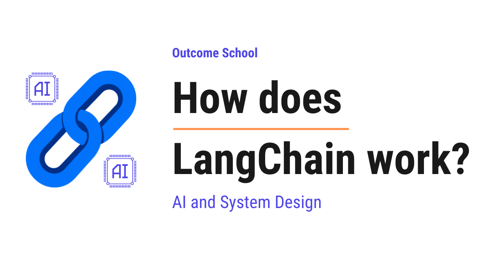

# How does LangChain work?

> Archived from <https://outcomeschool.com/blog/how-does-langchain-work> on 2026-11-25.

LangChain is a framework that helps us build applications powered by Large Language Models. It sits between us and the LLM, and connects the LLM with our data, our tools, and our logic.

In this blog, we will learn about how LangChain works. We will also see why we need it, what chains, prompts, memory, and output parsers are, how retrieval and agents fit in, and how the full flow works together in the real world.

We will cover the following:
<ul><li>What is LangChain?</li><li>Why do we need LangChain?</li><li>The core idea behind LangChain</li><li>LLM and Prompt Template</li><li>What is a Chain?</li><li>Output Parser</li><li>Memory</li><li>Retrieval and RAG</li><li>Tools and Agents</li><li>A complete flow of how LangChain works</li></ul>
I am <strong>Amit Shekhar</strong>, Founder @ <a target="_blank" rel="noopener noreferrer" href="https://outcomeschool.com">Outcome School</a>, I have taught and mentored many developers, and their efforts landed them high-paying tech jobs, helped many tech companies in solving their unique problems, and created many open-source libraries being used by top companies. I am passionate about sharing knowledge through open-source, blogs, and videos.

I teach <a target="_blank" rel="noopener noreferrer" href="https://outcomeschool.com/program/ai-and-machine-learning">AI and Machine Learning</a> at Outcome School.

Let&#x27;s get started.
<h2 id="what-is-langchain">What is LangChain?</h2>
<strong>LangChain is a framework that helps us build applications powered by Large Language Models.</strong>

Before we go further, let&#x27;s understand one term first. A <strong>Large Language Model</strong>, also called an <strong>LLM</strong>, is a model that understands and generates human-like text. ChatGPT is built on top of an LLM. We give it some text, and it gives us back some text.

Now, LangChain is a tool that sits between us and the LLM. It helps us connect the LLM with other things like our data, our tools, and our logic.

In simple words, LangChain helps us build smart apps that talk to an LLM and do useful work for us.

Let&#x27;s decompose the name to understand it better.
<blockquote>
LangChain = Lang + Chain
</blockquote>
Here, <code>Lang</code> stands for Language, which points to the language model. And <code>Chain</code> means joining many steps together, one after another. So LangChain is about chaining many steps into one smooth flow.

This idea of joining prompts step by step, where the output of one prompt becomes the input of the next, is called Prompt Chaining. We have a detailed blog on <a target="_blank" rel="noopener noreferrer" href="how-does-prompt-chaining-work.md">How does Prompt Chaining work</a> that explains it step by step.

Now, we have understood what LangChain is. Now, let&#x27;s understand why we even need it.
<h2 id="why-do-we-need-langchain">Why do we need LangChain?</h2>
Let&#x27;s say we want to build a simple app. We give it a question, and it gives us an answer using an LLM. This is easy. We send our text to the LLM and get the reply.

But real apps are not this simple. Let&#x27;s see why.

Suppose we want our app to do the following:
<ul><li>Take a question from the user.</li><li>Look up answers from our own documents.</li><li>Remember the previous messages in the conversation.</li><li>Call a calculator or a search engine when needed.</li><li>Format the final answer in a clean way.</li></ul>
Now, doing all of this by hand becomes messy. We have to write a lot of code to glue every piece together. We have to manage the order of steps. We have to handle the data moving from one step to the next.

This is hard to build and harder to maintain.

So, here comes LangChain to the rescue.

LangChain gives us ready-made building blocks. We just connect these blocks like Lego pieces. Each block does one job, and LangChain joins them together.

This way we can use LangChain to solve the interesting problem of building complex LLM apps in a very simple way.

Now that we have learned why we need LangChain, it&#x27;s time to understand the core idea behind it.
<h2 id="the-core-idea-behind-langchain">The core idea behind LangChain</h2>
The core idea of LangChain is very simple.
<blockquote>
Take small building blocks and chain them together to build a complete flow.
</blockquote>
Let&#x27;s understand this with an analogy.

Consider a factory assembly line. A car is built step by step. First, the body is made. Then, the engine is added. After that, the wheels are fixed. Finally, the paint is done. Each station does one job and passes the car to the next station.

LangChain works in the same way. Each block does one small job. The output of one block becomes the input of the next block. This is the chain.

Let me map this analogy to LangChain for our better understanding.
<table><thead><tr><th>Assembly line</th><th>LangChain</th></tr></thead><tbody><tr><td>Raw material entering</td><td>User input</td></tr><tr><td>A single work station</td><td>A building block</td></tr><tr><td>The car moving forward</td><td>Data passing to the next step</td></tr><tr><td>The finished car</td><td>The final answer</td></tr></tbody></table>
Now, we have the big picture. Now, let&#x27;s learn about each building block one by one. Do not worry, we will learn about each of them in detail.
<h2 id="llm-and-prompt-template">LLM and Prompt Template</h2>
The first block is the <strong>LLM</strong>, which is the brain of our app. We already know that the LLM takes text and returns text.

But before sending text to the LLM, we must prepare the text carefully. The text we send to the LLM is called a <strong>Prompt</strong>.

In simple words, a prompt is the instruction we give to the LLM.

Now, most of the time our prompt is not fixed. A part of it changes based on the user. So, here comes the <strong>Prompt Template</strong> into the picture.

<strong>A Prompt Template is a ready-made prompt with some blank spaces that we fill at runtime.</strong>

Let&#x27;s see the code for a prompt template as below:

<pre><code class="language-python code-highlight">from langchain_core.prompts import PromptTemplate

template = PromptTemplate.from_template(
    &quot;Explain {topic} in simple words for a beginner.&quot;
)

prompt = template.format(topic=&quot;LangChain&quot;)
</code></pre>

Here, we have created a template with a blank space called <code>topic</code>. When we call <code>format</code> and pass <code>topic=&quot;LangChain&quot;</code>, the blank space gets filled. The final prompt becomes &quot;Explain LangChain in simple words for a beginner.&quot;

This is how a prompt template helps us reuse the same prompt with different values. It makes our life easy.

<strong>Planning your move into AI?</strong>

No matter which tech domain you work in today, with your effort, you can transition to these roles:
<ul><li>AI Engineer</li><li>Forward Deployed Engineer</li><li>AI Agent Engineer</li><li>Harness Engineer</li><li>Voice AI Engineer</li><li>AI Architect</li><li>LLM Engineer</li><li>LLM Inference Engineer</li><li>Gen AI Engineer</li><li>MLOps Engineer</li><li>ML Engineer</li><li>Deep Learning Engineer</li></ul>
Our <a target="_blank" rel="noopener noreferrer" href="https://outcomeschool.com/program/ai-and-machine-learning">AI and Machine Learning Program</a> at Outcome School takes you there.

Now, we have a prompt ready. Now, let&#x27;s learn how to join the prompt template with the LLM. This is where the chain comes in.
<h2 id="what-is-a-chain">What is a Chain?</h2>
<strong>A Chain is the joining of many blocks so that the output of one block flows into the next block.</strong>

In simple words, a chain is a pipeline of steps.

Let&#x27;s say we want a simple chain. First, the prompt template fills in the user topic. Then, the LLM reads that prompt and gives an answer. This is a chain of two steps.

Let&#x27;s see the code for a chain as below:

<pre><code class="language-python code-highlight">from langchain_openai import ChatOpenAI
from langchain_core.prompts import PromptTemplate

llm = ChatOpenAI(model=&quot;gpt-4o-mini&quot;)

template = PromptTemplate.from_template(
    &quot;Explain {topic} in simple words for a beginner.&quot;
)

chain = template | llm

result = chain.invoke({&quot;topic&quot;: &quot;LangChain&quot;})
</code></pre>

Here, we can see a few important things. We created the <code>llm</code> block and the <code>template</code> block. Then we joined them using the <code>|</code> symbol. This <code>|</code> symbol is the pipe, and it means &quot;send the output of the left side into the right side.&quot;

So, <code>template | llm</code> means the filled prompt from the template goes straight into the LLM. When we call <code>invoke</code> with our topic, the data flows through the chain and we get a result.

This is the heart of LangChain. We build small blocks and join them with the pipe.

Let&#x27;s visualize this chain as below:

<pre><code class="code-highlight language-text">  user input              filled prompt              answer
   {topic}                    text                    text
      |                        |                        |
      v                        v                        v
  +----------+    pipe    +----------+    pipe    +----------+
  | Template | ---------&gt; |   LLM    | ---------&gt; |  Parser  |
  +----------+            +----------+            +----------+
   fills the              the brain:              cleans the
   blank space            reads the prompt,       answer into a
                          gives an answer         clean result
</code></pre>

Here, we can see that the data flows from left to right. The top row shows the data on each wire, and the bottom row shows what each block does. The <code>Template</code> fills the blank space and passes the filled prompt to the <code>LLM</code>. The <code>LLM</code> is the brain. It reads the prompt and passes its answer forward to the <code>Parser</code>. The <code>|</code> pipe between each block is what carries the output of one block into the next block. This is exactly what a chain means.

To learn how to build LLM apps with LangChain and LangGraph in depth, check out our <a target="_blank" rel="noopener noreferrer" href="https://outcomeschool.com/program/ai-and-machine-learning">AI and Machine Learning Program</a> at Outcome School.

Now, we have understood the chain. But the LLM gives us plain text. Many times we need the answer in a clean structure. So, let&#x27;s learn about the output parser.
<h2 id="output-parser">Output Parser</h2>
<strong>An Output Parser takes the raw text from the LLM and converts it into a clean, structured form.</strong>

In simple words, the LLM speaks in plain text, and the output parser turns that text into something our program can use easily.

Let&#x27;s say we ask the LLM for a list of three fruits. The LLM returns &quot;apple, banana, mango&quot; as plain text. But in our code, we need an actual list of three separate items. The output parser does this conversion for us.

Let&#x27;s see the code for an output parser as below:

<pre><code class="language-python code-highlight">from langchain_core.output_parsers import StrOutputParser

parser = StrOutputParser()

chain = template | llm | parser

result = chain.invoke({&quot;topic&quot;: &quot;LangChain&quot;})
</code></pre>

Here, we have added one more block called <code>parser</code> to our chain. Now the data flows through three blocks. The template fills the prompt, the LLM gives an answer, and the parser cleans that answer into a simple string. The <code>StrOutputParser</code> simply gives us back clean text instead of the full message object.

This is how an output parser makes the final result neat and ready to use.

Now, our chain can take input, talk to the LLM, and clean the output. But there is a problem. Our app forgets everything after every message. Let&#x27;s solve this with memory.
<h2 id="memory">Memory</h2>
Let&#x27;s say we are chatting with our app. We ask, &quot;Who is Albert Einstein?&quot; The app answers correctly. Then we ask, &quot;Where was he born?&quot;

But here is the catch. The app does not know who &quot;he&quot; is, because it forgot the previous message. Every call to the LLM is fresh, and it does not remember the past on its own.

So, here comes <strong><a target="_blank" rel="noopener noreferrer" href="ai-agent-memory.md">Memory</a></strong> to the rescue.

<strong>Memory is the part of LangChain that stores the previous messages of a conversation so the app can remember the context.</strong>

In simple words, memory gives our app the power to recall what was said before.

Let&#x27;s understand how it works. Each time the user sends a new message, LangChain takes the old messages from memory and adds them to the new prompt. So the LLM sees the full conversation, not just the latest message.

Let&#x27;s see a simple flow of memory as below:

<pre><code class="language-python code-highlight"># Turn 1
# Stored in memory: &quot;User: Who is Albert Einstein?&quot;

# Turn 2
# Memory + new message are sent together:
# &quot;User: Who is Albert Einstein?
#  AI: Albert Einstein was a famous physicist.
#  User: Where was he born?&quot;
</code></pre>

Here, we can notice that in the second turn, the old conversation is added before the new question. So now the LLM knows that &quot;he&quot; means Albert Einstein. The memory carries the context forward.

This is how memory makes our app feel like a real conversation. Problem Solved.

<strong>A quick note for you</strong>

No matter which tech domain you work in, get familiar with these topics:
<ul><li>LLM</li><li>RAG</li><li>MCP</li><li>Agent</li><li>Fine-tuning</li><li>Quantization</li></ul>
We put it all together in one video:

<a target="_blank" rel="noopener noreferrer" href="https://www.youtube.com/watch?v=lnfWvX66FUk">AI Engineering Explained: LLM, RAG, MCP, Agent, Fine-Tuning, and Quantization</a>

No need to stop reading - bookmark it and watch later when you get time. Future you will thank you.

Now, let&#x27;s get back to the topic.

Now, our app can remember the chat. But what if we want the app to answer using our own documents? The LLM does not know about our private data. Let&#x27;s solve this with retrieval.
<h2 id="retrieval-and-rag">Retrieval and RAG</h2>
The LLM is trained on general data from the internet. It does not know about our company documents, our personal notes, or our latest files.

Let&#x27;s say we have a 200-page company handbook. We want our app to answer questions from this handbook. The LLM has never seen it. So how do we teach the app about it?

So, here comes <strong>Retrieval</strong> into the picture.

<strong>Retrieval means fetching the most relevant pieces of our own data and giving them to the LLM along with the question.</strong>

This full pattern has a name. It is called <strong><a target="_blank" rel="noopener noreferrer" href="retrieval-augmented-generation-rag.md">RAG</a></strong>, which stands for <strong>Retrieval-Augmented Generation</strong>. In simple words, we first retrieve the right information, then we let the LLM generate the answer using that information.

Let&#x27;s understand the steps of how retrieval works.

<strong>Step 1:</strong> We break our big document into small pieces called <a target="_blank" rel="noopener noreferrer" href="chunking-strategies-for-rag.md">chunks</a>.

<strong>Step 2:</strong> We convert each chunk into a list of numbers called an <strong><a target="_blank" rel="noopener noreferrer" href="what-are-embeddings.md">embedding</a></strong>. An embedding is just a way to represent text as numbers so the computer can compare meaning.

<strong>Step 3:</strong> We store all these embeddings in a special database called a <strong><a target="_blank" rel="noopener noreferrer" href="how-does-a-vector-database-work.md">Vector Store</a></strong>. A vector store is a database built to <a target="_blank" rel="noopener noreferrer" href="how-does-semantic-search-work.md">search by meaning</a>, not just by exact words.

<strong>Step 4:</strong> When the user asks a question, we turn the question into an embedding too, and we search the vector store for the closest matching chunks.

<strong>Step 5:</strong> We send those matching chunks plus the question to the LLM, and the LLM answers using them.

We can picture the RAG flow as below:

<pre><code class="code-highlight language-text">  Our document
       |
       v
  +----------+    +-----------+    +--------------+
  |  Chunks  | -&gt; | Embeddings | -&gt; | Vector Store |
  +----------+    +-----------+    +--------------+
                                          ^
                                          | search by meaning
                                          |
  User question --&gt; Embedding ------------+
                                          |
                                          v
                                  matching chunks
                                          |
                                          v
                           User question + matching chunks
                              combined into one prompt
                                          |
                                          v
                              +-----------------------+
                              |          LLM          | --&gt; Answer
                              +-----------------------+
</code></pre>

Here, we can see that the top row prepares our data once. We split the document into chunks, turn each chunk into an embedding, and store all of them in the <code>Vector Store</code>. When the user asks a question, we turn the question into an embedding too and search the <code>Vector Store</code> by meaning. The matching chunks and the question are then combined into one single prompt, and that single prompt is sent to the <code>LLM</code>, which generates the final answer from our own data.

Let&#x27;s see a simplified code for retrieval as below:

<pre><code class="language-python code-highlight"># Find the chunks that match the user question
relevant_chunks = vector_store.similarity_search(&quot;What is the leave policy?&quot;)

# Send the chunks and the question to the LLM
chain = prompt_with_context | llm | parser

result = chain.invoke({
    &quot;context&quot;: relevant_chunks,
    &quot;question&quot;: &quot;What is the leave policy?&quot;
})
</code></pre>

Here, we can see that we first search the vector store for chunks related to the leave policy. Then we pass both the chunks and the question into our chain. The LLM now reads our own data and answers from it.

This is how retrieval and RAG let the LLM answer questions from our private data. That&#x27;s the beauty of LangChain.

We have a detailed blog on <a target="_blank" rel="noopener noreferrer" href="agentic-rag.md">Agentic RAG</a> that takes this retrieval pattern further.

<strong>Stay updated:</strong> Subscribe to our <a target="_blank" rel="noopener noreferrer" href="https://outcomeschool.substack.com/subscribe">newsletter</a> to get our latest AI and Machine Learning blogs straight to your inbox.

Now, our app can use memory and our own documents. But sometimes the LLM needs to take action in the real world, like searching the web or doing math. Let&#x27;s learn about tools and agents.
<h2 id="tools-and-agents">Tools and Agents</h2>
The LLM is very good at language, but it is not good at everything. For example, the LLM is weak at exact math, and it does not know today&#x27;s live information.

Let&#x27;s say we ask, &quot;What is the weather in Delhi right now?&quot; The LLM cannot know this, because it has no live connection to the weather.

So, here comes the idea of <strong>Tools</strong> to the rescue.

<strong>A Tool is an external function, such as a calculator, a search engine, or a weather service, that can be run to do something the LLM cannot do on its own.</strong>

In simple words, a tool is a helper that gets run when the LLM cannot do the job by itself.

Now, here is one very important point that people often get wrong. The LLM does not run the tool by itself. The LLM only <a target="_blank" rel="noopener noreferrer" href="how-does-function-calling-work-in-llms.md">recommends which tool to use</a> and what input to pass to it. The actual call to the tool is made by our code. The LLM is the advisor, and our code is the doer.

So, the next big question is: who takes the LLM&#x27;s recommendation and actually runs the tool? This is where the <strong><a target="_blank" rel="noopener noreferrer" href="ai-agent.md">Agent</a></strong> comes in.

<strong>An Agent is a smart controller that uses the LLM to decide which tool to use and in what order, then runs that tool, takes back the result, and gives it to the LLM, until the task is complete.</strong>

In simple words, the agent <a target="_blank" rel="noopener noreferrer" href="ai-agent-loop.md">works in a loop</a>. It asks the LLM what to do next. The LLM recommends a tool and the input for it. The agent runs that tool, sees the result, and sends the result back to the LLM. Then it asks the LLM for the next step again. It keeps doing this until the task is done.

Let&#x27;s see a numeric walkthrough of how an agent works. Suppose the user asks, &quot;What is 25 times 18, and is that more than 400?&quot;

<strong>Step 1:</strong> The agent sends the question to the LLM. The LLM recommends the calculator tool with the input <code>25 * 18</code>.

<strong>Step 2:</strong> The agent runs the calculator tool with <code>25 * 18</code>. The tool returns <code>450</code>.

<strong>Step 3:</strong> The agent sends <code>450</code> back to the LLM. The LLM compares <code>450</code> with <code>400</code> and sees that <code>450</code> is more than <code>400</code>.

<strong>Step 4:</strong> The LLM forms the final answer: &quot;25 times 18 is 450, which is more than 400.&quot;

Here, we can notice that the math was not guessed. The agent ran a real tool for the calculation, and then the LLM reasoned about the result. This makes the answer reliable.

When these agent steps, decisions, and loops grow complex, we can lay them out as a graph and let the framework run them for us. We have a detailed blog on <a target="_blank" rel="noopener noreferrer" href="how-does-langgraph-work.md">how LangGraph works</a> that explains this step by step.

<strong>Note:</strong> The agent uses the LLM as its brain to make decisions, and the tools as its hands to take actions.

This is how tools and agents give our app the power to do real work.

To go deep into AI Agents and Tool use, and to build an AI Coding Agent from scratch, check out our <a target="_blank" rel="noopener noreferrer" href="https://outcomeschool.com/program/ai-and-machine-learning">AI and Machine Learning Program</a> at Outcome School.

Now, we have learned about every building block. Now, let&#x27;s put them all together into one complete flow.
<h2 id="a-complete-flow-of-how-langchain-works">A complete flow of how LangChain works</h2>
Let&#x27;s connect everything we have learned into a single story. Suppose a user opens our app and asks a question about our company handbook.

<strong>Step 1:</strong> The user types the question into our app.

<strong>Step 2:</strong> LangChain pulls the previous messages from memory and adds them for context.

<strong>Step 3:</strong> LangChain uses retrieval to fetch the matching chunks from the vector store.

<strong>Step 4:</strong> The prompt template combines the question, the memory, and the retrieved chunks into one final prompt.

<strong>Step 5:</strong> This prompt flows into the LLM through the chain.

<strong>Step 6:</strong> If the task needs an action, the LLM recommends a tool, and the agent runs that tool and brings the result back to the LLM.

<strong>Step 7:</strong> The LLM produces an answer.

<strong>Step 8:</strong> The output parser cleans the answer into a neat form.

<strong>Step 9:</strong> The clean answer is shown to the user, and the new messages are saved into memory for the next turn.

The complete flow looks like below:

<pre><code class="code-highlight language-text">   User question
        |
        v
  +-----------+        +-----------+        +--------------+
  |  Memory   | -----&gt; |  Prompt   | &lt;----- | Retrieval /  |
  | (context) |        | Template  |        | Vector Store |
  +-----------+        +-----------+        +--------------+
        ^                    |
        |                    v
        |              +-----------+  agent calls   +-------+
        |              |    LLM    | &lt;------------&gt; | Tools |
        |              +-----------+ (LLM advises)  +-------+
        |                    |
        |                    v
        |              +-----------+
        |              |  Parser   |
        |              +-----------+
        |                    |
        |                    v
        |          Clean answer to user
        |                    |
        +--------------------+
              saves new messages
</code></pre>

Here, we can see how all the blocks work together. The question first gathers context from <code>Memory</code> and matching chunks from <code>Retrieval</code>. The <code>Prompt Template</code> combines everything into one prompt and sends it to the <code>LLM</code>. When an action is needed, the <code>LLM</code> recommends a tool, and the <code>Agent</code> runs that tool and feeds the result back to the <code>LLM</code>. The answer then passes through the <code>Parser</code> to become clean, and finally goes back to the user while the new messages are saved into <code>Memory</code> for the next turn.

Here, we can see how each block does one job and passes its result to the next block. The input flows in from one side, moves through the chain, and the final answer comes out from the other side. This is exactly the assembly line we talked about at the start.

This is how LangChain works, end to end. Let&#x27;s quickly recap what we have learned.

LangChain is a framework that helps us build applications powered by LLMs. It gives us small building blocks and lets us chain them together.

We learned about the prompt template that prepares the text, the chain that joins the blocks, and the output parser that cleans the result. We learned about memory that remembers the conversation, retrieval and RAG that bring in our own data, and tools and agents that take real actions.

Now, we must have understood how LangChain works.
<h2 id="frequently-asked-questions">Frequently Asked Questions</h2><h3 id="is-langchain-an-llm">Is LangChain an LLM?</h3>
No. LangChain is not an LLM. It is a framework that sits between us and the LLM. It gives us ready-made building blocks, like prompt templates, chains, output parsers, memory, retrieval, and tools, and helps us connect the LLM with our data, our tools, and our logic.
<h3 id="does-the-llm-run-tools-by-itself-in-langchain">Does the LLM run tools by itself in LangChain?</h3>
No. The LLM only recommends which tool to use and what input to pass to it. The actual call to the tool is made by our code through the agent. The agent runs the tool, takes back the result, and gives it to the LLM, until the task is complete.
<h3 id="does-an-llm-remember-earlier-messages-without-memory">Does an LLM remember earlier messages without memory?</h3>
No. Every call to the LLM is fresh, and it does not remember the past on its own. LangChain memory stores the previous messages and adds them to each new prompt, so the LLM sees the full conversation and knows, for example, who &quot;he&quot; refers to.
<h3 id="what-does-the-pipe-symbol-do-in-a-langchain-chain">What does the pipe symbol do in a LangChain chain?</h3>
The <code>|</code> pipe sends the output of the left side into the right side. For example, <code>template | llm | parser</code> means the filled prompt goes into the LLM, and the LLM&#x27;s answer goes into the parser. This is how we join small blocks into one chain.
<h3 id="when-should-we-use-langgraph-instead-of-a-simple-langchain-chain">When should we use LangGraph instead of a simple LangChain chain?</h3>
We should use LangGraph when agent steps, decisions, and loops grow complex. In that case, we can lay them out as a graph and let the framework run them for us.

That&#x27;s it for now.

Thanks

<strong>Amit Shekhar</strong> Founder @ <a target="_blank" rel="noopener noreferrer" href="https://outcomeschool.com">Outcome School</a>

You can connect with me on:
<ul><li><a target="_blank" rel="noopener noreferrer" href="https://x.com/amitiitbhu">X</a></li><li><a target="_blank" rel="noopener noreferrer" href="https://www.linkedin.com/in/amit-shekhar-iitbhu">LinkedIn</a></li><li><a target="_blank" rel="noopener noreferrer" href="https://github.com/amitshekhariitbhu">GitHub</a></li></ul>
Follow Outcome School on:
<ul><li><a target="_blank" rel="noopener noreferrer" href="https://x.com/outcome_school">X</a></li><li><a target="_blank" rel="noopener noreferrer" href="https://youtube.com/@OutcomeSchool">YouTube</a></li><li><a target="_blank" rel="noopener noreferrer" href="https://www.linkedin.com/company/outcomeschool">LinkedIn</a></li><li><a target="_blank" rel="noopener noreferrer" href="https://github.com/OutcomeSchool">GitHub</a></li></ul>
<a target="_blank" rel="noopener noreferrer" href="https://outcomeschool.com/blog"><strong>Read all of our high-quality blogs here.</strong></a>

