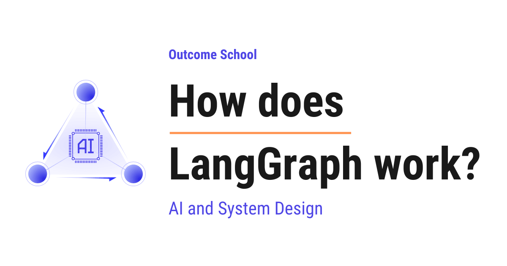

# How does LangGraph work?

> Archived from <https://outcomeschool.com/blog/how-does-langgraph-work> on 2026-11-25.

LangGraph is a framework that helps us build applications powered by an LLM, where the work is organized as a graph of steps, and a shared state travels from one step to the next.

In this blog, we will learn about how LangGraph works. We will also see why we need it, what graphs, state, nodes, and edges are, how tools work and who actually calls them, how memory and <a target="_blank" rel="noopener noreferrer" href="human-in-the-loop-agents.md">human-in-the-loop</a> fit in through a complete example, and when to use it in the real world.

We will cover the following:
<ul><li>What is LangGraph?</li><li>Why do we need LangGraph?</li><li>What is a Graph in LangGraph?</li><li>What is State in LangGraph?</li><li>Nodes and Edges</li><li>Conditional Edges</li><li>A complete example</li><li>Tools and who calls them</li><li>Memory and persistence</li><li>Human-in-the-loop</li><li>When to use LangGraph</li></ul>
I am <strong>Amit Shekhar</strong>, Founder @ <a target="_blank" rel="noopener noreferrer" href="https://outcomeschool.com">Outcome School</a>, I have taught and mentored many developers, and their efforts landed them high-paying tech jobs, helped many tech companies in solving their unique problems, and created many open-source libraries being used by top companies. I am passionate about sharing knowledge through open-source, blogs, and videos.

I teach <a target="_blank" rel="noopener noreferrer" href="https://outcomeschool.com/program/ai-and-machine-learning">AI and Machine Learning</a> at Outcome School.

Let&#x27;s get started.
<h2 id="what-is-langgraph">What is LangGraph?</h2>
<strong>LangGraph is a framework that helps us build applications powered by an LLM, where the work is organized as a graph of steps.</strong>

Before we go ahead, let&#x27;s understand one term first. An <strong>LLM</strong> is a Large Language Model. It is the kind of AI model that powers tools like ChatGPT. We give it some text, and it gives us back some text.

Now, let&#x27;s decompose the name to make it simple.

LangGraph = Lang + Graph

<code>Lang</code> comes from language, because we are working with language models. <code>Graph</code> is a way of connecting steps together. So, LangGraph is a way to connect language model steps together in a structured manner.

In simple words, LangGraph lets us describe an AI application as a set of steps, and it controls which step runs, in what order, and what happens next.

LangGraph comes from the same team behind LangChain and builds on its ideas, adding graphs, loops, and branching on top. We have a detailed blog on <a target="_blank" rel="noopener noreferrer" href="how-does-langchain-work.md">how LangChain works</a> that explains this in depth.
<h2 id="why-do-we-need-langgraph">Why do we need LangGraph?</h2>
The best way to learn this is by taking an example.

Suppose we want to build a simple AI app. We send a question to the LLM, and it gives us an answer. This is easy. We do not need any framework for this.

But real applications are not that simple. Let&#x27;s say we are building a customer support assistant. The assistant must do many things.

First, it must read the user&#x27;s message. Then, it must decide whether the question is about billing or about a technical issue. After that, it must search the right document. Then, it must ask the LLM to write a reply. And sometimes, it must ask a human to approve the reply before sending it.

Now, here is the catch. These steps are not a straight line. The app must make decisions. It must loop back and try again. It must remember what happened before. It must pause and wait for a human.

If we write all of this with plain <code>if</code> and <code>else</code> conditions, the code becomes messy very fast. It becomes hard to read and hard to change.

So, here comes LangGraph to the rescue.

LangGraph lets us describe these steps and decisions clearly as a graph. It then runs the graph for us. It makes our life easy.
<h2 id="what-is-a-graph-in-langgraph">What is a Graph in LangGraph?</h2>
Before jumping into LangGraph, we must know what a graph is.

<strong>A graph is a collection of points connected by lines.</strong>

In simple words, a graph has two things.
<ul><li><strong>Nodes</strong>: these are the points. Each point is a piece of work.</li><li><strong>Edges</strong>: these are the lines. Each line connects one point to the next point.</li></ul>
Let&#x27;s say we draw a small map. We have three circles named A, B, and C. We draw an arrow from A to B, and another arrow from B to C. This is a graph. The circles are nodes. The arrows are edges.

Let&#x27;s visualize this as below:

<pre><code class="code-highlight language-text">   +-----+        +-----+        +-----+
   |  A  | -----&gt; |  B  | -----&gt; |  C  |
   +-----+        +-----+        +-----+
    node           node           node
            edge           edge
</code></pre>

Here, we can see that <code>A</code>, <code>B</code>, and <code>C</code> are the nodes, which are the boxes that do work. The arrows between them are the edges, which tell the graph where to go next. The graph starts at <code>A</code>, moves to <code>B</code>, and then moves to <code>C</code>.

Consider a simple real-world map. We start at home, then we go to the office, then we go back home. Home and office are nodes. The roads between them are edges.

In LangGraph, each node does some work, and each edge tells the app where to go next. This is the core idea, and everything else is built on top of it.

Designing a system this way, as nodes and edges, is called <a target="_blank" rel="noopener noreferrer" href="what-is-graph-engineering.md">Graph Engineering</a>, and we have a detailed blog on it that explains this from the ground up.
<h2 id="what-is-state-in-langgraph">What is State in LangGraph?</h2>
Before we build a graph, we must understand one more important concept called state.

<strong>State is the shared memory that travels through the graph.</strong>

In simple words, the state is a box of information that every node can read from and write to. As the app moves from one node to the next, the state carries the data along.

Let&#x27;s say we are processing an order. The state can hold the user&#x27;s message, the items in the cart, and the final reply. Node 1 puts the user&#x27;s message into the state. Node 2 reads that message and puts the cart items into the state. Node 3 reads everything and writes the final reply.

This way, the nodes do not need to call each other directly. They just read and write to the shared state. The state is the glue that holds the whole graph together.

Let&#x27;s see the code for a simple state as below:

<pre><code class="language-python code-highlight">from typing import TypedDict

class State(TypedDict):
    message: str
    reply: str
</code></pre>

Here, we have defined a <code>State</code> using <code>TypedDict</code>. A <code>TypedDict</code> is just a dictionary where we declare the names and the types of the values it will hold. Our state holds two things. The <code>message</code> is the user&#x27;s input. The <code>reply</code> is the answer we will produce. This is the box that will travel through our graph.
<h2 id="nodes-and-edges">Nodes and Edges</h2>
Now that we have understood the state, it&#x27;s time to learn about nodes and edges in LangGraph.

<strong>A node is a Python function that takes the current state and returns an update to the state.</strong>

In simple words, a node is one step of work. It reads the state, does something, and gives back the part of the state it wants to change.

Let&#x27;s see the code for a node as below:

<pre><code class="language-python code-highlight">def write_reply(state: State):
    user_message = state[&quot;message&quot;]
    answer = &quot;Thanks for your message: &quot; + user_message
    return {&quot;reply&quot;: answer}
</code></pre>

Here, we have created a node named <code>write_reply</code>. It reads the <code>message</code> from the state. It builds a small answer. Then it returns a dictionary with the new <code>reply</code>. LangGraph takes this returned value and updates the shared state with it. The node does not change anything else. It only updates what it returns.

Now, let&#x27;s understand edges.

<strong>An edge connects one node to the next node, and tells the graph where to go after a node finishes.</strong>

In simple words, an edge is the arrow between the steps. After one node finishes, the edge decides which node runs next.

There are two special points in every graph. The <code>START</code> point is where the graph begins. The <code>END</code> point is where the graph stops. We connect our first node to <code>START</code> and our last node to <code>END</code>.

<strong>Planning your move into AI?</strong>

No matter which tech domain you work in today, with your effort, you can transition to these roles:
<ul><li>AI Engineer</li><li>Forward Deployed Engineer</li><li>AI Agent Engineer</li><li>Harness Engineer</li><li>Voice AI Engineer</li><li>AI Architect</li><li>LLM Engineer</li><li>LLM Inference Engineer</li><li>Gen AI Engineer</li><li>MLOps Engineer</li><li>ML Engineer</li><li>Deep Learning Engineer</li></ul>
Our <a target="_blank" rel="noopener noreferrer" href="https://outcomeschool.com/program/ai-and-machine-learning">AI and Machine Learning Program</a> at Outcome School takes you there.
<h2 id="conditional-edges">Conditional Edges</h2>
Till now, we have learned about normal edges that always go to the same next node. But real apps must make decisions.

So, here comes the <strong>conditional edge</strong> into the picture.

<strong>A conditional edge is an edge that picks the next node based on the current state.</strong>

In simple words, a conditional edge is like a fork on a road. Based on what is in the state, the graph chooses one path or another.

Let&#x27;s say a user sends a message. We must check whether it is a billing question or a technical question. If it is billing, we go to the billing node. If it is technical, we go to the technical node. This decision is made by a conditional edge.

We can picture the fork as below:

<pre><code class="code-highlight language-text">                              +------------+
                       bill   |  billing   |
                     -------&gt; |    node    |
   +---------+      /         +------------+
   |  route  | ----+
   | message |      \         +------------+
   +---------+       -------&gt; | technical  |
                    not bill  |    node    |
                              +------------+
</code></pre>

Here, we can see that the <code>route message</code> step looks at the state and then picks one path. If the message contains the word <code>bill</code>, the graph goes to the <code>billing</code> node. Otherwise, the graph goes to the <code>technical</code> node. This is how a conditional edge branches the graph based on the state.

Let&#x27;s see the code for a conditional edge function as below:

<pre><code class="language-python code-highlight">def route_message(state: State):
    if &quot;bill&quot; in state[&quot;message&quot;]:
        return &quot;billing&quot;
    return &quot;technical&quot;
</code></pre>

Here, we have created a function named <code>route_message</code>. It reads the <code>message</code> from the state. If the message contains the word <code>bill</code>, it returns the text <code>billing</code>. Otherwise, it returns the text <code>technical</code>. LangGraph reads this returned text and sends the graph to the matching node. This way, the graph can branch in different directions.

<strong>A quick note for you</strong>

No matter which tech domain you work in, get familiar with these topics:
<ul><li>LLM</li><li>RAG</li><li>MCP</li><li>Agent</li><li>Fine-tuning</li><li>Quantization</li></ul>
We put it all together in one video:

<a target="_blank" rel="noopener noreferrer" href="https://www.youtube.com/watch?v=lnfWvX66FUk">AI Engineering Explained: LLM, RAG, MCP, Agent, Fine-Tuning, and Quantization</a>

No need to stop reading - bookmark it and watch later when you get time. Future you will thank you.

Now, let&#x27;s get back to the topic.
<h2 id="a-complete-example">A complete example</h2>
Now, the best way to bring everything together is by building the same billing example from start to end.

Let&#x27;s recall our customer support assistant. It reads a user message, decides whether the message is about billing or about a technical issue, and then replies with the right team. We have already seen the state and the routing function. Now, let&#x27;s assemble the full graph step by step.

First, we define the state and the two nodes as below:

<pre><code class="language-python code-highlight">from typing import TypedDict
from langgraph.graph import StateGraph, START, END

class State(TypedDict):
    message: str
    reply: str

def billing(state: State):
    return {&quot;reply&quot;: &quot;This is the billing team. We will help you with your payment.&quot;}

def technical(state: State):
    return {&quot;reply&quot;: &quot;This is the technical team. We will help you fix the issue.&quot;}
</code></pre>

Here, we have defined our <code>State</code> with <code>message</code> and <code>reply</code>. We have created two nodes. The <code>billing</code> node writes a reply from the billing team. The <code>technical</code> node writes a reply from the technical team. We have also imported <code>StateGraph</code>, which is the builder we use to create our graph, along with <code>START</code> and <code>END</code>, which are the start and stop points.

Then, we bring back our routing function as below:

<pre><code class="language-python code-highlight">def route_message(state: State):
    if &quot;bill&quot; in state[&quot;message&quot;]:
        return &quot;billing&quot;
    return &quot;technical&quot;
</code></pre>

Here, we have the same <code>route_message</code> function we saw earlier. It reads the <code>message</code> from the state. If the message contains the word <code>bill</code>, it returns <code>billing</code>. Otherwise, it returns <code>technical</code>. This is the function that decides which node runs next.

After that, we build the graph and connect the parts as below:

<pre><code class="language-python code-highlight">builder = StateGraph(State)
builder.add_node(&quot;billing&quot;, billing)
builder.add_node(&quot;technical&quot;, technical)

builder.add_conditional_edges(START, route_message)
builder.add_edge(&quot;billing&quot;, END)
builder.add_edge(&quot;technical&quot;, END)

graph = builder.compile()
</code></pre>

Here, we can see the full wiring. We create a <code>StateGraph</code> and give it our <code>State</code>. We add our two nodes with <code>add_node</code>. Then we add a conditional edge from <code>START</code> using <code>add_conditional_edges</code>, which calls <code>route_message</code> to pick the next node. We add an edge from <code>billing</code> to <code>END</code> and from <code>technical</code> to <code>END</code>, so the graph stops after it replies. Finally, we call <code>compile</code>, which turns our description into a runnable graph.

After that, we run the graph with a billing message as below:

<pre><code class="language-python code-highlight">result = graph.invoke({&quot;message&quot;: &quot;I have a question about my bill&quot;})
print(result[&quot;reply&quot;])
</code></pre>

Here, we have called <code>invoke</code> and passed the starting state with a <code>message</code> about a bill. The graph reads the message, the conditional edge sends it to the <code>billing</code> node, the node writes the reply, and we get the final state. We print the <code>reply</code> from it.

This will print the following:

<pre><code class="code-highlight">This is the billing team. We will help you with your payment.
</code></pre>

It works perfectly. The message had the word <code>bill</code>, so the graph picked the billing path on its own.

Now, let&#x27;s run the graph with a different message as below:

<pre><code class="language-python code-highlight">result = graph.invoke({&quot;message&quot;: &quot;My app is not working&quot;})
print(result[&quot;reply&quot;])
</code></pre>

This will print the following:

<pre><code class="code-highlight">This is the technical team. We will help you fix the issue.
</code></pre>

This time the message did not have the word <code>bill</code>, so the conditional edge sent the graph to the <code>technical</code> node. This is the same billing example we have been building, now running from start to end.

We can picture the full flow as below:

<pre><code class="code-highlight language-text">                              +------------+
                       bill   |  billing   | ---&gt; END
                     -------&gt; |    node    |
   +-------+        /         +------------+
   | START | -----&gt;+
   +-------+        \         +------------+
                     -------&gt; | technical  | ---&gt; END
                    not bill  |    node    |
                              +------------+
</code></pre>

Here, we can see that the graph begins at <code>START</code>. The conditional edge reads the <code>message</code> from the state and picks one path. If the message contains <code>bill</code>, the graph goes to the <code>billing</code> node. Otherwise, it goes to the <code>technical</code> node. The chosen node writes the <code>reply</code> into the state, and the graph moves to <code>END</code>. We get the final state back with both the <code>message</code> and the <code>reply</code> filled in.

To learn how to build agent applications like this - AI Agents, Agent Architecture, and Orchestration and Routing - check out our <a target="_blank" rel="noopener noreferrer" href="https://outcomeschool.com/program/ai-and-machine-learning">AI and Machine Learning Program</a> at Outcome School, where we build an AI Coding Agent from scratch.
<h2 id="tools-and-who-calls-them">Tools and who calls them</h2>
Now, it&#x27;s time to learn about a very important concept called tools. This is also the part where we often get confused, so we must read it carefully.

First, let&#x27;s remember what an LLM really is. <strong>An LLM only takes text and gives back text.</strong> It cannot search the web on its own. It cannot read our database. It cannot send an email. It can only produce words.

But real apps need real actions. We may need to search the web, look up an order, or check the weather. So, here comes the <strong>tool</strong> into the picture.

<strong>A tool is a normal function that does a real action, like searching the web or reading a database.</strong>

Now, here is the catch, and we must be very clear about it.

<strong>The LLM does not call the tool. The LLM only recommends which tool to use.</strong>

In simple words, the LLM reads the user&#x27;s request and says, &quot;We should use the search tool, and the input should be weather in Delhi.&quot; That is all the LLM does. It returns this recommendation as text. It does not run anything.

We can picture the LLM&#x27;s recommendation as below:

<pre><code class="code-highlight language-text">tool:  search
input: weather in Delhi
</code></pre>

Here, we can see that the LLM only produced a small piece of text. It named the tool and the input. It did not run the search. It just gave a recommendation.

So, now the question is, who actually calls the tool? The answer is the <strong>agent</strong>.

In simple words, the <a target="_blank" rel="noopener noreferrer" href="ai-agent.md">agent</a> is the code that runs around the LLM. Here, LangGraph is that agent. It reads the recommendation from the LLM, calls the real tool function, gets the result, and then gives the result back to the LLM.

Let&#x27;s understand this with a simple analogy. Think of the LLM as a doctor and the agent as a pharmacist. The doctor looks at the patient and writes a prescription. The doctor only recommends the medicine. The doctor does not hand over the medicine. The pharmacist reads the prescription and actually gives the medicine. In the same way, the LLM only recommends the tool, and the agent actually calls it.

Let&#x27;s see this flow step by step.
<ul><li><strong>Step 1:</strong> The user asks a question.</li><li><strong>Step 2:</strong> The LLM reads the question and recommends a tool with some input. It does not run the tool.</li><li><strong>Step 3:</strong> The agent reads this recommendation and actually calls the tool.</li><li><strong>Step 4:</strong> The tool runs and returns a result.</li><li><strong>Step 5:</strong> The agent gives the result back to the LLM.</li><li><strong>Step 6:</strong> The LLM reads the result and writes the final answer.</li></ul>
We can picture this flow as below:

<pre><code class="code-highlight language-text">   user question
        |
        v
   +-----------+
   | LLM node  |   recommends a tool (but does not call it)
   +-----------+
        |
        v
   +-----------+
   |   agent   |   reads the recommendation
   +-----------+
        |
        v
   +-----------+
   | tool node |   actually calls the tool, gets the result
   +-----------+
        |
        v   the result goes back to the LLM node
   +-----------+
   | LLM node  |   reads the result and writes the final answer
   +-----------+
</code></pre>

Here, we can see the clear split of work. The LLM node only thinks and recommends. The tool node only does the real action. The agent connects the two. The LLM recommends, and the agent calls. This is the key idea, and we must always keep it in mind.

In LangGraph, this fits perfectly with what we have already learned. The LLM is one node. The tool is another node. After the LLM node, a conditional edge checks one simple thing: did the LLM recommend a tool? If yes, the graph goes to the tool node, runs the tool, and loops back to the LLM node with the result. If no, the graph goes to <code>END</code> with the final answer.

This is why LangGraph is so useful for building agents. It gives us a clean way to run this loop of recommend, call, and respond.

This pattern, where the LLM names a tool and its input and the agent runs it, is called function calling. We have a detailed blog on <a target="_blank" rel="noopener noreferrer" href="how-does-function-calling-work-in-llms.md">how function calling works in LLMs</a> that covers this end to end.

<strong>Stay updated:</strong> Subscribe to our <a target="_blank" rel="noopener noreferrer" href="https://outcomeschool.substack.com/subscribe">newsletter</a> to get our latest AI and Machine Learning blogs straight to your inbox.
<h2 id="memory-and-persistence">Memory and persistence</h2>
Now, let&#x27;s understand a very useful feature called memory.

<strong>Memory in LangGraph means the graph can remember the state across many runs.</strong>

In simple words, without memory, the graph forgets everything once it finishes. With memory, the graph can save the state and continue later from the same place.

Let&#x27;s say we are building a chat assistant. The user says &quot;My name is Amit&quot;. Later, the user asks &quot;What is my name?&quot;. For the second question to work, the assistant must remember the first message. This is where memory comes in.

In LangGraph, we add memory using something called a <strong>checkpointer</strong>. A checkpointer is a small helper that saves the state after each step. When the user comes back, the graph loads the saved state and continues.

This way, our app can hold long conversations and pick up exactly where it left off. The state is no longer lost. It is persisted, which means it is stored safely.
<h2 id="human-in-the-loop">Human-in-the-loop</h2>
Now, it&#x27;s time to learn about another powerful feature called human-in-the-loop.

<strong>Human-in-the-loop means the graph can pause and wait for a human to check or approve a step before moving ahead.</strong>

In simple words, sometimes we do not want the AI to act fully on its own. We want a person to review the work first.

Let&#x27;s say our assistant wrote a reply to a customer, but the reply involves a refund. We do not want to send a refund automatically. So, the graph pauses, a human reviews the reply, and only after approval does the graph continue.

Because LangGraph saves the state with a checkpointer, it can stop at any node and wait. The human checks the state, makes a decision, and the graph resumes from that exact point. This gives us control and safety in important workflows.

To go deep into Tool use in Agents, Memory in Agents, and Multi-Agent Systems, we cover these in our <a target="_blank" rel="noopener noreferrer" href="https://outcomeschool.com/program/ai-and-machine-learning">AI and Machine Learning Program</a> at Outcome School end to end.
<h2 id="when-to-use-langgraph">When to use LangGraph</h2>
Now, we have understood how LangGraph works. Let&#x27;s understand when we must use it.

Let me tabulate the differences between a simple LLM call and LangGraph for your better understanding so that you can decide which one to use based on your use case.
<table><thead><tr><th>Situation</th><th>Simple LLM call</th><th>LangGraph</th></tr></thead><tbody><tr><td>One question, one answer</td><td>Best fit</td><td>Not needed</td></tr><tr><td>Many steps in order</td><td>Hard to manage</td><td>Easy to manage</td></tr><tr><td>Decisions and branching</td><td>Messy with <code>if</code> and <code>else</code></td><td>Clean with conditional edges</td></tr><tr><td>Looping back to retry</td><td>Difficult</td><td>Built-in support</td></tr><tr><td>Calling tools or actions</td><td>LLM can only recommend</td><td>Agent calls the tool</td></tr><tr><td>Remembering past runs</td><td>Manual work</td><td>Checkpointer handles it</td></tr><tr><td>Pausing for a human</td><td>Very hard</td><td>Human-in-the-loop support</td></tr></tbody></table>
Here, we can see the pattern clearly. For a single question and a single answer, a plain LLM call is enough. But when our app has many steps, decisions, loops, tools, memory, and human checks, LangGraph makes our life easier.

So, now we know where we can use LangGraph.

Let&#x27;s quickly recall the full flow with a simple analogy table. This maps each LangGraph piece to a real-world role so that it stays in our memory.
<table><thead><tr><th>LangGraph piece</th><th>Real-world role</th></tr></thead><tbody><tr><td>State</td><td>The shared notebook everyone writes in</td></tr><tr><td>Node</td><td>A worker doing one task</td></tr><tr><td>Edge</td><td>The path from one worker to the next</td></tr><tr><td>Conditional edge</td><td>A fork on the road</td></tr><tr><td>Tool</td><td>A real action like searching the web</td></tr><tr><td>LLM</td><td>The advisor who only recommends the tool</td></tr><tr><td>Agent</td><td>The worker who actually calls the tool</td></tr><tr><td>Checkpointer</td><td>The save button</td></tr><tr><td>Human-in-the-loop</td><td>The manager who approves the work</td></tr></tbody></table>
Here, we can notice how each technical piece maps to something we already know from daily life. The state is the shared notebook. The nodes are workers. The edges are the paths. The conditional edge is a fork. The tool is a real action. The LLM is the advisor who only recommends the tool, and the agent is the worker who actually calls it. The checkpointer is the save button. The human-in-the-loop is the manager who approves.

This is how LangGraph works. We describe our AI application as a graph of nodes and edges, we let a shared state carry the data, we use conditional edges to make decisions, and we use a checkpointer for memory and human approval. We must also remember the key point about tools. The LLM only recommends which tool to use, and the agent actually calls the tool. The framework runs the graph for us, and we get a clear and powerful way to build complex AI applications in a very simple manner.
<h2 id="frequently-asked-questions">Frequently Asked Questions</h2><h3 id="what-is-the-difference-between-langgraph-and-langchain">What is the difference between LangGraph and LangChain?</h3>
LangGraph comes from the same team behind LangChain and builds on its ideas. It adds graphs, loops, and branching on top. In LangGraph, we describe the app as nodes and edges, a shared state carries the data, and the framework decides which step runs next.
<h3 id="do-we-need-langgraph-for-a-simple-question-and-answer-app">Do we need LangGraph for a simple question and answer app?</h3>
No. For one question and one answer, a plain LLM call is the best fit, and we do not need any framework. LangGraph becomes useful when our app has many steps, decisions, loops, tool calls, memory, or human approval.
<h3 id="do-nodes-in-langgraph-call-each-other-directly">Do nodes in LangGraph call each other directly?</h3>
No. Each node reads from the shared state, does its work, and returns only the part of the state it wants to change. The edges then decide which node runs next. The state is the glue that holds the whole graph together.
<h3 id="can-a-langgraph-graph-loop-back-to-an-earlier-step">Can a LangGraph graph loop back to an earlier step?</h3>
Yes, looping back is built in. For example, after the LLM node, a conditional edge checks whether the LLM recommended a tool. If yes, the graph goes to the tool node, runs the tool, and loops back to the LLM node with the result. If no, it goes to <code>END</code>.
<h3 id="why-does-human-in-the-loop-depend-on-the-checkpointer">Why does human-in-the-loop depend on the checkpointer?</h3>
Because the checkpointer saves the state after each step. This lets the graph stop at any node and wait. A human checks the saved state, makes a decision, and the graph resumes from that exact point.

That&#x27;s it for now.

Thanks

<strong>Amit Shekhar</strong> Founder @ <a target="_blank" rel="noopener noreferrer" href="https://outcomeschool.com">Outcome School</a>

You can connect with me on:
<ul><li><a target="_blank" rel="noopener noreferrer" href="https://x.com/amitiitbhu">X</a></li><li><a target="_blank" rel="noopener noreferrer" href="https://www.linkedin.com/in/amit-shekhar-iitbhu">LinkedIn</a></li><li><a target="_blank" rel="noopener noreferrer" href="https://github.com/amitshekhariitbhu">GitHub</a></li></ul>
Follow Outcome School on:
<ul><li><a target="_blank" rel="noopener noreferrer" href="https://x.com/outcome_school">X</a></li><li><a target="_blank" rel="noopener noreferrer" href="https://youtube.com/@OutcomeSchool">YouTube</a></li><li><a target="_blank" rel="noopener noreferrer" href="https://www.linkedin.com/company/outcomeschool">LinkedIn</a></li><li><a target="_blank" rel="noopener noreferrer" href="https://github.com/OutcomeSchool">GitHub</a></li></ul>
<a target="_blank" rel="noopener noreferrer" href="https://outcomeschool.com/blog"><strong>Read all of our high-quality blogs here.</strong></a>

