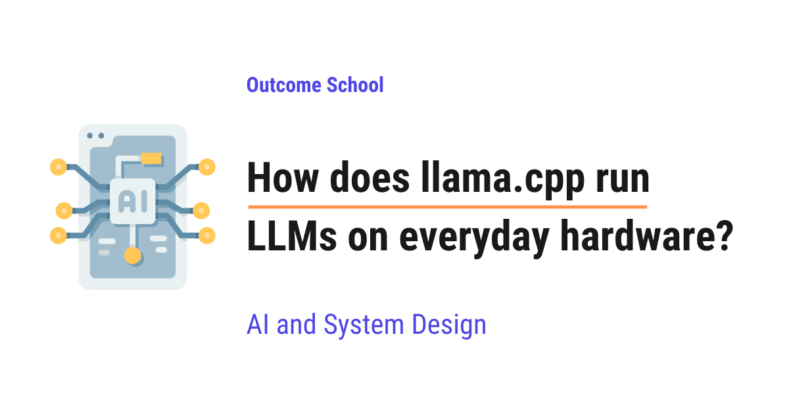

# How does llama.cpp run LLMs on everyday hardware?

> Archived from <https://outcomeschool.com/blog/how-does-llama-cpp-run-llms-on-everyday-hardware> on 2026-11-25.

llama.cpp is a program written in C++ that runs large language models on everyday hardware, like a normal laptop. It shrinks the model with quantization, loads it quickly, and shares the work between the CPU and the GPU.

In this blog, we will learn about how llama.cpp runs large language models on everyday hardware. We will also see what llama.cpp is, why it was created, how it shrinks huge models with quantization, how it loads them quickly, and how it shares work between the CPU and the GPU.

We will cover the following:
<ul><li>What is llama.cpp?</li><li>Why we needed llama.cpp</li><li>A quick refresher on what an LLM is</li><li>The real problem: models are too big to fit</li><li>The first big idea: quantization</li><li>Understanding names like Q4_K_M</li><li>The GGUF file: everything packed in one box</li><li>Memory mapping: loading the model the smart way</li><li>Squeezing speed out of the CPU</li><li>Sharing the work with the GPU</li><li>The full journey of running a prompt</li><li>Where llama.cpp is used</li></ul>
I am <strong>Amit Shekhar</strong>, Founder @ <a target="_blank" rel="noopener noreferrer" href="https://outcomeschool.com">Outcome School</a>, I have taught and mentored many developers, and their efforts landed them high-paying tech jobs, helped many tech companies in solving their unique problems, and created many open-source libraries being used by top companies. I am passionate about sharing knowledge through open-source, blogs, and videos.

I teach <a target="_blank" rel="noopener noreferrer" href="https://outcomeschool.com/program/ai-and-machine-learning">AI and Machine Learning</a> at Outcome School.

Let&#x27;s get started.
<h3 id="what-is-llamacpp">What is llama.cpp?</h3>
Let&#x27;s start with the name itself.

<strong>llama.cpp = llama + .cpp.</strong>

The word <strong>llama</strong> comes from LLaMA, which is the family of large language models first released by Meta. The part <strong>.cpp</strong> is the file ending used for programs written in the C++ programming language.

So, <strong>llama.cpp</strong> is a program, written mainly in C and C++, that runs large language models on our own computer.

In simple words, llama.cpp is a small, fast engine that lets us run a large language model on a normal laptop, without needing a giant server in a data center.

It was created by <strong>Georgi Gerganov</strong> in March 2023. His first goal was simple. He wanted to run Meta&#x27;s LLaMA model on an Apple Mac using only the regular processor, with no special hardware.

Today, llama.cpp is one of the most popular open-source projects in the world, with more than 120,000 stars on GitHub. It quietly powers many well-known local AI tools, such as <a target="_blank" rel="noopener noreferrer" href="how-does-ollama-work.md">Ollama</a> and LM Studio.
<h3 id="why-we-needed-llamacpp">Why we needed llama.cpp</h3>
Let&#x27;s understand the problem first. Then the solution will make sense.

When large language models became popular, there was a catch. Running them needed very expensive computers with powerful graphics cards and a huge amount of memory.

So, most people could only use these models through the internet, by sending their words to a company&#x27;s server far away.

This created three problems.
<ul><li><strong>Cost.</strong> Renting powerful servers is expensive.</li><li><strong>Privacy.</strong> Our private words had to leave our own device.</li><li><strong>Dependence.</strong> Without internet, nothing worked.</li></ul>
So, here comes llama.cpp to the rescue.

The idea was bold. What if we could run these models right on our own laptop, our own phone, or a cheap mini computer, using the hardware we already own?

That hardware is what we call <strong>everyday hardware</strong>, which means normal devices like laptops, desktops, and phones, not special data-center machines.

We have a detailed blog on <a target="_blank" rel="noopener noreferrer" href="cloud-vs-on-device-model-deployment.md">Cloud vs On-device Model Deployment</a> that explains this choice between a far-away server and our own device step by step.
<h3 id="a-quick-refresher-on-what-an-llm-is">A quick refresher on what an LLM is</h3>
Before we go deeper, we must understand what a large language model actually is. Do not worry, we will keep this simple.

An <strong>LLM</strong>, which is short for <strong>Large Language Model</strong>, is a model that has read an enormous amount of text and learned the patterns in language.

Its one main job is to guess the next word. We give it some words, and it predicts what word should come next. Then it adds that word and predicts the next one, again and again.

Inside the model are billions of numbers called <strong>weights</strong>. A <strong>weight</strong> is just a number the model learned during training. These weights are the model&#x27;s entire knowledge.

To produce each new word, the model does a huge amount of multiplication and addition using these weights. That is the heavy work llama.cpp has to handle.
<h3 id="the-real-problem-models-are-too-big-to-fit">The real problem: models are too big to fit</h3>
Now we reach the heart of the difficulty.

A model&#x27;s size is measured in <strong>parameters</strong>, which is just another word for those learned weights. For example, a model with <strong>7 billion</strong> parameters is often written as 7B.

Here is the problem. Each weight is normally stored as a number that takes up 2 or 4 bytes of memory.

Let&#x27;s do the simple math. A 7-billion-parameter model, with each weight taking 2 bytes, needs about 14 gigabytes of memory just to hold the weights. Many normal laptops have only 8 GB or 16 GB of total memory.

So, the model alone does not fit comfortably, and we still need room for everything else. This is the wall that stopped normal people from running these models.

<strong>Planning your move into AI?</strong>

No matter which tech domain you work in today, with your effort, you can transition to these roles:
<ul><li>AI Engineer</li><li>Forward Deployed Engineer</li><li>AI Agent Engineer</li><li>Harness Engineer</li><li>Voice AI Engineer</li><li>AI Architect</li><li>LLM Engineer</li><li>LLM Inference Engineer</li><li>Gen AI Engineer</li><li>MLOps Engineer</li><li>ML Engineer</li><li>Deep Learning Engineer</li></ul>
Our <a target="_blank" rel="noopener noreferrer" href="https://outcomeschool.com/program/ai-and-machine-learning">AI and Machine Learning Program</a> at Outcome School takes you there.

We needed a way to make the model much smaller without making it much worse. So, here comes the first big idea.
<h3 id="the-first-big-idea-quantization">The first big idea: quantization</h3>
The most important trick in llama.cpp is called <strong><a target="_blank" rel="noopener noreferrer" href="how-does-model-quantization-work.md">quantization</a></strong>.

<strong>Quantization</strong> means storing each weight using fewer bits, so the whole model takes much less memory.

A <strong>bit</strong> is the smallest piece of computer information. It is a single 0 or 1. The more bits we use for a number, the more precise but also the heavier it is.

Let&#x27;s say a weight is normally stored using 16 bits. Quantization can store it using only 4 bits. That is four times smaller.

Here is the clever part. We do not just chop off the number carelessly. llama.cpp works on the weights in small <strong>blocks</strong>, where each block holds a group of weights together.

For each block, it finds the largest weight, and uses it to create a shared <strong>scale factor</strong>. A <strong>scale factor</strong> is a single number that records how big the values in that block are. Then every weight in the block is squeezed down to a small 4-bit value, and the scale factor lets us bring it back close to its original size when needed.

Let&#x27;s see the idea as below:

<pre><code class="language-text code-highlight">   Original block (each weight stored big, 16 bits):
   [ 0.92,  -0.31,  0.78,  -0.55,  0.12,  ... 32 values ... ]
            |
            |  find the largest (0.92), make one shared scale factor
            |  scale = 0.92 / 7 = 0.13
            v
   Quantized block (each weight now tiny, 4 bits, -8 to 7):
   scale = 0.13
   [   7 ,   -2  ,   6 ,   -4  ,   1 ,  ... 32 values ... ]
            |
            |  to use a weight:  small value  x  scale
            |  7 x 0.13 = 0.91,  6 x 0.13 = 0.78,  -4 x 0.13 = -0.52
            v
   Restored value (close to the original, good enough)
</code></pre>

Here, we can see that a block of weights is squeezed into tiny 4-bit values plus one shared scale factor. With 4 bits, we only get 16 different values to work with, so we use the range -8 to 7. To use a weight, we multiply its tiny value by the scale to get back close to the original.

Here, we can also notice that we do not get back the exact number. The weight 0.92 comes back as 0.91, and -0.55 comes back as -0.52. This tiny difference is the precision we give up, and this is exactly what quantization costs us. The model becomes much smaller, and the answers stay almost as good.

A 7B model that needed about 14 GB can now fit in roughly 4 GB after 4-bit quantization. That is about 70 percent smaller. Now it fits on a normal laptop.

To learn Quantization, Model Compression, and Knowledge Distillation, check out our <a target="_blank" rel="noopener noreferrer" href="https://outcomeschool.com/program/ai-and-machine-learning">AI and Machine Learning Program</a> at Outcome School.
<h3 id="understanding-names-like-q4_k_m">Understanding names like Q4_K_M</h3>
When we download a model for llama.cpp, we often see names like <strong>Q4_K_M</strong>. This looks confusing, but it is simple once we break it down.

<strong>Q4_K_M = Q4 + K + M.</strong>
<ul><li><strong>Q4</strong> means each weight is stored using about 4 bits. A smaller number here means a smaller file. We could also see Q8, which uses about 8 bits and is more precise but larger.</li><li><strong>K</strong> means it uses the <strong>K-quant</strong> method that came with llama.cpp. We just saw that every small block keeps its own scale factor. But the scale factor is also a number, so it takes space too. So, K-quant groups many small blocks into a bigger <strong>super-block</strong> of 256 weights. The super-block keeps one main scale factor for the whole group, and each small block inside keeps only a tiny adjustment to it. It is like a company setting one base salary, where each person only needs a small plus or minus from that base. This way, the helper numbers cost very little space, and the accuracy still stays good.</li><li><strong>M</strong> means <strong>medium</strong>. This letter does not change the 4 in Q4. It only tells us how much of the model gets extra bits on top of that 4-bit base. Inside the model, the weights sit in big tables of numbers called <strong>tensors</strong>. Some tensors are more sensitive to quantization, which means squeezing them down hurts the quality more than it hurts the others. So, in Q4_K_M, these sensitive tensors are stored at 6 bits, while the rest of the model stays at 4 bits. This gives us better quality for only a small increase in file size. The other choice here is <strong>S</strong> for small, which keeps everything at 4 bits, so the file is a little smaller but usually a little less accurate.</li></ul>
So, Q4_K_M means a 4-bit, super-block model with a medium mix. It is the most popular choice because it stays small while keeping quality very close to the original.

For most everyday tasks, the quality drop is so small that we barely notice it.
<h3 id="the-gguf-file-everything-packed-in-one-box">The GGUF file: everything packed in one box</h3>
Now we need a way to store this quantized model in one neat package. That package is the <strong><a target="_blank" rel="noopener noreferrer" href="how-does-gguf-work.md">GGUF</a></strong> file.

<strong>GGUF</strong> is the file format used to store models that run on <strong>GGML</strong>. The name <strong>GGML</strong> comes from the small math library, written by the same author, that llama.cpp uses to do its number crunching. It replaced a few older formats that were harder to extend.

A <strong>GGUF</strong> file is a single file that holds everything needed to run the model. We do not need extra files scattered around.

A GGUF file packs in the following:
<ul><li>The <strong>quantized weights</strong>, which are the model&#x27;s knowledge in small form.</li><li>The <strong>architecture details</strong>, which describe how the model is built.</li><li>The <strong><a target="_blank" rel="noopener noreferrer" href="tokenization-in-llms.md">tokenizer</a></strong>, which is the part that breaks text into small pieces the model understands.</li><li>The <strong>quantization settings</strong>, so the program knows how to read the small weights.</li></ul>
Let&#x27;s see the box as below:

<pre><code class="language-text code-highlight">   +=================================================+
   |                  GGUF file                      |
   |              (one single file)                  |
   |                                                 |
   |   +-----------------------------------------+   |
   |   |  Quantized weights   (the knowledge)    |   |
   |   +-----------------------------------------+   |
   |   |  Architecture        (how it is built)  |   |
   |   +-----------------------------------------+   |
   |   |  Tokenizer           (text -&gt; tokens)   |   |
   |   +-----------------------------------------+   |
   |   |  Quantization settings (how to read it) |   |
   |   +-----------------------------------------+   |
   |                                                 |
   +=================================================+
</code></pre>

Here, we can see that one GGUF file holds everything in a single box. The quantized weights, the architecture details, the tokenizer, and the quantization settings all live together, so llama.cpp does not have to hunt for scattered files.

Because everything sits in one well-organized file, llama.cpp can open it and start working almost instantly. This neat packaging is one reason GGUF became the standard format for running models locally.

<strong>A quick note for you</strong>

No matter which tech domain you work in, get familiar with these topics:
<ul><li>LLM</li><li>RAG</li><li>MCP</li><li>Agent</li><li>Fine-tuning</li><li>Quantization</li></ul>
We put it all together in one video:

<a target="_blank" rel="noopener noreferrer" href="https://www.youtube.com/watch?v=lnfWvX66FUk">AI Engineering Explained: LLM, RAG, MCP, Agent, Fine-Tuning, and Quantization</a>

No need to stop reading - bookmark it and watch later when you get time. Future you will thank you.

Now, let&#x27;s get back to the topic.
<h3 id="memory-mapping-loading-the-model-the-smart-way">Memory mapping: loading the model the smart way</h3>
Even with a smaller file, loading a few gigabytes from the disk into memory could be slow. So, llama.cpp uses a clever trick called <strong>memory mapping</strong>, often written as <strong>mmap</strong>.

Normally, to use a file, a program copies the whole file from the slow disk into the fast memory first. For a large model, that copy takes time and uses a lot of memory.

<strong>Memory mapping</strong> is different. Instead of copying everything up front, the program tells the operating system to treat this file on disk as if it were already in memory. The system then loads only the parts that are actually needed, only when they are needed.

Let&#x27;s see the difference as below:

<pre><code class="language-text code-highlight">   Normal loading (slow start):
   Disk [ whole model ]  ===&gt; copy everything ===&gt; Memory [ whole model ]
                          (wait for the full copy before starting)

   Memory mapping (instant start):
   Disk [ whole model ]  ---- mapped ----&gt; looks like it is in Memory
                          |
                          v
   Only the needed pieces are pulled in, exactly when they are needed
   (start working right away)
</code></pre>

Here, we can see that normal loading copies the entire model from disk to memory before anything can begin, while memory mapping lets llama.cpp start at once and fetch only the pieces it actually needs, when it needs them.

Let&#x27;s say we start using the model. llama.cpp does not wait for the full file to load. It begins working right away, and the needed pieces are pulled in on demand.

This gives us two big wins. The model becomes ready to use almost immediately. And if the same model is opened by more than one program, they can share the same data in memory instead of each keeping its own copy.
<h3 id="squeezing-speed-out-of-the-cpu">Squeezing speed out of the CPU</h3>
Now the model fits and loads fast. But it still has to do billions of multiplications for every word. We must make that fast on a normal processor.

To get the most out of the CPU, llama.cpp uses a feature called <strong>SIMD</strong>.

<strong>SIMD</strong> stands for <strong>Single Instruction, Multiple Data</strong>. In simple words, it means doing the same operation on many numbers at the same time, instead of one by one.

Let&#x27;s say we need to multiply eight pairs of numbers. A simple program would do them one after another, eight steps. With SIMD, the CPU does all eight in a single step.

Modern CPUs offer SIMD through instruction sets with names like <strong>AVX</strong>, <strong>AVX2</strong>, <strong>AVX512</strong> on Intel and AMD chips, and <strong>NEON</strong> on Apple and ARM chips. llama.cpp is written in fast C and C++ and is carefully tuned to use whichever of these our CPU supports.

This careful tuning is a big reason llama.cpp can run models on plain CPUs at a usable speed, even without any graphics card.

At the other end of the spectrum, some chips are designed around this one job from the ground up, and we have a detailed blog on <a target="_blank" rel="noopener noreferrer" href="how-does-an-lpu-work.md">how an LPU works</a> that covers that approach end to end.

<strong>Stay updated:</strong> Subscribe to our <a target="_blank" rel="noopener noreferrer" href="https://outcomeschool.substack.com/subscribe">newsletter</a> to get our latest AI and Machine Learning blogs straight to your inbox.
<h3 id="sharing-the-work-with-the-gpu">Sharing the work with the GPU</h3>
Many everyday computers also have a <strong><a target="_blank" rel="noopener noreferrer" href="how-does-a-gpu-work-for-deep-learning.md">GPU</a></strong>, which stands for <strong>Graphics Processing Unit</strong>. A GPU is like a large team of small workers that do many calculations at the same time, which is perfect for the math an LLM needs.

The challenge is that a small GPU may not have enough memory to hold the whole model. So, llama.cpp does something flexible. It splits the model into <strong>layers</strong> and lets us choose how many layers to place on the GPU.

A <strong>layer</strong> is one stage of the model&#x27;s processing. A model is a stack of many layers, one after another.

We control this with a setting called <strong>gpu-layers</strong>. The more layers we move onto the GPU, the faster it runs, as long as the GPU has room. Whatever does not fit stays on the CPU.

Let&#x27;s see the split as below:

<pre><code class="language-text code-highlight">                 One large language model
                 split into many layers
   +---------------------------------------------------+
   |  Layer 1   Layer 2   Layer 3  ...  Layer N        |
   +---------------------------------------------------+
        |  (these fit in GPU memory)   |  (the rest)
        v                              v
   +----------------+           +----------------+
   |      GPU       |           |      CPU       |
   |  fast, many    |           |  flexible,     |
   |  workers       |           |  always there  |
   +----------------+           +----------------+
        \                              /
         \                            /
          v                          v
            Layers work together, in order,
            to produce the next word
</code></pre>

Here, we can see that the model is cut into layers, and we choose how many go to the GPU and how many stay on the CPU. The GPU handles its share quickly, the CPU handles the rest, and together they produce each word. This is why llama.cpp runs on so many kinds of machines. It works with Apple&#x27;s Metal, NVIDIA&#x27;s CUDA, the cross-platform Vulkan, AMD&#x27;s ROCm, and more, and it falls back to the CPU when there is no GPU at all.

If we want to go deep into LLM Inference Engineering and Cloud vs On-device Deployment, we cover these in our <a target="_blank" rel="noopener noreferrer" href="https://outcomeschool.com/program/ai-and-machine-learning">AI and Machine Learning Program</a> at Outcome School in depth.
<h3 id="the-full-journey-of-running-a-prompt">The full journey of running a prompt</h3>
Let&#x27;s now follow the complete journey from our question to the model&#x27;s answer, step by step.

<strong>Step 1:</strong> We start llama.cpp and point it at a GGUF file. The program reads the file using memory mapping, so it is ready almost instantly.

<strong>Step 2:</strong> We type a prompt, which is our question or instruction in plain text.

<strong>Step 3:</strong> The <strong>tokenizer</strong> breaks our text into small pieces called <strong>tokens</strong>. A <strong>token</strong> is a chunk of text, often a word or part of a word, turned into a number the model can work with.

<strong>Step 4:</strong> These tokens flow through the model&#x27;s layers. Each layer does its multiply-and-add math using the quantized weights, split across the CPU and GPU as we chose.

<strong>Step 5:</strong> The model produces a score for every possible next token. A step called <strong><a target="_blank" rel="noopener noreferrer" href="how-does-temperature-control-llm-output.md">sampling</a></strong> then picks one token from these scores, based on settings we control, like <a target="_blank" rel="noopener noreferrer" href="how-do-top-k-and-top-p-sampling-work.md">Top-k and Top-p</a>.

<strong>Step 6:</strong> The chosen token is turned back into text and shown to us right away. This instant showing is called <strong><a target="_blank" rel="noopener noreferrer" href="how-does-token-streaming-work.md">streaming</a></strong>, which is why we see the answer appear word by word.

<strong>Step 7:</strong> To keep things fast, llama.cpp saves its progress in a <strong><a target="_blank" rel="noopener noreferrer" href="kv-cache-in-llms.md">KV cache</a></strong>. The <strong>KV cache</strong> is a memory of the work already done for earlier tokens, so the model does not redo it for every new word.

<strong>Step 8:</strong> The new token is fed back in, and the cycle repeats, producing one token at a time, until the answer is complete.

Here is the full flow:

<pre><code class="language-text code-highlight">   GGUF file on disk
          |  memory mapping (loads instantly)
          v
   Our prompt (plain text)
          |  tokenizer breaks it into tokens
          v
   Tokens flow through the layers
   (math split across CPU + GPU, using quantized weights)
          |
          v
   Scores for every possible next token
          |  sampling picks one
          v
   Token turned back into text  ---&gt;  streamed to us
          |
          |  saved in the KV cache, fed back in
          +------------- repeats, one token at a time ----+
          |
          v
   Complete answer
</code></pre>

Here, we can see the data travels in a steady loop. Our text becomes tokens, the tokens pass through the layers, one new token comes out, it is shown to us, and the loop repeats until the full answer is ready. This is how a single question travels through llama.cpp on our own machine.

To master Tokenization, KV Cache, and Transformer Architecture, and to build a Large Language Model (LLM) from scratch, explore our <a target="_blank" rel="noopener noreferrer" href="https://outcomeschool.com/program/ai-and-machine-learning">AI and Machine Learning Program</a> at Outcome School.
<h3 id="where-llamacpp-is-used">Where llama.cpp is used</h3>
So, now we know how llama.cpp works. Let&#x27;s see where it is actually used.

llama.cpp has become the quiet engine inside many popular local AI tools. Tools like <strong>Ollama</strong> and <strong>LM Studio</strong>, which let people run chatbots on their own computers, are built on top of it.

It supports a wide range of modern models, such as Llama, Mistral, Qwen, and Gemma. It runs on Windows, Mac, and Linux computers, and even on phones and small single-board computers.

There is also a clear trade-off we must understand. A heavily quantized model is smaller and faster, but its answers can be slightly less accurate than the full model. We pick a balance, like Q4_K_M, based on our use case.

So, this is how llama.cpp runs large language models on everyday hardware. It shrinks a giant model with quantization, packs it into a single GGUF file, loads it instantly with memory mapping, runs the math quickly using the CPU&#x27;s SIMD power, shares the work with the GPU layer by layer, and produces the answer one token at a time, all on the device we already own.
<h2 id="frequently-asked-questions">Frequently Asked Questions</h2><h3 id="do-we-need-a-gpu-to-run-llamacpp">Do we need a GPU to run llama.cpp?</h3>
No. llama.cpp can run models on plain CPUs at a usable speed, even without any graphics card. It uses SIMD instructions like AVX and NEON to do many calculations at once. If a GPU is available, we can move some layers onto it for extra speed, and it falls back to the CPU when there is no GPU.
<h3 id="what-is-the-relation-between-llamacpp-and-ollama">What is the relation between llama.cpp and Ollama?</h3>
Ollama is built on top of llama.cpp. llama.cpp is the quiet engine inside many popular local AI tools, including Ollama and LM Studio. These tools let people run chatbots on their own computers, while llama.cpp does the actual work of running the model.
<h3 id="does-quantization-make-llamacpp-models-less-accurate">Does quantization make llama.cpp models less accurate?</h3>
Slightly. A heavily quantized model is smaller and faster, but its answers can be slightly less accurate than the full model, because the restored weights are close to the original but not exact. For most everyday tasks, the quality drop with a choice like Q4_K_M is so small that we barely notice it.
<h3 id="how-many-layers-should-we-put-on-the-gpu">How many layers should we put on the GPU?</h3>
We should move as many layers onto the GPU as its memory can hold. The more layers we place on the GPU with the gpu-layers setting, the faster the model runs. Whatever does not fit stays on the CPU, and the two work together to produce each word.
<h3 id="does-llamacpp-only-run-metas-llama-models">Does llama.cpp only run Meta&#x27;s LLaMA models?</h3>
No. llama.cpp started with the goal of running Meta&#x27;s LLaMA model on a Mac, but today it supports a wide range of modern models, such as Llama, Mistral, Qwen, and Gemma. It runs on Windows, Mac, and Linux, and even on phones and small single-board computers.

That&#x27;s it for now.

Thanks

<strong>Amit Shekhar</strong> Founder @ <a target="_blank" rel="noopener noreferrer" href="https://outcomeschool.com">Outcome School</a>

You can connect with me on:
<ul><li><a target="_blank" rel="noopener noreferrer" href="https://x.com/amitiitbhu">X</a></li><li><a target="_blank" rel="noopener noreferrer" href="https://www.linkedin.com/in/amit-shekhar-iitbhu">LinkedIn</a></li><li><a target="_blank" rel="noopener noreferrer" href="https://github.com/amitshekhariitbhu">GitHub</a></li></ul>
Follow Outcome School on:
<ul><li><a target="_blank" rel="noopener noreferrer" href="https://x.com/outcome_school">X</a></li><li><a target="_blank" rel="noopener noreferrer" href="https://youtube.com/@OutcomeSchool">YouTube</a></li><li><a target="_blank" rel="noopener noreferrer" href="https://www.linkedin.com/company/outcomeschool">LinkedIn</a></li><li><a target="_blank" rel="noopener noreferrer" href="https://github.com/OutcomeSchool">GitHub</a></li></ul>
<a target="_blank" rel="noopener noreferrer" href="https://outcomeschool.com/blog"><strong>Read all of our high-quality blogs here.</strong></a>

