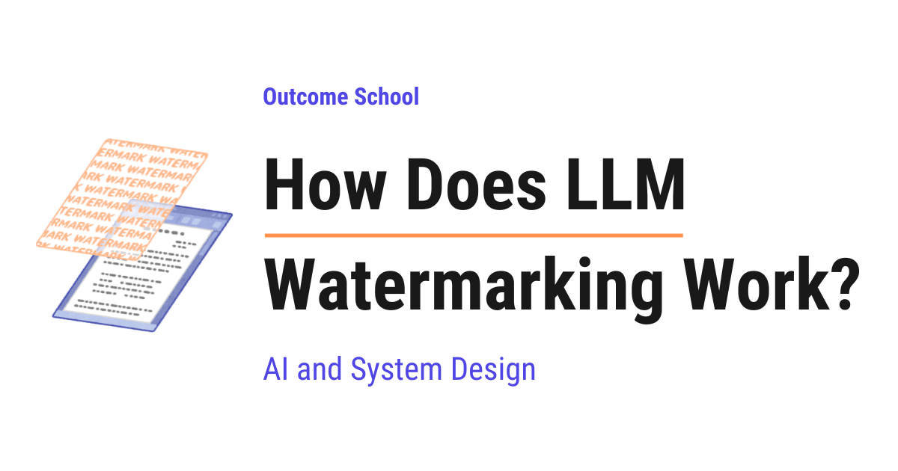

# How Does LLM Watermarking Work?

> Archived from <https://outcomeschool.com/blog/how-does-llm-watermarking-work> on 2026-11-25.

LLM watermarking is a hidden signal that a model quietly leaves inside the text it writes. A secret key slightly nudges which words the model picks, without changing the meaning, and a detector with the same key can find this pattern later.

In this blog, we will learn about how LLM watermarking works, the hidden signal that a model quietly leaves inside the text it writes. We will also see why we need it, how an LLM picks one token at a time, how a secret key silently changes those choices without touching the meaning, how a detector finds that hidden pattern later, why the quality of the text does not break, how it is different from an AI text detector, and where it works well and where it fails.

We will cover the following:
<ul><li>What is a watermark?</li><li>Why do we need a watermark in LLM-generated text?</li><li>How does an LLM write text?</li><li>How does an LLM choose the next word?</li><li>The hidden freedom that makes watermarking possible</li><li>Here comes the secret key into the picture</li><li>Preferred tokens and other tokens</li><li>Slightly changing the probabilities</li><li>Why the preferred set keeps changing</li><li>One token vs thousands of tokens</li><li>How does the detection work?</li><li>How is this different from an AI text detector?</li><li>Why the quality of the text does not break</li><li>What happens when someone edits the text?</li><li>Where is LLM watermarking used in the real world?</li><li>Advantages and disadvantages of LLM watermarking</li></ul>
I am <strong>Amit Shekhar</strong>, Founder @ <a target="_blank" rel="noopener noreferrer" href="https://outcomeschool.com">Outcome School</a>, I have taught and mentored many developers, and their efforts landed them high-paying tech jobs, helped many tech companies in solving their unique problems, and created many open-source libraries being used by top companies. I am passionate about sharing knowledge through open-source, blogs, and videos.

I teach <a target="_blank" rel="noopener noreferrer" href="https://outcomeschool.com/program/ai-and-machine-learning">AI and Machine Learning</a> at Outcome School.

Let&#x27;s get started.
<h3 id="what-is-a-watermark">What is a watermark?</h3>
Let&#x27;s start with something we have all seen.

Take a currency note in our hand and hold it against the light. We will see a hidden design inside the paper. That hidden design is called a <strong>watermark</strong>.

Here, we can notice two things.

First, the watermark is not printed on top of the note like normal ink. It is created inside the paper itself.

Second, we do not see it while using the note in our daily life. It shows up only when we hold the note against the light and look for it.

So, a watermark is a hidden mark that stays quiet until someone checks for it. It answers one simple question: who created this?

Now, LLM watermarking does the same job for text.

<strong>LLM Watermarking = LLM + Watermarking</strong>

In simple words, it means putting a hidden mark inside the text that an LLM writes.

But here is the catch. Text has no paper and no light. We cannot hide a design inside a sentence. So, the watermark has to be hidden somewhere else.

<strong>In LLM watermarking, the mark is hidden inside the choice of words.</strong>

Do not worry, we will understand exactly how this happens, step by step.
<h3 id="why-do-we-need-a-watermark-in-llm-generated-text">Why do we need a watermark in LLM-generated text?</h3>
Today, an LLM can write an essay, an email, an answer, a news article, or a review. And the text looks exactly like human writing.

So, the following question arises.

If someone shows us a piece of text, how do we know whether a human wrote it or a machine wrote it?

Let&#x27;s see a few real situations.

A student submits a homework assignment. The teacher wants to know whether the student wrote it.

A website receives thousands of product reviews. The company wants to know whether real customers wrote them.

A news article spreads on social media. People want to know whether a human reporter wrote it.

In all these cases, we need a way to check the source of the text.

We cannot solve this by just reading the text, because good LLM writing looks completely normal. We needed a solution for that, and here comes LLM watermarking to the rescue.

The idea is simple. While the LLM is writing the text, it quietly leaves a hidden signal inside the text. Later, anyone who has the secret key can check that signal.

Now, to understand how this signal is hidden, we must first understand how an LLM writes text.
<h3 id="how-does-an-llm-write-text">How does an LLM write text?</h3>
Before jumping into watermarking, we must know one very important thing.

<strong>An LLM generates one token at a time.</strong>

Now, the question is, what is a token?

A token is a small piece of text. Most of the time, a token is a word or a part of a word. For the sake of understanding, we can think of a token as a word.

The LLM does not write the full answer in one shot. It writes one token, then looks at everything written so far, then writes the next token, and it keeps doing this again and again until the answer is complete.

This way of writing is called autoregressive generation. We have a detailed blog on <a target="_blank" rel="noopener noreferrer" href="autoregressive-models.md">Autoregressive Models</a> that explains it in depth.

So, writing a paragraph of a few hundred words means the LLM made a few hundred separate decisions.

This is very important for us. Every one of those decisions is a chance to hide a signal.
<h3 id="how-does-an-llm-choose-the-next-word">How does an LLM choose the next word?</h3>
The best way to learn this is by taking an example.

Suppose the text written so far is:

<pre><code class="code-highlight">I am going to the ___
</code></pre>

Now, the LLM has to pick the next token.

Here, we must understand that the LLM does not directly give us one word. First, the LLM gives a probability to every possible next token.

For our example, it can look like below:

<pre><code class="code-highlight">office → 0.31
park   → 0.29
market → 0.22
gym    → 0.18
</code></pre>

Here, we can see that the LLM is telling us how likely each token is.

The number <code>0.31</code> for <code>office</code> means the model thinks there is a 31 percent chance that <code>office</code> is the right next token. The number <code>0.29</code> for <code>park</code> means a 29 percent chance, and so on.

After this, the model <a target="_blank" rel="noopener noreferrer" href="how-do-top-k-and-top-p-sampling-work.md">picks one token from this list</a>.

Without any watermark, the model picks the strongest option here.

<pre><code class="code-highlight">Without watermark → office
</code></pre>

So, the sentence becomes &quot;I am going to the office&quot;.

<strong>Note:</strong> The model does not always pick the token with the highest number. Sometimes it picks a lower one on purpose, so that the writing does not feel repetitive. But the higher the number, the higher the chance of getting picked. That part stays true always, and this is the only part we need for this blog.

To learn Tokenization, LLM Internals, and Transformer Architecture, and to build a Large Language Model (LLM) from scratch, check out our <a target="_blank" rel="noopener noreferrer" href="https://outcomeschool.com/program/ai-and-machine-learning">AI and Machine Learning Program</a> at Outcome School.
<h3 id="the-hidden-freedom-that-makes-watermarking-possible">The hidden freedom that makes watermarking possible</h3>
Now, let&#x27;s look at those numbers once again.

<pre><code class="code-highlight">office → 0.31
park   → 0.29
market → 0.22
gym    → 0.18
</code></pre>

Here, we can notice something very interesting.

The gap between <code>office</code> at <code>0.31</code> and <code>park</code> at <code>0.29</code> is very small.

And more importantly, all four sentences are perfectly correct.

<pre><code class="code-highlight">I am going to the office
I am going to the park
I am going to the market
I am going to the gym
</code></pre>

If we read any one of these, nothing feels wrong. No grammar mistake. No strange meaning. Nobody would notice anything.

<strong>This small freedom is exactly where the watermark lives.</strong>

Means, at most of the steps, the LLM has many good options and no single option is the only correct one. So, we can gently push the model towards some of those good options without damaging the text.

Now, the next big question is: which options should we push?

If we always push the same words, people would notice a strange repeated style. So, the choice must look random. But at the same time, we must be able to reproduce the same choice later during the check, otherwise we can never detect the watermark.

So, how can we get something that looks random but can be reproduced? The answer is the secret key.
<h3 id="here-comes-the-secret-key-into-the-picture">Here comes the secret key into the picture</h3>
<strong>The secret key is used as a seed to create a random-looking but reproducible selection of tokens.</strong>

Let&#x27;s understand the word <strong>seed</strong> with a simple example.

Suppose we have a deck of cards and a shuffling machine. We give the machine a number, and the machine shuffles the deck based on that number.

If we give the number <code>7</code>, the machine produces a particular order of cards. The order looks completely shuffled to us.

Now, if we give the number <code>7</code> again to a second machine with a fresh deck, we get exactly the same order again.

So, the number <code>7</code> is the seed. Here, we have got two things at the same time.
<ul><li>The result looks random to anyone who does not know the seed.</li><li>The result can be produced again by anyone who knows the seed.</li></ul>
This is exactly what the secret key does in LLM watermarking. The company that owns the model keeps this key private.

<strong>Planning your move into AI?</strong>

No matter which tech domain you work in today, with your effort, you can transition to these roles:
<ul><li>AI Engineer</li><li>Forward Deployed Engineer</li><li>AI Agent Engineer</li><li>Harness Engineer</li><li>Voice AI Engineer</li><li>AI Architect</li><li>LLM Engineer</li><li>LLM Inference Engineer</li><li>Gen AI Engineer</li><li>MLOps Engineer</li><li>ML Engineer</li><li>Deep Learning Engineer</li></ul>
Our <a target="_blank" rel="noopener noreferrer" href="https://outcomeschool.com/program/ai-and-machine-learning">AI and Machine Learning Program</a> at Outcome School takes you there.
<h3 id="preferred-tokens-and-other-tokens">Preferred tokens and other tokens</h3>
Before jumping into this part, we must know one more word: <strong>vocabulary</strong>.

The vocabulary is the full list of every token the model is allowed to write. Think of it as the dictionary of the model. A real model has around fifty thousand to a few hundred thousand tokens in its vocabulary.

We have a detailed blog on <a target="_blank" rel="noopener noreferrer" href="bpe-in-llms.md">Byte Pair Encoding in LLMs</a> that explains how this vocabulary is built in the first place.

Now, let&#x27;s come back to our example.

The model is about to pick the next token after &quot;I am going to the&quot;. At this exact step, the algorithm uses the secret key and splits the whole vocabulary into two groups.

For this particular step, the algorithm divides the vocabulary into two groups like below:

<pre><code class="code-highlight">Preferred tokens: park, market, school...
Other tokens:     office, gym, house...
</code></pre>

<strong>Note:</strong> This split has nothing to do with meaning or quality. It is not that <code>park</code> is a better word than <code>office</code>. It is more like a coin toss for every word in the vocabulary, and the secret key decides the result of every toss. The words simply landed on different sides.

In research papers, these two groups are called the green list and the red list. The name does not matter. The idea is the same. One group gets a small push, and the other group does not.
<h3 id="slightly-changing-the-probabilities">Slightly changing the probabilities</h3>
Now, we have the original probabilities from the LLM, and we have the two groups.

The LLM&#x27;s original probabilities are then slightly modified. The preferred tokens get a small boost, and the other tokens go down a little.

For example:

<pre><code class="code-highlight">office → 0.31 → 0.25
park   → 0.29 → 0.36
market → 0.22 → 0.25
gym    → 0.18 → 0.14
</code></pre>

Here, we can see what happened.

<code>park</code> and <code>market</code> are preferred tokens, so their numbers went up.

<code>office</code> and <code>gym</code> are other tokens, so their numbers went down.

And the order changed. Earlier <code>office</code> was on top with <code>0.31</code>. Now <code>park</code> is on top with <code>0.36</code>.

One more thing to notice. In both the lists, the four numbers add up to 1. The boost did not create anything extra. It only moved a little probability from the other tokens to the preferred tokens.

Now the model picks <code>park</code>.

So, the sentence becomes &quot;I am going to the park&quot;.

And this sentence is completely normal. A reader has no way to feel that anything special happened here. The text reads exactly like ordinary writing.

Here, we must also know that the size of the push is a setting we can control.

A bigger push makes the watermark easier to detect, but it pulls the model away from its best words more often, so the quality drops. A smaller push keeps the writing better, but then we need a longer text before the pattern becomes clear.

So, there is a trade-off here, and we choose the value based on our use case.
<h3 id="why-the-preferred-set-keeps-changing">Why the preferred set keeps changing</h3>
The important part is:

<strong>The secret key does NOT permanently mark <code>park</code> as preferred.</strong>

At the next token, the key plus the current context can produce a different preferred set. In that new set, <code>park</code> can easily land in the other group and <code>office</code> can land in the preferred group.

So, the process keeps changing at every single step.

<pre><code class="code-highlight">Secret key + context → preferred token set → small probability boost → next token
</code></pre>

Let&#x27;s read this flow once more, because this is the heart of LLM watermarking.

<strong>Secret key + context:</strong> At every step, the algorithm mixes the secret key with the text written so far.

<strong>Preferred token set:</strong> This mix decides which words are preferred at this exact step.

<strong>Small probability boost:</strong> The preferred words get a gentle push in their probability.

<strong>Next token:</strong> The model picks a token from these modified probabilities, and this new token becomes part of the context for the next step.

Then the whole cycle runs again for the next token, with a fresh preferred set.

This is why the watermarked text does not develop any visible habit. There is no fixed word that keeps coming back again and again. The preferred group is different at every step, so nothing repeats in a way that a reader can catch.

And there is one more reason, and it is a very important one.

Suppose the preferred group was fixed forever. Then anyone could generate a lot of text from the model, count which words keep coming a little too often, and slowly figure out the whole preferred group. After that, they could remove the watermark, or even worse, they could add a fake watermark to their own text and blame the model for it.

Because the group changes at every step, this attack does not work. Without the secret key, an outsider only sees ordinary words in an ordinary order.

<strong>A quick note for you</strong>

No matter which tech domain you work in, get familiar with these topics:
<ul><li>LLM</li><li>RAG</li><li>MCP</li><li>Agent</li><li>Fine-tuning</li><li>Quantization</li></ul>
We put it all together in one video:

<a target="_blank" rel="noopener noreferrer" href="https://www.youtube.com/watch?v=lnfWvX66FUk">AI Engineering Explained: LLM, RAG, MCP, Agent, Fine-Tuning, and Quantization</a>

No need to stop reading - bookmark it and watch later when you get time. Future you will thank you.

Now, let&#x27;s get back to the topic.
<h3 id="one-token-vs-thousands-of-tokens">One token vs thousands of tokens</h3>
Now, let&#x27;s ask the most natural question.

If the change at each step is so small, how can it ever be detected?

The answer is in the numbers.

One token → tiny change → looks completely normal.

But across thousands of tokens, preferred tokens appear more often than they would by chance.

Let&#x27;s understand this with a coin.

Suppose we toss a fair coin 10 times and we get 6 heads. Nobody will find this strange. This happens all the time.

Now, suppose we toss the same coin 10,000 times and we get 8,000 heads. Now we know something is going on. A fair coin cannot behave like this. The number is too far from what luck can produce.

The same thing happens in watermarked text.

For any normal text written by a human or by a model without a watermark, roughly half of the tokens will fall in the preferred group and roughly half will fall in the other group. That is what pure chance gives us, because the split itself was like a coin toss.

But in watermarked text, the preferred group keeps getting a small push at every step. So, far more than half of the tokens end up in the preferred group.

Let&#x27;s put some numbers on it. Suppose we have a text of 1000 tokens.

If the text has no watermark, around 500 tokens will fall in the preferred group. It can be 480 or 520, because chance is never exact.

If the text has a watermark, we can see something like 750 tokens in the preferred group.

Now, 750 out of 1000 is not something luck can produce. Getting that number by pure chance is like tossing a fair coin 1000 times and getting 750 heads. It simply does not happen.

For one sentence, this difference means nothing. For a long paragraph, this difference becomes very hard to explain by luck.

This creates a statistical pattern.

Here, the word <strong>statistical</strong> simply means a pattern that cannot be seen in one place. We can find it only by counting over a large amount of text.

And that pattern is our watermark.
<h3 id="how-does-the-detection-work">How does the detection work?</h3>
Now that we have learned how the watermark is added, it is time to learn how it is detected.

The flow is like below:

<pre><code class="code-highlight">Generated text → watermark detector → uses the secret key → checks the statistical pattern → Watermark detected
</code></pre>

Let&#x27;s go through it step by step.

<strong>Step 1:</strong> We give the text to the detector. The detector breaks the text into tokens, the same small pieces the model works with.

<strong>Step 2:</strong> The detector goes to the first token and looks at the context before it. Using the secret key and that context, the detector rebuilds the exact same preferred set that was used at that step. This is possible because the secret key is a seed, and the same seed with the same context always gives the same result.

<strong>Step 3:</strong> The detector checks whether this token belongs to the preferred group or to the other group, and keeps a count.

<strong>Step 4:</strong> The detector moves to the next token and repeats the same thing, and it keeps going till the end of the text.

<strong>Step 5:</strong> At the end, the detector compares the count with what pure chance would give. If the number of preferred tokens is close to half, the text has no watermark. If the number is far above half, the watermark is there.

Now, we have understood the detection.

Here, we must notice a few very important points.
<ul><li>The detector does not need the LLM. It only needs the text and the secret key.</li><li>The detector does not need the original prompt.</li><li>The detector does not need a stored copy of the generated text anywhere. Nothing is saved in a database. The proof is inside the text itself.</li><li>The detector gives a confidence. It can say how unlikely this pattern is by chance, which makes the answer measurable.</li></ul>
One more thing to notice. The detector counts token by token, so it can also work on a part of the text. Suppose a student wrote half of the essay and the model wrote the other half. The detector can show that the pattern is strong in one part and absent in the other part.

But the detector does need the secret key.

This is a very important limitation. We cannot check a piece of text on our own. Only the company that owns the model, or someone they trust with the key, can run this check. And the moment the key leaks, anyone can strip the watermark or fake it, so the whole system depends on keeping that key safe.

This is how a watermark detector works.
<h3 id="how-is-this-different-from-an-ai-text-detector">How is this different from an AI text detector?</h3>
Many of us must have used a tool that claims to tell whether a text was written by AI. Let&#x27;s see how that is different from what we have learned here.

An AI text detector only reads the final text and guesses. It looks at the writing style, the sentence length, how predictable the words are, and things like that. Nobody gave it any secret. It is making an educated guess from the outside.

A watermark detector does not guess. The mark was placed inside the text on purpose while the text was being written, and the detector opens it with the secret key.

Let me tabulate the differences between the two for your better understanding.
<table><thead><tr><th>AI text detector</th><th>Watermark detector</th></tr></thead><tbody><tr><td>Reads the final text and guesses from the style</td><td>Reads the hidden signal that was planted on purpose</td></tr><tr><td>Needs no key and no help from the model owner</td><td>Needs the secret key of the model owner</td></tr><tr><td>Works on text from any model</td><td>Works only on text from a model that added the watermark</td></tr><tr><td>Often marks human writing as AI writing by mistake</td><td>Gives a measurable chance of a mistake</td></tr></tbody></table>
So, both have their place. The watermark detector is far more reliable, but it works only where the model owner has already done the work of adding the watermark.

If we want to go deep into Evaluation of LLMs and Agents, and LLM as a Judge, check out our <a target="_blank" rel="noopener noreferrer" href="https://outcomeschool.com/program/ai-and-machine-learning">AI and Machine Learning Program</a> at Outcome School, where we cover them end to end.
<h3 id="why-the-quality-of-the-text-does-not-break">Why the quality of the text does not break</h3>
Now, one doubt must be coming to our mind.

If we are pushing the model away from its best answer, are we not making the text worse?

Let&#x27;s understand this carefully.

The push is very small. Look at our example once again. <code>office</code> went from <code>0.31</code> to <code>0.25</code>, and <code>park</code> went from <code>0.29</code> to <code>0.36</code>. The model still picked a word that it already considered a good option. It just picked the second good option instead of the first one.

And there is one more thing. In many places, the model has almost no freedom at all.

For example, consider the text &quot;The capital of France is ___&quot;. Here, the model gives something like below:

<pre><code class="code-highlight">Paris → 0.99
Lyon  → 0.004
Nice  → 0.003
</code></pre>

Here, <code>Paris</code> is at <code>0.99</code>. A small boost to some other token cannot beat <code>0.99</code>. So, the model still writes <code>Paris</code>.

This is very good for us. Where the answer must be a fact, the watermark stays out of the way. Where the model genuinely has many equally good options, the watermark does its work.

<strong>So, the watermark takes its space only from the freedom that the model already had.</strong>

This also tells us something about short text. If the text is only a few words long, there were very few free choices, so there is very little pattern to measure. A watermark detector needs enough tokens to be confident. Short text is hard to check, and long text is easy to check.

<strong>Stay updated:</strong> Subscribe to our <a target="_blank" rel="noopener noreferrer" href="https://outcomeschool.substack.com/subscribe">newsletter</a> to get our latest AI and Machine Learning blogs straight to your inbox.
<h3 id="what-happens-when-someone-edits-the-text">What happens when someone edits the text?</h3>
This is a very practical question. Let&#x27;s see a few cases.

<strong>Case 1: Changing a few words.</strong> Suppose someone changes ten words in a long article. The remaining hundreds of tokens still carry the pattern. The detector will still find the watermark, with slightly less confidence.

<strong>Case 2: Rewriting every sentence in different words.</strong> Now, most of the tokens are new choices made by a human or by another model. Those new tokens know nothing about our secret key, so they land in the preferred group only by chance. The pattern becomes much weaker, and the detector can miss the watermark.

<strong>Case 3: Translating the text into another language.</strong> Almost every token changes. The watermark is mostly gone.

So, the honest summary is:
<ul><li>LLM watermarking is good against small edits.</li><li>LLM watermarking is weak against heavy rewriting and translation.</li><li>LLM watermarking works only when the model owner adds it, so text from a model without a watermark can never be caught this way.</li></ul>
This is why we must treat watermarking as one useful signal, and not as a final proof.
<h3 id="where-is-llm-watermarking-used-in-the-real-world">Where is LLM watermarking used in the real world?</h3>
Now, let&#x27;s take a real use case.

Google DeepMind built a system called <strong>SynthID</strong>, and one part of it, SynthID-Text, does exactly what we have learned in this blog. It changes the token selection slightly while the model writes, and a detector with the key can check the text later.

The same idea is used beyond text too. For images, audio, and video, a hidden signal is placed inside the pixels or inside the sound in a way that our eyes and ears cannot catch, but a detector can. We have a detailed blog on <a target="_blank" rel="noopener noreferrer" href="multimodal-ai.md">Multimodal AI</a> that covers how models work across all of these together.

So, the core idea stays the same everywhere. Hide a signal in the small choices that nobody notices, and read it back later with the key.
<h3 id="advantages-and-disadvantages-of-llm-watermarking">Advantages and disadvantages of LLM watermarking</h3>
Let&#x27;s see the advantages and disadvantages of LLM watermarking.

<strong>Advantages:</strong>
<ul><li>The text quality stays almost the same.</li><li>Nothing needs to be stored in any database.</li><li>The detection gives a measurable confidence, not a guess.</li><li>The reader sees completely normal text.</li></ul>
<strong>Disadvantages:</strong>
<ul><li>Heavy rewriting or translation removes the pattern.</li><li>Short text cannot be checked with confidence.</li><li>The secret key must be protected, because leaking it breaks everything.</li><li>It works only for models that chose to add a watermark.</li></ul>
So, now we know where we can use LLM watermarking and where we must be careful.
<h3 id="summary">Summary</h3>
Let&#x27;s recall everything in a short form.

An LLM writes one token at a time. At every step, it gives a probability to every possible next token, and then it picks one.

At most of those steps, many different tokens would give perfectly good text. This freedom is where the watermark lives.

The secret key acts as a seed. At every step, the key plus the current context splits the vocabulary into preferred tokens and other tokens. The preferred tokens get a small boost in their probability.

The preferred set is not fixed. It changes at every single step, so the text never develops a visible habit.

One token gets a tiny change, so nothing looks unusual. Thousands of tokens together produce far more preferred tokens than chance allows, and this becomes a statistical pattern.

The detector takes the text and the secret key, rebuilds the preferred set at every step, counts the preferred tokens, and compares the count with chance.

So, the watermark is not a visible mark.

It is a statistical pattern created by slightly changing the probability of which tokens get selected.

Now we must have understood how LLM watermarking works.
<h2 id="frequently-asked-questions">Frequently Asked Questions</h2><h3 id="can-anyone-check-whether-a-text-has-an-llm-watermark">Can anyone check whether a text has an LLM watermark?</h3>
No. The detector needs the secret key of the model owner. Only the company that owns the model, or someone they trust with the key, can run this check. If the key leaks, anyone can strip the watermark or fake it, so the whole system depends on keeping that key safe.
<h3 id="does-the-watermark-detector-need-the-original-prompt-or-a-saved-copy-of-the-text">Does the watermark detector need the original prompt or a saved copy of the text?</h3>
No. The detector does not need the LLM, the original prompt, or any stored copy of the generated text. It only needs the text and the secret key. The proof is inside the text itself, so nothing has to be saved in a database.
<h3 id="can-llm-watermarking-catch-text-from-any-ai-model">Can LLM watermarking catch text from any AI model?</h3>
No. LLM watermarking works only when the model owner adds it while the text is being written. Text from a model without a watermark can never be caught this way. An AI text detector works on text from any model, but it only guesses from the writing style.
<h3 id="can-a-watermark-detector-find-ai-written-parts-inside-a-mixed-text">Can a watermark detector find AI-written parts inside a mixed text?</h3>
Yes. The detector counts token by token, so it can also work on a part of the text. Suppose a student wrote half of an essay and the model wrote the other half. The detector can show that the pattern is strong in one part and absent in the other part.
<h3 id="is-an-llm-watermark-a-final-proof-that-ai-wrote-the-text">Is an LLM watermark a final proof that AI wrote the text?</h3>
No. We must treat watermarking as one useful signal, not as a final proof. It is good against small edits, but heavy rewriting and translation can remove the pattern, and short text cannot be checked with confidence. The detector gives a measurable confidence rather than a certain answer.

That&#x27;s it for now.

Thanks

<strong>Amit Shekhar</strong> Founder @ <a target="_blank" rel="noopener noreferrer" href="https://outcomeschool.com">Outcome School</a>

You can connect with me on:
<ul><li><a target="_blank" rel="noopener noreferrer" href="https://x.com/amitiitbhu">X</a></li><li><a target="_blank" rel="noopener noreferrer" href="https://www.linkedin.com/in/amit-shekhar-iitbhu">LinkedIn</a></li><li><a target="_blank" rel="noopener noreferrer" href="https://github.com/amitshekhariitbhu">GitHub</a></li></ul>
Follow Outcome School on:
<ul><li><a target="_blank" rel="noopener noreferrer" href="https://x.com/outcome_school">X</a></li><li><a target="_blank" rel="noopener noreferrer" href="https://youtube.com/@OutcomeSchool">YouTube</a></li><li><a target="_blank" rel="noopener noreferrer" href="https://www.linkedin.com/company/outcomeschool">LinkedIn</a></li><li><a target="_blank" rel="noopener noreferrer" href="http://github.com/OutcomeSchool">GitHub</a></li></ul>
<a target="_blank" rel="noopener noreferrer" href="https://outcomeschool.com/blog"><strong>Read all of our high-quality blogs here.</strong></a>

