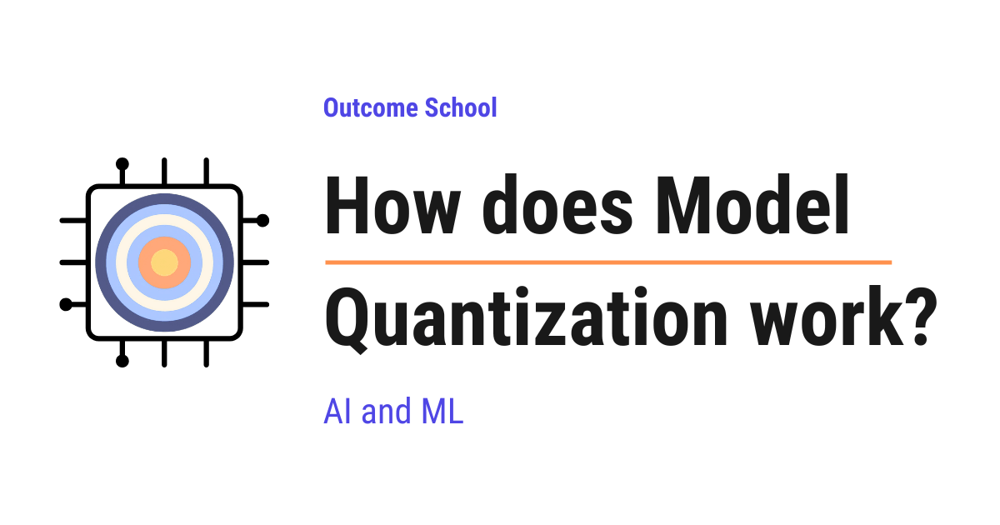

# How does Model Quantization work?

> Archived from <https://outcomeschool.com/blog/how-does-model-quantization-work> on 2026-11-25.

Model Quantization is the process of storing and computing a model&#x27;s numbers at lower precision, so that the model takes less memory and runs faster. In simple words, we use smaller, simpler numbers in place of big, detailed numbers.

In this blog, we will learn about how Model Quantization works. We will also see why we need it, how it shrinks big AI models, and how it lets us run them on a laptop, a phone, or a single GPU.

We will cover the following:
<ul><li>What is Model Quantization?</li><li>How numbers use bits (FP32, INT8, INT4)</li><li>Why fewer bits means less memory and faster speed</li><li>The core mechanic: scale and zero-point</li><li>Symmetric vs Asymmetric Quantization</li><li>Per-tensor vs Per-channel Quantization</li><li>Post-Training Quantization (PTQ) vs Quantization-Aware Training (QAT)</li><li>Weight-only vs Weight-and-activation Quantization</li><li>The outlier problem in LLMs</li><li>Popular methods: GPTQ, AWQ, bitsandbytes, GGUF / llama.cpp</li><li>The accuracy trade-off and running LLMs locally</li><li>Wrapping up Model Quantization</li></ul>
I am <strong>Amit Shekhar</strong>, Founder @ <a target="_blank" rel="noopener noreferrer" href="https://outcomeschool.com">Outcome School</a>, I have taught and mentored many developers, and their efforts landed them high-paying tech jobs, helped many tech companies in solving their unique problems, and created many open-source libraries being used by top companies. I am passionate about sharing knowledge through open-source, blogs, and videos.

I teach <a target="_blank" rel="noopener noreferrer" href="https://outcomeschool.com/program/ai-and-machine-learning">AI and Machine Learning</a> at Outcome School.

Let&#x27;s get started.
<h3 id="what-is-model-quantization">What is Model Quantization?</h3>
<strong>Model Quantization is the process of storing and computing a model&#x27;s numbers at lower precision, so the model takes less memory and runs faster.</strong>

In simple words, quantization means we use smaller, simpler numbers in place of big, detailed numbers.

Before we go deeper, let&#x27;s understand one basic thing. An AI model is, at its heart, just a huge collection of numbers. These numbers are called <strong>weights</strong>. A model learns by adjusting these weights during training. A large language model can have billions of such numbers.

Normally, each of these numbers is stored in a very detailed, high-precision form. Quantization takes these detailed numbers and rounds them into a much simpler form. For example, we go from a detailed decimal number like <code>0.7319284</code> to a plain whole number like <code>94</code>. The whole number may look bigger, but it needs far fewer bits to store, and that is what makes the model smaller.

Let&#x27;s say we have a high-resolution photo that takes a lot of space on our phone. We compress it into a smaller file. The photo still looks almost the same, but it now takes far less space. Quantization does the same thing to a model. We make it smaller while trying to keep it almost as good.

This is the basic idea. Now, to truly understand how it works, we must first understand how numbers are stored using bits.
<h3 id="how-numbers-use-bits-fp32-int8-int4">How numbers use bits (FP32, INT8, INT4)</h3>
A computer stores everything using <strong>bits</strong>. A bit is the smallest piece of information. It can be only <code>0</code> or <code>1</code>.

To store a number, the computer uses a group of bits. More bits means we can store a more detailed and more precise number. Fewer bits means a simpler number with less detail.

Let&#x27;s see the common formats used in AI models.

<strong>FP32</strong> means a floating-point number that uses 32 bits. &quot;Floating-point&quot; is just the computer&#x27;s way of storing numbers with a decimal part, such as <code>0.7319284</code> or <code>-12.55</code>. FP32 is very precise. It can store very large, very small, and very detailed values. This is the format most models use during training.

<strong>FP16</strong> and <strong>BF16</strong> use 16 bits. These store decimal numbers too, but with less detail than FP32. They are half the size of FP32.

<strong>INT8</strong> means an integer that uses 8 bits. &quot;Integer&quot; means a whole number with no decimal part, such as <code>94</code> or <code>-12</code>. With 8 bits, we can store only 256 different values, from <code>-128</code> to <code>127</code>.

<strong>INT4</strong> means an integer that uses only 4 bits. With 4 bits, we can store just 16 different values.

Let&#x27;s put the sizes side by side for our better understanding.
<table><thead><tr><th>Format</th><th>Bits</th><th>What it stores</th><th>Detail level</th></tr></thead><tbody><tr><td>FP32</td><td>32</td><td>decimals, very precise</td><td>very high</td></tr><tr><td>FP16</td><td>16</td><td>decimals, less precise</td><td>high</td></tr><tr><td>BF16</td><td>16</td><td>decimals, wide range</td><td>high</td></tr><tr><td>INT8</td><td>8</td><td>whole numbers, 256 values</td><td>low</td></tr><tr><td>INT4</td><td>4</td><td>whole numbers, 16 values</td><td>very low</td></tr></tbody></table>
Here, we can see that as we go down the list, the number of bits drops. Fewer bits means each number is simpler and takes less space. This is the key idea behind why quantization saves so much.
<h3 id="why-fewer-bits-means-less-memory-and-faster-speed">Why fewer bits means less memory and faster speed</h3>
Now that we understand bits, let&#x27;s see why fewer bits help us so much.

<strong>Less memory.</strong> Each weight in FP32 takes 32 bits, which is 4 bytes. The same weight in INT8 takes 8 bits, which is 1 byte. So INT8 is 4 times smaller. INT4 is 8 times smaller than FP32.

Let&#x27;s say a model has 7 billion weights. In FP32, that needs <a target="_blank" rel="noopener noreferrer" href="llm-gpu-memory.md">about 28 GB of memory</a>. The same model in INT8 needs about 7 GB. In INT4, it needs only about 3.5 GB. So, a model that did not fit on our machine now fits on a single <a target="_blank" rel="noopener noreferrer" href="how-does-a-gpu-work-for-deep-learning.md">GPU</a>, or even runs on a good laptop.

We can picture the shrink for a 7-billion-weight model as below:

<pre><code class="code-highlight">FP32  (4 bytes each)  +--------------------------------+  about 28 GB
INT8  (1 byte each)   +--------+                          about  7 GB
INT4  (half byte each)+----+                              about 3.5 GB
</code></pre>

Here, we can see that the same model gets dramatically smaller as we use fewer bits per weight. The shape of the model does not change, only the size of each number does. This is what turns a model that needed a data-center into one that fits on our own machine.

<strong>Faster speed.</strong> Smaller numbers move faster. When a model runs, the computer constantly reads weights from memory and does math on them. Moving 1 byte is much faster than moving 4 bytes. On top of that, integer math is often faster than decimal math on many chips. So the model not only fits better, it also runs quicker and uses less power.

This is why quantization comes into the picture. We get a smaller model, faster answers, and lower cost. The price we pay is a small loss of accuracy, and we will discuss that trade-off later.

<strong>Planning your move into AI?</strong>

No matter which tech domain you work in today, with your effort, you can transition to these roles:
<ul><li>AI Engineer</li><li>Forward Deployed Engineer</li><li>AI Agent Engineer</li><li>Harness Engineer</li><li>Voice AI Engineer</li><li>AI Architect</li><li>LLM Engineer</li><li>LLM Inference Engineer</li><li>Gen AI Engineer</li><li>MLOps Engineer</li><li>ML Engineer</li><li>Deep Learning Engineer</li></ul>
Our <a target="_blank" rel="noopener noreferrer" href="https://outcomeschool.com/program/ai-and-machine-learning">AI and Machine Learning Program</a> at Outcome School takes you there.

Now, the big question is: how do we actually turn a detailed FP32 number into a small INT8 number without losing everything? Let&#x27;s understand the core mechanic.
<h3 id="the-core-mechanic-scale-and-zero-point">The core mechanic: scale and zero-point</h3>
This is the heart of quantization, so let&#x27;s go slowly.

Our weights are decimal numbers spread across some range, for example from <code>-1.0</code> to <code>1.0</code>. We want to map every number in that range onto a small set of integers, for example the 256 values that INT8 can hold.

To do this, we use two helper values. They are the <strong>scale</strong> and the <strong>zero-point</strong>.

The <strong>scale</strong> tells us how much real value each integer step represents. It is the size of one step.

The <strong>zero-point</strong> is the integer that represents the real value zero.

In simple words, the scale stretches or squeezes the integers to cover our range, and the zero-point shifts them so they line up correctly.

The formula to go from a real number to an integer is below:

<pre><code class="code-highlight">quantized_int = round(real_value / scale) + zero_point
</code></pre>

And to get back an approximate real number from the integer, we use the formula below:

<pre><code class="code-highlight">real_value ≈ (quantized_int - zero_point) * scale
</code></pre>

Here, we can see that quantizing and then de-quantizing does not give us the exact original number back. We get something close. That small difference is the rounding error, and it is the source of accuracy loss.

Let&#x27;s take a concrete example to make this real.

Suppose our weights range from <code>-1.0</code> to <code>1.0</code>, and we want to map them into INT8 values from <code>0</code> to <code>255</code>. Remember, INT8 gives us 256 slots, and here we are simply labelling them from <code>0</code> to <code>255</code>.

<strong>Step 1:</strong> The full range is <code>1.0 - (-1.0) = 2.0</code>. We have 255 steps available. So the scale is <code>2.0 / 255 ≈ 0.00784</code>.

<strong>Step 2:</strong> The real value zero must map to the middle, so the zero-point is about <code>128</code>.

<strong>Step 3:</strong> Now take a real weight <code>0.5</code>. We compute <code>round(0.5 / 0.00784) + 128 = round(63.7) + 128 = 64 + 128 = 192</code>.

<strong>Step 4:</strong> To read it back, we compute <code>(192 - 128) * 0.00784 ≈ 0.502</code>.

We stored <code>0.5</code> and got back <code>0.502</code>. Very close. The tiny gap is the rounding error we talked about.

We can visualize this mapping as a number line being squeezed onto integer slots, like below:

<pre><code class="code-highlight">real (FP32):  -1.0 ........... 0.0 ........ 0.5 ......... 1.0
                |               |            |             |
                v               v            v             v
int  (INT8):    0 ............ 128 ......... 192 ........ 255
              (min)        (zero-point)              (max)

              &lt;-- each step = scale (about 0.00784) --&gt;
</code></pre>

Here, we can see that the wide range of real decimal values is mapped onto the small set of integer slots. The zero-point <code>128</code> marks where the real value <code>0.0</code> lands, and the scale is the size of one step between slots. The real value <code>0.5</code> lands on the integer slot <code>192</code>, exactly as we computed.

This is the engine that powers all quantization. Everything else is just smart choices about how we pick the range, the scale, and the zero-point.

To learn Quantization and Model Compression from the ground up, check out our <a target="_blank" rel="noopener noreferrer" href="https://outcomeschool.com/program/ai-and-machine-learning">AI and Machine Learning Program</a> at Outcome School.
<h3 id="symmetric-vs-asymmetric-quantization">Symmetric vs Asymmetric Quantization</h3>
Now that we know about scale and zero-point, let&#x27;s look at two ways to set them up.

<strong>Symmetric Quantization</strong> uses a range that is centered around zero, like <code>-1.0</code> to <code>1.0</code>, mapped onto signed integers like <code>-127</code> to <code>127</code>. Because the range is balanced around zero, the zero-point becomes zero itself, and the real value zero maps cleanly. This keeps the math simple and fast.

<strong>Asymmetric Quantization</strong> uses a range that is not centered around zero, like <code>0.0</code> to <code>6.0</code>. Here the zero-point is shifted to one side so the integers can fully cover this lopsided range.

Let&#x27;s understand when each one fits.

Suppose our numbers are spread evenly on both the negative and positive side, such as model weights. Then symmetric quantization is a great fit. The range is naturally balanced, so we do not waste any integer values.

But suppose our numbers are always positive, such as the output of a function that can never be negative. If we used a symmetric range here, half of our integers would sit on the negative side doing nothing. That is wasted precision. So here comes asymmetric quantization to the rescue. It hugs the real range tightly and uses every integer value.

<strong>Advantage of symmetric:</strong> simpler and faster math.

<strong>Advantage of asymmetric:</strong> better fit for one-sided data, so less waste.

This is how we choose between symmetric and asymmetric based on the shape of our data.

<strong>A quick note for you</strong>

No matter which tech domain you work in, get familiar with these topics:
<ul><li>LLM</li><li>RAG</li><li>MCP</li><li>Agent</li><li>Fine-tuning</li><li>Quantization</li></ul>
We put it all together in one video:

<a target="_blank" rel="noopener noreferrer" href="https://www.youtube.com/watch?v=lnfWvX66FUk">AI Engineering Explained: LLM, RAG, MCP, Agent, Fine-Tuning, and Quantization</a>

No need to stop reading - bookmark it and watch later when you get time. Future you will thank you.

Now, let&#x27;s get back to the topic.
<h3 id="per-tensor-vs-per-channel-quantization">Per-tensor vs Per-channel Quantization</h3>
Next, let&#x27;s understand at what level we apply these scale and zero-point values.

A <strong>tensor</strong> is just a big grid of numbers. A layer of weights in a model is one tensor. Think of it as a table with many rows and columns of numbers.

<strong>Per-tensor Quantization</strong> uses one single scale and one zero-point for the entire tensor. Simple and fast, but it has a weakness.

Let&#x27;s say one row of the tensor has tiny numbers like <code>0.001</code>, and another row has large numbers like <code>0.9</code>. If we force a single scale to cover both, the tiny numbers get crushed into almost the same integer. We lose their detail.

So here comes <strong>Per-channel Quantization</strong> into the picture. Instead of one scale for the whole tensor, we use a separate scale for each row, or each &quot;channel&quot;. Now the tiny row gets its own fine scale, and the large row gets its own scale. Each part keeps its detail.

<pre><code class="code-highlight">Per-tensor:                 Per-channel:
one scale for everything    one scale per row

[ row A: small numbers ]    [ row A -&gt; scale A ]
[ row B: large numbers ]    [ row B -&gt; scale B ]
[ row C: mixed numbers ]    [ row C -&gt; scale C ]
   one shared scale            each row its own scale
</code></pre>

Here, we can see that per-channel quantization protects rows with very different number sizes. It costs a little more memory to store many scales, but the accuracy is much better. For this reason, per-channel quantization is very common for model weights.
<h3 id="post-training-quantization-ptq-vs-quantization-aware-training-qat">Post-Training Quantization (PTQ) vs Quantization-Aware Training (QAT)</h3>
Now, the next question is: when do we apply quantization? There are two main approaches.

<strong>Post-Training Quantization (PTQ)</strong> means we take a model that is already trained, and we quantize it afterward. We do not train it again. We just look at the weights, pick good scales and zero-points, and convert the numbers.

In simple words, PTQ is &quot;train first, shrink later&quot;. It is fast, cheap, and needs no big training setup. Most of the time, we only need a small amount of sample data to measure the ranges. This is the most popular approach because it is so easy.

But, here is the catch. Because the model never knew it would be quantized, the rounding errors can sometimes hurt accuracy more than we like, especially at very low bits like INT4.

So here comes <strong>Quantization-Aware Training (QAT)</strong> to the rescue.

<strong>Quantization-Aware Training (QAT)</strong> means we teach the model about quantization while it is still training. During training, we simulate the rounding errors so the model learns to handle them. The model adjusts its weights to stay accurate even after quantization.

In simple words, QAT is &quot;train the model so it is ready to be shrunk&quot;.

We can compare the two flows as below:

<pre><code class="code-highlight">PTQ:   [ Train model ] --&gt; [ Trained model ] --&gt; [ Quantize ] --&gt; [ Small model ]
                                                   (shrink later)

QAT:   [ Train model with rounding simulated ] --&gt; [ Quantize ] --&gt; [ Small model ]
            (model learns to handle it)            (already ready)
</code></pre>

Here, we can see that PTQ shrinks the model only after training is fully done, while QAT bakes the rounding into the training itself so the model is already prepared. PTQ is one quick extra step at the end, whereas QAT changes how the whole training runs.

Let me tabulate the differences between PTQ and QAT for your better understanding.
<table><thead><tr><th>Point</th><th>PTQ</th><th>QAT</th></tr></thead><tbody><tr><td>When applied</td><td>After training</td><td>During training</td></tr><tr><td>Cost</td><td>Low, fast</td><td>High, needs full training</td></tr><tr><td>Data needed</td><td>Small sample</td><td>Full training data</td></tr><tr><td>Accuracy at low bits</td><td>Good</td><td>Best</td></tr><tr><td>Ease of use</td><td>Very easy</td><td>Harder</td></tr></tbody></table>
Here, we can see that PTQ is the easy, cheap, and popular choice. QAT gives the best accuracy but costs much more effort. We pick PTQ when we want speed and simplicity, and QAT when we need the highest accuracy at very low precision.

Frontier models use QAT in production, and DeepSeek-V4 trains with FP4 Quantization-Aware Training to make its inference faster and cheaper. We have a detailed blog on <a target="_blank" rel="noopener noreferrer" href="decoding-deepseek-v4.md">Decoding DeepSeek-V4</a> that covers this in depth.
<h3 id="weight-only-vs-weight-and-activation-quantization">Weight-only vs Weight-and-activation Quantization</h3>
Until now, we mostly talked about quantizing the weights. But a running model has another set of numbers we must understand.

When a model runs, each layer produces output numbers that flow into the next layer. These flowing numbers are called <strong>activations</strong>. So a model has two kinds of numbers: the fixed weights, and the activations that appear only while the model is running.

This gives us two choices.

<strong>Weight-only Quantization</strong> means we quantize only the weights and keep the activations in a higher precision like FP16. This is the most common choice for large language models. It already gives a huge memory saving, because the weights are the bulk of the model. And it is safer for accuracy.

<strong>Weight-and-activation Quantization</strong> means we quantize both the weights and the activations to low precision, such as INT8 for both. This gives even more speed, because the math itself runs in fast integer form. It is common for smaller models on phones and small devices that run AI on their own, without a big server.

One more thing to notice: an LLM has a third set of numbers too, the KV cache it builds up during a long conversation, and that can be quantized as well. This is one of the <a target="_blank" rel="noopener noreferrer" href="kv-cache-compression.md">KV Cache Compression</a> techniques.

<strong>Stay updated:</strong> Subscribe to our <a target="_blank" rel="noopener noreferrer" href="https://outcomeschool.substack.com/subscribe">newsletter</a> to get our latest AI and Machine Learning blogs straight to your inbox.

Now, the next big question is: why not always quantize the activations too? The answer leads us to a famous problem in large language models. Let&#x27;s understand it.
<h3 id="the-outlier-problem-in-llms">The outlier problem in LLMs</h3>
In large language models, the activations are not well-behaved. Most activation values are small, but a few of them are huge. These rare, extreme values are called <strong>outliers</strong>.

Let&#x27;s say almost all our numbers sit between <code>-1</code> and <code>1</code>, but a few jump to <code>60</code>. To fit that one value of <code>60</code> into our range, the scale must stretch a lot. Once the scale is stretched wide, all the small, normal numbers get crushed together into a few integers. We lose their detail. The outlier ruins the precision for everyone else.

<pre><code class="code-highlight">Without outlier:           With one outlier (60):
range -1 .. 1              range -1 .. 60
fine scale, good detail    huge scale, tiny values crushed

[ -1 ........... 1 ]       [ -1 ..... 60 ]
   spread nicely              all small values squished here
</code></pre>

Here, we can see why quantizing activations in large models is hard. A single outlier forces a wide range that hurts everything else. This is exactly the problem that modern quantization methods are designed to solve. Let&#x27;s see how the popular methods handle it.
<h3 id="popular-methods-gptq-awq-bitsandbytes-gguf--llamacpp">Popular methods: GPTQ, AWQ, bitsandbytes, GGUF / llama.cpp</h3>
We do not have to invent quantization ourselves. There are well-tested methods and tools we can simply use. Let&#x27;s go through the popular ones by name.

<strong>GPTQ</strong> stands for <strong>Generative Pre-trained Transformer Quantization</strong>. It is a post-training method that quantizes the weights of large language models down to 4 bits, very carefully and one layer at a time. After rounding each weight, it slightly adjusts the remaining weights to make up for the error it just introduced. Means, it does not just round blindly. It corrects as it goes. This keeps the accuracy high even at 4 bits.

<strong>AWQ</strong> stands for Activation-aware Weight Quantization. Its key idea is that not all weights matter equally. Some weights are more important because they connect to the large activation values we just learned about. AWQ finds these important weights and gives them special treatment, so they keep their detail instead of being crushed by rounding. It keeps the model accurate while still pushing weights down to 4 bits.

<strong>bitsandbytes</strong> is a popular and easy-to-use library that lets us load a model in 8-bit or 4-bit form directly. It is widely used with Hugging Face, so we can quantize and run a model with just a few lines of code. It is the easiest, most beginner-friendly choice for running big models on a single GPU. It also smartly keeps the outlier values in higher precision to protect accuracy.

<strong>GGUF and llama.cpp</strong> are made for running models on regular computers, including those with no GPU at all. <strong><a target="_blank" rel="noopener noreferrer" href="how-does-llama-cpp-run-llms-on-everyday-hardware.md">llama.cpp</a></strong> is a fast engine that runs language models on the CPU, and <strong><a target="_blank" rel="noopener noreferrer" href="how-does-gguf-work.md">GGUF</a></strong> is the file format it uses to store quantized models. People run models in many sizes, such as 4-bit, 5-bit, and so on, all packaged in a single GGUF file. This is how most people run large language models on their own laptops today. On the server side, <strong><a target="_blank" rel="noopener noreferrer" href="how-does-tensorrt-llm-work.md">TensorRT-LLM</a></strong> does the same job on NVIDIA GPUs, applying these smaller number formats while it serves the model to many users at once.

Let&#x27;s see a tiny code example of loading a model in 4-bit using bitsandbytes, like below:

<pre><code class="code-highlight language-python">from transformers import AutoModelForCausalLM, BitsAndBytesConfig

config = BitsAndBytesConfig(load_in_4bit=True)

model = AutoModelForCausalLM.from_pretrained(
    &quot;some-large-model&quot;,
    quantization_config=config,
)
</code></pre>

Here, we can see that we set <code>load_in_4bit=True</code> in the <code>BitsAndBytesConfig</code>, and pass it as <code>quantization_config</code> while loading the model. The library handles all the scale and zero-point math for us. The model that needed many GB now loads in a fraction of the memory. It works perfectly.

This is how we can use quantization in practice without doing any of the low-level math by hand.

We have a complete program on this - check out our <a target="_blank" rel="noopener noreferrer" href="https://outcomeschool.com/program/ai-and-machine-learning">AI and Machine Learning Program</a> at Outcome School, where we cover Quantization and Optimizations, Low-Rank Adaptation (LoRA), QLoRA, and Cloud vs On-device Deployment end to end.
<h3 id="the-accuracy-trade-off-and-running-llms-locally">The accuracy trade-off and running LLMs locally</h3>
Now, let&#x27;s be honest about the cost, because quantization is not free.

Every time we use fewer bits, we lose a little detail. This is the rounding error we saw earlier. At INT8, the loss is usually so small that we barely notice it. At INT4, the loss is larger, but smart methods like GPTQ and AWQ keep it surprisingly small. At very low bits like 2 bits, the model often starts to make clear mistakes.

So there is a trade-off we must always keep in mind:
<blockquote>
Fewer bits means smaller and faster, but also less accurate.
</blockquote>
The goal is to find the sweet spot where the model is much lighter and quicker, but still almost as accurate as the original. For most uses today, 4-bit quantization hits that sweet spot beautifully for large language models.

Let&#x27;s see why this matters in the real world.

Suppose we want to run a powerful chatbot on our own laptop, with no cloud and no monthly cost. The full FP32 model is far too big to fit. But the same model quantized to 4-bit fits comfortably and runs at a good speed. This is exactly what tools like <code>llama.cpp</code> with GGUF files let us do every day. We get privacy, no cost, and full control, all because of quantization.

We have a detailed blog on <a target="_blank" rel="noopener noreferrer" href="cloud-vs-on-device-model-deployment.md">Cloud vs On-device Model Deployment</a> that covers when a model should run on a far-away server and when it should run right on the user&#x27;s own device.

This is the real power of quantization. It takes models that once needed expensive data-center hardware and brings them to our laptop, our phone, and our single GPU. It makes powerful AI accessible to everyone.

Quantization is not the only way to shrink a model. Knowledge Distillation takes a different route, where a small student model is trained to copy a big teacher model instead of rounding its numbers. We have a detailed blog on <a target="_blank" rel="noopener noreferrer" href="how-does-knowledge-distillation-work.md">how Knowledge Distillation works</a> that explains this step by step.
<h3 id="wrapping-up-model-quantization">Wrapping up Model Quantization</h3>
Let&#x27;s quickly recap what we have learned, so the whole picture is clear.

A model is a huge pile of numbers. Quantization stores and computes these numbers at lower precision, such as going from FP32 to INT8 or INT4. Fewer bits means less memory, faster speed, and lower cost.

The core mechanic is mapping a range of decimal values onto a small set of integers using a scale and a zero-point. We can do this symmetrically or asymmetrically, and at the level of a whole tensor or per channel.

We can quantize after training with PTQ, or train the model to be ready for it with QAT. We can quantize weights only, or weights and activations together, while watching out for the outlier problem in large language models. And we can lean on ready-made methods like GPTQ, AWQ, bitsandbytes, and GGUF with llama.cpp to do all of this easily.

Through all of it, we balance one simple trade-off: fewer bits gives a smaller, faster model, at the cost of a little accuracy. When we pick the right level, we lose almost nothing and gain a lot.

This is how Model Quantization works.
<h2 id="frequently-asked-questions">Frequently Asked Questions</h2><h3 id="can-we-get-the-exact-original-number-back-after-quantization">Can we get the exact original number back after quantization?</h3>
No. Quantizing and then de-quantizing gives us a number that is close, but not exact. For example, a weight of 0.5 can come back as 0.502. This small gap is the rounding error, and it is the source of the accuracy loss in quantization.
<h3 id="how-many-bits-should-we-use-to-quantize-an-llm">How many bits should we use to quantize an LLM?</h3>
For most uses today, 4-bit quantization hits the sweet spot for large language models. At INT8, the accuracy loss is usually so small that we barely notice it. At INT4, the loss is larger, but methods like GPTQ and AWQ keep it small. At very low bits like 2 bits, the model often starts to make clear mistakes.
<h3 id="what-is-the-easiest-way-for-a-beginner-to-quantize-a-model">What is the easiest way for a beginner to quantize a model?</h3>
bitsandbytes is the easiest, most beginner-friendly choice. It lets us load a model in 8-bit or 4-bit form directly with just a few lines of code, and it is widely used with Hugging Face. The library handles all the scale and zero-point math for us.
<h3 id="what-is-the-difference-between-quantization-and-knowledge-distillation">What is the difference between quantization and knowledge distillation?</h3>
Both make a model smaller, but in different ways. Quantization keeps the same model and stores its numbers at lower precision, like going from FP32 to INT4. Knowledge Distillation trains a small student model to copy a big teacher model instead of rounding its numbers.

That&#x27;s it for now.

Thanks

<strong>Amit Shekhar</strong> Founder @ <a target="_blank" rel="noopener noreferrer" href="https://outcomeschool.com">Outcome School</a>

You can connect with me on:
<ul><li><a target="_blank" rel="noopener noreferrer" href="https://x.com/amitiitbhu">X</a></li><li><a target="_blank" rel="noopener noreferrer" href="https://www.linkedin.com/in/amit-shekhar-iitbhu">LinkedIn</a></li><li><a target="_blank" rel="noopener noreferrer" href="https://github.com/amitshekhariitbhu">GitHub</a></li></ul>
Follow Outcome School on:
<ul><li><a target="_blank" rel="noopener noreferrer" href="https://x.com/outcome_school">X</a></li><li><a target="_blank" rel="noopener noreferrer" href="https://youtube.com/@OutcomeSchool">YouTube</a></li><li><a target="_blank" rel="noopener noreferrer" href="https://www.linkedin.com/company/outcomeschool">LinkedIn</a></li><li><a target="_blank" rel="noopener noreferrer" href="https://github.com/OutcomeSchool">GitHub</a></li></ul>
<a target="_blank" rel="noopener noreferrer" href="https://outcomeschool.com/blog"><strong>Read all of our high-quality blogs here.</strong></a>

