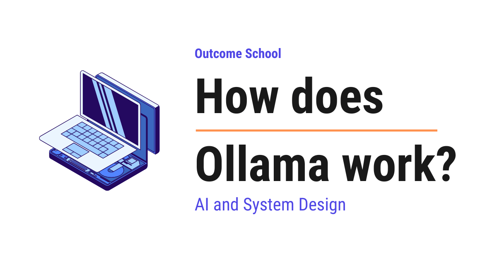

# How does Ollama work?

> Archived from <https://outcomeschool.com/blog/how-does-ollama-work> on 2026-11-25.

Ollama is a free tool that lets us download and run LLMs on our own computer with one simple command. It works by running a small server in the background that downloads compressed model files, loads them into memory, and uses a fast engine to generate text when we send it a prompt.

In this blog, we will learn about how Ollama works. We will also see why model files must be shrunk before they fit on a laptop, how Ollama&#x27;s client and server talk to each other, what happens step by step when we type a command, how models are downloaded, stored, and loaded onto the CPU and GPU, what a Modelfile is and how other apps use Ollama through its API, and where it works well and where it fails.

We will cover the following:
<ul><li>What does running an LLM locally mean?</li><li>What is Ollama?</li><li>The big problem: models are huge</li><li>Quantization and the GGUF file format</li><li>The architecture: client and server</li><li>What happens when we run a model?</li><li>How models are downloaded and stored</li><li>How the model runs on CPU and GPU</li><li>What is a Modelfile?</li><li>Using Ollama from code through its API</li><li>Where it works well and where it fails</li></ul>
I am <strong>Amit Shekhar</strong>, Founder @ <a target="_blank" rel="noopener noreferrer" href="https://outcomeschool.com">Outcome School</a>, I have taught and mentored many developers, and their efforts landed them high-paying tech jobs, helped many tech companies in solving their unique problems, and created many open-source libraries being used by top companies. I am passionate about sharing knowledge through open-source, blogs, and videos.

I teach <a target="_blank" rel="noopener noreferrer" href="https://outcomeschool.com/program/ai-and-machine-learning">AI and Machine Learning</a> at Outcome School.

Let&#x27;s get started.
<h2 id="what-does-running-an-llm-locally-mean">What does running an LLM locally mean?</h2>
Before jumping into Ollama, we must know what running an LLM locally means.

An LLM (Large Language Model) reads a prompt and writes a reply, one small piece of text at a time. These small pieces of text are called <strong><a target="_blank" rel="noopener noreferrer" href="tokenization-in-llms.md">tokens</a></strong>. A token is usually a word or a part of a word.

When we use an LLM on a website, the LLM is not running on our computer. Our message travels over the internet to a big computer owned by a company, the model runs there, and the reply travels back to us.

<strong>Running an LLM locally means the model runs on our own computer, and our messages never leave our machine.</strong>

Let&#x27;s say we compare this with food. Using an online LLM is like ordering food from a restaurant. Running locally is like cooking at home. Cooking at home needs our own kitchen and ingredients, but we control everything, nobody else sees what we eat, and it works even when the restaurants are closed.

So, running locally gives us:
<ul><li><strong>Privacy:</strong> Our data stays on our machine.</li><li><strong>Works offline:</strong> No internet is needed once the model is downloaded.</li><li><strong>No per-message cost:</strong> We do not pay for each request.</li><li><strong>Full control:</strong> We choose which model to run and how.</li></ul>
We have a detailed blog on <a target="_blank" rel="noopener noreferrer" href="cloud-vs-on-device-model-deployment.md">Cloud vs On-device Model Deployment</a> that explains when a model should run on a far-away server and when it should run on our own device.

But, running an LLM locally used to be hard. We had to find the right model file, install many libraries, set up the GPU, and write code. Here comes Ollama into the picture.
<h2 id="what-is-ollama">What is Ollama?</h2>
<strong>Ollama is an open-source tool that makes it easy to download, run, and manage LLMs on our own computer.</strong>

In simple words, Ollama does for LLMs what an app store does for apps. We just say which model we want, and Ollama takes care of downloading it, setting it up, and running it.

After installing Ollama, we can start chatting with a model using just one command:

<pre><code class="code-highlight language-bash">ollama run llama3.2
</code></pre>

Here, <code>ollama run</code> tells Ollama to run a model, and <code>llama3.2</code> is the name of the model. If the model is not on our computer yet, Ollama downloads it first. Then, it opens a chat right in the terminal.

It works on macOS, Windows, and Linux. Now, let&#x27;s understand what happens behind this simple command.
<h2 id="the-big-problem-models-are-huge">The big problem: models are huge</h2>
An LLM is made of billions of numbers called <strong>weights</strong>. These weights are what the model learned during training.

Normally, each weight is stored using 16 bits, which is 2 bytes.

Let&#x27;s calculate the size of a model with 8 billion weights:

<pre><code class="code-highlight language-text">8 billion weights x 2 bytes = 16 GB
</code></pre>

Here, we can see that even a medium-sized model needs 16 GB just to hold its weights. Many laptops have only 8 GB or 16 GB of memory in total, and that memory is also needed by the operating system and other apps.

Also, to generate every single token, the computer must read through all of these weights. So, a bigger file means slower replies.

<strong>Planning your move into AI?</strong>

No matter which tech domain you work in today, with your effort, you can transition to these roles:
<ul><li>AI Engineer</li><li>Forward Deployed Engineer</li><li>AI Agent Engineer</li><li>Harness Engineer</li><li>Voice AI Engineer</li><li>AI Architect</li><li>LLM Engineer</li><li>LLM Inference Engineer</li><li>Gen AI Engineer</li><li>MLOps Engineer</li><li>ML Engineer</li><li>Deep Learning Engineer</li></ul>
Our <a target="_blank" rel="noopener noreferrer" href="https://outcomeschool.com/program/ai-and-machine-learning">AI and Machine Learning Program</a> at Outcome School takes you there.

The question is: how do we fit this on a normal laptop? The answer is: we shrink the numbers.
<h2 id="quantization-and-the-gguf-file-format">Quantization and the GGUF file format</h2>
<strong><a target="_blank" rel="noopener noreferrer" href="how-does-model-quantization-work.md">Quantization</a> means storing each weight with fewer bits, for example 4 bits instead of 16 bits.</strong>

In simple words, it is like rounding prices. Instead of writing 49.97, we write 50. We lose a tiny bit of detail, but the number becomes shorter.

Let&#x27;s do the math again for the same 8 billion weight model:

<pre><code class="code-highlight language-text">16-bit:  8 billion x 2 bytes    = 16 GB
4-bit:   8 billion x 0.5 bytes  =  4 GB  (a little more in practice)
</code></pre>

Here, we can see that the 4-bit version is about four times smaller. It now fits easily on a laptop, and it runs faster too, because there is less data to read for every token. The answer quality drops only a little.

Most models that Ollama downloads by default are already quantized to around 4 bits.

Now, these shrunk models are saved in a file format called <strong><a target="_blank" rel="noopener noreferrer" href="how-does-gguf-work.md">GGUF</a></strong>. GGUF is the file format used to store models that run on <strong>GGML</strong>, a library for running LLMs efficiently. A GGUF file packs everything a model needs into one single file:
<ul><li>The quantized weights.</li><li>The details of the model&#x27;s architecture, like how many layers it has.</li><li>The <strong>tokenizer</strong>, which is the part that splits text into tokens and turns tokens back into text.</li></ul>
GGUF comes from the <strong><a target="_blank" rel="noopener noreferrer" href="how-does-llama-cpp-run-llms-on-everyday-hardware.md">llama.cpp</a></strong> project. llama.cpp is a popular open-source program, written in C and C++, that runs LLMs very efficiently on normal computers, including computers without a powerful GPU. Ollama has been built on top of llama.cpp and its underlying library GGML. Newer versions of Ollama also have their own engine for some models, built on the same GGML library.

So, the actual heavy math of running the model is done by this engine. A program that runs a trained model to produce answers is called an <strong>inference engine</strong>. Ollama is the layer on top that handles everything else.

To learn Quantization and Optimizations and LLM Inference Engineering in depth, check out our <a target="_blank" rel="noopener noreferrer" href="https://outcomeschool.com/program/ai-and-machine-learning">AI and Machine Learning Program</a> at Outcome School.
<h2 id="the-architecture-client-and-server">The architecture: client and server</h2>
Now, let&#x27;s understand how Ollama is organized.

Ollama has two parts:
<ul><li><strong>The server:</strong> A program that runs in the background. It manages the models, loads them into memory, and runs them. It is started with <code>ollama serve</code>, and the desktop app starts it for us automatically.</li><li><strong>The client:</strong> The thing that sends requests to the server. The <code>ollama</code> command we type in the terminal is a client. But, any other app can also be a client.</li></ul>
They talk to each other using <strong>HTTP</strong>. The server listens at the address <code>http://localhost:11434</code>. Here, <code>localhost</code> means &quot;this same computer&quot;, and <code>11434</code> is the <strong>port</strong>, which is like a door number where the server waits for requests.

<pre><code class="code-highlight language-text">+-------------+   +-------------+   +-------------+
| ollama CLI  |   | Python app  |   | A chat app  |
|  (client)   |   |  (client)   |   |  (client)   |
+-------------+   +-------------+   +-------------+
       ↓                 ↓                 ↓
       +-----------------+-----------------+
                         ↓
                   HTTP requests
                         ↓
         +-------------------------------+
         |  Ollama server (port 11434)   |
         |  - manages models             |
         |  - loads them into memory     |
         |  - runs the inference engine  |
         +-------------------------------+
                         ↓
                 +---------------+
                 |   CPU / GPU   |
                 +---------------+
</code></pre>

Here, we can see that many different clients can use the same Ollama server. There is one server and one place where the models live, and every app on our computer can use it.
<h2 id="what-happens-when-we-run-a-model">What happens when we run a model?</h2>
Now, let&#x27;s follow what happens when we type <code>ollama run llama3.2</code> and ask a question.

<strong>Step 1:</strong> The client contacts the server. The <code>ollama</code> command sends a request to the server at <code>localhost:11434</code>.

<strong>Step 2:</strong> The server checks if the model is on disk. If it is not, the server downloads it from the Ollama model library on the internet. We will see how this works in the next section.

<strong>Step 3:</strong> The server loads the model into memory. It reads the GGUF file and places the weights into the <a target="_blank" rel="noopener noreferrer" href="how-does-a-gpu-work-for-deep-learning.md">GPU</a> memory, the normal computer memory, or a mix of both. This can take a few seconds.

<strong>Step 4:</strong> The prompt is prepared. Each model expects the conversation in a special layout, with markers that show where the system instructions, the user&#x27;s message, and the assistant&#x27;s reply begin. This layout is called a <strong>chat template</strong>. Ollama wraps our message in the right template for that model automatically.

<strong>Step 5:</strong> The prompt is turned into tokens. The tokenizer splits the text into tokens, and each token becomes a number.

<strong>Step 6:</strong> The model generates the reply. The engine runs the model to predict the next token, adds it to the text, and repeats. This happens again and again until the reply is complete.

<strong>Step 7:</strong> The reply is <a target="_blank" rel="noopener noreferrer" href="how-does-token-streaming-work.md">streamed</a> back. Each new token is sent back to the client as soon as it is ready. That is why we see the words appear one by one on the screen, instead of waiting for the whole reply.

<strong>Step 8:</strong> The model stays in memory for a while. After the reply, the model is not removed right away. By default, Ollama keeps it loaded for 5 minutes. If we ask another question within that time, the reply starts instantly because Step 3 is skipped. If nothing happens for 5 minutes, the model is unloaded to free the memory. We can change this time with a setting called <code>keep_alive</code>.

This is how one simple command turns into a full chat with a local LLM.

<strong>A quick note for you</strong>

No matter which tech domain you work in, get familiar with these topics:
<ul><li>LLM</li><li>RAG</li><li>MCP</li><li>Agent</li><li>Fine-tuning</li><li>Quantization</li></ul>
We put it all together in one video:

<a target="_blank" rel="noopener noreferrer" href="https://www.youtube.com/watch?v=lnfWvX66FUk">AI Engineering Explained: LLM, RAG, MCP, Agent, Fine-Tuning, and Quantization</a>

No need to stop reading - bookmark it and watch later when you get time. Future you will thank you.

Now, let&#x27;s get back to the topic.
<h2 id="how-models-are-downloaded-and-stored">How models are downloaded and stored</h2>
Now, let&#x27;s see how Step 2 works.

Ollama has an online model library at ollama.com. Each model has a name and a <strong>tag</strong>, like <code>llama3.2:3b</code> or <code>qwen2.5:7b</code>. The tag usually tells the size or the version. If we do not give a tag, Ollama uses the default one, called <code>latest</code>.

We can download a model without running it, as below:

<pre><code class="code-highlight language-bash">ollama pull llama3.2
</code></pre>

Here, <code>pull</code> downloads the model and stores it on our computer, so that it is ready for later.

A model in Ollama is not stored as one single file with a name. It is stored as a set of pieces, called <strong>layers</strong>. One layer is the big GGUF weights file. Other small layers hold things like the chat template, the default settings, and the license.

There is also a small file called a <strong>manifest</strong>. It is a list that says which layers make up this model.

Each layer is saved with a name made from its <strong>hash</strong>. A hash is a short fingerprint calculated from the content of a file. The same content always gives the same fingerprint.

Why is this useful? Let&#x27;s say we create two custom versions of the same model, each with a different system instruction. Both versions use the exact same weights file. Since the weights layer has the same hash, Ollama stores it only once. Only the tiny different layers are stored separately. This saves a lot of disk space.

For example, on a Mac, these files live in a folder named <code>.ollama/models</code> inside our home folder.

We can manage our models with a few simple commands:

<pre><code class="code-highlight language-bash">ollama list            # show all downloaded models
ollama ps              # show models currently loaded in memory
ollama rm llama3.2     # delete a model from disk
</code></pre>

Here, <code>list</code> shows what is on disk, <code>ps</code> shows what is loaded in memory right now, and <code>rm</code> removes a model we no longer need.
<h2 id="how-the-model-runs-on-cpu-and-gpu">How the model runs on CPU and GPU</h2>
Now, the next big question is: where does the actual math happen?

The model can run on the <strong>CPU</strong> or on the <strong>GPU</strong>. A GPU can do thousands of calculations at the same time. LLMs need exactly this kind of work, so a GPU makes them much faster.

When Ollama starts, it checks which GPU our computer has. It supports NVIDIA GPUs, many AMD GPUs, and Apple Silicon chips on Macs. On Apple Silicon, the CPU and GPU share the same memory, which works well for LLMs.

An LLM is built from many <strong>layers</strong> stacked one after the other. Here, layer means a stage of the model&#x27;s computation, not the storage layer we saw earlier. The input passes through the first layer, then the second, and so on, until the last one.

Ollama decides how many of these model layers fit into the GPU memory:
<ul><li>If the whole model fits, all layers go to the GPU. This is the fastest.</li><li>If only part of it fits, some layers go to the GPU and the rest stay in normal memory and run on the CPU. This is called <strong>partial offloading</strong>.</li><li>If there is no usable GPU, everything runs on the CPU.</li></ul>
<pre><code class="code-highlight language-text">Model with 32 layers, GPU can hold 20:

  [Layer 1 ... Layer 20]  -&gt; GPU  (fast)
  [Layer 21 ... Layer 32] -&gt; CPU  (slower)
</code></pre>

Here, we can see that Ollama makes the best use of whatever hardware we have, without us having to set anything. We can run <code>ollama ps</code> to see how much of a loaded model is on the GPU and how much is on the CPU.

<strong>Note:</strong> Memory is needed not only for the weights but also for the conversation itself. As the model reads more text, it saves its work on earlier tokens in memory, which is called the <strong><a target="_blank" rel="noopener noreferrer" href="kv-cache-in-llms.md">KV cache</a></strong>. A longer conversation needs more memory. The maximum amount of text the model can see at once is called the <strong>context length</strong>, and a bigger context length uses more memory.

If we want to go deep into LLM Inference Engineering and Cloud vs On-device Deployment, we have a complete program on it - check out our <a target="_blank" rel="noopener noreferrer" href="https://outcomeschool.com/program/ai-and-machine-learning">AI and Machine Learning Program</a> at Outcome School.
<h2 id="what-is-a-modelfile">What is a Modelfile?</h2>
Now, let&#x27;s say we want our own version of a model, for example, one that always answers like a friendly teacher, with less randomness.

Ollama lets us do this with a <strong>Modelfile</strong>. <strong>A Modelfile is a small text file that describes how to build a custom model from an existing one.</strong>

In simple words, it is a recipe. It says which model to start from and what to change.

Let&#x27;s see the code for a Modelfile as below:

<pre><code class="code-highlight language-text">FROM llama3.2

PARAMETER temperature 0.3
PARAMETER num_ctx 4096

SYSTEM &quot;&quot;&quot;
You are a friendly teacher. Explain everything in simple words.
&quot;&quot;&quot;
</code></pre>

Here, we have:
<ul><li><code>FROM llama3.2</code> is the base model we start from.</li><li><code>PARAMETER temperature 0.3</code> sets the <strong><a target="_blank" rel="noopener noreferrer" href="how-does-temperature-control-llm-output.md">temperature</a></strong>, which controls randomness. A lower value gives more focused and predictable answers.</li><li><code>PARAMETER num_ctx 4096</code> sets the context length to 4096 tokens.</li><li><code>SYSTEM</code> sets the <a target="_blank" rel="noopener noreferrer" href="system-prompt.md">system message</a>, which is the instruction the model sees before every conversation.</li></ul>
Now, we can create and run our custom model like below:

<pre><code class="code-highlight language-bash">ollama create teacher -f Modelfile
ollama run teacher
</code></pre>

Here, <code>create</code> builds a new model named <code>teacher</code> using the recipe, and <code>run</code> starts chatting with it.

The best part is that no new copy of the weights is made. Our <code>teacher</code> model points to the same weights layer as <code>llama3.2</code>. Only the small settings layers are new. This is the same layer sharing we learned about earlier.

<strong>Stay updated:</strong> Subscribe to our <a target="_blank" rel="noopener noreferrer" href="https://outcomeschool.substack.com/subscribe">newsletter</a> to get our latest AI and Machine Learning blogs straight to your inbox.
<h2 id="using-ollama-from-code-through-its-api">Using Ollama from code through its API</h2>
So far, we have used Ollama from the terminal. But, since the server talks HTTP, any program can use it through its <strong>API</strong>.

Let&#x27;s see the code for sending a chat request with Python as below:

<pre><code class="code-highlight language-python">import requests

response = requests.post(
    &quot;http://localhost:11434/api/chat&quot;,
    json={
        &quot;model&quot;: &quot;llama3.2&quot;,
        &quot;messages&quot;: [
            { &quot;role&quot;: &quot;user&quot;, &quot;content&quot;: &quot;Why is the sky blue?&quot; }
        ],
        &quot;stream&quot;: False,
    },
)

print(response.json()[&quot;message&quot;][&quot;content&quot;])
</code></pre>

Here, we have:
<ul><li>We send a request to the <code>/api/chat</code> address of the local Ollama server.</li><li><code>model</code> says which model to use.</li><li><code>messages</code> is the conversation. Each message has a <code>role</code>, like <code>user</code> or <code>assistant</code>, and its <code>content</code>.</li><li><code>stream</code> set to <code>False</code> means we want the full reply at once. By default, Ollama streams the reply piece by piece, like we saw in the terminal.</li><li>Finally, we print the reply text.</li></ul>
It will print the model&#x27;s answer about why the sky is blue.

Ollama also offers an address that follows the same request format as OpenAI&#x27;s API, at <code>http://localhost:11434/v1</code>. This means many apps and libraries that were built for OpenAI can use a local Ollama model just by changing the address.
<h2 id="where-it-works-well-and-where-it-fails">Where it works well and where it fails</h2>
Let me tabulate the differences between using a cloud LLM service and running a model with Ollama for your better understanding.
<table><thead><tr><th>Point</th><th>Cloud LLM service</th><th>Ollama (local)</th></tr></thead><tbody><tr><td>Where the model runs</td><td>Company&#x27;s servers</td><td>Our own computer</td></tr><tr><td>Privacy</td><td>Data is sent over the internet</td><td>Data stays on our machine</td></tr><tr><td>Internet needed</td><td>Yes</td><td>Only for downloading models</td></tr><tr><td>Cost</td><td>Pay per use or subscription</td><td>Free, but needs our own hardware</td></tr><tr><td>Model size</td><td>Very large models</td><td>Limited by our computer&#x27;s memory</td></tr><tr><td>Speed</td><td>Fast, powerful servers</td><td>Depends on our CPU and GPU</td></tr><tr><td>Setup</td><td>Just an account and an API key</td><td>Install Ollama and pull a model</td></tr></tbody></table>
<strong>It works well when:</strong>
<ul><li>We want privacy, for example, working with personal notes or company documents.</li><li>We want to build and test apps without paying for every request.</li><li>We need to work offline.</li><li>We want to try many open models quickly.</li></ul>
<strong>It struggles when:</strong>
<ul><li>We need the largest and smartest models. Those are too big for most personal computers.</li><li>Our computer has little memory or no good GPU. Then, replies come out slowly.</li><li>We need to serve many users at the same time. Ollama is designed mainly for one person or a small team on one machine. For serving a large number of users, tools built for high traffic, like <a target="_blank" rel="noopener noreferrer" href="how-does-vllm-work.md">vLLM</a>, are a better fit.</li></ul>
For most personal computers, smaller models are the sweet spot. We have a detailed blog on <a target="_blank" rel="noopener noreferrer" href="small-language-models-slms.md">Small Language Models (SLMs)</a> that covers when to pick them.

Now we must have understood how Ollama works.
<h2 id="frequently-asked-questions">Frequently Asked Questions</h2><h3 id="is-ollama-free-to-use">Is Ollama free to use?</h3>
Yes. Ollama is a free and open-source tool. We do not pay for each request we send to a local model. The only cost is our own hardware, because the model runs on our own computer instead of a company&#x27;s servers.
<h3 id="does-ollama-need-an-internet-connection">Does Ollama need an internet connection?</h3>
Only for downloading models. Once a model is pulled from the Ollama model library, it runs fully on our own computer, so we can keep using it offline. Our prompts and replies never leave our machine.
<h3 id="can-ollama-run-without-a-gpu">Can Ollama run without a GPU?</h3>
Yes. If there is no usable GPU, Ollama runs the whole model on the CPU. It works, but replies come out more slowly. When a GPU is present, Ollama puts as many model layers on it as fit and runs the rest on the CPU.
<h3 id="can-apps-built-for-the-openai-api-use-ollama">Can apps built for the OpenAI API use Ollama?</h3>
Yes. Ollama offers an address that follows the same request format as OpenAI&#x27;s API, at <code>http://localhost:11434/v1</code>. So many apps and libraries that were built for OpenAI can use a local Ollama model just by changing the address they send requests to.
<h3 id="why-is-the-first-reply-from-ollama-slower-than-the-next-ones">Why is the first reply from Ollama slower than the next ones?</h3>
The first request has to load the model from disk into memory, which can take a few seconds. After that, Ollama keeps the model loaded for 5 minutes by default, so the next questions skip the loading step and the reply starts instantly. We can change this time with the <code>keep_alive</code> setting.

That&#x27;s it for now.

Thanks

<strong>Amit Shekhar</strong> Founder @ <a target="_blank" rel="noopener noreferrer" href="https://outcomeschool.com">Outcome School</a>

You can connect with me on:
<ul><li><a target="_blank" rel="noopener noreferrer" href="https://x.com/amitiitbhu">X</a></li><li><a target="_blank" rel="noopener noreferrer" href="https://www.linkedin.com/in/amit-shekhar-iitbhu">LinkedIn</a></li><li><a target="_blank" rel="noopener noreferrer" href="https://github.com/amitshekhariitbhu">GitHub</a></li></ul>
Follow Outcome School on:
<ul><li><a target="_blank" rel="noopener noreferrer" href="https://x.com/outcome_school">X</a></li><li><a target="_blank" rel="noopener noreferrer" href="https://youtube.com/@OutcomeSchool">YouTube</a></li><li><a target="_blank" rel="noopener noreferrer" href="https://www.linkedin.com/company/outcomeschool">LinkedIn</a></li><li><a target="_blank" rel="noopener noreferrer" href="http://github.com/OutcomeSchool">GitHub</a></li></ul>
<a target="_blank" rel="noopener noreferrer" href="https://outcomeschool.com/blog"><strong>Read all of our high-quality blogs here.</strong></a>

