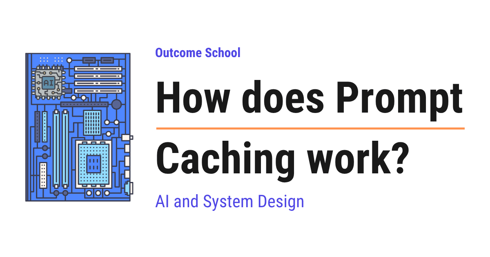

# How does Prompt Caching work?

> Archived from <https://outcomeschool.com/blog/how-does-prompt-caching-work> on 2026-11-25.

Prompt Caching is a technique where the model saves the work it already did for a repeated part of a prompt, so that next time it can reuse that saved work instead of doing it all over again.

In this blog, we will learn about how Prompt Caching works. We will also see why we need it, how it actually works inside a large language model, and where it is used in real systems like AI assistants and agents.

We will cover the following:
<ul><li>What is a prompt?</li><li>A quick recap of how an LLM reads a prompt</li><li>What is Prompt Caching?</li><li>Why we need Prompt Caching</li><li>The core idea behind Prompt Caching</li><li>The exact-prefix rule</li><li>Cache write vs cache read and TTL</li><li>What we should put in the cache</li><li>The benefits of Prompt Caching</li><li>Prompt Caching in the real world</li></ul>
I am <strong>Amit Shekhar</strong>, Founder @ <a target="_blank" rel="noopener noreferrer" href="https://outcomeschool.com">Outcome School</a>, I have taught and mentored many developers, and their efforts landed them high-paying tech jobs, helped many tech companies in solving their unique problems, and created many open-source libraries being used by top companies. I am passionate about sharing knowledge through open-source, blogs, and videos.

I teach <a target="_blank" rel="noopener noreferrer" href="https://outcomeschool.com/program/ai-and-machine-learning">AI and Machine Learning</a> at Outcome School.

Let&#x27;s get started.
<h3 id="what-is-a-prompt">What is a prompt?</h3>
Before we talk about Prompt Caching, we must first understand what a prompt is.

<strong>A prompt is simply the text we send to a large language model.</strong>

A large language model, or LLM, is the technology behind tools like ChatGPT and Claude. We give it some text, and it gives us back some text.

In simple words, the prompt is everything we type in. The model reads our prompt and then writes a reply.

Let&#x27;s say we are building a customer support assistant. The text we send to the model usually has a few parts:
<ul><li>A set of <a target="_blank" rel="noopener noreferrer" href="system-prompt.md">instructions telling the model how to behave</a>, for example &quot;You are a polite support agent for a shoe store.&quot;</li><li>Maybe a long document with all our shoe return policies.</li><li>The actual question from the user, for example &quot;Can I return shoes after 40 days?&quot;</li></ul>
All of this text together is the prompt.

Now, here is something important to notice. The instructions and the policy document stay the same for every user. Only the user&#x27;s question changes. We will come back to this point soon, because it is the heart of Prompt Caching.
<h3 id="a-quick-recap-of-how-an-llm-reads-a-prompt">A quick recap of how an LLM reads a prompt</h3>
To understand Prompt Caching, we must understand one thing about how an LLM reads a prompt.

When we send a prompt, the model does not read it as full words. It first breaks the text into small pieces called <a target="_blank" rel="noopener noreferrer" href="tokenization-in-llms.md"><strong>tokens</strong></a>. A token is a small chunk of text, roughly a word or part of a word. For example, a short word like <code>support</code> is usually one token, while a longer word like <code>returning</code> is often split into two tokens.

So, the prompt becomes a list of tokens.

We have a detailed blog on <a target="_blank" rel="noopener noreferrer" href="bpe-in-llms.md">Byte Pair Encoding (BPE)</a> that explains how this tokenization works.

Now, the model goes through these tokens one by one and builds an internal understanding of each token. This first step, where the model reads the whole prompt and processes every token before writing even a single word of the reply, is called the <a target="_blank" rel="noopener noreferrer" href="prefill-vs-decode-llm-inference-optimization.md"><strong>prefill</strong></a> step.

In simple words, prefill is the model reading and digesting our entire prompt.

During prefill, for every single token, the model computes some internal values and stores them. These stored values are kept in something called the <a target="_blank" rel="noopener noreferrer" href="kv-cache-in-llms.md"><strong>KV cache</strong></a>.

Let&#x27;s understand the KV cache in plain words. As the model reads each token, it creates a small summary of that token, a kind of note about what that token means in the context of everything before it. The KV cache is the collection of all these notes, one set of notes per token. The model needs these notes to write the reply, and it also reuses them while generating each new word.

Here is the key point to remember:

<strong>Building the KV cache for a long prompt takes real work. The model has to do heavy computation for every token, one by one.</strong>

So, if our prompt has 5,000 tokens, the model does this work for all 5,000 tokens before it writes anything. The longer the prompt, the more time and money this prefill step costs.

This is the foundation we needed. Now we are ready to understand the problem.
<h3 id="what-is-prompt-caching">What is Prompt Caching?</h3>
Now that we know how the model reads a prompt, let&#x27;s understand Prompt Caching.

<strong>Prompt Caching is a technique where the model saves the work it already did for a repeated part of a prompt, so that next time it can reuse that saved work instead of doing it all over again.</strong>

In simple words, Prompt Caching means: do the hard work once, then reuse it.

The word &quot;cache&quot; simply means a place where we store something so we can grab it quickly later, instead of making it again from scratch.

Let&#x27;s connect this to what we just learned. The &quot;hard work&quot; the model does is building the KV cache during the prefill step. Prompt Caching saves that KV cache for a repeated part of the prompt. The next time we send a prompt that starts with the same repeated part, the model loads the saved KV cache and skips redoing all that work.

So, Prompt Caching is about reusing the internal computation for a repeated beginning of a prompt.

This is different from <a target="_blank" rel="noopener noreferrer" href="how-does-semantic-caching-work.md">semantic caching</a>, which reuses the final answer whenever a new question means the same thing, even if the words are different.

Now, the question is, why do we even need this? Let&#x27;s see.
<h3 id="why-we-need-prompt-caching">Why we need Prompt Caching</h3>
Let&#x27;s go back to our shoe store support assistant.

Every user sends a question. But remember, with every single question, we also send the same instructions and the same long return policy document. The user&#x27;s question is short, but the instructions and the document are long.

So, the model reads the same long instructions and the same long document again and again, for every user, for every message.

Let&#x27;s put some numbers to it for the sake of understanding. Suppose:
<ul><li>The instructions and the policy document are 5,000 tokens.</li><li>The user&#x27;s question is 50 tokens.</li></ul>
Every time a user asks something, the model does prefill on 5,050 tokens. Out of these, 5,000 tokens are exactly the same as last time. Only 50 tokens are new.

This is wasteful. The model is doing heavy work on 5,000 tokens that have not changed at all.

This causes two real problems:
<ul><li><strong>It is slow.</strong> Processing 5,000 tokens again and again adds delay before the user sees a reply.</li><li><strong>It is costly.</strong> We pay based on how many tokens the model processes. Reprocessing the same 5,000 tokens every time means we pay for the same work over and over.</li></ul>
This problem becomes much bigger in real applications. Think about long system instructions, large documents, and many examples that we send with every request. We send the same big block of text repeatedly, and the model keeps redoing the same work.

<strong>Planning your move into AI?</strong>

No matter which tech domain you work in today, with your effort, you can transition to these roles:
<ul><li>AI Engineer</li><li>Forward Deployed Engineer</li><li>AI Agent Engineer</li><li>Harness Engineer</li><li>Voice AI Engineer</li><li>AI Architect</li><li>LLM Engineer</li><li>LLM Inference Engineer</li><li>Gen AI Engineer</li><li>MLOps Engineer</li><li>ML Engineer</li><li>Deep Learning Engineer</li></ul>
Our <a target="_blank" rel="noopener noreferrer" href="https://outcomeschool.com/program/ai-and-machine-learning">AI and Machine Learning Program</a> at Outcome School takes you there.

So, here comes Prompt Caching to the rescue.
<h3 id="the-core-idea-behind-prompt-caching">The core idea behind Prompt Caching</h3>
Let&#x27;s understand the core idea step by step.

We learned that during prefill, the model builds the KV cache, which is the set of internal notes for every token. Prompt Caching takes a simple but powerful step.

<strong>The idea is to save the KV cache of a fixed, repeated part of the prompt. On the next request that starts with the same part, the model loads the saved KV cache and starts from there, skipping the recomputation.</strong>

Let&#x27;s walk through it with our example.

<strong>Step 1:</strong> A user sends the first question. The prompt is the 5,000-token instructions and document, followed by the 50-token question. The model does prefill on all 5,050 tokens and builds the KV cache. While doing this, it saves the KV cache for the first 5,000 tokens, because we marked that part to be cached.

<strong>Step 2:</strong> A new user sends a different question. The prompt is the same 5,000-token instructions and document, followed by a new 50-token question. Now, instead of redoing the work for the first 5,000 tokens, the model loads the saved KV cache for them. It only does fresh work for the new 50-token question.

So, the model jumped straight to where the cached part ended and continued from there. It did not waste time on the 5,000 tokens it had already understood.

Here is a simple diagram to make this clear.

<pre><code class="code-highlight">WITHOUT prompt caching (every request):

[ 5,000 tokens: instructions + document ]  +  [ 50 tokens: question ]
        process all of this again                process this
        (slow, costly, repeated)                 (new work)

WITH prompt caching (after the first request):

[ 5,000 tokens: instructions + document ]  +  [ 50 tokens: question ]
        load from cache (fast, cheap)             process this
        skip the heavy work                       (new work)
</code></pre>

The problem is solved. The model now does the heavy work on the repeated part only once.

To go deep into LLM Internals and the KV Cache, check out our <a target="_blank" rel="noopener noreferrer" href="https://outcomeschool.com/program/ai-and-machine-learning">AI and Machine Learning Program</a> at Outcome School.
<h3 id="the-exact-prefix-rule">The exact-prefix rule</h3>
Now, there is one very important rule we must understand, because most mistakes happen here.

<strong>Prompt Caching works on a matching prefix. The cached part must be the beginning of the prompt, and it must match exactly, character for character.</strong>

Let&#x27;s understand the word <strong>prefix</strong>. A prefix is the starting part of something. In our case, the cached part is the beginning of the prompt, the part that comes before the user&#x27;s question.

The model can reuse the cache only as long as the beginning of the new prompt is exactly identical to the beginning of the cached prompt. The moment the text differs, the cache stops being useful from that point onward.

We can picture it as below:

<pre><code class="code-highlight">Cached prompt:    You are a polite support agent. Return window is 30 days.
New prompt:       You are a polite support agent. Return window is 45 days.
                  |--------------- matches exactly ---------------|
                                   read from cache
                                                                  ^ differs from here, so this part is redone
</code></pre>

Here, we can notice that the two prompts are the same up to a point, so that matching front part is read from the cache. From the very first token that differs, the prefix no longer matches, so the model must redo the work for everything after that point.

Here is the part we must be very careful about:

<strong>If even one character changes early in the prompt, the cache breaks for everything after that change.</strong>

Let&#x27;s see why with an example. Suppose at the very top of our instructions we add a line like &quot;Today&#x27;s date is 2026-06-07.&quot; This line changes every single day. Since it sits at the very beginning of the prompt, the prefix is now different every day. So, the cache built yesterday cannot be reused today. The model has to redo all the work.

This is a very common mistake. We accidentally put something that changes, like the current date, a random ID, or a user name, near the top of the prompt. And that one small changing thing quietly breaks the entire cache.

So, the rule to remember is simple:

<strong>Put the stable part first, and put the changing part last.</strong>

If the beginning of the prompt stays the same, the cache keeps working. If the beginning keeps changing, the cache is useless. Do not worry, we will see exactly which parts to keep stable and where to place them in a moment.

<strong>A quick note for you</strong>

No matter which tech domain you work in, get familiar with these topics:
<ul><li>LLM</li><li>RAG</li><li>MCP</li><li>Agent</li><li>Fine-tuning</li><li>Quantization</li></ul>
We put it all together in one video:

<a target="_blank" rel="noopener noreferrer" href="https://www.youtube.com/watch?v=lnfWvX66FUk">AI Engineering Explained: LLM, RAG, MCP, Agent, Fine-Tuning, and Quantization</a>

No need to stop reading - bookmark it and watch later when you get time. Future you will thank you.

Now, let&#x27;s get back to the topic.
<h3 id="cache-write-vs-cache-read-and-ttl">Cache write vs cache read and TTL</h3>
Now, let&#x27;s understand two simple terms: cache write and cache read.

<strong>A cache write happens the first time.</strong> This is when the model processes the repeated part and saves its KV cache. We are writing the result into the cache for the first time.

<strong>A cache read happens after that.</strong> This is when a later request reuses the saved KV cache instead of recomputing it. We are reading from the cache.

Let&#x27;s connect this to cost, because this is where it gets interesting.

A cache write costs a little more than normal processing, because the model has to do the work and also store the result. As a rough idea, the cache write costs around 1.25 times the normal price for that part.

But a cache read is very cheap. Reading from the cache costs only around one-tenth of the normal price. That is roughly a 90 percent saving on the repeated part.

So, the first request pays a small extra cost to write the cache. Every request after that pays much less because it reads from the cache. The more we reuse the cache, the more we save.

The flow looks like below:

<pre><code class="code-highlight">Request 1  --&gt;  process the stable part  --&gt;  save it    (cache WRITE, ~1.25x cost)
                                               |
                                               v
                                        +-------------+
                                        |    cache    |
                                        +-------------+
                                            ^  ^  ^
Request 2 ----------------------------------+  |  |   (cache READ, ~0.1x cost)
Request 3 -------------------------------------+  |   (cache READ, ~0.1x cost)
Request 4 ----------------------------------------+   (cache READ, ~0.1x cost)
</code></pre>

Here, we can see that only the first request does the heavy work and writes the result into the cache. Every later request that starts with the same stable part simply reads from the cache, which is why each one costs much less than redoing the work from scratch.

Now, the next question is: does the cache stay forever? The answer is no.

The cache has a <strong>TTL</strong>, which stands for <strong>time to live</strong>. In simple words, TTL is how long the cache stays alive before it expires and gets removed.

A common default TTL is 5 minutes. There is also an option for a longer TTL, such as 1 hour. Here is what TTL means in practice:
<ul><li>If a new request with the same prefix comes within the TTL window, it can read from the cache.</li><li>If no request comes within the TTL window, the cache expires. The next request has to do a fresh cache write again.</li></ul>
So, Prompt Caching helps the most when many requests share the same beginning and arrive close together in time.

<strong>Note:</strong> A longer TTL keeps the cache alive longer, which is helpful when requests are spread out, but the cache write for a longer TTL costs a bit more. So we choose the TTL based on our use case.
<h3 id="what-we-should-put-in-the-cache">What we should put in the cache</h3>
Now, we know caching works on the stable beginning of the prompt. So, the natural question is, what exactly should we put there?

The answer is simple. We put the parts that stay the same across many requests first, and the parts that change last.

Here are the parts that are great to cache, because they usually do not change:
<ul><li><strong>System instructions.</strong> These describe how the model should behave, for example &quot;You are a polite support agent.&quot; These stay the same for every user.</li><li><strong>Large documents.</strong> For example, our full return policy, a product manual, or a knowledge base article. These are long and repeated, so caching them saves a lot.</li><li><strong>Tool definitions.</strong> When we let the model use tools, we describe each tool to it. These descriptions are usually fixed.</li><li><strong>Few-shot examples.</strong> These are example questions and answers we give the model so it learns the style we want. The word &quot;few-shot&quot; simply means we give the model a few examples to guide it. These examples are the same every time.</li></ul>
And here is the part that changes and must come last:
<ul><li><strong>The user&#x27;s actual question or message.</strong> This is different for every request, so it goes at the very end, after all the cached parts.</li></ul>
Let&#x27;s see the order with a simple diagram.

<pre><code class="code-highlight">ORDER OF A WELL-DESIGNED PROMPT

  FIRST  -&gt;  Tool definitions     |
             System instructions  |  stable part: cache this
             Large documents      |
             Few-shot examples    |

  LAST   -&gt;  User&#x27;s question         changing part: do not cache
</code></pre>

This order is the whole trick. The stable block sits at the front and gets cached. The changing question sits at the back and does not break the cache.

So, now we know exactly what to cache and where to place it.

Deciding what goes into the prompt and in what order is its own discipline. We have a detailed blog on <a target="_blank" rel="noopener noreferrer" href="context-engineering.md">Context Engineering</a> that covers this in depth.

<strong>Stay updated:</strong> Subscribe to our <a target="_blank" rel="noopener noreferrer" href="https://outcomeschool.substack.com/subscribe">newsletter</a> to get our latest AI and Machine Learning blogs straight to your inbox.
<h3 id="the-benefits-of-prompt-caching">The benefits of Prompt Caching</h3>
Let&#x27;s quickly bring together the benefits, because they are the reason we use this technique.
<ul><li><strong>Lower latency.</strong> Latency means the delay before the user gets a reply. Since the model skips reprocessing the repeated part, it starts replying faster.</li><li><strong>Lower cost.</strong> Cached tokens are read at a much cheaper rate, around one-tenth of the normal price. When we send the same large block of text again and again, this saving adds up to a lot.</li></ul>
In simple words, Prompt Caching makes our application faster and cheaper at the same time, without changing the quality of the answers. The model still sees the full prompt. It just avoids redoing work it has already done.

That&#x27;s the beauty of Prompt Caching.
<h3 id="prompt-caching-in-the-real-world">Prompt Caching in the real world</h3>
Now, let&#x27;s see where Prompt Caching is used in real systems.

Major AI providers offer Prompt Caching as a built-in feature. For example, Anthropic, the company behind Claude, and OpenAI, the company behind GPT models, both support Prompt Caching. We simply mark the stable part of our prompt to be cached, and the provider handles the saving and reusing for us. We can also check the response to see how many tokens were written to the cache and how many were read from it, so we always know that the caching is actually working.

Prompt Caching is especially powerful in two kinds of systems.

The first is <strong><a target="_blank" rel="noopener noreferrer" href="retrieval-augmented-generation-rag.md">RAG</a></strong>. RAG stands for Retrieval-Augmented Generation. In simple words, it is a system where we first fetch some relevant documents and then send them to the model along with the user&#x27;s question. These fetched documents and the fixed instructions are often large and repeated across requests. Caching the stable instructions and any text we send again cuts down the cost and the delay. The same trick makes <a target="_blank" rel="noopener noreferrer" href="how-does-contextual-retrieval-work.md">Contextual Retrieval</a> affordable, where we send the same full document to the model once for every chunk to write a short context note for that chunk. Earlier in the same pipeline, the document embeddings can be cached too, and we have a detailed blog on <a target="_blank" rel="noopener noreferrer" href="how-does-an-embedding-cache-work.md">how an Embedding Cache works</a> that explains how that avoids recomputing them on every query.

The second is <strong>agent systems</strong>. An <a target="_blank" rel="noopener noreferrer" href="ai-agent.md">agent</a> is an AI program that works on a task step by step, often calling tools and taking many turns to finish a job. In an agent system, the same big block of instructions, tool definitions, and earlier text is sent on every single step. There can be many steps, so the same beginning is reused a huge number of times. This is exactly the situation where Prompt Caching shines, because the cached prefix is read again and again.

Serving these repeated prefixes at scale is the job of the inference engine, and we have a detailed blog on <a target="_blank" rel="noopener noreferrer" href="how-does-vllm-work.md">vLLM</a> that explains how it shares identical prefixes across requests step by step. Another inference engine, <a target="_blank" rel="noopener noreferrer" href="how-does-sglang-work.md">SGLang</a>, does the same with a radix tree that matches shared prefixes even more precisely. NVIDIA&#x27;s <a target="_blank" rel="noopener noreferrer" href="how-does-tensorrt-llm-work.md">TensorRT-LLM</a> does it too, under the name prefix reuse.

So, anywhere we keep sending the same large beginning of a prompt, Prompt Caching helps us a lot.

If we want to go deep into RAG, Vector Databases, and AI Agents, we have a complete program on this - check out our <a target="_blank" rel="noopener noreferrer" href="https://outcomeschool.com/program/ai-and-machine-learning">AI and Machine Learning Program</a> at Outcome School.

This is how Prompt Caching works. We save the model&#x27;s internal work for a fixed, repeated beginning of the prompt, we keep that beginning exactly the same and place it first, and then we reuse it again and again to get faster and cheaper responses.
<h2 id="frequently-asked-questions">Frequently Asked Questions</h2><h3 id="what-is-the-difference-between-prompt-caching-and-semantic-caching">What is the difference between prompt caching and semantic caching?</h3>
Prompt caching reuses the model&#x27;s internal work, the KV cache, for a repeated beginning of a prompt. The model still reads the new part and writes a fresh reply. Semantic caching reuses the final answer whenever a new question means the same thing, even if the words are different.
<h3 id="does-prompt-caching-change-the-quality-of-the-answers">Does prompt caching change the quality of the answers?</h3>
No. Prompt caching makes our application faster and cheaper without changing the quality of the answers. The model still sees the full prompt. It just avoids redoing the work for the repeated part that it has already done.
<h3 id="why-is-our-prompt-cache-not-getting-any-hits">Why is our prompt cache not getting any hits?</h3>
A very common reason is something that changes near the top of the prompt, like the current date, a random ID, or a user name. The cached part must match exactly, character for character, so even one early change breaks the cache for everything after it. We should put the stable part first and the changing part last.
<h3 id="is-prompt-caching-always-cheaper">Is prompt caching always cheaper?</h3>
Not for the first request. A cache write costs a little more than normal processing, around 1.25 times the normal price. The savings come from later cache reads, which cost around one-tenth of the normal price. So caching pays off when many requests share the same beginning and arrive within the TTL window.
<h3 id="how-do-we-know-if-prompt-caching-is-actually-working">How do we know if prompt caching is actually working?</h3>
We can check the response from the provider. It shows how many tokens were written to the cache and how many were read from it. If later requests show tokens read from the cache, the caching is working.

That&#x27;s it for now.

Thanks

<strong>Amit Shekhar</strong> Founder @ <a target="_blank" rel="noopener noreferrer" href="https://outcomeschool.com">Outcome School</a>

You can connect with me on:
<ul><li><a target="_blank" rel="noopener noreferrer" href="https://x.com/amitiitbhu">X</a></li><li><a target="_blank" rel="noopener noreferrer" href="https://www.linkedin.com/in/amit-shekhar-iitbhu">LinkedIn</a></li><li><a target="_blank" rel="noopener noreferrer" href="https://github.com/amitshekhariitbhu">GitHub</a></li></ul>
Follow Outcome School on:
<ul><li><a target="_blank" rel="noopener noreferrer" href="https://x.com/outcome_school">X</a></li><li><a target="_blank" rel="noopener noreferrer" href="https://youtube.com/@OutcomeSchool">YouTube</a></li><li><a target="_blank" rel="noopener noreferrer" href="https://www.linkedin.com/company/outcomeschool">LinkedIn</a></li><li><a target="_blank" rel="noopener noreferrer" href="https://github.com/OutcomeSchool">GitHub</a></li></ul>
<a target="_blank" rel="noopener noreferrer" href="https://outcomeschool.com/blog"><strong>Read all of our high-quality blogs here.</strong></a>

