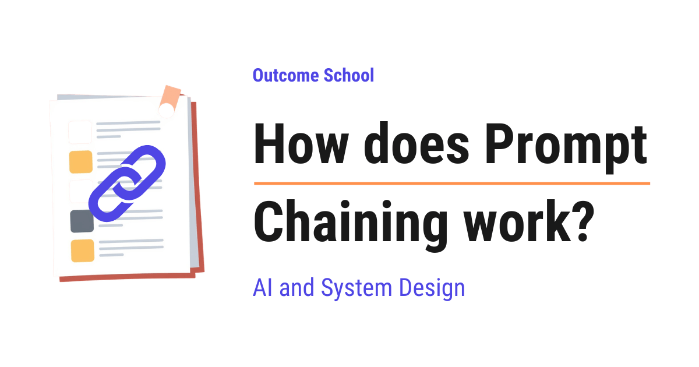

# How does Prompt Chaining work?

> Archived from <https://outcomeschool.com/blog/how-does-prompt-chaining-work> on 2026-11-25.

Prompt Chaining is a way of breaking one big task into smaller prompts, where the output of one prompt becomes the input of the next prompt.

In this blog, we will learn about how Prompt Chaining works. We will also see why we need it, how it works step by step by passing the output of one prompt into the next, and where it is used in the real world to solve bigger tasks reliably.

We will cover the following:
<ul><li>What is a prompt?</li><li>What is Prompt Chaining?</li><li>Why do we need Prompt Chaining?</li><li>How does Prompt Chaining work step by step?</li><li>A real example of Prompt Chaining</li><li>Code example of Prompt Chaining</li><li>Common patterns in Prompt Chaining</li><li>Advantages of Prompt Chaining</li><li>Things to take care of while using Prompt Chaining</li><li>When to use Prompt Chaining</li></ul>
I am <strong>Amit Shekhar</strong>, Founder @ <a target="_blank" rel="noopener noreferrer" href="https://outcomeschool.com">Outcome School</a>, I have taught and mentored many developers, and their efforts landed them high-paying tech jobs, helped many tech companies in solving their unique problems, and created many open-source libraries being used by top companies. I am passionate about sharing knowledge through open-source, blogs, and videos.

I teach <a target="_blank" rel="noopener noreferrer" href="https://outcomeschool.com/program/ai-and-machine-learning">AI and Machine Learning</a> at Outcome School.

Let&#x27;s get started.
<h3 id="what-is-a-prompt">What is a prompt?</h3>
Before jumping into Prompt Chaining, we must know what a prompt is.

A <strong>prompt</strong> is the instruction or question that we give to an AI model.

In simple words, a prompt is what we type to tell the AI what we want.

Let&#x27;s say we open an AI chat tool and type &quot;Write a short poem about the rain.&quot; That sentence is the prompt. The AI reads our prompt and gives us an answer back. That answer is called the <strong>response</strong>.

So, a prompt goes in, and a response comes out. This is the simplest way to talk to an AI model.

Now, we have understood what a prompt is. Now, it&#x27;s time to learn about Prompt Chaining.
<h3 id="what-is-prompt-chaining">What is Prompt Chaining?</h3>
<strong>Prompt Chaining</strong> is a way of breaking one big task into smaller prompts, where the output of one prompt becomes the input of the next prompt.

Let&#x27;s decompose the term to understand it better.
<blockquote>
Prompt Chaining = Prompt + Chaining
</blockquote>
Here, &quot;Prompt&quot; is the instruction we give to the AI. And &quot;Chaining&quot; means joining things one after another, like the links of a chain.

In simple words, instead of asking the AI to do everything in one single big prompt, we ask it in small steps. We take the answer from the first step and feed it into the second step. Then we take the answer from the second step and feed it into the third step, and so on.

So, each step depends on the answer of the step before it. The steps are connected like a chain. That is why we call it Prompt Chaining.

Do not confuse this with <a target="_blank" rel="noopener noreferrer" href="how-does-chain-of-thought-prompting-work.md">Chain-of-Thought (CoT) Prompting</a> - there, a single model reasons step by step inside one prompt, while here we join multiple separate prompts into a chain.

<strong>Planning your move into AI?</strong>

No matter which tech domain you work in today, with your effort, you can transition to these roles:
<ul><li>AI Engineer</li><li>Forward Deployed Engineer</li><li>AI Agent Engineer</li><li>Harness Engineer</li><li>Voice AI Engineer</li><li>AI Architect</li><li>LLM Engineer</li><li>LLM Inference Engineer</li><li>Gen AI Engineer</li><li>MLOps Engineer</li><li>ML Engineer</li><li>Deep Learning Engineer</li></ul>
Our <a target="_blank" rel="noopener noreferrer" href="https://outcomeschool.com/program/ai-and-machine-learning">AI and Machine Learning Program</a> at Outcome School takes you there.
<h3 id="why-do-we-need-prompt-chaining">Why do we need Prompt Chaining?</h3>
The best way to learn this is by taking an example.

Suppose we want the AI to do this big task for us:

&quot;Read this long customer review, find out if the customer is happy or angry, and then write a polite reply to the customer.&quot;

We can try to do this in one single prompt. Let&#x27;s call this Approach 1.

<strong>Approach 1: One big prompt</strong>

We write everything in one prompt as below:

<pre><code class="language-text code-highlight">Here is a customer review: &quot;...&quot;
Find out if the customer is happy or angry,
and then write a polite reply to the customer.
</code></pre>

Here, we are asking the AI to do many things at once. It must read the review, decide the mood, and write a reply, all in one go.

The issue with this approach is that the AI tries to do too many things in one step. The mood detection can be wrong, and the reply can become messy. When one big prompt does many jobs, mistakes become hard to find and hard to fix.

Let&#x27;s see how the next approach solves this issue.

<strong>Approach 2: Prompt Chaining</strong>

Now, we break the big task into small steps. Each step has its own small prompt.

So, here comes Prompt Chaining to the rescue.

We split the work like below:
<ul><li>Step 1: Ask the AI to read the review and tell us only the mood (happy or angry).</li><li>Step 2: Take that mood, and ask the AI to write a reply that matches the mood.</li></ul>
Here, each prompt does only one small job. The first prompt finds the mood. The second prompt uses that mood to write the reply.

This way the work becomes clean and clear. If something goes wrong, we know exactly which step to fix. The problem is solved.

We can picture the difference between the two approaches as below:

<pre><code class="language-text code-highlight">Approach 1: One big prompt

  +-------------------------------+        +---------------+
  | Read review + find mood +     |        |               |
  | write reply (all in one go)   |  ---&gt;  |  Reply (messy)|
  +-------------------------------+        +---------------+

Approach 2: Prompt Chaining

  +----------------+   mood    +----------------+
  | Find the mood  | --------&gt; | Write reply    |  ---&gt;  Reply
  | (happy/angry)  |           | for that mood  |        (clean)
  +----------------+           +----------------+
</code></pre>

Here, we can see that in Approach 1 a single prompt is forced to do every job at once, so the reply can come out messy. In Approach 2, the first prompt only finds the mood, and that mood is passed into the second prompt, which writes the reply. Each box does one small job.

This is why we need Prompt Chaining. It makes a hard task easy by splitting it into small, simple steps.

To learn Prompt Chaining, Prompt Engineering, and how AI Agents break a big task into steps, we have our <a target="_blank" rel="noopener noreferrer" href="https://outcomeschool.com/program/ai-and-machine-learning">AI and Machine Learning Program</a> at Outcome School.
<h3 id="how-does-prompt-chaining-work-step-by-step">How does Prompt Chaining work step by step?</h3>
Now, let&#x27;s understand how Prompt Chaining actually works, one step at a time.

The idea is simple. We pass the output of one prompt as the input to the next prompt.

Let&#x27;s say we have three steps. Here is how the flow works:
<ul><li><strong>Step 1:</strong> We give the first prompt to the AI. The AI gives us an output. Let&#x27;s call it Output 1.</li><li><strong>Step 2:</strong> We take Output 1 and put it inside the second prompt. The AI gives us Output 2.</li><li><strong>Step 3:</strong> We take Output 2 and put it inside the third prompt. The AI gives us the final answer.</li></ul>
Let&#x27;s visualize this flow as below:

<pre><code class="language-text code-highlight">  +---------+   Output 1   +---------+   Output 2   +---------+
  | Prompt  | -----------&gt; | Prompt  | -----------&gt; | Prompt  |
  | Step 1  |              | Step 2  |              | Step 3  |
  +---------+              +---------+              +---------+
       ^                                                 |
       |                                                 v
   first input                                     Final answer
</code></pre>

Here, we can see that the output of each step becomes the input of the next step. Output 1 from Step 1 flows into Step 2, and Output 2 from Step 2 flows into Step 3, which gives us the final answer.

So, Output 1 feeds Step 2, and Output 2 feeds Step 3. Each output becomes the input of the next step. This is the heart of Prompt Chaining.

For better understanding, let&#x27;s map this to a real-world team.
<table><thead><tr><th>Prompt Chaining role</th><th>Real-world comparison</th></tr></thead><tbody><tr><td>The full task</td><td>A project given to a team</td></tr><tr><td>Each small prompt</td><td>One team member doing one job</td></tr><tr><td>Output passed forward</td><td>One member handing their work to the next member</td></tr><tr><td>Final answer</td><td>The finished project</td></tr></tbody></table>
Here, we can see that Prompt Chaining works just like a team in a factory line. Each worker does one small job and passes the result to the next worker. The last worker hands over the finished product.

This is how Prompt Chaining works at a high level.

<strong>A quick note for you</strong>

No matter which tech domain you work in, get familiar with these topics:
<ul><li>LLM</li><li>RAG</li><li>MCP</li><li>Agent</li><li>Fine-tuning</li><li>Quantization</li></ul>
We put it all together in one video:

<a target="_blank" rel="noopener noreferrer" href="https://www.youtube.com/watch?v=lnfWvX66FUk">AI Engineering Explained: LLM, RAG, MCP, Agent, Fine-Tuning, and Quantization</a>

No need to stop reading - bookmark it and watch later when you get time. Future you will thank you.

Now, let&#x27;s get back to the topic.
<h3 id="a-real-example-of-prompt-chaining">A real example of Prompt Chaining</h3>
Let&#x27;s take a real example so that everything becomes clear.

Suppose we run a blog website. We want to take a long article and turn it into a short social media post.

This is a big task. So, we break it into a chain of small prompts.

<strong>Step 1: Summarize the article.</strong>

We give the AI this prompt:

<pre><code class="language-text code-highlight">Summarize the following article in 3 short sentences:
&quot;&lt;the full long article goes here&gt;&quot;
</code></pre>

Here, the AI reads the long article and gives us a short summary of three sentences. This summary is our Output 1.

<strong>Step 2: Turn the summary into a social media post.</strong>

Now, we take Output 1 (the summary) and put it into the next prompt as below:

<pre><code class="language-text code-highlight">Turn the following summary into a short, catchy social media post:
&quot;&lt;the summary from Step 1 goes here&gt;&quot;
</code></pre>

Here, the AI does not see the long article again. It only sees the short summary from Step 1. The AI now writes a catchy post based on that summary. This is our Output 2.

<strong>Step 3: Add hashtags.</strong>

Finally, we take Output 2 (the social media post) and put it into the last prompt as below:

<pre><code class="language-text code-highlight">Add 3 relevant hashtags to the end of this social media post:
&quot;&lt;the social media post from Step 2 goes here&gt;&quot;
</code></pre>

Here, the AI adds three hashtags to the post. This is our final answer, ready to be published.

We have followed the following steps:
<ul><li>We summarized the long article.</li><li>We turned the summary into a post.</li><li>We added hashtags to the post.</li></ul>
Each step used the output of the step before it. This way we used Prompt Chaining to solve the task in a very simple way.
<h3 id="code-example-of-prompt-chaining">Code example of Prompt Chaining</h3>
Now, let&#x27;s see the code for a simple Prompt Chaining. We will use Python for the sake of understanding.

We can write the code as below:

<pre><code class="code-highlight language-python"># A made-up helper that sends a prompt to the AI and returns the answer.
def ask_ai(prompt):
    # send the prompt to the AI model and get the response back
    return call_the_ai_model(prompt)

# The long article that we want to process.
article = &quot;&lt;the full long article goes here&gt;&quot;

# Step 1: Get a short summary.
summary = ask_ai(&quot;Summarize this article in 3 short sentences: &quot; + article)

# Step 2: Turn the summary into a social media post.
post = ask_ai(&quot;Turn this summary into a catchy social media post: &quot; + summary)

# Step 3: Add hashtags to the post.
final_post = ask_ai(&quot;Add 3 relevant hashtags to this post: &quot; + post)

print(final_post)
</code></pre>

Here, we can see the whole chain in action.
<ul><li>The <code>ask_ai</code> function takes a prompt, sends it to the AI model, and returns the answer.</li><li>In Step 1, we pass the <code>article</code> and get back a <code>summary</code>.</li><li>In Step 2, we pass the <code>summary</code> (not the full article) and get back a <code>post</code>.</li><li>In Step 3, we pass the <code>post</code> and get back the <code>final_post</code>.</li></ul>
Here, we can notice that the output of one step is passed into the next step as input. The <code>summary</code> flows into Step 2, and the <code>post</code> flows into Step 3. This is exactly what Prompt Chaining means in code.

It works perfectly.

In real projects, frameworks like LangChain let us build these chains without wiring each step by hand. We have a detailed blog on <a target="_blank" rel="noopener noreferrer" href="how-does-langchain-work.md">How does LangChain work</a> that covers this end to end.
<h3 id="common-patterns-in-prompt-chaining">Common patterns in Prompt Chaining</h3>
Now, let&#x27;s understand a few common patterns that we use in Prompt Chaining.

<strong>Pattern 1: The straight chain.</strong>

This is the simplest pattern. Step 1 feeds Step 2, Step 2 feeds Step 3, and so on, in a straight line, with no branches and no going back - the moment we need those, we are into <a target="_blank" rel="noopener noreferrer" href="what-is-graph-engineering.md">Graph Engineering</a>. Our blog example above used this pattern.

<strong>Pattern 2: Extract, then act.</strong>

First, we ask the AI to pull out some important information from a piece of text. Then, in the next prompt, we ask the AI to do something with that information.

For example, first extract the name and email from a message. Then write a personal reply using that name.

<strong>Pattern 3: Generate, then check.</strong>

First, we ask the AI to write something. Then, in the next prompt, we ask the AI to check its own work and fix any mistakes.

For example, first write a piece of code. Then ask the AI to review the code and correct any bug.

This generate-then-check idea is exactly how a <a target="_blank" rel="noopener noreferrer" href="reflection-agent.md">Reflection Agent</a> works, where the model reviews and improves its own output.

So, now we know the common patterns where we can use Prompt Chaining. We can pick the pattern based on our use case.
<h3 id="advantages-of-prompt-chaining">Advantages of Prompt Chaining</h3>
Now, let&#x27;s understand why Prompt Chaining is so useful.

<strong>Advantages:</strong>
<ul><li><strong>Each step is simple.</strong> Every prompt does only one small job, so the AI gives better answers.</li><li><strong>Easy to fix mistakes.</strong> If the final answer is wrong, we can check each step and find exactly where the problem started.</li><li><strong>Easy to reuse.</strong> We can use the same small prompt in many different chains.</li><li><strong>Better control.</strong> We can look at the output of each step and even change it before passing it to the next step.</li><li><strong>Clear thinking.</strong> Breaking a big task into small steps helps the AI think in a clear order, just like we do.</li></ul>
Short prompts help in one more way. Nothing important ends up buried in the middle of a long context. We have a detailed blog on <a target="_blank" rel="noopener noreferrer" href="lost-in-the-middle-problem-in-llms.md">The Lost in the Middle Problem in LLMs</a> that explains this in depth.

This is how Prompt Chaining makes our life easier when we work on complex tasks.

<strong>Stay updated:</strong> Subscribe to our <a target="_blank" rel="noopener noreferrer" href="https://outcomeschool.substack.com/subscribe">newsletter</a> to get our latest AI and Machine Learning blogs straight to your inbox.
<h3 id="things-to-take-care-of-while-using-prompt-chaining">Things to take care of while using Prompt Chaining</h3>
Now, it&#x27;s time to learn about a few things we must take care of.

But, here is the catch. Prompt Chaining is powerful, but we must use it carefully.

<strong>Note:</strong> Each step makes one more call to the AI model. So, a chain with five steps makes five calls. More steps mean more time and more cost. We must keep our chain only as long as needed.

One more thing to notice is the error spreading. If Step 1 gives a wrong output, then Step 2 works on that wrong output, and the mistake travels down the whole chain. So, we must make sure each early step is correct before moving forward.

Another thing to take care of is to pass only the needed information to the next step. In our blog example, Step 2 received only the short summary, not the whole long article. This keeps each prompt small, fast, and focused.

So, we must keep our chain short, check the early steps, and pass only what is needed.

To go deeper into Context Engineering, Orchestration, and Prompt Chaining, we teach all of it in our <a target="_blank" rel="noopener noreferrer" href="https://outcomeschool.com/program/ai-and-machine-learning">AI and Machine Learning Program</a> at Outcome School.
<h3 id="when-to-use-prompt-chaining">When to use Prompt Chaining</h3>
Now, the question is, when must we use Prompt Chaining?

We must use Prompt Chaining when a task is too big or has many clear steps inside it.

Here are a few example use cases:
<ul><li>Reading a document, then answering questions about it.</li><li>Translating a text, then making the translation more polite.</li><li>Pulling data out of a form, then saving it in a clean format.</li><li>Writing a draft, then improving the draft, then checking it for mistakes.</li></ul>
If a task feels like one giant instruction with many parts, that is a strong sign to break it into a chain.

But, if a task is simple and small, then we do not need Prompt Chaining. A single prompt is enough. We must choose based on our use case.

Now, we have understood how Prompt Chaining works. We learned that it means breaking a big task into small prompts, where the output of one prompt becomes the input of the next prompt. We saw a real example, a code example, the common patterns, the advantages, and the things to take care of.

This way we can use Prompt Chaining to solve any complex AI task in a very simple way.
<h2 id="frequently-asked-questions">Frequently Asked Questions</h2><h3 id="what-is-the-difference-between-prompt-chaining-and-chain-of-thought-prompting">What is the difference between Prompt Chaining and Chain-of-Thought Prompting?</h3>
In Chain-of-Thought Prompting, a single model reasons step by step inside one prompt. In Prompt Chaining, we join multiple separate prompts into a chain, where the output of one prompt becomes the input of the next. So one works inside a single prompt, and the other connects many prompts.
<h3 id="does-prompt-chaining-cost-more-than-a-single-prompt">Does Prompt Chaining cost more than a single prompt?</h3>
Yes. Each step makes one more call to the AI model, so a chain with five steps makes five calls. More steps mean more time and more cost. We should keep the chain only as long as needed, and use a single prompt when the task is simple and small.
<h3 id="what-happens-if-one-step-in-the-chain-gives-a-wrong-output">What happens if one step in the chain gives a wrong output?</h3>
The mistake travels down the whole chain. If Step 1 gives a wrong output, Step 2 works on that wrong output, and so on. So we must make sure each early step is correct before moving forward. Because every step is separate, we can check each one and find exactly where the problem started.
<h3 id="should-we-pass-the-full-original-input-to-every-step-of-the-chain">Should we pass the full original input to every step of the chain?</h3>
No. We should pass only the information the next step needs. For example, when turning an article into a social media post, the second step receives only the short summary, not the whole long article. This keeps each prompt small, fast, and focused.
<h3 id="do-we-need-a-framework-like-langchain-to-build-a-prompt-chain">Do we need a framework like LangChain to build a prompt chain?</h3>
No. A simple prompt chain can be written in plain code, where we call the model, store its answer in a variable, and pass that variable into the next prompt. In real projects, frameworks like LangChain let us build these chains without wiring each step by hand.

That&#x27;s it for now.

Thanks

<strong>Amit Shekhar</strong> Founder @ <a target="_blank" rel="noopener noreferrer" href="https://outcomeschool.com">Outcome School</a>

You can connect with me on:
<ul><li><a target="_blank" rel="noopener noreferrer" href="https://x.com/amitiitbhu">X</a></li><li><a target="_blank" rel="noopener noreferrer" href="https://www.linkedin.com/in/amit-shekhar-iitbhu">LinkedIn</a></li><li><a target="_blank" rel="noopener noreferrer" href="https://github.com/amitshekhariitbhu">GitHub</a></li></ul>
Follow Outcome School on:
<ul><li><a target="_blank" rel="noopener noreferrer" href="https://x.com/outcome_school">X</a></li><li><a target="_blank" rel="noopener noreferrer" href="https://youtube.com/@OutcomeSchool">YouTube</a></li><li><a target="_blank" rel="noopener noreferrer" href="https://www.linkedin.com/company/outcomeschool">LinkedIn</a></li><li><a target="_blank" rel="noopener noreferrer" href="https://github.com/OutcomeSchool">GitHub</a></li></ul>
<a target="_blank" rel="noopener noreferrer" href="https://outcomeschool.com/blog"><strong>Read all of our high-quality blogs here.</strong></a>

